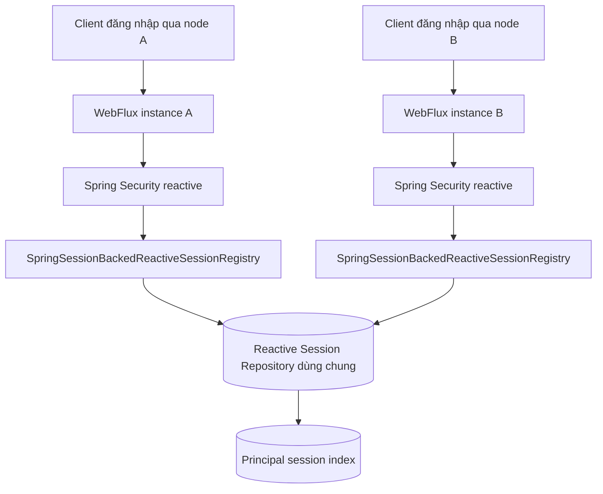

# SpringSessionBackedReactiveSessionRegistry và khả năng theo phiên bản

Trong ứng dụng Spring WebFlux, Spring Security có thể giới hạn số phiên đăng nhập đồng thời của mỗi người dùng. Để áp dụng giới hạn này trên nhiều instance, registry theo dõi phiên phải đọc được trạng thái từ kho dùng chung. `SpringSessionBackedReactiveSessionRegistry` kết nối Spring Security reactive concurrent session control với dữ liệu phiên do Spring Session quản lý, thay vì chỉ giữ danh sách session trong bộ nhớ của một node.

Khả năng này phụ thuộc phiên bản. `SpringSessionBackedReactiveSessionRegistry` và `ReactiveFindByIndexNameSessionRepository` được giới thiệu trong Spring Session 3.3.0; `ReactiveSessionRegistry` và reactive concurrent session control của Spring Security có từ Spring Security 6.3. Dự án cũ hơn có thể vẫn dùng WebSession và Redis reactive bình thường, nhưng chưa có bộ API indexed/registry này. Cần kiểm tra bộ phiên bản Spring Boot, Spring Security và Spring Session đang chạy trước khi áp dụng cấu hình.

## 1. Vì sao cần registry dùng chung?

Spring Security cần biết người dùng hiện có bao nhiêu phiên để thực thi chính sách như tối đa một hoặc hai phiên đăng nhập. `ReactiveSessionRegistry` là abstraction lưu và truy vấn thông tin các phiên đã xác thực. Các thao tác chính gồm:

- `getAllSessions(principal)`: lấy các phiên của một principal.
- `getSessionInformation(sessionId)`: lấy thông tin của một phiên.
- `saveSessionInformation(information)`: lưu thông tin phiên sau xác thực.
- `updateLastAccessTime(sessionId)`: cập nhật lần truy cập gần nhất.
- `removeSessionInformation(sessionId)`: loại bỏ thông tin phiên khỏi registry.

Spring Security cung cấp `InMemoryReactiveSessionRegistry`. Registry này phù hợp với ứng dụng đơn instance hoặc môi trường kiểm thử đơn giản, nhưng trạng thái nằm trong bộ nhớ của tiến trình. Nếu cụm có hai instance A và B, mỗi node có một registry riêng, A không nhất thiết biết phiên được đăng ký tại B. Khi người dùng đăng nhập qua nhiều node, giới hạn phiên có thể bị áp dụng không nhất quán.

`SpringSessionBackedReactiveSessionRegistry` lấy thông tin từ Spring Session repository. Nếu các instance dùng cùng một repository reactive và cùng principal index, mỗi node có thể truy vấn phiên đã được node khác tạo. Trong cấu hình Redis phổ biến, repository đó là `ReactiveRedisIndexedSessionRepository`. Đây là cơ sở để thực thi concurrent session control trong môi trường clustered.



Registry không tạo ra kho dữ liệu mới. Nó sử dụng repository và index do Spring Session cung cấp. Vì vậy, chất lượng của principal index, tính nhất quán cấu hình và khả năng truy cập Redis/JDBC ảnh hưởng trực tiếp đến việc giới hạn phiên.

## 2. Ranh giới phiên bản

Cần đồng thời có API phía Spring Session và API phía Spring Security:

| Thành phần | Phiên bản bắt đầu hỗ trợ | Vai trò |
|---|---:|---|
| `ReactiveFindByIndexNameSessionRepository` | Spring Session 3.3.0 | Tra cứu session theo index name/value, bao gồm principal name |
| `SpringSessionBackedReactiveSessionRegistry` | Spring Session 3.3.0 | Adapter `ReactiveSessionRegistry` dựa trên Spring Session |
| `ReactiveSessionRegistry` | Spring Security 6.3 | Hợp đồng registry cho reactive concurrent session control |
| Reactive concurrent session DSL | Spring Security 6.3 | Cấu hình giới hạn số phiên và cách xử lý khi vượt giới hạn |

Spring Session 3.2.x trở xuống có thể cung cấp `ReactiveSessionRepository` và `ReactiveRedisSessionRepository`, nhưng chưa có `ReactiveFindByIndexNameSessionRepository` hoặc `SpringSessionBackedReactiveSessionRegistry`. Spring Security 6.2.x trở xuống chưa có reactive registry/concurrent session control tương ứng.

Spring Boot 3.3 là mốc phổ biến đưa Spring Session 3.3 và Spring Security 6.3 vào bộ dependency được quản lý. Với các dòng Boot mới hơn, để BOM quản lý phiên bản tương thích giữa Spring Framework, Spring Security, Spring Session và Spring Data Redis. Không chỉ nâng riêng một JAR Spring Session trong ứng dụng Boot cũ rồi bỏ qua các dependency liên quan.

Nếu build báo không tìm thấy `SpringSessionBackedReactiveSessionRegistry`, `ReactiveFindByIndexNameSessionRepository` hoặc `ReactiveSessionRegistry`, trước hết kiểm tra dependency thực tế. Đây có thể là lỗi version alignment chứ không phải sai package hoặc thiếu import.

## 3. Phân biệt registry reactive với registry Servlet

Spring Session có hai tích hợp concurrent session control riêng cho hai mô hình ứng dụng:

| Mục đích | WebFlux reactive | Servlet đồng bộ |
|---|---|---|
| Registry | `SpringSessionBackedReactiveSessionRegistry` | `SpringSessionBackedSessionRegistry` |
| Hợp đồng Spring Security | `ReactiveSessionRegistry` | `SessionRegistry` |
| Repository index | `ReactiveFindByIndexNameSessionRepository` | `FindByIndexNameSessionRepository` |
| Repository session | `ReactiveSessionRepository` | `SessionRepository` |
| API session | `WebSession` | `HttpSession` |
| Kiểu xử lý | `Mono`/`Flux` | Đồng bộ |

Không dùng `SpringSessionBackedSessionRegistry` đồng bộ trong WebFlux rồi gọi `block()` để biến nó thành reactive. Cũng không dùng `SpringSessionBackedReactiveSessionRegistry` cho `HttpSession`/`SessionRegistry` của Servlet. Chọn đúng loại theo application stack.

## 4. Dependency và bộ phiên bản

Với Spring Boot dependency management, khai báo các starter cần thiết và để BOM chọn các phiên bản tương thích:

```groovy
dependencies {
    implementation("org.springframework.boot:spring-boot-starter-webflux")
    implementation("org.springframework.boot:spring-boot-starter-security")
    implementation("org.springframework.boot:spring-boot-starter-data-redis-reactive")
    implementation("org.springframework.session:spring-session-data-redis")
}
```

Đây là cấu hình minh họa cho WebFlux + reactive Redis. Không khai báo phiên bản riêng cho từng module Spring Session nếu Boot BOM đã quản lý. Sau khi build, kiểm tra dependency runtime thực tế:

```bash
./gradlew dependencyInsight \
  --dependency spring-session-data-redis \
  --configuration runtimeClasspath

./gradlew dependencyInsight \
  --dependency spring-security-web \
  --configuration runtimeClasspath
```

Nếu dùng Maven, xem `mvn dependency:tree` với các group/artifact tương ứng. Việc kiểm tra runtimeClasspath quan trọng hơn chỉ đọc phiên bản trong build file vì dependency mediation hoặc plugin có thể chọn một phiên bản khác.

## 5. Điều kiện repository có index principal

Constructor của `SpringSessionBackedReactiveSessionRegistry` nhận hai dependency:

```java
SpringSessionBackedReactiveSessionRegistry(
        ReactiveSessionRepository<S> sessionRepository,
        ReactiveFindByIndexNameSessionRepository<S> indexedSessionRepository)
```

Repository thứ nhất dùng để tìm session theo ID và thực hiện các thao tác vòng đời. Repository thứ hai dùng để tra cứu các session thuộc principal. Chỉ có `ReactiveSessionRepository` là chưa đủ, vì nó không cung cấp truy vấn theo người dùng.

Trong Spring Session Redis 3.3 trở lên, `ReactiveRedisIndexedSessionRepository` triển khai cả hai interface. Có thể cấu hình bằng `@EnableRedisIndexedWebSession`:

```java
import org.springframework.context.annotation.Configuration;
import org.springframework.session.data.redis.config.annotation.web.server.EnableRedisIndexedWebSession;

@Configuration(proxyBeanMethods = false)
@EnableRedisIndexedWebSession(maxInactiveIntervalInSeconds = 1800)
public class ReactiveSessionConfiguration {
}
```

Ứng dụng cần reactive Redis connection factory và dependency tương thích. Namespace, timeout, serializer và cấu hình Redis phải giống nhau trên mọi instance trong cùng cụm. Nếu dùng một repository reactive khác, implementation đó cũng phải cung cấp khả năng index theo principal.

## 6. Khai báo SpringSessionBackedReactiveSessionRegistry

Đăng ký registry dưới dạng bean để Spring Security sử dụng:

```java
import org.springframework.context.annotation.Bean;
import org.springframework.context.annotation.Configuration;
import org.springframework.session.Session;
import org.springframework.session.ReactiveFindByIndexNameSessionRepository;
import org.springframework.session.ReactiveSessionRepository;
import org.springframework.session.security.SpringSessionBackedReactiveSessionRegistry;

@Configuration(proxyBeanMethods = false)
public class ReactiveSessionRegistryConfiguration {

    @Bean
    public <S extends Session> SpringSessionBackedReactiveSessionRegistry<S>
            springSessionBackedReactiveSessionRegistry(
                    ReactiveSessionRepository<S> sessionRepository,
                    ReactiveFindByIndexNameSessionRepository<S> indexedSessionRepository) {
        return new SpringSessionBackedReactiveSessionRegistry<>(
                sessionRepository, indexedSessionRepository);
    }
}
```

Hai tham số constructor đều cần thiết. `sessionRepository` hỗ trợ truy cập session theo ID; `indexedSessionRepository` hỗ trợ tra cứu theo principal. Với cấu hình Redis indexed, cùng một bean repository thường đáp ứng cả hai interface.

Nếu ứng dụng tự khai báo repository hoặc có nhiều repository bean, cần kiểm tra bean nào được inject vào registry. Không vô tình nối registry với repository cục bộ trong khi WebSessionManager đang dùng một repository Redis khác. Một registry dùng sai repository có thể không nhìn thấy session thực tế của request.

## 7. Kết nối registry vào Spring Security WebFlux

Spring Security reactive cấu hình concurrent session control qua `ServerHttpSecurity.sessionManagement`. Ví dụ giới hạn mỗi người dùng một phiên và chỉ định registry Spring Session-backed:

```java
import org.springframework.context.annotation.Bean;
import org.springframework.context.annotation.Configuration;
import org.springframework.security.config.Customizer;
import org.springframework.security.config.web.server.ServerHttpSecurity;
import org.springframework.security.core.session.ReactiveSessionRegistry;
import org.springframework.security.web.server.SecurityWebFilterChain;
import org.springframework.security.web.server.authentication.SessionLimit;

@Configuration(proxyBeanMethods = false)
public class SecurityConfiguration {

    @Bean
    SecurityWebFilterChain springSecurityFilterChain(
            ServerHttpSecurity http,
            ReactiveSessionRegistry sessionRegistry) {

        return http
                .authorizeExchange(exchanges -> exchanges
                        .anyExchange().authenticated())
                .formLogin(Customizer.withDefaults())
                .sessionManagement(sessions -> sessions
                        .concurrentSessions(concurrency -> concurrency
                                .maximumSessions(SessionLimit.of(1))
                                .sessionRegistry(sessionRegistry)))
                .build();
    }
}
```

Đoạn code thể hiện cách cấu hình theo API Spring Security 6.3 trở lên. Nếu dự án dùng một phiên bản Security khác, đối chiếu DSL và import theo Javadoc của đúng phiên bản. Có thể cung cấp registry bằng bean `ReactiveSessionRegistry` hoặc chỉ định trực tiếp qua `sessionRegistry(...)` trong DSL.

Khi bật concurrent session control, Spring Security theo dõi các lần xác thực thành công và đăng ký session information. Với cấu hình mặc định, Spring Security tích hợp vào các authentication mechanism như form login, OAuth 2.0 login và HTTP Basic. Nếu ứng dụng tự cấu hình `ServerAuthenticationSuccessHandler`, cần chú ý cách đăng ký handler để không vô tình thay thế các handler kiểm soát và đăng ký phiên mà DSL đã thêm.

## 8. Chính sách khi vượt số phiên tối đa

Mặc định Spring Security cho phép số phiên không giới hạn nếu chưa cấu hình `maximumSessions`. Khi đặt giới hạn, ví dụ `SessionLimit.of(1)`, lần đăng nhập mới được so sánh với các phiên đã biết của principal.

Khi số phiên vượt giới hạn, hành vi mặc định là hết hạn phiên ít được sử dụng gần đây nhất (least recently used) cho đến khi đạt giới hạn. Có thể chọn chính sách khác, ví dụ từ chối đăng nhập mới để giữ nguyên các phiên đang hoạt động. Spring Security cung cấp handler tương ứng và cho phép triển khai `ServerMaximumSessionsExceededHandler` riêng theo nhu cầu.

| Chính sách | Hành vi | Trường hợp phù hợp |
|---|---|---|
| Invalidate phiên ít được dùng gần đây nhất | Cho phép đăng nhập mới và làm hết hạn phiên cũ | Ưu tiên thiết bị vừa đăng nhập; chấp nhận thiết bị cũ bị đăng xuất |
| Ngăn đăng nhập mới | Giữ các phiên hiện có và từ chối lần đăng nhập vượt giới hạn | Ưu tiên không làm gián đoạn phiên hiện tại |
| Handler tùy chỉnh | Áp dụng quy tắc riêng như thông báo, phân loại thiết bị hoặc kiểm tra rủi ro | Có yêu cầu nghiệp vụ riêng |

Không nhầm việc hết hạn session với việc thu hồi session tại một Identity Provider bên ngoài. Spring Security concurrent session control quản lý session của ứng dụng; nếu cần đăng xuất cả phiên ở nhà cung cấp OAuth2/OIDC, phải triển khai thêm quy trình gọi endpoint/revocation phù hợp của nhà cung cấp.

## 9. Giới hạn phiên theo Authentication

`SessionLimit` có thể được cung cấp dưới dạng hàm nhận `Authentication` và trả `Mono<Integer>`. Nhờ đó, ứng dụng có thể áp dụng giới hạn khác nhau theo authority hoặc loại tài khoản:

```java
private SessionLimit sessionLimit() {
    return authentication -> {
        boolean unlimited = authentication.getAuthorities().stream()
                .anyMatch(authority -> authority.getAuthority()
                        .equals("ROLE_UNLIMITED_SESSIONS"));
        if (unlimited) {
            return Mono.empty();
        }

        boolean admin = authentication.getAuthorities().stream()
                .anyMatch(authority -> authority.getAuthority()
                        .equals("ROLE_ADMIN"));
        return Mono.just(admin ? 2 : 1);
    };
}
```

Trong API này, `Mono.empty()` biểu thị không giới hạn; `Mono.just(2)` cho phép hai phiên; `Mono.just(1)` cho phép một phiên. Các authority phải đến từ `Authentication` đã được xác thực, không lấy từ role hoặc cờ do client gửi.

Gắn chính sách vào DSL:

```java
.sessionManagement(sessions -> sessions
        .concurrentSessions(concurrency -> concurrency
                .maximumSessions(sessionLimit())
                .sessionRegistry(sessionRegistry)))
```

Không nên cấp không giới hạn cho nhóm người dùng rộng chỉ để tránh support ticket về đăng xuất. Xác định chính sách theo rủi ro, loại tài khoản và nhu cầu thiết bị; ghi lại lý do và kiểm thử cả các nhánh giới hạn.

## 10. Principal phải khớp giữa Authentication và index

`SpringSessionBackedReactiveSessionRegistry` cần chuyển principal nhận từ Spring Security thành một chuỗi có thể so khớp với giá trị được Spring Session index. Vì vậy, representation của principal phải nhất quán.

`ReactiveFindByIndexNameSessionRepository` cung cấp:

```java
Mono<Map<String, S>> findByPrincipalName(String principalName);
```

Phương thức này là shortcut cho `findByIndexNameAndIndexValue` với `PRINCIPAL_NAME_INDEX_NAME`. Spring Session không biết mọi cơ chế xác thực của ứng dụng; trách nhiệm bảo đảm index được populate thuộc về ứng dụng và `IndexResolver`.

Với cấu hình Spring Security chuẩn, `PrincipalNameIndexResolver` có thể đọc principal từ `SecurityContext` được lưu trong session. Với custom authentication hoặc cách lưu context khác, cần xác minh resolver nhận diện được principal name. Có thể đặt thuộc tính index tường minh sau khi xác thực:

```java
session.getAttributes().put(
        ReactiveFindByIndexNameSessionRepository.PRINCIPAL_NAME_INDEX_NAME,
        authentication.getName()
);
```

Đoạn code là minh họa cho việc populate principal index trong session; vị trí thực hiện phải nằm trong luồng xác thực đã tin cậy và trước khi session được lưu. Không nhận giá trị index từ request body hoặc header do client tự khai báo.

Nếu `Authentication.getName()` trả `alice@example.com` nhưng index lưu `alice`, registry có thể không tìm thấy phiên dù session tồn tại. Chuẩn hóa principal name nhất quán, chú ý phân biệt chữ hoa/thường và thay đổi username. Nếu username có thể đổi, cần chính sách chuyển index/thu hồi phiên để tránh session bị bỏ sót.

## 11. Registry lưu gì và lấy thông tin từ đâu?

`SpringSessionBackedReactiveSessionRegistry` triển khai `ReactiveSessionRegistry` và truy vấn dữ liệu session từ Spring Session thay vì giữ toàn bộ danh sách trong map cục bộ. Các API của nó trả về kiểu reactive:

| API | Kiểu kết quả | Ý nghĩa |
|---|---|---|
| `getAllSessions(principal)` | `Flux<ReactiveSessionInformation>` | Các phiên của principal |
| `getSessionInformation(sessionId)` | `Mono<ReactiveSessionInformation>` | Thông tin một phiên |
| `saveSessionInformation(information)` | `Mono<Void>` | Lưu thông tin registry |
| `updateLastAccessTime(sessionId)` | `Mono<ReactiveSessionInformation>` | Cập nhật lần truy cập |
| `removeSessionInformation(sessionId)` | `Mono<ReactiveSessionInformation>` | Xóa thông tin registry |

Registry dựa vào repository để tìm phiên; do đó, nó chia sẻ trạng thái với các instance khác dùng cùng kho. Không nên thêm một map static hoặc local cache để tự quản lý danh sách phiên song song, vì các nguồn trạng thái có thể lệch nhau.

## 12. Chủ động thu hồi các phiên của một người dùng

Ngoài giới hạn khi đăng nhập, ứng dụng có thể cần thu hồi tất cả phiên khi đổi mật khẩu, khóa tài khoản hoặc người dùng yêu cầu đăng xuất mọi thiết bị. Spring Security cho phép dùng `ReactiveSessionRegistry` kết hợp `WebSessionStore`:

```java
public Mono<Void> invalidateSessions(String username) {
    return reactiveSessionRegistry.getAllSessions(username)
            .flatMap(information ->
                    information.invalidate().thenReturn(information))
            .flatMap(information ->
                    webSessionStore.removeSession(information.getSessionId()))
            .then();
}
```

Đây là luồng reactive: lấy các session information, invalidate từng session, loại session khỏi WebSessionStore rồi hoàn tất. Tên và kiểu bean cần khớp Spring Security/WebFlux version của ứng dụng.

Endpoint thu hồi phải xác thực quyền của caller. Người dùng thông thường chỉ được thu hồi phiên của chính họ; quản trị viên có thể có quyền thu hồi phiên của người khác theo policy. Ghi audit lý do và kết quả nhưng không ghi session ID dạng rõ hoặc cookie.

Với thao tác nhạy cảm như đổi mật khẩu, nên kết hợp thu hồi với một version credential/session hoặc trạng thái tài khoản được kiểm tra ở request sau. Một request đang chạy có thể đã khôi phục session trước khi thao tác thu hồi hoàn tất; repository registry không tự hủy mọi request đang thực thi.

## 13. Custom AuthenticationSuccessHandler có thể làm mất concurrent control

Reactive concurrent session control được gắn vào các success handler của authentication filter. Spring Security thêm handler kiểm tra giới hạn và handler đăng ký phiên vào danh sách handler mặc định.

Nếu cấu hình trực tiếp một `ServerAuthenticationSuccessHandler` mới cho form login hoặc authentication filter, ứng dụng có thể thay thế danh sách handler mặc định và vô tình bỏ qua concurrent session control. Khi cần chạy thêm logic sau đăng nhập, dùng API cho phép bổ sung handler vào danh sách hiện có, hoặc phối hợp rõ ràng các handler kiểm tra/đăng ký phiên.

Sau khi tùy chỉnh success handler, kiểm thử rằng:

- Đăng nhập đầu tiên tạo và đăng ký session information.
- Đăng nhập vượt giới hạn kích hoạt đúng exceeded handler.
- Custom redirect/response vẫn chạy.
- Request tiếp theo có thể khôi phục WebSession và Authentication.

Đừng kết luận registry lỗi khi thực tế success handler không gọi logic đăng ký phiên.

## 14. Khác biệt giữa số phiên và số thiết bị

Concurrent session control đếm các WebSession gắn với principal, không trực tiếp đếm thiết bị vật lý. Hai tab trong cùng browser profile thường chia sẻ cùng cookie và do đó dùng chung một WebSession. Một browser profile khác, trình duyệt khác hoặc thiết bị khác thường tạo một session riêng.

Nếu nghiệp vụ cần danh sách thiết bị, session registry chỉ cung cấp nền tảng tìm các phiên. Ứng dụng cần lưu metadata thiết bị ở mức tối thiểu như nhãn do người dùng đặt, thời điểm đăng nhập, loại client hoặc thông tin nhận diện đã được làm sạch. Không coi User-Agent là định danh thiết bị chắc chắn và không lưu fingerprint quá mức cần thiết.

Đừng lưu thông tin thiết bị nhạy cảm hoặc bí mật trong principal index. Index nên giữ khóa tra cứu ổn định; dữ liệu hiển thị thiết bị có thể là thuộc tính riêng có chính sách retention và quyền truy cập.

## 15. Đồng thời và giới hạn bảo đảm

Registry dùng chung giúp các node tra cứu cùng dữ liệu, nhưng không nên giả định toàn bộ quy trình “đếm phiên rồi tạo phiên mới” là một transaction nguyên tử duy nhất. Hai lần đăng nhập đồng thời có thể cùng kiểm tra số phiên trước khi lần còn lại được ghi đầy đủ. Hành vi chính xác phụ thuộc Spring Security version, repository, timing của authentication success handlers và backend.

Nếu giới hạn phiên là một quy tắc bảo mật nghiêm ngặt, hãy kiểm thử race condition bằng nhiều request đăng nhập đồng thời từ các instance khác nhau. Xác nhận số phiên cuối cùng, exceeded handler, session bị hết hạn và trạng thái registry. Nếu cần đảm bảo cứng hơn, có thể cần cơ chế điều phối/atomic admission riêng theo principal, nhưng phải thiết kế cùng vòng đời session và tránh tạo một lock phân tán không có timeout hoặc cơ chế phục hồi.

`ReactiveSessionRegistry` cũng không thu hồi session ở Identity Provider bên ngoài. Với OAuth2 Login, việc hết hạn WebSession của ứng dụng không tự động kết thúc phiên tại nhà cung cấp danh tính. Nếu cần đăng xuất liên kết, triển khai thêm `ServerMaximumSessionsExceededHandler` hoặc logout flow tích hợp với nhà cung cấp.

## 16. Kiểm thử theo phiên bản và nhiều instance

Kiểm thử phải xác nhận cả compile-time API lẫn hành vi runtime:

| Kịch bản | Cách kiểm thử | Kết quả cần xác nhận |
|---|---|---|
| Phiên bản cũ | Build với Spring Session 3.2.x/Security 6.2.x | API registry reactive mới không có; cấu hình phải không tham chiếu class mới |
| Phiên bản hỗ trợ | Build với Spring Session 3.3+ và Security 6.3+ tương thích | Có thể tạo registry và cấu hình concurrent sessions |
| Principal index | Đăng nhập một user và gọi `findByPrincipalName` | Index trả đúng session ID |
| Giới hạn một phiên | Đăng nhập cùng user từ hai client | Phiên cũ bị expire hoặc login mới bị chặn theo handler |
| Giới hạn theo role | Dùng hai Authentication có authority khác nhau | Mỗi principal nhận đúng `SessionLimit` |
| Hai instance | Đăng nhập lần đầu qua A, lần tiếp theo qua B | B nhìn thấy phiên của A và áp dụng giới hạn |
| Custom success handler | Bổ sung handler tùy chỉnh | Cả kiểm tra giới hạn và đăng ký phiên vẫn chạy |
| Thu hồi thủ công | Gọi endpoint logout all sessions | Các WebSession được invalidate và không khôi phục được |
| Principal đổi tên | Đổi username hoặc representation | Index và registry không để lại phiên không thể tra cứu |
| Login đồng thời | Gửi nhiều yêu cầu xác thực cùng principal | Ghi nhận race và xác nhận policy cuối cùng |
| Redis unavailable | Ngắt Redis trong lúc kiểm tra/đăng nhập | Lỗi hạ tầng được xử lý rõ, không giả thành không có phiên |
| OAuth2 IdP session | Vượt giới hạn ứng dụng | Xác nhận logout IdP có/không được thực hiện theo thiết kế |

Với test HTTP, dùng `WebTestClient` để đăng nhập, giữ cookie từ response và gửi request tiếp theo. Dùng Redis test cùng loại cấu hình với production và hai application context/instance cùng trỏ đến namespace. Dùng `StepVerifier` khi kiểm tra publisher registry hoặc service reactive.

Không chỉ test một node và một lần đăng nhập. Test xuyên node là bằng chứng quan trọng nhất để chứng minh registry đang đọc kho dùng chung thay vì trạng thái local. Không dùng mock `ReactiveSessionRegistry` để kết luận Redis index hoặc failover hoạt động.

## 17. Chẩn đoán lỗi thường gặp

| Triệu chứng | Nguyên nhân có thể | Hướng kiểm tra |
|---|---|---|
| Không tìm thấy `SpringSessionBackedReactiveSessionRegistry` | Spring Session dưới 3.3 hoặc dependency bị override | Kiểm tra dependency tree/BOM và version runtime |
| Không tìm thấy `ReactiveSessionRegistry` | Spring Security dưới 6.3 | Nâng theo dòng Boot tương thích |
| Không inject được indexed repository | Đang dùng `@EnableRedisWebSession` hoặc repository cơ bản | Dùng indexed repository hỗ trợ `ReactiveFindByIndexNameSessionRepository` |
| Đăng nhập nhiều node vượt giới hạn | Đang dùng `InMemoryReactiveSessionRegistry` hoặc repository/namespace khác nhau | Xác nhận registry bean, Redis endpoint và namespace |
| Principal lookup trả rỗng | Index chưa được populate hoặc tên principal không khớp | Kiểm tra `IndexResolver`, `Authentication.getName()` và session attributes |
| Login lần hai không bị kiểm soát | Custom success handler thay thế handler mặc định | Kiểm tra handler registration trong authentication filter |
| Một browser mở nhiều tab bị tính nhiều phiên | Client hoặc cấu hình cookie tạo nhiều session ID | Kiểm tra cookie path/domain và luồng tạo session |
| Phiên cũ vẫn truy cập được sau khi vượt giới hạn | Session chưa được invalidate/expire hoặc request đã bắt đầu trước đó | Kiểm tra repository và exceeded handler; test request đang chạy |
| Logout app nhưng IdP vẫn còn phiên | Registry chỉ quản lý WebSession của ứng dụng | Thêm logout/revocation với IdP nếu cần |
| Hành vi không ổn định khi login đồng thời | Race giữa truy vấn registry và đăng ký session | Chạy test concurrent login và đánh giá cơ chế admission |

Khi điều tra, ghi lại Spring Boot, Spring Session, Spring Security, loại repository, principal index resolver, instance, namespace và mã tương quan. Không ghi cookie hoặc session ID dạng rõ vào log.

## 18. Checklist triển khai

- [ ] Spring Session 3.3.0 trở lên.
- [ ] Spring Security 6.3 trở lên và tương thích với Spring Boot đang dùng.
- [ ] Dùng WebFlux và reactive Redis repository hoặc một reactive repository tương thích.
- [ ] Repository triển khai cả `ReactiveSessionRepository` và `ReactiveFindByIndexNameSessionRepository`.
- [ ] Principal index được populate từ danh tính đã xác thực.
- [ ] `SpringSessionBackedReactiveSessionRegistry` nhận đúng hai repository interface.
- [ ] `SecurityWebFilterChain` cấu hình `maximumSessions` và registry này.
- [ ] Exceeded handler phù hợp với chính sách sản phẩm.
- [ ] Custom authentication success handler không vô tình bỏ qua kiểm tra/đăng ký phiên.
- [ ] Mọi instance dùng cùng repository, namespace, serializer và resolver.
- [ ] Kiểm thử login xuyên node, login đồng thời, logout all sessions và Redis outage.
- [ ] Có chính sách riêng cho phiên ở Identity Provider nếu dùng OAuth2/OIDC.

## 19. Tài liệu phiên bản cần đối chiếu

- [Spring Session – Common Configurations: ReactiveSessionRegistry integration](https://docs.spring.io/spring-session/reference/configuration/common.html)
- [SpringSessionBackedReactiveSessionRegistry – API Spring Session 3.4](https://docs.spring.io/spring-session/reference/3.4/api/java/org/springframework/session/security/SpringSessionBackedReactiveSessionRegistry.html)
- [ReactiveFindByIndexNameSessionRepository – API Spring Session 3.4](https://docs.spring.io/spring-session/docs/3.4.6/api/org/springframework/session/ReactiveFindByIndexNameSessionRepository.html)
- [Spring Security – Reactive Concurrent Sessions Control](https://docs.spring.io/spring-security/reference/reactive/authentication/concurrent-sessions-control.html)
- [ReactiveSessionRegistry – API Spring Security 6.3](https://docs.spring.io/spring-security/site/docs/6.3.x/api/org/springframework/security/core/session/ReactiveSessionRegistry.html)

`SpringSessionBackedReactiveSessionRegistry` kết nối reactive concurrent session control với dữ liệu session dùng chung, giúp Spring Security nhìn thấy các phiên được tạo ở những instance khác nhau. Muốn dùng tính năng này, dự án cần Spring Session 3.3.0 trở lên, Spring Security 6.3 trở lên, repository có principal index và cấu hình `SecurityWebFilterChain` phù hợp. Registry là nền tảng tra cứu; chính sách giới hạn, cách xử lý phiên vượt ngưỡng, index principal, race khi đăng nhập đồng thời và logout tại Identity Provider vẫn cần được thiết kế và kiểm thử theo yêu cầu ứng dụng.
