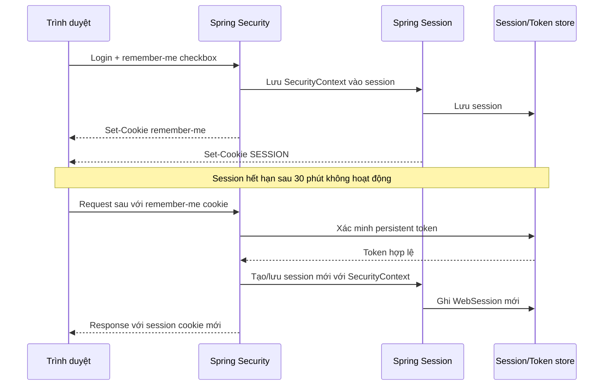

# Phối hợp remember-me với DefaultCookieSerializer được tùy chỉnh

Trong ứng dụng Servlet dùng Spring Session và Spring Security, trình duyệt có thể giữ hai loại cookie khác nhau: cookie chứa session ID do Spring Session quản lý và cookie remember-me do Spring Security phát hành. Hai cookie có thể cùng xuất hiện trên một request, nhưng chúng có mục đích, thời hạn và cơ chế xác minh riêng.

`DefaultCookieSerializer` chỉ định cách Spring Session đọc và ghi cookie mang session ID, thường có tên `SESSION`. Nó không định dạng, xác minh hoặc gia hạn cookie remember-me. Cookie remember-me được quản lý bởi `RememberMeServices` của Spring Security. Khi tùy chỉnh cookie session, cần giữ hai cơ chế tách biệt và cấu hình chúng phối hợp về domain, path, HTTPS, HttpOnly, SameSite, thời hạn và đăng xuất.

## 1. Hai cookie, hai trách nhiệm

| Cookie | Thành phần quản lý | Giá trị chứa | Vai trò |
|---|---|---|---|
| `SESSION` (hoặc `JSESSIONID` nếu đã cấu hình tên này) | Spring Session qua `CookieSerializer` | Session ID opaque | Khôi phục session phía server, bao gồm SecurityContext và các attributes |
| `remember-me` (tên mặc định thường gặp) | Spring Security `RememberMeServices` | Token remember-me | Tự động xác thực lại người dùng khi session hiện tại không còn trạng thái xác thực |

Cookie session là chìa khóa tra cứu một Web/HTTP session phía server. Cookie remember-me là credential có thể cho phép tạo lại trạng thái xác thực sau khi session hết hạn. Vì vậy, remember-me thường có thời hạn dài hơn session cookie và cần được bảo vệ như một bí mật xác thực.

Ví dụ response có thể chứa hai header riêng:

```http
Set-Cookie: SESSION=opaque-session-id; Path=/; Secure; HttpOnly; SameSite=Lax
Set-Cookie: remember-me=series-and-token; Path=/; Max-Age=1209600; Secure; HttpOnly; SameSite=Lax
```

Giá trị trên chỉ minh họa. Định dạng token phụ thuộc loại `RememberMeServices`; không tự tạo token bằng cách ghép chuỗi theo ví dụ. Hai cookie có thể dùng cùng host và path nhưng vẫn là hai cookie độc lập vì tên khác nhau.

## 2. DefaultCookieSerializer quản lý cookie session

Spring Session dùng `CookieHttpSessionIdResolver` kết hợp `CookieSerializer` để trao đổi session ID qua HTTP. `DefaultCookieSerializer` là implementation phổ biến. Các thuộc tính thường được tùy chỉnh gồm:

- Tên cookie, ví dụ `SESSION`.
- `Path` và `Domain`.
- `Secure` để chỉ gửi qua HTTPS.
- `HttpOnly` để JavaScript không đọc trực tiếp cookie.
- `SameSite` để kiểm soát một số ngữ cảnh cross-site.
- `Max-Age` nếu muốn trình duyệt lưu cookie qua lần đóng/mở trình duyệt.

Ví dụ cấu hình cookie session:

```java
@Configuration
class SessionCookieConfiguration {

    @Bean
    CookieSerializer cookieSerializer() {
        DefaultCookieSerializer serializer = new DefaultCookieSerializer();
        serializer.setCookieName("SESSION");
        serializer.setCookiePath("/");
        serializer.setUseHttpOnlyCookie(true);
        serializer.setUseSecureCookie(true);
        serializer.setSameSite("Lax");
        return serializer;
    }
}
```

Bean này được Spring Session dùng để đọc và ghi cookie chứa session ID. Nó không thay đổi tên cookie remember-me và cũng không thay đổi thời gian hiệu lực của token remember-me.

Trong production chạy HTTPS, bật `Secure`. Nếu TLS kết thúc ở reverse proxy, cấu hình forwarded headers và chỉ tin proxy được kiểm soát để ứng dụng nhận diện đúng scheme bên ngoài. Nếu ứng dụng không nhận biết request gốc là HTTPS, cookie serializer có thể đánh giá sai việc thêm thuộc tính Secure khi dùng chế độ tự xác định.

`Path=/` cho phép cookie được gửi tới mọi đường dẫn trên host. Nếu cùng host có nhiều ứng dụng độc lập, cân nhắc giới hạn path theo context path để tránh cookie bị gửi rộng hơn cần thiết. Chỉ đặt domain chung cho nhiều subdomain khi thực sự cần chia sẻ cookie và đã đánh giá phạm vi tin cậy.

## 3. Remember-me cookie do Spring Security quản lý

Spring Security cung cấp cơ chế remember-me cho ứng dụng Servlet. Khi người dùng đăng nhập và chọn tùy chọn “remember me”, `RememberMeServices` phát một cookie riêng. Ở request sau, nếu SecurityContext chưa có Authentication, filter remember-me có thể dùng cookie để xác thực lại người dùng.

Có hai cách triển khai phổ biến:

1. **Token-based remember-me:** cookie chứa thông tin định danh, thời hạn và chữ ký được tạo từ khóa bí mật cùng thông tin người dùng. Server xác minh chữ ký khi token được sử dụng.
2. **Persistent-token remember-me:** cookie chứa cặp `series` và `token`; server lưu token tương ứng trong `PersistentTokenRepository`, thường là JDBC. Token được luân chuyển khi sử dụng thành công, giúp phát hiện một số trường hợp token bị đánh cắp và phát lại.

Token-based đơn giản hơn về lưu trữ nhưng khó thu hồi riêng từng thiết bị trước khi token hết hạn nếu không bổ sung cơ chế quản lý. Persistent-token cần bảng lưu trữ và thao tác cập nhật, nhưng hỗ trợ thu hồi theo người dùng/series và phát hiện token reuse theo cơ chế của Spring Security.

Remember-me không phải session ID và không được Spring Session repository dùng để tìm WebSession. Khi remember-me xác thực thành công, Spring Security tạo Authentication cho request và có thể lưu SecurityContext vào session mới thông qua `SecurityContextRepository`.

## 4. Cấu hình remember-me với persistent token repository

Ví dụ cấu hình Spring Security Servlet dùng JDBC để lưu persistent remember-me token:

```java
@Configuration
class SecurityConfiguration {

    @Bean
    PersistentTokenRepository persistentTokenRepository(DataSource dataSource) {
        JdbcTokenRepositoryImpl repository = new JdbcTokenRepositoryImpl();
        repository.setDataSource(dataSource);
        return repository;
    }

    @Bean
    SecurityFilterChain securityFilterChain(
            HttpSecurity http,
            PersistentTokenRepository tokenRepository,
            UserDetailsService userDetailsService) throws Exception {

        http
            .authorizeHttpRequests(authorize -> authorize
                .requestMatchers("/login", "/assets/**").permitAll()
                .anyRequest().authenticated())
            .formLogin(Customizer.withDefaults())
            .rememberMe(remember -> remember
                .rememberMeParameter("remember-me")
                .rememberMeCookieName("remember-me")
                .tokenValiditySeconds(14 * 24 * 60 * 60)
                .tokenRepository(tokenRepository)
                .userDetailsService(userDetailsService)
                .useSecureCookie(true));

        return http.build();
    }
}
```

Đoạn mã minh họa cấu hình Servlet. Cần có `DataSource`, `UserDetailsService` và schema persistent login phù hợp với phiên bản Spring Security. Khi dùng `JdbcTokenRepositoryImpl`, bảng `persistent_logins` thường có các cột `username`, `series`, `token` và `last_used`; dùng schema script chính thức tương ứng hoặc migration do ứng dụng quản lý.

`rememberMeParameter` phải khớp với tên field checkbox trong form login. Nếu không chỉ định `alwaysRemember(true)`, người dùng thường phải gửi tham số remember-me khi đăng nhập để yêu cầu cookie dài hạn. `tokenValiditySeconds` là thời hạn remember-me token, không phải session timeout.

Trong ứng dụng có nhiều instance, các instance phải dùng chung persistent token repository và cùng cấu hình xác thực. Nếu dùng token-based remember-me, khóa ký cần được quản lý an toàn và thống nhất giữa các instance; không hard-code khóa bí mật vào source code.

## 5. DefaultCookieSerializer không cấu hình remember-me cookie

Đây là điểm cần nhớ khi tùy chỉnh cookie:

- `CookieSerializer` được Spring Session gọi khi đọc hoặc ghi session ID.
- `RememberMeServices` của Spring Security tạo, kiểm tra và xóa remember-me cookie.
- `tokenValiditySeconds` điều khiển thời hạn token remember-me ở phía Spring Security.
- Session timeout điều khiển thời gian không hoạt động tối đa của session phía server.

Ví dụ đổi tên cookie session:

```java
serializer.setCookieName("APP_SESSION");
```

Chỉ cookie session đổi thành `APP_SESSION`. Remember-me cookie vẫn có tên do Spring Security cấu hình, ví dụ `remember-me`. Ngược lại, đổi `.rememberMeCookieName("persistent-login")` chỉ đổi cookie remember-me; nó không đổi tên session cookie.

Nếu cần tùy chỉnh `Secure`, `HttpOnly`, `SameSite`, `Domain` hoặc `Path` cho remember-me cookie, cấu hình riêng trên `RememberMeServices`/implementation Spring Security đang sử dụng theo API của phiên bản dự án. Không giả định `DefaultCookieSerializer` sẽ áp dụng các thuộc tính đó cho mọi cookie response. Kiểm tra trực tiếp các header `Set-Cookie` của cả hai cookie trong integration test.

## 6. Thời hạn session và remember-me là hai đồng hồ khác nhau

Giả sử session timeout là 30 phút không hoạt động, còn remember-me token có thời hạn 14 ngày:

1. Người dùng đăng nhập và chọn remember-me.
2. Spring Security tạo remember-me cookie với thời hạn dài hơn.
3. Spring Session lưu SecurityContext vào session và phát cookie session.
4. Sau 30 phút không hoạt động, session hết hạn logic và không còn khôi phục được.
5. Trình duyệt vẫn có thể gửi remember-me cookie nếu token chưa hết hạn.
6. Spring Security xác minh remember-me token và xác thực lại người dùng.
7. Một SecurityContext mới được tạo; ứng dụng có thể lưu context vào WebSession mới và phát session ID mới.



Sơ đồ thể hiện ý tưởng tổng quát. Filter order và chi tiết tạo session phụ thuộc cấu hình Spring Security/Spring Session. Điều quan trọng là remember-me có thể tái xác thực sau khi session hết hạn, trong khi cookie session cũ không tự làm phiên sống lại.

## 7. Cookie Max-Age không thay thế server-side timeout

Cookie `Max-Age` điều khiển thời gian trình duyệt giữ cookie. Session timeout và remember-me token validity là thời hạn do server kiểm tra. Ba giá trị này có thể khác nhau:

| Thời hạn | Thành phần kiểm soát | Kết quả khi hết hạn |
|---|---|---|
| Session timeout | Spring Session/repository | Session không còn được khôi phục như phiên hợp lệ |
| Session cookie Max-Age | `DefaultCookieSerializer` | Trình duyệt ngừng lưu/gửi session ID theo thời hạn cookie |
| Remember-me token validity | Spring Security `RememberMeServices` | Remember-me credential không còn được chấp nhận |
| Remember-me cookie Max-Age | Spring Security cookie writer | Trình duyệt ngừng lưu/gửi remember-me token |

Không đặt `DefaultCookieSerializer.cookieMaxAge` bằng 14 ngày rồi kết luận người dùng đã có remember-me. Việc đó chỉ khiến trình duyệt giữ session ID lâu hơn; nếu session đã hết hạn hoặc bị xóa ở server, ID vẫn không khôi phục được session. Remember-me phải được cấu hình qua Spring Security.

Tương tự, cookie remember-me có thể còn trong trình duyệt sau khi token đã bị thu hồi hoặc hết hạn phía server. Mỗi request tự động đăng nhập vẫn phải được xác minh bởi `RememberMeServices` và `UserDetailsService`.

## 8. Filter order: Spring Session phải bọc request trước Spring Security

Trong ứng dụng Servlet, `SessionRepositoryFilter` của Spring Session cần chạy trước Spring Security filter chain. Nhờ vậy, khi Spring Security đọc hoặc ghi `HttpSession` để lưu `SecurityContext`, nó thao tác trên session được Spring Session quản lý thay vì session manager cục bộ của container.

Luồng khái quát:

1. `SessionRepositoryFilter` đọc session ID từ cookie `SESSION` hoặc tên đã cấu hình.
2. Filter bọc request/response để `HttpSession` đi qua Spring Session.
3. Spring Security filter chain tải SecurityContext từ session.
4. Nếu context chưa có và remember-me cookie hợp lệ, remember-me filter xác thực người dùng.
5. SecurityContext mới được lưu vào `HttpSession` đã được bọc.
6. Khi response hoàn tất, Spring Session lưu session và `DefaultCookieSerializer` xử lý session cookie.

Nếu filter order sai hoặc có filter chạy trước SessionRepositoryFilter tự gọi `request.getSession()`, container có thể tạo session native riêng. Dấu hiệu thường gặp là đồng thời có `JSESSIONID` và `SESSION`, hoặc SecurityContext được lưu vào session container thay vì kho Spring Session. Hãy kiểm tra thứ tự đăng ký filter và mọi thành phần truy cập session sớm.

Không đăng ký thêm một `SessionRepositoryFilter` thủ công nếu Spring Boot/Spring Session đã đăng ký filter tự động. Việc đăng ký trùng có thể tạo hai lớp quản lý session và gây hành vi khó dự đoán.

## 9. Đăng xuất phải xử lý cả session và remember-me

Đăng xuất hoàn chỉnh trong ứng dụng có remember-me cần xử lý các trạng thái sau:

- Xóa SecurityContext hiện tại.
- Invalidate session phía server để session ID cũ không còn khôi phục được.
- Xóa session cookie ở trình duyệt theo đúng tên, domain và path.
- Xóa remember-me cookie ở trình duyệt.
- Với persistent-token remember-me, thu hồi token lưu trong `PersistentTokenRepository` theo cơ chế Spring Security.

Khi dùng logout mặc định của Spring Security cùng remember-me config, logout filter phối hợp các handler để xóa trạng thái bảo mật và gọi `RememberMeServices` xóa cookie/token. Nếu thay thế logout handler hoặc viết endpoint logout riêng, phải kiểm tra rằng cả session lẫn remember-me token đều được thu hồi.

Logout nên dùng POST và giữ CSRF protection cho ứng dụng cookie-based. Không thiết kế endpoint GET có thể bị website khác kích hoạt để đăng xuất hoặc thay đổi trạng thái người dùng.

Ví dụ cấu hình logout mặc định:

```java
http
    .formLogin(Customizer.withDefaults())
    .rememberMe(remember -> remember
        .tokenRepository(tokenRepository)
        .userDetailsService(userDetailsService))
    .logout(logout -> logout
        .logoutUrl("/logout"));
```

Đây là cấu hình minh họa; khi dùng CSRF mặc định, client cần gửi CSRF token cho POST logout. Nếu ứng dụng có custom `LogoutHandler`, hãy kiểm thử repository token và response cookie sau logout.

## 10. Thu hồi remember-me khi tài khoản thay đổi

Remember-me là credential dài hạn, do đó cần chính sách thu hồi khi:

- Người dùng chủ động đăng xuất khỏi tất cả thiết bị.
- Mật khẩu được đổi hoặc reset.
- Tài khoản bị khóa, vô hiệu hóa hoặc nghi ngờ bị xâm nhập.
- Thiết bị bị mất hoặc token bị phát hiện sử dụng bất thường.
- Quản trị viên thu hồi toàn bộ phiên đăng nhập.

Với `PersistentTokenRepository`, ứng dụng có thể xóa token theo username bằng API phù hợp, ví dụ `removeUserTokens(username)`. Khi người dùng logout bình thường, persistent remember-me service cũng có thể thu hồi token theo người dùng đã xác thực. Với luồng đổi mật khẩu hoặc khóa tài khoản, hãy gọi cơ chế thu hồi tương ứng thay vì chỉ đổi session ID.

Với token-based remember-me, thay đổi password có thể làm chữ ký token cũ không còn hợp lệ nếu chữ ký được tạo từ password hiện tại; tuy nhiên, không nên dựa vào hành vi đó như chính sách thu hồi duy nhất cho mọi implementation. Cần kiểm tra loại `RememberMeServices`, key, user lookup và cách ứng dụng quản lý tài khoản.

## 11. Bảo vệ cookie session và remember-me

Cả session ID và remember-me token đều là bearer credentials. Kẻ có được giá trị còn hiệu lực có thể thử sử dụng phiên hoặc tự động đăng nhập. Cần bảo vệ cả hai cookie:

| Thuộc tính | Cookie session | Cookie remember-me |
|---|---|---|
| `Secure` | Bật khi production dùng HTTPS | Bật khi production dùng HTTPS |
| `HttpOnly` | Nên bật | Nên bật |
| `SameSite` | Chọn theo luồng ứng dụng và SSO | Chọn tương thích với luồng đăng nhập/SSO, đồng thời giảm cross-site exposure |
| `Domain` | Giới hạn trong host/subdomain cần thiết | Giới hạn độc lập theo phạm vi cần thiết |
| `Path` | Giới hạn theo ứng dụng nếu có thể | Đặt để cookie được gửi tới endpoint cần xử lý remember-me |
| Max-Age | Thường là session cookie trừ khi có yêu cầu khác | Theo token validity và chính sách remember-me |

`HttpOnly` ngăn JavaScript đọc cookie qua API trình duyệt nhưng không ngăn XSS thực hiện request thay mặt người dùng. `SameSite` giảm một số request cross-site nhưng không thay thế CSRF protection. HTTPS bảo vệ cookie trên đường truyền; nó không bảo vệ cookie khỏi malware hoặc extension độc hại trên thiết bị người dùng.

Không log giá trị cookie. Ở reverse proxy, API gateway và hệ thống tracing, cần che `Cookie` và `Set-Cookie` hoặc loại bỏ các header nhạy cảm khỏi log.

## 12. Domain và path phải tương thích giữa hai cookie

Cookie session và remember-me có thể có path/domain khác nhau. Nếu người dùng truy cập một ứng dụng dưới context path `/shop`, nhưng remember-me cookie chỉ được gửi tới `/login` hoặc session cookie bị giới hạn path khác, một số request có thể nhận được cookie này nhưng không nhận cookie kia.

Khi cấu hình nhiều subdomain:

- Chỉ dùng domain chung khi các subdomain nằm trong cùng ranh giới tin cậy.
- Tránh để cookie remember-me có domain rộng hơn cần thiết; token có giá trị xác thực lâu dài.
- Đảm bảo endpoint login, logout và các endpoint cần tự động xác thực nhận được remember-me cookie.
- Khi đổi path hoặc domain, phải xóa cookie cũ bằng đúng cặp name/domain/path đã dùng để tạo nó; cookie cùng tên nhưng khác path có thể vẫn tồn tại.

Không dùng cùng tên cookie cho session ID và remember-me token. Hai giá trị có định dạng và cách xử lý khác nhau; trùng tên có thể khiến browser gửi giá trị không rõ ràng và server giải mã sai.

## 13. Tình huống nhiều instance

Trong hệ thống có nhiều instance Spring Boot, session và remember-me phải được chia sẻ nhất quán:

1. Mọi instance dùng chung Spring Session repository hoặc cùng kho session tương thích.
2. Mọi instance dùng cùng tên cookie session, domain/path và serializer.
3. Mọi instance dùng chung `PersistentTokenRepository` nếu dùng persistent remember-me.
4. Mọi instance có cùng `UserDetailsService` logic và cách kiểm tra trạng thái tài khoản.
5. Với token-based remember-me, mọi instance dùng cùng key được quản lý an toàn.
6. SecurityContext/principal được serialize theo định dạng mà mọi instance đọc được.

Nếu instance A phát remember-me token nhưng instance B không tìm thấy persistent token trong database riêng, tự động đăng nhập sẽ thất bại. Nếu A và B có key khác nhau trong token-based mode, B có thể không xác minh được chữ ký token do A phát. Sticky session không giải quyết được việc token cần được xác minh ở bất kỳ instance nào.

Khi triển khai rolling update, kiểm thử login ở instance A, để session hết hạn, rồi gửi request với remember-me cookie tới instance B. Xác nhận B xác minh token, tạo Web/HttpSession mới, lưu SecurityContext vào kho dùng chung và trả session cookie phù hợp.

## 14. Kiểm thử hai cookie riêng biệt

Kiểm thử tích hợp nên quan sát header HTTP, repository và hành vi nhiều request:

1. Gửi login request với remember-me parameter.
2. Xác nhận response có cookie session (ví dụ `SESSION`) và remember-me cookie (ví dụ `remember-me`) riêng biệt.
3. Kiểm tra cookie session có thuộc tính từ `DefaultCookieSerializer` như Path, Secure, HttpOnly và SameSite.
4. Kiểm tra remember-me cookie có tên, thời hạn và thuộc tính bảo mật do Spring Security cấu hình.
5. Gửi request tiếp theo với cả hai cookie; xác nhận session hiện tại được khôi phục và không cần remember-me reauthentication.
6. Xóa/để session hết hạn nhưng giữ remember-me cookie; gửi request mới và xác nhận Spring Security tự động xác thực lại.
7. Xác nhận response có session cookie mới nếu ứng dụng tạo session mới sau remember-me authentication.
8. Logout; xác nhận session cookie và remember-me cookie được expire, session phía server bị invalidate và persistent token bị thu hồi.
9. Gửi lại hai cookie cũ; xác nhận chúng không khôi phục phiên hoặc xác thực lại được.
10. Lặp lại trên instance khác và xác nhận shared repository/key hoạt động.

Khi dùng `MockMvc`, có thể kiểm tra cookie trong response và mô phỏng request tiếp theo. Để xác nhận filter order, Redis/JDBC persistence và hành vi browser cookie thực tế, nên có integration test với server/container và kho dữ liệu tương ứng.

## 15. Chẩn đoán lỗi thường gặp

| Triệu chứng | Nguyên nhân có thể | Hướng kiểm tra |
|---|---|---|
| Đổi cookie name trong serializer nhưng remember-me cookie không đổi | Hai cookie do hai thành phần khác nhau quản lý | Cấu hình `rememberMeCookieName` riêng trong Spring Security |
| Remember-me cookie còn nhưng session không khôi phục | Session đã hết hạn hoặc bị xóa; đây là hành vi bình thường trước khi remember-me tái xác thực | Kiểm tra token và `RememberMeServices` |
| Session cookie còn nhưng người dùng thành anonymous | Session hết hạn, không tìm thấy trong repository hoặc SecurityContext deserialize lỗi | Kiểm tra session store, timeout và serializer |
| Login có remember-me nhưng không có cookie dài hạn | Form không gửi parameter, `alwaysRemember` tắt hoặc authentication flow không gọi remember-me service | Kiểm tra form field và filter config |
| Cookie được phát nhưng request sau không gửi | Path/domain/SameSite/Secure không phù hợp với URL hoặc scheme | Kiểm tra browser cookie storage và request headers |
| Instance khác không chấp nhận remember-me token | Persistent token repository hoặc signing key không dùng chung | So sánh DataSource, key và cấu hình giữa instance |
| Logout xong tự động đăng nhập lại | Remember-me cookie/token chưa bị xóa hoặc custom logout handler bỏ qua service | Kiểm tra response Set-Cookie, `RememberMeServices.logout` và token repository |
| Có cả `JSESSIONID` và `SESSION` ngoài dự kiến | Container tạo native session trước Spring Session filter hoặc cookie path/domain cũ | Kiểm tra filter order và cookie scope |
| Đổi cookie path nhưng browser vẫn gửi cookie cũ | Cookie cũ chưa được xóa theo đúng name/domain/path | Phát expire header cho phạm vi cũ và kiểm thử lại |

## 16. Quy trình cấu hình khuyến nghị

1. Xác định session store và timeout: Spring Session quản lý session ID cùng trạng thái phía server.
2. Cấu hình `DefaultCookieSerializer` cho cookie session với tên, path, domain, Secure, HttpOnly và SameSite phù hợp.
3. Cấu hình remember-me qua Spring Security, chọn token-based hoặc persistent-token theo yêu cầu thu hồi và vận hành.
4. Dùng `rememberMeCookieName` riêng, đặt token validity và bảo đảm form gửi đúng parameter.
5. Nếu dùng persistent token, tạo schema `persistent_logins` bằng migration và dùng database chung giữa các instance.
6. Bảo đảm `SessionRepositoryFilter` chạy trước Spring Security filter chain.
7. Kiểm tra logout xóa SecurityContext, invalidate session và thu hồi remember-me cookie/token.
8. Kiểm thử session hết hạn nhưng remember-me còn hạn, rồi xác nhận người dùng được xác thực lại và session mới được tạo.
9. Theo dõi login tự động, token reuse, lỗi token repository và session deserialize; không ghi credential vào log.

## 17. Kết luận kỹ thuật

`DefaultCookieSerializer` và remember-me của Spring Security giải quyết hai phần khác nhau của quá trình đăng nhập. Serializer quản lý cookie session ID; `RememberMeServices` quản lý credential dài hạn dùng để xác thực lại khi session không còn. Một ứng dụng có thể tùy chỉnh cookie `SESSION` mà không ảnh hưởng cookie `remember-me`, và cũng có thể đổi tên remember-me cookie mà không thay đổi session cookie.

Khi phối hợp hai cơ chế, hãy đặt thời hạn session và remember-me riêng biệt, cấu hình thuộc tính bảo mật cho từng cookie, dùng repository/key dùng chung giữa các instance và bảo đảm filter order đúng. Logout phải thu hồi cả session phía server lẫn remember-me credential. Kiểm thử hai cookie như hai luồng độc lập sẽ giúp tránh lỗi cấu hình, đăng nhập lại ngoài ý muốn và rủi ro giữ credential lâu hơn chính sách ứng dụng cho phép.
