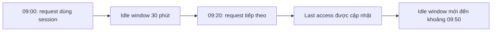

# Khoảng không hoạt động, gia hạn phiên và tuổi thọ tuyệt đối của đăng nhập

Spring Session quản lý thời hạn của session dựa trên khoảng không hoạt động: khi người dùng tiếp tục gửi request sử dụng phiên, thời điểm truy cập được cập nhật và cửa sổ hết hạn có thể trượt về phía trước. Cách này thuận tiện cho trải nghiệm người dùng, nhưng một phiên có hoạt động liên tục có thể tồn tại rất lâu. Với ứng dụng nhạy cảm, cần phân biệt **idle timeout** (hết hạn do không hoạt động) với **absolute login lifetime** (giới hạn tổng thời gian kể từ lần xác thực gần nhất).

Ba đồng hồ thường bị nhầm lẫn là timeout của session phía server, tuổi thọ cookie ở trình duyệt và thời hạn của Remember-Me credential. Chúng có thể được cấu hình độc lập. Session hết hạn không có nghĩa Remember-Me cookie đã hết hạn; cookie còn tồn tại cũng không có nghĩa session trong Redis/JDBC vẫn còn. Thiết kế an toàn phải xác định rõ chính sách cho từng loại thời hạn và cách chúng tương tác khi người dùng hoạt động, đăng xuất hoặc được xác thực lại.

## 1. Ba khái niệm thời hạn

| Khái niệm | Bắt đầu tính từ | Được gia hạn khi nào? | Nơi kiểm soát |
|---|---|---|---|
| Idle timeout | Lần truy cập session gần nhất | Khi request tiếp tục sử dụng session | Spring Session repository / cấu hình session |
| Absolute login lifetime | Thời điểm xác thực thành công gần nhất | Không gia hạn bởi hoạt động thông thường; chỉ reset sau xác thực lại theo chính sách | Logic bảo mật của ứng dụng hoặc token có thời hạn |
| Cookie/Remember-Me lifetime | Thời điểm cookie được phát hành hoặc cập nhật | Tùy thuộc cách phát hành cookie và loại Remember-Me | Cookie resolver và Spring Security Remember-Me |

Idle timeout trả lời câu hỏi: “Người dùng đã không sử dụng phiên trong bao lâu?” Absolute lifetime trả lời: “Đã bao lâu kể từ khi danh tính được xác thực gần nhất?” Cookie lifetime trả lời: “Trình duyệt còn giữ và gửi credential này trong bao lâu?” Ba câu hỏi khác nhau nên không thể dùng một thuộc tính timeout duy nhất để giải quyết cả ba.

## 2. Idle timeout trong Spring Session

Idle timeout là khoảng thời gian tối đa một session được phép không hoạt động. Trong Servlet API, `HttpSession.setMaxInactiveInterval(int seconds)` đặt thời gian tính bằng giây. Với Spring Session, session abstraction lưu khoảng không hoạt động và repository sử dụng thông tin truy cập để xác định lúc phiên hết hạn.

Ví dụ đặt timeout 30 phút cho session hiện tại:

```java
import jakarta.servlet.http.HttpSession;
import org.springframework.web.bind.annotation.PostMapping;
import org.springframework.web.bind.annotation.RestController;

@RestController
class SessionPreferenceController {

    @PostMapping("/session/timeout")
    String configureTimeout(HttpSession session) {
        session.setMaxInactiveInterval(30 * 60);
        return "Idle timeout đã được đặt thành 30 phút";
    }
}
```

Với Spring Session API, có thể thao tác qua `Session` và `Duration` tùy implementation/version. Nếu chỉ cần timeout chung cho ứng dụng, nên cấu hình ở cấp ứng dụng thay vì đặt lại trong từng controller.

### Cấu hình timeout chung

Với Spring Boot và Spring Session, có thể cấu hình thời hạn session bằng thuộc tính `spring.session.timeout`:

```yaml
spring:
  session:
    timeout: 30m
```

Trong cấu hình Java Servlet truyền thống, Redis hoặc JDBC annotation cũng có thuộc tính timeout, ví dụ:

```java
@Configuration
@EnableRedisHttpSession(maxInactiveIntervalInSeconds = 1800)
class RedisSessionConfiguration {
}
```

Hoặc:

```java
@Configuration
@EnableJdbcHttpSession(maxInactiveIntervalInSeconds = 1800)
class JdbcSessionConfiguration {
}
```

Tên thuộc tính và cách auto-configuration áp dụng timeout phụ thuộc phiên bản Spring Boot/Spring Session. Kiểm tra metadata cấu hình của đúng phiên bản dự án trước khi triển khai.

## 3. Cửa sổ idle trượt theo hoạt động

Giả sử idle timeout là 30 phút. Nếu người dùng truy cập session lúc 09:00, phiên có thể hết hạn sau khi không có lần truy cập phù hợp trong khoảng 30 phút. Nếu người dùng tiếp tục gửi request sử dụng session lúc 09:20, thời điểm truy cập được cập nhật và cửa sổ idle mới được tính từ lần truy cập đó.



Đây là **sliding expiration**. Người dùng hoạt động đều đặn có thể duy trì session lâu hơn nhiều so với timeout ban đầu. Điều đó phù hợp với giỏ hàng hoặc biểu mẫu dài, nhưng không đủ để thực thi giới hạn đăng nhập tối đa của một hệ thống tài chính hoặc quản trị.

Việc cập nhật last access phụ thuộc request có sử dụng session và cách repository tích hợp với request lifecycle. Một request tĩnh không truy cập session không nhất thiết có cùng tác động như request sử dụng `HttpSession`. Khi đo timeout, hãy kiểm thử qua đúng filter và repository của ứng dụng.

## 4. Redis và JDBC thực thi idle expiration ra sao?

Spring Session cung cấp cùng ý nghĩa timeout ở API, nhưng kho lưu trữ thực thi và dọn dữ liệu theo cách khác nhau.

| Kho lưu trữ | Cách thể hiện timeout | Cách dọn dữ liệu |
|---|---|---|
| Redis | Repository cập nhật expiration/TTL cho dữ liệu session và các cấu trúc liên quan | Redis expiration cùng cơ chế cleanup/index của Spring Session |
| JDBC | Lưu `LAST_ACCESS_TIME`, `MAX_INACTIVE_INTERVAL`, `EXPIRY_TIME` trong bảng session | Repository và job cleanup xóa các hàng hết hạn theo cơ chế được cấu hình |

Redis TTL có thể loại bỏ key sau khi hết hạn; thời điểm key thực sự bị xóa và notification có thể trễ so với lúc TTL về 0. Với JDBC, dữ liệu hết hạn có thể còn trong bảng cho đến khi tác vụ cleanup chạy, nhưng repository vẫn phải coi session hết hạn là không hợp lệ khi tìm theo ID.

Không nên coi việc hàng dữ liệu còn tồn tại trong database là bằng chứng session vẫn được phép sử dụng. Quyết định hợp lệ phải dựa trên timeout và logic repository, không chỉ nhìn thấy một key hoặc row trong công cụ quản trị.

## 5. Vì sao idle timeout chưa đủ?

Một người dùng có thể giữ tab mở và gửi request định kỳ. Nếu mỗi request làm mới last access, idle timeout liên tục được gia hạn. Ví dụ timeout 30 phút không bảo đảm người dùng phải xác thực lại sau 30 phút; nó chỉ hết hạn khi session không được sử dụng trong 30 phút.

Với các chức năng nhạy cảm, thường cần thêm giới hạn tuyệt đối:

- Bắt buộc xác thực lại sau một khoảng thời gian kể từ lần đăng nhập, dù người dùng vẫn hoạt động.
- Giới hạn thời gian một phiên quản trị có thể tồn tại.
- Yêu cầu xác thực mạnh lại trước thao tác chuyển tiền, đổi mật khẩu hoặc thay đổi thông tin bảo mật.
- Giới hạn thời gian hiệu lực của một Remember-Me credential.

Idle timeout và absolute lifetime nên cùng được áp dụng. Thời điểm hết hạn hiệu lực có thể mô hình hóa như sau:

\[
T_{expire} = \min(T_{lastAccess} + T_{idle},\ T_{authenticatedAt} + T_{absolute})
\]

Trong đó `T_idle` là khoảng không hoạt động tối đa và `T_absolute` là tuổi thọ đăng nhập tối đa. Request hoạt động có thể cập nhật `T_lastAccess`, nhưng không được tự động cập nhật `T_authenticatedAt`.

## 6. Absolute login lifetime không tự có từ idle timeout

Spring Session cung cấp timeout không hoạt động thông qua `maxInactiveInterval`. Thuộc tính này không phải bộ đếm tuổi thọ tuyệt đối của lần xác thực. Muốn giới hạn tổng thời gian đăng nhập, ứng dụng cần lưu mốc xác thực ban đầu và kiểm tra nó trên các request cần bảo vệ, hoặc sử dụng credential có thời hạn tuyệt đối do hệ thống xác thực quản lý.

Một thuộc tính session thường dùng để minh họa là `AUTHENTICATED_AT`:

```java
private static final String AUTHENTICATED_AT = "security.authenticatedAt";
```

Giá trị này phải được đặt sau khi xác thực thành công và giữ nguyên trong suốt phiên. Không cập nhật nó mỗi khi người dùng gửi request, vì như vậy absolute lifetime sẽ biến thành một idle timeout thứ hai.

### Ghi mốc xác thực khi đăng nhập

Ví dụ helper được gọi từ authentication success handler sau khi Spring Security hoàn tất session authentication strategy:

```java
import java.time.Clock;
import jakarta.servlet.http.HttpServletRequest;
import jakarta.servlet.http.HttpSession;

class AuthenticationTimeRecorder {
    static final String AUTHENTICATED_AT = "security.authenticatedAt";

    private final Clock clock;

    AuthenticationTimeRecorder(Clock clock) {
        this.clock = clock;
    }

    void recordSuccessfulAuthentication(HttpServletRequest request) {
        HttpSession session = request.getSession(true);
        session.setAttribute(AUTHENTICATED_AT, clock.instant());
    }
}
```

Trong ứng dụng thực tế, gọi helper này từ success handler hoặc thành phần tương đương sau khi xác thực thành công. Nếu ứng dụng có nhiều cơ chế đăng nhập, tất cả phải ghi mốc theo cùng chính sách. Với session được tạo trước đăng nhập, cần bảo đảm mốc được ghi sau khi session fixation protection đã chạy để timestamp gắn với session đã xác thực.

## 7. Kiểm tra absolute lifetime trên mỗi request

Một filter có thể kiểm tra timestamp trước khi Spring Security tải `SecurityContext` từ session. Filter phải chạy sau `springSessionRepositoryFilter` để request đã được bọc bởi Spring Session, nhưng trước thành phần tải SecurityContext. Trong `SecurityFilterChain`, có thể đặt custom filter trước `SecurityContextHolderFilter`.

Ví dụ rút gọn:

```java
import java.io.IOException;
import java.time.Clock;
import java.time.Duration;
import java.time.Instant;

import jakarta.servlet.FilterChain;
import jakarta.servlet.ServletException;
import jakarta.servlet.http.HttpServletRequest;
import jakarta.servlet.http.HttpServletResponse;
import jakarta.servlet.http.HttpSession;

import org.springframework.web.filter.OncePerRequestFilter;

class AbsoluteLoginLifetimeFilter extends OncePerRequestFilter {
    private static final String AUTHENTICATED_AT =
            AuthenticationTimeRecorder.AUTHENTICATED_AT;

    private final Clock clock;
    private final Duration maximumLifetime;

    AbsoluteLoginLifetimeFilter(Clock clock, Duration maximumLifetime) {
        this.clock = clock;
        this.maximumLifetime = maximumLifetime;
    }

    @Override
    protected void doFilterInternal(
            HttpServletRequest request,
            HttpServletResponse response,
            FilterChain chain) throws ServletException, IOException {

        HttpSession session = request.getSession(false);
        if (session != null) {
            Object value = session.getAttribute(AUTHENTICATED_AT);
            if (value instanceof Instant authenticatedAt
                    && !clock.instant().isBefore(
                            authenticatedAt.plus(maximumLifetime))) {
                session.invalidate();
            }
        }

        chain.doFilter(request, response);
    }
}
```

Đây là khung minh họa, cần hoàn thiện theo chính sách của ứng dụng. Ví dụ chỉ invalidate khi tìm thấy timestamp kiểu `Instant`; hệ thống production phải quyết định rõ cách xử lý session đã xác thực nhưng thiếu timestamp. Với chính sách nghiêm ngặt, có thể từ chối phiên thiếu mốc hoặc buộc xác thực lại thay vì coi phiên đó là vô hạn. Không tự gán `authenticatedAt = now` ở mỗi request.

Khi session bị invalidate trước khi `SecurityContextHolderFilter` chạy, SecurityContext không được khôi phục từ session cũ. Ứng dụng cũng cần bảo đảm response hết hạn cookie theo resolver đang dùng và request tiếp theo được yêu cầu xác thực lại. Với nhiều filter chain, kiểm tra filter được áp dụng cho tất cả chain stateful có liên quan.

## 8. Re-authentication và gia hạn tuyệt đối

Absolute lifetime thường được reset khi người dùng thực hiện xác thực lại đầy đủ theo chính sách, không phải khi chỉ gửi request bình thường. Ví dụ:

- Đăng nhập lại bằng mật khẩu và MFA.
- Thực hiện step-up authentication cho thao tác có rủi ro cao.
- Được xác thực lại qua nhà cung cấp danh tính với yêu cầu freshness phù hợp.

Không phải mọi lần xác thực thành công đều nên reset cùng một đồng hồ. Một ứng dụng có thể có hai mốc: thời điểm đăng nhập phiên và thời điểm xác thực mạnh gần nhất. Thao tác nhạy cảm có thể yêu cầu `recentAuthenticationAt` trong vòng 5 phút, trong khi absolute login lifetime có thể là 8 giờ.

Nếu ứng dụng hỗ trợ impersonation hoặc chuyển vai trò, cần xác định đó có phải lần xác thực mới hay chỉ thay đổi ngữ cảnh. Không reset absolute lifetime chỉ vì người dùng chuyển màn hình hoặc đổi tenant.

## 9. Remember-Me cookie có thời hạn riêng

Spring Security Remember-Me cho phép người dùng được xác thực lại từ cookie sau khi session hiện tại đã mất hoặc hết hạn. Vì vậy, session timeout 30 phút không có nghĩa người dùng chắc chắn phải nhập mật khẩu sau 30 phút: nếu Remember-Me cookie vẫn hợp lệ, Spring Security có thể xác thực người dùng và tạo session mới.

Remember-Me có thời hạn riêng, thường được cấu hình bằng `tokenValiditySeconds` trong `rememberMe(...)`. Ví dụ:

```java
http.rememberMe(remember -> remember
        .key(rememberMeKey)
        .tokenValiditySeconds(14 * 24 * 60 * 60));
```

Đây là ví dụ cấu hình thời hạn 14 ngày; key phải được quản lý như secret, không hardcode giá trị dùng thật trong mã nguồn. Cơ chế token-based và persistent-token có chi tiết khác nhau, nhưng cookie Remember-Me không phải session cookie và thời hạn của nó không tự đồng bộ với `maxInactiveInterval`.

Nếu yêu cầu là “người dùng phải nhập lại thông tin xác thực sau tối đa 8 giờ”, chỉ đặt idle timeout 30 phút và Remember-Me 14 ngày là chưa đủ. Remember-Me có thể tái xác thực và tạo session mới. Cần giới hạn tuổi thọ của Remember-Me credential hoặc lưu mốc xác thực gốc được kiểm tra xuyên suốt các lần khôi phục session.

## 10. Tránh Remember-Me làm vòng đời đăng nhập kéo dài vô hạn

Nếu mỗi lần Remember-Me cookie tự động xác thực lại đều tạo session mới và ứng dụng ghi `authenticatedAt = now`, người dùng có thể kéo dài trạng thái đăng nhập vô hạn bằng cách quay lại trước khi cookie hết hạn. Để giới hạn tổng tuổi thọ, cần chọn một trong các chính sách:

- Remember-Me cookie có thời hạn tuyệt đối ngắn hơn hoặc bằng giới hạn đăng nhập mong muốn.
- Duy trì thời điểm xác thực gốc trong persistent token hoặc kho dữ liệu phía server và không reset khi auto-login.
- Yêu cầu mật khẩu/MFA lại sau một khoảng thời gian tuyệt đối.
- Vô hiệu hóa Remember-Me cho khu vực có yêu cầu xác thực mới thường xuyên.

Với persistent remember-me token, token rotation và phát hiện reuse có thể giúp giảm nguy cơ đánh cắp token, nhưng vẫn cần giới hạn thời hạn tổng. Cần xem xét chính sách khi token được xoay: thời gian hết hạn tuyệt đối có thể giữ nguyên theo lần cấp ban đầu, trong khi thời gian idle của token có thể được cập nhật theo hoạt động.

## 11. Cookie session và thời hạn phía server

Cookie session thường chứa session ID. Cookie có thể là cookie theo phiên trình duyệt hoặc cookie có `Max-Age`/`Expires`. Đây là thời hạn lưu ở client; nó không quyết định session còn hợp lệ trong repository hay không.

| Tình huống | Kết quả |
|---|---|
| Cookie còn hạn nhưng Redis session hết TTL | Client gửi ID cũ; repository không tìm thấy phiên hợp lệ |
| Session còn trong Redis nhưng cookie đã bị xóa | Trình duyệt không gửi ID; session có thể không được truy cập đến khi cleanup |
| Cookie session bị xóa khi đóng trình duyệt | Không bảo đảm session server bị xóa ngay |
| Remember-Me cookie còn hạn sau khi session hết hạn | Spring Security có thể tự xác thực lại và tạo session mới |
| Absolute lifetime đã hết nhưng cookie còn hạn | Filter/chính sách server phải từ chối session hoặc credential cũ |

Với Spring Session, cookie được phát hành bởi `HttpSessionIdResolver` hoặc resolver WebFlux tương ứng. Cookie cần `Secure`, `HttpOnly`, `SameSite`, `Path` và `Domain` phù hợp. Không đặt cookie `Max-Age` dài hơn chính sách mà không hiểu rằng server vẫn có thể từ chối session trước thời điểm cookie hết hạn.

## 12. Logout phải kết thúc cả session và Remember-Me credential

Logout trong ứng dụng Spring Security stateful thường cần:

1. Invalidate `HttpSession`/Spring Session repository.
2. Xóa `SecurityContext` khỏi request hiện tại.
3. Hết hạn cookie session ở client.
4. Xóa Remember-Me cookie và, với persistent-token service, vô hiệu hóa token phía server theo cơ chế hỗ trợ.
5. Xử lý CSRF token và redirect/response theo chính sách ứng dụng.

Khi dùng Spring Security logout DSL và đã cấu hình Remember-Me, hạ tầng logout có thể đăng ký handler để xóa Remember-Me token. Có thể chỉ định cookie bổ sung cần xóa:

```java
http.logout(logout -> logout
        .logoutUrl("/logout")
        .invalidateHttpSession(true)
        .clearAuthentication(true)
        .deleteCookies("APPSESSION", "remember-me"));
```

Tên cookie session phải khớp với resolver thực tế. Với Spring Session, session cookie có thể không mang tên mặc định của container. Nếu tự xây dựng logout endpoint, phải gọi đúng `WebSession.invalidate()` trong WebFlux hoặc invalidate session Servlet, đồng thời xóa Remember-Me credential bằng service tương ứng.

Không chỉ xóa cookie phía trình duyệt mà bỏ token phía server nếu đang dùng persistent remember-me tokens. Ngược lại, xóa token phía server mà để cookie cũ tồn tại cũng có thể tạo request thất bại lặp lại cho đến khi cookie bị xóa; nên xử lý cả hai phía.

## 13. Chọn timeout theo mức độ nhạy cảm

Không có một con số timeout phù hợp cho mọi hệ thống. Cần cân bằng trải nghiệm người dùng, nguy cơ thiết bị bị bỏ quên, loại dữ liệu và khả năng xác thực lại.

| Khu vực | Idle timeout tham khảo | Absolute lifetime tham khảo | Ghi chú |
|---|---:|---:|---|
| Cổng nội dung ít nhạy cảm | 30–60 phút | Theo chính sách sản phẩm | Có thể ưu tiên trải nghiệm |
| Ứng dụng nghiệp vụ nội bộ | 15–30 phút | Một ca làm việc hoặc giới hạn tổ chức | Cần logout khi rời máy |
| Trang quản trị | 5–15 phút | 1–4 giờ | Nên yêu cầu MFA/reauth cho thao tác nhạy cảm |
| Thao tác tài chính quan trọng | Theo luồng ngắn | Re-auth freshness vài phút | Xác thực lại ngay trước giao dịch |

Các con số chỉ là ví dụ để bắt đầu phân tích, không phải chuẩn bắt buộc. Chính sách cuối cùng cần dựa trên phân loại dữ liệu, yêu cầu pháp lý, threat model và hướng dẫn bảo mật của tổ chức.

## 14. Kiểm thử idle timeout và absolute lifetime

Kiểm thử cần chứng minh hai đồng hồ hoạt động độc lập:

1. Tạo session với idle timeout ngắn trong môi trường test.
2. Gửi request sử dụng session trước khi idle timeout hết và xác nhận phiên tiếp tục hợp lệ.
3. Không gửi request trong thời gian vượt idle timeout; xác nhận session không còn được repository chấp nhận.
4. Tạo session mới, ghi `authenticatedAt` và gửi request định kỳ để làm mới idle timeout.
5. Tiếp tục hoạt động vượt absolute lifetime; xác nhận filter vẫn invalidate hoặc yêu cầu xác thực lại.
6. Kiểm tra request sau khi absolute lifetime hết không thể khôi phục SecurityContext từ session cũ.
7. Kiểm tra Remember-Me cookie còn hạn có tạo session mới hay không và chính sách absolute có ngăn kéo dài vô hạn không.
8. Logout và xác nhận session bị xóa, session cookie cùng Remember-Me cookie được hết hạn, token persistent bị thu hồi nếu dùng.
9. Kiểm tra nhiều instance dùng cùng repository có cùng quyết định timeout.
10. Kiểm tra session cũ thiếu `authenticatedAt` khi triển khai phiên bản có absolute lifetime.

Nên dùng `Clock` có thể thay thế trong test để kiểm soát thời gian thay vì chờ thật nhiều phút. Với repository integration, dùng Redis/JDBC test riêng. Kiểm tra cả response cookie và trạng thái repository; chỉ kiểm tra một trong hai sẽ bỏ sót sự khác biệt giữa client và server.

## 15. Các lỗi thường gặp

| Hiện tượng | Nguyên nhân có thể | Cách xử lý |
|---|---|---|
| Người dùng hoạt động cả ngày không bị đăng xuất | Chỉ có idle timeout dạng sliding | Bổ sung absolute login lifetime |
| Session hết hạn nhưng người dùng vẫn tự đăng nhập lại | Remember-Me cookie vẫn hợp lệ | Đặt thời hạn Remember-Me và giới hạn xác thực gốc |
| Cookie còn nhưng session không tồn tại | Server TTL ngắn hơn cookie lifetime | Xử lý ID cũ như session hết hạn; đồng bộ trải nghiệm |
| Session trong JDBC còn row sau timeout | Cleanup chạy định kỳ, chưa xóa vật lý | Xác nhận repository từ chối phiên hết hạn; theo dõi cleanup |
| Một số session không bị absolute timeout | Thiếu timestamp hoặc filter không chạy trên mọi chain | Quy định xử lý session thiếu mốc và kiểm tra filter chain |
| Absolute lifetime bị reset mỗi request | Timestamp được ghi lại trong filter hoặc interceptor | Chỉ ghi khi xác thực mới thành công |
| Logout vẫn có thể auto-login | Remember-Me cookie/token chưa bị xóa hoặc thu hồi | Kết hợp logout handler cho session và Remember-Me |
| Một instance logout nhưng instance khác vẫn chấp nhận phiên | Không dùng chung repository hoặc dữ liệu bị cache cục bộ | Dùng store chung và kiểm thử nhiều instance |

## 16. Nguyên tắc thiết kế

- Dùng idle timeout để giới hạn thời gian không hoạt động, không coi nó là tuổi thọ tối đa của đăng nhập.
- Đặt `maxInactiveInterval` phù hợp với mức độ nhạy cảm và trải nghiệm của ứng dụng.
- Dùng `authenticatedAt` bất biến trong một lần đăng nhập để thực thi absolute lifetime.
- Chỉ reset absolute lifetime sau xác thực lại theo chính sách; không reset bởi request thông thường.
- Phân biệt thời hạn session server, session cookie và Remember-Me credential.
- Nếu Remember-Me có thể tạo session mới, phải ngăn nó vượt qua giới hạn absolute login lifetime.
- Đặt filter kiểm tra absolute lifetime ở vị trí chạy sau Spring Session filter và trước khi SecurityContext được tải.
- Quy định rõ cách xử lý session cũ thiếu timestamp khi triển khai chính sách mới.
- Logout phải invalidate session, xóa cookie và thu hồi Remember-Me token nếu có.
- Kiểm thử bằng Clock điều khiển được, repository thật trong test và nhiều instance.

Spring Session cung cấp cơ chế idle expiration, thường được gia hạn theo hoạt động sử dụng session. Giới hạn này không tự đặt trần cho tổng thời gian đăng nhập. Ứng dụng cần thêm absolute login lifetime dựa trên mốc xác thực không trượt, đồng thời quản lý riêng session cookie và Remember-Me credential. Khi các thời hạn được thiết kế cùng nhau, người dùng có trải nghiệm hợp lý mà phiên đăng nhập vẫn kết thúc đúng giới hạn bảo mật.
