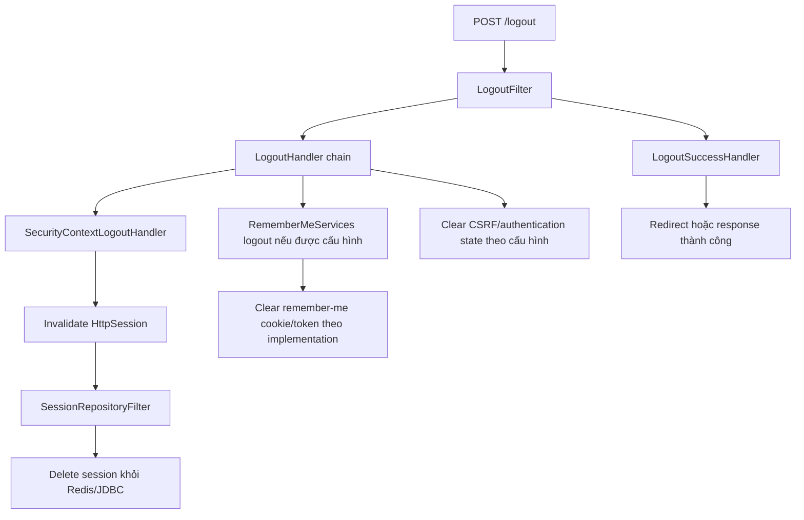

# Đăng xuất phiên hiện tại và thu hồi mọi phiên của một người dùng

Spring Session quản lý vòng đời session và lưu session ở một kho dùng chung như Redis hoặc JDBC. Spring Security sử dụng session đó để lưu SecurityContext trong các ứng dụng xác thực dựa trên session. Vì vậy, đăng xuất cần xử lý cả trạng thái xác thực và dữ liệu session phía server.

Đăng xuất phiên hiện tại và thu hồi tất cả phiên của một người dùng là hai nghiệp vụ khác nhau. Đăng xuất hiện tại thường invalidate một HttpSession và xóa SecurityContext của request đó. Thu hồi tất cả phiên cần tìm các session theo principal rồi xóa chúng khỏi repository dùng chung để các instance khác cũng không thể khôi phục phiên cũ. Nếu ứng dụng bật remember-me, cần xem xét token ghi nhớ đăng nhập riêng vì token đó có thể tạo phiên mới sau khi session đã bị xóa.

Bài học này trình bày luồng logout chuẩn của Spring Security, cách tích hợp với Spring Session, cách tìm và xóa session theo principal, xử lý phiên hiện tại khi logout-all, thu hồi remember-me token, các race condition và kiểm thử trên nhiều instance.

## 1. Phân biệt đăng xuất hiện tại và đăng xuất mọi thiết bị

Giả sử Alice đăng nhập trên laptop, điện thoại và máy tính bảng. Mỗi lần đăng nhập có thể tạo một session riêng, dù tất cả cùng thuộc principal alice.

| Thao tác | Phạm vi | Kết quả |
| --- | --- | --- |
| Logout phiên hiện tại | Một session của request hiện tại | Phiên đang dùng bị invalidate; các phiên khác của Alice vẫn hoạt động |
| Logout một thiết bị | Session ID được xác định an toàn ở server | Chỉ phiên tương ứng bị xóa |
| Logout mọi thiết bị | Tất cả session có principal của Alice | Các phiên hiện có bị xóa khỏi kho dùng chung |
| Khóa tài khoản | Trạng thái tài khoản trong nguồn dữ liệu chính | Chặn xác thực mới; cần thêm chính sách thu hồi phiên đang tồn tại |
| Thu hồi remember-me | Token ghi nhớ đăng nhập | Ngăn token đó tạo phiên đăng nhập mới theo cơ chế token được cấu hình |

Không nên xem việc xóa cookie trong browser là tương đương xóa session phía server. Cookie chỉ mang session ID; nếu session vẫn còn trong repository và cookie bị sao chép, request khác vẫn có thể sử dụng ID đó. Ngược lại, khi session đã bị xóa ở repository, cookie cũ có thể còn nằm trong browser nhưng không còn trỏ tới một session hợp lệ.

## 2. Luồng logout trong Spring Security và Spring Session

Trong ứng dụng Servlet, Spring Security thường xử lý logout qua LogoutFilter. Filter nhận request đến logout URL, gọi chuỗi LogoutHandler, sau đó gọi LogoutSuccessHandler.



SecurityContextLogoutHandler thường thực hiện các việc chính:

- Invalidate HttpSession nếu được cấu hình.
- Xóa Authentication khỏi SecurityContext.
- Xóa SecurityContext khỏi SecurityContextHolder.
- Lưu context rỗng theo cơ chế SecurityContextRepository khi cần.

Khi Spring Session bọc request bằng SessionRepositoryFilter, thao tác invalidate HttpSession được chuyển thành thao tác xóa session qua repository. Nhờ đó, dữ liệu phiên được xóa khỏi kho dùng chung thay vì chỉ xóa object trong bộ nhớ của một JVM.

Spring Session không tự quyết định endpoint logout hoặc quyền ai được phép logout người khác. Spring Security cung cấp chuỗi logout; ứng dụng cần cấu hình đúng filter, repository và quyền truy cập endpoint.

## 3. Cấu hình logout phiên hiện tại

Với Spring Security hiện đại, có thể cấu hình logout trong SecurityFilterChain:

```java
@Bean
SecurityFilterChain securityFilterChain(HttpSecurity http) throws Exception {
    http
        .authorizeHttpRequests(authorize -> authorize
            .requestMatchers("/login", "/assets/**").permitAll()
            .anyRequest().authenticated()
        )
        .logout(logout -> logout
            .logoutUrl("/logout")
            .invalidateHttpSession(true)
            .clearAuthentication(true)
            .logoutSuccessUrl("/login?logout")
        );

    return http.build();
}
```

Đây là cấu hình minh họa cho ứng dụng Servlet. Với CSRF được bật theo mặc định, logout nên được thực hiện bằng POST và request cần CSRF token hợp lệ. Không mở một GET endpoint có tác dụng logout hoặc xóa session nếu không có lý do rõ ràng, vì GET có thể bị kích hoạt ngoài ý muốn bởi link, crawler hoặc nội dung nhúng.

Trong ứng dụng Spring Session, SessionRepositoryFilter phải được đăng ký đúng thứ tự để Spring Security thao tác trên session wrapper của Spring Session. Spring Boot thường cấu hình filter này qua auto-configuration khi dependency và repository phù hợp. Tránh đăng ký thủ công thêm một filter thứ hai.

### 3.1. Session cookie sau logout

Khi session bị invalidate qua Spring Session, HttpSessionIdResolver được dùng để hết hạn định danh session ở client. Với cookie-based resolver, response có thể gửi cookie hết hạn theo cấu hình cookie serializer. Nếu ứng dụng tự cấu hình tên cookie, domain, path hoặc resolver, hãy xác nhận cookie hết hạn khớp chính xác với cookie đã phát hành.

Không mặc định cookie luôn có tên JSESSIONID. Spring Session có thể dùng tên cookie riêng, ví dụ SESSION, tùy cấu hình và phiên bản. deleteCookies("JSESSIONID") chỉ có tác dụng với đúng cookie name và path/domain phù hợp; nếu tự thêm deleteCookies, hãy dùng tên cookie thực tế.

Logout hiện tại thường chỉ invalidate session đang dùng. Các session khác của cùng principal vẫn tồn tại cho đến khi có thao tác revoke-all.

## 4. LogoutHandler và LogoutSuccessHandler

LogoutHandler thực hiện dọn trạng thái khi logout; LogoutSuccessHandler quyết định response sau khi các handler hoàn tất.

Ví dụ thêm một handler audit:

```java
public class LogoutAuditHandler implements LogoutHandler {

    @Override
    public void logout(
            HttpServletRequest request,
            HttpServletResponse response,
            Authentication authentication) {

        if (authentication != null) {
            // Ghi principal, thời điểm và correlation ID.
            // Không ghi session ID, cookie hoặc token.
        }
    }
}
```

Đăng ký handler:

```java
http.logout(logout -> logout
    .addLogoutHandler(logoutAuditHandler)
    .logoutSuccessHandler((request, response, authentication) ->
        response.setStatus(HttpServletResponse.SC_NO_CONTENT))
);
```

Không đặt logic xóa mọi session vào handler dùng chung nếu endpoint logout thông thường chỉ có ý nghĩa logout thiết bị hiện tại. Hãy phân biệt URL và quyền của thao tác logout-all, hoặc tạo một handler có điều kiện rõ ràng cho chính sách đó.

Logout handler nên idempotent: gọi lại không làm hỏng trạng thái và không tạo tác động nghiệp vụ lặp ngoài ý muốn. Nếu audit phải được lưu bền vững, không phụ thuộc duy nhất vào một log message có thể mất khi tiến trình dừng.

## 5. Tìm session của một principal

Để thu hồi tất cả session, repository cần hỗ trợ tra cứu theo principal. Spring Session cung cấp FindByIndexNameSessionRepository với phương thức findByPrincipalName.

```java
Map<String, ? extends Session> sessions =
        sessionRepository.findByPrincipalName(principalName);
```

Tên index tiêu chuẩn là:

```java
FindByIndexNameSessionRepository.PRINCIPAL_NAME_INDEX_NAME
```

Repository có principal index có thể lập chỉ mục session dựa trên SecurityContext hoặc thuộc tính principal được resolver hỗ trợ. Ví dụ, các repository indexed cho Redis hoặc JDBC có thể hỗ trợ truy vấn này tùy phiên bản và cấu hình.

Điều kiện để tìm đúng session:

- Repository runtime phải triển khai FindByIndexNameSessionRepository.
- Session phải lưu principal theo cách principal index resolver nhận diện được.
- Giá trị principalName truy vấn phải khớp với giá trị đã index.
- Principal name phải ổn định; nếu hệ thống nhiều tenant, cần tránh trùng tên principal giữa tenant hoặc đưa tenant vào định danh index theo thiết kế.

Không phải mọi SessionRepository đều hỗ trợ principal lookup. Không quét toàn bộ Redis keyspace hoặc toàn bộ bảng session để thay cho index trên production. Nếu repository không hỗ trợ index, cần thiết kế registry/index riêng có vòng đời và tính nhất quán được kiểm soát.

Trong code bảo mật, lấy principal từ Authentication#getName() của request đã xác thực hoặc từ nguồn danh tính tin cậy ở server. Không nhận một username bất kỳ từ query parameter rồi dùng nó để xóa phiên.

## 6. Service thu hồi session theo principal

Một service đơn giản có thể lấy danh sách session rồi xóa theo ID:

```java
import java.util.Map;

import org.springframework.session.FindByIndexNameSessionRepository;
import org.springframework.session.Session;
import org.springframework.stereotype.Service;

@Service
public class SessionRevocationService {

    private final FindByIndexNameSessionRepository<? extends Session> repository;

    public SessionRevocationService(
            FindByIndexNameSessionRepository<? extends Session> repository) {
        this.repository = repository;
    }

    public int revokeAll(String principalName) {
        Map<String, ? extends Session> found =
                repository.findByPrincipalName(principalName);

        for (String sessionId : found.keySet()) {
            repository.deleteById(sessionId);
        }

        return found.size();
    }
}
```

Service minh họa này phù hợp cho thao tác quản trị hoặc khi caller đã xác định principal hợp lệ. Endpoint gọi service cần kiểm tra quyền rõ ràng. Số lượng session bị thu hồi có thể trả về dưới dạng số đếm, nhưng không trả session ID hoặc nội dung session cho client.

Việc tìm danh sách rồi xóa từng session không phải một transaction nguyên tử bao trùm mọi session. Một phiên mới có thể được tạo sau thời điểm truy vấn; một request đang chạy có thể giữ bản session trong bộ nhớ và lưu lại ở cuối request. Các trường hợp này cần được xử lý trong chính sách logout-all.

## 7. Logout mọi thiết bị của chính người dùng

Một luồng phổ biến là người dùng chọn “đăng xuất khỏi tất cả thiết bị”. Có thể triển khai theo trình tự:

1. Lấy principal từ Authentication của request hiện tại.
2. Lấy session ID hiện tại từ request ở server.
3. Tìm các session theo principal.
4. Xóa các session khác, bỏ qua session hiện tại trong vòng lặp.
5. Dùng logout handler chuẩn để invalidate session hiện tại và xóa SecurityContext.
6. Trả response thành công sau khi các thao tác cần thiết hoàn tất.

Việc loại trừ session hiện tại khỏi bước xóa theo repository là có chủ đích. SessionRepositoryFilter đang giữ một wrapper/session object cho request hiện tại; nếu xóa session đó trực tiếp bằng repository trong khi wrapper vẫn còn hoạt động, bước save cuối request có thể ghi lại trạng thái session. Invalidate session hiện tại qua HttpSession/logout handler báo cho filter rằng phiên đã bị hủy và cho phép resolver hết hạn cookie.

Ví dụ phần service xóa các phiên khác:

```java
public int revokeOtherSessions(
        String principalName,
        String currentSessionId) {

    Map<String, ? extends Session> found =
            repository.findByPrincipalName(principalName);

    int revoked = 0;
    for (String sessionId : found.keySet()) {
        if (!sessionId.equals(currentSessionId)) {
            repository.deleteById(sessionId);
            revoked++;
        }
    }
    return revoked;
}
```

Controller hoặc handler có thể lấy session hiện tại, gọi service rồi invoke logout handler chuẩn:

```java
@PostMapping("/account/sessions/logout-others")
public ResponseEntity<Void> logoutOtherDevices(
        HttpServletRequest request,
        HttpServletResponse response,
        Authentication authentication) {

    String principalName = authentication.getName();
    HttpSession current = request.getSession(false);
    String currentSessionId = current != null ? current.getId() : null;

    sessionRevocationService.revokeOtherSessions(
            principalName, currentSessionId);

    securityContextLogoutHandler.logout(
            request, response, authentication);

    return ResponseEntity.noContent().build();
}
```

Ví dụ giả định securityContextLogoutHandler là bean được cấu hình theo ứng dụng và endpoint đã được bảo vệ CSRF/authorization phù hợp. Cần xác nhận controller chạy trong cùng request context được SessionRepositoryFilter bọc. Nếu mục tiêu là giữ phiên hiện tại và chỉ logout các thiết bị khác, không gọi handler invalidate current; nếu mục tiêu là logout-all bao gồm thiết bị hiện tại, gọi handler như ví dụ.

Một lựa chọn khác là triển khai logout-all qua một LogoutHandler chuyên biệt. Dù chọn cách nào, cần xác định rõ session hiện tại có được giữ lại hay không và không xóa nó trực tiếp khi filter vẫn có thể lưu wrapper cuối request.

## 8. Thu hồi phiên của một người dùng bởi quản trị viên

Quản trị viên có thể cần khóa tài khoản hoặc thu hồi mọi session của một principal khác. Endpoint phải kiểm tra quyền quản trị và phạm vi tenant trước khi gọi service:

```java
@PostMapping("/admin/users/{userId}/sessions/revoke")
@PreAuthorize("hasAuthority('account:sessions:revoke')")
public ResponseEntity<Void> revokeUserSessions(@PathVariable String userId) {
    String principalName = accountService.requirePrincipalName(userId);
    sessionRevocationService.revokeAll(principalName);
    return ResponseEntity.noContent().build();
}
```

Ví dụ cần bật method security và accountService phải kiểm tra tenant/định danh. Không dùng trực tiếp user ID hoặc principal string từ client làm index key nếu chưa xác minh người gọi được phép tác động đến tài khoản đó.

Nếu quản trị viên đang thu hồi session của chính tài khoản quản trị, request hiện tại cũng có thể bị xóa. Hãy xác định hành vi response và cookie trong trường hợp đó. Với thao tác thu hồi tài khoản khác, request hiện tại thuộc principal quản trị nên không có vấn đề wrapper của người dùng mục tiêu; tuy nhiên request của người dùng mục tiêu đang chạy ở node khác vẫn có thể tiếp tục.

## 9. Xử lý request đang chạy và đăng nhập đồng thời

Xóa session khỏi Redis/JDBC ngăn request mới khôi phục session đó sau khi xóa được nhìn thấy. Nó không tự dừng một request đã tải SecurityContext trước đó. Request đang chạy có thể đã vượt qua authorization filter và đang thực hiện service nghiệp vụ.

Ngoài ra, thao tác revoke-all có thể chạy đồng thời với một request đăng nhập:

1. Revoke-all đọc danh sách session hiện có.
2. Request login khác đã bắt đầu xác thực trước khi tài khoản bị khóa.
3. Login hoàn tất và tạo session mới sau lần truy vấn danh sách.
4. Session mới không có trong tập ID đã xóa.

Để xử lý:

- Khi khóa tài khoản, cập nhật trạng thái locked/disabled trong nguồn dữ liệu chính trước khi thu hồi session.
- AuthenticationProvider phải kiểm tra trạng thái tài khoản từ nguồn dữ liệu tin cậy.
- Với yêu cầu nghiêm ngặt, tăng securityVersion hoặc credentialVersion mỗi khi khóa tài khoản, đổi mật khẩu hoặc thay đổi quyền nhạy cảm.
- Lưu version tại thời điểm xác thực trong session; ở các request nhạy cảm, so sánh với version hiện tại.
- Khi version không khớp, từ chối thao tác, xóa context/session và yêu cầu xác thực lại.
- Dùng outbox/message bền vững hoặc retry có giới hạn để xử lý công việc thu hồi nếu kho session tạm thời lỗi.

Không chỉ dựa vào một lần quét principal index để bảo đảm không có session mới được tạo sau revoke. Nếu cần chặn tức thời, mọi đường xác thực và mọi request nhạy cảm phải kiểm tra trạng thái/version hiện tại theo một chính sách nhất quán.

## 10. Thu hồi remember-me token cùng với session

Remember-me và HttpSession là hai cơ chế khác nhau. Remember-me cookie có thể giúp người dùng được xác thực lại hoặc tạo session mới sau khi session hiện tại đã bị xóa. Vì vậy, “xóa mọi session” chưa chắc đồng nghĩa “người dùng không thể đăng nhập lại bằng remember-me”.

Với remember-me dựa trên persistent token, ứng dụng thường dùng PersistentTokenBasedRememberMeServices cùng một PersistentTokenRepository. Repository này có thao tác xóa token theo username:

```java
persistentTokenRepository.removeUserTokens(principalName);
```

Khi chính sách là logout-all hoặc account lock, có thể thu hồi các persistent remember-me token của principal sau khi đã xác minh danh tính và quyền thực hiện. Việc này ngăn các token series đã lưu trong repository được sử dụng tiếp theo cơ chế persistent remember-me.

Logout thông thường cũng có thể gọi RememberMeServices.logout thông qua chuỗi logout handler nếu remember-me được cấu hình. Hành vi xóa token phụ thuộc implementation. Kiểm tra rõ cấu hình hiện tại: xóa cookie ở browser có thể chỉ làm mất token trên thiết bị hiện tại, còn các token đã phát hành cho thiết bị khác vẫn có thể tồn tại.

Với hash-based remember-me token không lưu persistent token repository, khả năng thu hồi từng token phụ thuộc thiết kế key, user state, password và thời hạn token. Một số hệ thống dùng đổi mật khẩu hoặc security version để vô hiệu hóa token cũ. Không giả định removeUserTokens tồn tại hoặc có tác dụng nếu ứng dụng không dùng PersistentTokenRepository.

Nếu ứng dụng phát hành JWT, refresh token hoặc API key bên cạnh remember-me, phải thu hồi chúng theo cơ chế riêng. Xóa Spring Session không tự vô hiệu hóa một bearer token stateless đã phát hành.

## 11. Logout handler và cookie remember-me

Khi remember-me được bật trong Spring Security, cấu hình có thể dùng:

```java
http.rememberMe(remember -> remember
    .key(rememberMeKey)
    .tokenRepository(persistentTokenRepository)
);
```

rememberMeKey phải được quản lý như secret, không hard-code trong source code. PersistentTokenRepository cần được cấu hình với schema và database phù hợp.

Trong logout flow, Spring Security có thể gọi remember-me service để xóa cookie remember-me và token theo implementation. Nếu ứng dụng tự thêm CookieClearingLogoutHandler, phải dùng chính xác cookie name, path và domain đã phát hành. Xóa sai cookie path/domain có thể khiến browser vẫn gửi cookie cũ.

Session cookie và remember-me cookie phải được xử lý riêng:

| Cookie/token | Vai trò | Hành động khi logout |
| --- | --- | --- |
| Session cookie | Chứa session ID để tìm HttpSession | Invalidate session và hết hạn cookie qua HttpSessionIdResolver |
| Remember-me cookie | Chứa token ghi nhớ đăng nhập | Gọi RememberMeServices logout và hết hạn cookie |
| Persistent remember-me token | Bản ghi server-side cho thiết bị/series | Thu hồi trong PersistentTokenRepository theo chính sách |
| JWT/refresh token | Token độc lập với HttpSession | Thu hồi qua token store/introspection/denylist hoặc security version |

Không log giá trị của bất kỳ cookie hoặc token nào.

## 12. SessionRegistry và SpringSessionBackedSessionRegistry

Spring Security có SessionRegistry để theo dõi phiên đăng nhập, đặc biệt khi giới hạn số phiên đồng thời. Với Spring Session, SpringSessionBackedSessionRegistry kết nối registry với repository hỗ trợ principal index:

```java
@Bean
SessionRegistry sessionRegistry(
        FindByIndexNameSessionRepository<? extends Session> repository) {
    return new SpringSessionBackedSessionRegistry<>(repository);
}
```

Registry này hữu ích cho session concurrency control trên nhiều instance. Tuy nhiên, cần phân biệt:

- SessionRegistry phục vụ tra cứu và chính sách session trong Spring Security.
- SessionInformation.expireNow() đánh dấu session cần bị coi là hết hạn; filter tương ứng có thể xử lý khi request tiếp theo đến.
- SessionRepository.deleteById(sessionId) xóa session trực tiếp khỏi kho dùng chung.
- HttpSession.invalidate() invalidate session hiện tại thông qua web/session filter lifecycle.

Nếu mục tiêu là xóa mọi session khỏi kho dùng chung, repository principal index là một lựa chọn trực tiếp. Nếu mục tiêu là giới hạn số phiên đồng thời hoặc đánh dấu phiên cũ hết hạn theo Spring Security, dùng registry và cấu hình filter tương ứng. Không coi hai cơ chế là thay thế hoàn toàn cho nhau.

## 13. Xử lý lỗi và tính lặp an toàn

Logout hiện tại thường là thao tác idempotent: session đã hết hạn hoặc đã bị xóa thì gọi logout lần nữa vẫn nên kết thúc trong trạng thái chưa xác thực. Với logout-all, service nên chấp nhận trường hợp một session trong index đã biến mất trước khi deleteById được gọi.

Các lỗi cần xử lý:

| Lỗi | Cách xử lý |
| --- | --- |
| Principal index không khả dụng | Báo lỗi vận hành, không tuyên bố revoke-all đã hoàn tất |
| Redis/JDBC timeout khi delete | Retry có giới hạn hoặc ghi công việc thu hồi để đối soát |
| Một session đã bị xóa trước đó | Xem như thao tác lặp an toàn nếu repository trả kết quả phù hợp |
| Persistent token repository lỗi | Ghi nhận remember-me revocation chưa hoàn tất và retry |
| Một request cũ đang chạy | Kiểm tra account status/security version tại điểm nghiệp vụ nhạy cảm |
| Browser giữ cookie cũ | Cookie hết hạn khi logout chuẩn; server vẫn phải từ chối session ID đã bị xóa |

Không nuốt lỗi repository rồi trả thông báo “đã đăng xuất mọi thiết bị” nếu chưa xác nhận tất cả thao tác bắt buộc hoàn tất. Có thể trả trạng thái chấp nhận xử lý bất đồng bộ nếu có outbox/job bền vững, nhưng API và giao diện phải nói đúng trạng thái đó.

Audit event nên ghi principal, actor, lý do, thời điểm, số lượng session bị thu hồi và correlation ID. Không ghi session ID, cookie, remember-me token, refresh token hoặc toàn bộ SecurityContext.

## 14. Bảo vệ endpoint logout-all

Endpoint logout-all có thể xóa toàn bộ phiên của người dùng nên cần bảo vệ:

- Chỉ cho người dùng đã xác thực thu hồi phiên của chính họ, hoặc cho administrator có authority riêng thu hồi tài khoản khác.
- Lấy principal từ Authentication hiện tại đối với self-service.
- Kiểm tra tenant và quan hệ quản trị trước khi thu hồi principal khác.
- Giữ CSRF protection cho endpoint dùng cookie/session; dùng POST.
- Yêu cầu re-authentication hoặc MFA nếu thao tác có rủi ro cao.
- Giới hạn tốc độ và audit các thao tác hàng loạt.
- Không trả session ID hoặc token trong response.
- Xử lý idempotency khi client gửi lại request do timeout.

Không cung cấp endpoint GET kiểu /logout-all?username=... . GET không phù hợp cho hành động thay đổi trạng thái và tham số username có thể bị lạm dụng để tác động đến tài khoản khác.

## 15. Kiểm thử logout và thu hồi nhiều phiên

Kiểm thử nên dùng Redis/JDBC repository thật và nhiều instance nếu ứng dụng chạy phân tán.

Các kịch bản quan trọng:

1. **Logout hiện tại:** đăng nhập, lưu cookie, POST /logout, xác nhận session bị invalidate và request tiếp theo với cookie cũ không còn xác thực.
2. **Session khác vẫn hoạt động:** đăng nhập cùng principal trên hai browser, logout browser A, xác nhận browser B vẫn dùng được session.
3. **Logout-all:** tạo nhiều session cho cùng principal, gọi revoke-all, xác nhận các session đều không còn được repository tìm thấy.
4. **Logout other devices:** tạo nhiều session, giữ session hiện tại, xóa các phiên khác, rồi xác nhận current session bị invalidate hoặc còn hoạt động đúng theo yêu cầu đã chọn.
5. **Hai instance:** đăng nhập ở instance A, revoke-all ở B, gửi cookie cũ tới A và xác nhận không thể khôi phục session.
6. **Request đang chạy:** bắt đầu một request trước revoke, thu hồi session giữa chừng và xác nhận các thao tác nhạy cảm kiểm tra account/security version.
7. **Concurrent login:** đăng nhập đồng thời với revoke-all/account lock và xác nhận session mới không vượt qua chính sách.
8. **Remember-me:** đăng nhập với remember-me, logout và xác nhận cookie/token được xử lý; với persistent token, kiểm tra token series của principal đã bị thu hồi theo chính sách.
9. **JWT/refresh token:** xác nhận token độc lập bị thu hồi qua token store hoặc version, không chỉ dựa vào delete session.
10. **Lỗi repository:** mô phỏng Redis/JDBC unavailable, xác nhận API không báo thành công giả và công việc retry/đối soát được ghi nhận.
11. **Cookie:** xác nhận session cookie và remember-me cookie được hết hạn với đúng name/path/domain.
12. **CSRF/authorization:** request GET hoặc request thiếu CSRF token không thể kích hoạt logout-all; user thường không thể thu hồi session của principal khác.

Test principal index bằng repository thật. Mock FindByIndexNameSessionRepository chỉ kiểm tra code gọi đúng phương thức; nó không chứng minh index được tạo, cập nhật và xóa đúng trong Redis/JDBC.

## 16. Những lỗi thường gặp

- **Chỉ xóa cookie:** dữ liệu session phía server vẫn còn và cookie bị sao chép có thể tiếp tục dùng.
- **Chỉ invalidate session hiện tại nhưng gọi đó là logout-all:** các phiên khác vẫn hoạt động.
- **Xóa current session trực tiếp khi filter còn giữ wrapper:** request cuối có thể lưu lại trạng thái session nếu không invalidate qua lifecycle.
- **Dùng SessionRegistry local trên nhiều instance:** node khác không nhìn thấy toàn bộ phiên.
- **Không có principal index:** revoke-all không tìm được session theo người dùng một cách hiệu quả.
- **Tin principal do client gửi:** người dùng có thể yêu cầu xóa phiên của tài khoản khác.
- **Bỏ qua remember-me token:** người dùng có thể được xác thực lại sau khi session đã bị xóa.
- **Cho rằng xóa session thu hồi JWT:** bearer token độc lập vẫn có thể còn hiệu lực.
- **Bỏ qua request đang chạy:** request đã khôi phục Authentication có thể tiếp tục xử lý.
- **Bỏ qua race với đăng nhập mới:** session mới có thể xuất hiện sau lần truy vấn index.
- **Nuốt lỗi xóa:** giao diện báo logout-all thành công dù repository vẫn còn phiên.
- **Ghi token vào log:** làm lộ credential trong hệ thống quan sát.

## 17. Checklist triển khai

Trước khi phát hành, xác nhận:

- [ ] Logout hiện tại dùng Spring Security LogoutFilter/LogoutHandler và invalidate session.
- [ ] SessionRepositoryFilter được đăng ký đúng và dùng repository dùng chung.
- [ ] Session cookie được hết hạn qua resolver với đúng name/path/domain.
- [ ] Logout-all dùng principal index từ repository hỗ trợ FindByIndexNameSessionRepository.
- [ ] Principal self-service lấy từ Authentication, không lấy từ tham số tùy ý của client.
- [ ] Phiên hiện tại được invalidate qua lifecycle thay vì chỉ xóa trực tiếp khi wrapper còn hoạt động.
- [ ] SessionRegistry dùng SpringSessionBackedSessionRegistry nếu cần concurrency control đa instance.
- [ ] Remember-me cookie và persistent token được xử lý theo implementation đang dùng.
- [ ] JWT, refresh token và API key được thu hồi bằng cơ chế riêng.
- [ ] Account lock/security version xử lý request đang chạy và race với login mới.
- [ ] Endpoint dùng POST, CSRF và authorization phù hợp.
- [ ] Có retry/đối soát cho lỗi repository; không báo thành công giả.
- [ ] Integration test bao gồm nhiều session, nhiều instance, remember-me và repository outage.
- [ ] Audit/log không chứa session ID, cookie hoặc token.

## 18. Tự kiểm tra kiến thức

Bạn đã nắm được bài học nếu có thể trả lời:

- Logout phiên hiện tại khác logout mọi thiết bị như thế nào?
- LogoutFilter, LogoutHandler và LogoutSuccessHandler đảm nhiệm vai trò gì?
- Vì sao invalidate HttpSession qua Spring Session xóa được session ở kho dùng chung?
- FindByIndexNameSessionRepository hỗ trợ tìm các phiên của một principal ra sao?
- Vì sao khi logout-all cho chính mình cần xử lý session hiện tại qua lifecycle của filter?
- SpringSessionBackedSessionRegistry khác thao tác deleteById thế nào?
- Vì sao remember-me token cần được thu hồi riêng khi logout mọi thiết bị?
- Vì sao xóa session không dừng request đã chạy hoặc tự thu hồi JWT?
- Cần kiểm thử gì để xác nhận logout-all có hiệu lực trên nhiều instance?

Logout phiên hiện tại cần invalidate session và xóa SecurityContext qua chuỗi logout chuẩn của Spring Security. Logout-all cần tìm session theo principal trong repository dùng chung, xử lý session hiện tại đúng response lifecycle, và thu hồi remember-me token hoặc token độc lập theo cơ chế riêng. Khi triển khai nhiều instance, hãy kiểm thử cả phiên đang tồn tại, request đang chạy và đăng nhập đồng thời để xác nhận thao tác thu hồi thực sự có hiệu lực trên toàn hệ thống.
