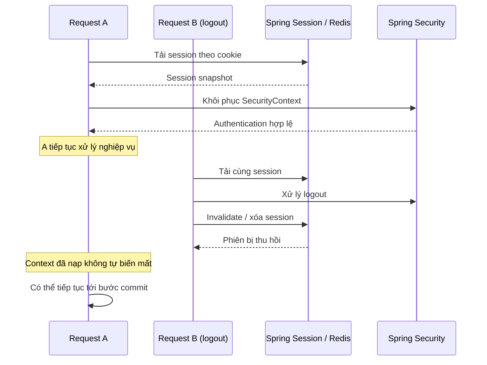

# Đăng xuất đồng thời với các yêu cầu đang thực hiện

Trong ứng dụng Spring Session, một người dùng có thể gửi nhiều request gần như cùng lúc: một request tải dữ liệu, một request cập nhật giỏ hàng, một request gọi API dài và một request logout. Khi logout xảy ra trong lúc các request khác đang chạy, việc xóa session ở Redis/JDBC không tự động dừng các request đã bắt đầu, cũng không xóa `SecurityContext` đã được nạp vào bộ nhớ của thread xử lý từng request.

Logout bảo đảm các request tiếp theo không thể khôi phục phiên đã bị thu hồi, nếu repository và các node cùng dùng chung trạng thái. Với request đã qua bước xác thực, ứng dụng cần quyết định rõ liệu request đó được phép hoàn tất hay phải kiểm tra lại trạng thái thu hồi trước khi thực hiện thay đổi quan trọng. Trong hệ thống nhiều instance, cần kiểm thử thêm cuộc đua giữa đọc session, cập nhật session, invalidate và thao tác lưu phiên ở cuối request.

## 1. Logout không phải lệnh hủy mọi request đang chạy

Khi request đến, Servlet container giao request cho một thread. Spring Session filter đọc session ID và tải phiên; Spring Security khôi phục `SecurityContext` cho request đó. Sau khi xác thực và authorization thành công, controller/service tiếp tục xử lý dựa trên authentication đã có trong ngữ cảnh request.

Nếu người dùng gửi logout ở một request khác, logout handler có thể xóa `SecurityContext` của request logout, invalidate `HttpSession` và xóa cookie trên response. Các thao tác đó không tự động đi vào thread của request đang chạy trước đó để dừng mã lệnh, hủy transaction hoặc xóa `Authentication` cục bộ mà request kia đã nhận.

Ví dụ:

1. Request A tải session và xác thực người dùng `user-42`.
2. Request A bắt đầu xử lý một lệnh chuyển trạng thái đơn hàng.
3. Request B gửi logout với cùng session cookie.
4. Request B invalidate session trong repository và xóa cookie trên response B.
5. Request A vẫn có thể tiếp tục với `SecurityContext` đã được khôi phục ở đầu request.

Vì vậy, cần phân biệt hai mục tiêu:

- **Thu hồi phiên cho request mới:** session ID cũ không còn được repository khôi phục thành phiên hợp lệ.
- **Ngăn request đang chạy tiếp tục hành động:** cần cơ chế kiểm tra thu hồi hoặc hủy công việc riêng; chỉ invalidate session là chưa đủ.

Đây là đặc tính của xử lý request đồng thời, không phải lỗi riêng của Redis hay JDBC. Servlet container có thể xử lý nhiều request của cùng cookie trên các thread khác nhau; nhiều instance còn làm các request đó chạy trên các process khác nhau.

## 2. Điều gì xảy ra với SecurityContext của request đang chạy?

Trong cấu hình Servlet phổ biến, Spring Security lưu `SecurityContext` trong `SecurityContextHolder` trong phạm vi xử lý request. `SecurityContextHolder` thường dùng strategy dựa trên `ThreadLocal`. Mỗi request có context gắn với thread xử lý nó.

Khi logout request B xóa context của chính request B, việc đó không xóa tự động context đang nằm trên thread request A. Hai request có thể cùng dùng một session ban đầu nhưng đã có các bản context/request state riêng sau khi được khởi tạo.

Luồng minh họa:



Không dùng `SecurityContextHolder.clearContext()` trong logout để kỳ vọng hủy authentication của mọi request đang chạy. Phương thức đó chỉ tác động tới context gắn với execution context hiện tại. Cũng không dùng một biến `static` trong JVM làm cờ logout toàn hệ thống; nó không được chia sẻ giữa các instance và không có semantics đồng bộ phân tán.

## 3. Session invalidate và request đã giữ tham chiếu cũ

`HttpSession.invalidate()` đánh dấu phiên hiện tại không còn hợp lệ và yêu cầu container/Spring Session hủy phiên. Các thuộc tính phiên được xử lý theo lifecycle của session. Sau khi invalidate, mã tiếp tục truy cập session cũ có thể nhận `IllegalStateException` hoặc hành vi không còn hợp lệ theo API/implementation.

Trong lúc đó, một request khác có thể đã lấy session object trước khi logout xảy ra. Request đó có thể giữ snapshot hoặc wrapper của phiên cũ. Khi nó tiếp tục sửa attributes hoặc đi tới bước lưu phiên, kết quả phụ thuộc repository, save/flush mode, thứ tự thao tác và implementation version.

Các tình huống có thể gặp:

- Request A chỉ đọc session, sau đó B invalidate: A vẫn có thể hoàn tất phần đọc đã lấy được.
- Request A sửa attribute trước khi B invalidate: thay đổi có thể được lưu trước hoặc sau thao tác xóa tùy thời điểm flush và transaction.
- Request A giữ phiên cũ rồi lưu sau khi B đã xóa: tùy repository và cách ghi, có thể xảy ra lỗi, không có dữ liệu được khôi phục, hoặc trạng thái liên quan được ghi lại nếu implementation cho phép cập nhật theo khóa cũ.
- Request A tiếp tục gọi method trên session đã invalidated: có thể phát sinh exception; không được giả định session object cũ vẫn hợp lệ.

Không nên khẳng định mọi repository đều có cùng kết quả khi save/invalidate đồng thời. Redis repository và JDBC repository có cách biểu diễn, cập nhật delta, câu lệnh SQL và transaction khác nhau; các phiên bản Spring Session cũng có thể thay đổi chi tiết. Hãy kiểm thử đúng backend, phiên bản, flush/save mode và cách request hoàn tất trong ứng dụng.

Điểm thiết kế an toàn là không dựa vào session làm khóa đồng bộ cho nghiệp vụ. Dữ liệu cần bảo vệ sau logout phải có trạng thái thu hồi riêng, được kiểm tra tại thời điểm thực hiện hành động hoặc commit.

## 4. Thứ tự filter và thời điểm invalidate

Trong Servlet application, `SessionRepositoryFilter` chạy trước `springSecurityFilterChain`. Spring Security nhận `HttpSession` do Spring Session quản lý. Logout filter xử lý request logout và gọi các logout handler đã cấu hình.

Một cấu hình cơ bản:

```java
@Bean
SecurityFilterChain securityFilterChain(HttpSecurity http) throws Exception {
    http
        .authorizeHttpRequests(authorize -> authorize
            .requestMatchers("/login", "/public/**").permitAll()
            .anyRequest().authenticated()
        )
        .formLogin(Customizer.withDefaults())
        .logout(logout -> logout
            .logoutUrl("/logout")
            .invalidateHttpSession(true)
            .clearAuthentication(true)
            .deleteCookies("SESSION")
        );
    return http.build();
}
```

Ví dụ giả định cookie Spring Session tên `SESSION`; phải thay bằng tên cookie thực tế. Với cấu hình Spring Security chuẩn, logout handler có thể xóa context, invalidate session và xử lý remember-me service theo cấu hình. Nếu ứng dụng tùy chỉnh logout handler, cần xác nhận các thao tác tương đương vẫn được thực hiện.

Logout nên là request thay đổi trạng thái, thường dùng POST và giữ CSRF protection. Không biến logout thành GET chỉ để trình duyệt dễ gọi; GET có thể bị kích hoạt bởi link, crawler hoặc nội dung nhúng ngoài ý muốn.

Cookie bị xóa trên response logout chỉ ảnh hưởng trình duyệt nhận response đó. Một tab khác hoặc request đã gửi trước đó vẫn có thể mang cookie cũ. Server-side invalidation mới là cơ chế thu hồi session ID; xóa cookie chỉ giúp client ngừng gửi cookie trong các request sau.

## 5. Tính nhất quán giữa nhiều instance

Trong triển khai nhiều instance, request A có thể tới node 1 còn logout request B tới node 2. Nếu cả hai dùng cùng Spring Session repository và cấu hình thống nhất, node 2 có thể xóa session trong kho chia sẻ. Những request mới sau đó tới bất kỳ node nào đều phải bị xử lý như không còn session hợp lệ.

Để đạt điều đó, các node cần thống nhất:

- Cùng Redis/JDBC endpoint và database/schema.
- Cùng session namespace, table name và serializer.
- Cùng cấu hình cookie/session ID resolver.
- Cùng timeout, save/flush mode và phiên bản tương thích.
- Cùng cấu hình Spring Security về session creation, security context và logout.

Nếu node 1 dùng namespace khác node 2, logout ở node 2 có thể chỉ xóa phiên trong namespace của node 2; request sau tới node 1 vẫn có thể khôi phục session cũ. Nếu một node dùng repository trong bộ nhớ cục bộ, load balancer sticky session không thay thế được kho session chia sẻ khi cần thu hồi trên toàn cụm.

Không dùng sticky session như biện pháp bảo đảm logout toàn cụm. Sticky routing có thể giảm số request đổi node nhưng không xử lý request đồng thời, failover hoặc request được gửi trực tiếp tới node khác.

## 6. Đặt điểm kiểm tra thu hồi trước hành động quan trọng

Nếu yêu cầu bảo mật là “sau khi logout được xác nhận, không request nào được commit hành động nhạy cảm bằng trạng thái đăng nhập cũ”, cần một cơ chế thu hồi được kiểm tra gần điểm commit. Kiểm tra session ở đầu request là chưa đủ vì logout có thể xảy ra sau bước đó.

Một cách thường dùng là lưu `authVersion` hoặc `sessionEpoch` cho principal trong kho dữ liệu dùng chung:

1. Khi xác thực, request nhận version hiện tại của principal.
2. Khi logout toàn bộ hoặc sự kiện bảo mật quan trọng xảy ra, tăng version/revocation counter trong database hoặc Redis.
3. Trước khi commit hành động nhạy cảm, service đọc lại version hiện tại.
4. Nếu version trong request không còn khớp, từ chối thao tác và rollback transaction.

Ví dụ minh họa:

```java
@Service
class SensitiveOperationService {

    private final AccountSecurityStateRepository securityStateRepository;
    private final OrderRepository orderRepository;

    SensitiveOperationService(
            AccountSecurityStateRepository securityStateRepository,
            OrderRepository orderRepository) {
        this.securityStateRepository = securityStateRepository;
        this.orderRepository = orderRepository;
    }

    @Transactional
    public void approveOrder(
            Long orderId,
            String principalId,
            long authenticatedVersion) {

        long currentVersion = securityStateRepository
                .findVersionForUpdate(principalId);

        if (currentVersion != authenticatedVersion) {
            throw new AuthenticationRevokedException();
        }

        Order order = orderRepository.findById(orderId)
                .orElseThrow(() -> new OrderNotFoundException(orderId));
        order.approve();
    }
}
```

Đây là ví dụ kiến trúc; `findVersionForUpdate` cần được triển khai bằng cơ chế transaction/locking phù hợp với database. `authenticatedVersion` phải được lấy từ trạng thái xác thực đã được xác minh, không nhận trực tiếp từ input người dùng. Khi cần bảo đảm thứ tự giữa logout và commit, thao tác tăng version và thao tác nghiệp vụ phải có quy tắc khóa/transaction rõ ràng để tránh race giữa lần kiểm tra cuối và commit.

Chỉ lưu version trong cùng `HttpSession` là không đủ: sau khi request đã tải session, nó có thể tiếp tục dùng bản cũ. Revocation marker phải nằm ở kho dùng chung độc lập với session đang bị xóa, và cần được kiểm tra lại tại điểm có ý nghĩa bảo mật.

## 7. Hủy các tác vụ dài đang chạy

Một số request chỉ đọc dữ liệu; một số khác kích hoạt công việc dài như xuất báo cáo, xử lý tệp hoặc workflow. Invalidate session không tự dừng các tác vụ đã được gửi sang executor, message broker hoặc hệ thống bên ngoài.

Nếu nghiệp vụ cần hủy công việc khi logout, hãy thiết kế cancellation riêng:

- Tạo `jobId` cho công việc và lưu trạng thái job trong kho dùng chung.
- Liên kết job với principal hoặc security epoch, không giữ `HttpServletRequest` hay `HttpSession` trong worker.
- Khi logout hoặc thu hồi quyền, đánh dấu job `CANCEL_REQUESTED` hoặc tăng revocation version.
- Worker kiểm tra cancellation ở các checkpoint và trước khi ghi kết quả cuối.
- Các thao tác ngoài hệ thống cần idempotency key hoặc cơ chế bù trừ nếu không thể hủy sau khi đã gửi.

Không dựa vào interrupt thread như bảo đảm hủy mọi tác vụ; nhiều I/O hoặc thư viện không phản ứng với interrupt. Với công việc đã gửi tới message broker, cần cơ chế kiểm tra trạng thái/revocation khi consumer thực thi.

## 8. Logout một phiên và logout tất cả phiên

Logout phiên hiện tại thường invalidate session ID đang dùng. Logout tất cả thiết bị có phạm vi rộng hơn: ứng dụng cần tìm mọi session của principal qua repository indexed/`SessionRegistry`, sau đó thu hồi từng phiên hoặc cập nhật revocation state ở cấp tài khoản.

Ngay cả khi đã xóa mọi session ID, các request đang chạy trên những session đó vẫn có thể có `SecurityContext` đã nạp. Vì vậy, nếu logout-all là phản ứng trước sự cố tài khoản, hãy kết hợp:

- Xóa các session đang tồn tại.
- Thu hồi remember-me/persistent tokens nếu ứng dụng sử dụng.
- Tăng authentication version hoặc thu hồi credential ở cấp principal.
- Kiểm tra version tại các thao tác nhạy cảm.
- Hủy hoặc vô hiệu hóa job dài đang chạy theo chính sách.

Nếu ứng dụng dùng JWT stateless, xóa Spring Session không thu hồi JWT độc lập. Cần token revocation, short-lived access token, refresh-token rotation hoặc cơ chế version/introspection phù hợp.

## 9. Remember-me có thể đăng nhập lại sau logout

Khi ứng dụng bật Spring Security remember-me, logout chỉ invalidate session mà không xóa remember-me cookie/token có thể dẫn tới việc trình duyệt tự xác thực lại ở request sau. Người dùng có thể tưởng logout không thành công, trong khi session cũ đã bị xóa và một session mới được tạo nhờ remember-me credential.

Với logout chuẩn, kiểm tra remember-me service có tham gia logout handling không. Nếu dùng custom cookie name hoặc persistent token repository, bảo đảm logout xóa cookie và thu hồi token record tương ứng. Đối với logout-all, xóa session không tự động thu hồi tất cả remember-me tokens.

Các request đang chạy cũng có thể tiếp tục tới khi hoàn tất nếu chúng đã xác thực trước khi logout. Nếu yêu cầu “logout ngay” bao gồm ngăn cả request đã xác thực nhưng chưa commit, cần kết hợp revocation marker như phần trước; xóa cookie không thực hiện được việc đó.

## 10. Các chính sách đối với request đang chạy

Không phải ứng dụng nào cũng cần hủy tất cả request đang chạy. Cần phân loại theo hậu quả nghiệp vụ:

| Loại request | Chính sách thường phù hợp | Lý do |
| --- | --- | --- |
| Đọc nội dung công khai hoặc dữ liệu không nhạy cảm | Có thể hoàn tất | Không tạo thay đổi bảo mật quan trọng |
| Đọc dữ liệu cá nhân | Có thể kiểm tra revocation trước khi trả kết quả hoặc trước bước tải dữ liệu nhạy cảm | Tránh tiếp tục trả dữ liệu sau khi quyền bị thu hồi |
| Cập nhật hồ sơ thông thường | Kiểm tra quyền/revocation trong transaction trước commit | Tránh ghi thay đổi từ request đã bị thu hồi |
| Thanh toán, phê duyệt, thay đổi quyền | Kiểm tra version/authorization tại điểm commit và dùng transaction | Hậu quả lớn nếu request cũ vẫn thực hiện |
| Tác vụ dài hoặc async | Cancellation state và checkpoint | Không còn request thread để logout điều khiển trực tiếp |
| Upload/download stream | Xác định có thể dừng stream hay chỉ ngăn request mới | Response có thể đã bắt đầu gửi và không thể thu hồi bytes đã gửi |

HTTP response đã gửi một phần không thể “thu hồi” lại từ trình duyệt. Nếu dữ liệu đã được truyền ra ngoài trước khi logout hoàn tất, server không thể làm client quên dữ liệu đó. Hãy đặt kiểm tra quyền trước khi bắt đầu stream nhạy cảm và giới hạn thời gian/khối lượng xử lý.

## 11. Kiểm thử race giữa request và logout

Kiểm thử tuần tự không phát hiện được nhiều lỗi đồng thời. Nên tạo test có latch/barrier để kiểm soát thứ tự:

1. Đăng nhập và lấy session cookie.
2. Request A gửi tới endpoint thử nghiệm, xác thực xong rồi tạm dừng trước bước commit.
3. Request B dùng cùng cookie gọi logout và chờ response hoàn tất.
4. Cho request A tiếp tục.
5. Kiểm tra chính sách đã chọn: A được phép hoàn tất hoặc bị từ chối tại revocation check.
6. Gửi request C bằng cookie cũ tới cùng instance và instance khác; C phải không được khôi phục session đã invalidate.

Các trường hợp nên kiểm tra:

| Kịch bản | Điều cần xác minh |
| --- | --- |
| Logout trước khi request mới bắt đầu | Request mới không khôi phục session cũ |
| Request đã xác thực, sau đó logout | Hành vi của request đang chạy đúng chính sách |
| Request cập nhật attribute đồng thời logout | Không có session cũ được lưu lại ngoài ý muốn; xác minh theo repository/version |
| Request A và logout ở hai instance | Thu hồi được chia sẻ qua repository dùng chung |
| Logout rồi gửi cookie cũ | Session cũ không được khôi phục |
| Remember-me còn cookie sau logout | Không tự xác thực lại nếu logout yêu cầu thu hồi remember-me |
| Logout-all | Session ở mọi instance bị thu hồi và revocation state được cập nhật |
| Tác vụ async đang chạy | Worker dừng ở checkpoint hoặc không commit kết quả sau thu hồi |
| Redis/JDBC tạm thời lỗi | Ứng dụng xử lý rõ trạng thái chưa thể xác nhận logout |

Dùng Redis/JDBC thật hoặc Testcontainers để kiểm thử repository. Chạy ít nhất hai application context nếu ứng dụng triển khai nhiều instance. Với test race, dùng `CountDownLatch`, `CyclicBarrier` hoặc cơ chế đồng bộ test tương đương để đảm bảo request A thực sự đã qua xác thực trước khi logout bắt đầu. Không dựa vào `sleep` ngẫu nhiên để tạo cuộc đua.

## 12. Xử lý lỗi khi logout không xác nhận được

Nếu kho session không truy cập được trong lúc logout, ứng dụng có thể không xác nhận được session đã bị xóa. Không nên trả thông báo thành công tuyệt đối nếu thao tác thu hồi phía server thất bại mà hệ thống yêu cầu bảo đảm thu hồi.

Chính sách cần xác định:

- Có chặn request nhạy cảm tiếp theo khi revocation store chưa truy cập được không?
- Có retry thao tác invalidate không, và retry có idempotent không?
- Có ghi nhận logout pending để xử lý lại không?
- Có yêu cầu thu hồi credential cấp principal qua một store khác không?
- Client nhận thông báo gì khi server chưa xác nhận được logout?

Xóa cookie trên response khi backend store đang lỗi có thể làm trình duyệt ngừng gửi cookie trong tab hiện tại, nhưng không bảo đảm cookie cũ ở tab khác hoặc thiết bị khác đã bị thu hồi. Với hệ thống bảo mật cao, có thể chọn fail-closed cho hành động nhạy cảm cho tới khi trạng thái thu hồi được xác nhận.

Không nuốt exception Redis/JDBC rồi coi như session không tồn tại. Phân biệt session đã bị xóa với repository unavailable. Ghi log và metric an toàn, không ghi session ID, cookie hoặc token.

## 13. Quan sát vận hành

Các tín hiệu nên theo dõi:

- Số lần logout thành công/thất bại và latency của repository.
- Lỗi invalidate, timeout, deadlock hoặc serialization khi request hoàn tất.
- Số request đã xác thực tiếp tục chạy sau thời điểm logout được xác nhận, nếu có revocation instrumentation.
- Số lần revocation check từ chối một hành động do authentication version không còn khớp.
- Job async bị hủy hoặc bị từ chối commit sau logout.
- Chênh lệch session count giữa repository và số principal/device record nghiệp vụ.
- Tỷ lệ request cũ gửi cookie đã bị thu hồi.

Không dùng session ID làm metric label hoặc log identifier công khai vì đó là bearer credential. Có thể dùng correlation ID và mã principal đã được bảo vệ/ẩn danh hóa theo chính sách dữ liệu.

## 14. Checklist triển khai

- `SessionRepositoryFilter` chạy trước Spring Security và mọi filter dùng `HttpSession`.
- Logout dùng POST và giữ CSRF protection.
- Logout handler xóa `SecurityContext`, invalidate session và xóa đúng cookie.
- Remember-me cookie/token được xử lý nếu ứng dụng bật remember-me.
- Mọi instance dùng chung repository, namespace, serializer và timeout.
- Không giả định invalidate sẽ hủy request đã xác thực hoặc job async đang chạy.
- Với thao tác nhạy cảm, kiểm tra revocation/authentication version tại điểm commit.
- Dùng transaction hoặc distributed coordination phù hợp nếu cần thứ tự nghiêm ngặt giữa logout và commit.
- Kiểm thử request đang chạy, cập nhật session đồng thời, logout ở node khác, cookie cũ và repository failure.
- Theo dõi lỗi invalidate, race và thao tác bị từ chối sau thu hồi; không log credential.

Logout trong Spring Session thu hồi session để các request mới không thể tiếp tục dùng ID cũ. Nó không tự động dừng các request đã xác thực, xóa `SecurityContext` trên thread khác hoặc hủy công việc bất đồng bộ. Khi yêu cầu bảo mật cần ngăn cả những thao tác đang chạy, ứng dụng phải bổ sung điểm kiểm tra thu hồi ở cấp principal hoặc transaction, xác định chính sách cho từng loại request và kiểm thử race trên đúng repository cùng môi trường nhiều instance.
