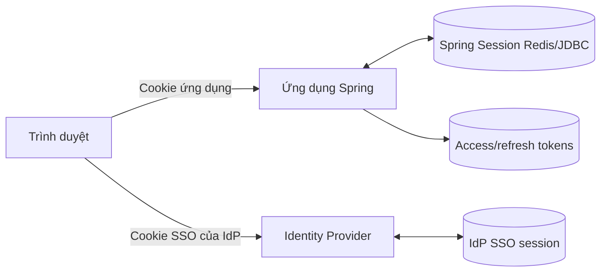

# Đăng xuất cục bộ khác với đăng xuất tại nhà cung cấp danh tính

Trong ứng dụng Spring dùng Spring Session và đăng nhập qua một nhà cung cấp danh tính (Identity Provider — IdP), có ít nhất hai phiên độc lập cần phân biệt: phiên của ứng dụng và phiên đăng nhập tại IdP. Đăng xuất khỏi ứng dụng thường chỉ hủy session mà ứng dụng đang quản lý trong Redis hoặc JDBC. Nó không tự động kết thúc phiên SSO tại IdP. Ngược lại, yêu cầu đăng xuất tại IdP cũng không bảo đảm mọi session cục bộ của mọi ứng dụng đã bị xóa nếu các ứng dụng không tham gia một cơ chế Single Logout.

Sự khác biệt này dễ thấy khi người dùng đăng nhập qua OpenID Connect (OIDC): sau khi logout cục bộ, người dùng truy cập lại ứng dụng và được chuyển tới IdP; vì cookie SSO của IdP vẫn còn, IdP có thể xác thực lại người dùng mà không hỏi mật khẩu. Từ góc nhìn người dùng, họ có cảm giác “logout không có tác dụng”, dù session cục bộ đã bị hủy đúng cách.

Một hệ thống cần thiết kế rõ từng hành động: hủy session ứng dụng, xóa remember-me credential, thu hồi access/refresh token, yêu cầu IdP kết thúc phiên SSO và thông báo logout tới các ứng dụng khác. Các thao tác này có phạm vi và giao thức khác nhau.

## 1. Những phiên và credential tồn tại đồng thời

### 1.1. Session cục bộ của ứng dụng

Trong ứng dụng Servlet, Spring Session thay thế implementation `HttpSession` bằng session được lưu trong repository. `SessionRepositoryFilter` đọc session ID từ cookie hoặc resolver đã cấu hình, nạp dữ liệu từ Redis/JDBC và cung cấp `HttpSession` cho Spring Security cùng ứng dụng.

Session cục bộ thường chứa:

- `SecurityContext` và thông tin Authentication của người dùng.
- Các thuộc tính quy trình như giỏ hàng hoặc trạng thái wizard.
- Mốc truy cập cuối và `maxInactiveInterval`.
- Các thuộc tính nội bộ cần thiết cho Spring Security hoặc ứng dụng.

Khi session bị invalidate, repository xóa dữ liệu phiên. Với kho dùng chung, mọi instance có thể thấy session ID đó không còn hợp lệ.

### 1.2. Phiên SSO tại Identity Provider

IdP có session riêng trong domain của nó. Cookie SSO của IdP giúp IdP nhận ra người dùng đã đăng nhập trước đó. Cookie này thường không được ứng dụng relying party (RP) đọc vì khác domain và thuộc quyền quản lý của IdP.

Ví dụ, người dùng truy cập `portal.example.com`, được chuyển tới `login.identity.example`, xác thực một lần rồi quay lại portal. Portal tạo session cục bộ và giữ cookie riêng. IdP giữ cookie SSO của nó. Hai cookie này có thể cùng tồn tại nhưng có vòng đời độc lập.

### 1.3. Remember-me credential

Remember-me là một cơ chế khác với cả session cục bộ lẫn IdP SSO. Spring Security có thể cấp một cookie remember-me dài hạn để nhận diện người dùng khi session cục bộ đã hết hạn hoặc bị xóa. Tùy cách cấu hình, credential này có thể là token hash hoặc persistent token có trạng thái phía server.

Nếu logout chỉ xóa session mà không xóa remember-me cookie và token tương ứng, một request sau đó có thể tự xác thực lại người dùng mà không cần nhập mật khẩu. Vì vậy, cần kiểm tra `RememberMeServices` và `PersistentTokenRepository` khi ứng dụng bật remember-me.

### 1.4. OAuth2 access token và refresh token

Ứng dụng có thể lưu OAuth2 access token hoặc refresh token để gọi API thay mặt người dùng. Các token này không phải session ID. Xóa Spring Session không mặc nhiên thu hồi token đã được phát hành. Nếu yêu cầu bảo mật là thu hồi quyền truy cập API, cần xóa token khỏi kho authorized client và/hoặc gọi token revocation endpoint của provider nếu provider hỗ trợ.

### 1.5. Sơ đồ các lớp trạng thái



Hủy một thành phần không tự động hủy các thành phần còn lại. Đây là nguyên nhân chính khiến local logout và IdP logout cần được thiết kế riêng.

## 2. Đăng xuất cục bộ (local logout)

### 2.1. Local logout thực hiện những gì?

Local logout kết thúc phiên của ứng dụng hiện tại. Với Spring Security và Spring Session, luồng logout tiêu chuẩn thường thực hiện các bước:

1. Xóa hoặc invalidate `HttpSession`.
2. Xóa `SecurityContext` khỏi holder và repository tương ứng.
3. Gọi `RememberMeServices.logout` nếu remember-me được cấu hình.
4. Xóa CSRF token hiện tại theo logout handler.
5. Gửi response xóa cookie session ID và remember-me cookie theo cấu hình.
6. Chuyển người dùng tới trang hoặc endpoint thành công.

Khi `HttpSession` bị invalidate, tích hợp Spring Session xóa session trong repository. `HttpSessionIdResolver`/cookie serializer chịu trách nhiệm phát chỉ thị hết hạn cookie session ID. Nếu dùng Redis/JDBC chung, request tiếp theo ở instance khác cũng không thể nạp session cũ.

### 2.2. Cấu hình logout cục bộ

Spring Security cung cấp logout support qua `LogoutFilter`. Ví dụ cấu hình:

```java
import org.springframework.context.annotation.Bean;
import org.springframework.context.annotation.Configuration;
import org.springframework.security.config.annotation.web.builders.HttpSecurity;
import org.springframework.security.web.SecurityFilterChain;

@Configuration
public class LocalLogoutConfiguration {

    @Bean
    SecurityFilterChain securityFilterChain(HttpSecurity http) throws Exception {
        return http
            .authorizeHttpRequests(authorize -> authorize
                .requestMatchers("/login", "/logged-out").permitAll()
                .anyRequest().authenticated())
            .formLogin(form -> form.permitAll())
            .logout(logout -> logout
                .logoutUrl("/logout")
                .invalidateHttpSession(true)
                .clearAuthentication(true)
                .logoutSuccessUrl("/logged-out"))
            .build();
    }
}
```

`invalidateHttpSession(true)` và `clearAuthentication(true)` được nêu rõ trong ví dụ để thể hiện mục tiêu local logout; đây cũng là hành vi mặc định của cấu hình logout tiêu chuẩn. Với cấu hình mặc định có CSRF, logout được thực hiện bằng POST và cần CSRF token. Không tắt CSRF chỉ để cho phép một liên kết GET `/logout`.

### 2.3. Cookie session do Spring Session quản lý

Khi dùng Spring Session, tên cookie có thể là `SESSION` hoặc tên tùy chỉnh qua `DefaultCookieSerializer`. Khi session bị invalidate, Spring Session phát cookie hết hạn dựa trên serializer. Nếu đổi tên cookie, path hoặc domain, hãy kiểm tra header `Set-Cookie` thực tế để chắc chắn browser nhận được lệnh xóa đúng cookie.

Không nên xóa cookie bằng JavaScript nếu cookie có `HttpOnly`; cũng không cần tự viết `document.cookie` để xóa cookie session. Nếu cấu hình serializer tùy chỉnh, phải giữ nhất quán `Path`, `Domain`, `Secure` và `SameSite` giữa cookie được tạo và cookie hết hạn.

### 2.4. Local logout không kết thúc IdP session

Sau local logout, session trong Redis/JDBC đã bị xóa nhưng cookie SSO của IdP vẫn còn. Nếu người dùng mở lại ứng dụng và chọn đăng nhập OIDC, trình duyệt được chuyển tới IdP. IdP thấy cookie SSO còn hợp lệ và có thể trả authorization response ngay mà không yêu cầu người dùng xác thực lại.

Đây là hành vi SSO bình thường, không nhất thiết là lỗi của Spring Session. Nếu sản phẩm chỉ yêu cầu đăng xuất khỏi một ứng dụng, local logout có thể là đúng. Nếu người dùng mong muốn đăng xuất khỏi toàn bộ hệ thống SSO, cần thực hiện thêm giao thức logout tại IdP và/hoặc cơ chế thông báo logout tới các RP khác.

## 3. Xóa remember-me khi logout

### 3.1. Remember-me có thể tạo session mới sau local logout

Khi bật remember-me, Spring Security có thể nhận diện người dùng từ cookie remember-me và tự tạo Authentication mới khi người dùng quay lại. Vì vậy, nếu chỉ invalidate `HttpSession`, người dùng có thể được đăng nhập lại ngay từ remember-me cookie.

Với `RememberMeServices` được Spring Security tích hợp vào logout filter, logout tiêu chuẩn gọi dịch vụ remember-me để xóa cookie. Nếu dùng persistent remember-me, token tương ứng cũng cần được xóa khỏi `PersistentTokenRepository`.

### 3.2. Cấu hình remember-me và logout

Ví dụ minh họa persistent remember-me:

```java
import org.springframework.beans.factory.annotation.Value;
import org.springframework.security.core.userdetails.UserDetailsService;
import org.springframework.security.web.authentication.rememberme.PersistentTokenRepository;

http
    .rememberMe(remember -> remember
        .key(rememberMeKey)
        .tokenRepository(persistentTokenRepository)
        .userDetailsService(userDetailsService))
    .logout(logout -> logout
        .logoutUrl("/logout")
        .invalidateHttpSession(true)
        .clearAuthentication(true)
        .logoutSuccessUrl("/logged-out"));
```

Đây là phần cấu hình nối vào `HttpSecurity` hiện có; `rememberMeKey` được inject từ cấu hình bảo mật, còn `persistentTokenRepository` và `userDetailsService` phải được khai báo phù hợp với ứng dụng. Ví dụ chữ ký method có thể nhận các dependency và secret:

```java
SecurityFilterChain securityFilterChain(
        HttpSecurity http,
        PersistentTokenRepository persistentTokenRepository,
        UserDetailsService userDetailsService,
        @Value("${security.remember-me-key}") String rememberMeKey) throws Exception {
    // Cấu hình rememberMe/logout ở trên.
}
```

Không dùng chuỗi key minh họa làm secret production. Khi logout, Spring Security gọi remember-me logout handler để xóa cookie và thu hồi token theo implementation được cấu hình.

### 3.3. Cookie tùy chỉnh và token lưu riêng

Nếu ứng dụng tự tạo cookie đăng nhập dài hạn ngoài `RememberMeServices`, logout handler mặc định không biết cookie đó. Cần đăng ký `LogoutHandler` riêng để:

- Hết hạn cookie đúng tên, path và domain.
- Thu hồi token hoặc xóa bản ghi server-side tương ứng.
- Đảm bảo token cũ không thể được sử dụng lại.

Chỉ xóa cookie ở trình duyệt là chưa đủ nếu token server-side vẫn còn hiệu lực. Ngược lại, chỉ xóa token trong database nhưng không xóa cookie sẽ khiến browser tiếp tục gửi credential vô hiệu, gây request lỗi hoặc vòng lặp xác thực.

## 4. Đăng xuất tại nhà cung cấp danh tính

### 4.1. RP-Initiated Logout của OpenID Connect

OIDC định nghĩa RP-Initiated Logout để ứng dụng relying party yêu cầu OpenID Provider kết thúc phiên đăng nhập của người dùng tại provider. Ứng dụng chuyển trình duyệt tới `end_session_endpoint` của provider. Request thường chứa:

- `id_token_hint`: ID Token đã được phát hành cho RP, giúp provider nhận biết phiên/người dùng cần logout.
- `post_logout_redirect_uri`: URI được đăng ký để provider chuyển trình duyệt về sau logout.
- `state`: giá trị liên kết request/response nếu được sử dụng để bảo vệ luồng chuyển hướng.

Provider có thể yêu cầu thêm tham số hoặc có chính sách riêng. Không phải mọi OAuth2 provider đều hỗ trợ OIDC logout; `end_session_endpoint` là một khả năng của OpenID Provider được công bố qua metadata.

### 4.2. Spring Security `OidcClientInitiatedLogoutSuccessHandler`

Spring Security cung cấp `OidcClientInitiatedLogoutSuccessHandler` cho RP-Initiated Logout. Handler này dùng `ClientRegistrationRepository` để tìm cấu hình OIDC, lấy thông tin endpoint logout từ provider metadata và xây dựng redirect phù hợp dựa trên `OidcUser` đang đăng nhập.

Ví dụ:

```java
import org.springframework.context.annotation.Bean;
import org.springframework.context.annotation.Configuration;
import org.springframework.security.config.annotation.web.builders.HttpSecurity;
import org.springframework.security.oauth2.client.registration.ClientRegistrationRepository;
import org.springframework.security.oauth2.client.oidc.web.logout.OidcClientInitiatedLogoutSuccessHandler;
import org.springframework.security.config.Customizer;
import org.springframework.security.web.SecurityFilterChain;
import org.springframework.security.web.authentication.logout.LogoutSuccessHandler;

@Configuration
public class OidcLogoutConfiguration {

    @Bean
    LogoutSuccessHandler oidcLogoutSuccessHandler(
            ClientRegistrationRepository clientRegistrationRepository) {
        OidcClientInitiatedLogoutSuccessHandler handler =
            new OidcClientInitiatedLogoutSuccessHandler(clientRegistrationRepository);
        handler.setPostLogoutRedirectUri("{baseUrl}");
        return handler;
    }

    @Bean
    SecurityFilterChain securityFilterChain(
            HttpSecurity http,
            LogoutSuccessHandler oidcLogoutSuccessHandler) throws Exception {
        return http
            .authorizeHttpRequests(authorize -> authorize
                .requestMatchers("/login", "/logged-out").permitAll()
                .anyRequest().authenticated())
            .oauth2Login(Customizer.withDefaults())
            .logout(logout -> logout
                .logoutUrl("/logout")
                .invalidateHttpSession(true)
                .clearAuthentication(true)
                .logoutSuccessHandler(oidcLogoutSuccessHandler))
            .build();
    }
}
```

Logout handlers của Spring Security được thực hiện trước `LogoutSuccessHandler`. Vì vậy, session cục bộ được invalidate và SecurityContext được xóa trước khi trình duyệt được chuyển tới IdP logout endpoint. Đây là thứ tự mong muốn: ứng dụng đã kết thúc session của chính nó ngay cả khi bước logout tại provider gặp lỗi.

Ví dụ dùng `{baseUrl}` để tạo URI quay về ứng dụng. URI thực tế phải được đăng ký trong cấu hình logout của IdP. Nếu ứng dụng chạy sau reverse proxy, cấu hình forwarded headers và danh sách proxy tin cậy để `{baseUrl}` không bị tạo sai scheme/host. Không lấy `post_logout_redirect_uri` tùy ý từ query parameter của người dùng vì có thể tạo open redirect.

### 4.3. Điều kiện để RP-Initiated Logout hoạt động

Kiểm tra các điều kiện sau:

1. Ứng dụng thực sự dùng OIDC login và Authentication có `OidcUser`/ID Token.
2. Provider công bố `end_session_endpoint` trong OpenID Provider metadata hoặc cấu hình tương đương.
3. RP có `ClientRegistrationRepository` đúng registration.
4. `post_logout_redirect_uri` được đăng ký/cho phép ở provider.
5. ID Token còn sẵn trong Authentication tại thời điểm logout để handler tạo `id_token_hint` nếu provider yêu cầu.
6. Reverse proxy và forwarded headers tạo ra URL ngoài chính xác.
7. Browser có thể truy cập endpoint logout của IdP và quay lại URI được phép.

Nếu ứng dụng chỉ dùng OAuth2 login với provider không triển khai OIDC, không thể mặc định dùng `OidcClientInitiatedLogoutSuccessHandler`. Khi đó cần API logout riêng của provider hoặc chỉ thực hiện local logout.

### 4.4. IdP logout không phải lúc nào cũng logout mọi ứng dụng

RP-Initiated Logout yêu cầu provider kết thúc phiên của người dùng tại provider. Việc các ứng dụng RP khác có bị logout hay không phụ thuộc provider có hỗ trợ và cấu hình Front-Channel Logout hoặc Back-Channel Logout cho từng client. Không nên quảng bá nút “Đăng xuất khỏi mọi ứng dụng” nếu hệ thống không có cơ chế phối hợp đó và không kiểm chứng được kết quả.

## 5. Front-channel và Back-channel logout

### 5.1. Front-channel logout

Front-channel logout dùng trình duyệt làm kênh thông báo. IdP có thể điều hướng hoặc tải endpoint logout của các RP trong browser, đôi khi qua iframe. RP nhận request trong ngữ cảnh trình duyệt và xóa session cục bộ tương ứng.

Ưu điểm là phù hợp với luồng browser và có thể phối hợp nhiều ứng dụng. Hạn chế là phụ thuộc trình duyệt, cookie và chính sách cross-site. Cookie `SameSite`, chặn third-party cookies, iframe restrictions hoặc browser đóng giữa chừng có thể làm thông báo không đến hoặc không mang cookie session như mong đợi.

### 5.2. Back-channel logout

Back-channel logout dùng giao tiếp server-to-server: IdP gửi logout token tới endpoint của RP mà không cần browser ở giữa. Với OIDC, logout token là JWT có các claim và event theo đặc tả Back-Channel Logout. RP xác minh token, xác định session hoặc subject bị logout rồi thu hồi session cục bộ.

Ưu điểm là không phụ thuộc cookie third-party hoặc browser đang mở. RP vẫn cần xác minh chữ ký, issuer, audience, thời gian, `jti`, claim logout event và `sid`/`sub` theo đặc tả. Không chấp nhận một POST chỉ chứa username rồi xóa tất cả session mà không xác minh token từ IdP.

Các phiên bản Spring Security hiện đại có hỗ trợ OIDC Back-Channel Logout; API DSL và cách đăng ký session registry phụ thuộc phiên bản. Hãy dùng tài liệu đúng BOM Spring Security của ứng dụng và kiểm thử rằng logout token được xác minh trước khi session bị xóa. Với provider hoặc phiên bản chưa hỗ trợ sẵn, cần triển khai endpoint theo đặc tả và kiểm tra bảo mật nghiêm ngặt.

### 5.3. `sid` và `sub`

Logout token có thể xác định phiên đăng nhập IdP bằng `sid` (session ID phía OP) hoặc subject bằng `sub`. Khi có `sid`, RP có thể ánh xạ chính xác các session cục bộ gắn với phiên IdP đó. Nếu chỉ có `sub`, chính sách có thể ảnh hưởng đến mọi session cục bộ của subject tại RP.

Ứng dụng cần duy trì ánh xạ giữa `sid`/`sub` và local session. Không dùng session ID nội bộ của Spring Session làm `sid` của IdP; đây là hai định danh khác nhau. Khi lưu ánh xạ, cần cập nhật khi login, refresh session, logout cục bộ và khi session hết hạn.

### 5.4. Sự kiện session của Spring Session không tự thay thế OIDC logout

Spring Session Redis indexed có thể phát `SessionDeletedEvent` hoặc `SessionExpiredEvent` khi repository nhận thông báo Redis phù hợp. Các event này phản ánh vòng đời session cục bộ trong repository. Chúng không tự chứng minh IdP đã kết thúc SSO session và cũng không tự gửi logout tới provider.

Với JDBC, repository không cung cấp cùng cơ chế session lifecycle event như Redis indexed. Nếu cần phối hợp logout, hãy thiết kế rõ đường đi từ IdP logout token hoặc logout handler đến thao tác invalidate local session. Không phụ thuộc vào một event mà repository hiện tại không phát.

## 6. Thu hồi token và authorized client

### 6.1. Xóa local session không thu hồi access token

OAuth2 access token có thể vẫn hợp lệ ở resource server cho tới khi hết hạn, kể cả sau khi người dùng logout khỏi ứng dụng. Refresh token cũng có thể tiếp tục dùng để lấy access token mới nếu chưa bị thu hồi.

Nếu ứng dụng lưu `OAuth2AuthorizedClient`, cần xóa bản ghi authorized client theo principal và registration khi logout nếu nghiệp vụ yêu cầu. Việc xóa bản ghi chỉ ngăn ứng dụng lấy lại token từ kho của nó; nó không nhất thiết làm token đã phát hành mất hiệu lực tại resource server.

### 6.2. Token revocation endpoint

Một số provider hỗ trợ OAuth 2.0 Token Revocation (RFC 7009). Ứng dụng có thể gửi refresh token hoặc access token tới revocation endpoint theo chính sách provider. Phải dùng client authentication và TLS đúng cách; không gửi token qua URL hoặc log.

Không phải mọi provider đều thu hồi token tức thời hoặc cùng cách. Resource server có thể tiếp tục chấp nhận access token self-contained cho tới `exp`, trừ khi có cơ chế introspection, denylist hoặc kiểm tra trạng thái bổ sung.

### 6.3. Lập thứ tự logout

Một quy trình logout mạnh có thể gồm:

1. Xác định danh tính, registration và ID Token/authorized client cần dùng.
2. Thu thập thông tin cần thiết để xây dựng provider logout request trước khi xóa Authentication.
3. Invalidate local session, xóa SecurityContext và remember-me credential.
4. Xóa authorized client hoặc yêu cầu thu hồi refresh/access token nếu chính sách yêu cầu.
5. Chuyển trình duyệt tới OIDC end-session endpoint hoặc gọi back-channel/token revocation phù hợp.
6. Xử lý lỗi provider theo chính sách: local logout vẫn phải hoàn tất; ghi nhận việc provider logout chưa xác nhận.

Không giữ local session sống chỉ vì IdP tạm thời không khả dụng. Nếu local logout là yêu cầu bảo mật, nó phải hoàn tất độc lập; bước provider logout có thể được retry hoặc hiển thị trạng thái chưa xác nhận.

## 7. Remember-me, SSO và trải nghiệm đăng nhập lại

### 7.1. Vì sao người dùng được đăng nhập lại ngay?

Sau khi local logout, có thể còn một trong các credential sau:

- IdP SSO cookie: khi redirect tới IdP, IdP xác thực lại mà không hỏi mật khẩu.
- Remember-me cookie: Spring Security khôi phục Authentication và tạo session cục bộ mới.
- Refresh token còn hiệu lực: ứng dụng có thể lấy access token mới mà không yêu cầu đăng nhập tương tác.
- Một session khác của cùng tài khoản trên thiết bị/browser khác: logout hiện tại chỉ xóa một session.

Khi debug, hãy xác định cơ chế nào đã tạo lại Authentication. Kiểm tra redirect tới IdP, log OAuth2 authorization, remember-me cookie, authorized client store và session ID mới. Không kết luận rằng Spring Session không xóa session chỉ vì người dùng được xác thực lại.

### 7.2. “Logout khỏi ứng dụng này” và “Logout khỏi SSO”

Giao diện nên diễn đạt đúng phạm vi:

| Hành động | Kết quả dự kiến |
|---|---|
| Đăng xuất khỏi ứng dụng này | Hủy local session, cookie session và remember-me credential của ứng dụng |
| Đăng xuất khỏi tài khoản IdP | Thực hiện RP-Initiated Logout hoặc cơ chế provider tương ứng để kết thúc IdP session |
| Đăng xuất khỏi mọi ứng dụng | Cần provider hỗ trợ front/back-channel hoặc cơ chế Single Logout tới tất cả RP |
| Thu hồi token API | Xóa authorized client và gọi revocation/introspection policy phù hợp |
| Đăng xuất mọi thiết bị của tài khoản | Tìm và xóa mọi local session theo principal trên kho dùng chung, đồng thời xử lý token/IdP theo yêu cầu |

Không gộp các hành động này thành một nút duy nhất nếu hệ thống không thể thực hiện hoặc xác nhận đầy đủ từng phần.

## 8. Vận hành nhiều instance

### 8.1. Local logout trên Redis/JDBC dùng chung

Khi mọi instance dùng cùng Spring Session repository, invalidate session ở instance A sẽ làm session ID không còn được nạp ở instance B. Đây là lợi ích chính của Spring Session khi triển khai nhiều node.

Với Redis, repository indexed có thể phát lifecycle event khi session bị xóa/hết hạn nếu keyspace notifications và listener được cấu hình. Với JDBC, cleanup và truy vấn session dựa trên database; không giả định có cùng event stream như Redis.

### 8.2. Local registry trong bộ nhớ không đủ cho cụm

Nếu dùng `SessionRegistryImpl` cục bộ, mỗi node có thể biết các session khác nhau. Khi cần giới hạn đăng nhập đồng thời hoặc xem/thu hồi session trên toàn cụm, dùng `SpringSessionBackedSessionRegistry` với repository hỗ trợ principal index, hoặc một registry phân tán phù hợp.

### 8.3. IdP back-channel có thể đến bất kỳ instance nào

Nếu IdP gửi back-channel logout tới load balancer, request có thể tới bất kỳ instance nào. Instance nhận thông báo phải xác minh logout token và tìm local session trong repository dùng chung. Nếu mapping `sid`/`sub` chỉ lưu trong memory của một node, node khác có thể không biết session cần xóa.

Lưu ánh xạ session IdP trong kho dùng chung hoặc dùng cơ chế truy vấn phù hợp. Thiết kế xử lý idempotent: cùng một logout token hoặc cùng một session có thể được xử lý lại mà không tạo lỗi. Nếu IdP retry khi RP không phản hồi, endpoint cần trả response đúng sau khi đã xử lý hoặc ghi nhận trạng thái.

### 8.4. Event và bảo đảm giao nhận

Redis Pub/Sub event có thể bị bỏ lỡ khi instance mất kết nối. Không dùng một event listener tạm thời làm cơ chế duy nhất để bảo đảm logout toàn hệ thống. Back-channel logout token, database state và repository delete cần được thiết kế theo yêu cầu độ tin cậy. Với công việc audit hoặc thu hồi cần bảo đảm, dùng lưu trữ bền vững, idempotency và retry có kiểm soát.

## 9. Kiểm thử local logout và IdP logout

### 9.1. Kiểm thử local logout

1. Đăng nhập và nhận session cookie.
2. Xác minh repository tìm thấy session ID.
3. Gửi POST `/logout` với CSRF token hợp lệ.
4. Xác minh repository không còn session theo ID cũ.
5. Kiểm tra response có `Set-Cookie` hết hạn session cookie đúng Path/Domain.
6. Nếu bật remember-me, xác minh cookie remember-me bị xóa và persistent token tương ứng không còn được chấp nhận.
7. Gửi request bảo vệ bằng cookie cũ; ứng dụng yêu cầu đăng nhập lại.

### 9.2. Kiểm thử IdP SSO còn hay đã kết thúc

Sau local logout, điều hướng lại luồng OIDC login. Nếu IdP session còn, có thể nhận authorization response mà không hỏi credential. Đây là phép kiểm tra tách biệt với local repository. Sau RP-Initiated Logout thành công, lặp lại luồng login và xác minh IdP có yêu cầu xác thực lại theo chính sách của provider.

Kết quả phụ thuộc IdP, browser, MFA policy và session khác của người dùng. Không giả định mọi provider đều hiển thị trang logout giống nhau.

### 9.3. Kiểm thử redirect và provider metadata

Kiểm tra:

- Metadata có `end_session_endpoint`.
- Redirect request có `id_token_hint` khi provider yêu cầu.
- `post_logout_redirect_uri` khớp URI đã đăng ký.
- URI ngoài được tạo đúng khi chạy sau reverse proxy.
- Redirect không thể bị thay đổi bằng query parameter tùy ý.
- Provider từ chối URI không được đăng ký.

### 9.4. Kiểm thử back-channel và nhiều instance

Nếu bật OIDC Back-Channel Logout:

1. Tạo session cục bộ ở instance A và instance B hoặc tạo nhiều session của cùng subject.
2. Ghi nhận mapping local session với `sid`/`sub`.
3. Gửi logout token hợp lệ qua endpoint được cấu hình.
4. Xác minh chữ ký, issuer, audience và claim logout được kiểm tra.
5. Xác minh đúng session liên quan bị xóa khỏi repository dùng chung.
6. Gửi lại cùng thông báo để kiểm tra idempotency.
7. Gửi token sai chữ ký, sai audience, hết hạn hoặc thiếu claim bắt buộc; endpoint phải từ chối.
8. Gửi request tiếp theo qua instance khác với cookie cũ; session đã thu hồi không được khôi phục.

### 9.5. Kiểm thử token và remember-me

Kiểm tra riêng local session, remember-me token, authorized client và access/refresh token. Việc một credential bị xóa không chứng minh các credential còn lại đã bị thu hồi. Dùng test provider hoặc mock server để xác minh request tới revocation endpoint và xử lý lỗi mạng.

## 10. Lỗi thường gặp và hướng xử lý

| Hiện tượng | Nguyên nhân có thể | Hướng kiểm tra |
|---|---|---|
| Logout xong mở lại ứng dụng vẫn vào thẳng | IdP SSO cookie còn hoặc remember-me khôi phục Authentication | Kiểm tra redirect IdP, remember-me cookie và authorized client |
| Session cũ còn trong Redis/JDBC | Logout handler không invalidate session hoặc đang kiểm tra nhầm namespace/ID | Kiểm tra `HttpSession.invalidate`, repository và `findById` |
| Cookie session vẫn còn sau logout | Cookie Path/Domain không khớp hoặc response hết hạn không tới browser | Kiểm tra `Set-Cookie` và cấu hình `CookieSerializer` |
| Remember-me vẫn đăng nhập lại | Cookie/token remember-me không bị xóa hoặc token repository không thu hồi | Kiểm tra `RememberMeServices.logout` và persistent token store |
| IdP không logout | Provider không có `end_session_endpoint`, redirect URI sai hoặc không hỗ trợ RP logout | Kiểm tra OIDC metadata, client registration và provider settings |
| Quay về ứng dụng bị lỗi redirect | `post_logout_redirect_uri` chưa đăng ký hoặc base URL sai sau proxy | Đồng bộ URI allowlist và forwarded headers |
| Local logout thành công nhưng token API vẫn dùng được | Access/refresh token độc lập với session | Xóa authorized client và gọi token revocation nếu được hỗ trợ |
| Một ứng dụng khác vẫn đăng nhập | IdP không gửi front/back-channel logout tới RP đó | Kiểm tra Single Logout support và cấu hình từng client |
| Back-channel logout xóa sai session | Mapping `sid`/`sub` sai hoặc chỉ lưu trong memory một node | Dùng mapping dùng chung và kiểm thử token claims |
| Logout đôi khi không đến node khác | Dựa vào Redis Pub/Sub event không bền vững hoặc local registry | Dùng repository chung và cơ chế back-channel/bền vững phù hợp |
| GET logout bị từ chối | CSRF protection yêu cầu POST | Dùng form POST với CSRF token; không tắt CSRF tùy tiện |

## 11. Quy trình thiết kế logout

Khi triển khai logout cho ứng dụng dùng Spring Session và OIDC, hãy xác định rõ phạm vi trước:

1. **Local logout:** invalidate `HttpSession`, xóa SecurityContext, cookie session và remember-me credential.
2. **Provider logout:** nếu cần kết thúc IdP SSO, dùng RP-Initiated Logout và kiểm tra `end_session_endpoint` cùng redirect URI.
3. **Single Logout:** nếu cần logout các RP khác, xác định provider hỗ trợ front-channel hoặc back-channel và cấu hình từng client.
4. **Token revocation:** nếu cần thu hồi quyền gọi API, xóa authorized client và dùng revocation endpoint theo chính sách provider.
5. **Distributed state:** bảo đảm mọi instance dùng cùng Spring Session repository và mapping OIDC logout cần thiết.
6. **Failure policy:** local logout phải hoàn tất ngay cả khi IdP không khả dụng; ghi nhận rõ provider logout chưa xác nhận.
7. **Verification:** kiểm thử cookie, repository, remember-me, IdP session, token và request qua node khác.

Local logout kết thúc session do ứng dụng Spring quản lý. IdP logout yêu cầu nhà cung cấp danh tính kết thúc phiên SSO; Single Logout còn cần cơ chế thông báo tới các ứng dụng relying party khác. Remember-me cookie và OAuth2 token là credential riêng nên cũng cần được xử lý theo chính sách. Khi tách rõ các phạm vi này, Spring Session bảo đảm việc thu hồi local session trên mọi instance, còn Spring Security/OIDC chịu trách nhiệm điều phối phần đăng xuất liên quan tới xác thực và nhà cung cấp danh tính.

## Tài liệu tham khảo

- [Spring Security — Logout](https://docs.spring.io/spring-security/reference/servlet/authentication/logout.html)
- [Spring Security — OpenID Connect 1.0 Logout](https://docs.spring.io/spring-security/reference/servlet/oauth2/login/logout.html)
- [Spring Security — Remember-Me Authentication](https://docs.spring.io/spring-security/reference/servlet/authentication/rememberme.html)
- [Spring Session — Spring Security Integration](https://docs.spring.io/spring-session/reference/spring-security.html)
- [OpenID Connect RP-Initiated Logout 1.0](https://openid.net/specs/openid-connect-rpinitiated-1_0.html)
- [OpenID Connect Back-Channel Logout 1.0](https://openid.net/specs/openid-connect-backchannel-1_0.html)
- [OAuth 2.0 Token Revocation — RFC 7009](https://www.rfc-editor.org/rfc/rfc7009)
