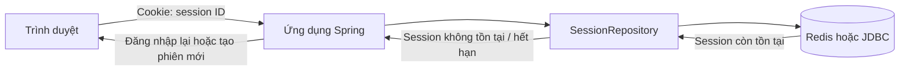
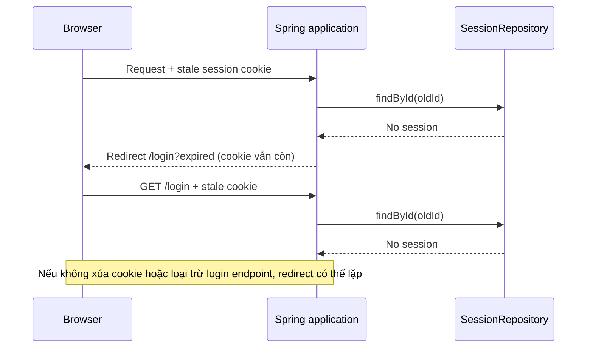

# Phiên bị xóa, cookie còn lại và yêu cầu đăng nhập lại

Cookie session ở trình duyệt thường chứa một session ID. Session data lại nằm ở server-side repository như Redis hoặc JDBC khi ứng dụng dùng Spring Session. Hai phần này có vòng đời độc lập: repository có thể đã xóa hoặc hết hạn session trong khi trình duyệt vẫn giữ cookie cũ. Khi đó, trình duyệt tiếp tục gửi ID không còn hợp lệ; server không thể khôi phục session chỉ từ cookie.

Ứng dụng cần xử lý trường hợp này như một phiên không còn tồn tại, đưa người dùng về luồng xác thực phù hợp và xóa cookie cũ để request sau không tiếp tục gửi ID lỗi thời. Nếu cookie session bị xóa nhưng Remember-Me cookie hoặc bearer token vẫn còn hiệu lực, Spring Security có thể xác thực lại người dùng và tạo session mới. Vì vậy, cần phân biệt rõ cookie mang session ID với credential có khả năng xác thực lại.

## 1. Cookie và session data nằm ở hai nơi

Trong mô hình Spring Session, trình duyệt thường chỉ giữ session ID; dữ liệu phiên được lưu trong repository dùng chung. Cookie không chứa toàn bộ `SecurityContext`, giỏ hàng hay attribute của session.



Ví dụ cookie có thể chứa giá trị như `SESSION=...` hoặc tên do ứng dụng cấu hình. Giá trị này là định danh phiên, không phải bằng chứng độc lập rằng người gửi cookie đã được xác thực.

Khi repository tìm thấy ID và session còn hợp lệ, Spring Session cung cấp session cho request. Nếu repository không tìm thấy ID vì session đã hết hạn, bị logout hoặc bị quản trị viên thu hồi, ứng dụng không thể đọc lại attribute cũ từ cookie.

## 2. Vì sao cookie còn sau khi session bị xóa?

Cookie được lưu ở client theo các thuộc tính `Expires` hoặc `Max-Age`, hoặc là cookie phiên của trình duyệt. Session phía server lại có timeout và chính sách xóa riêng. Các sự kiện sau có thể làm session biến mất trước khi cookie bị xóa:

- Idle timeout trong Redis/JDBC đã hết hạn.
- Người dùng đăng xuất và repository xóa session, nhưng response không xóa đúng cookie.
- Quản trị viên thu hồi session từ thiết bị khác.
- Tác vụ vận hành xóa session hoặc namespace dữ liệu.
- Redis eviction, mất dữ liệu hoặc khôi phục database khiến session không còn tồn tại.
- Ứng dụng thay đổi namespace, kho dữ liệu hoặc môi trường, khiến ID cũ không còn được tìm thấy.

Ngược lại, cookie có thể bị xóa khỏi trình duyệt trong khi session data còn tồn tại cho đến khi TTL hoặc cleanup xử lý. Do đó, cookie lifetime và server-side session lifetime phải được cấu hình và kiểm tra riêng.

## 3. Request mang session ID không còn hợp lệ được xử lý thế nào?

Giả sử trình duyệt gửi cookie chứa ID `abc...`, nhưng repository không còn session tương ứng. Về bản chất, server nhận một ID không ánh xạ được tới session đang hoạt động.

Tùy cấu hình, request có thể đi theo một trong các hướng:

1. Repository trả về không có session; Web/session infrastructure cung cấp session mới nếu code cần tạo session.
2. Nếu endpoint yêu cầu xác thực, Spring Security chuyển hướng đến trang đăng nhập hoặc trả `401 Unauthorized` theo entry point.
3. Nếu ứng dụng cấu hình chiến lược phát hiện invalid session, nó có thể chuyển hướng đến trang thông báo phiên hết hạn.
4. Nếu Remember-Me credential hợp lệ, Spring Security có thể xác thực lại và tạo session mới.
5. Nếu ứng dụng dùng bearer token, request có thể được xác thực bằng token dù session cookie cũ không còn tác dụng.

Không có quy tắc chung rằng mọi session ID không tồn tại đều tự động trả `401`. Hành vi phụ thuộc endpoint, filter chain, authentication entry point, request cache và các thành phần khác.

## 4. Phân biệt session cookie với Remember-Me cookie

Hai cookie có thể cùng tồn tại nhưng có vai trò khác nhau:

| Cookie/credential | Chứa hoặc đại diện cho | Có thể làm gì khi session đã mất? |
|---|---|---|
| Session cookie | Session ID | Chỉ giúp server tìm session; ID cũ không khôi phục được dữ liệu đã xóa |
| Remember-Me cookie | Credential dùng để xác thực lại | Có thể xác thực người dùng và tạo session mới nếu token còn hợp lệ |
| Access token/bearer token | Credential xác thực request | Có thể xác thực request độc lập với session, tùy cấu hình |

Nếu session cũ bị xóa mà người dùng vẫn được nhận diện là đã đăng nhập, hãy kiểm tra Remember-Me hoặc cơ chế token. Đừng kết luận rằng Spring Session đã khôi phục session cũ. Có thể Spring Security vừa xác thực lại và tạo một session mới.

Với persistent Remember-Me token, cần quản lý cả cookie ở client lẫn token phía server. Logout phải xóa credential và thu hồi token theo cơ chế Remember-Me đã cấu hình. Chỉ xóa session không đồng nghĩa thu hồi Remember-Me.

## 5. Cookie session cũ có thể gây vòng lặp chuyển hướng

Một lỗi phổ biến xảy ra khi ứng dụng phát hiện invalid session và chuyển hướng đến `/login?expired`, nhưng response không xóa cookie session cũ. Trình duyệt tự động gửi lại cookie đó cho request đến trang đăng nhập. Nếu trang đăng nhập hoặc filter tiếp tục coi ID đó là invalid session và chuyển hướng thêm lần nữa, người dùng có thể bị lặp redirect.



Giải pháp là xóa cookie cũ đúng cách khi phát hiện invalid session hoặc khi logout, đồng thời bảo đảm endpoint đăng nhập không bị áp dụng một redirect strategy gây vòng lặp. Việc xóa cookie phải khớp tên, `Path` và `Domain` với cookie đã phát hành.

## 6. Xóa cookie session đúng cách

Để trình duyệt xóa cookie, server gửi lại cookie cùng tên và scope tương ứng với thời hạn đã hết hoặc `Max-Age=0`. Nếu cookie ban đầu có `Path=/app` nhưng response xóa dùng `Path=/`, trình duyệt có thể coi đó là một cookie khác và giữ cookie cũ.

Các thuộc tính cần khớp hoặc được cân nhắc:

- **Name:** tên cookie session thực tế, có thể đã tùy chỉnh.
- **Path:** đường dẫn cookie được giới hạn khi phát hành.
- **Domain:** domain hoặc host-only scope ban đầu.
- **Secure:** cookie chỉ được gửi qua HTTPS nếu thuộc tính này được bật.
- **SameSite:** chính sách gửi cookie trong điều hướng cross-site.
- **Max-Age/Expires:** đặt về hết hạn để trình duyệt loại bỏ cookie.

Với Spring Session Servlet, `HttpSessionIdResolver` chịu trách nhiệm đọc và ghi session ID. Resolver cookie mặc định có cơ chế hết hạn ID thông qua response. Nếu dùng resolver tùy chỉnh, hãy bảo đảm `expireSession` phát cookie hết hạn với đúng tên và scope.

Không hardcode tên cookie mặc định trong code nếu ứng dụng có thể cấu hình khác nhau giữa môi trường. Ví dụ dưới đây minh họa ý tưởng xóa cookie; hãy thay bằng tên và scope thật của ứng dụng:

```java
import jakarta.servlet.http.Cookie;
import jakarta.servlet.http.HttpServletResponse;

void expireSessionCookie(HttpServletResponse response) {
    Cookie cookie = new Cookie("APPSESSION", "");
    cookie.setPath("/");
    cookie.setHttpOnly(true);
    cookie.setSecure(true);
    cookie.setMaxAge(0);
    response.addCookie(cookie);
}
```

Nếu cookie được phát hành với `Domain` cụ thể, cần đặt cùng domain khi xóa. Nếu dùng `SameSite`, có thể cần ghi header `Set-Cookie` phù hợp với chính sách cookie của ứng dụng vì API `Cookie` của Servlet không biểu diễn mọi thuộc tính trên tất cả phiên bản.

## 7. Phát hiện invalid session trong Spring Security

Trong Servlet stack, Spring Security có thể cấu hình invalid session strategy để xử lý request mang session ID không hợp lệ. Ví dụ với DSL hiện đại:

```java
http.sessionManagement(session -> session
        .invalidSessionUrl("/session-expired"));
```

Hoặc cấu hình `InvalidSessionStrategy` tùy chỉnh nếu cần trả JSON cho API thay vì redirect HTML. API có thể trả `401` cùng mã lỗi rõ ràng; trình duyệt có thể chuyển người dùng đến trang đăng nhập.

Không nên áp dụng redirect đến trang HTML cho mọi endpoint. Một API client mong đợi JSON có thể nhận HTML redirect và xử lý sai. Nếu ứng dụng có nhiều `SecurityFilterChain`, cấu hình invalid-session handling ở đúng chain và kiểm tra matcher.

### Lưu ý khi dùng Spring Session

Spring Session bọc `HttpSession` và cung cấp repository dùng chung, nhưng chi tiết phát hiện ID không hợp lệ có thể phụ thuộc resolver, filter và phiên bản Spring Security/Spring Session. Cần kiểm thử request thực tế với cookie ID đã bị xóa khỏi repository. Không chỉ dựa vào test unit của `InvalidSessionStrategy`.

Một session ID không hợp lệ cũng có thể là cookie cũ do người dùng logout từ tab khác. Trong trường hợp đó, thông báo “phiên đã hết hạn” thường phù hợp hơn một lỗi server 500.

## 8. Logout cần invalidate session và hết hạn cookie

Khi người dùng logout ở thiết bị hiện tại, thao tác nên xử lý đồng bộ cả server và client:

1. Invalidate `HttpSession`/Spring Session để repository không còn chấp nhận ID cũ.
2. Xóa `SecurityContext` khỏi request hiện tại.
3. Hết hạn session cookie đúng tên, path và domain.
4. Xóa Remember-Me cookie và thu hồi persistent token nếu có.
5. Trả response/redirect phù hợp với loại client.

Ví dụ cấu hình Spring Security:

```java
http.logout(logout -> logout
        .logoutUrl("/logout")
        .invalidateHttpSession(true)
        .clearAuthentication(true)
        .deleteCookies("APPSESSION", "remember-me"));
```

Tên `APPSESSION` chỉ là ví dụ; phải thay bằng cookie name thật. Với Spring Session, cần xác nhận resolver cũng xóa đúng cookie và scope. Nếu dùng `RememberMeServices`, logout handler tương ứng cần được cấu hình để xóa token phía server; xóa tên cookie thôi chưa chắc thu hồi persistent token.

Không xóa cookie nhưng giữ session data nếu mục tiêu là logout hoàn toàn. Ngược lại, chỉ xóa cookie ở client mà không invalidate session sẽ để session cũ còn dùng được nếu ID bị lộ hoặc một client khác vẫn giữ nó.

## 9. Thu hồi session từ thiết bị khác

Trang quản lý thiết bị có thể cho phép người dùng thu hồi một phiên khác. Backend tra cứu session theo principal, kiểm tra session được chọn thuộc người dùng hiện tại, sau đó xóa session khỏi repository.

Vì cookie của thiết bị kia nằm ở trình duyệt khác, server không thể trực tiếp xóa cookie đó bằng response gửi về thiết bị hiện tại. Khi thiết bị bị thu hồi gửi request tiếp theo, nó vẫn gửi cookie cũ nhưng repository không tìm thấy session và phải yêu cầu xác thực lại.

Ví dụ service nội bộ:

```java
import org.springframework.session.FindByIndexNameSessionRepository;
import org.springframework.session.Session;
import reactor.core.publisher.Mono;

class SessionRevocationService<S extends Session> {
    private final FindByIndexNameSessionRepository<S> repository;

    SessionRevocationService(FindByIndexNameSessionRepository<S> repository) {
        this.repository = repository;
    }

    void revokeOwnedSession(String principalName, String sessionId) {
        boolean owned = repository.findByPrincipalName(principalName)
                .containsKey(sessionId);
        if (owned) {
            repository.deleteById(sessionId);
        }
    }
}
```

Đây là ví dụ minh họa cho repository đồng bộ. Với `ReactiveSessionRepository`, cần trả về và nối `Mono<Void>` thay vì gọi phương thức đồng bộ. Trong production, nên tránh read-then-delete như một thao tác kiểm soát quyền nếu có nguy cơ race hoặc repository không bảo đảm snapshot; kiểm tra quyền sở hữu ở tầng service và xử lý xóa idempotent. Không nhận `sessionId` từ client rồi xóa mà không kiểm tra principal.

## 10. Khi nào yêu cầu đăng nhập lại?

Nếu chỉ có session cookie cũ và repository không còn session, request không thể khôi phục danh tính từ cookie đó. Ứng dụng nên đưa người dùng về luồng xác thực:

- Với web form login: redirect đến trang đăng nhập kèm thông báo phiên hết hạn.
- Với API: trả `401 Unauthorized` hoặc lỗi xác thực theo hợp đồng API.
- Với OAuth2 Login: bắt đầu lại authorization flow khi cần, với state/nonce mới.
- Với Remember-Me: chỉ tự xác thực lại nếu credential còn hợp lệ và chính sách cho phép.
- Với bearer token: xác thực token theo issuer, signature, audience, expiry và revocation policy; session cookie cũ không thay thế token.

Không nên tự động đăng nhập lại chỉ vì cookie session còn tồn tại. Cookie session ID không phải credential có thể xác thực độc lập.

## 11. Request cache và redirect sau khi session mất

Trong ứng dụng form login, Spring Security có thể dùng `HttpSessionRequestCache` để lưu request ban đầu trước khi redirect người dùng đến trang đăng nhập. Khi session cũ đã mất, request cache có thể tạo session mới để lưu `SavedRequest`.

Điều này có thể khiến trình duyệt nhận một cookie session mới trước khi người dùng đăng nhập. Đó không nhất thiết là session cũ được khôi phục; đó có thể là session mới chỉ dùng để giữ request đích hoặc CSRF token.

Nếu ứng dụng không cần lưu request ban đầu, có thể dùng `NullRequestCache`; nếu cần trải nghiệm quay lại URL cũ, giữ request cache và bảo đảm invalid-session redirect không tạo vòng lặp. Hãy kiểm tra chuỗi redirect cùng cookie trong trình duyệt thay vì chỉ đếm số cookie.

## 12. Kiểm thử cookie cũ và yêu cầu đăng nhập lại

Nên kiểm thử cả repository lẫn HTTP cookie behavior. Một kịch bản tích hợp điển hình:

1. Đăng nhập và nhận session cookie.
2. Xác nhận session được lưu trong Redis/JDBC.
3. Xóa session phía server bằng logout hoặc repository/admin operation.
4. Giữ nguyên cookie trong client và gửi request tiếp theo.
5. Xác nhận ứng dụng không khôi phục SecurityContext từ session đã xóa.
6. Xác nhận response xử lý theo đúng loại client: redirect hoặc `401`.
7. Xác nhận response xóa cookie cũ với đúng name/path/domain.
8. Gửi request tiếp theo và xác nhận cookie cũ không còn được gửi.
9. Kiểm tra Remember-Me cookie riêng: nếu còn hợp lệ, xác nhận auto-login có xảy ra đúng theo chính sách hay không.
10. Kiểm tra logout thu hồi persistent Remember-Me token nếu tính năng đó được dùng.
11. Thu hồi session từ thiết bị khác và xác nhận thiết bị đó bị yêu cầu xác thực lại ở request kế tiếp.
12. Chạy test trên nhiều instance cùng repository để bảo đảm xóa phiên có hiệu lực toàn cụm.

Ví dụ kiểm tra với MockMvc có thể giữ cookie từ response đầu và gửi lại sau khi session bị xóa. Với browser-level test, quan sát `Set-Cookie` và cookie jar thực tế giúp phát hiện sai `Path`/`Domain` mà mock request có thể bỏ qua.

## 13. Điều tra khi người dùng bị yêu cầu đăng nhập liên tục

Nếu người dùng liên tục bị đưa về trang đăng nhập, hãy kiểm tra theo thứ tự:

1. Cookie session được trình duyệt gửi có đúng tên và domain không?
2. Session ID có tồn tại trong repository/namespace mà instance đang dùng không?
3. Session có hết TTL hoặc bị thu hồi bởi thiết bị khác không?
4. Các instance có dùng cùng Redis/JDBC, namespace và serializer không?
5. Response xóa cookie có đúng `Path` và `Domain` của cookie gốc không?
6. Invalid session strategy có redirect đến endpoint mà chính nó lại xử lý như invalid session không?
7. Request cache có tạo session mới và redirect lặp không?
8. Remember-Me cookie có hết hạn, bị thu hồi hoặc không tương thích không?
9. Có clock skew hoặc cấu hình TTL khác nhau giữa các instance không?
10. Có reverse proxy làm thay đổi host, scheme hoặc cookie domain không?

Không ghi session ID, cookie hoặc Remember-Me token nguyên vẹn vào log. Dùng correlation ID, trạng thái “session found/missing”, tên cookie và metadata đã che để điều tra.

## 14. Các lỗi thường gặp

| Hiện tượng | Nguyên nhân có thể | Cách xử lý |
|---|---|---|
| Cookie còn nhưng người dùng bị logout | Session data đã hết TTL hoặc bị xóa | Yêu cầu xác thực lại và xóa cookie cũ |
| Redirect đến login lặp vô hạn | Invalid-session redirect không xóa cookie hoặc login endpoint bị áp dụng strategy | Hết hạn cookie đúng scope và loại trừ luồng login phù hợp |
| Xóa cookie nhưng trình duyệt vẫn gửi | Path/Domain khi xóa không khớp cookie gốc | Gửi `Set-Cookie` hết hạn với đúng scope |
| Session bị xóa nhưng vẫn đăng nhập lại tự động | Remember-Me hoặc bearer token còn hợp lệ | Kiểm tra và thu hồi credential riêng theo chính sách |
| Logout thiết bị hiện tại nhưng thiết bị khác vẫn hoạt động | Chỉ xóa cookie cục bộ hoặc xóa sai session ID | Invalidate repository session tương ứng và kiểm tra quyền sở hữu |
| API nhận HTML redirect thay vì 401 | Dùng invalid-session strategy dành cho browser | Cấu hình entry point/strategy riêng cho API |
| Session mới xuất hiện trước login | Request cache hoặc CSRF tạo session mới | Kiểm tra thành phần lưu state; không nhầm với session cũ |
| Một instance vẫn chấp nhận session cũ | Instance dùng store/namespace khác hoặc cache sai | Đồng bộ cấu hình và kiểm thử chia sẻ session |

## 15. Nguyên tắc thiết kế

- Coi session cookie là định danh để tra cứu, không phải dữ liệu session hay credential xác thực độc lập.
- Phân biệt session cookie, Remember-Me cookie và bearer token.
- Khi repository không tìm thấy session ID, không khôi phục danh tính từ ID cũ.
- Xử lý invalid session theo đúng loại client: redirect cho browser hoặc `401` cho API.
- Xóa cookie session với đúng tên, `Path`, `Domain` và thuộc tính phù hợp.
- Tránh vòng lặp redirect bằng cách xử lý cookie cũ trước khi gửi người dùng đến trang login.
- Logout phải invalidate session ở server, xóa cookie ở client và thu hồi Remember-Me token nếu có.
- Thu hồi session từ thiết bị khác cần kiểm tra principal ownership; cookie trên thiết bị kia chỉ được xử lý ở request tiếp theo.
- Kiểm thử server-side repository state và browser cookie jar cùng nhau.
- Không log session ID hoặc credential nguyên vẹn.

Khi session bị xóa, cookie cũ có thể tiếp tục được trình duyệt gửi cho đến khi hết hạn hoặc server chủ động xóa nó. Spring Session không thể tái tạo dữ liệu phiên chỉ từ ID này. Ứng dụng cần nhận diện phiên không còn tồn tại, xử lý xác thực lại theo đúng chính sách, xóa cookie đúng scope và kiểm tra riêng Remember-Me hoặc token nếu người dùng vẫn được xác thực. Cách tách bạch này giúp tránh vòng lặp đăng nhập và bảo đảm logout/thu hồi phiên có hiệu lực trên nhiều instance.
