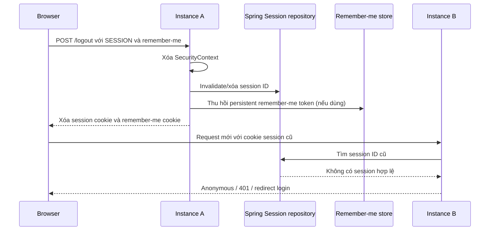

# Kiểm chứng kết thúc phiên trên các nút và kết nối liên quan

Trong ứng dụng Spring Session chạy trên nhiều instance, đăng xuất chỉ hoàn tất khi trạng thái phiên đã bị thu hồi ở kho dùng chung và mọi request tiếp theo trên các instance đều không thể dùng session ID cũ để khôi phục trạng thái xác thực. Với ứng dụng có remember-me, cần xử lý thêm credential dài hạn. Với ứng dụng có WebSocket hoặc kết nối kéo dài, cần đóng các kết nối đã được mở bằng phiên đó.

Một response logout trả về `200` hoặc xóa cookie trên trình duyệt chưa đủ chứng minh phiên đã kết thúc ở mọi nơi. Cần kiểm tra trạng thái trong repository, xác minh session ID cũ trên một instance khác, kiểm tra remember-me token và kiểm tra các kết nối gắn với phiên. Đồng thời phải hiểu giới hạn: request đã tải session trước khi logout có thể vẫn đang chạy; thao tác invalidate không tự hủy ngược mọi công việc đã được cấp quyền.

## 1. “Kết thúc phiên” gồm những trạng thái nào?

Một phiên đăng nhập có thể liên quan đến nhiều thành phần:

| Thành phần | Trạng thái cần kết thúc | Cách kiểm chứng |
|---|---|---|
| Session repository | Session ID không còn khôi phục được phiên hợp lệ | Tìm theo ID qua repository hoặc gửi request với cookie cũ |
| Session cookie | Trình duyệt được yêu cầu xóa cookie | Kiểm tra `Set-Cookie` có `Max-Age=0` hoặc `Expires` trong quá khứ, đúng name/domain/path |
| SecurityContext | Authentication không còn được khôi phục từ phiên đã thu hồi | Request kế tiếp phải là anonymous hoặc bị từ chối |
| Remember-me | Credential dài hạn bị xóa hoặc thu hồi theo cơ chế đã chọn | Kiểm tra cookie, persistent token store hoặc xác minh token thất bại |
| WebSocket | Kết nối được mở dưới phiên đó bị đóng hoặc bị chặn quyền gửi/nhận | Kiểm tra registry và trạng thái socket ở node sở hữu kết nối |
| SSE/stream/long polling | Luồng đang mở bị đóng hoặc không tiếp tục phát dữ liệu bảo vệ | Kiểm tra client nhận kết thúc stream và server giải phóng tài nguyên |
| Request đang chạy | Công việc nhạy cảm không vượt qua điểm kiểm tra quyền sau logout | Kiểm thử race condition tại các bước ghi dữ liệu quan trọng |

Các trạng thái trên có quan hệ nhưng không đồng nhất. Ví dụ, cookie đã bị xóa không chứng minh session record đã bị xóa. Session record đã bị xóa cũng không tự động đóng một WebSocket đã được xác thực từ trước.

## 2. Luồng logout trong Spring Session và Spring Security

Trong ứng dụng Servlet, `SessionRepositoryFilter` bọc request/response để `HttpSession` được quản lý bởi Spring Session. Khi Spring Security xử lý logout, các logout handler có thể xóa SecurityContext, invalidate session và xóa cookie. Lệnh `HttpSession.invalidate()` được chuyển thành thao tác xóa phiên qua repository.

Luồng khái quát:



Sơ đồ mô tả kết quả mong muốn. Chi tiết handler phụ thuộc cấu hình Spring Security, loại remember-me và repository. Với nhiều instance, điểm quyết định là mọi instance phải đọc cùng trạng thái đã bị thu hồi.

Ví dụ cấu hình logout mặc định:

```java
@Bean
SecurityFilterChain securityFilterChain(HttpSecurity http) throws Exception {
    return http
            .authorizeHttpRequests(authorize -> authorize
                    .requestMatchers("/login", "/public/**").permitAll()
                    .anyRequest().authenticated())
            .formLogin(Customizer.withDefaults())
            .logout(logout -> logout
                    .logoutUrl("/logout")
                    .invalidateHttpSession(true)
                    .clearAuthentication(true)
                    .deleteCookies("SESSION", "remember-me"))
            .build();
}
```

Đây là ví dụ cho ứng dụng Servlet dùng cookie tên `SESSION` và remember-me cookie tên `remember-me`. Nếu đã đổi cookie name, domain hoặc path, phải điều chỉnh cấu hình xóa cookie tương ứng. `deleteCookies` phát chỉ thị xóa ở response; việc invalidate session và thu hồi remember-me token phải được xử lý ở server. Khi bật remember-me qua Spring Security, cơ chế logout tích hợp có thể gọi `RememberMeServices` để xóa cookie/token. Nếu thay thế logout handlers, hãy bảo đảm không bỏ sót bước này.

Logout nên dùng POST và giữ CSRF protection cho ứng dụng xác thực bằng cookie. Không dùng GET để thực hiện thao tác thay đổi trạng thái.

## 3. Session store dùng chung là điều kiện để logout có hiệu lực trên mọi node

Giả sử load balancer phân phối request giữa instance A và B. Người dùng đăng nhập ở A, sau đó request khác được xử lý ở B. Nếu A và B dùng session store riêng, B không thể thấy session do A tạo; nếu mỗi node có bản sao session cục bộ, B có thể tiếp tục tin dữ liệu cũ sau logout.

Với Spring Session phân tán, các instance phải thống nhất:

- Cùng Redis database/cluster hoặc cùng database JDBC.
- Cùng namespace và tên bảng/schema session.
- Cùng cách đọc session ID từ cookie/header.
- Cùng serializer và phiên bản dữ liệu tương thích.
- Cùng chính sách timeout, principal mapping và bảo mật.
- Không có cache cục bộ giữ session đã thu hồi mà không có cơ chế invalidation.

Sticky session có thể giảm số lần request đổi node nhưng không chứng minh logout toàn cụm. Một node có thể restart, failover hoặc load balancer có thể chuyển request sang node khác. Kiểm thử phải cố ý gửi request sau logout đến một instance khác.

## 4. Kiểm chứng session ID cũ trên một node khác

Đây là kiểm tra quan trọng nhất của logout phân tán:

1. Đăng nhập và giữ lại session cookie.
2. Gửi request được bảo vệ tới instance A, xác nhận người dùng đã xác thực.
3. Gửi logout tới instance A hoặc B, xác nhận response hoàn tất.
4. Giữ bản sao cookie cũ trong test client; không để client tự xóa cookie khiến test mất khả năng kiểm tra ID cũ.
5. Gửi request tới endpoint được bảo vệ trên instance khác bằng cookie cũ.
6. Xác nhận request không còn principal đã đăng nhập và không truy cập được tài nguyên.
7. Nếu dùng repository API trực tiếp trong test, xác nhận `findById(oldSessionId)` không trả session hợp lệ.

Không chỉ kiểm tra browser cookie jar. Khi test client tự động nhận `Set-Cookie` để xóa cookie, request tiếp theo sẽ không gửi ID cũ và test không chứng minh được repository đã thu hồi session.

Ví dụ test minh họa với `MockMvc` khi có thể định tuyến request tới hai base URL/node riêng:

```java
MockHttpSession loginSession = loginOnNodeA();

mockMvcNodeA.perform(post("/logout").session(loginSession)
        .with(csrf()))
    .andExpect(status().is3xxRedirection());

mockMvcNodeB.perform(get("/api/me").session(loginSession))
    .andExpect(status().isUnauthorized());
```

Đoạn mã là khung minh họa; `MockHttpSession` native của container không phải lúc nào cũng mô phỏng đầy đủ cookie/session ID của Spring Session. Với kiểm thử phân tán thực tế, nên dùng HTTP client giữ cookie thô, hai ứng dụng test instance cùng repository và một cách chọn node rõ ràng. Kết quả mong đợi có thể là `401`, redirect login hoặc một response anonymous tùy security configuration.

## 5. SessionDestroyedEvent và các sự kiện vòng đời

Spring Session có các application event liên quan đến vòng đời phiên, thường gồm:

- `SessionCreatedEvent`: session được tạo.
- `SessionDeletedEvent`: session bị xóa chủ động.
- `SessionExpiredEvent`: session hết hạn.
- `SessionDestroyedEvent`: kiểu sự kiện cha cho các sự kiện hủy phiên.

Ứng dụng có thể lắng nghe sự kiện để dọn tài nguyên hoặc ghi nhận metric:

```java
@Component
class SessionLifecycleListener {

    private final LocalConnectionRegistry connections;

    SessionLifecycleListener(LocalConnectionRegistry connections) {
        this.connections = connections;
    }

    @EventListener
    public void onSessionDestroyed(SessionDestroyedEvent event) {
        this.connections.closeForSession(event.getSessionId());
    }
}
```

`LocalConnectionRegistry` trong ví dụ là thành phần do ứng dụng xây dựng để theo dõi các kết nối trên node hiện tại. API và event support cụ thể cần kiểm tra theo loại repository và phiên bản Spring Session. Không phải mọi implementation hoặc mọi cách xóa dữ liệu trực tiếp trong database đều phát đủ event. Nếu quản trị viên chạy SQL `DELETE` bên ngoài repository, application event có thể không được phát.

Sự kiện giúp kích hoạt cleanup, nhưng request kế tiếp vẫn phải được bảo vệ bằng trạng thái session repository và kiểm tra xác thực. Không dùng event listener làm lớp authorization duy nhất.

## 6. Phạm vi của event: local, distributed và khả năng bị mất

Một application event trong Spring `ApplicationContext` thường được phát trong tiến trình đã thực hiện thao tác. Để mọi node nhận được sự kiện, repository cần cơ chế truyền thông báo phân tán hoặc ứng dụng cần một kênh broadcast riêng.

Với Redis repository có hỗ trợ keyspace notifications, các instance có thể subscribe các thông báo liên quan đến expiration/deletion theo cấu hình. Tuy nhiên, hành vi cụ thể phụ thuộc implementation, topology Redis, cấu hình `notify-keyspace-events`, subscription và phiên bản. JDBC repository có thể phát event trong tiến trình thực hiện thao tác; không nên giả định một event cục bộ tự động được phát đến mọi JVM.

Redis Pub/Sub và keyspace notifications là cơ chế thông báo, không phải event log bền vững. Subscriber offline có thể bỏ lỡ event. Trong Redis Cluster hoặc dịch vụ managed, cần xác minh subscription nhận được thông báo từ các node/primary liên quan. Vì vậy:

- Dùng repository state để quyết định một session ID còn hợp lệ hay không.
- Dùng event để đóng kết nối và dọn tài nguyên phụ trợ.
- Nếu cần broadcast đến mọi node, dùng cơ chế pub/sub hoặc message broker phù hợp với topology.
- Làm cho handler idempotent để nhận event lặp không gây lỗi.
- Có đối soát định kỳ để tìm kết nối hoặc index mồ côi nếu yêu cầu vận hành cần.

Không giả định event được phát đúng một lần, đúng ngay thời điểm timeout hoặc chắc chắn đến mọi node.

## 7. Đóng WebSocket khi HTTP session bị hủy

WebSocket là kết nối dài hạn. Sau handshake, một kết nối có thể tiếp tục tồn tại dù cookie session đã bị xóa ở trình duyệt. Việc xóa cookie không tự đóng socket đã được mở trước đó. Nếu ứng dụng dùng WebSocket với xác thực dựa trên HTTP session, cần liên kết WebSocket connection với session ID và đóng các connection tương ứng khi session bị hủy.

Spring Session có hỗ trợ tích hợp vòng đời HTTP session với WebSocket trong các cấu hình messaging tương ứng. Tùy phiên bản, có thể dùng các thành phần tích hợp WebSocket của Spring Session để theo dõi session connect/disconnect và phản ứng khi session destroyed. Nếu tự quản lý, cần một registry ánh xạ session ID tới các WebSocket connection trên từng node.

Mô hình registry đơn giản:

```java
interface LocalConnectionRegistry {
    void register(String sessionId, WebSocketSession connection);
    void unregister(String sessionId, String connectionId);
    void closeForSession(String sessionId);
}
```

Khi nhận `SessionDestroyedEvent`, node đóng mọi WebSocket connection cục bộ được gắn với session ID đó. Với nhiều node, event hoặc lệnh đóng cần được truyền đến node sở hữu connection. Connection object thường chỉ tồn tại trong bộ nhớ của node đang giữ socket, vì vậy một node khác không thể trực tiếp gọi `close()` trên object đó.

Đóng socket cần có timeout và xử lý lỗi. Nếu socket đã đóng hoặc client mất kết nối, cleanup phải vẫn an toàn. Không ghi token hoặc session ID dạng rõ vào log; dùng mã định danh đã che hoặc correlation ID.

## 8. SSE, streaming và long polling

Server-Sent Events (SSE), streaming HTTP và long polling cũng có thể tiếp tục truyền dữ liệu sau khi request ban đầu đã được xác thực. Xóa session không tự động thu hồi mọi response body đang được stream.

Một số cách xử lý:

- Gắn stream với principal/session ID và giữ handle để server có thể đóng stream khi logout.
- Kiểm tra trạng thái phiên hoặc quyền trước khi phát các sự kiện nhạy cảm tiếp theo.
- Dùng timeout ngắn và yêu cầu client mở lại kết nối bằng credential hiện còn hợp lệ.
- Khi nhận logout/revocation event, hủy publisher hoặc đóng response stream trên node sở hữu kết nối.
- Bảo đảm cleanup giải phóng subscription, buffer và tài nguyên liên quan.

Không dựa vào việc client đóng tab hoặc xóa cookie để bảo vệ dữ liệu stream. Server phải có cơ chế dừng phát dữ liệu khi quyền truy cập không còn hợp lệ.

## 9. Request đang chạy tại thời điểm logout

Một race condition quan trọng xuất hiện khi request A đã tải session và xác thực thành công, trong khi request B thực hiện logout cùng session:

1. Request A đọc session và SecurityContext vào đầu request.
2. Request B invalidate session trong repository.
3. Request A vẫn giữ bản context đã tải trong bộ nhớ của request.
4. Request A tiếp tục xử lý và có thể hoàn thành thao tác sau logout.

Invalidate session thường ngăn các request mới khôi phục session ID cũ. Nó không thể tự động thu hồi Authentication đã được một request đang chạy tải trước đó. Vì vậy, nếu yêu cầu bảo mật là “sau logout không một thao tác nhạy cảm nào được commit”, ứng dụng cần kiểm tra thêm tại ranh giới nghiệp vụ quan trọng.

Các lựa chọn thiết kế có thể gồm:

- Kiểm tra trạng thái phiên/revocation version ngay trước thao tác ghi nhạy cảm.
- Dùng version hoặc generation của phiên/người dùng và từ chối nếu version đã thay đổi.
- Dùng transaction/locking ở kho nghiệp vụ để đồng bộ thao tác logout với hành động đang thực hiện.
- Giữ request ngắn, tránh chạy tác vụ nền dài với SecurityContext đã sao chép.
- Khi khởi chạy tác vụ nền, truyền danh tính và quyền theo hợp đồng riêng; kiểm tra lại quyền khi tác vụ thực hiện, không mặc định context cũ còn hiệu lực.

Không phải ứng dụng nào cũng cần hủy mọi request đã bắt đầu. Hãy định nghĩa rõ logout có hiệu lực với request mới, kết nối kéo dài hay cả các giao dịch đang chạy. Với thao tác chuyển tiền, đổi quyền hoặc dữ liệu nhạy cảm, cần chính sách nhất quán mạnh hơn so với một trang đọc thông thường.

## 10. Remember-me và các credential dài hạn

Remember-me cookie là credential riêng với session cookie. Sau khi session bị invalidate, một remember-me token còn hiệu lực có thể xác thực lại người dùng và tạo session mới. Vì vậy, nếu người dùng chọn “đăng xuất khỏi thiết bị này”, ứng dụng phải xác định có cần xóa remember-me cookie/token hay không. Nếu người dùng chọn “đăng xuất khỏi tất cả thiết bị”, thường cần thu hồi các persistent remember-me token của người dùng cùng với các session tương ứng.

Với `PersistentTokenRepository`, Spring Security cung cấp cơ chế xóa token theo người dùng, ví dụ `removeUserTokens(username)`. Với token-based remember-me, cần xem xét khóa ký, thời hạn và cơ chế thu hồi bổ sung. Chỉ xóa session trong Redis/JDBC không làm token remember-me biến mất.

Access token JWT cũng là credential riêng. Invalidate Spring Session không tự làm JWT đã phát hành mất hiệu lực nếu resource server xác minh chữ ký offline. Nếu hệ thống dùng JWT, cần expiry ngắn, denylist/introspection hoặc một cơ chế revocation phù hợp khi yêu cầu logout phải có hiệu lực tức thời.

## 11. Đăng xuất một thiết bị và đăng xuất mọi thiết bị

Hai hành vi cần chính sách khác nhau:

| Hành vi | Thao tác phía server | Credential phía client |
|---|---|---|
| Logout thiết bị hiện tại | Invalidate session hiện tại; thu hồi remember-me token/series của thiết bị nếu dùng persistent tokens | Xóa session cookie và remember-me cookie của thiết bị đó |
| Logout mọi thiết bị | Tìm session theo principal index và thu hồi tất cả; xóa persistent remember-me tokens; phát lệnh đóng connection | Mỗi client xóa cookie khi nhận được thông báo hoặc ở request tiếp theo; server vẫn phải từ chối credential cũ |
| Khóa tài khoản/đổi mật khẩu | Thu hồi session và remember-me token theo chính sách; có thể tăng revocation version | Các cookie còn lưu không được chấp nhận |

Cookie của thiết bị khác không thể bị server xóa trực tiếp nếu thiết bị không nhận response. Điều cần bảo đảm là cookie cũ không còn giúp khôi phục phiên hoặc tự động đăng nhập. Client có thể xóa cookie khi nhận push notification hoặc khi request tiếp theo bị từ chối.

Nếu dùng principal index, hãy xác thực principal từ SecurityContext hiện tại hoặc từ thao tác quản trị đã phân quyền. Không cho client truyền username tùy ý để xóa phiên của người khác.

## 12. Kiểm thử nhiều node và kết nối liên quan

Một bộ kiểm thử tích hợp nên dùng ít nhất hai instance ứng dụng cùng repository và cùng cấu hình bảo mật. Các bước đề xuất:

1. Đăng nhập qua instance A và nhận session cookie.
2. Gửi request đã xác thực qua instance B bằng cookie đó; xác nhận principal được khôi phục.
3. Mở WebSocket hoặc SSE qua instance B và ghi nhận connection/session mapping.
4. Gửi logout qua instance A.
5. Kiểm tra session ID cũ không khôi phục được qua A lẫn B.
6. Gửi lại cookie cũ trực tiếp tới endpoint bảo vệ ở cả hai instance; xác nhận request không còn xác thực.
7. Kiểm tra remember-me token đã bị thu hồi theo lựa chọn logout.
8. Xác nhận WebSocket/SSE trên node sở hữu connection được đóng hoặc không còn phát dữ liệu bảo vệ.
9. Kiểm tra event bị lặp hoặc subscriber reconnect không gây lỗi cleanup.
10. Chạy race test: request A tạm dừng sau khi tải context; request B logout; sau đó cho A tiếp tục và xác nhận hành vi đúng với chính sách nghiệp vụ đã định nghĩa.
11. Tắt một node trong quá trình logout và xác nhận request sau khi node phục hồi vẫn đọc trạng thái thu hồi từ kho dùng chung.
12. Kiểm tra lỗi kết nối repository và event transport; không báo logout hoàn tất nếu thao tác thu hồi cốt lõi thất bại.

Với kiểm thử, có thể dùng Testcontainers cho Redis/JDBC và chạy hai application context trên port riêng. Dùng HTTP client giữ cookie thô để kiểm tra ID cũ sau logout. Với WebSocket, kiểm tra cả trạng thái server-side và việc client nhận close frame hoặc không còn nhận message. Với SSE, kiểm tra stream kết thúc và publisher được dispose.

## 13. Chẩn đoán sự cố logout không đồng nhất

| Triệu chứng | Nguyên nhân có thể | Hướng kiểm tra |
|---|---|---|
| Logout ở A nhưng B vẫn chấp nhận session | Hai node dùng repository/namespace khác nhau hoặc B có cache stale | So sánh connection, namespace, serializer và cache invalidation |
| Cookie bị xóa nhưng session vẫn tồn tại | Chỉ xóa cookie, chưa invalidate server-side session | Kiểm tra `HttpSession.invalidate()` và repository delete |
| Session đã xóa nhưng tự đăng nhập lại | Remember-me token còn hiệu lực | Kiểm tra `RememberMeServices`, cookie và persistent token store |
| WebSocket vẫn gửi dữ liệu sau logout | Connection không gắn với session hoặc event không đến node sở hữu socket | Kiểm tra registry, event transport và close handling |
| SSE tiếp tục phát nội dung riêng tư | Stream không kiểm tra revocation hoặc không có cancellation hook | Kiểm tra publisher lifecycle và quyền trước mỗi message |
| Một số request đang chạy hoàn tất sau logout | Request đã tải context trước khi session bị invalidate | Xác định yêu cầu race semantics và thêm kiểm tra ở điểm commit nghiệp vụ |
| Logout mọi thiết bị chỉ thu hồi một số session | Principal index thiếu hoặc cleanup một phần bị lỗi | Kiểm tra index, từng kết quả delete và retry |
| Event logout bị mất khi node restart | Dùng application event/Pub/Sub không bền vững | Bổ sung broker/outbox hoặc tác vụ đối soát |
| Cookie cũ vẫn được browser gửi | Cookie xóa sai domain/path hoặc có cookie trùng tên | Kiểm tra toàn bộ `Set-Cookie` và cookie scope |

Log và metric nên giúp trả lời: session ID đã bị thu hồi ở repository chưa, node nào xử lý logout, event nào được phát/nhận, connection nào đã đóng và thao tác remember-me nào đã bị thu hồi. Không ghi nguyên session ID, remember-me token, access token hoặc cookie vào log. Dùng hash/identifier đã che và correlation ID.

## 14. Hành vi khi kho dữ liệu hoặc event transport gặp lỗi

Nếu repository không truy cập được trong lúc logout, ứng dụng không nên trả thông báo chắc chắn đã đăng xuất trong khi session phía server có thể còn hiệu lực. Có thể trả lỗi phù hợp, ghi nhận trạng thái chưa hoàn tất và cho phép retry. Thiết kế retry cần idempotent: xóa một session đã không còn tồn tại nên vẫn được xem là trạng thái mục tiêu đã đạt.

Nếu session đã bị xóa nhưng event transport bị lỗi, request mới vẫn phải bị từ chối vì repository là nguồn trạng thái chính. Tuy nhiên, WebSocket/SSE trên node khác có thể còn mở. Cần cơ chế bổ sung như heartbeat kiểm tra session/revocation version, message broker broadcast hoặc periodic reconciliation để đóng connection còn sót.

Với thao tác logout mọi thiết bị, có thể có kết quả một phần: một số session đã bị xóa nhưng một số thao tác thất bại. Hãy ghi lại các ID/series cần retry bằng định danh đã che, báo kết quả chính xác và không khôi phục các session đã thu hồi. Nếu yêu cầu all-or-nothing, cần thiết kế transaction hoặc revocation epoch ở tầng dữ liệu phù hợp thay vì giả định nhiều lệnh Redis/JDBC riêng lẻ tự tạo thành một giao dịch toàn cụm.

## 15. Checklist xác nhận logout hoàn tất

| Kiểm tra | Điều kiện đạt |
|---|---|
| Repository | Session ID cũ không khôi phục được phiên hợp lệ |
| Instance khác | Request có cookie cũ bị coi là anonymous hoặc bị từ chối |
| SecurityContext | Không còn được khôi phục từ session đã thu hồi |
| Session cookie | Response xóa đúng cookie name/domain/path |
| Remember-me | Cookie và token bị xóa/thu hồi theo chính sách |
| WebSocket | Kết nối gắn với session được đóng trên node sở hữu nó |
| SSE/stream | Không tiếp tục phát dữ liệu cần xác thực sau khi revocation có hiệu lực |
| Request đồng thời | Hành vi đã được định nghĩa và kiểm thử tại điểm commit nghiệp vụ |
| Event | Listener idempotent; mất event không làm request mới chấp nhận session cũ |
| Observability | Có log/metric không chứa credential để điều tra trạng thái thu hồi |

## 16. Quy trình triển khai thực tế

1. Xác định tất cả credential gắn với người dùng: session cookie, remember-me token và access token nếu có.
2. Dùng session repository dùng chung và xác nhận mọi node cùng đọc trạng thái.
3. Cấu hình Spring Security logout để clear SecurityContext, invalidate session và gọi remember-me logout.
4. Xóa cookie theo đúng tên, domain và path đã phát.
5. Đăng ký listener cho session destroyed/expired nếu cần dọn tài nguyên.
6. Theo dõi WebSocket/SSE theo session ID và truyền lệnh đóng đến node sở hữu connection.
7. Định nghĩa cách xử lý request đã bắt đầu trước logout và kiểm tra quyền lại ở điểm ghi nhạy cảm nếu cần.
8. Kiểm thử logout qua node A và xác minh cookie cũ trên node B, cùng với remember-me và kết nối dài hạn.
9. Thiết kế retry, idempotency và reconciliation cho lỗi repository hoặc event transport.
10. Theo dõi tỷ lệ logout thất bại, session còn tồn tại, connection chưa đóng và lỗi thu hồi token.

Kết thúc phiên trên hệ thống nhiều node là một quy trình gồm thu hồi trạng thái server-side, xóa credential phía client, xử lý remember-me và đóng các kết nối kéo dài. Repository dùng chung bảo đảm request mới trên node khác không thể khôi phục session đã bị xóa; event và registry giúp dọn WebSocket/SSE; kiểm tra tại điểm commit xử lý race của request đang chạy. Khi kiểm thử từng lớp riêng và kết hợp, ứng dụng có thể chứng minh logout có hiệu lực trong phạm vi chính sách đã định nghĩa.
