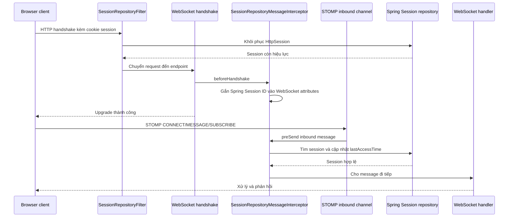
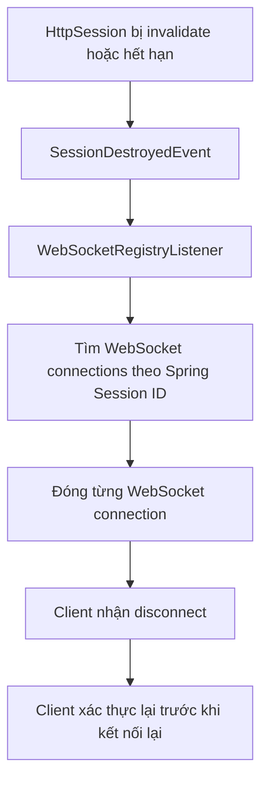

# Vòng đời HttpSession và kết nối WebSocket không đồng nhất

Trong ứng dụng Spring, `HttpSession` và kết nối WebSocket có hai vòng đời khác nhau. `HttpSession` được quản lý theo thời gian không hoạt động và có thể hết hạn khi người dùng không gửi request HTTP. WebSocket sau khi handshake thành công là một kết nối hai chiều lâu dài; client không gửi lại cookie session trên từng frame. Vì vậy, người dùng có thể đang chat hoặc nhận cập nhật qua WebSocket trong khi `HttpSession` không được làm mới và sắp hết hạn.

Spring Session tích hợp với Spring WebSocket để nối hai vòng đời này. Khi dùng Spring WebSocket STOMP message broker, `AbstractSessionWebSocketMessageBrokerConfigurer` tự cấu hình các thành phần cần thiết: ghi nhận quan hệ giữa Spring Session và WebSocket connection, cập nhật thời điểm truy cập khi nhận message từ client, và đóng các WebSocket connection khi Spring Session bị kết thúc. Nhờ đó, session hoạt động theo tương tác thực của người dùng và socket không tiếp tục tồn tại như một kết nối đã xác thực sau khi session bị xóa hoặc hết hạn.

## 1. Hai vòng đời không tự đồng bộ

`HttpSession` có vòng đời do Servlet container hoặc Spring Session quản lý. Một session có thời điểm tạo, lần truy cập gần nhất, khoảng không hoạt động tối đa và trạng thái tồn tại trong repository. Khi không có hoạt động được ghi nhận đủ lâu, session hết hạn hoặc bị invalidate.

WebSocket bắt đầu bằng một HTTP handshake. Sau khi server trả về trạng thái nâng cấp giao thức, kết nối chuyển sang WebSocket và hai phía trao đổi frame trên kết nối đó. Những frame này không phải request HTTP mới, do đó không tự động đi qua `SessionRepositoryFilter` như một request Servlet thông thường.

| Đặc điểm | HttpSession | WebSocket connection |
|---|---|---|
| Khởi tạo | Khi ứng dụng tạo hoặc truy cập session | Sau HTTP handshake thành công |
| Định danh | Session ID trong cookie/header | WebSocket session ID do endpoint/container quản lý |
| Hoạt động | Request HTTP được ghi nhận truy cập session | Frame/message trên kết nối đã mở |
| Hết hạn | Theo inactivity timeout hoặc invalidate | Theo close frame, lỗi transport, timeout hoặc server chủ động đóng |
| Cookie | Client gửi theo chính sách cookie ở request HTTP | Thường chỉ được gửi trong handshake, không gửi lại theo từng frame |
| Lưu trạng thái | Repository như Redis/JDBC | Kết nối và attributes thường gắn với instance đang giữ socket |

Nếu không tích hợp, một WebSocket có thể vẫn mở trong khi session phía server đã hết hạn. Ngược lại, nếu mỗi message đến đều được coi là hoạt động của người dùng và làm mới session, phiên có thể tiếp tục sống trong lúc người dùng thực sự đang sử dụng ứng dụng.

## 2. Handshake là điểm liên kết ban đầu

Với browser client dùng cookie, request handshake đến endpoint WebSocket có thể mang cookie session hiện tại. Spring Session khôi phục `HttpSession` trước khi Spring WebSocket xử lý handshake. Spring Security cũng có thể xác định `Principal` của request từ `SecurityContext` trong session.

Trong Spring Framework, `HttpSessionHandshakeInterceptor` có thể sao chép một phần hoặc toàn bộ thuộc tính HTTP session vào handshake attributes để handler đọc qua `WebSocketSession.getAttributes()`. Interceptor cũng có thể sao chép HTTP session ID dưới key `HTTP_SESSION_ID_ATTR_NAME`.

Ví dụ đăng ký interceptor cho WebSocket handler thuần của Spring Framework:

```java
@Configuration
@EnableWebSocket
public class RawWebSocketConfiguration implements WebSocketConfigurer {

    @Override
    public void registerWebSocketHandlers(WebSocketHandlerRegistry registry) {
        registry.addHandler(new ChatWebSocketHandler(), "/chat")
                .addInterceptors(new HttpSessionHandshakeInterceptor());
    }
}
```

Các thuộc tính được sao chép tại thời điểm handshake. Đây là bản sao vào WebSocket session attributes, không phải một map được đồng bộ hai chiều với `HttpSession`. Nếu ứng dụng thay đổi thuộc tính HTTP session sau handshake, bản sao trong WebSocket session không tự thay đổi.

Không sao chép toàn bộ session attributes một cách máy móc. Chỉ sao chép những giá trị thật sự cần cho handler; tránh đưa credential, token, dữ liệu cá nhân hoặc object lớn vào vùng attributes của kết nối. Với tích hợp Spring Session STOMP, `SessionRepositoryMessageInterceptor` có mục đích riêng là gắn Spring Session ID vào WebSocket properties để cập nhật và kiểm tra vòng đời session.

## 3. Spring Session cần biết message nào thể hiện hoạt động

Một WebSocket connection mở không nhất thiết có nghĩa người dùng đang hoạt động. Server có thể gửi notification hoặc heartbeat đến client mà người dùng không gửi thao tác nào. Nếu mọi dữ liệu outbound đều làm mới inactivity timeout, một tab bị bỏ quên nhưng vẫn nhận heartbeat có thể giữ session sống vô thời hạn.

Với STOMP, `SessionRepositoryMessageInterceptor` được đăng ký như một `ChannelInterceptor` trên inbound channel. Mặc định interceptor theo dõi các loại message:

- `CONNECT`: client bắt đầu phiên STOMP.
- `MESSAGE`: client gửi message đến ứng dụng.
- `SUBSCRIBE`: client đăng ký nhận dữ liệu từ destination.
- `UNSUBSCRIBE`: client hủy đăng ký destination.

Khi nhận message phù hợp, interceptor đọc Spring Session ID được gắn lúc handshake, tìm session trong repository và cập nhật `lastAccessedTime`. Nếu session đã hết hạn, message không được tiếp tục đi vào luồng xử lý.

Các message do server gửi về client không làm mới session theo cơ chế này. Điều đó phản ánh đúng ý nghĩa inactivity timeout: hoạt động từ người dùng mới được tính là hoạt động của phiên.

## 4. Tích hợp tự động cho STOMP message broker

Trong ứng dụng Spring WebSocket dùng STOMP, Spring Session cung cấp `AbstractSessionWebSocketMessageBrokerConfigurer`. Thay vì chỉ triển khai `WebSocketMessageBrokerConfigurer`, cấu hình kế thừa lớp này và ghi đè `configureStompEndpoints`.

```java
@Configuration
@EnableScheduling
@EnableWebSocketMessageBroker
public class WebSocketConfig
        extends AbstractSessionWebSocketMessageBrokerConfigurer<Session> {

    @Override
    protected void configureStompEndpoints(StompEndpointRegistry registry) {
        registry.addEndpoint("/messages").withSockJS();
    }

    @Override
    public void configureMessageBroker(MessageBrokerRegistry registry) {
        registry.enableSimpleBroker("/queue/", "/topic/");
        registry.setApplicationDestinationPrefixes("/app");
    }
}
```

`Session` trong generic type là interface `org.springframework.session.Session`. Cấu hình trên minh họa endpoint STOMP `/messages`, broker đơn giản cho `/queue/` và `/topic/`, cùng prefix `/app` cho message gửi đến application handler.

`AbstractSessionWebSocketMessageBrokerConfigurer` thực hiện các việc sau:

1. Đăng ký `WebSocketConnectHandlerDecoratorFactory` để phát một `SessionConnectEvent` có chứa `WebSocketSession`. Thông tin này cho phép liên kết Spring Session ID với kết nối WebSocket thực tế.
2. Thêm `SessionRepositoryMessageInterceptor` làm `HandshakeInterceptor` cho STOMP endpoint. Interceptor lưu Spring Session ID vào attributes của WebSocket session.
3. Thêm cùng interceptor làm `ChannelInterceptor` cho inbound channel để cập nhật thời điểm truy cập và chặn message nếu session đã hết hạn.
4. Tạo bean `WebSocketRegistryListener` để duy trì ánh xạ Spring Session ID với các WebSocket connection.

Khi Spring Session kết thúc, `WebSocketRegistryListener` dùng ánh xạ này để đóng các kết nối WebSocket còn mở gắn với session đó.

## 5. Luồng hoạt động từ handshake đến message



Sau handshake, cookie không được gửi lại trên mỗi STOMP frame. Interceptor dựa vào Spring Session ID đã gắn trong WebSocket attributes để tìm session. Đây là lý do phải đăng ký interceptor ở cả handshake và inbound channel.

## 6. Session hết hạn hoặc bị invalidate sẽ đóng WebSocket

Khi người dùng logout, ứng dụng gọi `HttpSession.invalidate()` hoặc Spring Session repository xóa phiên. Khi session hết hạn, repository có thể phát `SessionExpiredEvent`. Cả `SessionDeletedEvent` và `SessionExpiredEvent` đều là dạng `SessionDestroyedEvent`.

`WebSocketRegistryListener` lắng nghe `SessionDestroyedEvent`. Nó tìm các WebSocket connection đã được ánh xạ với Spring Session ID và đóng những connection đó. Điều này giúp xử lý trường hợp session bị kết thúc trong khi socket vẫn đang mở.

Luồng khái quát:



Không nên chỉ xóa cookie ở browser. Nếu session phía server chưa bị invalidate, một client còn giữ session ID cũ có thể tiếp tục dùng session. Logout phải kết thúc session trong repository; việc đóng socket là bước dọn tài nguyên gắn với session đó.

## 7. Redis expiration event không nhất thiết đến đúng mili giây

Với Redis repository, Spring Session sử dụng keyspace notifications để phát hiện key liên quan đến session bị xóa hoặc hết hạn. `SessionDeletedEvent` và `SessionExpiredEvent` giúp dọn tài nguyên liên quan, trong đó có WebSocket connection.

Redis không cam kết keyspace expiration notification được phát chính xác tại thời điểm TTL vừa chạm 0. Spring Session có cơ chế cleanup bổ sung để phát hiện session hết hạn và xử lý tài nguyên còn liên quan. Vì vậy, socket có thể chỉ bị đóng sau một khoảng trễ so với thời điểm timeout lý thuyết.

Nếu dùng Redis được bảo vệ và tài khoản ứng dụng không có quyền `CONFIG`, Spring Session có thể không tự bật được keyspace notifications. Khi đó quản trị viên phải cấu hình Redis phù hợp và ứng dụng có thể dùng `ConfigureRedisAction.NO_OP` để tắt thao tác tự cấu hình. Không đặt `NO_OP` nếu chưa xác nhận Redis đã được cấu hình notification cần thiết.

Ngay cả khi event đến chậm, `SessionRepositoryMessageInterceptor` vẫn kiểm tra session khi nhận inbound message phù hợp. Nếu session đã hết hạn, message không được đi tiếp. Như vậy, có hai lớp xử lý: kiểm tra session trên message và đóng transport khi nhận event hủy session.

## 8. Chỉ message từ client mới làm mới inactivity timeout

Một chi tiết dễ bị bỏ qua là chiều message. Spring Session cập nhật `lastAccessedTime` khi nhận inbound STOMP message theo các loại được cấu hình. Message outbound từ server không thể hiện người dùng đang tương tác, nên không làm mới session.

Ví dụ:

| Tình huống | Có làm mới HttpSession không? | Giải thích |
|---|---|---|
| Client gửi STOMP `MESSAGE` | Có | Người dùng gửi thao tác/dữ liệu đến server |
| Client gửi `SUBSCRIBE` | Có | Client bắt đầu theo dõi destination |
| Client gửi `UNSUBSCRIBE` | Có | Client thay đổi đăng ký |
| Client gửi `CONNECT` | Có | Client bắt đầu STOMP session |
| Server gửi thông báo đến client | Không | Đây là hoạt động phía server |
| Server gửi heartbeat outbound | Không | Không chứng minh người dùng đang hoạt động |
| Socket chỉ mở nhưng không có inbound message | Không | Kết nối tồn tại không đồng nghĩa session được truy cập |

Nếu ứng dụng có client gửi heartbeat STOMP, hãy xác định loại message và chính sách matching. Không tạo message giả liên tục chỉ để giữ session sống nếu nghiệp vụ không yêu cầu; điều đó làm sai ý nghĩa inactivity timeout và tăng tải repository.

## 9. Session và WebSocket có định danh riêng

Một request handshake có thể mang `JSESSIONID` hoặc cookie session khác do Spring Session cấu hình. WebSocket container tạo một WebSocket session ID riêng cho kết nối. Hai ID này không thay thế nhau:

- Spring Session ID dùng để khôi phục `HttpSession` từ Redis/JDBC.
- WebSocket session ID dùng để quản lý một kết nối transport đang mở.
- STOMP session ID là định danh phiên giao thức STOMP trong message headers.

`WebSocketRegistryListener` cần liên kết Spring Session ID với WebSocket session tương ứng. Không dùng STOMP session ID hoặc WebSocket session ID làm khóa để đọc `HttpSession` trong repository.

Một người dùng có thể mở nhiều tab hoặc nhiều kết nối WebSocket dùng chung một `HttpSession`. Khi session bị kết thúc, mọi kết nối được registry liên kết với session đó cần được đóng. Ngược lại, một người dùng có thể đăng nhập ở hai browser profile với hai Spring Session ID khác nhau; kết thúc một session không mặc nhiên đóng các kết nối gắn với session còn lại.

## 10. Thuộc tính handshake không phải bản sao sống của session

`HttpSessionHandshakeInterceptor` có thể sao chép thuộc tính HTTP session vào WebSocket session attributes, nhưng dữ liệu được sao chép tại thời điểm handshake. Nếu ứng dụng thay đổi `HttpSession` sau đó, WebSocket attributes không tự cập nhật.

Vì vậy:

- Không dùng một role được copy lúc handshake làm nguồn quyền vĩnh viễn nếu role có thể bị thu hồi trong lúc socket đang mở.
- Không lưu một object mutable lớn trong handshake attributes với kỳ vọng nó luôn phản ánh session repository.
- Với thao tác nhạy cảm, kiểm tra trạng thái/authority hiện tại hoặc kết thúc socket khi session bị thu hồi.
- Chỉ copy những thuộc tính cần cho handler và tránh copy dữ liệu bí mật.

Spring Security có thể xác định `Principal` ở handshake và áp dụng authorization cho message. Tuy nhiên, khi quyền người dùng thay đổi, ứng dụng cần có chính sách cập nhật hoặc thu hồi kết nối đang mở. Việc giữ một socket không tự động làm mới `Authentication` đã được tạo ở thời điểm handshake.

## 11. Bảo vệ STOMP message sau handshake

Handshake thành công chỉ chứng minh request ban đầu được chấp nhận. Ứng dụng vẫn cần bảo vệ các destination và message type theo quyền người dùng. Không nên cho rằng mọi message sau handshake đều hợp lệ chỉ vì socket được mở bởi một principal đã xác thực.

Với Spring Security message authorization, cấu hình quyền cho các destination như `/app/**`, `/topic/**` và `/queue/**` theo chính sách của ứng dụng. Ví dụ, người dùng chỉ được gửi message đến handler ứng dụng được phép và chỉ subscribe vào queue/topic của họ. Không nhận username hoặc recipient ID từ payload rồi gửi dữ liệu riêng tư mà không kiểm tra quyền.

Khi session bị invalidate, `WebSocketRegistryListener` đóng connection theo event. Nhưng message đã được đưa vào channel hoặc request đang chạy có thể đã bắt đầu trước thời điểm invalidate. Với thao tác đặc biệt nhạy cảm, kiểm tra quyền và trạng thái tài khoản ở service boundary thay vì chỉ dựa vào việc socket còn mở.

## 12. Tích hợp WebSocket Spring khác với JSR-356 trực tiếp

Spring Session WebSocket integration dựa trên khả năng intercept handshake và incoming message của Spring WebSocket. Tích hợp này không hoạt động khi ứng dụng dùng JSR-356 trực tiếp mà bỏ qua Spring WebSocket, vì JSR-356 không cung cấp cơ chế intercept incoming WebSocket messages theo cách Spring Session cần.

Nếu ứng dụng dùng `@EnableWebSocketMessageBroker` và STOMP, `AbstractSessionWebSocketMessageBrokerConfigurer` cung cấp tích hợp tự động được mô tả ở trên. Nếu dùng `WebSocketHandler` thuần của Spring, `HttpSessionHandshakeInterceptor` có thể copy session attributes và ID, nhưng ứng dụng cần tự thiết kế cơ chế cập nhật session khi có message và đóng socket khi session kết thúc. Không giả định chỉ thêm handshake interceptor là đã có toàn bộ Spring Session WebSocket integration.

## 13. Nhiều instance và vị trí của WebSocket connection

Redis/JDBC có thể chia sẻ `HttpSession` giữa nhiều instance, nhưng WebSocket connection là kết nối mạng đang được một instance cụ thể giữ. Nếu client handshake vào node A, socket vẫn nằm ở A cho đến khi disconnect hoặc node A gặp sự cố. Một request HTTP khác có thể được load balancer chuyển đến node B và B vẫn đọc được cùng session từ Redis.

Để session destroy đóng được socket trên node A, node A phải nhận được sự kiện kết thúc session. `WebSocketRegistryListener` giữ ánh xạ các socket cục bộ; nó không thể tự đóng một socket nằm trong process khác nếu event không đến node đó.

Với Redis, cần kiểm tra keyspace notifications và message listener được cấu hình trên mọi instance để mỗi node có socket liên quan nhận được event hủy session. Với repository khác, xác minh implementation có phát và phân phối `SessionDestroyedEvent` xuyên node hay không. Nếu event chỉ được phát cục bộ, cần cơ chế pub/sub hoặc message bus bổ sung để thông báo cho node đang giữ socket.

Khi node chết đột ngột, socket của node đó cũng mất; session có thể vẫn còn trong Redis cho đến khi hết TTL hoặc bị thu hồi. Client cần reconnect qua handshake mới và server phải kiểm tra lại session hiện tại. Sticky session không thay thế cơ chế chia sẻ session và event; nó chỉ ảnh hưởng node nhận handshake hoặc request.

## 14. Kiểm thử vòng đời HttpSession và WebSocket

Nên kiểm thử các trường hợp sau bằng Spring WebSocket/STOMP và Spring Session repository thật:

| Kịch bản | Cách thực hiện | Kết quả mong đợi |
|---|---|---|
| Handshake có session | Đăng nhập qua HTTP rồi mở STOMP endpoint bằng cookie session | Principal và Spring Session ID được liên kết với WebSocket |
| Copy attributes | Dùng `HttpSessionHandshakeInterceptor` với danh sách thuộc tính cụ thể | WebSocket session nhận bản sao tại thời điểm handshake |
| Inbound message refresh | Gửi `CONNECT`, `MESSAGE` hoặc `SUBSCRIBE` trước timeout | `lastAccessedTime` được cập nhật và session tiếp tục hiệu lực |
| Chỉ outbound message | Server liên tục gửi message nhưng client không gửi inbound message | Không làm mới inactivity timeout |
| Session hết hạn | Không gửi inbound message quá timeout | Session bị hết hạn và socket bị đóng sau khi event/cleanup được xử lý |
| Session invalidate | Gọi logout hoặc invalidate từ HTTP request khác | `SessionDestroyedEvent` dẫn đến đóng socket liên quan |
| Message sau expiry | Gửi inbound STOMP message sau khi session đã hết hạn nhưng socket chưa kịp đóng | Interceptor từ chối message không cho đi tiếp |
| Redis notification tắt | Tắt keyspace notification trong môi trường test | Phát hiện event/cleanup không đúng và xác nhận cảnh báo vận hành |
| Nhiều socket cùng session | Mở hai WebSocket connection bằng cùng cookie | Kết thúc session đóng cả hai connection đã đăng ký |
| Nhiều instance | Handshake qua A, invalidate session qua B | Node giữ socket nhận event và đóng connection |
| Node restart | Dừng node đang giữ socket | Client disconnect và reconnect qua handshake mới |
| JSR-356 trực tiếp | Dùng endpoint không qua Spring WebSocket | Không kỳ vọng interceptor Spring Session tự xử lý message |

Để kiểm tra inactivity timeout, dùng timeout ngắn trong profile test. Ghi nhận thời điểm gửi inbound message, `lastAccessedTime`, thời điểm session hết hạn và thời điểm socket đóng. Không giả định Redis expiration event xảy ra chính xác tại giây TTL về 0; cho phép độ trễ cleanup theo cấu hình và kiểm tra giới hạn thời gian đóng đã được thiết kế.

Với kiểm thử nhiều instance, chạy hai application context hoặc hai tiến trình cùng trỏ đến một Redis test. Handshake ở node A, sau đó logout hoặc xóa session qua node B. Test này xác nhận event thực sự được chuyển tới node sở hữu socket; mock `WebSocketRegistryListener` không chứng minh được phân phối event.

## 15. Lỗi thường gặp

| Triệu chứng | Nguyên nhân có thể | Hướng kiểm tra |
|---|---|---|
| Chat vẫn mở nhưng HTTP session hết hạn | Chưa đăng ký `SessionRepositoryMessageInterceptor` cho inbound channel | Dùng configurer Spring Session STOMP hoặc đăng ký interceptor đúng cách |
| Session sống vô hạn khi tab bỏ quên | Client gửi inbound heartbeat/message giả liên tục | Kiểm tra message type và chính sách activity |
| Server gửi thông báo nhưng session vẫn hết hạn | Outbound message không làm mới last access | Đây là hành vi dự kiến; chỉ inbound activity làm mới |
| Logout HTTP nhưng socket chưa đóng ngay | Event chưa đến, cleanup/Redis notification bị trễ hoặc listener chưa có mapping | Kiểm tra `SessionDestroyedEvent`, keyspace notification và `WebSocketRegistryListener` |
| Socket node A không đóng khi logout ở B | Event không được phân phối đến instance A | Kiểm tra listener trên từng node hoặc thêm pub/sub |
| Message vẫn được xử lý sau khi session hết hạn | Inbound interceptor không được đăng ký hoặc message type không nằm trong matching set | Kiểm tra handshake/channel interceptor và cấu hình matching |
| WebSocket handler không thấy session attributes | Chưa đăng ký handshake interceptor hoặc đọc nhầm key | Kiểm tra `HttpSessionHandshakeInterceptor` và `WebSocketSession.getAttributes()` |
| Attribute trong WebSocket không đổi sau HTTP update | Handshake attributes chỉ là bản sao | Đọc lại dữ liệu cần thiết từ nguồn tin cậy hoặc gửi cập nhật rõ ràng |
| Tích hợp không hoạt động với JSR-356 | Bỏ qua Spring WebSocket interception | Dùng Spring WebSocket hoặc tự triển khai lifecycle bridge |
| Một user có nhiều socket còn sống | Registry chỉ liên kết một phần connection hoặc event thiếu | Kiểm thử nhiều connection cho cùng Spring Session ID |

Khi điều tra, ghi lại Spring Session version, WebSocket/STOMP configuration, loại repository, Redis keyspace notification, instance giữ socket, thời điểm inbound message cuối và trạng thái event. Không ghi cookie hoặc session ID dạng rõ vào log.

## 16. Nguyên tắc triển khai

- Xem `HttpSession` và WebSocket connection là hai tài nguyên có vòng đời khác nhau; thiết kế cơ chế liên kết rõ ràng.
- Bảo đảm HTTP session integration của Spring Session hoạt động trước khi tích hợp WebSocket.
- Với STOMP, ưu tiên `AbstractSessionWebSocketMessageBrokerConfigurer` để đăng ký handshake interceptor, inbound channel interceptor, connection decorator và registry listener.
- Hiểu rằng chỉ inbound message phù hợp mới cập nhật `lastAccessedTime`; outbound message không giữ session sống.
- Dùng `WebSocketRegistryListener` để đóng socket khi nhận `SessionDestroyedEvent`.
- Cấu hình và giám sát Redis keyspace notifications hoặc cơ chế event tương ứng của repository.
- Trong cụm nhiều instance, bảo đảm event kết thúc session đến được node đang giữ WebSocket connection.
- Không coi handshake attributes là bản sao sống của `HttpSession`.
- Bảo vệ STOMP destination và kiểm tra quyền ở service boundary cho thao tác nhạy cảm.
- Không dựa vào tích hợp này nếu dùng JSR-356 trực tiếp mà bỏ qua Spring WebSocket.
- Kiểm thử timeout, logout, inbound activity, nhiều socket trên một session, nhiều instance và node restart.
- Không log session ID, cookie, token hoặc thuộc tính nhạy cảm.

Spring Session giúp đồng bộ hành vi giữa inactivity timeout của `HttpSession` và hoạt động WebSocket. Inbound STOMP message làm mới thời điểm truy cập; khi session bị xóa hoặc hết hạn, event cùng `WebSocketRegistryListener` đóng các socket liên quan. Trong cụm nhiều instance, repository dùng chung là chưa đủ: sự kiện kết thúc session phải đến được instance đang giữ kết nối. Khi handshake, message interceptor, event listener và chính sách bảo mật được cấu hình nhất quán, ứng dụng tránh được cả việc ngắt chat khi người dùng đang hoạt động lẫn việc giữ socket đã mất hiệu lực xác thực.

## Tài liệu tham khảo

- [Spring Session – WebSocket Integration](https://docs.spring.io/spring-session/reference/web-socket.html)
- [Spring Session – WebSocket Guide](https://docs.spring.io/spring-session/reference/guides/boot-websocket.html)
- [SessionRepositoryMessageInterceptor API](https://docs.spring.io/spring-session/reference/api/java/org/springframework/session/web/socket/server/SessionRepositoryMessageInterceptor.html)
- [WebSocketRegistryListener API](https://docs.spring.io/spring-session/docs/current/api/org/springframework/session/web/socket/handler/WebSocketRegistryListener.html)
- [Spring Framework – HttpSessionHandshakeInterceptor API](https://docs.spring.io/spring-framework/docs/5.3.10/javadoc-api/org/springframework/web/socket/server/support/HttpSessionHandshakeInterceptor.html)
