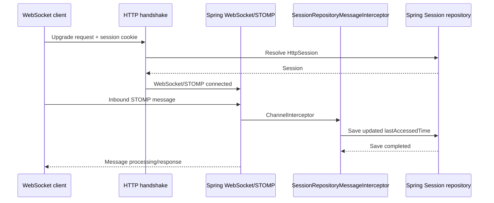

# Phạm vi tích hợp Spring WebSocket, STOMP và giới hạn với API WebSocket khác

Spring Session có thể phối hợp với kết nối WebSocket để duy trì vòng đời của phiên HTTP và đóng các kết nối còn mở khi phiên kết thúc. Tích hợp có sẵn tập trung vào Spring WebSocket cùng Spring Messaging/STOMP. Trong mô hình này, các thông điệp STOMP đi vào từ client có thể cập nhật thời điểm truy cập cuối của Spring Session; khi session bị hủy hoặc hết hạn, các WebSocket connection gắn với session có thể được đóng.

Phạm vi này cần được phân biệt với giao thức WebSocket thuần, JSR-356, RSocket hoặc các API socket do ứng dụng tự quản lý. Một kết nối WebSocket đã nâng cấp từ HTTP không tự động tạo ra request HTTP mới cho mỗi message. Nếu không có cơ chế cập nhật session theo inbound message, một kết nối vẫn đang mở có thể đi cùng một `HttpSession` đã hết hạn. Bài học này giải thích mô hình Spring WebSocket/STOMP, cách bật tích hợp, các thành phần tự động được đăng ký và giới hạn khi dùng API khác.

## 1. WebSocket, STOMP và Spring Session giải quyết các lớp khác nhau

Ba thành phần có vai trò riêng:

| Thành phần | Vai trò |
|---|---|
| WebSocket | Cung cấp kênh giao tiếp hai chiều lâu dài giữa client và server sau HTTP handshake |
| STOMP | Định nghĩa frame và semantics messaging như `CONNECT`, `SUBSCRIBE`, `SEND` và `DISCONNECT` |
| Spring WebSocket/Spring Messaging | Tích hợp WebSocket với handler, message channel, message broker và các abstraction của Spring |
| Spring Session | Lưu và quản lý vòng đời `HttpSession` trong kho như Redis hoặc JDBC |

WebSocket không bắt buộc phải dùng STOMP. Một ứng dụng có thể gửi text hoặc binary frame theo giao thức riêng. STOMP là một giao thức ứng dụng có thể chạy trên WebSocket; Spring cung cấp message broker support để route các frame đến `@MessageMapping` handler hoặc broker.

Spring Session không thay thế WebSocket transport và cũng không phải message broker. Nó kết nối vòng đời session HTTP với hạ tầng Spring WebSocket để session timeout, hoạt động người dùng và đóng kết nối được phối hợp tốt hơn.

## 2. Vì sao kết nối WebSocket cần tích hợp session riêng?

Trong HTTP thông thường, mỗi request có thể mang session cookie. Spring Session đọc session từ repository, xử lý request rồi cập nhật `lastAccessedTime` khi request sử dụng session.

Sau WebSocket handshake, kết nối được nâng cấp. Các message tiếp theo được truyền trên cùng socket; chúng không phải các HTTP request mới mang cookie session như trước. Vì vậy, chỉ dựa vào hoạt động WebSocket không tự động làm mới thời điểm truy cập cuối của `HttpSession`.

Nếu ứng dụng không cập nhật session theo hoạt động inbound:
- Người dùng vẫn gửi message qua socket nhưng session có thể hết hạn do idle timeout.
- Session hết hạn nhưng socket vẫn còn mở trong một khoảng thời gian chờ sự kiện cleanup.
- Một kết nối cũ có thể tiếp tục nhận dữ liệu nếu ứng dụng không kiểm tra trạng thái và không đóng socket.
- Trạng thái đăng nhập giữa HTTP endpoint và WebSocket endpoint có thể không nhất quán.

Tích hợp Spring Session WebSocket xử lý hai việc chính: cập nhật session khi có message từ client đi vào và đóng WebSocket connection khi Spring Session tương ứng bị kết thúc.

## 3. Phạm vi hỗ trợ chính thức: Spring WebSocket và STOMP

Tích hợp WebSocket của Spring Session hoạt động với Spring WebSocket support. Cấu hình tự động được cung cấp qua `AbstractSessionWebSocketMessageBrokerConfigurer`, một lớp cơ sở triển khai `WebSocketMessageBrokerConfigurer` dành cho message broker/STOMP.

Cấu hình này bổ sung các hook vào:
- STOMP endpoint handshake.
- Inbound message channel.
- WebSocket transport handler.
- Listener theo dõi quan hệ giữa Spring Session ID và WebSocket connection.

Vì vậy, đường tích hợp có sẵn phù hợp với ứng dụng dùng `@EnableWebSocketMessageBroker`, `StompEndpointRegistry` và `MessageBrokerRegistry`.

Spring Session không cung cấp cùng cơ chế tự động cho mọi API có tên WebSocket. Đặc biệt, tài liệu Spring Session nêu rõ tích hợp này không áp dụng trực tiếp cho JSR-356 vì API đó không có hook tương ứng để chặn các inbound WebSocket message theo cách mà tích hợp cần.

## 4. Cấu hình Spring WebSocket với STOMP

Một cấu hình Spring WebSocket/STOMP thông thường triển khai `WebSocketMessageBrokerConfigurer`:

```java
@Configuration
@EnableWebSocketMessageBroker
public class WebSocketConfig implements WebSocketMessageBrokerConfigurer {

    @Override
    public void registerStompEndpoints(StompEndpointRegistry registry) {
        registry.addEndpoint("/messages");
    }

    @Override
    public void configureMessageBroker(MessageBrokerRegistry registry) {
        registry.enableSimpleBroker("/queue/", "/topic/");
        registry.setApplicationDestinationPrefixes("/app");
    }
}
```

Để bổ sung Spring Session WebSocket support, thay việc triển khai trực tiếp interface bằng lớp cơ sở chuyên dụng:

```java
import org.springframework.context.annotation.Configuration;
import org.springframework.scheduling.annotation.EnableScheduling;
import org.springframework.session.Session;
import org.springframework.session.web.socket.config.annotation.AbstractSessionWebSocketMessageBrokerConfigurer;
import org.springframework.web.socket.config.annotation.EnableWebSocketMessageBroker;
import org.springframework.web.socket.config.annotation.StompEndpointRegistry;
import org.springframework.messaging.simp.config.MessageBrokerRegistry;

@Configuration
@EnableScheduling
@EnableWebSocketMessageBroker
public class WebSocketConfig
        extends AbstractSessionWebSocketMessageBrokerConfigurer<Session> {

    @Override
    protected void configureStompEndpoints(StompEndpointRegistry registry) {
        registry.addEndpoint("/messages");
    }

    @Override
    public void configureMessageBroker(MessageBrokerRegistry registry) {
        registry.enableSimpleBroker("/queue/", "/topic/");
        registry.setApplicationDestinationPrefixes("/app");
    }
}
```

Hai thay đổi quan trọng:
1. Kế thừa `AbstractSessionWebSocketMessageBrokerConfigurer<Session>` thay vì tự triển khai `WebSocketMessageBrokerConfigurer`.
2. Đổi method đăng ký endpoint từ `registerStompEndpoints` thành `configureStompEndpoints`.

Lớp cơ sở gọi và bổ sung các hook cần thiết cho Spring Session. Cấu hình lưu session bằng Redis/JDBC vẫn phải được thiết lập riêng; lớp này không tự tạo kho session.

## 5. Các thành phần Spring Session tự đăng ký

`AbstractSessionWebSocketMessageBrokerConfigurer` thực hiện một số cấu hình phía sau:

| Thành phần | Nơi được tích hợp | Mục đích |
|---|---|---|
| `SessionRepositoryMessageInterceptor` | Handshake interceptor của STOMP endpoint | Đưa Spring Session vào thuộc tính của WebSocket session để có thể cập nhật last access |
| `SessionRepositoryMessageInterceptor` | Inbound `ChannelInterceptor` | Cập nhật thời điểm truy cập cuối khi client gửi message |
| `WebSocketConnectHandlerDecoratorFactory` | WebSocket transport handler | Tạo sự kiện kết nối chứa WebSocket session |
| `WebSocketRegistryListener` | Spring application context | Theo dõi quan hệ giữa Spring Session ID và WebSocket connections để đóng socket khi session kết thúc |

Nhờ các thành phần này, ứng dụng không cần tự viết interceptor chỉ để lưu session vào handshake properties hoặc tự duy trì map session ID đến socket trong trường hợp STOMP được cấu hình qua lớp cơ sở.

Không đăng ký thủ công một bộ interceptor hoặc listener thứ hai làm cùng việc nếu chưa kiểm tra cấu hình tự động. Việc đăng ký trùng có thể gây cập nhật session nhiều lần, listener xử lý lặp hoặc khó chẩn đoán vòng đời kết nối.

## 6. Inbound message cập nhật thời điểm truy cập cuối

`SessionRepositoryMessageInterceptor` được gắn vào inbound channel. Khi một message từ client đi vào hệ thống, interceptor có thể cập nhật `lastAccessedTime` của Spring Session liên quan.

Luồng khái quát:



Chỉ hoạt động từ client đi vào được xem là tín hiệu activity để gia hạn idle session. Message server gửi xuống client hoặc dữ liệu client nhận được không chứng minh người dùng đang hoạt động, nên không làm mới session theo cùng cơ chế.

Điểm này quan trọng với chat, dashboard và notification. Một người dùng có thể mở trang nhận thông báo liên tục nhưng không gửi bất kỳ message nào. Nếu không có hoạt động inbound, session vẫn có thể hết hạn theo idle timeout dù socket còn mở.

## 7. STOMP heartbeat không đồng nghĩa với hoạt động nghiệp vụ

STOMP có thể hỗ trợ heartbeat giữa client và server để phát hiện kết nối chết hoặc duy trì trạng thái transport. Heartbeat và message nghiệp vụ có mục tiêu khác nhau:

- Heartbeat kiểm tra tính sống của kết nối.
- Inbound message từ người dùng thể hiện hoạt động ứng dụng.
- HTTP session timeout xác định thời gian không có hoạt động được repository ghi nhận.

Không nên giả định mọi heartbeat đều được tính là hoạt động người dùng và tự động gia hạn `HttpSession`. Hãy kiểm tra loại frame được đưa qua inbound channel trong phiên bản và cấu hình cụ thể. Nếu sản phẩm cần duy trì session trong lúc người dùng không tương tác, phải định nghĩa chính sách rõ ràng, ví dụ client gửi một application-level activity message có xác thực và giới hạn tần suất.

Không dùng heartbeat để gia hạn session vô hạn. Điều đó có thể khiến phiên đăng nhập tồn tại mãi chỉ vì tab trình duyệt vẫn mở, trái với yêu cầu idle timeout. Nếu cần absolute lifetime, hãy triển khai giới hạn tuyệt đối riêng bên cạnh idle timeout.

## 8. Khi Spring Session kết thúc, WebSocket connection được đóng

Spring Session WebSocket integration theo dõi những socket được mở trong một HTTP session. `WebSocketRegistryListener` duy trì quan hệ giữa session ID và WebSocket connections tương ứng.

Khi Spring Session bị kết thúc, ví dụ:
- Người dùng logout và session bị invalidate.
- Session hết hạn.
- Quản trị viên xóa session.
- Session bị thu hồi bởi chính sách bảo mật.

listener có thể tìm các WebSocket connection liên quan và đóng chúng. Điều này ngăn socket tồn tại vô thời hạn sau khi danh tính HTTP session không còn hợp lệ.

Việc đóng socket không thay thế authorization ở tầng message. Handler vẫn phải kiểm tra quyền trên destination và dữ liệu mỗi khi xử lý thao tác nhạy cảm. Một message đã được xếp hàng hoặc đang xử lý đúng lúc session bị thu hồi cần có chính sách xử lý rõ ràng.

## 9. Thời điểm đóng socket phụ thuộc vào việc phát hiện session hết hạn

Session hết hạn về mặt logic và dữ liệu vật lý bị dọn khỏi Redis/JDBC không nhất thiết xảy ra đúng cùng một thời điểm. Các repository có thể dùng TTL, keyspace notifications hoặc cleanup task để phát hiện expiration.

Vì vậy, WebSocket connection có thể được đóng sau khi sự kiện session destruction được phát và listener xử lý, thay vì đúng mili giây session timeout đạt ngưỡng. Tài liệu Spring Session minh họa trường hợp Redis notification có thể đến trễ và cleanup task định kỳ giúp đóng socket trong khoảng thời gian hợp lý.

Không xem độ trễ event là bằng chứng session còn hợp lệ. Mọi thao tác nhạy cảm vẫn phải xác thực trạng thái và quyền; đóng socket là biện pháp đồng bộ vòng đời transport sau khi session kết thúc.

Với repository và môi trường khác nhau, cần kiểm tra:
- Cơ chế phát session expiration/deletion event.
- Cấu hình notification của datastore.
- Lịch cleanup và scheduler có hoạt động không.
- Listener có nhận sự kiện ở node đang giữ WebSocket connection không.
- Ứng dụng có ghi nhận lỗi khi đóng socket hay không.

## 10. SockJS là fallback của Spring WebSocket/STOMP

SockJS cung cấp các transport dự phòng khi môi trường client hoặc proxy không hỗ trợ WebSocket trực tiếp. Trong Spring, endpoint STOMP có thể đăng ký như sau:

```java
@Override
protected void configureStompEndpoints(StompEndpointRegistry registry) {
    registry.addEndpoint("/messages")
            .setAllowedOriginPatterns("https://app.example.com")
            .withSockJS();
}
```

Khi dùng lớp cơ sở Spring Session, `SessionRepositoryMessageInterceptor` được thêm tự động vào các STOMP endpoint đã đăng ký, bao gồm cấu hình SockJS tương ứng.

SockJS không phải một repository session khác và cũng không phải giao thức thay thế STOMP ở tầng message. Nó cung cấp phương án transport/fallback cho kết nối đến cùng endpoint messaging. Các giới hạn về session activity và lifecycle vẫn cần được hiểu theo luồng inbound/outbound của Spring Messaging.

Cần cấu hình allowed origins theo domain thực tế. Không dùng wildcard rộng cho endpoint có cookie authentication nếu không có lý do và chính sách bảo vệ phù hợp.

## 11. HTTP handshake và danh tính người dùng

WebSocket handshake bắt đầu bằng HTTP request. Với ứng dụng dùng cookie session, trình duyệt gửi session cookie trong handshake request theo chính sách cookie và same-site phù hợp.

Nếu HTTP request đã được Spring Security xác thực, Spring WebSocket có thể gắn `Principal` của request vào `WebSocketSession`. Khi dùng STOMP, danh tính này được sử dụng làm user của message session. Điều đó giúp `@MessageMapping` handler biết người gửi là ai mà không cần tin một username do client tự khai báo trong payload.

Các nguyên tắc:
- Xác thực HTTP handshake như các endpoint được bảo vệ khác.
- Chỉ cho phép origin phù hợp với ứng dụng.
- Không tin trường `userId` hoặc `role` do client gửi trong message.
- Dùng `Principal` đã được server xác thực để xác định chủ thể.
- Kiểm tra quyền cho từng destination và từng thao tác dữ liệu.
- Không coi việc WebSocket handshake thành công là quyền truy cập mọi topic/queue.

Nếu dùng token thay cookie, cần thiết kế cách truyền và xác minh token ở handshake hoặc STOMP CONNECT theo API hỗ trợ; không giả định browser WebSocket constructor cho phép tùy ý thêm HTTP Authorization header như một HTTP client thông thường.

## 12. Spring Security và bảo vệ STOMP message

Spring Security có thể bảo vệ message inbound của STOMP thông qua cấu hình message security. Các quy tắc nên giới hạn:
- Ai được phép gửi đến application destination như `/app/**`.
- Ai được phép subscribe topic công khai.
- Ai chỉ được nhận queue riêng của mình.
- Những message nào yêu cầu role hoặc authority cụ thể.
- Những thao tác nào cần kiểm tra quyền sở hữu dữ liệu.

Ví dụ khái quát với message security:

```java
@Configuration
@EnableWebSocketSecurity
public class WebSocketSecurityConfiguration {

    // Khai báo AuthorizationManager<Message<?>> theo
    // destination và loại message của ứng dụng.
}
```

Đây là ví dụ khung; các matcher và authorization rule cần được định nghĩa theo phiên bản Spring Security cùng cấu trúc destination của ứng dụng. Với STOMP over WebSocket dùng cookie session, Spring Security thường yêu cầu CSRF token trong frame `CONNECT` theo cấu hình bảo mật mặc định. Client cần lấy token và gửi đúng header native theo quy tắc đã cấu hình.

Không tắt CSRF cho toàn bộ WebSocket chỉ để làm cho kết nối hoạt động. Nếu cần thay đổi chính sách, phải giới hạn chính xác endpoint, origin và loại message được miễn trừ, đồng thời kiểm thử tấn công cross-site WebSocket hijacking.

## 13. Phân biệt WebSocket transport timeout và HttpSession timeout

Hai thời hạn này độc lập:

| Thời hạn | Điều khiển | Hết hạn dẫn đến |
|---|---|---|
| HTTP session idle timeout | `maxInactiveInterval` và activity được repository ghi nhận | Session không còn hợp lệ; Spring Session phát sự kiện khi phát hiện kết thúc |
| WebSocket transport idle/connection timeout | Cấu hình transport, proxy hoặc server | Kết nối socket bị đóng |
| STOMP heartbeat | Cấu hình heartbeat client/server | Phát hiện peer không phản hồi hoặc giữ kết nối transport |
| Absolute login lifetime | Chính sách bảo mật do ứng dụng triển khai | Buộc xác thực lại dù session vẫn có activity |

Một WebSocket connection còn sống không có nghĩa session còn hợp lệ. Ngược lại, session còn hợp lệ không đảm bảo socket không bị proxy hoặc network đóng.

Hãy chọn các giá trị phù hợp và kiểm thử tương tác giữa chúng. Ví dụ, nếu WebSocket transport timeout ngắn hơn HTTP session timeout, người dùng có thể cần reconnect nhưng vẫn được xác thực qua session cookie. Nếu session timeout ngắn hơn thời gian người dùng giữ tab mở mà không gửi inbound message, socket sẽ bị đóng khi session kết thúc.

## 14. Spring Session WebSocket không tự phân phối socket giữa các node

Spring Session có thể chia sẻ `HttpSession` qua Redis hoặc JDBC, nhưng WebSocket connection là kết nối TCP đang kết thúc tại instance đã nhận handshake. Chia sẻ session không tự chuyển socket sang node khác và không tự làm message broker trở thành cluster.

Trong hệ thống nhiều instance:
- Load balancer định tuyến handshake đến một node.
- Socket tiếp tục gắn với node đó cho đến khi đóng hoặc mất kết nối.
- Node cần quản lý local WebSocket connection và session ID tương ứng.
- Spring Session repository cung cấp session state dùng chung.
- Broker có thể là simple broker cục bộ hoặc external broker relay; cách phân phối message cần được thiết kế riêng.

Khi session bị destroy, node đang giữ socket cần nhận được sự kiện phù hợp để đóng kết nối. Nếu repository phát event qua Redis pub/sub hoặc cơ chế khác, cần xác minh event được chuyển đến tất cả instance cần xử lý. Chỉ cấu hình cùng Redis session namespace không tự chứng minh socket trên mọi node sẽ đóng đúng lúc.

Sticky session có thể giảm số lần reconnect hoặc giúp vận hành một số broker cục bộ, nhưng không thay thế kho session dùng chung và không bảo đảm failover socket. Khi node chết, client thường phải reconnect và handshake lại.

## 15. Giới hạn với raw Spring WebSocketHandler

Spring Framework cung cấp API thấp hơn như `WebSocketHandler` để xử lý frame trực tiếp mà không dùng STOMP message broker. Handshake vẫn có thể dùng HTTP session và `Principal` theo cơ chế Spring WebSocket chuẩn.

Tuy nhiên, `AbstractSessionWebSocketMessageBrokerConfigurer` là lớp tích hợp cho message broker/STOMP. Nếu chỉ đăng ký raw `WebSocketHandler`, không nên giả định các interceptor inbound và registry listener được cấu hình tự động như với STOMP configurer.

Nếu cần raw handler, ứng dụng phải thiết kế các hook tương ứng:
- Lấy session HTTP trong handshake bằng interceptor phù hợp.
- Lưu liên kết giữa session ID và WebSocket connection.
- Cập nhật `lastAccessedTime` khi nhận frame inbound theo chính sách.
- Nghe session destruction event và đóng socket liên quan.
- Dọn map connection khi socket đóng hoặc session bị hủy.
- Kiểm thử reconnect, timeout, logout và race khi session hết hạn.

Không sao chép trực tiếp implementation nội bộ của Spring Session nếu chưa hiểu version contract. Có thể dùng các extension point public của Spring WebSocket và Spring Session để xây dựng adapter phù hợp.

## 16. JSR-356 và API WebSocket khác không được tích hợp tự động

JSR-356 là API Java WebSocket chuẩn, thường được dùng qua `@ServerEndpoint` hoặc container endpoint. Spring Session WebSocket integration không hỗ trợ trực tiếp API này vì không có cơ chế intercept inbound message theo cách tích hợp của Spring WebSocket yêu cầu.

Các trường hợp cần xem là ngoài phạm vi tích hợp tự động:
- JSR-356 endpoint trực tiếp.
- Raw socket handler không dùng STOMP broker configurer.
- RSocket.
- SSE (Server-Sent Events).
- WebSocket client/server library độc lập như Netty hoặc API riêng của container.
- Message transport tùy chỉnh không đi qua Spring Messaging inbound channel.

Điều đó không có nghĩa các công nghệ này không thể dùng chung với Spring Session ở cấp ứng dụng. Chúng có thể dùng cùng hệ thống đăng nhập hoặc đọc session trong HTTP handshake nếu có adapter phù hợp. Nhưng việc tự cập nhật idle time, đóng connection khi session destroy và ánh xạ session ID đến connection cần được triển khai riêng.

Đối với SSE, mỗi kết nối là HTTP response streaming chứ không phải WebSocket. Việc cập nhật session phụ thuộc request lifecycle và cách server giữ response; không áp dụng máy móc `SessionRepositoryMessageInterceptor` cho SSE.

## 17. Khi nào nên dùng STOMP và khi nào dùng API khác?

| Nhu cầu | Hướng phù hợp |
|---|---|
| Chat, topic, queue, subscribe và publish theo destination | Spring WebSocket + STOMP |
| Cần SockJS fallback cùng messaging abstraction | Spring WebSocket + STOMP + SockJS |
| Giao thức frame tùy chỉnh, ít cần broker semantics | Raw Spring `WebSocketHandler` và tự tích hợp session lifecycle |
| Endpoint theo chuẩn JSR-356 hiện có | Giữ JSR-356 và xây adapter session/connection riêng nếu cần |
| Giao tiếp reactive theo mô hình message stream | Đánh giá RSocket; session integration phải được thiết kế riêng |
| Server push một chiều qua HTTP | SSE, với chính sách session theo HTTP lifecycle |

Chọn STOMP khi cần destination routing, subscribe, user destination, broker và Spring Security message authorization. Chọn raw handler khi giao thức ứng dụng rất riêng hoặc cần kiểm soát frame trực tiếp. Lựa chọn transport không làm thay đổi trách nhiệm bảo vệ session và authorization.

## 18. Quản lý reconnect và session hết hạn

Khi socket bị đóng do session kết thúc hoặc network lỗi, client có thể tự reconnect. Reconnect phải đi qua handshake mới và được xác thực lại.

Một flow an toàn:
1. Client nhận close frame hoặc lỗi kết nối.
2. Client thử refresh trạng thái đăng nhập qua HTTP nếu chính sách cho phép.
3. Nếu session còn hợp lệ, client mở kết nối mới.
4. Nếu session đã hết hạn hoặc bị logout, server yêu cầu đăng nhập lại.
5. Client không tự gửi lại một principal hoặc role để khôi phục danh tính.
6. Sau reconnect, client subscribe lại destination được phép.

Không coi reconnect thành cơ chế gia hạn session. Nếu session đã bị invalidate, việc mở socket mới phải thất bại ở handshake hoặc bị từ chối trong quy trình xác thực. Nếu dùng retry, hãy áp dụng exponential backoff và jitter để tránh hàng nghìn client reconnect cùng lúc khi một node hoặc broker khởi động lại.

## 19. Kiểm thử vòng đời Spring Session và WebSocket

Một integration test cần kiểm tra cả HTTP session và socket:

**Kịch bản session được gia hạn bởi inbound message**
1. Đăng nhập qua HTTP và lấy session cookie.
2. Mở STOMP WebSocket endpoint bằng cookie đó.
3. Gửi message từ client đến application destination.
4. Xác nhận message được xử lý.
5. Chờ lâu hơn khoảng thời gian idle ban đầu nhưng gửi inbound message trước khi timeout.
6. Gọi HTTP endpoint cần xác thực và xác nhận session còn hợp lệ.

**Kịch bản session hết hạn**
1. Cấu hình timeout ngắn trong profile test.
2. Mở WebSocket/STOMP connection bằng session đã xác thực.
3. Không gửi inbound application message trong thời gian timeout.
4. Chờ repository phát hiện expiration và listener xử lý.
5. Xác nhận WebSocket connection bị đóng.
6. Gửi HTTP request với cookie cũ và xác nhận session không còn được khôi phục.

**Kịch bản phân biệt inbound và outbound**
- Chỉ gửi message từ server xuống client và xác nhận điều đó không được coi là activity gia hạn session.
- Gửi message từ client vào và xác nhận last access được cập nhật.
- Kiểm tra heartbeat riêng với application message.

**Kịch bản logout và nhiều node**
- Đăng nhập và mở socket ở node A.
- Invalidate session qua HTTP logout hoặc thao tác quản trị.
- Xác nhận node giữ socket nhận được session destruction event và đóng connection.
- Lặp lại với node B để kiểm tra event propagation.
- Xác nhận session khác của người dùng khác không bị đóng.

Dùng STOMP client test hoặc Spring WebSocket test support và repository thật trong integration test. Mock `SessionRepository` không đủ để kiểm tra TTL, event publication và việc đóng socket qua listener.

## 20. Chẩn đoán sự cố thường gặp

| Triệu chứng | Nguyên nhân có thể | Cách kiểm tra |
|---|---|---|
| Socket mở nhưng HTTP session hết hạn | Inbound message không cập nhật last access hoặc endpoint không dùng session configurer | Xác nhận đang kế thừa `AbstractSessionWebSocketMessageBrokerConfigurer` |
| Message đến nhưng session không được gia hạn | Interceptor không chạy trên inbound channel hoặc message không đi qua Spring Messaging | Kiểm tra endpoint, channel và interceptor registration |
| Server gửi notification liên tục nhưng session vẫn hết hạn | Outbound message không được tính là user activity | Kiểm thử riêng inbound và outbound |
| Logout HTTP nhưng socket còn mở | Session destruction event chưa đến node giữ socket hoặc listener không được đăng ký | Kiểm tra `WebSocketRegistryListener` và event propagation |
| STOMP hoạt động nhưng JSR-356 không gia hạn session | JSR-356 không nằm trong tích hợp tự động | Tạo adapter riêng hoặc dùng Spring WebSocket |
| Một node đóng socket, node khác không đóng | Event/session repository hoặc registry không nhất quán giữa instance | Kiểm tra event delivery, namespace và node ownership |
| Reconnect tạo nhiều subscription trùng | Client không cleanup subscription cũ hoặc không xử lý disconnect | Kiểm tra lifecycle và reconnect logic |
| Session sống quá lâu dù người dùng không tương tác | Client gửi application keepalive quá thường xuyên | Rà soát chính sách idle và absolute lifetime |

Khi điều tra, ghi lại session identifier đã che, WebSocket session ID, node ID, STOMP destination và thời điểm event. Không log cookie hoặc session ID nguyên vẹn, credentials hay nội dung message nhạy cảm.

## 21. Quy trình triển khai an toàn

Trước khi triển khai Spring Session với WebSocket:

1. Xác định ứng dụng dùng Servlet `HttpSession` và Spring WebSocket message broker.
2. Cấu hình Spring Session repository trước, sau đó bật `@EnableWebSocketMessageBroker`.
3. Kế thừa `AbstractSessionWebSocketMessageBrokerConfigurer<Session>` và triển khai `configureStompEndpoints`.
4. Cấu hình message broker, endpoint, allowed origins và SockJS fallback nếu cần.
5. Bảo đảm inbound message được xác thực, phân quyền và cập nhật session.
6. Kiểm tra session destruction event có thể đóng socket trên node giữ kết nối.
7. Phân biệt idle timeout, absolute lifetime, transport timeout và heartbeat.
8. Không giả định raw JSR-356 hoặc API socket khác được tích hợp tự động.
9. Kiểm thử logout, expiration, reconnect, nhiều instance và event propagation.
10. Theo dõi số socket đang mở, session timeout, event delay và lỗi đóng kết nối.

Spring Session WebSocket support được thiết kế cho Spring WebSocket cùng STOMP message broker. `AbstractSessionWebSocketMessageBrokerConfigurer` kết nối session với handshake, inbound channel và WebSocket lifecycle: message từ client cập nhật last access, còn session destruction có thể đóng các socket liên quan. Tích hợp này không áp dụng trực tiếp cho JSR-356 hoặc mọi API WebSocket khác. Với raw handler, RSocket, SSE hay transport tùy chỉnh, ứng dụng cần tự thiết kế cơ chế cập nhật session, authorization và đóng kết nối theo vòng đời phiên.

