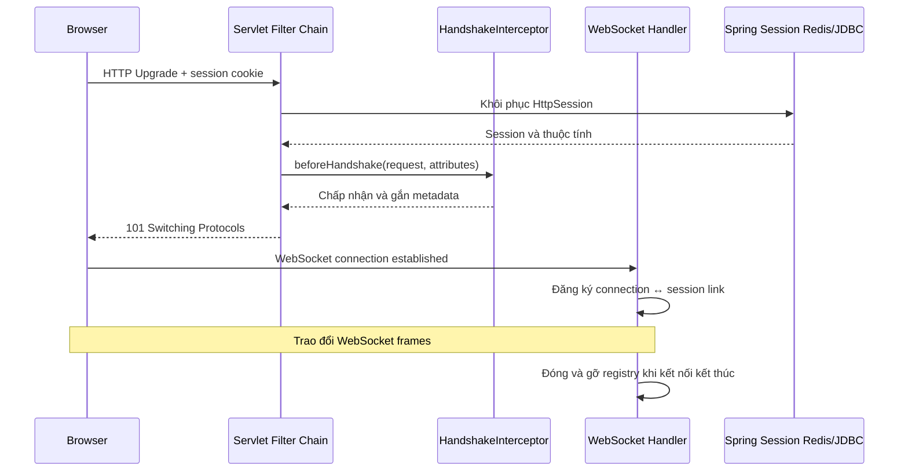
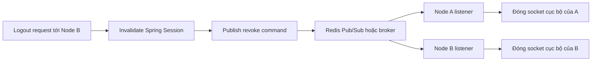

# HandshakeInterceptor và liên kết phiên với kết nối được mở

Khi trình duyệt mở kết nối WebSocket, nó bắt đầu bằng một HTTP handshake. Nếu người dùng đã đăng nhập bằng session của Spring, request handshake thường mang session cookie. Ứng dụng có thể dùng `HandshakeInterceptor` để kiểm tra request trước khi nâng cấp kết nối, lấy thông tin xác thực từ request đã được Spring Security xử lý và đưa một số thuộc tính cần thiết vào `WebSocketSession` mới.

Liên kết session HTTP với kết nối WebSocket giúp ứng dụng biết kết nối nào thuộc phiên đăng nhập nào. Nhờ đó, khi người dùng logout, session bị thu hồi hoặc chính sách bảo mật thay đổi, ứng dụng có thể tìm và đóng những kết nối tương ứng. Việc liên kết cần được thiết kế rõ ràng vì vòng đời HTTP session và WebSocket connection khác nhau: session có thể hết hạn trong khi socket vẫn mở, còn một session có thể mở nhiều tab và tạo nhiều kết nối.

Trong `SPRING_SESSION`, Spring Session lưu trạng thái phiên qua Redis/JDBC để nhiều instance dùng chung. `HandshakeInterceptor` là điểm tích hợp của Spring WebSocket trong Servlet stack; nó không tự biến WebSocket thành một session HTTP kéo dài và cũng không tự đóng socket khi session bị xóa. Bài học này trình bày handshake, cách truyền metadata tối thiểu, registry kết nối, xử lý logout/expiration và các giới hạn khi chạy nhiều instance.

## 1. Vòng đời của WebSocket handshake

WebSocket bắt đầu bằng một HTTP request có header yêu cầu nâng cấp giao thức. Server kiểm tra request và nếu chấp nhận sẽ trả response `101 Switching Protocols`. Sau đó, dữ liệu được trao đổi qua kết nối WebSocket thay vì mỗi thông điệp tạo một HTTP request mới.

Luồng khái quát khi ứng dụng dùng Spring Session:

1. Browser gửi handshake request tới endpoint WebSocket, kèm cookie session nếu cookie phù hợp với domain/path/SameSite.
2. Servlet filter chain chạy; `SessionRepositoryFilter` có thể khôi phục `HttpSession` từ Redis/JDBC.
3. Spring Security xác định principal và quyền của request handshake.
4. `HandshakeInterceptor.beforeHandshake` kiểm tra request và có thể chép metadata cần thiết vào map attributes.
5. Spring WebSocket thực hiện handshake và tạo `WebSocketSession`.
6. Handler nhận `afterConnectionEstablished` và đăng ký kết nối vào registry của ứng dụng.
7. Trong thời gian socket mở, handler xử lý frame/message và kiểm tra quyền theo chính sách.
8. Khi socket đóng, handler dọn registry; khi HTTP session bị logout/expire, ứng dụng có thể chủ động đóng các socket đã liên kết.



Interceptor chạy trong quá trình handshake. Nó không chạy lại cho mỗi WebSocket frame. Các message sau khi kết nối đã mở phải được bảo vệ tại message handler/channel security tương ứng.

## 2. HandshakeInterceptor cung cấp những gì?

Spring Framework định nghĩa `HandshakeInterceptor` với hai callback chính:

```java
public interface HandshakeInterceptor {
    boolean beforeHandshake(
            ServerHttpRequest request,
            ServerHttpResponse response,
            WebSocketHandler wsHandler,
            Map<String, Object> attributes) throws Exception;

    void afterHandshake(
            ServerHttpRequest request,
            ServerHttpResponse response,
            WebSocketHandler wsHandler,
            Exception exception);
}
```

- `beforeHandshake`: chạy trước khi handshake hoàn tất. Trả `true` để tiếp tục; trả `false` để từ chối handshake. Có thể đọc request, kiểm tra điều kiện và ghi dữ liệu vào `attributes`.
- `afterHandshake`: được gọi sau khi handshake thành công hoặc thất bại để thực hiện xử lý hậu kỳ/ghi nhận kết quả. Đây không phải callback khi WebSocket connection đóng.

Map `attributes` được chuyển sang `WebSocketSession.getAttributes()` của kết nối được tạo. Dữ liệu trong map là bản sao/metadata của kết nối tại thời điểm handshake, không phải một tham chiếu sống tới `HttpSession`. Thay đổi attribute trong HTTP session sau đó không tự động cập nhật map của WebSocket session.

`HandshakeInterceptor` không nên dùng để lưu toàn bộ `HttpSession` object, `SecurityContext`, cookie hoặc request headers vào WebSocket attributes. Chỉ chuyển những giá trị tối thiểu mà handler cần, ví dụ internal user ID và một session-link identifier không mang quyền xác thực.

## 3. Lấy HttpSession hiện tại mà không tạo session mới

Trong Servlet stack, request handshake có thể được bọc bởi `ServletServerHttpRequest`. Có thể lấy `HttpServletRequest` và gọi `getSession(false)` để lấy session đã tồn tại mà không tạo session mới.

```java
public void inspectHandshakeRequest(ServerHttpRequest request) {
    if (request instanceof ServletServerHttpRequest servletRequest) {
        HttpServletRequest httpRequest = servletRequest.getServletRequest();
        HttpSession session = httpRequest.getSession(false);
        // session == null nghĩa là request chưa có HttpSession.
    }
}
```

Nếu session không tồn tại, không nên tự động gọi `getSession(true)` trong interceptor chỉ để cho phép WebSocket. Việc đó có thể tạo anonymous session ngoài ý muốn, làm tăng session store và khiến kết nối không có danh tính xác thực. Nếu endpoint yêu cầu người dùng đăng nhập, hãy từ chối handshake khi không có session/principal hợp lệ.

Không phải mọi `ServerHttpRequest` đều là `ServletServerHttpRequest`. Nếu ứng dụng chạy WebFlux, đây không phải mô hình tích hợp tương ứng; WebFlux có handshake service và `WebSocketHandler` reactive riêng. Không ép kiểu request hoặc dùng Servlet `HttpSession` trong WebFlux.

## 4. Liên kết ổn định giữa HTTP session và WebSocket connection

Một cách đơn giản là lưu session ID vào WebSocket attributes. Tuy nhiên, session ID là credential nhạy cảm và có thể thay đổi khi Spring Security thực hiện session fixation protection. Không nên sao chép raw session ID vào message payload, log hoặc client. Một thiết kế tốt hơn là tạo một **session-link ID** ngẫu nhiên ở phía server, lưu trong HTTP session sau khi xác thực thành công, rồi chuyển ID này vào WebSocket attributes.

Session-link ID chỉ dùng nội bộ để liên kết session với các socket; nó không thay thế session ID, không được chấp nhận như credential và không được gửi cho browser. Nó có thể tồn tại qua việc đổi session ID nếu thuộc tính được migrate cùng session.

Ví dụ khởi tạo liên kết sau khi đăng nhập thành công:

```java
public void ensureSessionLink(HttpServletRequest request) {
    HttpSession session = request.getSession(true);
    if (session.getAttribute("app.ws.session-link") == null) {
        session.setAttribute(
                "app.ws.session-link",
                UUID.randomUUID().toString());
    }
}
```

Gọi hàm này từ authentication success handler hoặc một bước đăng ký session đáng tin cậy sau khi xác thực. Nếu ứng dụng hỗ trợ session migration, cần xác minh thuộc tính link được giữ lại theo chính sách. Không tạo link ID từ session ID, username hoặc timestamp vì các giá trị đó không phải định danh ngẫu nhiên phù hợp.

Nếu không muốn lưu thêm thuộc tính, có thể dùng session ID làm khóa nội bộ trong server-side registry, nhưng cần xử lý session ID rotation và bảo đảm giá trị không bao giờ rời khỏi server hoặc xuất hiện trong log. Dù chọn cách nào, registry phải có quy tắc cập nhật khi session fixation protection thay đổi ID.

## 5. Viết HandshakeInterceptor để kiểm tra và chuyển metadata

Ví dụ sau chỉ chấp nhận handshake từ người dùng đã xác thực, có session tồn tại và đã được gán session-link ID:

```java
import jakarta.servlet.http.HttpServletRequest;
import jakarta.servlet.http.HttpSession;
import org.springframework.http.server.ServerHttpRequest;
import org.springframework.http.server.ServerHttpResponse;
import org.springframework.http.server.ServletServerHttpRequest;
import org.springframework.web.socket.WebSocketHandler;
import org.springframework.web.socket.server.HandshakeInterceptor;

public final class SessionLinkHandshakeInterceptor
        implements HandshakeInterceptor {

    public static final String USER_ID = "app.ws.user-id";
    public static final String SESSION_LINK = "app.ws.session-link";

    @Override
    public boolean beforeHandshake(
            ServerHttpRequest request,
            ServerHttpResponse response,
            WebSocketHandler wsHandler,
            Map<String, Object> attributes) {

        if (!(request instanceof ServletServerHttpRequest servletRequest)) {
            return false;
        }

        HttpServletRequest httpRequest = servletRequest.getServletRequest();
        HttpSession httpSession = httpRequest.getSession(false);
        Principal principal = httpRequest.getUserPrincipal();

        if (httpSession == null || principal == null) {
            return false;
        }

        Object linkId = httpSession.getAttribute("app.ws.session-link");
        if (!(linkId instanceof String sessionLinkId)
                || sessionLinkId.isBlank()) {
            return false;
        }

        attributes.put(USER_ID, principal.getName());
        attributes.put(SESSION_LINK, sessionLinkId);
        return true;
    }

    @Override
    public void afterHandshake(
            ServerHttpRequest request,
            ServerHttpResponse response,
            WebSocketHandler wsHandler,
            Exception exception) {
        // Ghi metric/log kết quả handshake; không ghi cookie hoặc session ID.
    }
}
```

Đây là ví dụ cho Servlet stack. Cần bổ sung import `java.security.Principal`, `java.util.Map` và `HttpSession`/`HttpServletRequest` theo namespace Servlet mà ứng dụng sử dụng (`jakarta.servlet` ở Spring hiện đại; dự án cũ có thể dùng `javax.servlet`). Interceptor lấy principal từ request đã qua Spring Security; không tin `userId` trong query string hoặc header tùy ý.

`principal.getName()` chỉ nên dùng làm user identifier nếu nó là canonical name của hệ thống. Với nhiều tenant/issuer hoặc username có thể thay đổi, có thể ánh xạ principal sang internal user ID bất biến. Không lưu `Authentication` object hoặc credentials trong map.

### 5.1. Đăng ký interceptor

```java
@Configuration
@EnableWebSocket
public class WebSocketConfiguration implements WebSocketConfigurer {

    private final SessionLinkHandshakeInterceptor interceptor;
    private final ChatWebSocketHandler handler;

    public WebSocketConfiguration(
            SessionLinkHandshakeInterceptor interceptor,
            ChatWebSocketHandler handler) {
        this.interceptor = interceptor;
        this.handler = handler;
    }

    @Override
    public void registerWebSocketHandlers(WebSocketHandlerRegistry registry) {
        registry.addHandler(handler, "/ws/chat")
                .addInterceptors(interceptor)
                .setAllowedOrigins("https://app.example.com");
    }
}
```

Danh sách origin cần là các origin thực tế được phép. Không dùng `*` cho endpoint được xác thực bằng cookie session. Cấu hình CORS HTTP thông thường không thay thế việc kiểm tra `Origin` của WebSocket handshake.

## 6. Dùng HttpSessionHandshakeInterceptor có sẵn khi phù hợp

Spring cung cấp `HttpSessionHandshakeInterceptor`, có thể sao chép các thuộc tính từ HTTP session vào WebSocket session attributes. Có thể cấu hình để copy tất cả hoặc chỉ những tên thuộc tính được chọn, và có tùy chọn liên quan đến việc sao chép session ID tùy phiên bản.

Ví dụ chỉ định thuộc tính được phép sao chép:

```java
HttpSessionHandshakeInterceptor interceptor =
        new HttpSessionHandshakeInterceptor(
                List.of("app.ws.session-link", "app.user.display-name"));
```

Hãy kiểm tra constructor và API đúng phiên bản Spring Framework. Nếu dùng interceptor có sẵn, chỉ đưa vào danh sách những thuộc tính thực sự cần. Không bật copy-all trong ứng dụng có `SecurityContext`, CSRF token, saved request, access token hoặc nhiều dữ liệu session nhạy cảm.

Interceptor có sẵn giúp chuyển attribute; nó không thay thế authorization, origin validation hoặc connection registry. Nó cũng không tự đóng WebSocket khi HTTP session bị xóa.

## 7. Phân biệt HttpSession, WebSocketSession và Principal

Ba khái niệm này có vòng đời và mục đích khác nhau:

| Đối tượng | Đại diện cho | Vòng đời |
|---|---|---|
| `HttpSession` của Servlet/Spring Session | Phiên HTTP của browser hoặc client | Có thể tồn tại qua nhiều HTTP request, hết hạn hoặc bị invalidate |
| `WebSocketSession` | Một kết nối WebSocket cụ thể | Tồn tại từ khi handshake thành công tới khi socket đóng |
| `Principal` | Danh tính đã xác thực của người gọi | Được gắn với request/connection theo security integration; không phải session ID |

Một HTTP session có thể mở nhiều WebSocket connection, ví dụ nhiều tab hoặc nhiều cửa sổ. Một principal có thể có nhiều HTTP session từ nhiều thiết bị. Vì vậy, quan hệ thường là:

```text
Principal
  ├── HTTP session A
  │     ├── WebSocket connection 1 (tab A)
  │     └── WebSocket connection 2 (tab B)
  └── HTTP session B
        └── WebSocket connection 3 (điện thoại)
```

`WebSocketSession.getId()` là ID của kết nối WebSocket, không phải ID của `HttpSession`. Không dùng hai ID này thay thế cho nhau. Principal giúp kiểm tra người dùng; session-link ID giúp đóng đúng các kết nối thuộc một HTTP session cụ thể.

## 8. Đăng ký và gỡ WebSocket connection trong registry

Sau khi handshake thành công, handler có thể đọc session-link ID từ `WebSocketSession.getAttributes()` và đăng ký kết nối. Registry thường cần hai chiều:

- `sessionLinkId -> tập WebSocket connection ID` để đóng mọi kết nối của một HTTP session.
- `connectionId -> WebSocketSession` để tìm socket thực tế cần đóng.

Ví dụ registry trong một JVM:

```java
@Component
public class LocalWebSocketRegistry {

    private final ConcurrentMap<String, WebSocketSession> connections =
            new ConcurrentHashMap<>();

    private final ConcurrentMap<String, Set<String>> bySessionLink =
            new ConcurrentHashMap<>();

    public void register(WebSocketSession socket) {
        Object value = socket.getAttributes().get(
                SessionLinkHandshakeInterceptor.SESSION_LINK);
        if (!(value instanceof String linkId) || linkId.isBlank()) {
            throw new IllegalStateException("Thiếu session link");
        }

        connections.put(socket.getId(), socket);
        bySessionLink.computeIfAbsent(
                linkId, key -> ConcurrentHashMap.newKeySet())
                .add(socket.getId());
    }

    public void unregister(WebSocketSession socket) {
        connections.remove(socket.getId());
        Object value = socket.getAttributes().get(
                SessionLinkHandshakeInterceptor.SESSION_LINK);
        if (value instanceof String linkId) {
            Set<String> ids = bySessionLink.get(linkId);
            if (ids != null) {
                ids.remove(socket.getId());
                if (ids.isEmpty()) {
                    bySessionLink.remove(linkId, ids);
                }
            }
        }
    }

    public void closeBySessionLink(String linkId) {
        Set<String> ids = bySessionLink.getOrDefault(linkId, Set.of());
        for (String id : List.copyOf(ids)) {
            WebSocketSession socket = connections.get(id);
            if (socket != null && socket.isOpen()) {
                try {
                    socket.close(CloseStatus.POLICY_VIOLATION);
                }
                catch (IOException ignored) {
                    // Ghi metric và tiếp tục đóng các kết nối còn lại.
                }
            }
        }
    }
}
```

Đây là mẫu minh họa; cần bổ sung import và logging/metrics phù hợp. Với ứng dụng production, không nên bỏ qua exception đóng socket mà không ghi nhận. Registry phải xử lý race giữa close và unregister, và nên có giới hạn số connection cho mỗi session/principal để tránh tài nguyên bị lạm dụng.

### 8.1. Gắn registry với WebSocketHandler

```java
public class ChatWebSocketHandler extends TextWebSocketHandler {

    private final LocalWebSocketRegistry registry;

    public ChatWebSocketHandler(LocalWebSocketRegistry registry) {
        this.registry = registry;
    }

    @Override
    public void afterConnectionEstablished(WebSocketSession session)
            throws Exception {
        registry.register(session);
    }

    @Override
    public void afterConnectionClosed(
            WebSocketSession session,
            CloseStatus status) {
        registry.unregister(session);
    }
}
```

Nếu handler có logic khởi tạo khác, hãy bảo đảm registration thành công trước khi xử lý message yêu cầu registry. Nếu khởi tạo ném exception sau khi đăng ký, phải unregister hoặc đóng socket để tránh entry mồ côi.

## 9. Đóng WebSocket khi logout hoặc session bị thu hồi

Khi người dùng logout, Spring Security có thể invalidate HTTP session và Spring Session xóa dữ liệu khỏi Redis/JDBC. Nhưng WebSocket đã mở không tự trở thành một HTTP request mới để kiểm tra cookie; kết nối vẫn có thể tồn tại và tiếp tục nhận/gửi message.

Ứng dụng cần phối hợp hai hành động:

1. Kết thúc session HTTP bằng logout flow/Spring Session repository.
2. Tìm session-link ID trước khi xóa session và yêu cầu registry đóng các socket gắn với link đó.

Ví dụ service logout có thể lấy link ID trước khi invalidate:

```java
public void logoutCurrentSession(HttpServletRequest request) {
    HttpSession session = request.getSession(false);
    if (session == null) {
        return;
    }

    String linkId = (String) session.getAttribute("app.ws.session-link");
    if (linkId != null) {
        localWebSocketRegistry.closeBySessionLink(linkId);
    }

    session.invalidate();
}
```

Đây là ví dụ khái quát, không nên thay thế toàn bộ Spring Security logout handler bằng một method tự viết như trên. Trong ứng dụng thực tế, tích hợp đóng socket vào logout orchestration/`LogoutHandler` phù hợp và vẫn để Spring Security xóa `SecurityContext`, CSRF state, remember-me state và cookie theo cấu hình.

Đóng socket trước hay sau khi invalidate cần được quyết định theo yêu cầu. Nếu đóng trước, connection có thể được kết thúc ngay cả khi bước invalidate sau đó lỗi; nếu invalidate trước, vẫn cần giữ link ID đã đọc để đóng socket. Một cách triển khai an toàn là lấy link ID, thực hiện logout server-side, rồi phát lệnh đóng socket; nếu đóng socket thất bại, có cơ chế retry/reconciliation.

## 10. Phản ứng với SessionDeletedEvent và SessionExpiredEvent

Spring Session có thể phát sự kiện khi session bị xóa hoặc hết hạn, tùy repository và cấu hình:

- `SessionDeletedEvent`: session bị xóa tường minh.
- `SessionExpiredEvent`: session hết hạn.

Listener có thể dùng session attributes trong event để lấy session-link ID và đóng các socket tương ứng:

```java
@Component
public class SessionLifecycleWebSocketListener {

    private final LocalWebSocketRegistry registry;

    public SessionLifecycleWebSocketListener(
            LocalWebSocketRegistry registry) {
        this.registry = registry;
    }

    @EventListener
    public void onDeleted(SessionDeletedEvent event) {
        closeLinkedConnections(event.getSession());
    }

    @EventListener
    public void onExpired(SessionExpiredEvent event) {
        closeLinkedConnections(event.getSession());
    }

    private void closeLinkedConnections(Session session) {
        String linkId = session.getAttribute("app.ws.session-link");
        if (linkId != null) {
            registry.closeBySessionLink(linkId);
        }
    }
}
```

Tên package và kiểu generic của event/session cần khớp phiên bản Spring Session. Event support và thời điểm phát phụ thuộc repository. Với Redis, expiration event thường cần keyspace notifications được bật và listener hoạt động. Với JDBC, cleanup có thể chạy theo lịch; không giả định event được phát đúng ngay tại thời điểm timeout.

Event listener là lớp bổ sung cho logout orchestration, không phải bảo đảm duy nhất. Một notification có thể đến trễ hoặc bị bỏ lỡ khi subscriber dừng. Nếu socket giữ quyền truy cập dữ liệu nhạy cảm, phải kiểm tra authorization trên từng message và có cơ chế định kỳ xác minh trạng thái session/revocation.

## 11. Liên kết session không đồng nghĩa kết nối được xác thực mãi mãi

Handshake là thời điểm xác thực ban đầu. Sau khi nâng cấp, browser gửi WebSocket frames trên kết nối đã mở; không gửi lại HTTP session cookie ở mỗi frame. Nếu session bị thu hồi hoặc người dùng bị khóa sau handshake, connection không tự biết thay đổi đó.

Các biện pháp cần cân nhắc:

- Đóng connection ngay khi logout/revoke được xử lý ở server.
- Kiểm tra quyền cho từng STOMP destination/message hoặc từng loại WebSocket message.
- Với message nhạy cảm, xác minh principal và trạng thái tài khoản/session-link vẫn còn hiệu lực.
- Đặt giới hạn thời gian tối đa cho kết nối hoặc yêu cầu reconnect sau một khoảng thời gian.
- Dùng heartbeat để phát hiện socket chết; heartbeat không thay thế xác thực.
- Có cơ chế thu hồi theo user/session khi quyền hoặc trạng thái tài khoản thay đổi.

Không coi `WebSocketSession.getPrincipal()` là bằng chứng rằng người dùng vẫn còn quyền vô thời hạn. Principal cho biết danh tính gắn với handshake; authorization phải phản ánh chính sách hiện tại.

## 12. Bảo vệ handshake: Origin, cookie và CSRF

Trình duyệt có thể tự gửi cookie session khi mở WebSocket tới một origin phù hợp. Vì vậy, endpoint WebSocket dùng cookie authentication có nguy cơ Cross-Site WebSocket Hijacking nếu chấp nhận handshake từ origin không tin cậy.

Các yêu cầu cơ bản:

1. Dùng HTTPS/WSS trong production.
2. Cấu hình danh sách allowed origins cụ thể, không dùng wildcard cho endpoint có credentials.
3. Kiểm tra `Origin` theo chính sách của ứng dụng; không chỉ tin `Host` hoặc query parameter.
4. Giữ cookie `Secure`, `HttpOnly`, `SameSite` phù hợp với luồng triển khai.
5. Yêu cầu xác thực trước khi chấp nhận handshake nếu endpoint không công khai.
6. Nếu dùng STOMP, bảo vệ CONNECT và các message bằng Spring Security WebSocket message security; cấu hình CSRF token theo cơ chế hỗ trợ của phiên bản.

Origin validation và CSRF giải quyết các phần rủi ro khác nhau. Allowed origins giúp ngăn browser từ trang lạ khởi tạo kết nối có cookie; CSRF token trên STOMP CONNECT có thể là lớp xác nhận bổ sung. Không tắt CSRF chỉ vì kết nối dùng WebSocket.

Không truyền session ID, access token hoặc CSRF token qua query string của WebSocket URL. URL thường xuất hiện trong access log, telemetry, proxy log và browser diagnostics. Nếu cần token riêng cho một client, dùng cơ chế cấp token ngắn hạn, giới hạn audience/scope và truyền qua header/subprotocol được thiết kế an toàn theo client/platform.

## 13. STOMP và xác thực từng message

Nếu ứng dụng dùng STOMP trên WebSocket, Spring Messaging có thể gắn `Principal` vào message header. Spring Security có thể bảo vệ inbound channel/destination và kiểm tra quyền gửi/subscribe.

Ví dụ cấu hình message authorization theo hướng khái quát:

```java
@Configuration
@EnableWebSocketMessageBroker
public class MessagingSecurityConfiguration {
    // Cấu hình broker và endpoint STOMP ở lớp WebSocket.
}
```

Phần authorization chi tiết được cấu hình bằng Spring Security message security theo phiên bản đang dùng, chẳng hạn chỉ cho user đã xác thực gửi tới `/app/**` và subscribe đúng queue riêng của họ. Không chỉ kiểm tra quyền ở handshake rồi cho phép mọi destination.

Đối với message chứa resource ID, kiểm tra quyền sở hữu tài nguyên tại service. Việc người dùng có một WebSocket session hợp lệ không có nghĩa họ được subscribe vào mọi topic hoặc gửi lệnh thay mặt người dùng khác.

## 14. Session fixation và thay đổi session ID khi socket đang mở

Spring Security có thể đổi session ID sau khi xác thực thành công để chống session fixation. Nếu registry dùng raw HTTP session ID làm khóa liên kết, việc đổi ID có thể làm registry cũ không còn khớp với session mới.

Session-link ID riêng được lưu trong session attributes có thể ổn định qua `changeSessionId()` nếu thuộc tính được giữ lại. Tuy nhiên, cần kiểm thử hành vi migration và bảo đảm không có code nào tạo link mới ngoài ý muốn khi ID thay đổi.

Nếu buộc dùng session ID làm registry key:

- Lắng nghe sự kiện session ID change phù hợp của Servlet (`HttpSessionIdListener`) hoặc tích hợp tại nơi session fixation strategy thực hiện thay đổi.
- Chuyển mapping cũ sang mapping mới một cách nguyên tử.
- Xử lý trường hợp listener chạy trễ hoặc socket đóng đồng thời.
- Không để session ID xuất hiện trong message, API hoặc log.

Đối với thiết kế mới, session-link ID nội bộ thường dễ quản lý hơn vì tách định danh liên kết socket khỏi credential cookie.

## 15. Nhiều instance: registry cục bộ và lệnh đóng phân tán

Registry dùng `ConcurrentHashMap` trong ví dụ chỉ biết các socket được mở trên cùng một JVM. Nếu user handshake vào instance A nhưng logout request tới instance B, B không thể gọi `close()` trên đối tượng `WebSocketSession` đang nằm trong bộ nhớ A.

Một kiến trúc nhiều instance thường cần hai lớp:

- **Local connection registry:** mỗi instance giữ đối tượng socket đang kết nối trên chính node đó.
- **Distributed routing/command channel:** khi session bị revoke, node xử lý logout phát một lệnh chứa session-link ID; các node khác nhận lệnh và đóng các socket cục bộ tương ứng.

Có thể dùng Redis Pub/Sub, message broker hoặc một kênh sự kiện nội bộ. Payload chỉ cần session-link ID, event type, thời điểm và correlation ID; không chứa session ID/cookie/token. Mỗi node chỉ đóng các connection có link ID tương ứng trong local registry.



Pub/Sub thường không lưu bền thông điệp cho subscriber đang offline. Nếu node tạm dừng đúng lúc nhận lệnh, socket có thể chưa bị đóng. Với yêu cầu thu hồi mạnh, kết hợp:

- Lệnh đóng phân tán để phản ứng nhanh.
- Kiểm tra revocation/session validity khi nhận message nhạy cảm.
- Registry có TTL/heartbeat để loại bỏ mapping stale.
- Reconciliation định kỳ để phát hiện connection gắn với session không còn hợp lệ.
- Kênh bền vững/outbox nếu nghiệp vụ cần xử lý lệnh sau khi node khôi phục.

## 16. Giới hạn của session timeout khi WebSocket còn hoạt động

HTTP session timeout thường dựa trên hoạt động HTTP/session repository. WebSocket frames không phải các HTTP request độc lập. Việc client gửi message liên tục trên một socket không nhất thiết cập nhật `HttpSession.lastAccessedTime` hoặc gia hạn Redis TTL.

Do đó, có thể xảy ra tình huống:

1. Người dùng mở WebSocket khi session còn hợp lệ.
2. Socket tiếp tục trao đổi frame trong thời gian dài.
3. Không có HTTP request nào làm mới session.
4. Redis TTL/session timeout hết hạn và session bị xóa.
5. WebSocket vẫn còn mở nếu ứng dụng không nhận event hoặc không đóng socket chủ động.

Nếu cần gia hạn session khi WebSocket có hoạt động, hãy thiết kế chính sách tường minh. Có thể yêu cầu client gửi heartbeat qua một HTTP endpoint được xác thực hoặc cập nhật last activity có giới hạn; không nên gia hạn session vô hạn chỉ vì frame ping/pong. Với thao tác nhạy cảm, kiểm tra session validity tại server và đóng socket khi session hết hạn.

Không tạo một HTTP request cho mỗi frame chỉ để làm mới TTL. Điều đó làm tăng tải datastore và có thể khiến kết nối giữ session sống mãi. Chọn chu kỳ heartbeat, idle timeout và maximum connection age phù hợp.

## 17. Đóng connection và dọn registry đúng cách

Registry phải được dọn khi:

- Client đóng bình thường.
- Network disconnect hoặc timeout.
- Server chủ động revoke session.
- Handler gặp lỗi.
- Node shutdown hoặc deploy.
- Kết nối không còn heartbeat trong khoảng thời gian cho phép.

Trong Servlet WebSocket API, `WebSocketSession.close(CloseStatus)` đóng socket. Có thể dùng close status như `NORMAL` cho đóng bình thường, `POLICY_VIOLATION` khi quyền không còn hợp lệ hoặc status phù hợp với chính sách ứng dụng. Không đưa thông tin nhạy cảm vào close reason vì client và proxy có thể nhìn thấy.

`afterConnectionClosed` là điểm dọn registry khi kết nối kết thúc. Nhưng nếu node chết đột ngột, callback có thể không chạy; registry phân tán cần TTL hoặc heartbeat để loại bỏ entry stale. Khi server shutdown có kiểm soát, chủ động đóng socket và unregister trước khi tiến trình kết thúc.

## 18. Kiểm thử HandshakeInterceptor và liên kết session

Kiểm thử cần bao phủ cả HTTP handshake lẫn vòng đời socket:

| Trường hợp | Cách kiểm tra | Kết quả mong đợi |
|---|---|---|
| Handshake có session hợp lệ | Đăng nhập, gửi cookie rồi mở WebSocket | Handshake được chấp nhận và link metadata có trong server-side attributes |
| Không có session | Mở endpoint mà không gửi cookie | Handshake bị từ chối nếu endpoint yêu cầu xác thực |
| Session hết hạn | Dùng cookie của session đã hết hạn | Không chấp nhận kết nối mới |
| Principal null/anonymous | Request không có principal xác thực | Bị từ chối theo policy |
| Link ID thiếu | Session không có thuộc tính liên kết | Bị từ chối hoặc đi qua quy trình khởi tạo đáng tin cậy đã định nghĩa |
| Origin không cho phép | Handshake từ origin lạ | Bị từ chối |
| Metadata tối thiểu | Kiểm tra `WebSocketSession.getAttributes()` | Chỉ có user ID/link ID cần thiết; không có cookie, token hoặc toàn bộ session |
| Nhiều tab | Một session mở nhiều socket | Registry giữ đủ các connection và đóng tất cả khi revoke session |
| Logout | Logout qua HTTP endpoint | Session bị invalidate và socket liên kết bị đóng |
| Session expiration | Cho session hết TTL | Listener/reconciliation đóng socket theo chính sách |
| Session ID rotation | Đăng nhập và đổi ID sau handshake | Link registry vẫn ánh xạ đúng theo thiết kế |
| Nhiều instance | Handshake trên A, logout trên B | Lệnh phân tán đóng socket trên A |
| Node offline khi revoke | Tạm dừng listener rồi phát lệnh | Khi phục hồi, kiểm tra validity/reconciliation vẫn thu hồi được quyền |
| Message sau revoke | Gửi message sau khi session bị thu hồi | Message nhạy cảm bị từ chối hoặc connection đóng |
| Cleanup | Đóng socket bình thường và bất thường | Registry không giữ mapping stale vô hạn |

Unit test interceptor có thể mock `ServerHttpRequest`, nhưng cần integration test trên embedded Servlet container để xác minh filter order, cookie, Spring Session và handshake thực tế. Với nhiều instance, dùng Redis/broker test và hai ứng dụng node riêng; registry in-memory đơn lẻ không chứng minh khả năng đóng socket phân tán.

## 19. Lỗi thường gặp và cách khắc phục

| Triệu chứng | Nguyên nhân có thể | Hướng xử lý |
|---|---|---|
| Handshake luôn bị từ chối | Request không phải `ServletServerHttpRequest`, thiếu session/principal hoặc link ID | Kiểm tra stack, filter order, cookie và authentication flow |
| Socket mở được sau khi logout | Chỉ invalidate HTTP session, không đóng connection | Tích hợp logout với connection registry và revoke command |
| Logout ở node B không đóng socket node A | Registry chỉ nằm trong bộ nhớ từng JVM | Dùng distributed command channel và local listener trên từng node |
| Session hết TTL nhưng socket còn mở | WebSocket frames không tự gia hạn HTTP session; event bị bỏ lỡ | Kiểm tra session validity, expiration event, heartbeat và reconciliation |
| Nhiều tab nhưng chỉ một socket bị đóng | Registry lưu một connection cho mỗi session link thay vì một tập | Dùng `sessionLinkId -> Set<connectionId>` |
| Socket bị gắn sai user | Tin user ID từ query/header client | Lấy principal từ request đã xác thực và server-side session |
| Session fixation làm mất mapping | Registry dùng raw session ID và ID đã đổi | Dùng session-link ID ổn định hoặc cập nhật mapping khi ID rotation |
| WebSocket attributes chứa bí mật | Copy toàn bộ HttpSession attributes | Chỉ copy allowlist metadata cần thiết |
| Event expiration không chạy | Redis keyspace notification/listener hoặc JDBC cleanup chưa hỗ trợ | Xác minh implementation và bổ sung kiểm tra/reconciliation |
| Message vẫn được xử lý sau revoke | Chỉ xác thực tại handshake | Kiểm tra authorization/session validity cho message nhạy cảm |
| Registry tăng không giới hạn | Không unregister khi close hoặc node chết | Dọn ở lifecycle callback, heartbeat và TTL |

## 20. Quy trình triển khai an toàn

Khi liên kết Spring Session với WebSocket, thực hiện theo thứ tự:

1. Xác định stack Servlet hay WebFlux; dùng đúng handshake API cho stack đó.
2. Bảo đảm Spring Session filter và Spring Security chạy trước handshake handler trong Servlet chain.
3. Tạo session-link ID ngẫu nhiên ở server sau authentication; không dùng nó làm credential.
4. Viết `HandshakeInterceptor` chỉ chấp nhận principal/session hợp lệ và chỉ chuyển metadata tối thiểu.
5. Cấu hình allowed origins cụ thể, WSS, cookie flags và CSRF/message security phù hợp.
6. Đăng ký `WebSocketSession` trong local registry theo session-link ID; hỗ trợ nhiều socket trên một session.
7. Gỡ registry ở `afterConnectionClosed` và khi handler thất bại.
8. Tích hợp logout/session revoke với lệnh đóng socket; dùng Spring Session lifecycle events như một lớp bổ sung.
9. Khi chạy nhiều instance, phát lệnh revoke qua broker/Redis Pub/Sub và để từng node đóng socket cục bộ.
10. Kiểm tra session validity và authorization trên message nhạy cảm; không coi handshake là quyền vĩnh viễn.
11. Thiết kế TTL/heartbeat/reconciliation để xử lý session hết hạn và node offline.
12. Kiểm thử filter order, session ID rotation, nhiều tab, logout, expiration, origin và multi-instance bằng môi trường tích hợp.

`HandshakeInterceptor` là điểm kiểm tra và truyền metadata ở thời điểm HTTP nâng cấp thành WebSocket. Liên kết bằng một session-link ID nội bộ giúp ứng dụng gom các socket thuộc cùng phiên đăng nhập mà không công bố session ID. Tuy nhiên, HTTP session và WebSocket connection có vòng đời độc lập; muốn logout hoặc expiration thu hồi được kết nối đang mở, ứng dụng phải quản lý registry, đóng socket trên đúng node và tiếp tục kiểm tra quyền khi xử lý message. Kết hợp các bước này với Spring Session shared store, Spring Security, origin validation và kiểm thử nhiều instance giúp WebSocket không tiếp tục phục vụ người dùng sau khi phiên đăng nhập đã bị thu hồi.
