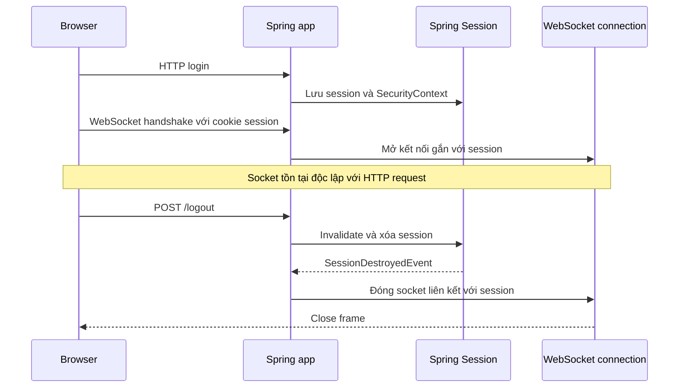

# SessionDestroyedEvent và đóng kết nối gắn với phiên đã kết thúc

WebSocket là kết nối hai chiều có thể tồn tại lâu sau khi HTTP handshake hoàn tất. Trong ứng dụng dùng Spring Security và Spring Session, kết nối WebSocket thường được mở bởi một người dùng đã xác thực qua HttpSession. Nếu session hết hạn, bị xóa khi logout hoặc bị thu hồi bởi quản trị viên, WebSocket vẫn có thể còn mở nếu ứng dụng không đóng kết nối tương ứng.

Spring Session phát các sự kiện vòng đời session, trong đó `SessionDestroyedEvent` là sự kiện nền cho trường hợp session bị xóa hoặc hết hạn. Khi tích hợp WebSocket, ứng dụng có thể dùng sự kiện này để tìm các kết nối được mở từ session đã kết thúc và đóng chúng. Spring Session có hỗ trợ tích hợp WebSocket để theo dõi mối liên hệ giữa HTTP session và WebSocket connection; với phiên bản hoặc kiến trúc tùy chỉnh, ứng dụng có thể cần một registry riêng.

Bài học này giải thích nguồn gốc và giới hạn của `SessionDestroyedEvent`, cách ánh xạ HTTP session với WebSocket connection, cách đóng kết nối an toàn và idempotent, cùng những điểm cần chú ý khi sự kiện được phát trong môi trường Redis/JDBC nhiều instance.

## 1. Vì sao session kết thúc nhưng WebSocket vẫn có thể mở?

HTTP session và WebSocket connection có vòng đời khác nhau:

- HTTP session được quản lý bởi Servlet container hoặc Spring Session repository.
- WebSocket connection được duy trì bởi server và client sau quá trình handshake.
- SecurityContext có thể được đọc tại thời điểm handshake để xác định principal.
- Việc xóa session trong Redis/JDBC không tự gửi một lệnh TCP/WebSocket close đến client.

Ví dụ, người dùng đăng nhập và mở một WebSocket để nhận thông báo. Sau đó họ bấm logout ở một tab khác. Spring Security invalidate HttpSession và Spring Session xóa session khỏi repository. Nếu không có cơ chế liên kết session với WebSocket, socket đã mở có thể tiếp tục nhận message dù session gốc không còn tồn tại.

Đây là vấn đề cả về tài nguyên và bảo mật. Một kết nối còn mở có thể giữ buffer, subscription và state trong memory; nếu ứng dụng tiếp tục gửi dữ liệu riêng tư qua socket, người dùng có thể vẫn nhận dữ liệu sau khi phiên đăng nhập đã bị thu hồi.



Mục tiêu là khi session kết thúc, mọi kết nối WebSocket được mở dưới danh tính/session đó phải được đóng hoặc bị vô hiệu hóa theo chính sách ứng dụng.

## 2. SessionDestroyedEvent là gì?

Spring Session định nghĩa sự kiện vòng đời session trong package `org.springframework.session.events`. `SessionDestroyedEvent` biểu thị một session đã bị hủy. Các sự kiện cụ thể như `SessionDeletedEvent` và `SessionExpiredEvent` là những trường hợp thường gặp:

| Sự kiện | Ý nghĩa |
| --- | --- |
| `SessionDestroyedEvent` | Sự kiện tổng quát cho một session đã kết thúc |
| `SessionDeletedEvent` | Session bị xóa chủ động, ví dụ do logout hoặc thao tác delete |
| `SessionExpiredEvent` | Session hết hạn theo idle timeout hoặc cơ chế expiration của repository |

Listener có thể lắng nghe kiểu cha `SessionDestroyedEvent` để xử lý chung cả xóa chủ động lẫn hết hạn:

```java
import org.springframework.context.event.EventListener;
import org.springframework.session.events.SessionDestroyedEvent;
import org.springframework.stereotype.Component;

@Component
public class SessionLifecycleListener {

    @EventListener
    public void onSessionDestroyed(SessionDestroyedEvent event) {
        String sessionId = event.getSessionId();
        // Tìm và đóng WebSocket connection gắn với sessionId.
    }
}
```

API event cụ thể có thể khác nhẹ theo phiên bản Spring Session; hãy dùng phương thức lấy session ID hoặc Session mà phiên bản dự án cung cấp. Không suy đoán session ID từ cookie hoặc log.

Điểm quan trọng: sự kiện là thông báo về thay đổi vòng đời session. Nó không tự đóng socket, không tự tìm principal và không bảo đảm mọi tác vụ cleanup của ứng dụng đã hoàn tất. Ứng dụng phải có cơ chế theo dõi quan hệ giữa session và kết nối.

## 3. Khi nào sự kiện được phát?

Các nguồn phát sự kiện thường gồm:

- Người dùng logout và Spring Security invalidate HttpSession.
- Quản trị viên thu hồi session qua Spring Session repository.
- Session hết hạn theo idle timeout và repository phát hiện expiration.
- Tác vụ cleanup phát hiện và xử lý các session hết hạn.

Thời điểm phát sự kiện phụ thuộc repository và hạ tầng:

- Với Redis, sự kiện hết hạn có thể phụ thuộc Redis keyspace notifications và listener của Spring Session. Notification expiration không nhất thiết xuất hiện đúng thời điểm TTL về 0; Redis có thể phát sự kiện khi key được xử lý hết hạn.
- Với JDBC, session hết hạn thường được phát hiện khi repository hoặc tác vụ cleanup kiểm tra dữ liệu. Nếu cleanup chạy theo lịch, thời điểm event có thể trễ so với thời điểm idle timeout đạt ngưỡng.
- Với repository tùy chỉnh, implementation phải chủ động publish event nếu muốn các listener nhận biết session destroyed.

Không giả định tất cả repository phát event giống nhau hoặc mọi sự kiện đều được broadcast tới mọi instance. Hãy kiểm tra implementation, cấu hình event publisher và khả năng phân phối event trong topology thực tế.

### 3.1. Redis keyspace notifications

Redis repository có thể dựa vào keyspace notifications để nhận biết key session hết hạn hoặc bị xóa. Redis phải được cấu hình cho nhóm event mà Spring Session cần. Trong nhiều cấu hình, nhóm keyevent expiration và generic delete được bật bằng một giá trị tương tự `Egx`; giá trị chính xác cần đối chiếu với phiên bản Spring Session, Redis và cách repository được cấu hình.

Một số môi trường managed Redis không cho phép ứng dụng tự thay đổi `notify-keyspace-events`. Khi đó, quản trị viên cần cấu hình ở cấp dịch vụ hoặc chọn cách triển khai khác được hỗ trợ. Không tự thay đổi cấu hình production nếu chưa đánh giá tác động tới các ứng dụng khác đang dùng Redis.

Nếu expiration notification bị tắt hoặc không tới được listener, session có thể bị xóa khỏi Redis nhưng listener không nhận `SessionExpiredEvent`; WebSocket cleanup dựa vào event sẽ không chạy. Cần kiểm tra Redis config, pub/sub connectivity và log của message listener container.

### 3.2. JDBC cleanup

Với JDBC, một session có thể đã quá idle timeout nhưng bản ghi vẫn tồn tại cho đến khi repository hoặc cleanup task xử lý. Khi cleanup phát hiện và xóa session, event có thể được publish ở node thực hiện thao tác. Không nên giả định mọi application node tự động nhận event chỉ vì chúng cùng truy cập một database.

Nếu các WebSocket connection được phân bố trên nhiều node, phải bảo đảm event cleanup được truyền tới node đang giữ socket. Có thể dùng event bus/message broker chung, một cơ chế notification được hỗ trợ, hoặc một registry phân tán kèm cơ chế gửi lệnh đóng tới đúng node.

## 4. Liên kết WebSocket với HTTP session

Để đóng đúng kết nối, ứng dụng phải biết WebSocket connection nào được mở từ HTTP session nào. Không dùng WebSocket session ID thay cho HTTP session ID; đây là hai định danh khác nhau.

Trong quá trình handshake, browser gửi session cookie. Server có thể đọc HttpSession hiện tại và lưu session ID vào handshake attributes. Với STOMP, các attributes này có thể được đưa vào session attributes của message để xử lý ở các interceptor hoặc registry.

Một HandshakeInterceptor minh họa:

```java
import jakarta.servlet.http.HttpSession;
import org.springframework.http.server.ServerHttpRequest;
import org.springframework.http.server.ServerHttpResponse;
import org.springframework.http.server.ServletServerHttpRequest;
import org.springframework.web.socket.WebSocketHandler;
import org.springframework.web.socket.server.HandshakeInterceptor;

import java.util.Map;

public class HttpSessionIdHandshakeInterceptor
        implements HandshakeInterceptor {

    public static final String HTTP_SESSION_ID = "HTTP_SESSION_ID";

    @Override
    public boolean beforeHandshake(
            ServerHttpRequest request,
            ServerHttpResponse response,
            WebSocketHandler wsHandler,
            Map<String, Object> attributes) {

        if (!(request instanceof ServletServerHttpRequest servletRequest)) {
            return false;
        }

        HttpSession httpSession =
                servletRequest.getServletRequest().getSession(false);
        if (httpSession == null) {
            return false;
        }

        attributes.put(HTTP_SESSION_ID, httpSession.getId());
        return true;
    }

    @Override
    public void afterHandshake(
            ServerHttpRequest request,
            ServerHttpResponse response,
            WebSocketHandler wsHandler,
            Exception exception) {
        // Không cần xử lý thêm trong ví dụ tối giản.
    }
}
```

Ví dụ dùng `jakarta.servlet` phù hợp các dòng Spring Framework/Spring Boot mới; dự án dùng Servlet API cũ có thể cần package `javax.servlet`. Đây là ví dụ cho handshake tùy chỉnh, không phải yêu cầu phải tự viết interceptor nếu Spring Session WebSocket integration đã quản lý việc này.

Session ID là dữ liệu nhạy cảm. Chỉ giữ nó trong memory/registry hoặc metadata nội bộ cần thiết; không đưa vào URL, message body gửi cho client, log hoặc metric label.

## 5. Dùng hỗ trợ WebSocket có sẵn của Spring Session

Spring Session có tích hợp WebSocket cho ứng dụng STOMP/WebSocket. Tích hợp này có thể:

- Gắn thông tin HTTP session với WebSocket/STOMP session trong quá trình handshake và connect.
- Theo dõi quan hệ giữa HTTP session và các WebSocket connection.
- Cập nhật thời gian truy cập session khi nhận message, tùy interceptor và cấu hình.
- Lắng nghe sự kiện session destroyed để đóng các WebSocket connection liên quan.
- Dọn registry khi WebSocket disconnect.

Trong các phiên bản cung cấp `AbstractSessionWebSocketMessageBrokerConfigurer`, lớp cấu hình này đăng ký các thành phần Spring Session cần thiết cho WebSocket message broker. Ở các phiên bản mới hơn, API cấu hình có thể thay đổi hoặc được thay bằng thành phần khác; hãy dùng hướng dẫn đúng phiên bản thay vì sao chép class đã deprecated hoặc không còn tồn tại.

Mẫu cấu hình theo phong cách API cũ:

```java
@Configuration
@EnableWebSocketMessageBroker
public class WebSocketConfig
        extends AbstractSessionWebSocketMessageBrokerConfigurer<WebSocketMessageBrokerConfigurer> {

    @Override
    protected void configureStompEndpoints(StompEndpointRegistry registry) {
        registry.addEndpoint("/ws");
    }

    @Override
    public void configureMessageBroker(MessageBrokerRegistry registry) {
        registry.enableSimpleBroker("/topic", "/queue");
        registry.setApplicationDestinationPrefixes("/app");
    }
}
```

Đoạn cấu hình chỉ minh họa vị trí tích hợp session-aware WebSocket trong các phiên bản có API này; generic signature và hook có thể khác theo phiên bản. Nếu Spring Session đã cung cấp `WebSocketRegistryListener` và interceptor tương ứng, không tạo thêm một registry khác làm cùng nhiệm vụ mà chưa xác định rõ quyền sở hữu và thứ tự cleanup.

Với raw WebSocket handler hoặc kiến trúc không dùng STOMP, có thể cần registry riêng. Dù dùng tích hợp có sẵn hay tự quản lý, yêu cầu cốt lõi vẫn là ánh xạ từ HTTP session ID sang tập WebSocket connection và đóng tập đó khi nhận event.

## 6. Registry ánh xạ session ID sang WebSocket connection

Nếu tự quản lý, cấu trúc dữ liệu có thể là:

```java
Map<String, Set<WebSocketSession>> connectionsByHttpSessionId;
Map<String, String> httpSessionIdByWebSocketId;
```

Map thứ nhất giúp tìm tất cả socket khi một HTTP session bị hủy. Map thứ hai giúp xóa nhanh liên kết khi một WebSocket disconnect. Tập connection nên an toàn khi nhiều thread cùng thêm/xóa, ví dụ dùng `ConcurrentHashMap` và concurrent set.

Interface minh họa:

```java
public interface WebSocketConnectionRegistry {

    void register(String httpSessionId, WebSocketSession webSocketSession);

    void unregister(String webSocketSessionId);

    void closeByHttpSessionId(String httpSessionId, CloseStatus status);
}
```

Đăng ký connection sau khi handshake thành công và gỡ đăng ký khi connection đóng. Khi session destroyed:

```java
@Component
public class CloseSocketsOnSessionDestroyed {

    private final WebSocketConnectionRegistry registry;

    public CloseSocketsOnSessionDestroyed(WebSocketConnectionRegistry registry) {
        this.registry = registry;
    }

    @EventListener
    public void onSessionDestroyed(SessionDestroyedEvent event) {
        registry.closeByHttpSessionId(
                event.getSessionId(),
                new CloseStatus(1000, "HTTP session ended"));
    }
}
```

`WebSocketConnectionRegistry` là abstraction do ứng dụng triển khai; Spring Session không cung cấp một bean có tên này. Khi dùng built-in WebSocket integration, listener/registry tương ứng đã được tích hợp và không cần viết lại ví dụ này.

## 7. Đóng WebSocket connection đúng cách

Đóng kết nối nên:

1. Lấy snapshot các connection đang gắn với session ID.
2. Loại bỏ mapping khỏi registry hoặc đánh dấu đang đóng để ngăn xử lý lặp.
3. Kiểm tra connection còn mở.
4. Gửi close frame với status/reason phù hợp.
5. Ghi nhận lỗi đóng nếu transport đã mất.
6. Xóa mọi mapping còn lại trong finally.

Ví dụ phần lõi:

```java
for (WebSocketSession socket : sockets) {
    if (socket.isOpen()) {
        try {
            socket.close(new CloseStatus(1000, "HTTP session ended"));
        }
        catch (IOException ex) {
            // Ghi lỗi kỹ thuật bằng correlation ID; không log session ID.
        }
    }
}
```

Close code `1000` biểu thị đóng bình thường. Ứng dụng có thể dùng application-specific code trong phạm vi được WebSocket protocol cho phép nếu client cần phân biệt lý do, nhưng không gửi thông tin nhạy cảm trong close reason.

Đóng connection có thể cạnh tranh với thread đang gửi message. Với STOMP hoặc WebSocket handler có nhiều sender, dùng cơ chế đồng bộ/concurrent decorator phù hợp của Spring để tránh đồng thời ghi frame không an toàn. Không giữ lock registry trong khi chờ I/O hoặc thực hiện close có thể chậm; lấy snapshot trước rồi đóng bên ngoài lock.

Không block event loop trong ứng dụng reactive. Với WebSocket Servlet/STOMP, tránh để việc đóng hàng loạt socket giữ một lock toàn cục hoặc làm chậm event listener xử lý các session khác.

## 8. Cleanup idempotent và tránh rò rỉ registry

Sự kiện session destroyed và WebSocket disconnect có thể đến gần như đồng thời. Ví dụ, browser đã đóng tab ngay trước khi session hết hạn. Listener có thể nhận event sau khi connection đã được gỡ khỏi registry.

Vì vậy:

- `unregister` phải an toàn nếu connection đã bị xóa.
- `closeByHttpSessionId` phải chấp nhận session ID không còn trong registry.
- Chỉ đóng socket còn mở.
- Xóa mapping ở cả hai chiều.
- Không giữ reference tới WebSocketSession sau khi disconnect.
- Có timeout hoặc reconciliation để phát hiện mapping mồ côi nếu event bị mất.

Một triển khai nên xử lý các thao tác lặp mà không phát sinh lỗi nghiêm trọng. Event trùng hoặc disconnect lặp không được làm dừng listener thread hay ngăn cleanup các connection còn lại.

Đừng chỉ xóa map session-to-socket mà quên map socket-to-session; điều đó tạo memory leak. Ngược lại, không giữ session ID trong một map không giới hạn thời gian nếu socket đã đóng.

## 9. Multi-instance: event phải đến đúng node đang giữ socket

Trong hệ thống nhiều instance, WebSocket connection thường được giữ trong memory của node đã nhận handshake. Session có thể được lưu ở Redis/JDBC dùng chung, nhưng registry socket cục bộ không tự chia sẻ giữa các JVM.

Ví dụ:

- Handshake của Alice đến node A; socket được giữ trong memory A.
- Request logout đến node B.
- B xóa session khỏi Redis.
- B nhận `SessionDeletedEvent`, nhưng socket của Alice nằm ở A.

Nếu event chỉ được publish trong ApplicationContext của B, listener ở B không thể đóng socket đang nằm ở A. Cần một cơ chế phân phối thông báo tới node A hoặc một registry/command channel phân tán.

Các cách triển khai:

1. **Event broadcast qua Redis Pub/Sub hoặc message broker:** mọi node đang giữ WebSocket subscribe cùng topic và lọc theo session ID.
2. **Registry phân tán có owner node:** lưu mapping session ID → node ID; khi session destroyed, gửi lệnh close tới node sở hữu socket.
3. **WebSocket gateway chuyên biệt:** gateway quản lý connection và nhận lệnh revoke từ dịch vụ session/authentication.

Nếu dùng Spring Session Redis, keyspace notification có thể được nhiều instance subscribe, tùy cấu hình listener container và Redis deployment. Nhưng không mặc định mọi loại event hoặc mọi topology đều broadcast đúng một lần tới mọi node. Kiểm tra bằng integration test qua ít nhất hai JVM.

Với JDBC, event phát từ cleanup task trên một node có thể chỉ nằm trong context node đó. Nếu socket nằm ở node khác, cần event bus/notification riêng hoặc cơ chế khác để truyền lệnh. Không dựa vào sticky session: logout request và WebSocket connection có thể được xử lý ở các node khác nhau.

## 10. Session hết hạn không đồng nghĩa socket tự timeout

WebSocket connection không tự động đóng chỉ vì cookie session hết hạn. Sau handshake, browser không gửi lại cookie cho mỗi frame như HTTP request thông thường. Nếu không có cơ chế lifecycle, kết nối có thể tồn tại vượt quá idle timeout của HTTP session.

Một số tích hợp Spring Session cập nhật lastAccessTime khi nhận WebSocket message. Khi đó hoạt động trên socket có thể giữ session sống lâu hơn; cần xác định chính sách mong muốn:

- Nếu message WebSocket được coi là hoạt động của người dùng, cập nhật lastAccessTime có thể phù hợp.
- Nếu chỉ heartbeat kỹ thuật được gửi định kỳ, không nên mặc định heartbeat giữ đăng nhập vô thời hạn.
- Nếu chính sách yêu cầu session hết hạn theo hoạt động HTTP, cần phân biệt heartbeat với thao tác nghiệp vụ.
- Nếu session bị thu hồi chủ động, socket phải đóng theo event/command, bất kể heartbeat gần nhất.

Không dùng ping/pong WebSocket làm bằng chứng rằng người dùng vẫn được xác thực hoặc còn quyền. Ping/pong chỉ kiểm tra kết nối ở tầng transport.

## 11. SecurityContext và quyền trên message sau handshake

Spring Security thường xác định principal tại handshake. Với STOMP, principal có thể được gắn với WebSocket session và được dùng khi xử lý message. Khi HttpSession bị hủy, không nên giả định principal đã gắn vào socket tự biến mất.

Đóng socket theo `SessionDestroyedEvent` là một phần của revoke. Ngoài ra, với các thao tác nhạy cảm:

- Kiểm tra quyền tại message authorization layer.
- Không tin user ID hoặc role do client gửi trong payload.
- Không dùng một giá trị principal từ handshake làm quyền vĩnh viễn nếu chính sách cho phép thu hồi quyền giữa phiên.
- Nếu cần, kiểm tra account status/security version trước khi xử lý message nhạy cảm.
- Sau khi nhận close, client phải dừng gửi message và xóa state UI liên quan.

Một request WebSocket message đã bắt đầu xử lý trước event destroy có thể vẫn chạy. Nếu cần ngăn side effect sau thu hồi, kiểm tra trạng thái phiên/quyền tại điểm nghiệp vụ trước khi commit.

## 12. Event timing, lỗi và tính nhất quán

`SessionDestroyedEvent` là tín hiệu cleanup, không phải cơ chế giao dịch phân tán. Có thể có độ trễ giữa lúc session bị xóa trong repository và lúc listener đóng socket:

- Redis expiration notification có thể đến trễ.
- JDBC cleanup có thể chạy theo lịch.
- Message broker có thể retry hoặc tạm thời mất kết nối.
- Listener có thể lỗi khi socket đã đóng hoặc node đang shutdown.

Thiết kế nên chấp nhận event có thể lặp, trễ hoặc bị bỏ lỡ trong một số failure mode:

- Listener idempotent.
- Retry có giới hạn cho lỗi tạm thời.
- Metric cho số event nhận, số socket đóng, lỗi close và độ trễ xử lý.
- Reconciliation định kỳ cho mapping socket mồ côi.
- Heartbeat/idle timeout ở tầng WebSocket để giải phóng kết nối mất chủ.
- Kiểm tra quyền tại message handler đối với thao tác nhạy cảm.

Không dùng event listener làm nơi duy nhất thực hiện side effect nghiệp vụ không thể mất. Nếu việc đóng kết nối phải được theo dõi bền vững, ghi lệnh revoke vào outbox hoặc queue bền vững rồi để worker/node xử lý và xác nhận.

## 13. Quan sát và chẩn đoán

Các metric hữu ích:

| Metric | Ý nghĩa |
| --- | --- |
| Số WebSocket connection đang mở | Theo dõi tài nguyên và phát hiện socket mồ côi |
| Số connection theo node | Xác định node đang giữ socket |
| Session destroyed events nhận được | Kiểm tra repository event pipeline |
| Số socket được đóng sau event | Đo hiệu quả cleanup |
| Độ trễ từ event đến close | Đánh giá thời gian revoke |
| Lỗi khi close | Phát hiện transport hoặc concurrency problem |
| Mapping không có socket tương ứng | Phát hiện registry leak |
| Event backlog/retry | Phát hiện broker hoặc listener bị nghẽn |

Log nên dùng correlation ID, node ID, event type và số lượng connection bị tác động. Không log session ID, cookie, access token, principal secret hoặc nội dung message riêng tư. Nếu cần nối sự kiện với một người dùng, dùng một định danh audit phù hợp chính sách dữ liệu, không dùng session ID làm metric label.

Khi điều tra socket không đóng:

1. Xác minh session thực sự đã bị delete/expire trong repository.
2. Xác minh repository có phát event tương ứng trong cấu hình hiện tại.
3. Kiểm tra listener có nhận event hay không.
4. Xác minh registry có mapping đúng giữa HTTP session và socket.
5. Với nhiều node, xác minh event/close command đến node đang giữ socket.
6. Kiểm tra lỗi close, executor saturation và mapping cleanup.

## 14. Kiểm thử SessionDestroyedEvent và WebSocket cleanup

Nên có integration test dùng repository thật và WebSocket server thực. Mock event chỉ kiểm tra listener logic, không chứng minh Redis/JDBC phát event đúng hoặc event đi tới node sở hữu socket.

Các kịch bản quan trọng:

1. **Logout:** mở WebSocket bằng session đã xác thực, logout qua HTTP và xác nhận server đóng socket liên kết.
2. **Expiration:** không hoạt động vượt idle timeout, chờ repository phát event và xác nhận socket đóng.
3. **Admin revoke:** xóa session theo principal từ node B trong khi WebSocket nằm ở node A; xác nhận A nhận được close command.
4. **Nhiều socket một session:** mở nhiều kết nối từ cùng HTTP session và xác nhận tất cả đều đóng khi session destroyed.
5. **Nhiều session một principal:** xóa một session và xác nhận chỉ các socket của session đó bị đóng; các thiết bị/session khác vẫn hoạt động.
6. **Disconnect trước event:** client đóng socket trước, sau đó event đến; listener không lỗi và registry không rò rỉ.
7. **Event lặp:** publish/đưa cùng một destroy event nhiều lần; cleanup vẫn idempotent.
8. **Event trễ hoặc mất:** mô phỏng broker/Redis notification gián đoạn và xác nhận reconciliation/timeout xử lý socket mồ côi.
9. **Concurrent message:** gửi message cùng lúc với session destroy; xác nhận thao tác nhạy cảm kiểm tra trạng thái trước side effect.
10. **Node shutdown:** đóng các socket thuộc node trước khi ứng dụng tắt và xóa registry local.

Với Redis, kiểm tra keyspace notification và listener container trong môi trường test. Với JDBC, kiểm tra cleanup job và cơ chế phát event; nếu cần đóng socket ở node khác, test cả đường truyền event phân tán. Không dùng Thread.sleep cố định dài để chờ event; dùng latch, polling có timeout hoặc StepVerifier/awaitility phù hợp với loại test.

## 15. Các lỗi thường gặp

- **Chỉ xóa HttpSession:** WebSocket đã mở có thể tiếp tục tồn tại nếu không có listener/registry liên kết.
- **Dùng WebSocket session ID để tìm HTTP session:** hai ID có mục đích và vòng đời khác nhau.
- **Không đăng ký disconnect cleanup:** registry giữ reference tới socket đã đóng.
- **Chỉ có registry local trong multi-instance:** event ở node B không thể đóng socket nằm trong memory node A.
- **Giả định event phát đúng thời điểm TTL:** Redis/JDBC expiration detection có thể trễ.
- **Tắt Redis keyspace notifications:** session có thể hết hạn mà listener không nhận event.
- **Đóng socket trong khi giữ global lock:** một connection chậm có thể chặn cleanup của các connection khác.
- **Cho rằng close frame thu hồi request đang chạy:** message handler đã bắt đầu có thể tiếp tục; cần kiểm tra quyền ở điểm nghiệp vụ.
- **Để heartbeat giữ session sống ngoài ý muốn:** phân biệt traffic kỹ thuật với hoạt động người dùng.
- **Ghi session ID vào log:** làm lộ định danh có thể dùng để truy cập phiên.
- **Xem event listener là durable queue:** event có thể trễ, lặp hoặc mất theo failure mode của repository/broker.

## 16. Checklist triển khai

Trước khi phát hành, xác nhận:

- [ ] Đã bật Spring Session WebSocket integration phù hợp với phiên bản hoặc có registry tùy chỉnh rõ ràng.
- [ ] Mỗi WebSocket connection được liên kết với đúng HTTP session ID.
- [ ] `SessionDestroyedEvent` được xử lý cho cả session deleted và expired.
- [ ] Redis keyspace notifications hoặc JDBC cleanup/event pipeline được cấu hình và kiểm thử.
- [ ] Disconnect luôn gỡ mapping khỏi registry.
- [ ] Destroy listener đóng mọi socket gắn với session và hoạt động idempotent.
- [ ] Multi-instance event/command đến được node đang giữ socket.
- [ ] Close không giữ global lock và không block reactive event loop.
- [ ] Heartbeat không vô tình gia hạn session trái chính sách.
- [ ] Message handler kiểm tra quyền cho thao tác nhạy cảm.
- [ ] Có metric cho event, close latency, connection count và registry leak.
- [ ] Đã kiểm thử logout, expiration, admin revoke, event trễ/lặp và nhiều node.
- [ ] Log không chứa session ID, cookie hoặc token.

## 17. Tự kiểm tra kiến thức

Bạn đã nắm được bài học nếu có thể trả lời:

- Vì sao xóa session không tự đóng một WebSocket đã mở?
- `SessionDestroyedEvent` khác `SessionDeletedEvent` và `SessionExpiredEvent` như thế nào?
- Vì sao cần ánh xạ HTTP session ID sang WebSocket connection ID?
- Spring Session WebSocket integration hỗ trợ theo dõi và đóng socket ra sao?
- Redis keyspace notification và JDBC cleanup ảnh hưởng thời điểm phát event như thế nào?
- Vì sao listener local ở node B không thể tự đóng socket nằm trong node A?
- Vì sao cleanup phải idempotent và gỡ mapping khi disconnect?
- Vì sao close socket không dừng message handler đã chạy?
- Cần kiểm thử gì để xác nhận logout hoặc expiration đóng đúng socket trên nhiều instance?

`SessionDestroyedEvent` cung cấp tín hiệu để ứng dụng dọn các tài nguyên gắn với một session đã kết thúc. Để đóng WebSocket đúng, cần liên kết connection với HTTP session, nhận event từ repository, định tuyến việc đóng tới node đang giữ socket và dọn registry an toàn khi các sự kiện đến trễ hoặc lặp. Spring Session có tích hợp WebSocket hỗ trợ nhiều phần của quy trình; hãy dùng đúng API của phiên bản dự án và kiểm thử event propagation trên topology thực tế thay vì giả định xóa session sẽ tự đóng mọi socket.
