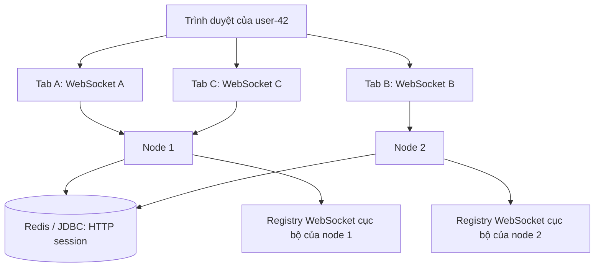
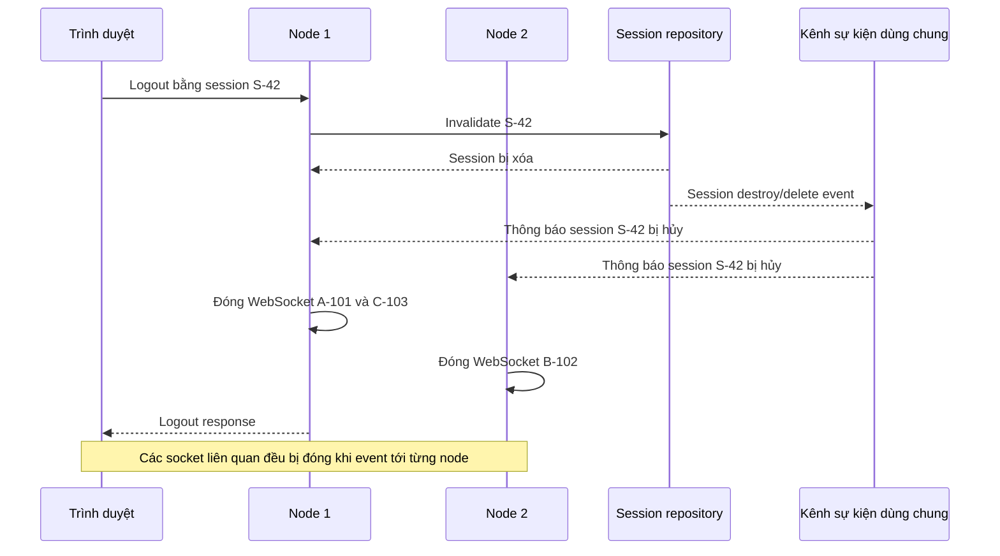

# Một phiên có nhiều WebSocket trên nhiều nút

Một người dùng có thể mở nhiều tab hoặc thiết bị, mỗi tab tạo một kết nối WebSocket riêng. Các kết nối đó có thể được thiết lập tới những instance Spring khác nhau, trong khi tất cả cùng sử dụng một HTTP session được lưu trong Redis hoặc JDBC. Spring Session giúp chia sẻ trạng thái HTTP session giữa các instance, nhưng bản thân kết nối WebSocket vẫn là kết nối mạng dài hạn được giữ tại node đã thực hiện handshake.

Vì vậy, cần phân biệt dữ liệu phiên dùng chung với trạng thái kết nối WebSocket cục bộ. Mỗi node biết những WebSocket mà chính nó đang quản lý. Khi session bị logout, hết hạn hoặc bị thu hồi, mọi node đang giữ WebSocket của session đó phải nhận được tín hiệu hủy và đóng các kết nối tương ứng. Nếu chỉ xóa session trong Redis/JDBC mà không phân phối sự kiện tới các node còn lại, socket ở node khác có thể vẫn mở và tiếp tục nhận/gửi thông điệp.

## 1. Một HTTP session có thể gắn với nhiều WebSocket

HTTP session định danh trạng thái đăng nhập và dữ liệu ứng dụng của người dùng. WebSocket là kết nối hai chiều được mở qua HTTP Upgrade hoặc một transport tương thích như SockJS. Khi trình duyệt mở kết nối, handshake thường gửi cookie session. Spring Session đọc cookie đó và tải HTTP session trước khi WebSocket handler hoàn tất quá trình bắt tay.

Ví dụ một người dùng mở ba tab:

- Tab A kết nối tới node 1 và tạo WebSocket A.
- Tab B được load balancer chuyển tới node 2 và tạo WebSocket B.
- Tab C kết nối tới node 1 và tạo WebSocket C.

Cả ba request handshake có thể mang cùng session cookie. Do đó, ba WebSocket có thể gắn với cùng một HTTP session ID, nhưng chúng là ba kết nối độc lập với connection ID, transport state và vòng đời riêng.



Redis/JDBC chia sẻ dữ liệu session, không chuyển một TCP/WebSocket connection từ node 1 sang node 2. Sau handshake, socket A và C vẫn do node 1 quản lý; socket B vẫn do node 2 quản lý cho tới khi bị đóng hoặc node tương ứng mất kết nối.

## 2. Hai loại trạng thái cần quản lý riêng

| Trạng thái | Phạm vi | Thành phần quản lý |
| --- | --- | --- |
| HTTP session attributes, creation time, last access time, timeout | Dùng chung giữa các instance | Spring Session repository như Redis hoặc JDBC |
| Session ID gắn với WebSocket handshake | Theo từng kết nối | WebSocket handshake/session attributes và Spring Session integration |
| WebSocket connection, transport, socket ID | Cục bộ tại node nhận handshake | WebSocket runtime và registry trên node đó |
| STOMP subscriptions và destination state | Tùy broker và cấu hình | Broker, message channel và user registry |
| Authentication/principal tại handshake | Gắn với kết nối và security context | Spring Security cùng WebSocket handshake/interceptor |

Không nên lưu object WebSocket session, socket handle hoặc transport connection vào `HttpSession`. Các object đó gắn với một process và kết nối mạng đang mở; chúng không thể serialize để node khác khôi phục. Session chỉ nên giữ dữ liệu nghiệp vụ nhỏ và định danh cần thiết.

## 3. Luồng handshake và liên kết với HTTP session

Với ứng dụng Servlet dùng Spring Session và Spring WebSocket/STOMP, handshake ban đầu đi qua Servlet filter chain. `SessionRepositoryFilter` đọc session cookie và bọc request để WebSocket handshake handler có thể nhìn thấy `HttpSession` được quản lý bởi Spring Session.

Ở mức khái quát:

1. Trình duyệt gửi HTTP Upgrade request tới một node, kèm session cookie.
2. `SessionRepositoryFilter` tải HTTP session từ repository.
3. Spring Security xác thực request handshake và xác định principal.
4. WebSocket handshake tạo kết nối và gắn thông tin session cần thiết vào attributes của WebSocket.
5. Spring Session WebSocket integration đăng ký quan hệ giữa HTTP session ID và WebSocket connection tại node hiện tại.
6. Kết nối tiếp tục nhận/gửi frame mà không tạo một HTTP request mới cho từng frame.

Spring Session cung cấp tích hợp WebSocket để duy trì thời gian truy cập của session khi nhận thông điệp và đóng các WebSocket liên quan khi session bị hủy. Trong các phiên bản có `AbstractSessionWebSocketMessageBrokerConfigurer`, lớp cấu hình này giúp đăng ký các thành phần cần thiết. Cần kiểm tra API của phiên bản Spring Session đang dùng; không sao chép cấu hình cũ vào phiên bản đã thay đổi hoặc loại bỏ API đó.

Ví dụ cấu hình STOMP theo cách tích hợp được cung cấp ở các phiên bản hỗ trợ:

```java
@Configuration
@EnableRedisHttpSession
@EnableWebSocketMessageBroker
class WebSocketSessionConfig
        extends AbstractSessionWebSocketMessageBrokerConfigurer<Session> {

    @Override
    protected void configureStompEndpoints(StompEndpointRegistry registry) {
        registry.addEndpoint("/ws")
                .setAllowedOrigins("https://app.example.com");
    }

    @Override
    public void configureMessageBroker(MessageBrokerRegistry registry) {
        registry.setApplicationDestinationPrefixes("/app");
        registry.enableSimpleBroker("/topic", "/queue");
    }
}
```

Đây là ví dụ cho Servlet application dùng STOMP và API configurer có trong phiên bản tương ứng. `AbstractSessionWebSocketMessageBrokerConfigurer` đảm nhiệm các phần tích hợp session cần thiết như interceptor cập nhật access time và đăng ký WebSocket theo HTTP session. Nếu phiên bản dự án không còn cung cấp lớp này, dùng hướng dẫn tích hợp WebSocket tương ứng của phiên bản đó; không tự giả định chỉ cần thêm `@EnableWebSocketMessageBroker` là đã có đầy đủ session lifecycle integration.

## 4. Registry WebSocket thường là cục bộ theo node

Để đóng các socket liên quan tới một HTTP session, node cần biết những WebSocket connection nào đã được mở từ session đó. Spring Session WebSocket integration sử dụng registry/listener để theo dõi quan hệ giữa session ID và WebSocket sessions đang hoạt động trên node.

Một registry trong bộ nhớ của node 1 có thể chứa:

```text
HTTP session S-42
  ├── WebSocket A-101
  └── WebSocket C-103
```

Registry của node 2 có thể chứa:

```text
HTTP session S-42
  └── WebSocket B-102
```

Hai registry này không tự chia sẻ object connection với nhau. Khi node 1 nhận được sự kiện session bị hủy, listener trên node 1 có thể đóng A-101 và C-103. Node 2 cũng phải nhận sự kiện tương ứng để đóng B-102.

Đây là lý do event fan-out rất quan trọng. Một thông báo chỉ được phát trong `ApplicationContext` của node 1 không tự xuất hiện trong context của node 2. Cần một cơ chế để mỗi node đang giữ socket của session đều biết rằng session đã bị thu hồi.

## 5. Đóng WebSocket khi HTTP session bị hủy

Khi người dùng logout, ứng dụng thường invalidate HTTP session. Khi session hết hạn hoặc bị xóa bởi thao tác quản trị, repository có thể phát sự kiện vòng đời như `SessionDeletedEvent` hoặc `SessionExpiredEvent`. Spring Session WebSocket integration dùng sự kiện session bị hủy để tìm các kết nối liên quan trong registry cục bộ và đóng chúng.

Luồng mong muốn:



Không nên hiểu rằng xóa một hàng session trong database sẽ tự động đóng TCP connection ở mọi node. Việc đóng socket chỉ xảy ra nếu node nhận được sự kiện hoặc có cơ chế kiểm tra thu hồi tương đương. Độ trễ đóng socket phụ thuộc vào độ trễ phát/nhận event và xử lý local registry.

## 6. Phân phối session-destroyed event giữa các node

### Redis

Với Redis repository, Spring Session có thể sử dụng keyspace notifications để phát hiện key session bị xóa hoặc hết hạn. Các node ứng dụng cần được cấu hình để lắng nghe đúng sự kiện và cùng nhận được notification cho key thuộc namespace của ứng dụng.

Các điểm cần kiểm tra:

- Redis bật các loại keyspace/keyevent notification cần cho sự kiện xóa và hết hạn, thường liên quan tới `del` và `expired`.
- Cơ chế listener của từng node đã subscribe và reconnect sau khi mất kết nối.
- Mọi node dùng cùng Redis endpoint, database và namespace.
- Nếu dùng Redis Cluster, xác minh listener nhận event từ mọi primary có thể sở hữu key; subscription ở một node không mặc nhiên bao phủ toàn cluster.
- Không coi Redis `PING` thành công là bằng chứng event listener đang hoạt động.

Keyspace notification là Pub/Sub, không phải hàng đợi bền vững. Nếu một node mất subscription trong lúc session bị xóa, node đó có thể bỏ lỡ event. Khi kết nối lại, Redis không phát lại mọi notification đã mất. Hệ thống cần có biện pháp phục hồi như reconnect, xác minh session trước khi xử lý thông điệp tiếp theo và đóng socket nếu session ID không còn hợp lệ.

### JDBC

Database dùng chung bảo đảm các node có thể đọc cùng session data, nhưng một câu lệnh `DELETE` ở node A không tự phát một Spring application event tới context của node B. Application event thường có phạm vi trong process phát nó. Nếu cần đóng WebSocket trên mọi node, phải bảo đảm thông báo session bị hủy được phân phối tới các node khác.

Có thể dùng một kênh thông báo bổ sung như message broker, Redis Pub/Sub hoặc outbox/event table được các node tiêu thụ. Event nên chứa định danh session cần thu hồi và loại sự kiện, không chứa cookie, token hay toàn bộ session attributes. Consumer tại mỗi node tra cứu registry cục bộ và đóng các socket phù hợp.

Nếu dùng Spring Session JDBC, kiểm tra chính xác repository/version phát sự kiện nào và trong trường hợp nào (xóa tường minh, hết hạn qua cleanup, cleanup thủ công). Không giả định scheduled cleanup trên một node sẽ tự broadcast `SessionExpiredEvent` tới mọi node. Nếu yêu cầu đóng socket trên toàn cụm là bắt buộc, kiểm thử đường đi event thực tế và bổ sung event distribution có retry/đối soát khi cần.

## 7. Cập nhật lastAccessTime khi WebSocket hoạt động

WebSocket là kết nối dài hạn; sau handshake, frame không đi qua Servlet filter chain như HTTP request mới. Nếu không có cơ chế cập nhật `lastAccessTime`, một HTTP session có thể hết idle timeout dù socket vẫn đang mở.

Spring Session WebSocket integration cung cấp `SessionRepositoryMessageInterceptor` trong các cấu hình hỗ trợ để cập nhật thời gian truy cập khi nhận STOMP message. Configurer tích hợp của Spring Session thường đăng ký interceptor này. Khi tự cấu hình WebSocket message channel, phải xác nhận interceptor được cài đúng và dùng repository tương ứng.

Ví dụ ý nghĩa của luồng:

1. Client gửi STOMP `SEND` hoặc thông điệp inbound.
2. Inbound channel interceptor xác định HTTP session liên quan.
3. Repository cập nhật access time của session.
4. Session tiếp tục hợp lệ theo idle timeout nếu có hoạt động phù hợp.

Không giả định mọi frame mạng đều làm mới idle timeout. Heartbeat STOMP có thể được xử lý ở tầng transport/broker và không nhất thiết đi qua cùng inbound message path như application message. Outbound message do server gửi cũng không nhất thiết cập nhật last access time. Hãy kiểm thử heartbeat, inbound message và timeout với cấu hình thực tế.

Nếu session hết hạn trong khi WebSocket vẫn mở, session destroy event cần đóng socket. Không tăng timeout vô hạn chỉ để giữ kết nối mở; hãy xác định chính sách idle, heartbeat, reconnect và thời gian sống tối đa phù hợp.

## 8. Một người dùng có nhiều kết nối trên cùng node và khác node

Registry phải hỗ trợ nhiều WebSocket connection cùng gắn với một session ID. Không dùng cấu trúc map đơn giản `sessionId -> one websocket` nếu người dùng có thể mở nhiều tab. Cần lưu tập connection, xử lý connect/disconnect idempotent và loại bỏ đúng connection khi một tab đóng.

Ví dụ trạng thái mong muốn:

| Node | HTTP session ID | WebSocket connection | Trạng thái |
| --- | --- | --- | --- |
| node-1 | S-42 | A-101 | Đang mở |
| node-1 | S-42 | C-103 | Đang mở |
| node-2 | S-42 | B-102 | Đang mở |
| node-2 | S-77 | D-104 | Đang mở |

Khi S-42 bị logout, node 1 đóng A-101 và C-103; node 2 đóng B-102; socket D-104 thuộc session S-77 vẫn hoạt động. Đây là lý do event cần chứa session ID chính xác và registry phải hỗ trợ một-nhiều.

Khi một WebSocket đóng bình thường, listener chỉ xóa connection tương ứng khỏi registry. Không invalidate HTTP session chỉ vì một tab đóng socket, trừ khi nghiệp vụ quy định rõ điều đó. Một session có thể vẫn được dùng bởi tab khác hoặc HTTP request khác.

## 9. Broker relay và user registry không thay thế session event

Trong hệ thống STOMP nhiều node, `enableSimpleBroker` thường là broker đơn giản trong process. Nó không tự phân phối subscription/message giữa các instance. Có thể dùng STOMP broker relay tới broker ngoài như RabbitMQ hoặc ActiveMQ để nhiều node chia sẻ message routing.

Tuy nhiên, broker relay giải quyết việc phân phối STOMP message, không tự đóng WebSocket transport ở các node khi HTTP session bị invalidate. Tương tự, `SimpUserRegistry` hoặc registry người dùng phục vụ gửi message tới user/session không thay thế registry liên kết HTTP session với WebSocket connection và không thay thế session-destroyed event.

Trong thiết kế nhiều node, cần kiểm tra riêng:

- Message từ client tới application destination có được node xử lý đúng không?
- Message tới user đang có socket trên node khác có được broker/user registry định tuyến không?
- Session destroy event có tới mọi node đang giữ socket không?
- Node nhận event có đóng toàn bộ local WebSocket gắn với session ID không?

Đừng coi việc STOMP message được gửi tới nhiều node là bằng chứng logout event cũng được phân phối. Đây là hai luồng thông báo với mục tiêu và semantics khác nhau.

## 10. Security khi handshake và khi nhận message

Handshake thường dựa trên cookie session và principal được Spring Security xác định. Chỉ cho phép origin đáng tin cậy; không dùng `setAllowedOrigins("*")` một cách tùy tiện khi endpoint dựa vào cookie xác thực. Với STOMP, bảo vệ `CONNECT` và các destination bằng quy tắc authorization phù hợp.

Các nguyên tắc:

- Chỉ chấp nhận origin được phép; xác thực cookie/session tại handshake.
- Không cho client truyền session ID tùy ý qua query parameter để chọn phiên khác.
- Dùng principal từ security context đã xác thực, không tin username trong message payload.
- Kiểm tra quyền cho từng destination/message; xác thực ở handshake không thay thế authorization nghiệp vụ.
- Sau logout, đóng socket và từ chối message tiếp theo gắn với session/principal đã thu hồi.
- Không ghi cookie, session ID, remember-me token hoặc nội dung nhạy cảm vào log WebSocket.

Một socket có thể giữ `Principal` đã được gắn ở handshake. Nếu session bị thu hồi mà event đóng socket bị trễ hoặc bị mất, principal trên connection có thể vẫn tồn tại. Với thao tác nhạy cảm, kiểm tra revocation state hoặc authentication version trước khi thực hiện; không chỉ dựa vào principal cũ gắn trên socket.

Nếu authentication hoàn tất sau khi socket đã được mở, hoặc session ID bị rotate sau handshake do session fixation protection, cần kiểm tra cách Spring Session WebSocket integration cập nhật quan hệ giữa session và socket. Thiết kế đơn giản hơn là hoàn tất đăng nhập/đổi session ID trước khi mở WebSocket; nếu ứng dụng cho phép đổi ID khi socket đang mở, hãy kiểm thử việc registry và event cleanup dùng đúng ID hiện tại.

## 11. Node bị dừng và client reconnect

Nếu node đang giữ WebSocket bị crash hoặc bị loại khỏi load balancer, các socket tại node đó sẽ mất. HTTP session có thể vẫn còn trong Redis/JDBC; client có thể kết nối lại tới node khác bằng cookie session còn hợp lệ.

Client nên có chiến lược reconnect:

- Dùng backoff tăng dần và jitter để tránh tất cả client reconnect cùng lúc sau sự cố.
- Phân biệt mất mạng tạm thời với close code thể hiện logout hoặc policy violation.
- Không tự reconnect vô hạn sau khi server xác nhận session đã bị thu hồi.
- Khi reconnect, thực hiện handshake và xác thực lại session từ repository.
- Khôi phục subscription sau khi kết nối mới được xác thực và đăng ký thành công.

Nếu logout đã xảy ra nhưng client nhận close bất thường, reconnect phải bị từ chối vì session không còn hợp lệ. Nếu remember-me hoặc cơ chế tự đăng nhập có thể tạo session mới, cần xác định rõ có cho phép WebSocket reconnect bằng authentication mới hay yêu cầu người dùng đăng nhập lại.

## 12. Kiểm thử một session có nhiều WebSocket trên nhiều node

Kiểm thử trên một instance không chứng minh được event fan-out. Cần ít nhất hai application instance dùng chung session repository và một cách tạo nhiều WebSocket connection mang cùng session cookie.

| Kịch bản | Điều cần xác minh |
| --- | --- |
| Hai tab cùng session kết nối một node | Cả hai socket được đăng ký; đóng một socket không đóng socket còn lại |
| Hai tab cùng session kết nối hai node | Mỗi node giữ connection trong registry cục bộ tương ứng |
| Logout từ node 1 | Event tới node 1 và node 2; mọi socket của session bị đóng |
| Logout session S-42 | Socket của session S-77 không bị đóng nhầm |
| Session hết idle timeout | Repository đánh dấu hết hạn và các socket liên quan bị đóng theo event |
| Inbound STOMP message | Access time được cập nhật theo interceptor đã cấu hình |
| Chỉ có heartbeat | Xác minh heartbeat có/không làm mới session trong cấu hình thực tế |
| Event listener mất kết nối | Phát hiện mất subscription và có cơ chế reconnect/đối soát |
| Redis Cluster failover | Event từ primary mới vẫn được nhận trên các node ứng dụng |
| JDBC cleanup | Kiểm tra chính xác event hết hạn có được phân phối toàn cụm hay cần outbox/broker |
| Node đang giữ socket bị dừng | Client reconnect tới node khác nếu session còn hợp lệ |
| Logout rồi client reconnect bằng cookie cũ | Handshake không được khôi phục session đã thu hồi |

Trong integration test, tạo một HTTP session trước, lấy cookie rồi mở hai WebSocket connection với cùng cookie nhưng ép handshake đi tới hai instance khác nhau. Sau đó logout bằng HTTP request ở một node và quan sát close event tại cả hai node. Với STOMP, kiểm tra cả broker message routing lẫn socket closure; không dùng một loại assertion để thay thế loại còn lại.

Kiểm thử Redis bằng Redis thật hoặc Testcontainers và bật notification cần thiết. Với JDBC, kiểm tra repository event và cơ chế broadcast thực tế. Thêm trường hợp listener tạm thời mất kết nối trong lúc logout để xác minh hệ thống không để socket tồn tại vô hạn sau khi session đã bị thu hồi.

## 13. Quan sát và xử lý sự cố

Các chỉ số hữu ích:

- Số WebSocket đang mở theo node và số connection gắn với từng session ID ở mức metric an toàn.
- Số connect/disconnect và close reason.
- Số session destroy/expire event nhận được trên mỗi node.
- Độ trễ từ lúc logout/session expiry tới lúc socket cuối cùng bị đóng.
- Trạng thái Redis Pub/Sub subscription hoặc event consumer.
- Lỗi khi đóng connection và số socket còn lại sau khi session đã bị thu hồi.
- Số lần reconnect thành công/thất bại và handshake bị từ chối do session không hợp lệ.

Không đưa session ID đầy đủ, cookie hoặc token làm metric label. Có thể dùng mã correlation đã được bảo vệ hoặc hash ngắn hạn để đối chiếu log, nhưng tránh tạo cardinality cao hoặc biến log thành nơi lưu bearer credential.

Nếu logout xong nhưng socket ở node khác vẫn gửi được message, kiểm tra theo thứ tự: repository đã xóa session chưa; event đã được phát chưa; node giữ socket có nhận event không; registry có ánh xạ đúng session ID không; close operation có thành công không; inbound message handler có kiểm tra revocation bổ sung không.

Nếu session hết hạn dù WebSocket đang hoạt động, kiểm tra `SessionRepositoryMessageInterceptor`, đường đi inbound message, idle timeout và cách broker xử lý heartbeat. Nếu chỉ socket ở một node được đóng, kiểm tra event subscription/fan-out ở node còn lại trước khi sửa registry local.

## 14. Checklist triển khai

- Xác nhận handshake mang session cookie và Spring Session filter tải đúng HTTP session.
- Bật Spring Session WebSocket integration phù hợp phiên bản để liên kết session với socket và cập nhật access time.
- Theo dõi nhiều WebSocket connection cho một session; registry phải là một-nhiều tại mỗi node.
- Giữ session repository dùng chung và cấu hình nhất quán trên tất cả instance.
- Phân phối session-destroyed/expired event tới mọi node có thể đang giữ socket.
- Với Redis, kiểm tra keyspace notifications, listener subscription, Redis Cluster coverage và reconnect.
- Với JDBC, không giả định database write tự broadcast event; dùng broker/outbox hoặc cơ chế phân phối phù hợp khi cần.
- Phân biệt STOMP broker relay/user registry với cơ chế đóng socket khi session bị hủy.
- Kiểm tra inbound message cập nhật idle timeout; xác minh heartbeat có được tính hay không.
- Bảo vệ handshake, origin, STOMP destination và message authorization.
- Kiểm thử logout, timeout, nhiều tab, nhiều node, failover và reconnect bằng cookie cũ.

Một HTTP session có thể gắn với nhiều WebSocket connection trên nhiều node, nhưng các socket vẫn được quản lý cục bộ tại node đã nhận handshake. Spring Session chia sẻ dữ liệu phiên; để logout hoặc hết hạn đóng được mọi socket, hệ thống còn phải phân phối session lifecycle event tới tất cả node và để mỗi node đóng các connection trong registry của mình. Khi tách riêng session store, local WebSocket registry, STOMP broker và event fan-out, ứng dụng có thể quản lý nhiều tab/thiết bị nhất quán mà không nhầm việc xóa session với việc tự động đóng mọi kết nối mạng.
