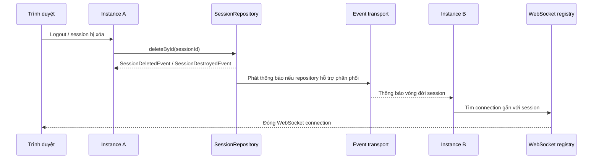

# Phụ thuộc vào repository có sự kiện và độ trễ nhận thông báo

Trong ứng dụng Spring dùng WebSocket, một kết nối có thể tồn tại lâu hơn nhiều request HTTP thông thường. Spring Session quản lý phiên đăng nhập và có thể liên kết phiên HTTP với kết nối WebSocket để khi người dùng đăng xuất hoặc session hết hạn, các kết nối liên quan được đóng lại. Cơ chế này phụ thuộc vào khả năng phát sự kiện của `SessionRepository`, cách sự kiện được truyền tới các instance và thời gian listener nhận được thông báo.

Không phải repository nào cũng phát đầy đủ sự kiện vòng đời, và không phải mọi cơ chế phát sự kiện đều bảo đảm message được giao đúng một lần hoặc đúng thời điểm. Khi triển khai nhiều instance, cần phân biệt sự kiện trong một application context với thông báo được truyền giữa các node. Đây là cơ sở để thiết kế WebSocket cleanup, xử lý độ trễ và bảo vệ tài nguyên khi thông báo bị mất.

## 1. Vì sao WebSocket cần biết vòng đời HTTP session?

Một kết nối WebSocket thường bắt đầu bằng HTTP handshake. Trình duyệt gửi cookie session ID trong handshake; sau khi kết nối được nâng cấp, các message WebSocket tiếp theo không nhất thiết tạo request HTTP mới. Nếu người dùng đăng xuất ở một tab khác hoặc session hết hạn trong repository, kết nối WebSocket hiện tại có thể vẫn đang mở.

Spring Session WebSocket integration liên kết session ID với WebSocket connection. Khi có sự kiện session bị xóa hoặc hết hạn, thành phần quản lý registry có thể tìm các WebSocket connection thuộc session đó và yêu cầu đóng chúng. Trong tích hợp Spring Session, các thành phần thường gặp gồm:

- `SessionRepositoryMessageInterceptor`: kết nối vòng đời Spring Session với WebSocket/STOMP handshake và inbound message; interceptor giúp lưu session ID vào attributes của WebSocket session và cập nhật hoạt động session khi có message inbound.
- `WebSocketRegistryListener`: theo dõi sự kiện session bị hủy và phối hợp đóng các WebSocket connection đã đăng ký với session tương ứng.
- `SessionDestroyedEvent` cùng các sự kiện cụ thể như `SessionDeletedEvent` và `SessionExpiredEvent`: biểu diễn việc session bị xóa chủ động hoặc hết hạn.

Tên lớp, cách đăng ký và các extension point có thể thay đổi theo phiên bản Spring Session. Hãy dùng cấu hình WebSocket integration được hỗ trợ trong release đang chạy và xác nhận các listener/interceptor thực sự được đăng ký trong application context.

## 2. Luồng sự kiện từ repository tới WebSocket connection

Luồng khái quát khi người dùng đăng xuất hoặc session hết hạn:



Sơ đồ này mô tả trường hợp có event transport liên node. Nếu repository chỉ phát một Spring `ApplicationEvent` trong JVM, event chỉ tới listener của instance đang phát. Instance khác không tự nhận được sự kiện đó. Cần repository hoặc cơ chế messaging phân tán để thông báo tới node đang giữ socket.

WebSocket registry thường được giữ cục bộ tại instance sở hữu kết nối. Do đó, nếu một người dùng kết nối WebSocket vào node B nhưng đăng xuất qua node A, node B cần nhận được thông báo hủy session để đóng socket của nó.

## 3. Repository có sự kiện và repository chỉ lưu session

`SessionRepository` là abstraction lưu trữ; việc triển khai interface này không tự động bảo đảm mọi event được phát và phân phối giống nhau. Khả năng sự kiện phụ thuộc implementation, phiên bản, cấu hình và backend.

| Repository/cơ chế | Hành vi cần xác minh |
|---|---|
| Redis indexed session repository | Có thể dùng Redis keyspace notifications để phát sự kiện khi session bị xóa/hết hạn; cần cấu hình notification và listener hoạt động |
| Redis repository không hỗ trợ indexed/event flow tương ứng | Không giả định có cùng sự kiện expiration hoặc cùng khả năng tra cứu như indexed repository |
| JDBC session repository | Có thể phát event trong các thao tác repository hoặc cleanup theo implementation; Spring application event tại một node không mặc nhiên broadcast sang node khác |
| Repository tùy chỉnh | Phải tự xác định event nào được phát, thời điểm phát, semantics và cách phân phối liên node |
| Event bus bên ngoài | Có thể broadcast tới nhiều instance, nhưng cần thiết kế delivery, retry, retention và idempotency |

Trước khi phụ thuộc vào event để đóng WebSocket, hãy trả lời các câu hỏi:

1. Repository có phát `SessionDeletedEvent` khi `invalidate()` hoặc `deleteById()` không?
2. Repository có phát `SessionExpiredEvent` khi idle timeout đạt ngưỡng không?
3. Event được phát khi phát hiện session hết hạn, khi cleanup xóa dữ liệu vật lý, hay ở thời điểm nào khác?
4. Event chỉ được publish trong JVM hay được truyền tới mọi instance?
5. Khi ứng dụng mất kết nối tới event transport, message có được lưu để phát lại không?
6. Listener có được khởi động lại và đăng ký lại sau Redis failover hoặc network interruption không?

Không suy ra khả năng event chỉ từ việc repository có thể tìm và xóa session. Kiểm tra tài liệu của đúng repository implementation và kiểm thử tích hợp bằng backend thực tế.

## 4. Sự kiện Spring Session khác với thông báo phân tán

Spring application event là cơ chế publish/subscribe trong một application context. Ví dụ, repository có thể publish `SessionDeletedEvent`; một `@EventListener` trong cùng instance nhận được event. Cơ chế này hữu ích cho metrics, audit hoặc cleanup nội bộ của node.

Trong triển khai nhiều instance, mỗi JVM có application context riêng. Event được publish tại node A không tự động xuất hiện ở node B. Để đóng socket nằm ở B, phải có một cơ chế chuyển thông báo giữa node, ví dụ Redis keyspace notification/Pub/Sub, broker hoặc một event transport khác được repository hỗ trợ.

Điểm khác nhau:

| Đặc tính | Spring application event cục bộ | Event transport liên node |
|---|---|---|
| Phạm vi | Một application context/JVM | Nhiều instance tham gia cùng transport |
| Dùng để | Listener nội bộ, metrics, xử lý trong node | Báo cho node khác biết session đã thay đổi |
| Độ bền | Thường không có hàng đợi lưu message | Tùy transport; Pub/Sub có thể không lưu, broker durable có thể lưu |
| Khi node mất kết nối | Event cục bộ không được phát sang node khác | Có thể mất hoặc được phát lại tùy transport |
| Bảo đảm đúng một lần | Không nên mặc định | Phải xem semantics thực tế; thường cần idempotency |

Một ứng dụng có thể cần cả hai lớp: repository phát Spring event để listener nội bộ xử lý, đồng thời adapter/event transport phân phối thông báo tới các node khác. Không coi hai lớp này là cùng một cơ chế.

## 5. Redis keyspace notifications và độ trễ expiration

Với Redis repository hỗ trợ event, Spring Session có thể lắng nghe Redis keyspace notifications để phát hiện key session bị xóa hoặc hết hạn. Redis keyspace notification là thông báo Pub/Sub; nó được phát khi Redis xử lý sự kiện tương ứng, không phải một lịch hẹn đảm bảo callback chính xác tại thời điểm TTL về 0.

Đối với expiration, có hai mốc cần phân biệt:

- **Deadline logic:** session vượt quá `maxInactiveInterval` tính từ lần truy cập cuối và không còn hợp lệ theo chính sách repository.
- **Xóa key vật lý:** Redis thực hiện lazy hoặc active expiration và xóa key đã hết hạn. Thông báo keyevent được phát gắn với quá trình expiration thực tế.

Redis kết hợp lazy expiration (kiểm tra khi key được truy cập) và active expiration (quét/dọn key hết hạn theo chu kỳ). Vì vậy, key có thể bị xóa sau deadline một khoảng thời gian. Event listener nhận thông báo sau khi Redis phát event và sau khi message đi qua network tới subscriber. Tổng độ trễ có thể gồm:

1. Độ trễ trước khi Redis thực hiện expiration.
2. Độ trễ phát và chuyển Pub/Sub message.
3. Độ trễ xử lý trong listener và WebSocket registry.
4. Độ trễ gửi frame close và xử lý disconnect ở client.

Với Redis managed service, cấu hình keyspace notifications có thể do parameter group hoặc chính sách nhà cung cấp quản lý. Cần xác nhận đúng notification flags theo tài liệu Spring Session và Redis version đang dùng; không giả định mọi Redis đều bật expiration events mặc định.

## 6. Pub/Sub không phải hàng đợi bền vững

Redis Pub/Sub gửi message tới subscriber đang kết nối. Nếu instance giữ WebSocket bị ngắt kết nối khỏi Redis trong lúc event được phát, message có thể bị mất; khi subscriber kết nối lại, Redis không tự phát bù các message Pub/Sub đã bỏ lỡ.

Điều này có nghĩa:

- Một node có thể không nhận được event đăng xuất trong thời gian reconnect.
- Việc listener đã khởi động lại không chứng minh mọi event trong khoảng gián đoạn đã được xử lý.
- Retry kết nối chỉ khôi phục nhận message trong tương lai, không tự sửa các WebSocket đang mở mà event trước đó bị mất.
- Nếu cần bảo đảm xử lý, phải có cơ chế đối soát hoặc transport bền vững.

Đối với thao tác đăng xuất chủ động, ứng dụng có thể bổ sung cơ chế thu hồi trạng thái có thể truy vấn: ví dụ session version/revocation marker hoặc registry lưu trạng thái session đã bị thu hồi. Các node kiểm tra trạng thái này khi nhận message hoặc theo chu kỳ. Với nghiệp vụ yêu cầu bảo đảm delivery, dùng broker có retention/acknowledgement hoặc outbox phù hợp thay vì chỉ dựa vào Pub/Sub.

## 7. Tích hợp interceptor để cập nhật hoạt động session

WebSocket có thể gửi message trong thời gian dài mà không tạo HTTP request mới. Nếu idle timeout của HTTP session vẫn được áp dụng nhưng message inbound không cập nhật `lastAccessedTime`, một người dùng đang hoạt động trên WebSocket vẫn có thể bị xem là không hoạt động và session hết hạn.

`SessionRepositoryMessageInterceptor` được thiết kế để liên kết session repository với message flow. Khi được đăng ký theo hướng dẫn tích hợp của phiên bản Spring Session, interceptor có thể:

- Đưa thông tin session ID vào attributes của WebSocket session trong handshake.
- Đọc session liên quan khi có inbound message.
- Cập nhật/lưu session để hoạt động WebSocket được phản ánh vào thời gian truy cập cuối.
- Hỗ trợ registry liên kết session HTTP với các WebSocket connection.

Ví dụ cấu hình inbound channel minh họa với STOMP:

```java
import org.springframework.messaging.simp.config.ChannelRegistration;
import org.springframework.session.Session;
import org.springframework.session.SessionRepository;
import org.springframework.session.web.socket.server.SessionRepositoryMessageInterceptor;
import org.springframework.web.socket.config.annotation.WebSocketMessageBrokerConfigurer;

class SessionAwareWebSocketConfiguration
        implements WebSocketMessageBrokerConfigurer {

    private final SessionRepository<? extends Session> sessionRepository;

    SessionAwareWebSocketConfiguration(
            SessionRepository<? extends Session> sessionRepository) {
        this.sessionRepository = sessionRepository;
    }

    @Override
    public void configureClientInboundChannel(ChannelRegistration registration) {
        registration.interceptors(
                new SessionRepositoryMessageInterceptor<>(sessionRepository));
    }
}
```

Đây là phần cấu hình inbound minh họa cho Servlet/STOMP và repository imperative. Tùy phiên bản, interceptor cũng cần được gắn vào handshake hoặc được đăng ký tự động qua cấu hình WebSocket integration chuyên biệt. Hãy làm theo API chính thức của release dự án, tránh đăng ký trùng interceptor hoặc bỏ sót handshake. Ứng dụng WebFlux/reactive dùng API reactive tương ứng, không dùng trực tiếp interceptor Servlet này.

Interceptor cập nhật hoạt động session khi có message inbound; nó không có nghĩa mọi byte WebSocket, mọi ping ở tầng TCP hoặc mọi thao tác giao diện đều tự động làm mới session. Hãy xác định loại message nào được tính là hoạt động và cấu hình heartbeat ở tầng ứng dụng nếu cần.

## 8. Đóng WebSocket khi session bị hủy

Spring Session WebSocket integration có `WebSocketRegistryListener` để theo dõi session bị hủy và đóng các kết nối được đăng ký với session đó. Sự kiện hủy có thể xuất phát từ logout/invalidate chủ động hoặc expiration. Khi event đến đúng node, registry tìm các WebSocket connection liên quan và yêu cầu đóng chúng.

Các tình huống:

- **Logout qua cùng node giữ socket:** event cục bộ có thể đủ để node đó đóng connection.
- **Logout qua node khác:** cần event transport liên node để node giữ socket biết session đã bị hủy.
- **Session hết hạn tự nhiên:** event có thể đến trễ vì phụ thuộc expiration/cleanup và khả năng notification của repository.
- **Listener mất kết nối:** event có thể bị bỏ lỡ nếu transport không durable; cần đối soát hoặc kiểm tra trạng thái khi message tiếp theo đến.

Không tự đóng mọi WebSocket connection chỉ dựa trên username nếu người dùng có nhiều session trên nhiều thiết bị. Registry nên liên kết theo session ID hoặc định danh session đã được bảo vệ để chỉ đóng đúng các connection thuộc phiên bị thu hồi.

## 9. Thiết kế bảo mật khi thông báo bị trễ hoặc mất

Thông báo đóng socket là cơ chế phản ứng nhanh, không phải lớp xác thực duy nhất. Nếu event bị trễ, socket có thể vẫn mở trong một khoảng thời gian sau khi session đã hết hạn. Vì vậy:

1. Xác thực và phân quyền từng message theo principal và quyền hiện tại.
2. Với thao tác nhạy cảm, kiểm tra session/revocation state ở server trước khi thực hiện nghiệp vụ.
3. Không tin rằng WebSocket connection còn mở nghĩa là session vẫn hợp lệ.
4. Có chính sách đóng socket khi không thể xác minh trạng thái sau một khoảng timeout hợp lý.
5. Khi logout chủ động, có thể chủ động đóng socket trên node hiện tại và phát thông báo tới các node khác.
6. Dùng absolute timeout nếu cần giới hạn tổng tuổi đăng nhập; inbound message chỉ làm mới idle timeout theo chính sách, không tự đặt lại absolute deadline.

Nếu mỗi message đều truy vấn database/Redis để xác minh, cần cân bằng mức độ bảo vệ với latency và tải. Có thể dùng cache revocation ngắn hạn hoặc session version có TTL, nhưng phải định nghĩa rõ độ trễ tối đa được chấp nhận và cách cache được vô hiệu hóa.

## 10. Listener phải idempotent và chịu được thứ tự event

Một session có thể bị logout chủ động gần thời điểm hết hạn tự nhiên. Listener có thể quan sát event xóa và event hết hạn theo thứ tự không như dự kiến, hoặc nhận thông báo lặp từ một cơ chế retry.

Hãy thiết kế xử lý theo các nguyên tắc:

- **Idempotent:** đóng một WebSocket connection đã đóng không gây lỗi nghiệp vụ; xóa mapping đã biến mất vẫn được xem là hoàn tất.
- **Không phụ thuộc đúng một event:** có thể nhận `SessionDeletedEvent` hoặc `SessionExpiredEvent` tùy nguyên nhân và repository.
- **Chấp nhận trễ:** event tới sau khi socket đã disconnect hoặc session metadata đã bị cleanup phải được xử lý bình thường.
- **Không giả định thứ tự toàn cục:** nhiều node và nhiều kênh event không tạo ra một thứ tự giao dịch chung nếu không có cơ chế bảo đảm.
- **Có timeout và giới hạn concurrency:** listener không nên gọi dịch vụ ngoài không giới hạn thời gian hoặc làm nghẽn thread xử lý message.
- **Có metric:** đo số event nhận được, thời gian xử lý, lỗi listener và số connection được đóng.

Ví dụ listener metrics không ghi định danh:

```java
import org.springframework.context.event.EventListener;
import org.springframework.session.events.SessionDeletedEvent;
import org.springframework.session.events.SessionExpiredEvent;
import org.springframework.stereotype.Component;

@Component
class SessionWebSocketLifecycleMetrics {

    @EventListener
    void onDeleted(SessionDeletedEvent event) {
        // Tăng metric session_deleted_event_received.
        // Không ghi session ID hoặc attributes vào log.
    }

    @EventListener
    void onExpired(SessionExpiredEvent event) {
        // Tăng metric session_expired_event_received.
        // Không giả định event đến đúng thời điểm TTL kết thúc.
    }
}
```

Các event trên là ví dụ cho repository có phát những event tương ứng. Nếu backend không phát `SessionExpiredEvent`, listener không thể tự tạo ra event đó; cần cơ chế cleanup/notification khác đã được kiểm chứng.

## 11. Đo độ trễ nhận thông báo

Không nên đặt SLA “socket phải đóng đúng thời điểm TTL kết thúc” nếu nguồn event không có bảo đảm thời gian thực. Thay vào đó, đo từng chặng:

| Chỉ số | Cách đo | Ý nghĩa |
|---|---|---|
| Event publish time | Ghi timestamp khi repository/event adapter phát thông báo | Mốc bắt đầu quan sát |
| Event receive time | Ghi timestamp khi node nhận event | Đo độ trễ transport |
| Listener processing duration | Đo thời gian xử lý event | Phát hiện listener chậm hoặc bị nghẽn |
| WebSocket close latency | Đo từ khi nhận event đến khi gửi close | Đo thời gian phản ứng tại node giữ socket |
| Active socket count | Số connection đang mở theo node | Phát hiện socket tồn tại sau logout/expiry |
| Listener reconnects/errors | Số lần subscriber mất kết nối hoặc lỗi | Phát hiện khoảng có nguy cơ mất event |

Nếu cần đo từ deadline expiry đến lúc socket đóng, cần có mốc deadline session và mốc close; không dùng thời điểm Redis key biến mất làm đại diện tuyệt đối cho deadline logic. Các metric nên dùng label có cardinality thấp như service, environment, instance và event type. Không dùng session ID, username hoặc cookie làm label.

## 12. Kiểm thử phụ thuộc repository và độ trễ event

Kiểm thử WebSocket chỉ trên một JVM thường không phát hiện được lỗi phân phối event liên node. Cần kết hợp test repository, event listener và WebSocket thật hoặc test client tương ứng.

Các kịch bản quan trọng:

1. **Repository có event:** tạo session, xóa chủ động và xác nhận repository phát event tương ứng.
2. **Expiration event:** để session hết idle timeout và xác nhận event được phát theo khả năng của backend.
3. **WebSocket mapping:** handshake với session cookie, xác nhận connection được liên kết với đúng session.
4. **Inbound activity:** gửi STOMP message và xác nhận last accessed time được cập nhật theo cấu hình interceptor.
5. **Logout cùng node:** invalidate session và xác nhận socket được đóng.
6. **Logout khác node:** mở WebSocket ở instance B, logout ở instance A và xác nhận event transport đưa thông báo tới B.
7. **Event trễ:** trì hoãn thông báo và xác nhận message nhạy cảm vẫn bị từ chối theo chính sách xác thực/revocation.
8. **Subscriber ngắt kết nối:** ngắt listener khi event được phát, kết nối lại và xác nhận reconciliation hoặc kiểm tra trạng thái xử lý được socket còn mở.
9. **Event lặp/khác thứ tự:** gửi lặp event delete/expire và xác nhận listener idempotent.
10. **Repository không hỗ trợ event:** xác nhận ứng dụng không âm thầm giả định socket sẽ được đóng qua event; fallback policy phải hoạt động.

Với Redis, dùng Redis test instance có cấu hình keyspace notifications giống môi trường mục tiêu. Với JDBC hoặc repository tùy chỉnh, test phải chứng minh event nào được phát, node nào nhận và cơ chế nào broadcast. Không dùng `Thread.sleep()` cố định rồi kỳ vọng event tới đúng mili giây; hãy poll điều kiện với timeout hợp lý và đo latency thực tế.

## 13. Lựa chọn cơ chế phân phối theo yêu cầu

| Yêu cầu | Cơ chế phù hợp để cân nhắc | Giới hạn cần hiểu |
|---|---|---|
| Listener nội bộ cùng node | Spring application event | Không broadcast sang JVM khác |
| Đóng socket khi Redis session hết hạn | Repository hỗ trợ Redis keyspace notification | Phụ thuộc cấu hình, expiration delay và subscriber connectivity |
| Thông báo logout tới mọi node | Pub/Sub hoặc message broker broadcast | Pub/Sub có thể mất message khi subscriber offline |
| Cần xử lý lại sau khi node offline | Broker durable, outbox hoặc reconciliation | Cần quản lý offset/ack/retry/idempotency |
| Cleanup socket mồ côi | Registry timeout, heartbeat và reconciliation | Không thể chỉ dựa vào event expiration |
| Kiểm soát quyền từng message | Security checks/revocation state trên server | Có chi phí lookup/cache và cần xác định độ trễ cho phép |

Chọn cơ chế theo mức độ bảo đảm nghiệp vụ. Với ứng dụng chat thông thường, event nhanh cùng heartbeat và kiểm tra quyền trên message có thể đủ. Với dashboard quản trị hoặc luồng giao dịch nhạy cảm, cần kiểm tra revocation chặt hơn và có cơ chế phục hồi khi event bị mất.

## 14. Lỗi thường gặp và hướng điều tra

| Hiện tượng | Nguyên nhân có thể | Hướng kiểm tra |
|---|---|---|
| Logout rồi nhưng WebSocket vẫn mở | Node giữ socket không nhận event hoặc repository không phát event phù hợp | Kiểm tra repository capability, listener và event transport liên node |
| Session hết hạn nhưng socket chỉ đóng sau một khoảng trễ | Redis active expiration hoặc listener xử lý event chậm | Đo deadline, event receive time và close latency riêng biệt |
| Event nhận ở node logout nhưng không nhận ở node giữ socket | Chỉ có Spring application event cục bộ hoặc Pub/Sub subscriber lỗi | Kiểm tra broadcast transport và subscriber health của từng node |
| WebSocket hoạt động nhưng HTTP session hết hạn | Inbound message không cập nhật last accessed time | Kiểm tra `SessionRepositoryMessageInterceptor` và cấu hình handshake/channel |
| Sau Redis reconnect vẫn còn socket cũ | Pub/Sub không phát bù message đã mất | Chạy reconciliation hoặc kiểm tra revocation state khi message tiếp theo đến |
| Listener xử lý lặp làm lỗi cleanup | Handler không idempotent | Làm thao tác close/remove mapping an toàn khi chạy nhiều lần |
| Không có `SessionExpiredEvent` | Repository không hỗ trợ, notification chưa bật hoặc cleanup chưa phát hiện key | Kiểm tra docs repository, Redis notification flags và integration test |
| Socket đóng nhầm các thiết bị khác | Registry liên kết theo user thay vì session cụ thể | Liên kết connection với session ID đã bảo vệ và đúng vòng đời |

Khi điều tra, ghi nhận event type, node, timestamp và correlation ID. Không log raw session ID, cookie, SecurityContext hoặc message payload có dữ liệu cá nhân.

## 15. Nguyên tắc triển khai

- WebSocket connection cần được liên kết với HTTP session nếu chính sách yêu cầu đóng socket khi session bị hủy.
- Xác nhận repository thực sự phát `SessionDeletedEvent`/`SessionExpiredEvent` theo đúng nguyên nhân và cấu hình.
- Spring application event chỉ có phạm vi application context; nhiều instance cần event transport liên node để thông báo tới node giữ socket.
- Redis keyspace notifications phụ thuộc cấu hình và thời điểm Redis xóa key; event expiration không phải timer chính xác.
- Redis Pub/Sub không lưu message để phát bù cho subscriber offline; cần reconciliation hoặc transport durable nếu yêu cầu bảo đảm cao.
- Dùng `SessionRepositoryMessageInterceptor` theo hướng dẫn phiên bản để inbound WebSocket message cập nhật hoạt động session khi phù hợp.
- Dùng `WebSocketRegistryListener`/tích hợp registry tương ứng để đóng connection thuộc session bị hủy; xác nhận listener được đăng ký trên từng node.
- Listener phải idempotent, chịu được event trễ/lặp và không được là lớp xác thực duy nhất.
- Kiểm tra quyền và trạng thái thu hồi trên server cho message nhạy cảm; không coi socket còn mở là session còn hợp lệ.
- Đo độ trễ publish, receive, xử lý và close; kiểm thử logout liên node, event bị mất và Redis reconnect.
