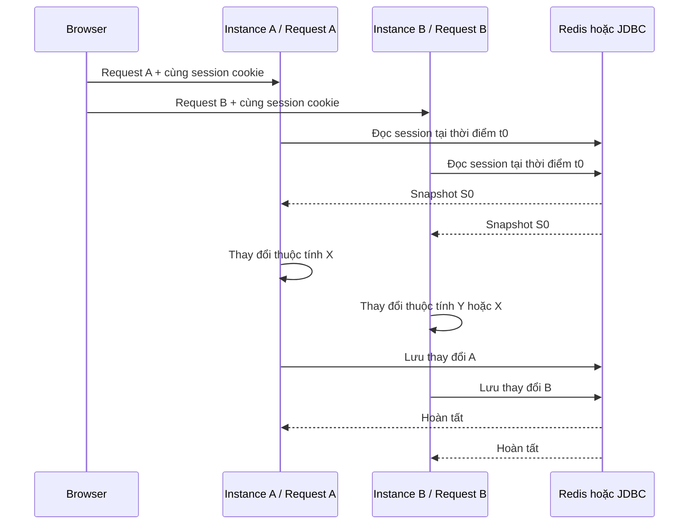

# Nhiều yêu cầu cùng đọc một phiên và cập nhật từ các bản trạng thái khác nhau

Một trình duyệt có thể gửi nhiều request đồng thời với cùng session cookie: nhiều tab cùng tải dữ liệu, JavaScript gọi nhiều API, hoặc người dùng bấm hai thao tác gần như cùng lúc. Trong hệ thống chạy nhiều instance Spring, các request đó thậm chí có thể được định tuyến tới những máy chủ khác nhau. Mỗi request đọc session từ Redis/JDBC, làm việc trên trạng thái mà nó đã tải, rồi lưu thay đổi. Nếu hai request cùng bắt đầu từ một snapshot cũ, thứ tự lưu có thể làm mất cập nhật, ghi đè thuộc tính hoặc làm một thuộc tính bị tạo lại sau khi đã xóa.

Spring Session giúp nhiều instance chia sẻ session qua một repository chung. Nó không tự tuần tự hóa mọi request dùng cùng session ID và cũng không biến `HttpSession` thành một transaction có khóa độc quyền. Muốn xử lý đúng, cần hiểu snapshot theo request, cách repository ghi thay đổi, sự khác nhau giữa cập nhật thuộc tính và cập nhật nghiệp vụ, cùng những công cụ như optimistic locking, atomic update và kiểm thử đồng thời.

## 1. Vì sao cùng một session có thể được đọc đồng thời?

Session cookie thường được trình duyệt gửi trong nhiều request. Trình duyệt không nhất thiết chờ request trước hoàn tất mới gửi request tiếp theo. Ví dụ, khi mở trang đơn hàng, frontend có thể đồng thời gọi API lấy hồ sơ, giỏ hàng và thông báo. Cả ba request có thể dùng cùng cookie và cùng session ID.

Trong một ứng dụng Servlet, `SessionRepositoryFilter` khôi phục session cho từng request. Request A và request B có thể nhận hai đối tượng session trong bộ nhớ riêng, dù chúng đại diện cho cùng một session ID trong kho chung. Mỗi request xử lý thuộc tính trên bản trạng thái mà nó đã tải. Khi request kết thúc, Spring Session lưu thay đổi theo repository và write policy được cấu hình.



Điểm quan trọng là hai request có thể cùng đọc snapshot `S0`. Việc A đã lưu không tự động cập nhật object session đang nằm trong bộ nhớ của B. B có thể tiếp tục tính toán từ dữ liệu cũ rồi ghi sau A.

## 2. Phân biệt session ID với bản trạng thái session trong request

Session ID là định danh để repository tìm session. Nó không phải một khóa đồng bộ tự động. Hai request có cùng session ID vẫn có thể xử lý đồng thời.

| Thành phần | Vai trò | Điều không nên giả định |
|---|---|---|
| Session ID | Xác định phiên trong repository | Có session ID giống nhau không có nghĩa các request dùng chung một object Java hoặc được khóa tuần tự |
| Session object của request A | Bản trạng thái A đã tải và đang sửa | Không tự nhận cập nhật mới nhất từ request B |
| Session object của request B | Bản trạng thái B đã tải và đang sửa | Không tự biết A vừa lưu dữ liệu mới |
| Redis/JDBC repository | Lưu và tải trạng thái session | Không mặc định cung cấp transaction bao trùm toàn bộ logic request |
| HTTP request/response | Ranh giới xử lý của một request | Hai request cùng cookie không nhất thiết chạy lần lượt |

Trong Servlet API, ứng dụng cũng không nên coi object được lưu trong session là thread-safe. Dù container hoặc Spring Session bảo vệ một số thao tác trên cấu trúc session, object mutable bên trong như `ArrayList`, `HashMap` hoặc DTO có setter vẫn cần được quản lý đồng thời một cách riêng.

## 3. Các kiểu xung đột thường gặp

### 3.1. Hai request sửa cùng một thuộc tính

Giả sử session đang có `app.ui.theme = "light"`.

1. Request A đọc giá trị `light` và quyết định đổi thành `dark`.
2. Request B cũng đọc giá trị `light` và quyết định đổi thành `contrast`.
3. A lưu `dark`.
4. B lưu `contrast` sau A.
5. Giá trị cuối có thể là `contrast`; cập nhật của A bị ghi đè.

Đây là tình huống last-write-wins ở cấp thuộc tính. Nếu theme chỉ là tùy chọn giao diện, chính sách này có thể chấp nhận được. Nếu thuộc tính biểu diễn trạng thái phê duyệt hoặc trạng thái thanh toán, ghi đè theo thứ tự hoàn tất request có thể không an toàn.

### 3.2. Hai request cùng tăng một giá trị

Session lưu `app.cart.quantity = 1`. Hai request cùng đọc 1, mỗi request tăng 1 và ghi 2. Kết quả cuối có thể vẫn là 2 dù người dùng đã thực hiện hai thao tác tăng.

Đây là lost update: cả hai request đều ghi thành công nhưng một thay đổi logic bị mất. Tăng số lần retry hoặc đổi `FlushMode` không giải quyết được lỗi tính toán trên snapshot cũ.

### 3.3. Một request xóa, request khác cập nhật

Request A gọi `removeAttribute("app.checkout.draft")`. Request B đã đọc bản session cũ, tiếp tục chỉnh sửa bản nháp rồi gọi `setAttribute`. Nếu B lưu sau A, thuộc tính có thể xuất hiện trở lại. Nếu A lưu sau B, cập nhật của B có thể biến mất.

Ứng dụng cần quyết định quy tắc nghiệp vụ: xóa có ưu tiên tuyệt đối, cập nhật mới nhất được giữ, hay thao tác xung đột phải bị từ chối. Repository không thể tự biết ý nghĩa của “xóa bản nháp” trong quy trình nghiệp vụ.

### 3.4. Hai request thay đổi các thuộc tính khác nhau

Request A đổi `app.ui.theme`, còn request B đổi `app.ui.locale`. Nếu repository ghi delta theo thuộc tính, hai thay đổi độc lập có thể được hợp nhất mà không ghi đè nhau. Tuy nhiên, không nên dựa vào hành vi này như một bảo đảm chung cho mọi repository, phiên bản hoặc custom implementation.

Nếu implementation ghi toàn bộ snapshot, request lưu sau có thể ghi lại giá trị cũ của thuộc tính mà nó không chủ ý sửa. Cần xác minh semantics của repository cụ thể và kiểm thử với Redis/JDBC đang sử dụng.

### 3.5. Logout hoặc invalidate cạnh tranh với request đang chạy

Request A đã tải session và đang xử lý. Request B logout, invalidate session hoặc xóa session ID khỏi repository. Request A vẫn có thể tiếp tục chạy với bản trạng thái đã tải. Tùy thứ tự hoàn tất và implementation, một lần save trễ có thể gây trạng thái không như mong đợi, chẳng hạn request cũ tiếp tục ghi dữ liệu sau thao tác thu hồi.

Không coi việc xóa session trong kho là cách hủy tức thời mọi request đang chạy. Các endpoint nhạy cảm cần kiểm tra trạng thái tài khoản/quyền ở nguồn dữ liệu chính, đặc biệt ngay trước side effect quan trọng. Kiểm thử race giữa logout và request đang xử lý trên repository thật.

## 4. Spring Session lưu thay đổi như thế nào?

Ứng dụng thường thao tác session qua `HttpSession` trong Servlet hoặc `WebSession` trong WebFlux. Filter/manager quản lý việc tải session và lưu thay đổi theo vòng đời request. Nếu gọi trực tiếp `SessionRepository`, code ứng dụng phải gọi `save(session)` sau khi thay đổi.

Với Redis, repository có thể theo dõi delta thuộc tính và cập nhật các trường thay đổi trong hash session. Việc ghi một trường Redis bằng `HSET` là nguyên tử ở cấp lệnh, nhưng chuỗi nhiều lệnh cho một lần lưu không mặc nhiên là transaction bao trùm request. Với JDBC, repository lưu thông tin session và các thuộc tính qua SQL; transaction của các câu lệnh lưu phụ thuộc implementation, transaction manager và cấu hình. Không có cơ chế mặc định biến hai request thành một chuỗi đọc-sửa-ghi tuần tự.

Do đó, cần phân biệt:

- **Atomicity của một lệnh datastore:** một lệnh Redis hoặc một câu SQL có thể được thực hiện nguyên tử theo engine.
- **Atomicity của một lần save:** một số thao tác ghi session có thể được nhóm theo transaction/pipeline tùy repository.
- **Atomicity của toàn bộ request:** không được bảo đảm chỉ vì session được lưu qua Spring Session.
- **Tính nhất quán nghiệp vụ:** phải được thiết kế ở tầng dữ liệu và service nghiệp vụ.

## 5. SaveMode ảnh hưởng tập thuộc tính được lưu

`SaveMode` quyết định thuộc tính nào được đưa vào thao tác lưu. Các mode phổ biến:

| SaveMode | Hành vi khái quát | Lưu ý khi có request đồng thời |
|---|---|---|
| `ON_SET_ATTRIBUTE` | Lưu thuộc tính được set hoặc remove | Phù hợp với thay đổi tường minh; mutation bên trong object có thể không được nhận biết |
| `ON_GET_ATTRIBUTE` | Lưu thuộc tính đã được truy cập/đọc theo semantics repository | Có thể tăng số thuộc tính được ghi và không giải quyết lost update |
| `ALWAYS` | Lưu tất cả thuộc tính session | Có thể ghi nhiều dữ liệu và ghi đè snapshot cũ hơn |

Với `ON_SET_ATTRIBUTE`, code nên gọi `setAttribute`/`put` sau khi tạo giá trị mới và gọi `removeAttribute` khi xóa. Không nên lấy một collection rồi sửa tại chỗ nếu repository chỉ theo dõi thao tác set/remove.

Ví dụ tạo bản mới:

```java
@SuppressWarnings("unchecked")
List<String> current =
        (List<String>) session.getAttribute("app.recent-items");

List<String> updated = current == null
        ? new ArrayList<>()
        : new ArrayList<>(current);
updated.add("sku-42");

session.setAttribute("app.recent-items", updated);
```

Copy-on-write làm rõ rằng thuộc tính đã thay đổi. Nhưng nếu hai request cùng tạo hai bản copy từ cùng một list cũ rồi ghi lại, request lưu sau vẫn có thể ghi đè bản trước. Copy-on-write cải thiện tracking và tránh chia sẻ object mutable; nó không tự giải quyết xung đột giữa các snapshot.

## 6. FlushMode quyết định thời điểm ghi, không phải khóa đồng thời

`FlushMode` trả lời khi nào repository đẩy thay đổi xuống kho:

| FlushMode | Ý nghĩa |
|---|---|
| `ON_SAVE` | Ghi khi repository được yêu cầu save theo vòng đời session/request |
| `IMMEDIATE` | Đẩy thay đổi sớm hơn theo khả năng của repository |

Với Servlet, `SessionRepositoryFilter` phối hợp save khi request/response đi tới ranh giới commit. Với WebFlux, `WebSessionManager` phối hợp lưu session trong reactive response lifecycle. Khi dùng repository trực tiếp, caller phải nối thao tác `save` vào luồng xử lý.

`IMMEDIATE` có thể giảm khoảng thời gian thay đổi chỉ nằm trong bộ nhớ request, nhưng không bảo đảm hai request không ghi đè nhau. Nếu A và B cùng đọc giá trị 1, cùng tính 2 rồi lần lượt flush, giá trị cuối vẫn có thể là 2.

Không dùng `FlushMode.IMMEDIATE` như một giải pháp thay thế optimistic locking hoặc transaction. Chọn SaveMode/FlushMode theo yêu cầu lưu và tải I/O, sau đó xử lý concurrency riêng ở nơi dữ liệu cần tính đúng.

## 7. Không lưu dữ liệu nghiệp vụ có phép đọc-sửa-ghi quan trọng trong session

Session phù hợp với trạng thái tạm, phục vụ trải nghiệm qua nhiều request:

- Ngôn ngữ hoặc theme giao diện.
- Mã tham chiếu bản nháp.
- Trạng thái điều hướng trong quy trình nhiều bước.
- Một số lựa chọn không quan trọng nếu last-write-wins được chấp nhận.

Session không phù hợp làm nguồn dữ liệu duy nhất cho:

- Số lượng giỏ hàng cần cộng chính xác qua nhiều request.
- Số dư, hạn mức, điểm thưởng hoặc tồn kho.
- Trạng thái đơn hàng/thanh toán/phê duyệt.
- Bộ đếm hoặc quota có nhiều người dùng cùng cập nhật.
- Trạng thái quyền truy cập cần thu hồi ngay.

Với các dữ liệu này, lưu trạng thái chính trong database nghiệp vụ hoặc một kho cung cấp thao tác nguyên tử. Session chỉ giữ ID tham chiếu và có thể cache một phần dữ liệu để hiển thị.

## 8. Optimistic locking cho dữ liệu nghiệp vụ

Optimistic locking cho phép nhiều request đọc cùng một bản ghi nhưng chỉ chấp nhận cập nhật nếu version vẫn đúng. Nếu request khác đã cập nhật trước, request cũ nhận conflict thay vì âm thầm ghi đè.

Ví dụ entity dùng JPA `@Version`:

```java
@Entity
public class ShoppingCart {

    @Id
    private UUID id;

    @Version
    private long version;

    private int quantity;

    public void add(int amount) {
        this.quantity += amount;
    }
}
```

Service thực hiện cập nhật trong transaction:

```java
@Transactional
public void addToCart(UUID cartId, int amount) {
    ShoppingCart cart = cartRepository.findById(cartId)
            .orElseThrow(CartNotFoundException::new);
    cart.add(amount);
}
```

JPA provider dùng version khi update. Nếu hai transaction cùng đọc version 4, transaction đầu cập nhật thành version 5. Transaction sau cập nhật với điều kiện version 4 sẽ không tác động dòng nào và thường dẫn tới optimistic locking exception. Ứng dụng có thể trả `409 Conflict`, tải lại dữ liệu và yêu cầu người dùng thử lại, hoặc retry giới hạn nếu phép toán có thể thực hiện lại an toàn.

`@Version` ở entity nghiệp vụ không tự bảo vệ thuộc tính Spring Session. Nó bảo vệ bản ghi được ánh xạ trong persistence context. Đây thường là nơi phù hợp để áp dụng optimistic locking vì dữ liệu giỏ hàng/đơn hàng là trạng thái nghiệp vụ có nguồn chính rõ ràng.

## 9. Atomic update thay vì đọc-sửa-ghi ở ứng dụng

Với phép toán đơn giản như tăng số lượng, có thể dùng câu SQL nguyên tử:

```sql
UPDATE CART_ITEM
SET QUANTITY = QUANTITY + :delta,
    VERSION = VERSION + 1
WHERE CART_ID = :cartId
  AND ITEM_ID = :itemId;
```

Database thực hiện phép cộng tại dòng dữ liệu trong một câu lệnh. Ứng dụng cần kiểm tra số hàng bị tác động, ràng buộc quantity không âm và các quy tắc nghiệp vụ khác. Nếu cần điều kiện version, thêm `AND VERSION = :expectedVersion` và xử lý trường hợp row count bằng 0 như conflict.

Với Redis, một số phép toán đơn giản có lệnh nguyên tử như `INCRBY`. Lua script hoặc transaction có thể gom nhiều thao tác liên quan trong Redis, nhưng cần hiểu phạm vi atomicity và khả năng retry. Không tự sửa cấu trúc key nội bộ của Spring Session để biến session store thành database nghiệp vụ. Dùng Redis keyspace riêng và schema do ứng dụng quản lý nếu cần counter/atomic state.

## 10. Compare-and-set ở cấp session

Nếu nghiệp vụ thực sự cần bảo vệ một thuộc tính session, có thể thiết kế version riêng và thực hiện compare-and-set trong một repository tùy chỉnh hoặc một kho phụ trợ. Quy trình khái quát:

1. Đọc giá trị và version hiện tại.
2. Tính giá trị mới.
3. Ghi chỉ khi version trong kho vẫn bằng version đã đọc.
4. Nếu version không khớp, từ chối hoặc tải lại và tính lại theo chính sách.

Một trường `version` nằm trong object session nhưng được đọc rồi ghi bằng hai thao tác thông thường không tạo compare-and-set. Hai request vẫn có thể cùng đọc version 3 và cùng ghi version 4. Kiểm tra version và cập nhật phải được thực hiện nguyên tử ở datastore.

Hợp đồng `SessionRepository` chuẩn tập trung vào create/find/save/delete; không nên giả định mọi implementation cung cấp API CAS hoặc optimistic locking cho từng attribute. Nếu cần, phải triển khai cơ chế riêng và kiểm thử theo datastore cụ thể.

## 11. Distributed lock: chỉ dùng khi thực sự cần

Distributed lock có thể tuần tự hóa thao tác theo một session hoặc resource, nhưng nó làm tăng độ phức tạp và có thể gây chờ, timeout hoặc deadlock. Một lock cần có:

- Khóa duy nhất theo resource cần bảo vệ.
- Lease/TTL để lock không tồn tại vô hạn khi node chết.
- Token chủ sở hữu ngẫu nhiên để chỉ chủ lock mới được giải phóng.
- Fencing token hoặc cơ chế bảo vệ khi lease hết hạn nhưng tiến trình cũ vẫn tiếp tục.
- Timeout và chính sách khi không lấy được lock.
- Kiểm thử khi network partition, node dừng và lock hết hạn.

Chỉ dùng lock nếu thao tác không thể giải quyết bằng transaction, optimistic locking hoặc atomic update. Không giữ distributed lock trong toàn bộ thời gian người dùng mở trang hoặc chờ tương tác. Nếu khóa chỉ để cập nhật giỏ hàng, thường nên bảo vệ dòng giỏ hàng bằng transaction/version ở database nghiệp vụ.

## 12. Xử lý race giữa logout, invalidate và request đang chạy

Khi logout, Spring Security có thể xóa `SecurityContext`, invalidate session và Spring Session xóa dữ liệu khỏi repository. Nhưng một request khác có thể đã tải context/session trước đó và vẫn tiếp tục xử lý.

Với endpoint thông thường, request đang chạy có thể hoàn tất. Với endpoint nhạy cảm, cần kiểm tra thêm trạng thái tài khoản, trạng thái token hoặc version bảo mật ở nguồn dữ liệu chính ngay trước khi thực hiện side effect.

Các nguyên tắc:

- Không coi session cookie hợp lệ lúc bắt đầu request là bảo đảm quyền không thay đổi tới cuối request.
- Không lưu quyền dài hạn trong session nếu cần thu hồi tức thời mà không có bước kiểm tra trạng thái hiện tại.
- Thiết kế thao tác thanh toán, đổi mật khẩu, đổi quyền và chuyển tiền có transaction/idempotency.
- Kiểm thử request đang chạy song song với logout và session expiration.
- Xác định rõ hành vi nếu một request cũ lưu session sau khi request khác đã invalidate; không giả định mọi repository xử lý race giống nhau.

## 13. Idempotency và retry khi request có thể gửi nhiều lần

Người dùng có thể double-click, browser retry hoặc client gửi lại request khi timeout. Nếu request là “tăng quantity thêm 1”, gửi hai lần có thể tạo hai lần tăng. Nếu request là “đặt quantity thành 3”, lặp lại có thể idempotent hơn, nhưng vẫn có thể xung đột với request khác.

Với thao tác tạo đơn hàng, thanh toán hoặc thay đổi trạng thái:

1. Cấp idempotency key cho thao tác logic.
2. Lưu key và kết quả trong kho nghiệp vụ có unique constraint/transaction.
3. Request lặp lại cùng key nhận lại kết quả đã xử lý thay vì chạy side effect lần nữa.
4. Không dùng session ID làm idempotency key.
5. Không giả định Reactor retry hoặc HTTP retry tự biết thao tác trước đã commit hay chưa.

Session có thể giữ một mã tham chiếu tới thao tác đang thực hiện, nhưng kho nghiệp vụ mới là nơi quyết định thao tác đã hoàn tất hay chưa.

## 14. Kiểm thử đồng thời một cách xác định

Test tuần tự thường không tái hiện được lost update. Cần tạo hai request độc lập cùng dùng một session ID và điều khiển thời điểm đọc/ghi.

Một cách tổ chức test:

1. Tạo session có thuộc tính ban đầu, ví dụ `counter = 0`.
2. Gửi hai request A và B cùng cookie.
3. Dùng `CountDownLatch`, `CyclicBarrier` hoặc test hook để chờ tới khi cả hai đã đọc snapshot.
4. Cho cả hai cùng tính và ghi giá trị mới.
5. Chờ hai response hoàn tất.
6. Đọc lại session bằng repository trong request/test mới.
7. So sánh kết quả với chính sách đã chọn: last-write-wins, conflict hoặc atomic increment.

Ví dụ pseudocode cho test điều phối:

```java
CountDownLatch bothRead = new CountDownLatch(2);
CountDownLatch allowWrite = new CountDownLatch(1);

// Mỗi request đọc session, gọi bothRead.countDown(),
// chờ allowWrite rồi mới cập nhật và lưu.
// Test chờ bothRead.await(), sau đó gọi allowWrite.countDown().
```

Đây là mô tả cách đồng bộ test; trong test reactive không được gọi `await()` trên event loop. Dùng scheduler dành cho test/blocking coordination hoặc Reactor test utilities phù hợp. Không đưa latch vào code production.

### 14.1. Ma trận test nên có

| Kịch bản | Thao tác | Điều cần xác minh |
|---|---|---|
| Hai request sửa cùng attribute | A ghi `dark`, B ghi `contrast` | Kết quả phù hợp chính sách xung đột |
| Hai request sửa attribute khác nhau | A đổi theme, B đổi locale | Không mất thay đổi độc lập nếu repository semantics hỗ trợ merge |
| Lost update | A/B cùng tăng counter từ snapshot 0 | Test chứng minh rủi ro và xác minh atomic update/version giải quyết |
| Remove/update | A xóa, B cập nhật cùng attribute | Kết quả cuối theo quy tắc nghiệp vụ đã định nghĩa |
| Mutable object | A/B sửa cùng collection tại chỗ | Kiểm tra SaveMode và race trên object |
| Logout cạnh tranh | A đang xử lý, B invalidate | Xác minh request đang chạy và request sau logout theo chính sách |
| Expiration cạnh tranh | Một request lưu khi TTL gần hết | Repository không trả session hết hạn như còn hợp lệ |
| Nhiều instance | A đọc trên node 1, B ghi trên node 2 | Cùng repository, cùng namespace/serializer và hành vi nhất quán |
| Redis/JDBC outage | Làm datastore lỗi giữa read và save | Lỗi được truyền đúng; không biến thành session rỗng hoặc thành công giả |
| Retry | Mô phỏng timeout sau khi write có thể đã commit | Không nhân đôi side effect |

Dùng Redis hoặc database thực tế (ví dụ Testcontainers) cho integration test. Mock repository chỉ xác minh logic service, không xác minh lệnh Redis, SQL, isolation hoặc thứ tự commit thực tế.

## 15. Theo dõi xung đột trong production

Một số lost update không phát sinh exception. Vì vậy, chỉ đếm lỗi HTTP hoặc `DuplicateKeyException` là chưa đủ.

Nên theo dõi:

- Số request đồng thời trên cùng session domain hoặc cùng resource nghiệp vụ.
- Tần suất cập nhật cùng attribute nếu ứng dụng có thể instrument.
- Optimistic locking conflict và số lần retry.
- Deadlock, lock timeout, serialization failure và duplicate key.
- Thời gian repository `findById`/`save` và latency datastore.
- Số lần session save thất bại sau khi controller đã thay đổi trạng thái.
- Tỷ lệ request retry hoặc idempotency key được dùng lại.
- Số session bị invalidate trong khi còn request đang xử lý nếu ứng dụng có theo dõi.

Không dùng session ID hoặc user ID làm metric label có cardinality cao. Có thể dùng loại thao tác, loại repository, outcome, instance và error category. Log cần correlation ID nhưng không ghi cookie, session ID đầy đủ hoặc serialized session attributes.

## 16. Lỗi thường gặp và cách khắc phục

| Triệu chứng | Nguyên nhân có thể | Hướng xử lý |
|---|---|---|
| Counter trong session tăng thiếu | Hai request cùng đọc giá trị cũ rồi ghi giá trị giống nhau | Chuyển counter sang atomic update hoặc transaction nghiệp vụ |
| Thuộc tính bị ghi đè | Hai snapshot cập nhật cùng key, request lưu sau thắng | Xác định last-write-wins hay conflict; dùng version nếu cần |
| Thuộc tính khác nhau bị mất | Repository/custom save ghi toàn bộ snapshot hoặc SaveMode rộng | Kiểm tra implementation, SaveMode và test merge theo attribute |
| Thuộc tính xuất hiện lại sau remove | Request cũ lưu snapshot sau thao tác xóa | Dùng version/tombstone hoặc chuyển dữ liệu quan trọng ra kho nghiệp vụ |
| Mutation list/map không được lưu | SaveMode chỉ theo dõi set/remove | Copy object và set lại thuộc tính |
| `IMMEDIATE` vẫn có lost update | Flush sớm không phải khóa | Dùng optimistic locking/atomic operation |
| Logout nhưng request cũ vẫn hoàn tất | Request đã tải session/context trước invalidate | Kiểm tra trạng thái quyền ở nguồn chính trước side effect nhạy cảm |
| Retry làm thao tác chạy hai lần | Không biết lần ghi trước đã commit chưa | Idempotency key và xác minh trạng thái |
| Test không tái hiện lỗi | Các request chạy tuần tự hoặc dùng mock | Dùng barrier/latch và datastore thật |
| Chỉ một instance thấy dữ liệu mới | Cấu hình repository/namespace/serializer khác nhau | Đồng bộ cấu hình và kiểm tra node nhận request |

## 17. Quy trình thiết kế cập nhật session an toàn

Khi nhiều request có thể cùng đọc và cập nhật session, thực hiện theo thứ tự:

1. Xác định thuộc tính nào là trạng thái tạm và thuộc tính nào đại diện cho dữ liệu nghiệp vụ quan trọng.
2. Giữ session nhỏ; ưu tiên lưu ID tham chiếu thay vì toàn bộ object nghiệp vụ.
3. Hiểu SaveMode và FlushMode của repository; dùng `setAttribute`/`removeAttribute` tường minh khi cần tracking.
4. Không dựa vào việc hai request cùng session ID sẽ được xử lý tuần tự.
5. Với dữ liệu chấp nhận ghi đè, ghi rõ last-write-wins và kiểm thử thứ tự save.
6. Với dữ liệu cần phát hiện xung đột, dùng optimistic locking/version ở kho nghiệp vụ.
7. Với phép toán đơn giản cần cộng/trừ, dùng atomic SQL hoặc lệnh Redis phù hợp trong keyspace do ứng dụng quản lý.
8. Chỉ dùng distributed lock khi transaction/version/atomic update không đáp ứng được; thiết kế lease và fencing an toàn.
9. Thiết kế idempotency cho request có thể retry hoặc được gửi nhiều lần.
10. Kiểm thử cùng session ID qua hai request, hai instance và datastore thật; bao gồm remove/update, logout và expiration race.
11. Theo dõi conflict, retry, latency và lỗi save trong production.

Spring Session chia sẻ session giữa nhiều instance, nhưng mỗi request vẫn có thể làm việc trên một snapshot riêng. Khi hai request cùng cập nhật một thuộc tính hoặc cùng tính toán từ một giá trị cũ, kết quả phụ thuộc semantics lưu và thứ tự ghi; `SaveMode`/`FlushMode` không thay thế cơ chế concurrency control. Hãy dùng session cho trạng thái tạm, đưa dữ liệu nghiệp vụ quan trọng vào kho có transaction hoặc atomic update, và kiểm thử các race condition bằng request đồng thời thực tế để tránh lost update và trạng thái xác thực không nhất quán.
