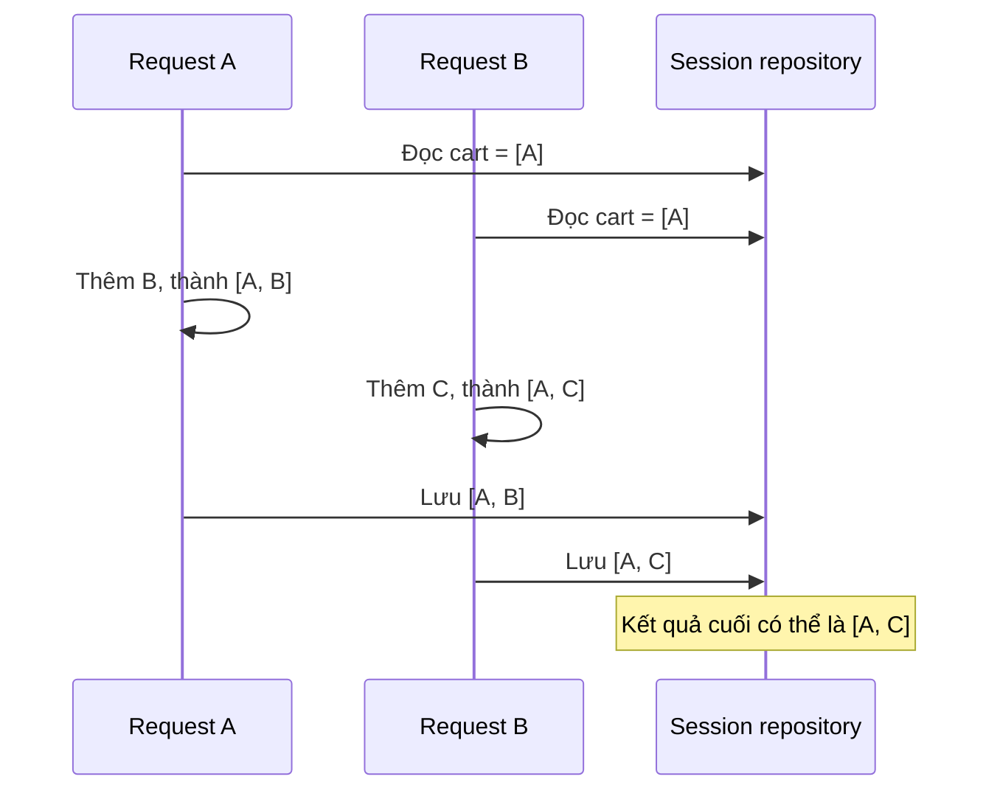

# Ghi đè mất thay đổi khi hai bên cập nhật cùng thuộc tính

Một HTTP session có thể được dùng đồng thời bởi nhiều request. Người dùng mở hai tab, trình duyệt gửi request nền trong lúc người dùng bấm nút, hoặc một request dài chạy song song với request cập nhật giỏ hàng. Các request này có thể cùng đọc một giá trị thuộc tính session, tính toán trên bản dữ liệu đã đọc rồi ghi kết quả trở lại. Nếu cả hai cùng cập nhật một thuộc tính, thay đổi của request ghi sau có thể ghi đè kết quả của request trước. Đây là lỗi lost update.

Spring Session lưu session trong kho dùng chung như Redis hoặc JDBC, nhờ đó nhiều instance có thể đọc cùng phiên. Việc chia sẻ kho dữ liệu không tự làm các thao tác đọc-sửa-ghi trở thành nguyên tử. `HttpSession`, `SessionRepository` và `SaveMode`/`FlushMode` không phải cơ chế khóa hay kiểm soát phiên bản cho mọi cập nhật nghiệp vụ. Khi hai request cùng sửa một thuộc tính, ứng dụng cần xác định cách hợp nhất, phát hiện xung đột hoặc chuyển dữ liệu quan trọng sang kho có transaction và concurrency control phù hợp.

## 1. Lost update là gì?

Lost update xảy ra khi hai thao tác cùng đọc một trạng thái ban đầu, mỗi thao tác tạo ra một trạng thái mới dựa trên bản cũ, rồi thao tác ghi sau thay thế kết quả của thao tác ghi trước. Cả hai request đều có thể trả thành công, nhưng một thay đổi không còn trong trạng thái cuối cùng.

Ví dụ thuộc tính `cart` trong session đang chứa hai sản phẩm. Hai request được gửi gần như đồng thời:

1. Request A đọc giỏ hàng `{A}`.
2. Request B cũng đọc giỏ hàng `{A}`.
3. A thêm sản phẩm `B`, tạo `{A, B}` rồi lưu.
4. B thêm sản phẩm `C` trên bản cũ, tạo `{A, C}` rồi lưu.
5. Trạng thái cuối có thể là `{A, C}`; sản phẩm `B` do A thêm đã mất.

Điều này có thể xảy ra dù request A và B được xử lý bởi hai thread khác nhau trong cùng JVM, hoặc hai instance khác nhau cùng dùng Redis/JDBC. Cùng một cookie session không đồng nghĩa các request được xử lý tuần tự.

## 2. Mô hình read-modify-write

Một thao tác cập nhật thuộc tính thường có ba bước:

```text
READ     Đọc giá trị hiện tại từ session
MODIFY   Tạo giá trị mới dựa trên giá trị đã đọc
WRITE    Ghi giá trị mới trở lại session
```

Nếu toàn bộ ba bước không được thực hiện như một thao tác nguyên tử, hai request có thể xen kẽ:



Đây là một cuộc đua theo thời gian (race condition). Thứ tự request được trình duyệt gửi, thứ tự thread được scheduler chạy và thứ tự lệnh tới Redis/database có thể khác nhau. Không nên dựa vào việc request đến trước sẽ luôn ghi trước.

## 3. Ví dụ lost update với thuộc tính số đếm

Giả sử session lưu số lượng mặt hàng đã chọn:

```java
@PostMapping("/cart/increment")
public String increment(HttpSession session) {
    Integer quantity = (Integer) session.getAttribute("quantity");
    if (quantity == null) {
        quantity = 0;
    }

    session.setAttribute("quantity", quantity + 1);
    return "redirect:/cart";
}
```

Nếu hai request cùng đọc `quantity = 4`, cả hai đều tính `5` và cùng ghi `5`. Người dùng gửi hai thao tác tăng nhưng kết quả chỉ tăng một đơn vị. Đây là lỗi read-modify-write; việc `setAttribute` được gọi ở cả hai request không làm phép cộng trở thành nguyên tử.

Một lỗi tương tự xảy ra với object mutable:

```java
Cart cart = (Cart) session.getAttribute("cart");
cart.add(productId);
session.setAttribute("cart", cart);
```

Việc gọi lại `setAttribute` giúp Spring Session nhận biết thuộc tính cần lưu trong các save mode theo dõi thao tác set. Tuy nhiên, nếu hai request đang giữ hai bản `Cart` khác nhau, `setAttribute` chỉ ghi object của request hiện tại. Nó không tự hợp nhất các sản phẩm được thêm ở request còn lại.

## 4. Vì sao session dùng chung không ngăn được lost update?

Redis hoặc JDBC giúp các instance nhìn thấy cùng dữ liệu session. Chúng giải quyết vấn đề chia sẻ trạng thái qua nhiều process, nhưng không tự tạo một transaction bao trùm cả chuỗi `getAttribute` → tính toán trong Java → `setAttribute`.

Một request có thể tải session vào bộ nhớ, sửa object cục bộ rồi lưu về repository khi kết thúc request. Một request khác có thể tải cùng session trước khi lần lưu đầu hoàn tất. Nếu cả hai cùng ghi cùng thuộc tính, giá trị được lưu sau có thể thay thế giá trị trước. Chi tiết cập nhật theo attribute, thời điểm flush và câu lệnh lưu phụ thuộc repository cùng phiên bản Spring Session; không nên giả định mọi backend đều có cùng biểu hiện ở cấp câu lệnh.

Điều cần ghi nhớ:

- Kho dùng chung không đồng nghĩa với thao tác read-modify-write nguyên tử.
- Session ID giống nhau không có nghĩa các request được khóa theo session.
- Servlet container không bảo đảm tự đồng bộ mọi thao tác trên object mutable bên trong session.
- Repository có thể lưu các thuộc tính được đánh dấu thay đổi, nhưng không biết cách hợp nhất hai object nghiệp vụ.
- Kết quả phụ thuộc thứ tự lưu, save/flush mode, transaction và implementation; cần kiểm thử backend thật.

## 5. SaveMode và FlushMode không phải concurrency control

Spring Session có các chính sách quyết định thuộc tính nào được ghi và thời điểm ghi. Chúng ảnh hưởng dirty tracking và I/O, nhưng không cung cấp optimistic locking hoặc merge semantics cho hai request đồng thời.

| Cấu hình | Mục đích | Không bảo đảm điều gì? |
| --- | --- | --- |
| `SaveMode.ON_SET_ATTRIBUTE` | Lưu thuộc tính được đặt qua `setAttribute` | Không phát hiện hoặc hợp nhất hai giá trị cùng được set |
| `SaveMode.ON_GET_ATTRIBUTE` | Đưa thuộc tính đã đọc vào phạm vi cần lưu theo semantics của implementation | Không khóa thuộc tính giữa các request; có thể làm nhiều request ghi lại cùng dữ liệu |
| `SaveMode.ALWAYS` | Lưu mọi thuộc tính khi session được lưu | Không ngăn request cũ ghi đè trạng thái mới |
| `FlushMode.ON_SAVE` | Ghi các thay đổi tại bước save, thường cuối request | Không làm toàn bộ request thành transaction nguyên tử |
| `FlushMode.IMMEDIATE` | Ghi sớm khi repository nhận biết thay đổi | Không biến `list.add()` hoặc `count + 1` thành thao tác atomic |

Ví dụ, chuyển từ `ON_SET_ATTRIBUTE` sang `ALWAYS` có thể khiến nhiều thuộc tính được serialize và ghi nhiều hơn. Điều đó không giải quyết lost update; request B vẫn có thể lưu snapshot cũ sau request A. Tương tự, `IMMEDIATE` thay đổi thời điểm ghi nhưng không đảm bảo request khác không đọc trạng thái cũ trước đó.

Chọn save/flush mode theo nhu cầu lưu trữ và hiệu năng. Giải quyết đồng thời phải được thiết kế riêng bằng cập nhật nguyên tử, version check, khóa phân tán hoặc transaction ở tầng dữ liệu nghiệp vụ.

## 6. Không nên coi HttpSession là kho giao dịch

Session phù hợp để giữ trạng thái điều hướng và dữ liệu tạm giữa các request, chẳng hạn tab hiện tại, lựa chọn giao diện, mã wizard hoặc một số thông tin nhỏ của giỏ hàng. Nó không phải database transaction manager.

Không nên đặt logic quan trọng như tồn kho, số dư, điểm thưởng, số lần sử dụng mã giảm giá, trạng thái phê duyệt hoặc thanh toán trong một object session rồi kỳ vọng cập nhật đồng thời luôn chính xác. Các dữ liệu này cần ràng buộc nhất quán, transaction và audit ở tầng database/service.

Một cách thiết kế thường tốt hơn:

- Session lưu `cartId`, `draftId` hoặc định danh nghiệp vụ nhỏ.
- Database lưu trạng thái giỏ hàng/draft thực tế.
- Service thực hiện cập nhật trong transaction.
- Database dùng optimistic locking, pessimistic locking hoặc câu lệnh atomic phù hợp.
- Session chỉ phản ánh lựa chọn giao diện hoặc cache tạm, có thể tải lại từ nguồn dữ liệu chính.

Ví dụ, thay vì lưu toàn bộ giỏ hàng trong session, lưu `cartId`:

```java
@PostMapping("/cart/items")
public Mono<Void> addItem(HttpSession session,
                          @RequestParam Long productId) {
    String cartId = (String) session.getAttribute("cartId");
    return cartService.addItem(cartId, productId);
}
```

Đây chỉ là ví dụ minh họa tầng controller; nếu ứng dụng là Servlet MVC thì service thường trả kiểu đồng bộ hoặc được tích hợp theo cách phù hợp. Ý chính là thao tác cập nhật dữ liệu giỏ hàng được chuyển tới service/database có concurrency control, không thực hiện bằng read-modify-write trên object session. Trong ứng dụng reactive, không trộn `HttpSession` Servlet với WebFlux; dùng `WebSession` và reactive service/repository tương ứng.

## 7. Cách 1: cập nhật nguyên tử ở database

Với số lượng hoặc bộ đếm, có thể dùng câu lệnh SQL atomic thay vì đọc giá trị rồi ghi lại từ ứng dụng:

```sql
UPDATE CART_LINE
SET QUANTITY = QUANTITY + 1
WHERE CART_ID = ? AND PRODUCT_ID = ?;
```

Database thực hiện phép cộng trong một câu lệnh cập nhật. Hai transaction đồng thời không còn cùng tính `4 + 1` trên hai bản snapshot trong Java rồi ghi `5`; database điều phối cập nhật theo semantics của hệ quản trị.

Với thao tác phức tạp hơn, dùng transaction và khóa hàng khi cần:

```sql
SELECT QUANTITY
FROM CART_LINE
WHERE CART_ID = ? AND PRODUCT_ID = ?
FOR UPDATE;
```

Sau khi lấy row lock, transaction đọc giá trị hiện tại, kiểm tra quy tắc nghiệp vụ, cập nhật và commit. Khóa phải nằm trong cùng transaction và được giữ trong khoảng thời gian ngắn. Tránh gọi dịch vụ bên ngoài hoặc chờ người dùng trong lúc giữ database lock.

Nếu database hỗ trợ `UPDATE ... RETURNING` hoặc câu lệnh tương tự, có thể lấy giá trị mới ngay trong cùng thao tác. Cú pháp phụ thuộc database; cần kiểm tra dialect và isolation level thực tế.

## 8. Cách 2: optimistic locking với version

Optimistic locking phù hợp khi xung đột không quá thường xuyên và ứng dụng có thể từ chối hoặc thử lại thao tác khi dữ liệu đã thay đổi. Mỗi bản ghi có một cột version. Request đọc version `v`; khi cập nhật, nó chỉ ghi nếu version vẫn là `v`. Nếu một request khác đã cập nhật, version tăng lên và câu lệnh của request cũ không cập nhật hàng nào.

Ví dụ JPA entity:

```java
@Entity
class Cart {

    @Id
    private Long id;

    @Version
    private long version;

    private int itemCount;

    public void incrementItemCount() {
        itemCount++;
    }
}
```

Khi hai transaction cùng đọc version `7`, transaction A cập nhật thành công và version thành `8`. Transaction B vẫn cố ghi với điều kiện version `7`; database phát hiện không còn khớp và JPA báo optimistic locking conflict, thường dưới dạng `OptimisticLockException` hoặc exception Spring được dịch tương ứng.

Ứng dụng cần xử lý conflict:

1. Rollback transaction đã thất bại.
2. Thông báo xung đột hoặc đọc lại dữ liệu mới.
3. Nếu nghiệp vụ cho phép, áp dụng lại ý định của người dùng trên trạng thái mới.
4. Giới hạn số lần retry và dùng backoff/jitter khi tải cao.

Không retry mù quáng một thao tác không idempotent. Nếu request đã tạo giao dịch thanh toán hoặc gửi thông điệp ra ngoài trước khi conflict xảy ra, retry có thể thực hiện hành động hai lần. Dùng transaction boundary, outbox hoặc idempotency key phù hợp.

## 9. Cách 3: cập nhật theo phiên bản ở Redis

Nếu dữ liệu nghiệp vụ thực sự nằm trong Redis, có thể dùng primitive atomic của Redis thay vì lưu cả object rồi ghi đè. Ví dụ counter dùng `INCR`:

```text
INCR cart:42:item-count
```

Lệnh này tăng giá trị nguyên tử trên một key. Với cấu trúc phức tạp, có thể dùng Lua script để đọc, kiểm tra và cập nhật trong một thao tác nguyên tử phía Redis, hoặc dùng `WATCH`/`MULTI`/`EXEC` để phát hiện key đã thay đổi.

Một quy trình optimistic với `WATCH` có thể gồm:

1. `WATCH` key cần cập nhật.
2. Đọc trạng thái hiện tại.
3. Tính toán giá trị mới.
4. Bắt đầu `MULTI` và xếp lệnh cập nhật.
5. Gọi `EXEC`; nếu key bị thay đổi từ sau `WATCH`, transaction bị abort.
6. Đọc lại và thử lại có giới hạn nếu nghiệp vụ cho phép.

Đây là cơ chế cho key nghiệp vụ do ứng dụng quản lý. Không tự thao tác trực tiếp các key nội bộ của Spring Session để triển khai khóa hoặc CAS nếu không có contract được hỗ trợ. Cấu trúc key, serialization và cách repository ghi session là chi tiết implementation có thể thay đổi theo phiên bản.

Nếu dùng Lua hoặc Redis transaction, cần cân nhắc cluster hash slot, timeout, retry, idempotency và hành vi failover. Atomicity của một script không tự bảo đảm một chuỗi thao tác trải qua nhiều hệ thống Redis/database là giao dịch phân tán.

## 10. Cách 4: khóa phân tán khi cần tuần tự hóa cập nhật

Một distributed lock có thể bảo đảm chỉ một request tại một thời điểm thực hiện đoạn cập nhật cho cùng một tài nguyên, nếu khóa được thiết kế và sử dụng đúng. Khóa cần được lưu ở hệ thống dùng chung mà mọi instance truy cập; `synchronized` hoặc `ReentrantLock` trong JVM không đủ cho nhiều node.

Một luồng khái quát:

1. Tạo khóa theo tài nguyên nghiệp vụ ổn định, ví dụ `cartId`, không nhất thiết theo session ID.
2. Thử lấy lock với lease có thời hạn.
3. Nếu lấy được, đọc trạng thái mới nhất từ nguồn dữ liệu chính.
4. Cập nhật và commit.
5. Nhả lock trong `finally` hoặc cơ chế tương đương.
6. Nếu không lấy được lock, chờ ngắn có giới hạn hoặc trả conflict/retry cho client.

Lock cần token sở hữu để chỉ chủ khóa mới được nhả. Lease phải dài hơn thời gian cập nhật dự kiến nhưng vẫn có giới hạn để tránh khóa treo. Nếu thao tác có thể kéo dài quá lease, cần fencing token hoặc cơ chế bảo vệ ghi để chủ khóa cũ không ghi sau khi quyền khóa đã chuyển sang node khác.

Distributed lock có chi phí, điểm lỗi và độ phức tạp. Không dùng nó thay transaction database khi database đã cung cấp atomic update hoặc optimistic locking đơn giản hơn. Cũng không khóa theo session ID nếu cùng giỏ hàng có thể được truy cập từ nhiều session/thiết bị; khóa nên gắn với tài nguyên nghiệp vụ cần bảo vệ.

## 11. Merge theo ý định thay vì ghi lại snapshot cũ

Một cách giảm lost update là gửi lệnh mô tả ý định thay đổi thay vì gửi toàn bộ object snapshot. Ví dụ thay vì client gửi toàn bộ giỏ hàng mới, client gửi “thêm product 123 số lượng 1”. Service nạp trạng thái hiện tại rồi áp dụng lệnh trên dữ liệu mới nhất.

| Cách cập nhật | Rủi ro | Cách cải thiện |
| --- | --- | --- |
| Gửi cả object cart đã đọc trước đó | Ghi đè thay đổi của tab/thiết bị khác | Gửi command như add/remove/set quantity |
| Ghi lại toàn bộ map preferences | Mất các key được request khác thêm | Cập nhật từng key hoặc merge theo version |
| Tăng counter bằng `oldValue + 1` | Hai request cùng ghi một giá trị | Dùng atomic increment tại datastore |
| Thay danh sách bằng snapshot cũ | Mất phần tử được thêm đồng thời | Dùng operation-based update hoặc version check |

Merge theo ý định vẫn cần quy tắc nghiệp vụ. Ví dụ hai request cùng đặt quantity thành hai giá trị khác nhau không thể tự động cộng; cần xác định last-write-wins có chấp nhận được hay phải trả conflict cho người dùng.

## 12. Object immutable giúp rõ ràng nhưng không tự giải quyết race

Dùng immutable object và tạo instance mới sau mỗi lần cập nhật giúp tránh mutation âm thầm và phù hợp với `SaveMode.ON_SET_ATTRIBUTE`. Tuy nhiên, hai request vẫn có thể cùng đọc object version cũ và tạo hai object mới khác nhau. Request ghi sau vẫn có thể thay thế object của request trước.

Ví dụ:

```java
CartState current = (CartState) session.getAttribute("cartState");
CartState updated = current.add(productId);
session.setAttribute("cartState", updated);
```

Immutable object làm dữ liệu dễ dự đoán và kiểm thử hơn, nhưng không thay thế version check, transaction hoặc atomic update. Nếu object immutable chứa snapshot cũ, lost update vẫn xảy ra khi nhiều request cùng thay thế thuộc tính.

## 13. Chọn giải pháp theo loại dữ liệu

| Dữ liệu | Lựa chọn phù hợp |
| --- | --- |
| Tab đang mở, bước wizard, bộ lọc tạm | Có thể lưu trong session; chấp nhận quy tắc last-write-wins nếu phù hợp |
| Số đếm tăng/giảm | Atomic increment/decrement tại database hoặc Redis |
| Giỏ hàng nhiều thiết bị | Lưu cart trong database theo `cartId`; dùng transaction/version |
| Form draft | Lưu draft có version; trả conflict hoặc merge khi hai tab cùng sửa |
| Quyền, trạng thái tài khoản | Nguồn dữ liệu chính trong database/identity service; kiểm tra lại trước hành động |
| Tồn kho, hạn mức, thanh toán | Transaction và concurrency control ở tầng nghiệp vụ/database |
| Cache dữ liệu hiển thị | Có thể dùng cache/session nếu chấp nhận stale data và có chiến lược refresh |

Nếu nghiệp vụ cho phép request mới nhất thắng, cần ghi rõ quy tắc đó và thông báo phù hợp ở giao diện. Nếu mọi thay đổi phải được bảo toàn, cần thiết kế merge hoặc phát hiện xung đột. Không nên để last-write-wins xảy ra một cách vô tình.

## 14. Kiểm thử lost update có chủ đích

Một test tuần tự không thể chứng minh hệ thống an toàn trước lost update. Cần tạo hai request cùng đọc một trạng thái ban đầu trước khi cho cả hai ghi.

Quy trình kiểm thử:

1. Tạo session và đặt thuộc tính `cart` hoặc `quantity` ở giá trị ban đầu.
2. Mở hai request đồng thời bằng cùng session cookie.
3. Dùng `CountDownLatch`, `CyclicBarrier` hoặc test hook để cả hai request xác nhận đã đọc cùng phiên bản trước khi tiếp tục.
4. Cho request A và B áp dụng hai thay đổi khác nhau.
5. Điều khiển thứ tự ghi hoặc để scheduler chạy tự nhiên qua nhiều lần lặp.
6. Đọc trạng thái cuối từ một request mới hoặc trực tiếp qua API domain.
7. Xác minh cả hai thay đổi được giữ, hoặc một request nhận conflict theo chính sách thiết kế.

Các tình huống nên kiểm tra:

| Kịch bản | Kết quả mong đợi |
| --- | --- |
| Hai request cùng tăng một counter | Kết quả tăng hai lần nếu dùng atomic update |
| Hai request sửa cùng thuộc tính session | Phát hiện được hành vi ghi đè hoặc có chính sách merge/conflict rõ ràng |
| Hai request thêm hai sản phẩm khác nhau | Cả hai sản phẩm được giữ nếu nghiệp vụ yêu cầu bảo toàn |
| Hai transaction cập nhật cùng entity có `@Version` | Một transaction thành công, transaction còn lại nhận conflict và xử lý có kiểm soát |
| Hai instance dùng cùng Redis/JDBC | Kết quả không phụ thuộc node nhận request |
| Request retry sau timeout | Không nhân đôi thao tác nhờ idempotency hoặc kiểm soát retry |
| SaveMode/FlushMode thay đổi | Xác minh thời điểm ghi thay đổi nhưng không nhầm với concurrency control |

Dùng Redis/JDBC thật hoặc Testcontainers để kiểm tra repository. Mock `HttpSession` không tái hiện đầy đủ thời điểm tải/lưu của backend. Nếu test sử dụng hai application instance, bảo đảm chúng dùng cùng repository và cùng namespace/table. Không dùng `Thread.sleep` ngẫu nhiên làm cơ chế đồng bộ test; hãy dùng barrier để tái hiện chính xác interleaving.

## 15. Chẩn đoán trong production

Lost update thường khó nhận ra vì từng request đều có thể trả thành công. Hãy tìm các dấu hiệu:

- Người dùng báo một thay đổi biến mất sau khi mở nhiều tab hoặc dùng nhiều thiết bị.
- Giá trị counter thấp hơn số thao tác đã xác nhận.
- Log cho thấy nhiều request cùng session ID cập nhật một thuộc tính trong khoảng thời gian ngắn.
- Dữ liệu session thay đổi theo node nhận request hoặc theo thứ tự response.
- Lỗi tập trung ở object lớn được thay thế toàn bộ thay vì cập nhật theo command.

Để điều tra, ghi correlation ID, request ID, tên thuộc tính ở mức an toàn, version dữ liệu trước/sau và kết quả conflict. Không log session ID đầy đủ, cookie, token hoặc toàn bộ session attributes. Nếu cần liên kết nhiều request của một principal, dùng định danh đã được bảo vệ/ẩn danh hóa theo chính sách dữ liệu.

Đo cả tỷ lệ conflict, retry, lock wait, transaction duration và số lần cập nhật bị từ chối. Nếu đổi từ session object sang database domain model, theo dõi thời gian truy vấn và tải database để bảo đảm giải pháp concurrency không tạo nút thắt mới.

## 16. Quy trình xử lý một thuộc tính bị cập nhật đồng thời

1. Xác định thuộc tính nào bị ghi đè và request nào đọc/ghi nó.
2. Kiểm tra dữ liệu đó có thực sự nên nằm trong session hay thuộc domain database.
3. Xác định semantics nghiệp vụ: last-write-wins, merge, cộng dồn hay từ chối conflict.
4. Nếu dữ liệu quan trọng, chuyển trạng thái chính sang database/service hoặc Redis key nghiệp vụ riêng.
5. Chọn atomic update, transaction, optimistic locking/version hoặc distributed lock theo nhu cầu.
6. Dùng session giữ ID hoặc snapshot nhỏ, không giữ bản sao làm nguồn chân lý.
7. Kiểm thử hai request đồng thời trên đúng backend và nhiều instance.
8. Theo dõi conflict, retry, lost update và latency sau triển khai.

## 17. Checklist thiết kế

- Có thể có hai request cùng dùng một session cookie không? Hãy mặc định là có.
- Hai request có thể cùng đọc rồi ghi một thuộc tính không?
- Thay đổi có phải dữ liệu nghiệp vụ cần bảo toàn không?
- `SaveMode` và `FlushMode` có đang bị hiểu nhầm là khóa đồng thời không?
- Có thể lưu ID trong session và cập nhật dữ liệu chính qua service/database không?
- Có cần atomic increment, optimistic locking hoặc transaction không?
- Nếu dùng distributed lock, key có gắn với tài nguyên nghiệp vụ và có lease/fencing phù hợp không?
- Retry có an toàn và idempotent không?
- Test có tái hiện được hai request cùng đọc một phiên bản ban đầu không?
- Có metric/log đủ để phát hiện conflict mà không lộ session credential không?

Spring Session chia sẻ session giữa các request và các instance, nhưng không tự hợp nhất hai thay đổi đồng thời trên cùng thuộc tính. Khi hai request cùng đọc một giá trị rồi ghi snapshot mới, request ghi sau có thể làm mất thay đổi của request trước. Hãy dùng session cho trạng thái tạm, còn dữ liệu cần nhất quán phải được cập nhật bằng transaction, atomic operation, version check hoặc cơ chế điều phối phù hợp ở tầng dữ liệu nghiệp vụ.
