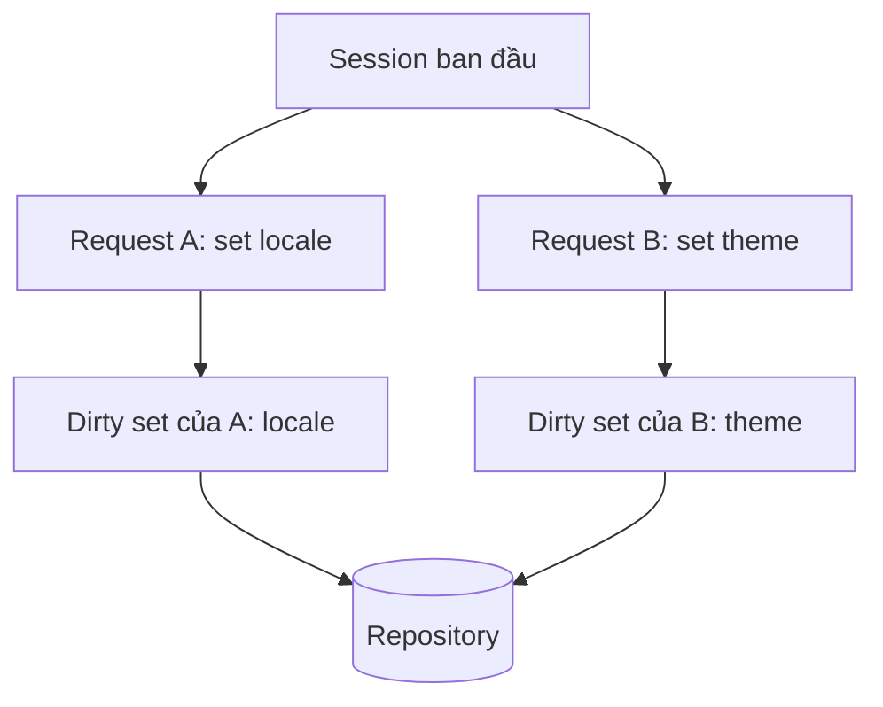

# Thay đổi thuộc tính khác nhau và ảnh hưởng của chính sách lưu

Một session có thể chứa nhiều attribute độc lập như `cartId`, `locale`, `lastViewedProduct` và `checkoutStep`. Trong một request, ứng dụng có thể chỉ thay đổi một vài attribute; request khác có thể đọc hoặc cập nhật attribute khác của cùng session. Spring Session cung cấp hai nhóm chính sách ảnh hưởng đến việc ghi dữ liệu: **`SaveMode` quyết định attribute nào được xem là cần lưu**, còn **`FlushMode` quyết định khi nào thay đổi được đẩy xuống repository**.

Hai chính sách này có liên quan nhưng giải quyết hai vấn đề khác nhau. Chọn `SaveMode` phù hợp giúp tránh ghi lại attribute không cần thiết hoặc bỏ sót thay đổi bên trong object mutable. Chọn `FlushMode` phù hợp giúp cân bằng giữa số lần ghi, độ trễ và thời điểm dữ liệu được lưu. Cả hai đều không tự cung cấp khóa giao dịch hoặc giải quyết xung đột giữa hai request đồng thời.

## 1. Session attribute và trạng thái thay đổi

`HttpSession` cung cấp một map tên-giá-trị. Mỗi attribute được lưu bằng tên, ví dụ:

```java
session.setAttribute("cartId", "cart-2048");
session.setAttribute("locale", "vi-VN");
session.setAttribute("checkoutStep", 2);
```

Spring Session chuyển các attribute thành dữ liệu lưu trữ trong repository như Redis hoặc JDBC. Khi request sau tải cùng session, các attribute được khôi phục để ứng dụng tiếp tục xử lý.

Không phải mọi thay đổi đều có hình thức giống nhau:

- **Thay giá trị:** gọi `setAttribute("locale", "en-US")`.
- **Xóa attribute:** gọi `removeAttribute("checkoutStep")`.
- **Sửa object mutable bên trong:** lấy một `List` hoặc object từ session rồi thay đổi nội dung của nó mà không gọi lại `setAttribute`.
- **Chỉ đọc attribute:** gọi `getAttribute` mà không sửa giá trị.

Spring Session cần biết attribute nào được đánh dấu thay đổi để quyết định dữ liệu cần ghi. `SaveMode` điều khiển cách nhận diện tập attribute đó.

## 2. Phân biệt `SaveMode` và `FlushMode`

Hai enum thường được cấu hình riêng trong repository tích hợp:

| Chính sách | Câu hỏi được trả lời | Tác động chính |
|---|---|---|
| `SaveMode` | Attribute nào cần ghi khi lưu session? | Phạm vi dữ liệu attribute được ghi |
| `FlushMode` | Khi nào thay đổi được gửi đến kho lưu trữ? | Thời điểm và số lần ghi |

Ví dụ, `SaveMode.ON_SET_ATTRIBUTE` kết hợp `FlushMode.ON_SAVE` có nghĩa là repository tập trung vào attribute được set rõ ràng và trì hoãn ghi cho đến lúc session được lưu. `SaveMode.ALWAYS` kết hợp `FlushMode.IMMEDIATE` có thể làm tăng đáng kể số byte và số thao tác ghi.

Không nên chọn một enum rồi coi nó thay thế enum còn lại. Một cấu hình có thể theo dõi đúng attribute nhưng flush quá muộn so với nhu cầu; hoặc flush nhanh nhưng không đánh dấu một thay đổi mutable là cần lưu.

## 3. Các giá trị của `SaveMode`

Spring Session cung cấp ba lựa chọn phổ biến:

| Giá trị | Cách xác định attribute cần lưu | Phù hợp khi |
|---|---|---|
| `ON_SET_ATTRIBUTE` | Lưu attribute được thay đổi qua `setAttribute` hoặc thao tác attribute rõ ràng | Attribute thường được thay bằng giá trị mới; muốn giảm ghi thừa |
| `ON_GET_ATTRIBUTE` | Lưu các attribute đã được đọc bằng `getAttribute` hoặc được set | Có object mutable được sửa sau khi đọc từ session |
| `ALWAYS` | Lưu tất cả attribute của session khi lưu | Ưu tiên đơn giản, chấp nhận write amplification |

### `ON_SET_ATTRIBUTE`

Chế độ này đánh dấu attribute thay đổi khi ứng dụng gọi `setAttribute`. Nó phù hợp với cách cập nhật bất biến: đọc giá trị cũ, tạo giá trị mới rồi gán lại vào session.

```java
String oldLocale = (String) session.getAttribute("locale");
String newLocale = "en-US";
session.setAttribute("locale", newLocale);
```

Attribute `locale` được đánh dấu để lưu vì có lời gọi `setAttribute`. Nếu ứng dụng sửa nội dung object mutable mà không gọi lại `setAttribute`, thay đổi đó có thể không được phát hiện.

### `ON_GET_ATTRIBUTE`

Chế độ này đánh dấu attribute đã được đọc là có khả năng thay đổi và cần lưu khi session được lưu. Điều đó hữu ích với object mutable: ứng dụng đọc object từ session, thay đổi object rồi không cần thay tham chiếu bằng một lời gọi `setAttribute` mới.

```java
@SuppressWarnings("unchecked")
List<String> recentlyViewed =
        (List<String>) session.getAttribute("recentlyViewed");

if (recentlyViewed == null) {
    recentlyViewed = new ArrayList<>();
}

recentlyViewed.add("product-42");
session.setAttribute("recentlyViewed", recentlyViewed);
```

Ví dụ vẫn gọi `setAttribute` để thể hiện thay đổi rõ ràng. Với `ON_GET_ATTRIBUTE`, một attribute được đọc cũng nằm trong tập cần lưu; điều này hỗ trợ trường hợp sửa object mutable tại chỗ. Đổi lại, chỉ đọc nhiều attribute cũng có thể làm tăng lượng dữ liệu ghi ở cuối request.

### `ALWAYS`

Chế độ này lưu tất cả attribute mỗi khi session được lưu, bất kể attribute có được đọc hoặc thay đổi hay không. Nó giảm phụ thuộc vào việc phát hiện dirty attribute, nhưng có thể ghi lại nhiều dữ liệu không thay đổi.

Nếu session chứa nhiều attribute lớn, `ALWAYS` có thể làm tăng CPU serialize, lưu lượng mạng, Redis command hoặc SQL update và độ trễ request. Không chọn chế độ này chỉ vì muốn “chắc chắn”; cần cân nhắc kích thước session và hành vi đồng thời.

## 4. Các giá trị của `FlushMode`

`FlushMode` quy định thời điểm repository đẩy thay đổi xuống store:

| Giá trị | Hành vi | Đánh đổi |
|---|---|---|
| `ON_SAVE` | Ghi khi `SessionRepository.save(...)` được gọi, thường ở cuối request qua filter | Có thể gom nhiều thay đổi thành một lần lưu; dữ liệu chưa được flush trong suốt request |
| `IMMEDIATE` | Ghi thay đổi xuống store sớm nhất có thể khi thao tác session phát sinh | Thay đổi có thể được lưu sớm hơn nhưng tăng số lần I/O |

### `ON_SAVE`

Với `ON_SAVE`, session có thể được sửa nhiều lần trong một request rồi mới được lưu khi repository nhận lệnh `save`. Trong Servlet stack, Spring Session filter thường đảm nhiệm việc lưu session ở giai đoạn hoàn tất request.

Ví dụ một request cập nhật ba attribute:

```java
session.setAttribute("locale", "vi-VN");
session.setAttribute("cartId", "cart-2048");
session.setAttribute("checkoutStep", 3);
```

Các thay đổi có thể được gom trong đối tượng session trước khi ghi. Cách này thường giảm số lần round-trip đến Redis/database so với ghi ngay sau từng thao tác.

### `IMMEDIATE`

Với `IMMEDIATE`, repository cố gắng phản ánh thay đổi xuống store ngay khi có thao tác cập nhật session. Cách này có thể hữu ích khi ứng dụng cần thay đổi được lưu sớm, nhưng có thể tạo nhiều lệnh ghi hơn trong một request.

Không nên hiểu `IMMEDIATE` là mọi thay đổi đã được commit bền vững trước khi phương thức setter trả về trong mọi implementation. Chi tiết thực thi phụ thuộc repository và cách thao tác được gọi; cần kiểm tra lỗi và semantics của integration đang dùng.

`IMMEDIATE` cũng không làm nhiều thao tác session trở thành một transaction nguyên tử. Nếu hai request cùng cập nhật session, chúng vẫn có thể ghi đè dữ liệu của nhau.

## 5. Cấu hình chính sách trong Spring Session

Với Servlet stack và Redis, có thể cấu hình qua annotation:

```java
import org.springframework.context.annotation.Configuration;
import org.springframework.session.FlushMode;
import org.springframework.session.SaveMode;
import org.springframework.session.data.redis.config.annotation.web.http.EnableRedisHttpSession;

@Configuration
@EnableRedisHttpSession(
        saveMode = SaveMode.ON_SET_ATTRIBUTE,
        flushMode = FlushMode.ON_SAVE)
class RedisSessionConfiguration {
}
```

Với JDBC, cấu hình tương tự thông qua annotation JDBC:

```java
import org.springframework.context.annotation.Configuration;
import org.springframework.session.FlushMode;
import org.springframework.session.SaveMode;
import org.springframework.session.jdbc.config.annotation.web.http.EnableJdbcHttpSession;

@Configuration
@EnableJdbcHttpSession(
        saveMode = SaveMode.ON_SET_ATTRIBUTE,
        flushMode = FlushMode.ON_SAVE)
class JdbcSessionConfiguration {
}
```

Đây là ví dụ cấu hình Servlet. Ứng dụng WebFlux sử dụng repository reactive và annotation reactive tương ứng; không sao chép nguyên cấu hình `HttpSession` sang WebFlux. Tên thuộc tính, giá trị mặc định và cách Boot auto-configure có thể thay đổi theo phiên bản Spring Session/Spring Boot, nên kiểm tra API đúng release train trước khi áp dụng.

## 6. Thay giá trị attribute khác với sửa object mutable

Sự khác nhau quan trọng nhất giữa các `SaveMode` xuất hiện khi attribute chứa object mutable.

### Thay giá trị và gọi lại `setAttribute`

```java
CartSummary current =
        (CartSummary) session.getAttribute("cartSummary");

CartSummary updated = current.withItemCount(current.itemCount() + 1);
session.setAttribute("cartSummary", updated);
```

Với kiểu immutable như record hoặc object có phương thức tạo bản sao, ứng dụng tạo giá trị mới và gọi `setAttribute`. `ON_SET_ATTRIBUTE` có thể nhận biết thay đổi rõ ràng.

### Sửa tại chỗ object mutable

```java
@SuppressWarnings("unchecked")
List<String> items = (List<String>) session.getAttribute("items");
items.add("product-42");
```

Nếu không gọi lại `setAttribute`, `ON_SET_ATTRIBUTE` có thể không đánh dấu attribute `items` là dirty. Khi đó, request hoàn tất nhưng thay đổi trong list không được ghi xuống repository.

Có hai cách xử lý:

1. Sau khi sửa, gọi lại `session.setAttribute("items", items)` để đánh dấu rõ ràng.
2. Dùng `SaveMode.ON_GET_ATTRIBUTE` nếu mô hình ứng dụng thường xuyên sửa object mutable sau khi đọc.

Cách thứ nhất thường rõ ràng và hạn chế ghi thừa. Cách thứ hai tiện cho code cũ nhưng có thể lưu lại cả attribute chỉ được đọc.

## 7. Khi request chỉ thay đổi một attribute

Giả sử session có bốn attribute: `cartId`, `locale`, `theme` và `checkoutStep`. Request A chỉ đổi `locale`; request B chỉ đổi `theme`.



Với `ON_SET_ATTRIBUTE`, mỗi request đánh dấu attribute được set. Điều này giảm việc ghi lại `cartId` và `checkoutStep` nếu chúng không thay đổi. Với repository hỗ trợ cập nhật delta theo attribute, việc thay đổi các attribute độc lập có thể giảm khả năng ghi đè không cần thiết so với ghi toàn bộ session.

Tuy nhiên, không được suy luận rằng hai request thay đổi hai attribute khác nhau luôn được merge an toàn. Repository có thể phải cập nhật metadata session, có thể ghi các attribute theo chiến lược riêng và có thể có transaction/locking khác nhau. Hành vi cuối cùng phụ thuộc implementation và thời điểm flush.

## 8. Khi hai request thay đổi cùng một attribute

Nếu Request A và Request B cùng tải session với `cartQuantity = 1`, rồi lần lượt ghi giá trị 2 và 3, kết quả có thể là last-write-wins. `SaveMode` xác định attribute nào được ghi, nhưng không tự phát hiện rằng hai request đã sửa cùng một bản dữ liệu cũ.

```mermaid
sequenceDiagram
    participant A as Request A
    participant R as Repository
    participant B as Request B
    A->>R: find session (quantity=1)
    B->>R: find session (quantity=1)
    A->>A: set quantity=2
    B->>B: set quantity=3
    A->>R: save quantity=2
    B->>R: save quantity=3
    Note over R: Giá trị cuối có thể là 3; cập nhật của A bị ghi đè
```

Đây là lost update. Đổi từ `ON_SAVE` sang `IMMEDIATE` không giải quyết vấn đề; nó chỉ thay đổi thời điểm gửi lệnh ghi. Đổi sang `ALWAYS` có thể làm tình hình xấu hơn nếu request ghi lại snapshot cũ của nhiều attribute.

Nếu cùng một attribute có ý nghĩa nghiệp vụ quan trọng, không nên dựa vào session repository như một cơ chế transaction. Hãy lưu dữ liệu chuẩn trong database nghiệp vụ và dùng optimistic locking, atomic update hoặc transaction phù hợp.

## 9. `ON_GET_ATTRIBUTE` và tác động khi chỉ đọc

`ON_GET_ATTRIBUTE` có thể hữu ích với mutable object, nhưng cần hiểu chi phí của việc đọc. Ví dụ một interceptor đọc `userPreferences`, `cart`, `recentItems` và `featureFlags` trong mọi request. Dù chỉ một trong các object bị sửa, nhiều attribute đã được đánh dấu để lưu.

Điều này có thể làm tăng:

- Số attribute được serialize.
- Byte ghi vào Redis hoặc database.
- Số lệnh cập nhật và thời gian flush.
- Khả năng một request ghi lại snapshot cũ của attribute mà request khác vừa cập nhật.

Vì vậy, `ON_GET_ATTRIBUTE` nên được chọn khi lợi ích của việc bắt thay đổi mutable lớn hơn chi phí ghi lại attribute được đọc. Với ứng dụng có thể chuyển sang immutable DTO và gọi `setAttribute` rõ ràng, `ON_SET_ATTRIBUTE` thường dễ dự đoán hơn.

## 10. `ALWAYS` và write amplification

`ALWAYS` làm cho mỗi lần lưu session có thể ghi lại toàn bộ attribute. Điều này đơn giản hóa việc theo dõi thay đổi, nhưng có thể làm tăng write amplification.

Ví dụ session chứa:

| Attribute | Kích thước ước lượng |
|---|---:|
| `locale` | 20 byte |
| `cartId` | 40 byte |
| `recentItems` | 8 KB |
| `checkoutContext` | 24 KB |
| `featureFlags` | 2 KB |

Nếu request chỉ đổi `locale`, chế độ ghi tất cả attribute vẫn có thể serialize và ghi cả những object lớn không đổi. Khi số request tăng, CPU serialize, network và tải repository có thể tăng đáng kể.

Không nên lưu object lớn trong session chỉ vì `ALWAYS` làm cho việc phát hiện dirty đơn giản hơn. Hãy giảm kích thước session và đưa dữ liệu nghiệp vụ lớn ra kho chuyên dụng.

## 11. `ON_SAVE` và `IMMEDIATE` trong một request

Một request có thể thực hiện nhiều thay đổi liên tiếp:

```java
session.setAttribute("locale", "vi-VN");
session.setAttribute("theme", "dark");
session.setAttribute("checkoutStep", 3);
```

Với `ON_SAVE`, các thay đổi được giữ trong session và repository lưu khi `save` được gọi, thường ở cuối request. Với `IMMEDIATE`, các thay đổi có thể được gửi xuống store ngay trong quá trình cập nhật.

| Tình huống | `ON_SAVE` | `IMMEDIATE` |
|---|---|---|
| Một request đổi nhiều attribute | Có thể gom thay đổi vào lần save cuối | Có thể phát sinh nhiều lần ghi |
| Lỗi trước khi request hoàn tất | Thay đổi chưa flush có thể chưa được lưu | Một số thay đổi trước lỗi có thể đã được ghi |
| Request khác đọc giữa lúc request hiện tại đang chạy | Thường thấy trạng thái đã flush trước đó | Có thể thấy một phần cập nhật đã được ghi sớm hơn |
| Đảm bảo transaction toàn request | Không | Không |

`IMMEDIATE` không biến chuỗi nhiều setter thành một transaction. Một request khác có thể nhìn thấy trạng thái trung gian nếu implementation ghi từng thay đổi riêng. Nếu cần cập nhật nhiều attribute nguyên tử, hãy dùng cơ chế transaction của kho dữ liệu hoặc thiết kế một aggregate/version được cập nhật nguyên tử.

## 12. Kết hợp `SaveMode` và `FlushMode`

Có thể xem xét các tổ hợp theo nhu cầu:

| Tổ hợp | Hành vi dự kiến | Lưu ý |
|---|---|---|
| `ON_SET_ATTRIBUTE` + `ON_SAVE` | Ghi các attribute được set rõ ràng khi lưu session | Phù hợp với cập nhật immutable và gom ghi cuối request |
| `ON_GET_ATTRIBUTE` + `ON_SAVE` | Ghi attribute đã đọc hoặc set khi lưu session | Hữu ích cho mutable object; đọc nhiều có thể làm tăng ghi |
| `ALWAYS` + `ON_SAVE` | Ghi mọi attribute tại thời điểm save | Đơn giản nhưng có write amplification |
| `ON_SET_ATTRIBUTE` + `IMMEDIATE` | Ghi thay đổi được đánh dấu khi chúng phát sinh | Có thể giảm khoảng chờ nhưng tăng I/O |
| `ALWAYS` + `IMMEDIATE` | Ghi rộng và sớm | Dễ tạo tải ghi cao; cần lý do và benchmark rõ ràng |

Không có tổ hợp nào tự giải quyết lost update. `SaveMode` quyết định tập attribute được ghi; `FlushMode` quyết định thời điểm ghi. Transaction, optimistic locking, atomic operation và thiết kế dữ liệu quyết định cách xử lý xung đột.

## 13. Chọn cách mô hình hóa attribute

Để giảm rủi ro và giúp chính sách lưu dễ dự đoán:

- Ưu tiên attribute immutable hoặc DTO nhỏ; khi thay đổi, tạo giá trị mới và gọi `setAttribute`.
- Nếu dùng collection/object mutable, gọi lại `setAttribute` sau khi sửa hoặc chọn `ON_GET_ATTRIBUTE` có chủ đích.
- Không lưu entity JPA, lazy proxy, stream, connection hoặc object gắn với tài nguyên runtime.
- Tránh một object session quá lớn chứa nhiều trường không liên quan.
- Chia attribute theo đơn vị cập nhật độc lập nếu repository và nghiệp vụ cho phép.
- Không dùng session làm nguồn dữ liệu chuẩn cho số dư, tồn kho, trạng thái đơn hàng hoặc bộ đếm cần cập nhật nguyên tử.

Chia nhỏ attribute có thể giúp giảm phạm vi ghi nếu repository hỗ trợ delta update. Tuy nhiên, không bảo đảm các attribute được cập nhật nhất quán với nhau. Nếu hai trường phải thay đổi cùng lúc, hãy đặt chúng trong một transaction nghiệp vụ hoặc một cấu trúc có version/atomic update.

## 14. Lưu ý riêng theo repository

`SaveMode` và `FlushMode` là các chính sách của Spring Session, nhưng chi tiết ghi xuống store phụ thuộc repository implementation.

| Khía cạnh | Redis | JDBC |
|---|---|---|
| Lưu attribute | Serialize attribute và cập nhật cấu trúc Redis | Serialize attribute và ghi vào bảng attributes |
| Chi phí ghi | Redis command, network và replication | SQL update/insert/delete, transaction và index |
| Flush | Phụ thuộc Redis repository và cấu hình flush | Phụ thuộc JDBC repository, transaction và connection |
| Xung đột đồng thời | Có thể xảy ra khi nhiều request ghi cùng session/attribute | Có thể xảy ra khi nhiều transaction cập nhật cùng hàng/attribute |
| Công cụ điều tra | Redis command/latency, key và index | SQL log, execution plan, lock và transaction metrics |

Không giả định Redis và JDBC có cùng mức atomicity chỉ vì cùng nhận `SaveMode`. Đọc tài liệu của đúng repository/version và kiểm thử trên store thực tế. Nếu ứng dụng dùng WebFlux, cần xét repository reactive và semantics của reactive save; không áp dụng trực tiếp cấu hình Servlet một cách máy móc.

## 15. Kiểm thử chính sách lưu

Nên viết integration test để xác nhận chính sách ảnh hưởng thế nào đến attribute được lưu và thời điểm dữ liệu xuất hiện ở repository.

### Kiểm thử mutable attribute

1. Tạo session và lưu một `ArrayList` vào attribute `items`.
2. Đọc session ở request tiếp theo.
3. Thêm phần tử vào list mà không gọi `setAttribute`.
4. Kết thúc request và tải session bằng một repository/client mới.
5. Với `ON_SET_ATTRIBUTE`, xác nhận thay đổi tại chỗ không được giả định là đã lưu.
6. Lặp lại bằng cách gọi `setAttribute` sau khi sửa và xác nhận thay đổi được lưu.
7. Thử `ON_GET_ATTRIBUTE` để xác nhận attribute được đọc nằm trong tập cần lưu.

### Kiểm thử flush

- Dùng repository test hoặc quan sát store để xác định thời điểm lệnh ghi xảy ra.
- Với `ON_SAVE`, xác nhận thay đổi được flush khi repository save được gọi.
- Với `IMMEDIATE`, xác nhận hành vi ghi theo implementation và không dựa vào giả định setter luôn đồng bộ hoàn tất.
- Gây lỗi giữa request để xem thay đổi nào đã được lưu.

### Kiểm thử request đồng thời

1. Hai client dùng cùng session ID và tải snapshot ban đầu.
2. Request A đổi attribute `locale`; Request B đổi attribute `theme`.
3. Đồng bộ hai request bằng barrier để kiểm soát thứ tự save.
4. Tải session sau cả hai request và xác nhận attribute nào còn.
5. Lặp lại với cả hai request đổi cùng attribute để quan sát lost update.
6. Lặp lại theo từng `SaveMode` và `FlushMode` được hỗ trợ.
7. Chạy trên Redis/JDBC thực tế và nhiều instance, không chỉ dùng `MockHttpSession`.

Kết quả test phải phản ánh repository/version thực tế. Không viết assertion rằng mọi thay đổi attribute khác nhau luôn được merge; nếu implementation không cam kết điều đó, test cần ghi nhận hành vi và kiến trúc không nên dựa vào bảo đảm chưa có.

## 16. Đo tác động hiệu năng

Khi so sánh chính sách, đo ít nhất:

- Số lần save/flush trên mỗi request.
- Số attribute và số byte được serialize.
- Số lệnh Redis hoặc số SQL statement.
- p50, p95 và p99 latency của request có cập nhật session.
- CPU của application instance và memory của repository.
- Tỷ lệ lỗi lưu, timeout và retry.
- Tỷ lệ request chỉ đọc so với request thay đổi session.

Benchmark cần dùng session có kích thước và phân bố attribute gần production. Một test chỉ có hai chuỗi ngắn không đủ để kết luận `ALWAYS` hay `ON_GET_ATTRIBUTE` phù hợp với session có nhiều object lớn.

## 17. Nguyên tắc lựa chọn

- Dùng `ON_SET_ATTRIBUTE` khi ứng dụng có thể đánh dấu thay đổi rõ ràng bằng `setAttribute`.
- Dùng `ON_GET_ATTRIBUTE` khi cần hỗ trợ sửa object mutable sau khi đọc và chấp nhận ghi lại các attribute được đọc.
- Dùng `ALWAYS` khi thực sự cần ghi toàn bộ attribute và đã đánh giá write amplification.
- Dùng `ON_SAVE` khi muốn gom thay đổi và ghi theo vòng đời save cuối request.
- Cân nhắc `IMMEDIATE` khi cần đẩy thay đổi sớm, nhưng đo số lần I/O và hiểu khả năng xuất hiện trạng thái trung gian.
- Không coi bất kỳ SaveMode/FlushMode nào là cơ chế khóa hoặc transaction giữa các request.
- Dùng immutable DTO, gọi lại `setAttribute` sau khi sửa mutable object và giữ session nhỏ.
- Đưa dữ liệu nghiệp vụ cần cập nhật nguyên tử ra kho dữ liệu có transaction hoặc atomic operation.
- Kiểm thử cả mutable attribute, hai request thay đổi thuộc tính khác nhau, cùng thuộc tính và lỗi giữa lúc flush.
- Xác minh semantics trên đúng repository, phiên bản và topology production.

`SaveMode` xác định attribute nào được ghi, còn `FlushMode` xác định khi nào thay đổi được đẩy xuống repository. `ON_SET_ATTRIBUTE` phù hợp với thay giá trị rõ ràng; `ON_GET_ATTRIBUTE` hỗ trợ object mutable đã được đọc; `ALWAYS` ghi mọi attribute. `ON_SAVE` gom ghi đến lúc lưu session, còn `IMMEDIATE` đẩy thay đổi sớm hơn nhưng có thể tăng I/O. Khi nhiều request đồng thời, hai chính sách này chỉ điều khiển phạm vi và thời điểm ghi; tính nhất quán vẫn cần được kiểm chứng theo repository và được bảo vệ bằng transaction, versioning hoặc atomic operation ở nơi lưu dữ liệu nghiệp vụ.
