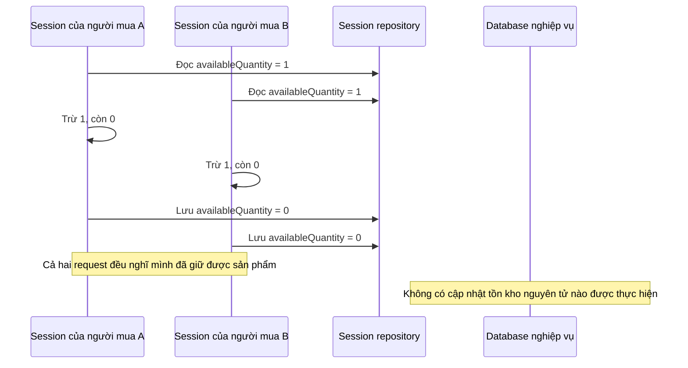

# Tránh dùng phiên làm nguồn duy nhất cho số dư, tồn kho hoặc bất biến nghiệp vụ

Spring Session giúp ứng dụng chia sẻ trạng thái phiên giữa nhiều instance bằng Redis, JDBC hoặc một repository khác. Điều đó giải quyết việc khôi phục `HttpSession`/`WebSession` khi request tiếp theo đến một node khác. Tuy nhiên, session vẫn là trạng thái phục vụ tương tác của người dùng; nó không phải nơi bảo đảm tính đúng đắn của giao dịch nghiệp vụ.

Không lưu số dư tài khoản, số lượng tồn kho, hạn mức, trạng thái thanh toán hoặc bất biến quan trọng chỉ trong session rồi xem đó là dữ liệu chuẩn. Session có thể hết hạn, bị invalidate, bị xóa, bị ghi đè bởi request đồng thời hoặc không lưu thành công. Hai request có thể cùng đọc một snapshot cũ rồi ghi lại các giá trị khác nhau. Một kho session dùng chung không tự cung cấp transaction nghiệp vụ, khóa cập nhật hay cơ chế hợp nhất thay đổi.

Nguồn dữ liệu chuẩn (source of truth) cho số dư, tồn kho và trạng thái nghiệp vụ cần nằm trong kho dữ liệu có mô hình nhất quán phù hợp, thường là database quan hệ với transaction, constraint và các thao tác cập nhật nguyên tử. Session có thể giữ mã tham chiếu, lựa chọn tạm thời hoặc dữ liệu giao diện để cải thiện trải nghiệm; trước khi thực hiện giao dịch, server phải đọc và xác nhận dữ liệu chuẩn.

## 1. Phân biệt trạng thái phiên và trạng thái nghiệp vụ

Session được thiết kế để duy trì ngữ cảnh giữa nhiều request của cùng một client. Ví dụ, ứng dụng có thể lưu:

- mã giỏ hàng đang thao tác;
- mã quy trình wizard và bước giao diện hiện tại;
- ngôn ngữ hoặc tùy chọn hiển thị;
- mã tham chiếu đến báo giá hoặc đơn hàng đã được tạo ở database;
- một số dữ liệu tạm thời có thể tính lại hoặc tải lại.

Các giá trị sau cần có nguồn dữ liệu nghiệp vụ đáng tin cậy:

- số dư và số tiền có thể chi tiêu;
- số lượng hàng còn bán được;
- số lượng đã giữ chỗ hoặc đã phân bổ;
- giá, thuế, chiết khấu và tổng tiền phải thanh toán;
- hạn mức tín dụng, quota hoặc giới hạn sử dụng;
- trạng thái đơn hàng, thanh toán, hoàn tiền và chuyển khoản;
- quan hệ sở hữu tài nguyên và quyền phê duyệt.

| Dữ liệu | Có thể đặt trong session? | Nguồn chuẩn nên là |
|---|---|---|
| `cartId` | Có, như mã tham chiếu | Bảng giỏ hàng và chi tiết giỏ hàng |
| `selectedLocale` | Có | Tùy chọn người dùng hoặc session |
| `displayedCartTotal` | Chỉ để hiển thị tạm thời, phải tính lại | Giá hiện hành, thuế và chiết khấu trong database/dịch vụ giá |
| `availableQuantity` | Không dùng làm giá trị quyết định bán hàng | Bản ghi tồn kho và reservation |
| `accountBalance` | Không dùng làm số dư có thể chi tiêu | Ledger/số dư được cập nhật trong transaction |
| `lastOrderId` | Có, như liên kết điều hướng | Bảng đơn hàng |
| `isAdmin` | Không dùng làm quyền | `Authentication` và chính sách phân quyền phía server |

Một thuộc tính có thể được cache trong session để giảm số lần tải dữ liệu, nhưng cache phải được coi là bản sao có thể cũ. Khi thực hiện thao tác quan trọng, server phải xác nhận lại với nguồn chuẩn.

## 2. Vì sao session không bảo đảm bất biến nghiệp vụ?

Một bất biến nghiệp vụ là điều kiện phải luôn đúng sau mọi giao dịch hợp lệ. Ví dụ:

- số lượng tồn kho không được âm;
- số dư khả dụng không được thấp hơn mức cho phép;
- một yêu cầu thanh toán không được ghi nhận thành công hai lần;
- một mã voucher chỉ được sử dụng tối đa số lần quy định;
- một đơn hàng không được chuyển từ `CANCELLED` sang `SHIPPED` nếu không có quy trình hợp lệ.

Session không phù hợp để bảo vệ các bất biến này vì:

1. **Nhiều request đồng thời:** hai request có thể cùng khôi phục một session trước khi request nào lưu thay đổi.
2. **Nhiều instance:** Redis/JDBC giúp các node dùng chung dữ liệu, nhưng không tự khóa toàn bộ session hoặc hợp nhất object đã được đọc ở các thời điểm khác nhau.
3. **Thời điểm lưu:** thay đổi session thường được lưu ở điểm flush/save do filter hoặc WebSession lifecycle quản lý. Thời điểm đó có thể khác transaction của service nghiệp vụ.
4. **Hết hạn và logout:** session có thể bị xóa trong khi dữ liệu nghiệp vụ cần tiếp tục tồn tại.
5. **Lỗi kho session:** Redis hoặc database session có thể không sẵn sàng; điều đó không được phép làm sai số dư hay tồn kho.
6. **Retry request:** client có thể gửi lại request khi timeout mà không biết giao dịch trước đã commit hay chưa.
7. **Thay đổi phiên bản:** session attribute có thể không tương thích khi rolling deployment, trong khi dữ liệu nghiệp vụ cần được bảo toàn lâu dài.

Spring Session giải quyết lưu trữ và khôi phục session. Nó không biến session thành một aggregate có transaction, không cung cấp optimistic locking cho từng quy tắc nghiệp vụ và không bảo đảm một thao tác chỉ xảy ra một lần.

## 3. Ví dụ lost update khi giữ tồn kho trong session

Giả sử kho có 1 sản phẩm và hai người dùng cùng mở trang mua hàng. Cả hai session đều lưu `availableQuantity = 1`.



Kết quả cuối session có thể là `0`, nhưng hai người mua đều đã được thông báo thành công. Giá trị cuối cùng nhìn có vẻ hợp lý không chứng minh bất biến được bảo vệ. Session không có thông tin đủ để quyết định request nào được quyền mua sản phẩm cuối cùng.

Nếu tồn kho được lưu trong database, hai request phải cạnh tranh trên cùng một bản ghi hoặc một reservation resource. Database có thể tuần tự hóa cập nhật trên hàng đó và điều kiện cập nhật quyết định chỉ một request thành công.

## 4. Cập nhật tồn kho bằng câu lệnh nguyên tử

Một cách đơn giản là dùng câu lệnh cập nhật có điều kiện. Ví dụ với bảng `inventory`:

```sql
UPDATE inventory
SET available_quantity = available_quantity - :quantity,
    version = version + 1
WHERE sku = :sku
  AND available_quantity >= :quantity;
```

Ứng dụng kiểm tra số hàng được cập nhật:

- `1`: database đã trừ được số lượng yêu cầu; tiếp tục tạo reservation hoặc order trong cùng transaction.
- `0`: SKU không tồn tại hoặc số lượng khả dụng không đủ; trả kết quả từ chối phù hợp.

Điều kiện `available_quantity >= :quantity` được đánh giá cùng thao tác cập nhật. Hai transaction cạnh tranh trên cùng hàng không thể cùng trừ một đơn vị cuối cùng thành công nếu database thực thi câu lệnh nguyên tử đúng theo transaction semantics của nó.

Ví dụ service Spring dùng `JdbcTemplate`:

```java
@Service
public class InventoryService {

    private final JdbcTemplate jdbc;
    private final ReservationRepository reservations;

    public InventoryService(JdbcTemplate jdbc,
                            ReservationRepository reservations) {
        this.jdbc = jdbc;
        this.reservations = reservations;
    }

    @Transactional
    public Reservation reserve(String sku, int quantity, UUID requestId) {
        if (quantity <= 0) {
            throw new IllegalArgumentException("quantity must be positive");
        }

        int updated = jdbc.update("""
                UPDATE inventory
                SET available_quantity = available_quantity - ?,
                    version = version + 1
                WHERE sku = ? AND available_quantity >= ?
                """, quantity, sku, quantity);

        if (updated != 1) {
            throw new InsufficientInventoryException(sku);
        }

        return reservations.create(sku, quantity, requestId);
    }
}
```

Ví dụ giả định `ReservationRepository` dùng cùng database và transaction manager. Nếu tạo reservation thất bại, exception làm transaction rollback, bao gồm cả thao tác trừ tồn kho. Trong production, `requestId` cũng cần được bảo vệ bằng unique constraint/idempotency để retry không tạo reservation trùng.

Thêm constraint ở database như một lớp bảo vệ cuối:

```sql
ALTER TABLE inventory
ADD CONSTRAINT inventory_available_nonnegative
CHECK (available_quantity >= 0);
```

Constraint bảo vệ dữ liệu ngay cả khi có code path khác quên kiểm tra. Không chỉ dựa vào validation trong controller hoặc giá trị `availableQuantity` của session.

## 5. Giữ chỗ tồn kho là dữ liệu nghiệp vụ có thời hạn

Giỏ hàng có thể nằm trong session, nhưng thao tác giữ hàng cần bản ghi reservation riêng. Một reservation thường có:

- ID duy nhất;
- SKU và số lượng;
- người dùng hoặc đơn hàng liên quan;
- trạng thái `ACTIVE`, `CONFIRMED`, `RELEASED` hoặc `EXPIRED`;
- thời điểm tạo và thời điểm hết hạn;
- mã idempotency hoặc khóa nghiệp vụ.

TTL của session không phải TTL của reservation. Người dùng có thể đóng trình duyệt hoặc logout trong khi reservation vẫn phải được giải phóng theo chính sách. Ngược lại, session có thể còn hiệu lực sau khi reservation đã hết hạn.

Quy trình điển hình:

1. Transaction giảm `available_quantity` và tạo reservation `ACTIVE` với `expires_at`.
2. Khi thanh toán thành công, transaction chuyển reservation sang `CONFIRMED` và tạo order/fulfillment theo quy tắc.
3. Nếu hết thời hạn mà chưa xác nhận, một job nghiệp vụ chuyển reservation sang `EXPIRED` và hoàn số lượng về kho bằng transaction.
4. Nếu người dùng hủy, chuyển trạng thái sang `RELEASED` và hoàn số lượng đúng một lần.

Job giải phóng reservation phải có điều kiện trạng thái để không hoàn kho hai lần. Ví dụ, chỉ cập nhật hàng `ACTIVE` sang `EXPIRED`; chỉ transaction nào thực sự đổi được một hàng mới được tăng lại số lượng khả dụng.

## 6. Số dư tài khoản phải có nguồn chuẩn riêng

Không lưu `balance = 1000000` trong session rồi trừ tiền ở đó. Hai request rút tiền đồng thời có thể cùng đọc số dư cũ và cùng cho phép rút, hoặc một request có thể ghi đè kết quả của request kia.

Với hệ thống tài chính, nguồn chuẩn thường là sổ cái (ledger) ghi nhận các bút toán bất biến. Mỗi giao dịch chuyển tiền tạo các entry cân bằng giữa tài khoản nguồn và đích. Số dư hiển thị có thể là tổng từ ledger hoặc một projection được cập nhật trong cùng transaction.

Một số nguyên tắc:

- Dùng `BigDecimal` hoặc đơn vị tiền nguyên nhỏ nhất (minor units) thay vì `float`/`double`.
- Gắn số tiền với currency; không cộng các loại tiền khác nhau nếu chưa có quy tắc chuyển đổi.
- Ghi debit và credit trong cùng transaction.
- Dùng khóa ngoại và constraint để bảo vệ liên kết ledger.
- Dùng unique transaction/reference ID để chống ghi nhận cùng giao dịch hai lần.
- Không cho phép số dư âm nếu chính sách tài khoản không cho phép; thực hiện kiểm tra ngay trong transaction.
- Ghi audit trail và không sửa/xóa bút toán lịch sử tùy tiện; dùng bút toán đảo khi cần điều chỉnh.

Ví dụ cập nhật số dư khả dụng bằng điều kiện nguyên tử:

```sql
UPDATE account_balance
SET available_amount = available_amount - :amount,
    version = version + 1
WHERE account_id = :accountId
  AND currency = :currency
  AND available_amount >= :amount;
```

Chỉ khi đúng một hàng được cập nhật, service mới tiếp tục ghi ledger debit/credit trong cùng transaction. Constraint `CHECK (available_amount >= 0)` có thể bảo vệ thêm nếu mô hình nghiệp vụ cấm âm. Trong hệ thống thực tế, cần xác định rõ cách xử lý phí, hạn mức, pending amount, hold và giao dịch đang chờ; một cột số dư đơn giản có thể chưa đủ mô hình.

## 7. Transaction database bảo vệ điều gì?

`@Transactional` tạo ranh giới commit/rollback cho các thao tác tham gia cùng transaction manager. Ví dụ, cập nhật tồn kho, tạo reservation và ghi outbox record có thể cùng commit hoặc cùng rollback nếu chúng dùng chung database resource.

```java
@Transactional
public Order placeOrder(PlaceOrderCommand command) {
    inventoryService.reserve(command.sku(), command.quantity(), command.requestId());
    Order order = orderRepository.create(command);
    outboxRepository.add(OrderPlaced.from(order));
    return order;
}
```

Để tính nguyên tử có hiệu lực:

- các repository phải dùng cùng transaction manager hoặc một cơ chế giao dịch phân tán được thiết kế rõ;
- phương thức phải được gọi qua Spring proxy theo cách `@Transactional` có hiệu lực;
- không commit thủ công một phần công việc trước khi các bước cần thiết hoàn tất;
- exception và rollback rules phải phù hợp với loại lỗi;
- không thực hiện lời gọi mạng dài trong khi giữ database lock nếu có thể tránh.

Transaction database không tự bao trùm Redis session store. Ngay cả khi Spring Session JDBC dùng cùng database, session save thường diễn ra theo vòng đời filter/response và có thể xảy ra sau khi transaction service kết thúc. Không giả định cập nhật `HttpSession` và ghi order cùng commit chỉ vì cả hai có thể dùng JDBC.

## 8. Không dùng session TTL để quyết định tính hợp lệ của giao dịch

Session TTL chỉ nói rằng một phiên có thể không còn được khôi phục sau một khoảng không hoạt động. Nó không phải thời hạn của đơn hàng, reservation, hóa đơn hoặc giao dịch thanh toán.

Ví dụ:

- Người dùng tạo order rồi đóng browser. Order vẫn cần tồn tại và được xử lý.
- Người dùng logout trong khi thanh toán đang chờ xác nhận. Backend vẫn phải nhận callback hợp lệ và cập nhật trạng thái order.
- Session hết hạn không có nghĩa reservation tự động được hoàn kho trừ khi có job nghiệp vụ thực hiện chuyển trạng thái.
- Session còn hiệu lực không có nghĩa giá trong giỏ hàng vẫn còn hiệu lực hoặc số lượng còn đủ.

Đặt thời hạn nghiệp vụ trong database bằng `expires_at`, trạng thái và job xử lý tương ứng. Job phải idempotent và dùng transaction/điều kiện trạng thái để không áp dụng một chuyển đổi hai lần.

## 9. Dùng session như cache hoặc ngữ cảnh giỏ hàng an toàn

Session có thể lưu mã giỏ hàng:

```java
HttpSession session = request.getSession(true);
session.setAttribute("cartId", cart.getId());
```

Khi checkout, server tải giỏ hàng từ database theo `cartId`, kiểm tra quyền sở hữu, giá hiện hành, trạng thái sản phẩm, thuế, voucher và tồn kho. Không lấy tổng tiền hoặc đơn giá từ session làm kết quả cuối.

Một payload checkout có thể chứa `cartId`, địa chỉ giao hàng và lựa chọn vận chuyển. Server phải kiểm tra địa chỉ có thuộc quyền sử dụng của principal hay không; tính phí và giá từ dữ liệu tin cậy; rồi reserve stock trong transaction. Nếu giỏ hàng đã thay đổi hoặc giá hết hiệu lực, trả lỗi nghiệp vụ yêu cầu người dùng xác nhận lại.

Nếu cache một giá trị trong session để hiển thị nhanh, lưu kèm version hoặc timestamp để biết nó cũ đến đâu. Cache không được phép quyết định một giao dịch khi chưa xác thực lại nguồn chuẩn.

## 10. Idempotency khi client retry

Client có thể gửi lại request vì timeout, mất mạng hoặc không nhận được response dù transaction đã commit. Nếu endpoint tạo order hoặc chuyển tiền không idempotent, retry có thể tạo hai giao dịch.

Một mẫu phổ biến là idempotency key:

1. Client tạo một key duy nhất cho một ý định giao dịch và gửi trong request.
2. Server lưu key cùng operation, principal, hash payload và kết quả trong database.
3. Unique constraint ngăn cùng key được xử lý như một giao dịch mới lần thứ hai.
4. Nếu key đã tồn tại với cùng payload, trả lại kết quả đã ghi nhận.
5. Nếu cùng key nhưng payload khác, từ chối vì client đang tái sử dụng key sai mục đích.

Ví dụ schema:

```sql
CREATE TABLE idempotency_record (
    idempotency_key VARCHAR(100) PRIMARY KEY,
    principal_id VARCHAR(100) NOT NULL,
    request_hash VARCHAR(128) NOT NULL,
    operation_status VARCHAR(30) NOT NULL,
    result_reference VARCHAR(100),
    created_at TIMESTAMP NOT NULL
);
```

Ghi idempotency record và cập nhật dữ liệu nghiệp vụ trong cùng transaction. Nếu chỉ lưu key trong session, session có thể hết hạn, bị xóa hoặc request khác có thể không thấy cập nhật; unique constraint trong database mới là hàng rào chống trùng ở cấp hệ thống.

## 11. Outbox cho sự kiện sau commit

Sau khi tạo order hoặc giữ tồn kho, ứng dụng có thể cần phát message cho dịch vụ vận chuyển, thanh toán hoặc thông báo. Gửi message trực tiếp trước khi transaction commit có nguy cơ hệ thống khác nhận một sự kiện cho giao dịch sau đó rollback. Gửi sau commit mà tiến trình chết trước khi gửi có thể làm mất sự kiện.

Transactional outbox giải quyết vấn đề này bằng cách ghi business data và outbox record trong cùng transaction. Worker đọc outbox, gửi message rồi đánh dấu đã xử lý. Worker phải chịu được gửi lặp; consumer cũng cần idempotency.

Session có thể lưu `lastOrderId` để giao diện hiển thị liên kết đến order. Nó không thay thế outbox, không chứng minh message đã gửi và không phải nhật ký giao dịch.

## 12. Optimistic locking và pessimistic locking

Khi cập nhật dữ liệu cạnh tranh, có hai kỹ thuật thường dùng:

| Kỹ thuật | Cách hoạt động | Phù hợp khi |
|---|---|---|
| Optimistic locking | Mỗi hàng có version; update chỉ thành công nếu version chưa đổi | Xung đột không quá thường xuyên và có thể retry an toàn |
| Pessimistic locking | Database khóa hàng, ví dụ `SELECT ... FOR UPDATE`, cho transaction hiện tại | Cần tuần tự hóa thao tác trên tài nguyên nóng và transaction ngắn |

Với JPA, có thể dùng `@Version`:

```java
@Entity
public class InventoryItem {
    @Id
    private String sku;

    private int availableQuantity;

    @Version
    private long version;
}
```

Nếu hai transaction cùng đọc version 4, transaction commit trước sẽ cập nhật version lên 5. Transaction còn lại không thể update với version cũ và nhận lỗi optimistic locking. Ứng dụng có thể tải lại và thử lại nếu nghiệp vụ cho phép; retry phải bắt đầu trong transaction mới và không lặp tác dụng phụ bên ngoài.

Pessimistic locking có thể dùng `SELECT ... FOR UPDATE` trong transaction ngắn. Không giữ khóa trong lúc chờ người dùng, gọi API thanh toán hoặc gửi email. Nếu transaction dài, lock contention và deadlock có thể làm giảm throughput.

## 13. Vì sao distributed session store không phải distributed lock?

Spring Session lưu session dùng chung để nhiều instance có thể đọc cùng dữ liệu. Điều đó không có nghĩa repository khóa session trong suốt thời gian controller xử lý. Hai node vẫn có thể khôi phục cùng snapshot, xử lý độc lập rồi lưu thay đổi.

Không dùng việc “cùng session ID” như một khóa mutex. Nếu nghiệp vụ thực sự cần khóa phân tán, chọn cơ chế lock có lease/timeout, fencing token và xử lý crash rõ ràng; tuy nhiên, ưu tiên transaction và constraint của database khi bất biến nằm trong database đó. Distributed lock không thay thế constraint cuối cùng vì lease có thể hết hạn trong lúc worker cũ vẫn tiếp tục chạy.

Đối với tồn kho, conditional update và constraint `CHECK` thường đơn giản hơn việc khóa cả session. Với số dư, ledger và transaction cung cấp lịch sử và tính kiểm toán tốt hơn một lock quanh session attribute.

## 14. Không trộn dữ liệu từ session với quyền truy cập tài nguyên

Session có thể chứa `cartId`, `draftId` hoặc `lastOrderId`, nhưng server vẫn phải kiểm tra tài nguyên đó thuộc principal hiện tại. Không tin `ownerId`, `accountId` hoặc `role` do client gửi. Dùng `Authentication` để xác định principal, sau đó truy vấn tài nguyên với điều kiện ownership hoặc authorization phù hợp.

Ví dụ:

```java
@PreAuthorize("hasAuthority('ORDER_READ')")
public OrderView findMyOrder(UUID orderId, AppPrincipal principal) {
    return orderRepository.findViewByIdAndOwnerId(
                    orderId, principal.userId())
            .orElseThrow(OrderNotFoundException::new);
}
```

Trong ví dụ, `principal` đến từ `Authentication` đã được Spring Security xác thực. Truy vấn ràng buộc cả order ID và owner ID nên không trả dữ liệu của người khác chỉ vì client biết một mã order.

## 15. Lỗi khi session store và business database không đồng bộ

Một số tình huống thường gặp:

| Tình huống | Điều có thể xảy ra | Cách thiết kế đúng |
|---|---|---|
| Business transaction commit, session save thất bại | Order đã tạo nhưng `lastOrderId` chưa được lưu | Truy vấn order theo principal ở request sau; dùng idempotency khi retry |
| Session lưu trạng thái checkout, database rollback | Session nói đang ở bước tiếp theo dù order chưa được tạo | Đọc trạng thái order từ database và dựng lại UI |
| Redis mất dữ liệu session | Người dùng phải xác thực lại hoặc khôi phục ngữ cảnh | Business records vẫn tồn tại và có thể tải lại sau xác thực |
| Session hết hạn khi reservation còn active | Reservation vẫn giữ hàng | Job reservation riêng giải phóng theo `expires_at` |
| Hai request cập nhật session đồng thời | Một thuộc tính ghi đè thay đổi khác | Đưa invariant vào transaction/atomic update ở business store |
| Client retry sau timeout | Cùng nghiệp vụ có thể được gửi hai lần | Idempotency key với unique constraint |
| Role trong session cũ | Người dùng giữ authority đã bị thu hồi | Thu hồi/làm mới SecurityContext và kiểm tra quyền hiện hành |

Điểm mấu chốt là mỗi hệ thống có thể thất bại độc lập. Không thiết kế logic dựa trên giả định session store và business database luôn cùng commit hoặc cùng rollback.

## 16. Kiểm thử đồng thời và bất biến

Test cần kiểm tra trạng thái cuối trong database, không chỉ response hoặc session attribute. Ví dụ tồn kho ban đầu có 10 đơn vị; gửi 50 request đồng thời, mỗi request reserve 1 đơn vị. Kết quả mong đợi là đúng 10 reservation thành công, 40 request bị từ chối và tồn kho không âm.

Các kịch bản nên có:

| Ca kiểm thử | Cách thực hiện | Bất biến cần xác nhận |
|---|---|---|
| Cạnh tranh tồn kho | Nhiều request reserve cùng SKU | `available_quantity >= 0`; tổng reservation không vượt số có thể bán |
| Cạnh tranh số dư | Nhiều lệnh debit cùng tài khoản | Không vượt số dư/hạn mức theo chính sách |
| Retry cùng request | Gửi lại cùng idempotency key nhiều lần | Chỉ một giao dịch nghiệp vụ được ghi nhận |
| Hai session cùng user | Hai browser/session cùng checkout | Kết quả được quyết định bởi database, không bởi snapshot session |
| Session save lỗi | Cho business commit rồi làm session store unavailable | Dữ liệu nghiệp vụ vẫn nhất quán; lỗi session được xử lý riêng |
| Business rollback | Gây lỗi sau khi trừ tồn kho nhưng trước khi tạo reservation | Cả hai thay đổi trong cùng transaction rollback |
| Reservation hết hạn | Chạy cleanup reservation nhiều lần | Hàng chỉ được giải phóng một lần |
| Hai instance | Gửi request qua node A và B | Constraint và transaction vẫn giữ bất biến |
| Logout/session expiry | Xóa session trong lúc order đang xử lý | Trạng thái order không phụ thuộc session còn sống |
| Optimistic conflict | Hai transaction cùng cập nhật version | Một transaction bị conflict và retry theo quy tắc |

Một bài test tải có thể dùng barrier để nhiều worker bắt đầu gần như cùng lúc. Sau khi hoàn tất, đọc trực tiếp các bảng nghiệp vụ và tính tổng để xác nhận bất biến. Đừng chỉ kiểm tra 10 response thành công; hãy xác minh số reservation, ledger entries và tồn kho thực tế.

## 17. Quan sát và vận hành

Theo dõi các chỉ số ở cả hai lớp:

**Session layer:** số phiên hoạt động, tỷ lệ session lookup/save lỗi, Redis latency hoặc JDBC latency, số phiên hết hạn, kích thước thuộc tính, serialization failure và lỗi giữa các instance.

**Business layer:** số giao dịch thành công/từ chối, số lần optimistic conflict, deadlock, lock wait, constraint violation, idempotency replay, reservation backlog và độ trễ transaction.

Không log session ID, cookie, token hoặc số dư nhạy cảm. Dùng correlation ID/request ID và mã giao dịch nghiệp vụ để liên kết log. Nếu session save thất bại sau khi business commit, metric cần phân biệt rõ hai kết quả thay vì chỉ ghi request thành công/thất bại chung.

Khi có sự cố, xác định nguồn chuẩn trước khi sửa dữ liệu. Không copy số dư hoặc tồn kho từ session vào database để “khôi phục” vì session có thể chứa snapshot cũ. Khôi phục từ ledger, transaction log, backup hoặc hệ thống nghiệp vụ có thẩm quyền.

## 18. Nguyên tắc thiết kế

- Dùng Spring Session cho ngữ cảnh tương tác, không dùng làm nguồn duy nhất cho số dư, tồn kho, hạn mức hoặc trạng thái giao dịch.
- Lưu dữ liệu nghiệp vụ chuẩn trong database hoặc service sở hữu invariant.
- Thực hiện kiểm tra và cập nhật trong một transaction phù hợp.
- Dùng conditional update, optimistic/pessimistic locking và constraint để bảo vệ dữ liệu cạnh tranh.
- Dùng reservation record có trạng thái và thời hạn riêng; không đồng nhất reservation TTL với session TTL.
- Dùng ledger/audit cho số dư và giao dịch tài chính; tránh kiểu dấu phẩy động cho tiền.
- Dùng idempotency key được bảo vệ bằng unique constraint cho request có thể retry.
- Ghi outbox cùng transaction khi cần phát sự kiện bền vững sau commit.
- Chỉ lưu mã tham chiếu hoặc cache tạm trong session; xác nhận lại dữ liệu chuẩn trước khi checkout/charge/approve.
- Không xem shared session repository là distributed lock hoặc transaction nghiệp vụ.
- Không giả định Spring Session save và `@Transactional` service tự động commit cùng nhau.
- Kiểm thử concurrency, failure, retry và nhiều instance bằng cách xác minh dữ liệu cuối trong business database.

Spring Session giúp duy trì ngữ cảnh người dùng giữa các request và instance, nhưng các bất biến như số dư không âm, tồn kho không âm hay một giao dịch chỉ được ghi nhận một lần phải được bảo vệ tại nơi sở hữu dữ liệu nghiệp vụ. Hãy để session giữ tham chiếu và trạng thái giao diện; để transaction, constraint, ledger, idempotency và cơ chế đồng bộ của database quyết định kết quả giao dịch. Khi session hết hạn hoặc không thể lưu, dữ liệu nghiệp vụ vẫn phải đúng và có thể được khôi phục từ nguồn chuẩn.
