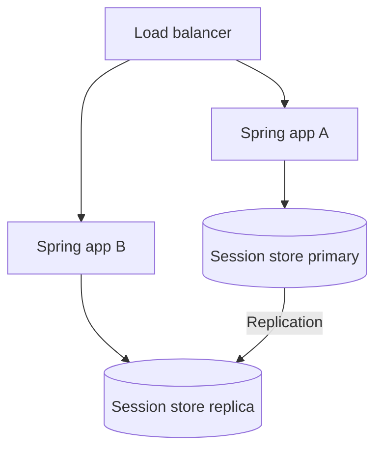

# Phiên trên replica, độ trễ sao chép và dữ liệu cũ

Spring Session cho phép nhiều instance ứng dụng dùng chung trạng thái `HttpSession` thông qua Redis, JDBC hoặc repository tương thích. Tuy nhiên, “dùng chung một kho” chưa đủ để bảo đảm mọi request đọc được phiên bản dữ liệu mới nhất. Nếu kho dữ liệu có primary/replica và sao chép bất đồng bộ, một request có thể ghi session vào primary rồi request kế tiếp đọc từ replica chưa bắt kịp.

Dữ liệu session thường chứa thông tin xác thực, principal, quyền truy cập, trạng thái quy trình và thời điểm hoạt động cuối. Một lần đọc cũ có thể khiến người dùng bị đăng xuất nhầm, tiếp tục dùng phiên đã bị thu hồi, mất cập nhật hoặc thấy trạng thái không nhất quán giữa các instance. Vì vậy, cần thiết kế đường đọc/ghi session theo yêu cầu nhất quán, hiểu giới hạn của replication và kiểm thử tình huống lag/failover.

## 1. Phân biệt replica ứng dụng và replica dữ liệu

Một hệ thống nhiều instance thường có hai loại replica:

| Loại replica | Nội dung được nhân bản | Mục tiêu |
|---|---|---|
| Application replica | Tiến trình Spring Boot, cấu hình và code | Tăng khả năng phục vụ, scale ngang |
| Data replica | Dữ liệu Redis/database được sao chép từ primary | Tăng khả năng đọc hoặc dự phòng khi node lỗi |

Nhiều application replica có thể cùng kết nối một session store primary. Khi đó, session được chia sẻ qua kho dữ liệu chung và các node có thể đọc cùng trạng thái.

Nếu session store cũng có replica, mỗi replica dữ liệu có thể có độ trễ sao chép. Một instance ứng dụng có thể đọc primary trong khi instance khác đọc replica. Khi đó, hai request mang cùng cookie session có thể thấy hai trạng thái khác nhau.

Sơ đồ khái quát:



Sơ đồ này minh họa tình huống nguy hiểm: ghi và đọc không đi qua cùng nguồn dữ liệu có khả năng cung cấp read-after-write.

## 2. Session được đọc và ghi ở đâu trong vòng đời request?

Trong ứng dụng Servlet, Spring Session thay thế việc lưu session cục bộ của container bằng `SessionRepositoryFilter` và một `SessionRepository` như Redis hoặc JDBC.

Một request điển hình:
1. Trình duyệt gửi cookie chứa session ID.
2. Spring Session resolve ID và gọi repository để tìm session.
3. Spring Security có thể đọc `SecurityContext` từ thuộc tính session.
4. Controller và service đọc hoặc cập nhật thuộc tính.
5. Spring Session lưu thay đổi theo `FlushMode` và `SaveMode` đã cấu hình.
6. Response trả về client; request tiếp theo có thể đến instance khác.

Các thao tác đọc và ghi này có thể diễn ra nhiều lần trong một request. Điều quan trọng là repository phải dùng nguồn dữ liệu phù hợp cho cả quá trình. Nếu `findById` đọc replica trong khi `save` ghi primary, request sau có thể không nhìn thấy dữ liệu vừa lưu.

Với session bảo mật, đường đọc session cũng quan trọng như đường ghi. Một logout chỉ có ý nghĩa nếu request tiếp theo không thể khôi phục lại context đã bị thu hồi từ một bản sao cũ.

## 3. Replication lag là gì?

Replication lag là khoảng trễ giữa thời điểm primary chấp nhận một thay đổi và thời điểm replica áp dụng thay đổi đó.

Ví dụ:
- Tại thời điểm T0, primary lưu session mới.
- Tại T1, ứng dụng gửi response chứa cookie session ID.
- Tại T2, request tiếp theo được chuyển sang instance đọc replica.
- Tại T2, replica chưa nhận hoặc chưa áp dụng thay đổi từ T0.
- `findById` trên replica trả về không tìm thấy session.

Đây là lỗi read-after-write: một lần đọc sau lần ghi của cùng luồng nghiệp vụ lại không nhìn thấy kết quả vừa ghi.

Replication lag có thể do mạng, tải ghi cao, checkpoint hoặc log replay chậm, replica đang khởi động lại, I/O bị nghẽn hoặc quá trình failover. Độ trễ có thể tăng đột biến trong thời gian sự cố dù bình thường chỉ vài mili giây.

Không nên coi replication lag là một con số cố định. Hệ thống cần đo lag, đặt ngưỡng cảnh báo và quyết định hành vi khi vượt ngưỡng.

## 4. Những loại dữ liệu session dễ bị ảnh hưởng

Các thuộc tính session có mức độ rủi ro khác nhau:

| Dữ liệu | Hậu quả khi đọc bản cũ |
|---|---|
| `SPRING_SECURITY_CONTEXT` | Người dùng có thể bị xem là anonymous hoặc vẫn mang quyền cũ |
| Trạng thái logout/revocation | Phiên đã thu hồi có thể bị chấp nhận lại |
| `lastAccessedTime` | Timeout có thể bị tính sai hoặc session bị xem là cũ |
| Trạng thái giỏ hàng/quy trình | Mất cập nhật hoặc hiển thị bước cũ |
| Session attribute mới | Request sau không thấy dữ liệu vừa ghi |
| Principal index | Tìm kiếm session theo người dùng có thể thiếu hoặc trả kết quả cũ |
| Dữ liệu expiration/event | Cleanup và xử lý vòng đời có thể bị trễ |

Session không nên là nguồn dữ liệu duy nhất cho giao dịch nghiệp vụ quan trọng. Đơn hàng, thanh toán, số dư và quyền sở hữu dữ liệu cần nằm trong kho nghiệp vụ với transaction và quy tắc nhất quán tương ứng.

## 5. Redis replication và session store

Redis replication thường hoạt động bất đồng bộ: primary xử lý lệnh ghi trước, sau đó truyền các thay đổi đến replica. Replica có thể phục vụ đọc nếu client được cấu hình như vậy, nhưng dữ liệu đọc có thể chậm hơn primary.

Với Spring Session Redis:
- Ghi session được gửi đến primary.
- Nếu client đọc từ replica, `findById` có thể thấy trạng thái trước đó.
- Session vừa tạo có thể chưa xuất hiện trên replica.
- Thuộc tính vừa cập nhật có thể chưa được phản ánh.
- Lệnh xóa hoặc thay đổi TTL có thể chưa được replica áp dụng.
- Principal index có thể chưa phản ánh đầy đủ thay đổi gần nhất.

Redis repository không tự biến replication bất đồng bộ thành strong consistency. Việc sử dụng `RedisIndexedSessionRepository` thay cho repository không indexed giúp tra cứu theo principal và xử lý index/event, nhưng không loại bỏ độ trễ replication của Redis topology.

Với session authentication, khuyến nghị chung là để các thao tác đọc/ghi session đi tới primary hoặc một nguồn có read-after-write tương đương, trừ khi ứng dụng chấp nhận rõ ràng dữ liệu cũ và đã có cơ chế kiểm soát.

## 6. Cấu hình Lettuce ưu tiên đọc từ primary

Spring Data Redis với Lettuce cho phép cấu hình hướng đọc thông qua `ReadFrom`. Trong topology có replica, hãy bảo đảm session connection factory không bị cấu hình đọc replica.

Ví dụ khung cấu hình:

```java
@Bean
LettuceConnectionFactory sessionRedisConnectionFactory(
        RedisSentinelConfiguration sentinelConfiguration) {

    LettuceClientConfiguration clientConfiguration =
            LettuceClientConfiguration.builder()
                    .readFrom(ReadFrom.MASTER)
                    .build();

    return new LettuceConnectionFactory(
            sentinelConfiguration,
            clientConfiguration
    );
}
```

Ví dụ minh họa cho topology Sentinel và các phiên bản Spring Data Redis có constructor tương ứng. Cần điều chỉnh theo phiên bản đang dùng và topology thực tế (standalone, Sentinel hay Cluster). Với session store, không chọn `REPLICA` hoặc `REPLICA_PREFERRED` chỉ để giảm tải đọc nếu cần read-after-write cho đăng nhập, logout và thu hồi session.

Nếu ứng dụng có một Redis connection factory dùng chung cho cache đọc ít nhạy cảm và session, hãy cân nhắc tách cấu hình connection/session store. Một chính sách đọc replica phù hợp với cache sản phẩm không nhất thiết phù hợp với `SecurityContext`.

## 7. JDBC primary/replica và routing DataSource

Với Spring Session JDBC, repository dùng `DataSource` để đọc và ghi các bảng session. Nếu ứng dụng dùng `AbstractRoutingDataSource` hoặc proxy phân luồng truy vấn, các lệnh đọc session có thể bị chuyển sang read replica ngoài ý muốn.

Một tình huống thường gặp:
- `INSERT` hoặc `UPDATE` session đi tới primary.
- `SELECT` session đi tới replica do transaction được đánh dấu read-only hoặc routing rule.
- Replica chưa replay transaction ghi.
- Request tiếp theo không tìm thấy session hoặc thấy thuộc tính cũ.

Với session repository, không nên phân loại mọi câu SELECT là có thể đọc replica. Một truy vấn session có thể cần nhìn thấy ngay lần ghi vừa commit, hoặc cần thấy logout/revocation mới nhất.

Khi có nhiều DataSource, có thể đánh dấu riêng nguồn dùng cho Spring Session bằng `@SpringSessionDataSource` và cấu hình nó trỏ đến writer endpoint. Các repository nghiệp vụ vẫn có thể dùng routing read/write riêng, nhưng session repository nên có đường kết nối nhất quán được xác định rõ.

## 8. Ví dụ tách session DataSource khỏi read routing

Ví dụ cấu hình:

```java
@Configuration(proxyBeanMethods = false)
public class SessionDataSourceConfiguration {

    @Bean
    @SpringSessionDataSource
    DataSource sessionDataSource(
            @Value("${app.datasource.session.writer-url}") String url,
            @Value("${app.datasource.session.username}") String username,
            @Value("${app.datasource.session.password}") String password) {

        return DataSourceBuilder.create()
                .url(url)
                .username(username)
                .password(password)
                .build();
    }
}
```

Cấu hình `writer-url` cần trỏ đến primary/writer endpoint hoặc một endpoint có semantics read-after-write được database bảo đảm. Không trỏ session repository vào load balancer đọc chỉ chọn replica tùy tải.

Nếu ứng dụng dùng nhiều transaction manager, xác nhận transaction manager của Spring Session gắn với đúng session DataSource. Một routing DataSource ở bên dưới vẫn có thể chuyển truy vấn sang replica; qualifier chỉ chọn bean, không tự bảo đảm target là primary.

## 9. Kịch bản lỗi: đăng nhập thành công nhưng request sau thành anonymous

Một luồng phổ biến:
1. Người dùng gửi credential đến node A.
2. Spring Security xác thực thành công và lưu `SecurityContext` trong session.
3. Spring Session ghi session vào primary.
4. Response trả cookie session ID.
5. Request tiếp theo đến node B.
6. Node B đọc session từ replica chưa đồng bộ.
7. Repository trả về không có session hoặc dữ liệu cũ.
8. Spring Security xử lý request như chưa đăng nhập.

Triệu chứng thường là login trả thành công nhưng request kế tiếp bị redirect về login hoặc trả 401/403. Vấn đề có thể chỉ xuất hiện ngay sau login, khi request được chuyển node hoặc khi tải tăng.

Biện pháp:
- Đọc session từ primary.
- Dùng cùng repository/namespace và cookie config trên mọi instance.
- Xác nhận ghi session hoàn tất trước khi response được commit theo cấu hình filter.
- Không chuyển session read sang replica theo routing rule chung.
- Kiểm thử request kế tiếp ngay sau login qua một instance khác.

Sticky session có thể làm triệu chứng ít xuất hiện nếu request quay lại node vừa xử lý login, nhưng không giải quyết read-after-write khi node đó cũng đọc replica hoặc khi failover.

## 10. Kịch bản lỗi: logout nhưng phiên vẫn được chấp nhận

Logout thường invalidate session hoặc xóa dữ liệu session khỏi repository. Nếu request sau đó đọc từ replica chưa nhận lệnh xóa, replica có thể còn bản ghi cũ.

Đối với Spring Security, đây là rủi ro nghiêm trọng hơn việc hiển thị dữ liệu cũ: `SecurityContext` có thể vẫn được khôi phục từ trạng thái chưa cập nhật nếu đường đọc cho phép điều đó.

Quy trình cần bảo đảm:
1. Logout xóa hoặc thu hồi session trên nguồn có thẩm quyền.
2. Request được bảo vệ đọc trạng thái từ nguồn có tính nhất quán phù hợp.
3. Nếu dùng admission/revocation store riêng, kiểm tra trạng thái thu hồi trước thao tác nhạy cảm.
4. Event đóng WebSocket hoặc dọn dữ liệu có thể đến trễ nhưng không được là lớp kiểm soát quyền duy nhất.

Đừng dựa vào việc cookie bị xóa ở trình duyệt. Cookie cũ có thể được gửi lại, bị sao chép hoặc đã nằm trong request đồng thời. Quyết định xác thực phải dựa trên trạng thái server-side có thẩm quyền.

## 11. Kịch bản lỗi: cập nhật session bị mất hoặc bị ghi đè

Replication lag là một dạng dữ liệu cũ; nó khác với lost update do hai request cùng ghi. Hai request có thể cùng đọc một session, mỗi request sửa một thuộc tính rồi ghi theo thứ tự khác nhau. Nếu một request ghi toàn bộ trạng thái cũ sau request kia, thay đổi mới hơn có thể bị ghi đè.

Các nguyên nhân cần phân biệt:
- Replica chưa nhận thay đổi: stale read.
- Hai request cùng sửa một session: concurrent update.
- `SaveMode` ghi lại nhiều thuộc tính hơn cần thiết: write amplification hoặc ghi đè thuộc tính.
- `FlushMode` quyết định thời điểm ghi: thay đổi có thể chưa được đẩy xuống store.
- Failover làm mất một số ghi đã được primary xác nhận: durability/RPO issue.

`SaveMode.ON_SET_ATTRIBUTE` có thể giảm ghi lại thuộc tính không thay đổi, nhưng không biến nhiều request thành transaction tuần tự. `FlushMode.IMMEDIATE` đẩy thay đổi sớm hơn, nhưng không bảo đảm replica đã nhận dữ liệu trước request tiếp theo.

Cần xử lý stale read, concurrent update và replication durability như ba bài toán riêng.

## 12. TTL, expiration và replication

Spring Session thường đặt thời hạn session dựa trên `maxInactiveInterval`. Với Redis, key có TTL; với JDBC, repository lưu thông tin hết hạn và cleanup task xóa dữ liệu hết hạn.

Khi có replica:
- Thay đổi TTL hoặc thao tác xóa cần được replicate.
- Replica có thể chưa phản ánh expiration/delete mới nhất.
- Expiration event có thể đến trễ so với thời điểm timeout logic.
- Cleanup vật lý có thể chạy sau khi repository đã xem session là hết hạn.
- Nếu đọc từ replica, ứng dụng có thể quan sát trạng thái cũ trong khoảng lag.

Không đồng nhất “key còn tồn tại” với “session còn hợp lệ”. Repository phải kiểm tra timeout theo semantics của nó. Tuy nhiên, nếu repository đang đọc replica, dữ liệu đầu vào cho phép kiểm tra đó cũng có thể cũ.

Với session bảo mật, đọc từ primary vẫn là lựa chọn đơn giản và an toàn hơn. Với hệ thống có yêu cầu rất nghiêm ngặt, cần kiểm tra trạng thái thu hồi/expiration từ một nguồn có consistency phù hợp trước khi cấp quyền.

## 13. Failover có thể làm mất ghi đã xác nhận

Đọc primary giải quyết read-after-write trong trạng thái primary ổn định, nhưng không tự giải quyết mọi tình huống failover.

Trong replication bất đồng bộ:
1. Primary nhận và xác nhận một lần ghi.
2. Ghi chưa được replica áp dụng.
3. Primary gặp sự cố.
4. Một replica được thăng cấp thành primary.
5. Ghi cuối cùng có thể không có trên primary mới.

Hệ quả:
- Session vừa tạo có thể biến mất.
- Logout hoặc revocation mới nhất có thể bị mất.
- Thay đổi quyền hoặc thuộc tính session có thể quay về phiên bản cũ.
- Admission state có thể không khớp với session repository.

Đây là vấn đề durability và recovery point objective (RPO), không chỉ là read routing. Cần đánh giá chính sách replication, persistence, failover và mức độ mất dữ liệu có thể chấp nhận của Redis/database.

Redis có các cơ chế như `WAIT` để chờ một số replica xác nhận đã nhận ghi, nhưng đây không phải bảo đảm consensus hoặc durable commit tuyệt đối trong mọi kiểu lỗi. Với database, có thể cấu hình synchronous replication hoặc cơ chế quorum tùy engine, nhưng phải đánh giá latency, availability và semantics cụ thể.

## 14. Đặt yêu cầu consistency theo loại thao tác

Không phải mọi session read đều cần cùng mức consistency. Có thể phân loại:

| Thao tác | Mức nhất quán nên ưu tiên | Lý do |
|---|---|---|
| Sau login | Read-your-writes | Request kế tiếp phải thấy session và SecurityContext mới |
| Sau logout | Strong/latest state hoặc revocation check | Tránh chấp nhận lại phiên đã thu hồi |
| Sau session ID rotation | Read-your-writes | ID mới phải resolve được; ID cũ không được tiếp tục dùng |
| Cập nhật giỏ hàng tạm | Tùy nghiệp vụ, nhưng cần xử lý concurrent update | Có thể chấp nhận eventual consistency nếu không gây sai dữ liệu |
| Đọc thông tin hiển thị không nhạy cảm | Có thể chấp nhận stale read | Rủi ro thấp hơn nếu dữ liệu không điều khiển quyền |
| Kiểm tra session còn hợp lệ | Nguồn có thẩm quyền | Quyết định xác thực không nên dựa vào bản sao cũ |

Nếu không thể phân loại, hãy xem session repository là dữ liệu có yêu cầu consistency cao vì nó có thể chứa danh tính và quyền truy cập.

## 15. Chiến lược đọc: primary, replica hoặc read-your-writes

Có ba chiến lược tổng quát:

**Đọc primary cho mọi thao tác session.** Đây là cách đơn giản nhất để có read-after-write khi primary hoạt động ổn định. Nó tăng tải đọc trên primary nhưng dễ giải thích và kiểm thử.

**Đọc replica cho session.** Chỉ phù hợp nếu chấp nhận dữ liệu cũ, không dùng session read để quyết định xác thực/thu hồi và có cơ chế xử lý lag. Thường không phù hợp với session authentication.

**Read-your-writes routing.** Sau khi một request ghi session, các request tiếp theo của cùng session được ghim đọc primary cho đến khi replica bắt kịp. Cách này phức tạp: cần token/version hoặc affinity có thời hạn, xử lý nhiều instance, failover và logout. Nó vẫn cần đường đọc primary cho thao tác nhạy cảm hoặc khi không thể chứng minh replica đã bắt kịp.

Đừng triển khai read-your-writes chỉ bằng sticky session nếu mỗi node vẫn có thể chọn replica khác nhau. Cần một tín hiệu nhất quán được chia sẻ và có semantics rõ ràng.

## 16. Cấu hình và kiểm soát đường đọc trong ứng dụng

Các nguyên tắc cấu hình:
- Dùng connection factory riêng cho session nếu cache nghiệp vụ cần đọc replica.
- Với Lettuce, kiểm tra `ReadFrom` và pin session reads vào master/primary.
- Với JDBC, trỏ session DataSource tới writer endpoint; tránh routing SELECT sang read replica.
- Không đặt session repository sau một proxy/load balancer không có read-after-write guarantee.
- Dùng cùng namespace, schema, table name và serializer trên mọi instance.
- Không fallback sang local in-memory session khi shared store lỗi.
- Khi failover, xác minh node mới là writer và mọi instance dùng topology mới.
- Đặt timeout kết nối và retry có giới hạn; không retry vô hạn trong request.

Một cấu hình đúng ở một node nhưng khác ở node khác vẫn tạo ra dữ liệu không nhất quán ở cấp ứng dụng. Quản lý cấu hình theo cùng một nguồn và kiểm tra drift khi triển khai.

## 17. Khi nào có thể dùng read replica?

Replica có thể phù hợp cho các truy vấn phân tích hoặc màn hình vận hành không quyết định tính hợp lệ của session, ví dụ báo cáo số lượng phiên gần đúng. Tuy nhiên, các truy vấn này phải chấp nhận độ trễ và không được dùng kết quả để cho phép hoặc từ chối truy cập.

Nếu cần hiển thị danh sách thiết bị đăng nhập, có thể hiển thị dữ liệu gần đúng và ghi rõ thời điểm cập nhật; thao tác thu hồi thực tế vẫn phải ghi vào primary/coordinator có thẩm quyền và request sau đó phải kiểm tra trạng thái mới nhất.

Không dùng replica để:
- Xác minh session ID vừa được tạo.
- Xác nhận logout đã có hiệu lực.
- Quyết định session fixation hoặc rotation thành công.
- Kiểm tra quyền truy cập nhạy cảm từ SecurityContext vừa thay đổi.
- Quyết định admission cho giới hạn phiên nếu dữ liệu có thể cũ.

Tách truy vấn báo cáo khỏi đường xử lý request bảo mật giúp giảm tải mà không làm suy yếu quyết định xác thực.

## 18. Quan sát replication lag và stale reads

Theo dõi cả tầng datastore và tầng ứng dụng.

**Redis:**
- Vai trò primary/replica và trạng thái link.
- Replication offset và độ chênh giữa primary/replica.
- Thời gian từ khi ghi đến khi replica áp dụng.
- Failover, reconnect và số lần đổi primary.
- Command latency, timeout và error rate.
- Các chỉ số keyspace/TTL và session lookup miss.

**JDBC/database:**
- Replication/replay lag theo engine.
- WAL/LSN hoặc log position của primary và replica nếu database hỗ trợ.
- Transaction commit latency.
- Query latency và connection pool.
- Số lần session lookup không tìm thấy ngay sau login.
- Tỷ lệ request bị anonymous ngay sau xác thực.
- Logout/revocation propagation delay.

**Ứng dụng Spring Session:**
- Tỷ lệ session create/find/save/delete lỗi.
- Tỷ lệ `findById` miss theo node.
- Lỗi serialization.
- Session timeout và số lần login lại bất thường.
- Chênh lệch hành vi giữa các application instance.
- Thời gian từ logout đến khi request tiếp theo bị từ chối.

Không log session ID, cookie, access token hoặc toàn bộ SecurityContext. Dùng mã tham chiếu đã che hoặc hash có kiểm soát để liên kết sự kiện.

## 19. Kiểm thử replication lag có chủ đích

Một test chỉ chạy trên primary đơn lẻ không phát hiện lỗi stale replica. Cần môi trường có primary và replica thật hoặc một mô phỏng replication delay có kiểm soát.

**Kịch bản read-after-write:**
1. Đăng nhập qua instance A.
2. Xác nhận session được ghi vào primary.
3. Tạo độ trễ replicate hoặc tạm ngăn replica áp dụng dữ liệu.
4. Gửi request ngay sau login qua instance B.
5. Xác nhận session repository đọc primary và khôi phục SecurityContext.
6. Nếu cố ý cấu hình đọc replica trong một test riêng, xác nhận test phát hiện session miss để chứng minh rủi ro.

**Kịch bản logout/revocation:**
1. Tạo session và xác thực.
2. Logout trên primary.
3. Giữ replica chậm.
4. Gửi request với cookie cũ qua một instance khác.
5. Xác nhận đường đọc có thẩm quyền từ chối session.
6. Kiểm tra event cleanup/close socket có thể đến trễ nhưng không cho phép request nhạy cảm tiếp tục.

**Kịch bản failover:**
1. Tạo session hoặc logout.
2. Mô phỏng primary lỗi trước khi replica nhận ghi cuối.
3. Promote replica.
4. Kiểm tra session state và hành vi bảo mật.
5. Đo mức mất dữ liệu và xác nhận hệ thống xử lý theo RPO đã chọn.

Dùng Testcontainers hoặc môi trường tích hợp tương đương với topology thực tế. Một mock `RedisConnectionFactory` hay mock DataSource không mô phỏng replication lag và failover.

## 20. Xử lý khi session store không truy cập được

Không nên tự động chuyển sang session cục bộ khi Redis/JDBC primary lỗi. Nếu một node tạo session cục bộ trong khi node khác dùng shared store, người dùng sẽ có trạng thái khác nhau tùy request được định tuyến đến đâu.

Chính sách nên rõ:
- Với login mới, có thể từ chối đăng nhập khi không thể lưu session bền vững.
- Với request đã xác thực, nếu không thể kiểm tra session/revocation theo yêu cầu bảo mật, cân nhắc fail-closed cho thao tác nhạy cảm.
- Trả lỗi dịch vụ phù hợp và ghi metric.
- Retry có giới hạn và backoff; tránh retry đồng loạt làm datastore quá tải.
- Sau failover, xác minh topology và writer endpoint trước khi tiếp tục lưu.
- Không xóa cookie hoặc tạo session mới một cách âm thầm khi nguyên nhân là datastore tạm thời lỗi.

Nếu sản phẩm chọn fail-open vì tính sẵn sàng, cần ghi nhận rõ giới hạn bảo mật và có cơ chế thu hồi/bù trừ sau khi kho phục hồi. Không gọi đó là bảo đảm consistency.

## 21. Phân biệt stale read với clock skew và concurrent update

Ba lỗi có thể tạo triệu chứng gần giống nhau:

| Hiện tượng | Nguyên nhân | Dấu hiệu |
|---|---|---|
| Stale read | Replica chưa nhận dữ liệu mới | Primary có phiên bản mới, replica trả phiên bản cũ |
| Clock skew | Đồng hồ node lệch nhau | Timeout hoặc timestamp khác biệt dù cùng dữ liệu |
| Concurrent update | Hai request ghi cùng session | Một thay đổi bị ghi đè theo thứ tự commit |

Cách chẩn đoán:
1. Ghi lại node xử lý request và datasource/Redis node thực tế.
2. So sánh trạng thái cùng session trên primary và replica bằng công cụ an toàn.
3. Kiểm tra thời gian commit và replication offset.
4. Kiểm tra đồng hồ hệ thống và thời gian database.
5. Tìm request đồng thời dùng cùng session ID.
6. Kiểm tra SaveMode/FlushMode và thứ tự save.
7. Tái hiện bằng integration test có barrier và replication delay.

Không giải quyết stale read bằng cách tăng `maxInactiveInterval` hoặc thay SaveMode nếu nguyên nhân thực sự là read routing.

## 22. Quy trình triển khai nhất quán cho Spring Session

Một quy trình triển khai có thể áp dụng:

1. Xác định session có chứa SecurityContext, trạng thái thu hồi hay dữ liệu nhạy cảm nào.
2. Chọn primary/writer endpoint làm nguồn đọc và ghi có thẩm quyền.
3. Tách session DataSource/connection factory khỏi routing phục vụ cache hoặc báo cáo nếu cần.
4. Cấu hình Lettuce `ReadFrom.MASTER` hoặc writer DataSource tương ứng.
5. Đồng bộ namespace, schema, cookie, serializer và session timeout giữa mọi instance.
6. Kiểm tra session create/find/save/delete trên đúng node dữ liệu.
7. Kiểm thử read-after-write sau login, logout và session ID rotation.
8. Đặt ngưỡng replication lag và cảnh báo failover.
9. Đánh giá RPO/RTO và durability của session store.
10. Có runbook xác minh writer sau failover và kiểm tra session state trước khi mở lại traffic.

Nếu cần dùng replica cho báo cáo, tạo đường đọc riêng và không dùng kết quả đó cho quyết định xác thực. Không để một cấu hình read preference chung vô tình áp dụng cho session repository.

## 23. Checklist trước khi phát hành

- Mọi application replica dùng cùng session repository và namespace.
- Session writes đi đến primary/writer.
- Session reads cần tính mới cũng đi đến primary/writer.
- Không route session SELECT sang read replica chỉ vì câu lệnh là read-only.
- Không dựa vào sticky session làm cơ chế nhất quán.
- Logout và revocation được kiểm tra từ nguồn có thẩm quyền.
- Session ID rotation được kiểm thử qua nhiều node.
- TTL, cleanup và expiration event có chính sách rõ.
- SaveMode/FlushMode được chọn theo cách cập nhật thuộc tính, không dùng để thay thế consistency.
- Failover và khả năng mất ghi đã được đánh giá theo RPO.
- Có metric replication lag, session lookup miss và logout propagation.
- Có integration test với lag, stale read và primary failover.
- Không fallback âm thầm sang local session khi shared store lỗi.

Spring Session chia sẻ trạng thái giữa các application replica thông qua repository, nhưng độ nhất quán cuối cùng còn phụ thuộc topology và chính sách đọc/ghi của Redis hoặc database. Replication lag có thể làm request sau login không thấy session mới, hoặc khiến request sau logout đọc được trạng thái cũ. Với dữ liệu xác thực và thu hồi, hãy dùng primary/writer hoặc một cơ chế read-after-write có bảo đảm tương đương; đánh giá riêng durability khi failover, đồng bộ cấu hình mọi instance và kiểm thử stale reads trên topology thực tế.

