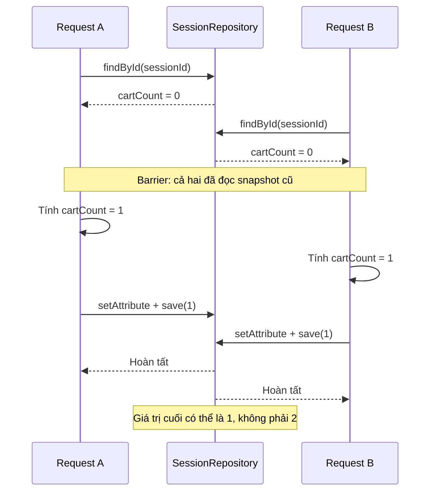

# Kiểm thử các lịch thực thi gây lỗi thay vì chỉ tăng số luồng

Một bài kiểm thử đồng thời có giá trị không chỉ tạo thật nhiều thread rồi hy vọng lỗi xuất hiện. Với Spring Session, nhiều lỗi chỉ xảy ra khi các request đọc cùng một phiên, tạm dừng ở những thời điểm cụ thể, rồi ghi hoặc xóa theo một thứ tự nhất định. Nếu không kiểm soát được thứ tự đó, test có thể chạy hàng nghìn lần mà vẫn bỏ sót lost update, ghi đè attribute, session hồi sinh sau logout hoặc sai lệch khi hết hạn.

Cách kiểm thử đáng tin cậy là mô tả **lịch thực thi** (execution schedule): request nào đọc trước, request nào thay đổi dữ liệu, thao tác nào bị giữ lại, lúc nào được phép ghi và kết quả cuối phải thỏa bất biến nào. Dùng barrier, latch, hook trong test hoặc repository giả lập để buộc các request đi qua đúng thứ tự. Sau đó kiểm tra trạng thái được đọc lại từ repository, không chỉ object trong bộ nhớ của request.

## 1. Vì sao tăng số thread chưa đủ?

Giả sử một session chứa `cartCount = 0`. Hai request A và B cùng đọc session. Mỗi request tăng số lượng lên một rồi lưu. Lịch thực thi có thể là:

1. A đọc `cartCount = 0`.
2. B đọc `cartCount = 0`.
3. A tính giá trị mới là 1.
4. B cũng tính giá trị mới là 1.
5. A lưu 1.
6. B lưu 1.

Hai request đều hoàn tất thành công, nhưng giá trị cuối là 1 thay vì 2. Đây là *lost update*. Việc chạy test với 100 thread không đảm bảo hai request đọc cùng snapshot trước khi một request ghi xong. Scheduler có thể vô tình chạy A hoàn toàn trước B trong mọi lần thử.

Một bài test tốt phải buộc A và B cùng đọc giá trị cũ trước khi cho bất kỳ request nào lưu. Khi đó, test tái hiện được điều kiện gây lỗi thay vì phụ thuộc may rủi của hệ điều hành.

## 2. Phân biệt tải đồng thời với lịch thực thi

Hai khái niệm phục vụ hai mục tiêu khác nhau:

| Kỹ thuật | Câu hỏi được trả lời | Điểm yếu nếu dùng riêng |
|---|---|---|
| Tăng số thread/request | Hệ thống chịu được bao nhiêu tải? | Không bảo đảm một race condition cụ thể xảy ra |
| Lặp test nhiều lần | Lỗi có xuất hiện ngẫu nhiên không? | Kết quả không ổn định, khó tái hiện và chẩn đoán |
| Điều khiển lịch bằng latch/barrier | Có tái hiện đúng thứ tự thao tác gây lỗi không? | Cần biết điểm cần đồng bộ trong luồng xử lý |
| Fault injection/delay hook | Hệ thống phản ứng thế nào khi một thao tác bị chậm hoặc lỗi? | Hook phải đặt ở đúng ranh giới và chỉ dùng trong test |
| Kiểm thử nhiều instance | Trạng thái có nhất quán qua các node không? | Cần môi trường chia sẻ repository gần với production |

Load test vẫn hữu ích để đo throughput, latency và giới hạn tài nguyên. Nhưng để chứng minh một bất biến đồng thời, trước hết cần kiểm soát thứ tự đọc–sửa–ghi hoặc xóa–lưu.

## 3. Các điểm đồng bộ cần quan sát trong Spring Session

Trong ứng dụng Servlet, request thường đi qua `SessionRepositoryFilter`, đọc session từ `SessionRepository`, sửa `HttpSession` rồi lưu thay đổi theo `SaveMode` và `FlushMode`. Trong WebFlux, các thao tác tương ứng diễn ra qua `WebSession`, `ReactiveSessionRepository` và reactive chain.

Các điểm đáng đặt test hook:

- Sau khi repository đã tải session, trước khi handler đọc hoặc sửa attribute.
- Sau khi đọc một attribute, trước khi tính giá trị mới.
- Sau khi thay đổi attribute, trước khi `save()` hoặc flush.
- Trước và sau `deleteById()` hoặc `invalidate()`.
- Trước khi `changeSessionId()` hoàn tất và trước khi response gửi cookie mới.
- Trước khi repository cập nhật last-access time/expiry hoặc cleanup xóa phiên hết hạn.
- Trước khi response commit, khi session thay đổi còn cần được lưu.

Không cần thêm hook vào production code chỉ để test nếu có thể dùng một repository decorator, test service hoặc latch ở tầng nghiệp vụ. Nếu cần hook trong ứng dụng, hãy đặt sau một abstraction nhỏ và bảo đảm cấu hình đó chỉ được bật trong test.

## 4. Lịch A/B gây lost update trên cùng attribute

Đây là lịch cơ bản nhất cần có trong bộ test session:



Với `SaveMode.ON_SET_ATTRIBUTE`, cả hai request đều gọi `setAttribute("cartCount", ...)`, nên repository có thể ghi cùng attribute theo thứ tự lưu. Lần ghi cuối có thể ghi đè giá trị của request kia. `ON_SET_ATTRIBUTE` giảm ghi những attribute không đổi; nó không cung cấp phép cộng nguyên tử và không giải quyết lost update trên cùng một attribute.

Ví dụ helper test dùng `CountDownLatch` để buộc cả hai request đọc trước khi lưu:

```java
static <S extends Session> Callable<Void> incrementFromSnapshot(
        SessionRepository<S> repository,
        String sessionId,
        CountDownLatch bothRead,
        CountDownLatch allowSave) {

    return () -> {
        S session = repository.findById(sessionId);
        Integer current = session.getAttribute("cartCount");

        // Báo rằng request đã đọc xong snapshot.
        bothRead.countDown();

        // Chờ test điều phối cho phép cả hai request tiếp tục.
        if (!allowSave.await(5, TimeUnit.SECONDS)) {
            throw new TimeoutException("Không nhận được tín hiệu cho phép save");
        }

        session.setAttribute("cartCount", current + 1);
        repository.save(session);
        return null;
    };
}
```

Phần điều phối test:

```java
CountDownLatch bothRead = new CountDownLatch(2);
CountDownLatch allowSave = new CountDownLatch(1);

Future<Void> a = pool.submit(incrementFromSnapshot(
        repository, sessionId, bothRead, allowSave));
Future<Void> b = pool.submit(incrementFromSnapshot(
        repository, sessionId, bothRead, allowSave));

assertTrue(bothRead.await(5, TimeUnit.SECONDS));
allowSave.countDown();

a.get(5, TimeUnit.SECONDS);
b.get(5, TimeUnit.SECONDS);

S finalSession = repository.findById(sessionId);
assertEquals(1, (Integer) finalSession.getAttribute("cartCount"));
```

Đây là test minh họa cho repository đang được cấu hình để trả về cùng kiểu `S`; trong test thực tế cần khởi tạo session ban đầu với `cartCount = 0`, tạo thread pool đủ hai worker và dọn executor trong `finally`. Test cố ý chứng minh lost update của cách đọc–sửa–ghi không có đồng bộ. Nếu ứng dụng có cơ chế chống lost update, thay assertion cuối bằng bất biến mà cơ chế đó cam kết, ví dụ kết quả là 2 hoặc một request nhận conflict và được retry.

`CountDownLatch.await()` chặn hai worker test, không phải event-loop hoặc thread phục vụ production request. Đặt timeout cho mọi barrier để test thất bại rõ ràng thay vì treo vô hạn.

## 5. Lịch cập nhật hai attribute khác nhau

Một lịch khác kiểm tra xem hai request cập nhật hai attribute riêng có ghi đè nhau hay không:

1. A và B cùng tải session có `theme = light`, `locale = vi-VN`.
2. A chỉ đổi `theme = dark`.
3. B chỉ đổi `locale = en-US`.
4. Cả hai cùng lưu.
5. Request thứ ba đọc lại session.

Kết quả mong đợi của nghiệp vụ có thể là cả hai thay đổi cùng tồn tại. Tuy nhiên, hành vi phụ thuộc `SaveMode`, cách repository theo dõi attribute đã đổi và câu lệnh cập nhật của implementation. Với `ON_SET_ATTRIBUTE`, repository thường chỉ cần ghi attributes được đặt; với `ALWAYS`, repository có thể ghi toàn bộ attributes trong snapshot. Khi hai snapshot cũ được lưu xen kẽ, một implementation có thể ghi đè thay đổi khác nếu nó ghi cả tập attribute.

Không suy luận hành vi chỉ từ tên SaveMode. Hãy viết cùng một lịch test cho các chế độ mà ứng dụng có thể triển khai:

| SaveMode | Điều cần quan sát |
|---|---|
| `ON_SET_ATTRIBUTE` | A và B chỉ ghi attribute đã set; kiểm tra hai cập nhật riêng có cùng tồn tại không |
| `ON_GET_ATTRIBUTE` | Attribute được đọc cũng có thể được ghi; kiểm tra khả năng ghi lại snapshot cũ |
| `ALWAYS` | Tất cả attributes được lưu; kiểm tra việc snapshot cũ có ghi đè cập nhật từ request kia không |

Đây là kiểm thử hành vi của repository và phiên bản cụ thể, không phải khẳng định mọi implementation đều có cùng lịch ghi. Nếu kết quả khác nhau giữa Redis và JDBC, ghi nhận đó là khác biệt cần xử lý trong thiết kế hoặc cấu hình.

## 6. Lịch remove đối đầu với set

Hai request có thể cùng thao tác một attribute theo hai hướng trái ngược:

- A đọc `cart`, sau đó cập nhật `cart` bằng danh sách mới.
- B đọc cùng snapshot rồi gọi `removeAttribute("cart")`.

Nếu A lưu trước B, attribute có thể bị xóa. Nếu B lưu trước A, attribute có thể xuất hiện lại. Cả hai kết quả đều có thể là “last writer wins” tùy repository và save policy. Nếu nghiệp vụ yêu cầu logout, xóa dữ liệu nhạy cảm hoặc thu hồi quyền không được bị một request cũ ghi lại, cần bất biến mạnh hơn thứ tự lưu thông thường.

Lịch test nên ép hai thứ tự:

1. A set rồi B remove.
2. B remove rồi A set từ snapshot cũ.

Sau mỗi lịch, tải lại session từ repository và xác nhận trạng thái theo chính sách. Đừng chỉ kiểm tra `getAttribute()` trên object A hoặc B, vì hai object có thể là snapshot độc lập.

## 7. Lịch invalidate đối đầu với save từ request cũ

Một tình huống nhạy cảm là request A đã tải session và giữ object trong bộ nhớ, còn request B thực hiện logout:

1. A gọi `findById` và có SecurityContext hợp lệ.
2. A tạm dừng trước khi lưu một thay đổi.
3. B gọi `invalidate()` hoặc `deleteById(sessionId)`.
4. Repository xóa session.
5. A tiếp tục và gọi `save()` trên snapshot cũ.
6. Request mới dùng lại session ID cũ.

Điều cần kiểm chứng là session đã bị thu hồi không được trở thành một phiên xác thực hợp lệ trở lại. Hành vi của thao tác save cũ sau delete phụ thuộc repository, cách implementation phân biệt session mới/cũ và cơ chế lưu attributes. Không giả định Redis và JDBC xử lý race này giống nhau.

Test phải buộc thứ tự `A: read → pause`, `B: invalidate → complete`, `A: save`, rồi tải lại bằng ID cũ. Nếu repository có thể tái tạo key hoặc dữ liệu theo cách làm session sống lại, cần xử lý ở tầng thiết kế: ví dụ dùng revocation generation/epoch, kiểm tra trạng thái thu hồi tại điểm lưu nhạy cảm, hoặc cơ chế khóa/đồng bộ phù hợp. Không chỉ xóa cookie phía client vì A vẫn có thể ghi từ object đã tải.

Nếu ứng dụng yêu cầu logout có hiệu lực tức thời đối với mọi thao tác, cần xác định cả request đang chạy. Invalidate session thường ngăn request mới khôi phục phiên; nó không tự rút SecurityContext đã được request A tải vào bộ nhớ.

## 8. Lịch hết hạn đối đầu với request gia hạn session

Session có timeout dựa trên thời gian không hoạt động. Một request có thể cập nhật `lastAccessedTime` và gia hạn TTL đúng lúc cleanup hoặc expiration xử lý session cũ.

Lịch cần kiểm thử:

1. Tạo session với timeout ngắn.
2. Đưa thời gian đến sát mốc hết hạn hoặc dùng test clock nếu implementation cho phép.
3. Request A bắt đầu đọc session và chuẩn bị cập nhật một attribute.
4. Cleanup/expiration xử lý key hoặc hàng session.
5. A lưu và cập nhật last-access/expiry.
6. Request C dùng session ID cũ để kiểm tra kết quả.

Các bất biến cần xác định:

- Một session đã hết hạn theo chính sách không được khôi phục chỉ vì key vật lý còn tồn tại trong grace period.
- Một request hợp lệ đã bắt đầu trước hạn có được phép gia hạn hay không phải được xác định theo semantics repository và ứng dụng.
- Cleanup không được xóa nhầm session vừa được gia hạn nếu implementation hứa hỗ trợ hành vi đó.
- Sự kiện hết hạn có thể đến trễ so với mốc TTL; test không nên yêu cầu event phát chính xác tại một mili giây cụ thể.

Với Redis, kiểm tra expiration marker, hash session và sorted set nếu repository indexed dùng chúng. Với JDBC, kiểm tra `EXPIRY_TIME`, truy vấn cleanup và transaction/locking. Không dùng `Thread.sleep(1000)` làm cơ chế đồng bộ chính; dùng timeout ngắn có kiểm soát, polling đến điều kiện cuối hoặc clock test nếu có.

## 9. Lịch changeSessionId đối đầu với request đồng thời

Sau đăng nhập, Spring Security có thể đổi session ID để giảm nguy cơ session fixation. Nếu hai request cùng dùng ID cũ trong thời gian đổi ID, cần kiểm tra:

- Request bắt đầu trước khi đổi ID có thể hoàn tất bình thường không?
- Request mới sau khi đổi ID có khôi phục được session bằng ID mới không?
- ID cũ có còn được chấp nhận ngoài chính sách không?
- Hai response trả cookie theo thứ tự ngược nhau có khiến browser giữ ID cũ không?
- Một request dùng snapshot cũ có ghi đè metadata hoặc attributes của session mới không?

Để tái hiện, cho A thực hiện login và đổi ID, giữ response trước khi client cập nhật cookie; đồng thời cho B gửi request bằng cookie cũ. Sau đó đảo thứ tự hoàn tất response để kiểm tra cookie cuối cùng trong client. Cần xác nhận hành vi theo chính sách session fixation protection và implementation resolver đang dùng.

Đừng chỉ assert rằng ID mới khác ID cũ. Cần xác minh ID cũ không thể dùng để khôi phục trạng thái xác thực theo chính sách, ID mới có đầy đủ attributes cần thiết, và cookie cuối cùng client giữ là ID hợp lệ.

## 10. Lịch request trên hai application instance

Một test trong một application context có thể bỏ sót cấu hình lệch giữa các node. Với hệ thống nhiều instance, cần tạo ít nhất hai ứng dụng dùng chung Redis hoặc JDBC:

1. A và B cùng kết nối tới một session store.
2. Request đăng nhập đi qua A và tạo session.
3. Request đọc session đi qua B.
4. A và B đồng thời sửa cùng session theo lịch đã định.
5. Request tiếp theo đọc qua A rồi B để xác nhận cùng trạng thái cuối.
6. Logout đi qua A.
7. Request với cookie cũ đi qua B và phải bị từ chối hoặc trở thành anonymous.

Nếu hai node dùng serializer khác nhau, namespace khác nhau hoặc version class principal không tương thích, lỗi có thể trông giống race condition. Vì vậy, test nhiều node nên kiểm tra cả cấu hình và kết quả repository.

Trong test, có thể chạy hai Spring application context trên port riêng và dùng cùng Testcontainers Redis/database. Định tuyến request trực tiếp tới từng port giúp biết node nào xử lý request. Một load balancer ngẫu nhiên khó tái hiện lịch chính xác và khó chẩn đoán khi test thất bại.

## 11. Điều khiển lịch bằng latch và barrier

Các công cụ Java phù hợp cho test điều phối:

| Công cụ | Cách dùng trong test |
|---|---|
| `CountDownLatch` | Chờ N request đến một điểm; sau đó phát tín hiệu cho chúng tiếp tục |
| `CyclicBarrier` | Buộc một nhóm worker cùng tới một ranh giới trước khi đi tiếp |
| `Phaser` | Điều phối nhiều pha khi test có nhiều vòng đọc, ghi và kiểm tra |
| `Semaphore` | Giới hạn số worker được vào một đoạn xử lý |
| `CompletableFuture`/`Future` | Thu thập kết quả và exception từ các request song song |
| Test repository decorator | Tạm dừng trước/sau `findById`, `save` hoặc `deleteById` |
| Fault injection | Làm một thao tác chậm, timeout hoặc thất bại để kiểm tra recovery |

Mọi wait phải có timeout. Nếu barrier không được giải phóng vì request lỗi trước đó, test cần thất bại với thông báo rõ ràng thay vì treo build. Dọn thread pool trong `finally` và đảm bảo test không để worker sống qua test kế tiếp.

Không đặt `CountDownLatch.await()` trong controller production hoặc trên Reactor event-loop. Đối với WebFlux, dùng `Sinks.One`, `Mono.delay`, `StepVerifier` hoặc test scheduler để điều khiển publisher mà không chặn event-loop. Latch trong test chỉ phù hợp khi nó chặn worker test riêng.

## 12. Ví dụ repository decorator để tạo điểm dừng

Khi không muốn thêm test hook vào service, có thể bọc repository bằng decorator trong test. Ý tưởng là cho phép test chờ sau một thao tác đọc cụ thể:

```java
final class PausingSessionRepository<S extends Session>
        implements SessionRepository<S> {

    private final SessionRepository<S> delegate;
    private final CountDownLatch afterFind;
    private final CountDownLatch continueFind;

    PausingSessionRepository(
            SessionRepository<S> delegate,
            CountDownLatch afterFind,
            CountDownLatch continueFind) {
        this.delegate = delegate;
        this.afterFind = afterFind;
        this.continueFind = continueFind;
    }

    @Override
    public S findById(String id) {
        S session = this.delegate.findById(id);
        this.afterFind.countDown();
        try {
            if (!this.continueFind.await(5, TimeUnit.SECONDS)) {
                throw new IllegalStateException("Test schedule timed out");
            }
        }
        catch (InterruptedException ex) {
            Thread.currentThread().interrupt();
            throw new IllegalStateException("Test worker interrupted", ex);
        }
        return session;
    }

    @Override
    public S createSession() {
        return this.delegate.createSession();
    }

    @Override
    public void save(S session) {
        this.delegate.save(session);
    }

    @Override
    public void deleteById(String id) {
        this.delegate.deleteById(id);
    }
}
```

Đây là khung cho `SessionRepository` đồng bộ; trong test cần thêm mọi method của interface theo phiên bản Spring Session đang dùng. Đối với `ReactiveSessionRepository`, decorator phải giữ kiểu trả về `Mono` và đặt điểm dừng bằng operator reactive, không block. Cũng cần giới hạn việc pause đúng session ID và đúng số lần, tránh làm request kiểm tra cuối cùng bị chặn ngoài ý muốn.

## 13. Kiểm thử reactive mà không chặn event-loop

Với WebFlux, các thao tác session thường trả publisher. Không chuyển chúng thành blocking chỉ để dễ điều khiển test. Có thể dùng `Sinks.One<Void>` làm tín hiệu:

```java
Sinks.One<Void> allowSave = Sinks.one();
Sinks.One<Void> bothLoaded = Sinks.one();
AtomicInteger loaded = new AtomicInteger();

Mono<Void> request = exchange.getSession()
        .flatMap(session -> {
            if (loaded.incrementAndGet() == 2) {
                bothLoaded.tryEmitEmpty();
            }

            return allowSave.asMono()
                    .then(Mono.defer(() -> {
                        session.getAttributes().put("state", "updated");
                        return session.save();
                    }));
        });
```

Đây chỉ là minh họa cơ chế tín hiệu; để có hai request độc lập, test phải subscribe hai publisher request và điều phối bằng `StepVerifier` hoặc test harness WebFlux. Không gọi `.block()` trên event-loop. Nếu cần chờ trong test thread, dùng `StepVerifier` với timeout hoặc chạy kiểm thử trên scheduler/test client phù hợp.

Với `WebTestClient`, có thể gửi hai request song song bằng hai subscription, nhưng để ép chúng cùng đọc một snapshot, cần một hook ở repository/service. Chỉ gửi hai request đồng thời không bảo đảm chúng đã đọc session trước khi một request lưu.

## 14. Kiểm thử các chính sách SaveMode và FlushMode

`SaveMode` quyết định attribute nào được ghi; `FlushMode` quyết định khi nào thay đổi được đẩy xuống repository. Chúng ảnh hưởng số lần ghi và khả năng một snapshot cũ ghi lại dữ liệu.

Các lịch cần có:

- A và B cùng sửa một attribute, cả hai gọi `setAttribute` rồi lưu.
- A và B sửa hai attribute khác nhau.
- A gọi `removeAttribute`, B gọi `setAttribute` cùng tên.
- A chỉ đọc attribute mutable rồi sửa nội bộ; B cập nhật attribute khác.
- A save theo `FlushMode.IMMEDIATE`, B save theo request completion nếu ứng dụng cho phép cấu hình khác nhau giữa test profile.

Chạy test với chính sách mà production sử dụng. Nếu đổi SaveMode hoặc FlushMode, chạy lại các lịch có liên quan vì số lượng và thời điểm ghi thay đổi. Không dùng `ALWAYS` như một cách chữa race; ghi toàn bộ attributes có thể tăng ghi và làm snapshot cũ có thêm cơ hội ghi đè thay đổi khác.

## 15. Xác định bất biến trước khi viết test

Một lịch test cần có kết quả kỳ vọng cụ thể. Nếu chỉ assert “không có exception”, test chưa chứng minh tính nhất quán.

Ví dụ các bất biến có thể định nghĩa:

| Nghiệp vụ | Bất biến |
|---|---|
| Bộ đếm tăng đồng thời | Hai lần tăng được áp dụng đủ, hoặc một request bị conflict rõ ràng để caller retry |
| Hai preference độc lập | Cả hai cập nhật cùng tồn tại nếu nghiệp vụ yêu cầu merge |
| Logout | Session đã invalidate không thể khôi phục SecurityContext qua request mới trên bất kỳ node nào |
| Xóa attribute nhạy cảm | Một request cũ không được ghi lại attribute sau khi thu hồi có hiệu lực |
| Session hết hạn | ID đã hết hạn không được dùng để truy cập tài nguyên, dù key vật lý còn trong grace period |
| Đổi session ID | ID cũ không còn hợp lệ theo chính sách; ID mới giữ đúng attributes cần thiết |
| Multi-instance | Mọi instance nhìn thấy cùng trạng thái cuối từ repository dùng chung |

Một số nghiệp vụ có thể chấp nhận last-write-wins. Khi đó hãy ghi rõ thứ tự nào thắng và test đúng semantics đó. Không phải mọi cập nhật session đều cần merge hoặc transaction mạnh; yêu cầu phải xuất phát từ nghiệp vụ.

## 16. Khi cần cơ chế nhất quán mạnh hơn

Spring Session là nơi lưu trạng thái phiên, không phải cơ chế transaction tổng quát cho mọi cập nhật nghiệp vụ. Nếu hai request cùng sửa một giá trị cần tính chính xác, có thể cần:

- **Optimistic locking:** lưu version và chỉ chấp nhận update nếu version chưa thay đổi; request xung đột phải đọc lại và retry hoặc trả conflict.
- **Pessimistic locking:** khóa hàng hoặc tài nguyên trong thời gian đọc–sửa–ghi, nếu database và thời gian giữ khóa phù hợp.
- **Atomic operation:** dùng phép tăng/đặt có điều kiện ở kho dữ liệu nếu repository/nghiệp vụ hỗ trợ.
- **Single-writer/queue:** tuần tự hóa cập nhật theo session hoặc theo aggregate key.
- **Dữ liệu nghiệp vụ riêng:** chuyển giỏ hàng, số dư, tồn kho hoặc trạng thái giao dịch vào database nghiệp vụ với transaction và constraint phù hợp.

Không thêm khóa phân tán chỉ để che một thiết kế cập nhật không rõ ràng. Khóa cũng cần timeout, fencing/token, xử lý node chết và chính sách retry. Với dữ liệu quan trọng, database transaction và optimistic version thường dễ kiểm chứng hơn việc tự đồng bộ toàn bộ session.

## 17. Không dùng sleep để điều khiển race

Mẫu test sau không đáng tin:

```java
Thread.sleep(100);
```

Sleep chỉ chờ một khoảng thời gian, không chứng minh request kia đã đọc session hoặc đã tới điểm cần kiểm tra. Trên máy chậm, request có thể chưa chạy; trên máy nhanh, nó có thể đã chạy qua cả đoạn cần giữ lại.

Thay bằng tín hiệu có ý nghĩa:

- `bothRead.await(...)`: cả hai request đã đọc xong snapshot.
- `saveStarted.await(...)`: request đã tới ngay trước thao tác save.
- `deleteCompleted.await(...)`: invalidate đã hoàn tất.
- `responseCommitted` hoặc test exchange hook: response đã commit.

Nếu cần kiểm tra thời gian hết hạn, dùng clock test hoặc polling có timeout để chờ điều kiện quan sát được. Không giả định `sleep(timeout)` khiến Redis cleanup hoặc scheduled job hoàn tất đúng ngay sau đó.

## 18. Bộ lịch tối thiểu cho Spring Session

Một bộ regression test tập trung có thể gồm:

| ID | Lịch thực thi | Lỗi cần phát hiện |
|---|---|---|
| C1 | Hai request cùng đọc một attribute rồi cùng ghi | Lost update |
| C2 | Hai request ghi hai attribute khác nhau từ snapshot cũ | Ghi đè ngoài ý muốn do save policy |
| C3 | Một request set, request kia remove cùng attribute | Trạng thái cuối phụ thuộc thứ tự ghi |
| C4 | A đọc, B invalidate, A save stale snapshot | Session có bị hồi sinh sau logout không? |
| C5 | Request chạm session cùng lúc cleanup/expiry | Gia hạn và hết hạn có nhất quán không? |
| C6 | Một request đổi session ID khi request khác còn dùng ID cũ | ID cũ/new cookie có đúng chính sách không? |
| C7 | Hai node cùng cập nhật một session | Cùng repository có thấy một trạng thái cuối không? |
| C8 | Save bị chậm hoặc lỗi trước response commit | Response có báo thành công khi session chưa được lưu không? |
| C9 | Một request cập nhật mutable attribute nhưng không set lại | Dirty tracking có bỏ sót thay đổi không? |
| C10 | Hai request logout/thu hồi cùng lúc | Xóa lặp có an toàn và idempotent không? |

Mỗi test cần lưu lại lịch đã điều phối, cấu hình repository, SaveMode/FlushMode, phiên bản Spring Session và database/Redis. Khi lỗi xảy ra, log test nên ghi mốc sự kiện và request ID thay vì session ID dạng rõ.

## 19. Tách unit test, repository integration test và multi-node test

Không cần chạy mọi lịch trên toàn bộ hệ thống nếu có thể chia theo lớp:

1. **Unit test:** kiểm tra logic merge, version check hoặc service update với latch/barrier.
2. **Repository integration test:** kiểm tra hành vi thật của Redis/JDBC khi hai snapshot cùng lưu, invalidate đối đầu save và expiry cleanup.
3. **Web integration test:** kiểm tra filter, cookie, response commit và session ID qua request thật.
4. **Multi-node test:** kiểm tra hai application context dùng chung kho, serializer và cấu hình.
5. **Load/stress test:** đo throughput, latency và xác suất lỗi dưới tải sau khi các lịch cụ thể đã có regression test.

Dùng Testcontainers hoặc môi trường test gần production cho Redis/database. H2 có thể hữu ích cho test logic JDBC đơn giản, nhưng không thay thế database production khi cần kiểm tra locking, transaction isolation, kiểu BLOB và truy vấn cleanup.

## 20. Chẩn đoán test đồng thời thất bại

Khi một lịch test thất bại, ghi lại các mốc theo thứ tự:

- Request A/B bắt đầu và kết thúc.
- Session ID đã được che hoặc hash dùng trong test.
- Kết quả `findById` và giá trị attribute ngay sau khi đọc.
- Thao tác `setAttribute`, `removeAttribute`, `invalidate`, `changeSessionId`.
- Thời điểm repository `save`/`delete` bắt đầu và hoàn tất.
- SaveMode, FlushMode, loại repository và instance xử lý.
- Giá trị đọc lại cuối cùng từ repository.

Đừng chỉ log trạng thái object trước khi lưu. Hãy đọc lại bằng một thao tác mới hoặc request mới để xác nhận dữ liệu đã được ghi thật. Với Redis, có thể kiểm tra key và TTL trong môi trường test; với JDBC, kiểm tra hàng session/attributes và transaction. Tránh dùng lệnh quét toàn bộ keyspace hoặc bảng trên production để điều tra race.

Các nhóm lỗi thường gặp:

| Triệu chứng | Nguyên nhân có thể |
|---|---|
| Test chạy nhiều lần mới thất bại | Lịch chưa được điều khiển; phụ thuộc scheduler |
| Cả hai request thành công nhưng chỉ một thay đổi tồn tại | Lost update hoặc last-write-wins |
| Attribute khác cũng bị quay về giá trị cũ | Save policy ghi lại snapshot rộng hơn dự kiến |
| Session xuất hiện lại sau invalidate | Save cũ chạy sau delete và repository cho phép tái tạo dữ liệu |
| Chỉ lỗi trên Redis hoặc JDBC | Khác biệt implementation, transaction hoặc serialization |
| Chỉ lỗi khi chạy hai node | Namespace, serializer, repository hoặc cấu hình không đồng nhất |
| Test treo | Barrier không được giải phóng, thiếu timeout hoặc worker không được dọn |

## 21. Quy trình viết một test lịch thực thi

1. Chọn một bất biến nghiệp vụ, ví dụ “hai lần tăng không được mất” hoặc “logout không được hồi sinh session”.
2. Xác định các thao tác cần đan xen: read, set, save, delete, expire hoặc change ID.
3. Đặt hook sau/before các thao tác cần giữ lại.
4. Dùng latch/barrier để buộc request tới đúng mốc trước khi giải phóng.
5. Chạy hai thứ tự đối nghịch nếu thứ tự ghi có thể thay đổi kết quả.
6. Chờ mọi publisher/future hoàn tất với timeout hữu hạn.
7. Đọc lại session bằng repository mới hoặc request mới.
8. Assert bất biến, không chỉ assert không có exception.
9. Lặp test với repository, SaveMode/FlushMode và topology production.
10. Lưu lịch thực thi thành regression test để lỗi không quay lại.

Kiểm thử đồng thời Spring Session hiệu quả khi nó chứng minh được một lịch cụ thể dẫn tới kết quả đúng hoặc sai. Số lượng thread chỉ tạo tải; barrier, latch và hook mới giúp tái hiện thứ tự gây lỗi. Hãy kiểm tra cả cùng attribute, attribute khác nhau, remove/set, invalidate/save, expiry/touch, ID rotation và request qua nhiều instance. Khi bất biến không thể được bảo đảm bởi semantics repository, chuyển cập nhật quan trọng sang cơ chế đồng bộ hoặc kho nghiệp vụ có transaction rõ ràng.
