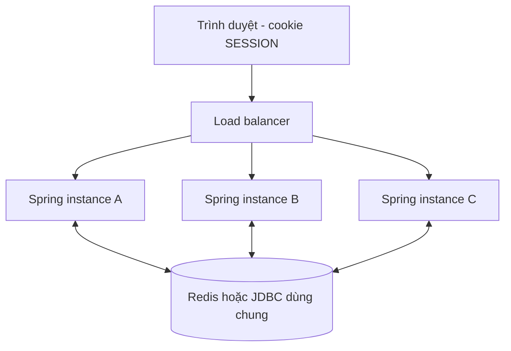
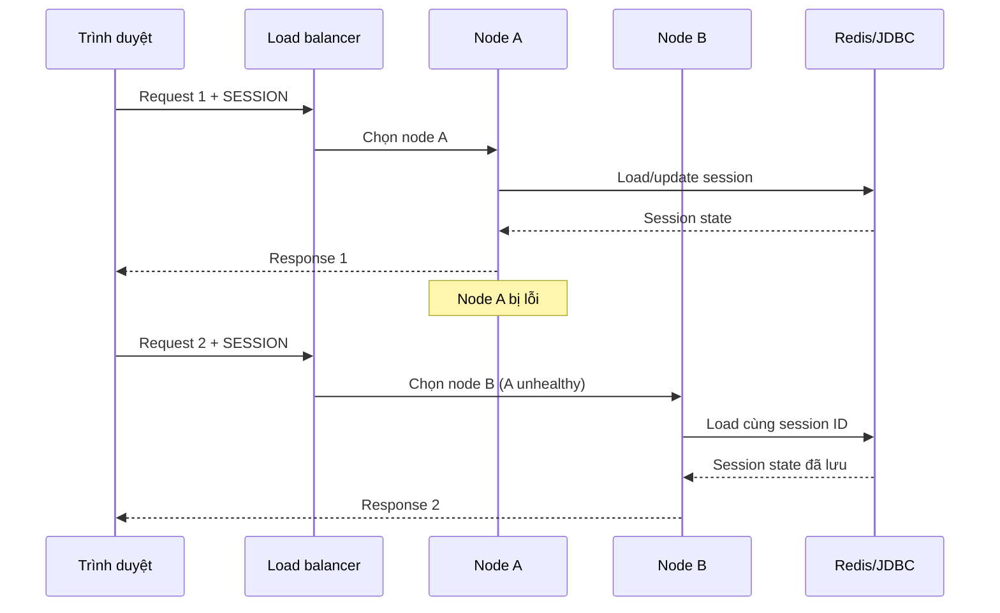

# Cân bằng tải, sticky session và khả năng chuyển yêu cầu sang nút khác

Khi triển khai ứng dụng Spring trên nhiều instance, load balancer phân phối request tới các node đang khỏe mạnh. Nếu mỗi node chỉ lưu `HttpSession` trong bộ nhớ riêng, request tiếp theo có thể đến node khác và không tìm thấy trạng thái đăng nhập. Sticky session (session affinity) có thể giữ request của một client ở cùng node, nhưng nó chỉ giải quyết việc định tuyến trong một số tình huống; node hỏng vẫn làm mất session nếu dữ liệu chỉ nằm trong memory của node đó.

Spring Session giải quyết bài toán chia sẻ trạng thái bằng cách lưu session trong kho dùng chung như Redis hoặc JDBC. Mỗi instance dùng cùng repository và có thể đọc cùng session ID, vì vậy load balancer có thể phân phối request luân phiên mà không cần phụ thuộc vào một node cố định. Sticky session vẫn có thể được dùng để tối ưu locality hoặc hỗ trợ ứng dụng có trạng thái cục bộ, nhưng không nên là cơ chế duy nhất bảo đảm session tồn tại khi node lỗi.

Bài học này tập trung vào cách phối hợp load balancing, affinity cookie, Spring Session shared store, health check, graceful draining và failover để một request tiếp theo có thể được xử lý ở node khác mà vẫn giữ trạng thái đăng nhập.

## 1. Mô hình nhiều node và vai trò của Spring Session

### 1.1. Session cục bộ khi chưa dùng kho chia sẻ

Trong ứng dụng Servlet thông thường, Servlet container thường lưu `HttpSession` trong memory của instance. Giả sử cụm có ba node A, B và C:

1. Request đăng nhập tới A; A tạo session `S1` trong memory của A.
2. Load balancer gửi request kế tiếp tới B.
3. B không có `S1`, nên request có thể bị xem như chưa đăng nhập.
4. Người dùng bị chuyển về trang login hoặc gặp lỗi dù session chưa hết timeout.

Sticky session có thể giảm hiện tượng này bằng cách cố định client ở A. Tuy nhiên, nếu A dừng đột ngột, memory session của A mất và request chuyển sang B vẫn không tìm thấy `S1`.

### 1.2. Session dùng kho chia sẻ

Spring Session thay thế cách lưu session trong memory của một Servlet container bằng `SessionRepository`. `SessionRepositoryFilter` tích hợp repository với API `HttpSession`. Với Redis hoặc JDBC, session được lưu ở kho bên ngoài và mọi instance ứng dụng cùng truy cập kho đó.



Nếu request đầu tiên tới A tạo session `S1`, request sau tới B vẫn có thể nạp `S1` từ kho dùng chung. Việc định tuyến không còn phải giữ client ở đúng node đã tạo session.

### 1.3. Hai lớp cookie có thể cùng tồn tại

Trong cấu hình sticky cookie, thường có hai cookie với hai mục đích khác nhau:

| Cookie | Ai tạo/quản lý | Mục đích |
|---|---|---|
| `SESSION` (hoặc tên Spring Session đã cấu hình) | Spring Session | Mang session ID để ứng dụng nạp dữ liệu phiên từ Redis/JDBC |
| `NODE` (tên tùy load balancer) | Load balancer | Gợi ý node mà client nên tiếp tục sử dụng |

Không nhầm cookie định tuyến với cookie session. Xóa cookie `NODE` có thể làm request được phân phối sang node khác nhưng không nhất thiết logout người dùng. Xóa hoặc invalidate cookie `SESSION` cùng session ở repository mới là thao tác kết thúc local session.

## 2. Cân bằng tải request

### 2.1. Các thuật toán thường gặp

| Thuật toán | Cách chọn node | Khi phù hợp | Hạn chế |
|---|---|---|---|
| Round robin | Lần lượt từng node theo vòng | Các node có năng lực tương đương, request tương đối đồng đều | Không xét số request đang chạy hoặc chi phí request |
| Weighted round robin | Phân phối theo trọng số cấu hình | Node có CPU/RAM hoặc năng lực khác nhau | Trọng số tĩnh không phản ánh tải tức thời |
| Least connections | Ưu tiên node có ít kết nối đang mở | Request có thời gian xử lý hoặc kết nối khác nhau | Kết nối không luôn tương đương với lượng CPU sử dụng |
| Least response time | Ưu tiên node có độ trễ thấp theo số đo | Có metric latency đáng tin cậy | Dễ dao động nếu đo trên cửa sổ quá ngắn |
| Hash/consistent hash | Băm một thuộc tính client để chọn node | Cần affinity hoặc phân phối ổn định theo khóa | Thay đổi topology có thể làm đổi node; hash không thay thế shared store |

Với Spring Session và kho dùng chung, round robin hoặc least connections thường là lựa chọn đủ tốt cho HTTP request thông thường. Chọn thuật toán theo đặc tính workload và khả năng của load balancer, không chọn chỉ vì ứng dụng có session.

### 2.2. Health check và loại node không khỏe mạnh

Load balancer cần biết node nào đủ điều kiện nhận request. Nên phân biệt:

- **Liveness:** tiến trình còn sống và có thể tiếp tục chạy hay không.
- **Readiness:** instance đã khởi tạo xong và hiện đủ điều kiện nhận traffic hay chưa.
- **Dependency health:** Redis/JDBC có thể truy cập hay không; cách phản ánh trạng thái này vào readiness tùy chính sách vận hành.

Nếu Redis mất kết nối nhưng ứng dụng vẫn nhận request đăng nhập, các request có thể thất bại khi đọc/ghi session. Tùy yêu cầu, có thể đánh dấu instance không ready hoặc để ứng dụng trả lỗi có kiểm soát trong khi hạ tầng khôi phục. Không biến lỗi kho session thành trạng thái “chưa đăng nhập” rồi âm thầm cấp quyền truy cập mặc định.

Ví dụ endpoint readiness của Spring Boot Actuator có thể được dùng cho health check:

```text
GET /actuator/health/readiness
```

Endpoint và nhóm health indicator cần được cấu hình đúng với phiên bản Spring Boot. Không công khai toàn bộ thông tin health nội bộ ra Internet; giới hạn quyền truy cập và chỉ trả các trạng thái cần thiết cho load balancer.

### 2.3. Không dùng session affinity để thay thế health check

Một client có cookie affinity trỏ tới node A. Nếu A không khỏe, load balancer phải có chính sách bỏ qua route cũ và chọn node B hoặc C. Nếu load balancer vẫn cố gửi request tới node A chỉ vì cookie `NODE`, client sẽ tiếp tục lỗi dù cụm còn node khỏe.

Kiểm thử cả trường hợp cookie affinity trỏ tới node đã bị đánh dấu down. Cấu hình fallback phụ thuộc sản phẩm và phiên bản load balancer; không giả định mọi thiết bị tự động bỏ route cookie lỗi.

## 3. Sticky session (session affinity)

### 3.1. Sticky session là gì?

Sticky session là cơ chế load balancer cố định một client hoặc một nhóm request vào cùng backend trong một khoảng thời gian. Load balancer có thể dùng cookie route do chính nó phát, source IP hoặc một khóa hash để chọn node.

Ví dụ, request đầu tiên tới A. Load balancer trả thêm cookie `NODE=A`. Các request tiếp theo gửi cookie này và được định tuyến về A khi A còn khỏe.

Sticky session hữu ích khi ứng dụng có dữ liệu cục bộ cần tái sử dụng, cache nóng, kết nối dài hoặc một số thành phần chưa được đưa ra kho dùng chung. Tuy nhiên, dữ liệu xác thực và trạng thái session cần thiết để tiếp tục request phải được lưu trong Spring Session shared store nếu muốn failover đáng tin cậy.

### 3.2. Affinity bằng cookie do load balancer phát

Ví dụ cấu hình HAProxy minh họa cookie route riêng:

```haproxy
backend spring_nodes
    balance roundrobin
    cookie NODE insert indirect nocache
    option httpchk GET /actuator/health/readiness
    server app1 10.0.1.11:8080 check cookie a
    server app2 10.0.1.12:8080 check cookie b
    server app3 10.0.1.13:8080 check cookie c
```

Trong ví dụ, HAProxy thêm cookie `NODE` để định tuyến client về server tương ứng. Cookie này độc lập với cookie `SESSION` của Spring Session. Cú pháp và khả năng health check cần được xác minh theo phiên bản HAProxy và cấu hình triển khai thực tế.

Nếu affinity cookie hết hạn hoặc backend bị loại khỏi pool, load balancer cần chọn node khỏe khác và cập nhật route cookie. Khi node quay lại, chính sách có thể tiếp tục dùng node cũ hoặc phân phối lại; điều đó ảnh hưởng locality nhưng không được làm mất session đã lưu trong Redis/JDBC.

### 3.3. Affinity theo source IP

Một số load balancer hỗ trợ `ip_hash` hoặc persistence theo client IP. Cách này dễ triển khai nhưng có các hạn chế:

- Nhiều người dùng có thể đi qua cùng NAT/proxy và bị dồn về một node.
- IP của client có thể thay đổi giữa mạng Wi-Fi, di động hoặc VPN.
- Reverse proxy phía trước có thể khiến load balancer chỉ nhìn thấy IP của proxy nếu không cấu hình trusted client address đúng.
- Một số mạng doanh nghiệp gom rất nhiều người dùng vào ít địa chỉ public IP.

Không dùng `X-Forwarded-For` do client tự gửi làm căn cứ tin cậy nếu chuỗi proxy chưa được xác định và lọc đúng. Chỉ tin header do proxy nằm trong danh sách tin cậy ghi đè.

### 3.4. Affinity dựa trên cookie Spring Session ID

Load balancer có thể băm cookie session ID để giữ client ở node đã phục vụ request trước đó. Cách này gắn affinity với session ứng dụng nhưng tạo ra một số ràng buộc:

- Khi Spring Security xoay session ID sau đăng nhập để chống session fixation, giá trị cookie thay đổi và có thể ánh xạ sang node khác.
- Khi session cookie bị xóa hoặc hết hạn, request không có khóa affinity và phải được phân phối theo thuật toán mặc định.
- Load balancer phải parse cookie đúng tên, domain và path.
- Cookie session ID là credential nhạy cảm; không ghi giá trị cookie vào log hoặc metric.

Nếu cần sticky routing, thường nên dùng cookie route độc lập như `NODE`, để thay đổi session ID không làm thay đổi affinity. Tuy nhiên, shared session store vẫn là điều kiện để node khác tiếp tục xử lý khi route cũ không còn dùng được.

## 4. Khi nào cần sticky session nếu đã có Spring Session?

### 4.1. Không cần sticky để giữ `HttpSession`

Với `SessionRepositoryFilter` và repository dùng chung, mỗi node có thể đọc cùng session ID. Vì vậy, request có thể chuyển A → B → C mà không mất `HttpSession`, miễn là:

- Tất cả node dùng cùng Redis/database và namespace/bảng.
- Cấu hình cookie và session ID tương thích.
- Serializer, classpath và phiên bản ứng dụng đọc được dữ liệu session do node khác ghi.
- Kho session có tính sẵn sàng và nhất quán phù hợp.

Đây là khả năng chính của Spring Session khi chạy nhiều instance.

### 4.2. Sticky vẫn có thể hữu ích cho locality

Affinity có thể giảm việc cache cục bộ bị miss, giảm một số lượt truy cập kho dùng chung hoặc giữ kết nối WebSocket ở cùng node. Tuy nhiên, cache cục bộ phải được xem là cache có thể mất; không lưu trạng thái xác thực duy nhất hoặc dữ liệu nghiệp vụ chưa commit trong memory của node.

Nếu sticky cookie trỏ tới node A rồi A bị loại, node B phải có thể phục hồi mọi trạng thái cần thiết từ shared store hoặc nguồn dữ liệu bền vững. Nếu B cần một object chỉ tồn tại trong memory A, ứng dụng vẫn chưa stateless đủ để failover.

### 4.3. Khi nào nên tắt sticky?

Có thể tắt affinity khi:

- Session và trạng thái cần thiết đã được lưu ở shared store.
- Các node có cấu hình và artifact tương thích.
- Không có dữ liệu request quan trọng phụ thuộc memory cục bộ.
- Load balancer có health check và thuật toán phân phối phù hợp.

Tắt sticky giúp phân phối tải linh hoạt hơn, tránh một node bị quá tải do client cố định và đơn giản hóa failover. Nên thử nghiệm bằng cách gửi liên tiếp request cùng cookie qua nhiều node trước khi áp dụng production.

## 5. Cấu hình Spring Session cho các node dùng chung

### 5.1. Redis dùng chung

Với Servlet application, có thể bật Spring Session Redis bằng annotation:

```java
import org.springframework.context.annotation.Configuration;
import org.springframework.session.data.redis.config.annotation.web.http.EnableRedisHttpSession;

@Configuration
@EnableRedisHttpSession(
    maxInactiveIntervalInSeconds = 1800,
    redisNamespace = "portal:session"
)
public class SessionConfiguration {
}
```

Ứng dụng cần có `RedisConnectionFactory` phù hợp; Spring Boot có thể tự cấu hình factory từ dependency và properties. Tất cả node phải trỏ tới cùng Redis deployment, cùng database/cluster topology và cùng namespace. Không để mỗi instance dùng Redis local riêng.

Trong production, Redis cần có cấu hình HA phù hợp như managed failover, Sentinel hoặc Cluster theo kiến trúc được chọn. Cần xác minh persistence, replication lag, failover behavior, ACL, TLS và backup/restore. Shared store cũng có thể là điểm lỗi chung nếu không được triển khai có dự phòng.

### 5.2. JDBC dùng chung

Với JDBC, có thể bật repository bằng:

```java
import org.springframework.context.annotation.Configuration;
import org.springframework.session.jdbc.config.annotation.web.http.EnableJdbcHttpSession;

@Configuration
@EnableJdbcHttpSession
public class JdbcSessionConfiguration {
}
```

Các node dùng cùng database/schema và schema Spring Session đã được migration. Index trên `SESSION_ID`, `EXPIRY_TIME` và `PRINCIPAL_NAME` cần tồn tại theo repository và chức năng được dùng. Connection pool của từng node phải được tính vào tổng kết nối database khi scale out.

Không cấu hình một node dùng Redis còn node khác dùng JDBC cho cùng một cookie session nếu không có lớp migration/bridge rõ ràng. Hai repository không tự đồng bộ dữ liệu với nhau.

### 5.3. Không khai báo nhiều cơ chế session cạnh tranh

Khi dùng Spring Boot auto-configuration, kiểm tra phiên bản và cấu hình `spring.session.*` thực tế. Nếu dùng annotation `@EnableRedisHttpSession` hoặc `@EnableJdbcHttpSession`, tránh vô tình khai báo thêm repository/filter khác khiến hai cơ chế cùng quản lý session. Chọn một repository làm nguồn sự thật cho mỗi ứng dụng/namespace.

### 5.4. Tính tương thích giữa các node

Mọi node cần thống nhất:

- Phiên bản Spring Session/Spring Security và cách serialize session attributes.
- Namespace Redis hoặc tên bảng JDBC.
- Session cookie name, path, domain, SameSite, Secure và HttpOnly.
- `maxInactiveInterval` mặc định và quy tắc timeout đặc thù.
- Cấu hình `IndexResolver`, principal name và security context.
- Secret/keys cần thiết cho authentication, remember-me hoặc mã hóa dữ liệu.

Trong rolling deployment, node mới và cũ có thể cùng đọc/ghi session. DTO, enum, class name và serializer phải tương thích ngược/tiến trong khoảng thời gian cả hai phiên bản cùng chạy.

## 6. Cookie session qua load balancer và reverse proxy

### 6.1. Tên và thuộc tính cookie

Spring Session thường dùng cookie session riêng, ví dụ `SESSION`. Có thể tùy chỉnh bằng `CookieSerializer`:

```java
import org.springframework.context.annotation.Bean;
import org.springframework.context.annotation.Configuration;
import org.springframework.session.web.http.CookieSerializer;
import org.springframework.session.web.http.DefaultCookieSerializer;

@Configuration
public class SessionCookieConfiguration {

    @Bean
    CookieSerializer cookieSerializer() {
        DefaultCookieSerializer serializer = new DefaultCookieSerializer();
        serializer.setCookieName("SESSION");
        serializer.setCookiePath("/");
        serializer.setUseHttpOnlyCookie(true);
        serializer.setUseSecureCookie(true);
        serializer.setSameSite("Lax");
        return serializer;
    }
}
```

Trong production, cookie session nên được gửi qua HTTPS với `Secure`, `HttpOnly` và `SameSite` phù hợp. Nếu ứng dụng cần luồng cross-site như một số cấu hình OIDC, `SameSite=None` thường cần đi kèm `Secure`; hãy kiểm thử callback thực tế trên browser mục tiêu.

### 6.2. Reverse proxy kết thúc TLS

Trong nhiều hệ thống, TLS kết thúc tại load balancer hoặc ingress rồi request nội bộ được chuyển tới ứng dụng bằng HTTP. Nếu ứng dụng không biết request gốc là HTTPS, cookie serializer hoặc redirect có thể được tạo với scheme sai.

Cần cấu hình trusted forwarded headers theo phiên bản Spring Boot/Servlet container. Chỉ tin `Forwarded` hoặc `X-Forwarded-*` từ proxy đã xác thực; nếu nhận trực tiếp từ Internet, attacker có thể giả mạo host/scheme và ảnh hưởng URL hoặc cookie. Với `useSecureCookie(true)`, ứng dụng luôn phát cookie Secure bất kể scheme request nội bộ, phù hợp khi toàn bộ truy cập public bắt buộc HTTPS.

### 6.3. Domain và path nhất quán

Nếu các node phục vụ cùng host public, cookie phải có path/domain nhất quán. Không để một node phát cookie cho `/portal` còn node khác phát cho `/`. Khi rolling deployment, cấu hình cookie phải đồng nhất để browser gửi cùng session ID tới mọi node.

Nếu có nhiều ứng dụng cùng domain, cân nhắc tên cookie và path riêng để tránh xung đột. Cookie `NODE` của load balancer cũng cần domain/path phù hợp nhưng có vòng đời độc lập với `SESSION`.

## 7. Failover khi một node ngừng hoạt động

### 7.1. Request tiếp theo được chuyển sang node khỏe

Giả sử request trước đã được A xử lý và session đã được lưu vào Redis/JDBC. A bị lỗi. Load balancer phát hiện A không healthy và chuyển request kế tiếp sang B. B đọc cookie `SESSION`, nạp session từ shared repository và tiếp tục xử lý.



Điều kiện là request trước đã commit/lưu session vào kho dùng chung trước khi node lỗi. Dữ liệu chỉ nằm trong memory của A hoặc thay đổi chưa được flush có thể mất.

### 7.2. Không bảo đảm request đang chạy được chuyển tiếp

Load balancer thường không thể chuyển nguyên trạng một request đang chạy từ node A sang B. Nếu A chết giữa request, client có thể nhận connection reset hoặc timeout. Client có thể gửi lại request, nhưng ứng dụng phải xử lý khả năng request đầu đã thực hiện một phần hoặc đã commit nghiệp vụ.

Với GET hoặc thao tác idempotent, retry thường dễ hơn. Với POST thanh toán, tạo đơn hoặc cập nhật dữ liệu, dùng idempotency key và transaction để tránh thực hiện hai lần. Không tự động retry mọi request ở load balancer nếu chưa đánh giá semantics.

### 7.3. Session save và thời điểm commit

Spring Session thường lưu thay đổi session vào repository ở cuối vòng đời request theo flush/save mode cấu hình. Nếu node dừng trước khi session được lưu, thay đổi của request đó có thể không có trong shared store. Các thao tác nghiệp vụ quan trọng phải được commit vào database/service nghiệp vụ riêng; session không phải nơi lưu giao dịch cần bảo đảm.

Không lưu kết quả thanh toán hoặc trạng thái đơn hàng duy nhất trong `HttpSession`. Session phù hợp với dữ liệu điều hướng và trạng thái tạm thời; nguồn sự thật nghiệp vụ phải nằm trong kho dữ liệu bền vững.

### 7.4. Kho session cũng cần HA

Nếu tất cả application node đều khỏe nhưng Redis/JDBC dùng chung bị down, mọi node có thể cùng không đọc/ghi được session. Spring Session không tự làm Redis hoặc database trở thành HA.

Thiết kế cần xem xét:

- Redis Sentinel/Cluster hoặc dịch vụ managed có failover.
- JDBC database HA, connection pool, timeout và failover endpoint.
- Backup/restore và khả năng phục hồi sau sự cố.
- Chính sách khi store tạm thời không khả dụng: fail closed đối với xác thực.
- Monitoring latency, error rate, connection count và replication/failover.

Không fallback sang local in-memory session một cách âm thầm khi shared store lỗi. Điều đó tạo ra các session khác nhau giữa các node và có thể gây lỗi bảo mật hoặc trạng thái khó dự đoán.

## 8. Graceful shutdown và draining node

### 8.1. Vì sao cần draining?

Khi deploy phiên bản mới hoặc bảo trì node, nên ngừng nhận request mới trước khi dừng tiến trình. Nếu dừng ngay, request đang xử lý có thể bị cắt và client nhận lỗi.

Quy trình thường gồm:

1. Đánh dấu instance không còn ready hoặc chuyển backend sang trạng thái drain.
2. Load balancer ngừng gửi request mới tới node.
3. Cho các request đang chạy hoàn tất trong thời hạn drain.
4. Đóng connection và dừng ứng dụng.
5. Deploy/restart và chờ readiness pass trước khi nhận traffic lại.

### 8.2. Sticky client trong thời gian drain

Nếu node có cookie affinity, cần biết load balancer xử lý route cookie khi server ở trạng thái drain như thế nào. Một số cấu hình vẫn cho request đã sticky tới node drain; một số cấu hình chuyển sang backend khác. Quy tắc phải được xác minh với sản phẩm load balancer.

Với shared session store, chuyển client sang node khác vẫn an toàn cho session nếu mọi thay đổi đã được lưu. Nếu cần hỗ trợ WebSocket hoặc kết nối dài, quy trình drain cần gửi close/reconnect signal hoặc chờ connection timeout phù hợp.

### 8.3. Rolling deployment và tương thích schema

Trong thời gian node phiên bản cũ và mới cùng chạy, cả hai cùng truy cập session store. Cần giữ serializer, tên thuộc tính session, cookie và schema tương thích. Khi migration database, dùng chiến lược expand/contract: thêm cấu trúc mới trước, triển khai code tương thích, chuyển writer/reader rồi mới bỏ cấu trúc cũ.

Không đổi Redis namespace hoặc JDBC table name giữa hai phiên bản nếu không có kế hoạch migration. Nếu mỗi phiên bản ghi vào namespace khác nhau, session đang hoạt động có thể không được node còn lại tìm thấy.

## 9. Session affinity và session fixation

### 9.1. Session ID có thể thay đổi sau xác thực

Spring Security bảo vệ chống session fixation bằng cách thay đổi session ID sau khi đăng nhập hoặc nâng quyền, tùy cấu hình Servlet container và chiến lược session authentication. Spring Session hỗ trợ thay ID trong repository và cookie mới được gửi cho browser.

Nếu load balancer dùng cookie `SESSION` để chọn node, session ID mới có thể làm hash route thay đổi. Client có thể chuyển node sau login. Với shared store, việc chuyển này không ảnh hưởng session; với ứng dụng còn state cục bộ, nó có thể gây lỗi.

### 9.2. Dùng route cookie riêng

Nếu cần giữ affinity qua session ID rotation, dùng cookie route độc lập do load balancer phát, ví dụ `NODE`. Cookie route không nên chứa session credential và không nên được dùng để xác thực. Khi node lỗi, load balancer có thể đổi route cookie mà không phải thay đổi session ID.

### 9.3. Không log cookie

Load balancer access log và application log không nên ghi giá trị cookie `SESSION`. Nếu cần đối chiếu request, dùng request ID hoặc fingerprint một chiều có kiểm soát; không dùng raw session ID trong metric label vì vừa nhạy cảm vừa tạo cardinality rất lớn.

## 10. Dữ liệu ngoài session và WebSocket

### 10.1. Tránh state chỉ có trong memory node

Shared session store chỉ chia sẻ dữ liệu mà ứng dụng thực sự lưu vào session. Các biến static, singleton mutable, local cache, scheduled job state và file tạm vẫn riêng từng node.

Nếu request B cần dữ liệu được tạo trong memory của A, hãy chuyển dữ liệu đó sang database/cache dùng chung hoặc thiết kế để có thể tái tạo. Không dựa vào sticky session như bảo đảm lâu dài cho dữ liệu quan trọng.

### 10.2. WebSocket và kết nối dài

Sau khi WebSocket handshake thành công, kết nối TCP thường gắn với một node cho tới khi đóng. Spring Session có thể chia sẻ HTTP/WebSession state, nhưng không tự di chuyển một WebSocket connection đang mở sang node khác.

Khi node chết, client cần reconnect tới node khỏe và xác thực lại bằng cookie/session còn hợp lệ. Nếu ứng dụng cần gửi message tới socket ở mọi node, dùng broker hoặc cơ chế pub/sub thích hợp; không giả định session store tự phân phối message WebSocket.

## 11. Kiểm thử cân bằng tải và failover

### 11.1. Kiểm thử không sticky

1. Chạy ít nhất hai instance Spring Session cùng Redis/JDBC.
2. Tắt affinity ở load balancer và dùng round robin.
3. Gửi request đăng nhập, nhận cookie `SESSION`.
4. Gửi request tiếp theo nhiều lần, xác nhận các node khác nhau xử lý.
5. Mỗi node phải đọc cùng principal và thuộc tính session.
6. Kiểm tra session ID và authentication không thay đổi ngoài các thao tác bảo mật dự kiến.

Trong môi trường test, có thể thêm header `X-Node-Id` vào response để biết request đã tới node nào. Không dùng header này như thông tin bảo mật hoặc để lộ topology production.

### 11.2. Kiểm thử sticky cookie

1. Bật cookie affinity riêng `NODE`.
2. Gửi request đầu tiên và xác nhận load balancer phát route cookie.
3. Gửi nhiều request với cả `NODE` và `SESSION`; xác nhận route ổn định khi node khỏe.
4. Xóa riêng `NODE`; xác nhận load balancer có thể chọn node khác và session vẫn hoạt động.
5. Xóa `SESSION`; xác nhận người dùng không còn session đã đăng nhập dù `NODE` vẫn còn.

Test này chứng minh hai cookie có vai trò khác nhau.

### 11.3. Kiểm thử node failover

1. Đăng nhập và tạo dữ liệu session ở node A.
2. Chờ response hoàn tất để session được lưu.
3. Dừng A hoặc làm readiness fail.
4. Gửi request tiếp theo với cookie cũ.
5. Xác nhận load balancer chọn B/C và repository nạp được session.
6. Kiểm tra endpoint được bảo vệ vẫn hoạt động.
7. Kiểm thử lại khi A chết giữa một request; xác nhận client xử lý timeout/retry an toàn và nghiệp vụ không bị thực hiện hai lần.

### 11.4. Kiểm thử shared store failure

Ngắt kết nối Redis/JDBC trong môi trường test. Xác minh ứng dụng trả lỗi có kiểm soát, không chuyển sang session memory riêng và không cấp Authentication mặc định. Khôi phục store rồi kiểm tra session đã lưu vẫn có thể được nạp.

### 11.5. Kiểm thử rolling deployment

Chạy đồng thời node phiên bản cũ và mới:

- V1 tạo session, V2 đọc được.
- V2 cập nhật thuộc tính, V1 đọc được nếu V1 vẫn còn nhận request.
- Xoay session ID sau authentication và xác minh cookie mới được chia sẻ.
- Drain V1, đưa V2 lên readiness rồi chuyển traffic.
- Kiểm tra session cũ tồn tại qua toàn bộ thời gian rollout.

## 12. Giám sát vận hành

Các chỉ số nên theo dõi:

| Nhóm | Metric/log | Mục đích |
|---|---|---|
| Load balancer | Request count, active connections, 4xx/5xx theo backend | Phát hiện phân phối lệch hoặc node lỗi |
| Health | Readiness/liveness, thời gian phát hiện backend down | Đánh giá failover detection |
| Session store | Redis latency/command errors hoặc JDBC query latency/pool usage | Phát hiện kho session là nút nghẽn |
| Session behavior | Session lookup miss, serialization failure, invalidation count | Phát hiện cấu hình node không đồng nhất |
| Node | CPU, heap, GC, thread/event-loop saturation | Phát hiện một node quá tải |
| Affinity | Tỷ lệ request theo route cookie và số client bị chuyển node | Đánh giá sticky routing và failover |
| Deploy | Drain duration, in-flight requests, restart count | Kiểm soát rolling deployment |

Không gắn session ID hoặc user ID thô vào metric label. Dùng cardinality thấp như application, environment, backend node và outcome. Log cần có correlation/request ID để nối sự kiện qua load balancer và application node.

## 13. Lỗi thường gặp

| Hiện tượng | Nguyên nhân có thể | Hướng xử lý |
|---|---|---|
| Người dùng bị logout khi request sang node khác | Session vẫn lưu trong memory riêng hoặc node không dùng cùng repository | Bật Spring Session shared store và xác minh namespace/database |
| Sticky hoạt động nhưng node chết làm mất session | Chỉ có local session, chưa có shared store | Lưu session trong Redis/JDBC dùng chung |
| Cookie `NODE` còn nhưng backend không tồn tại | Route cookie trỏ tới node down | Cấu hình LB bỏ route lỗi và chọn backend khỏe |
| Mọi request dồn về một node | IP affinity sau NAT hoặc cookie route không được cập nhật | Kiểm tra thuật toán, cookie và phân bố client |
| Login xong chuyển sang node khác và lỗi | Affinity dựa trên session ID bị xoay hoặc local state chưa chia sẻ | Dùng route cookie riêng hoặc loại bỏ state cục bộ |
| Cookie không được gửi qua HTTPS/proxy | Secure, SameSite, Domain, Path hoặc forwarded headers sai | Kiểm tra `Set-Cookie` và browser devtools |
| Node mới không đọc session node cũ ghi | Serializer hoặc class/attribute không tương thích | Triển khai reader tương thích trước writer mới |
| Failover làm POST chạy hai lần | Load balancer/client retry sau khi response mất | Dùng idempotency key và transaction nghiệp vụ |
| Node drain vẫn nhận request mới | Readiness/LB drain không đồng bộ | Kiểm tra health endpoint và backend state |
| Redis/JDBC down làm tất cả node lỗi session | Shared store là dependency chung không có HA đủ | Thiết kế HA, timeout, alert và fail-closed policy |
| WebSocket mất khi node chết | Kết nối socket gắn với node đã dừng | Client reconnect, xác thực lại và dùng broker nếu cần |

## 14. Quy trình triển khai nhiều node

1. Chọn Redis hoặc JDBC làm shared session repository và triển khai kho đó với HA phù hợp.
2. Cấu hình mọi node dùng cùng repository, namespace/schema, serializer và timeout.
3. Cấu hình cookie `SESSION` nhất quán, bảo vệ bằng HTTPS, HttpOnly và SameSite phù hợp.
4. Chọn thuật toán load balancing dựa trên workload; bắt đầu với round robin/least connections nếu không cần affinity.
5. Nếu cần sticky session, dùng route cookie riêng và kiểm tra hành vi khi backend down.
6. Cấu hình readiness/liveness và health check của load balancer.
7. Bảo đảm mọi state cần cho request sau được lưu trong shared store hoặc nguồn dữ liệu bền vững.
8. Thiết kế graceful drain và rolling deployment với serializer/schema tương thích.
9. Dùng idempotency cho thao tác có side effect khi client/LB có thể retry sau failover.
10. Kiểm thử request chuyển node, node chết, shared store lỗi, cookie affinity và session ID rotation.
11. Theo dõi latency, error rate, session lookup, connection pool và backend distribution.

Spring Session cho phép mọi instance đọc cùng session từ Redis hoặc JDBC, vì vậy load balancer có thể chuyển request sang node khác mà không phụ thuộc sticky session. Sticky routing chỉ là tùy chọn tối ưu locality; route cookie của load balancer độc lập với cookie session của ứng dụng. Để failover thực sự hoạt động, cần shared store có HA, cấu hình node tương thích, health check, graceful draining và kiểm thử cả request đang chạy lẫn request được gửi lại sau sự cố.

## Tài liệu tham khảo

- [Spring Session — HttpSession Integration](https://docs.spring.io/spring-session/reference/http-session.html)
- [Spring Session — Redis Configuration](https://docs.spring.io/spring-session/reference/configuration/redis.html)
- [Spring Session — JDBC Configuration](https://docs.spring.io/spring-session/reference/configuration/jdbc.html)
- [Spring Session API — SessionRepositoryFilter](https://docs.spring.io/spring-session/reference/api/java/org/springframework/session/web/http/SessionRepositoryFilter.html)
- [Spring Boot — Actuator Endpoints and Kubernetes Probes](https://docs.spring.io/spring-boot/reference/actuator/endpoints.html)
- [HAProxy Configuration Manual — Persistence and Cookie](https://docs.haproxy.org/)
