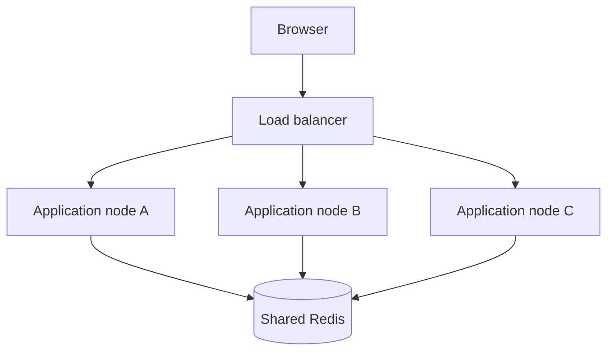

# Namespace, tên cookie và cấu hình phải thống nhất trong cùng một ứng dụng

Khi triển khai Spring Session trên nhiều instance, các node phải nhận diện session theo cùng một quy ước. Mỗi request có thể được load balancer chuyển đến instance A hoặc B; cả hai phải đọc cùng cookie, kết nối tới cùng kho session, dùng cùng namespace và hiểu cùng định dạng dữ liệu. Nếu cấu hình lệch nhau, một người dùng có thể bị đăng xuất ngẫu nhiên, tạo nhiều session song song hoặc thấy trạng thái session khác nhau tùy node.

Trong bài này, “cùng một ứng dụng” nghĩa là các instance phục vụ cùng một logical application và cùng tập người dùng. Các instance đó cần chia sẻ cấu hình session tương thích. Những ứng dụng độc lập hoặc các môi trường như staging và production thường cần namespace, cookie scope hoặc kho dữ liệu riêng để tránh dùng nhầm session của nhau.

Nội dung tập trung vào ba lớp định danh cần phân biệt:

- **Redis namespace hoặc JDBC table/schema:** xác định nơi dữ liệu session của ứng dụng được lưu.
- **Cookie name và cookie scope:** xác định browser gửi session ID nào tới ứng dụng.
- **Session configuration:** xác định các node diễn giải, serialize, gia hạn, lưu và hết hạn session như thế nào.

## 1. Vì sao mọi node phải thống nhất cấu hình?

Giả sử một ứng dụng có ba instance sau load balancer:



Browser gửi cookie session ID. Instance nhận request dùng resolver để đọc cookie, sau đó dùng repository tìm session trong Redis hoặc JDBC. Các node chỉ chia sẻ được session nếu toàn bộ đường đi tương thích:

1. Browser gửi đúng cookie name, domain và path.
2. Mọi node dùng cùng resolver hoặc cấu hình tương đương.
3. Mọi node kết nối cùng Redis deployment hoặc cùng JDBC database/schema.
4. Mọi node dùng cùng namespace/table mapping.
5. Serializer và cách biểu diễn session attributes tương thích.
6. Timeout, save mode, flush mode và chính sách expiration không xung đột.

Nếu A ghi vào namespace thứ nhất còn B đọc namespace thứ hai, B không tìm thấy session dù cả hai kết nối tới cùng Redis. Nếu A phát cookie tên này còn B chỉ tìm cookie tên khác, B có thể tạo session mới. Hai lỗi này thường bị nhầm với lỗi load balancer hoặc mất session.

## 2. Phân biệt namespace và cookie name

Namespace là định danh phía server cho vùng dữ liệu session. Với Redis, Spring Session dùng namespace để tạo prefix cho các key do repository quản lý. Cookie name là tên cookie phía browser chứa session ID để server tra cứu session.

| Thành phần | Nằm ở đâu? | Dùng để làm gì? | Ví dụ |
| --- | --- | --- | --- |
| Redis namespace | Redis keyspace | Phân vùng key session của ứng dụng | `acme:portal:sessions` |
| JDBC table/schema | Database | Chọn bảng/schema lưu session | `SPRING_SESSION` trong schema ứng dụng |
| Cookie name | Browser request/response | Chọn cookie chứa session ID | `PORTALSESSION` |
| Cookie path | Browser | Quyết định URL path nào nhận cookie | `/portal` hoặc `/` |
| Cookie domain | Browser | Quyết định host nào nhận cookie | Host-only hoặc `example.com` |
| Session ID | Cookie và repository key | Định danh một session cụ thể | Giá trị do Spring Session phát hành |

Namespace không phải cookie name. Đổi namespace không tự đổi cookie ở browser; đổi cookie name không tự chuyển dữ liệu session sang namespace mới. Hai lớp cần được cấu hình riêng và phải tương thích giữa các instance.

Cookie chỉ mang định danh, không phải toàn bộ session attributes. Không ghi dữ liệu nghiệp vụ hoặc quyền truy cập vào cookie session ID.

## 3. Chọn Redis namespace ổn định cho một logical application

Spring Session Redis hỗ trợ cấu hình namespace để tách key của các ứng dụng dùng chung Redis. Với Spring Boot, thuộc tính thường dùng là:

```properties
spring.session.redis.namespace=acme:portal:sessions
```

Mọi instance của ứng dụng Portal phải dùng cùng giá trị namespace. Nếu node A dùng `acme:portal:sessions` còn node B dùng `acme:portal:session` (thiếu chữ s), chúng có thể ghi và đọc hai tập key khác nhau.

Một quy ước dễ quản lý thường gồm:

- Tên tổ chức hoặc hệ thống.
- Tên logical application.
- Môi trường triển khai nếu Redis được chia sẻ giữa nhiều môi trường.
- Thành phần `sessions` để nhận biết loại dữ liệu.

Ví dụ:

```text
acme:portal:prod:sessions
acme:portal:staging:sessions
acme:admin:prod:sessions
```

Các giá trị trên chỉ là quy ước minh họa. Điều quan trọng là mọi instance thuộc cùng một ứng dụng và cùng môi trường phải dùng chính xác cùng namespace. Production và staging không nên dùng chung namespace vì có thể đọc nhầm session, ghi đè hoặc xóa dữ liệu của nhau.

Namespace giúp tách key theo quy ước, nhưng không phải ranh giới bảo mật. Vẫn cần Redis ACL, network isolation, credential riêng và quyền truy cập tối thiểu. Một client có quyền truy cập toàn bộ Redis có thể đọc nhiều namespace nếu ACL không giới hạn.

## 4. JDBC table và schema cũng phải thống nhất

Nếu dùng Spring Session JDBC, các instance của cùng ứng dụng phải kết nối tới cùng database/schema và cùng bảng session. Tên bảng có thể được cấu hình bằng thuộc tính tương ứng của Spring Boot, ví dụ:

```properties
spring.session.jdbc.table-name=SPRING_SESSION
```

Tên thuộc tính và khả năng cấu hình schema/table phụ thuộc phiên bản Spring Boot/Spring Session. Hãy đối chiếu với dependency đang dùng; không tự ghép property từ một phiên bản khác.

Một số nguyên tắc:

- Mọi node cùng logical application dùng cùng schema và table mapping.
- Các node dùng schema tương thích, bao gồm cột, index và kiểu dữ liệu.
- Migration schema phải được triển khai có kiểm soát trước hoặc cùng lúc với rollout ứng dụng.
- Không để một node ghi vào bảng mới trong khi node khác chỉ đọc bảng cũ.
- Nếu nhiều ứng dụng độc lập dùng chung database, tách schema/table hoặc có quy ước tên rõ ràng.

Redis namespace và JDBC table name có cùng mục đích phân vùng ở tầng lưu trữ, nhưng cơ chế thực hiện khác nhau. Không áp dụng thuộc tính Redis cho JDBC hoặc ngược lại.

## 5. Cấu hình cookie name thống nhất

Với Spring Boot Servlet, cookie name có thể được cấu hình bằng:

```properties
server.servlet.session.cookie.name=PORTALSESSION
```

Mọi instance của cùng ứng dụng phải dùng cùng cookie name. Nếu A phát cookie `PORTALSESSION` nhưng B chỉ tìm cookie `JSESSIONID`, request đến B có thể không mang định danh mà B mong đợi và dẫn đến session mới.

Nếu dùng Spring Session với `CookieHttpSessionIdResolver`, cookie serializer là nơi định nghĩa cookie name và các thuộc tính cookie. Có thể cấu hình bằng bean:

```java
import org.springframework.context.annotation.Bean;
import org.springframework.context.annotation.Configuration;
import org.springframework.session.web.http.CookieSerializer;
import org.springframework.session.web.http.DefaultCookieSerializer;

@Configuration
public class SessionCookieConfiguration {

    @Bean
    CookieSerializer cookieSerializer() {
        DefaultCookieSerializer serializer = new DefaultCookieSerializer();
        serializer.setCookieName("PORTALSESSION");
        serializer.setCookiePath("/");
        serializer.setUseHttpOnlyCookie(true);
        serializer.setUseSecureCookie(true);
        serializer.setSameSite("Lax");
        return serializer;
    }
}
```

Ví dụ này giả định ứng dụng dùng cookie-based session ID resolver và phiên bản Spring Session cung cấp các API trên. Nếu ứng dụng đã khai báo bean `CookieSerializer`, hãy xem bean đó là nguồn cấu hình có hiệu lực; property Boot có thể không còn là nơi duy nhất quyết định cookie. Tránh khai báo hai nguồn cấu hình cạnh tranh nhau.

Chọn một nguồn cấu hình chuẩn cho cookie name và bảo đảm mọi node khởi động cùng giá trị. Với nhiều profile hoặc biến môi trường, kiểm tra giá trị thực tế sau khi bind configuration.

## 6. Cookie path và domain phải được chọn có chủ đích

Cookie có `Path=/portal` chỉ được browser gửi tới các URL nằm dưới path đó. Nếu node A phát cookie với path `/portal` còn node B trả cookie với path `/`, browser có thể giữ hai cookie cùng tên nhưng scope khác nhau. Request có thể gửi cả hai hoặc gửi cookie theo quy tắc path matching, gây khó chẩn đoán.

Với các instance cùng một ứng dụng, thống nhất cookie path. Nếu ứng dụng được triển khai dưới context path riêng, chọn path phù hợp và xác nhận response Set-Cookie của mọi node giống nhau.

Nếu không đặt Domain, cookie thường là host-only và chỉ được gửi tới host đã phát hành nó. Nếu đặt domain chung như `example.com`, cookie có thể được gửi tới nhiều subdomain theo quy tắc browser.

Chỉ đặt domain chung khi thực sự cần chia sẻ cookie giữa các subdomain. Nếu nhiều ứng dụng độc lập cùng dùng domain và path rộng, chúng có thể đụng tên cookie. Nên cân nhắc cookie name riêng hoặc path riêng cho từng ứng dụng.

Các thuộc tính cookie nên thống nhất:

- `Secure`: chỉ gửi cookie qua HTTPS. Trong production, nên bật; nếu TLS kết thúc ở reverse proxy, cần cấu hình forwarded headers và ứng dụng nhận biết request gốc là HTTPS.
- `HttpOnly`: ngăn JavaScript truy cập cookie qua API trình duyệt; giảm nguy cơ lấy cookie trực tiếp từ script.
- `SameSite`: kiểm soát việc gửi cookie trong ngữ cảnh cross-site. `Lax`, `Strict` hoặc `None` cần được chọn theo luồng điều hướng, SSO và cross-site request; `None` yêu cầu `Secure` ở browser hiện đại.

Các node trả Set-Cookie không nhất quán có thể khiến browser thay đổi thuộc tính cookie tùy request được route tới node nào. Đặc biệt, nếu một node bỏ Secure hoặc đổi Domain/Path, browser có thể giữ một cookie khác scope hoặc ghi đè cookie đang dùng.

## 7. Tên cookie riêng khi nhiều ứng dụng cùng domain

Giả sử cùng domain có:

- Portal tại `/portal`.
- Admin tại `/admin`.
- Helpdesk tại `/support`.

Nếu cả ba dùng cookie name mặc định và cookie path `/`, browser có thể gửi cùng tên cookie tới nhiều ứng dụng. Các ứng dụng có thể ghi đè cookie của nhau hoặc đọc nhầm session ID từ cookie cùng tên.

Có thể tách bằng cookie name:

```properties
# Portal
server.servlet.session.cookie.name=PORTALSESSION

# Admin
server.servlet.session.cookie.name=ADMINSESSION

# Helpdesk
server.servlet.session.cookie.name=HELPDESKSESSION
```

Hoặc dùng path riêng nếu kiến trúc và đường dẫn triển khai bảo đảm browser scope đúng. Tên cookie riêng thường dễ quan sát và tránh xung đột hơn khi các ứng dụng cùng domain.

Không chia sẻ session giữa hai ứng dụng chỉ bằng cách đặt cookie name giống nhau. Để thực sự dùng chung session, chúng còn phải thống nhất repository, namespace, serialization, cookie resolver, bảo mật và cách diễn giải SecurityContext. Chia sẻ session giữa các ứng dụng độc lập có thể làm tăng coupling và mở rộng phạm vi ảnh hưởng khi một ứng dụng có lỗ hổng.

## 8. Tên cookie và namespace không phải cơ chế bảo mật

Đặt tên cookie khó đoán hoặc namespace phức tạp không thay thế các biện pháp bảo vệ:

- Session ID phải được tạo đủ ngẫu nhiên bởi framework.
- Dùng HTTPS và cookie Secure.
- Bật HttpOnly và chọn SameSite phù hợp.
- Bảo vệ session fixation bằng cơ chế Spring Security.
- Giới hạn quyền Redis/database.
- Không ghi session ID hoặc cookie vào log.
- Đặt thời hạn session phù hợp và thu hồi khi logout/account lock.

Namespace chỉ phân vùng dữ liệu. Cookie name chỉ giúp browser gửi đúng cookie. Cả hai đều không chứng minh người gửi request là người dùng hợp lệ; quyền truy cập vẫn phụ thuộc session ID bí mật và quá trình xác thực/ủy quyền của ứng dụng.

## 9. Các cấu hình session khác cần thống nhất

Ngoài namespace và cookie, các instance cùng ứng dụng cần cấu hình tương thích cho những thuộc tính ảnh hưởng cách lưu và khôi phục session.

Ví dụ cấu hình Redis trong Spring Boot:

```properties
spring.session.redis.namespace=acme:portal:prod:sessions
spring.session.redis.flush-mode=on_save
spring.session.redis.save-mode=on_set_attribute

server.servlet.session.timeout=30m
server.servlet.session.cookie.name=PORTALSESSION
server.servlet.session.cookie.path=/
server.servlet.session.cookie.http-only=true
server.servlet.session.cookie.secure=true
server.servlet.session.cookie.same-site=lax
```

Tên property và giá trị enum có thể khác giữa các phiên bản Spring Boot/Spring Session. Dùng cấu hình được phiên bản của dự án hỗ trợ và xác minh khi ứng dụng khởi động.

Những mục cần thống nhất:

| Cấu hình | Vì sao phải nhất quán? |
| --- | --- |
| Session repository type | Node này dùng Redis, node kia dùng JDBC hoặc local store thì không thấy cùng dữ liệu |
| Redis namespace hoặc JDBC schema/table | Đảm bảo mọi node đọc/ghi cùng tập session |
| Cookie resolver và cookie name | Mọi node phải đọc cùng định danh từ browser |
| Cookie path/domain/SameSite/Secure/HttpOnly | Browser phải gửi cùng cookie theo cùng scope và chính sách |
| Session timeout | Tránh node hiểu session còn hạn trong khi node khác coi đã hết hạn |
| Flush mode và save mode | Tránh khác biệt về thời điểm và thuộc tính được ghi |
| Serializer và class model | Mọi node phải giải mã được dữ liệu do node khác ghi |
| Principal index | Tính năng tìm session theo user phải hoạt động nhất quán |
| Expiration/cleanup policy | Tránh node giữ hoặc xóa session theo chính sách khác nhau |
| Encryption/signing key nếu có | Mọi node cần giải mã/xác minh dữ liệu do node khác tạo |

Không phải mọi khác biệt cấu hình đều làm mất session ngay lập tức, nhưng chúng có thể gây hành vi không xác định khi request chuyển node hoặc khi session được cập nhật.

## 10. Serializer và tương thích dữ liệu giữa node

Redis/JDBC lưu session attributes; các node phải đọc được dữ liệu do node khác ghi. Nếu một node dùng Java serialization và node khác dùng serializer JSON hoặc cấu hình class khác, session có thể không khôi phục được.

Nguyên tắc:

- Dùng cùng serializer và cấu hình trên tất cả node thuộc cùng logical application.
- Giữ class session attribute tương thích qua rolling deployment.
- Tránh lưu object phức tạp, ORM proxy, Spring bean, request/response hoặc object phụ thuộc classloader.
- Ưu tiên DTO nhỏ và ổn định hoặc lưu ID thay vì cả object nghiệp vụ.
- Nếu cần đổi serializer, có kế hoạch chuyển đổi dữ liệu và tương thích phiên bản cũ/mới.
- Nếu session attributes được mã hóa, mọi node cần cùng key ring hoặc cơ chế key rotation tương thích.

Một node mới không nên phát dữ liệu mà node cũ không thể đọc trong khi cả hai còn cùng phục vụ traffic. Hãy dùng chiến lược expand/contract: trước tiên triển khai code có thể đọc cả dạng cũ và mới, sau đó chuyển định dạng ghi, cuối cùng mới bỏ hỗ trợ dạng cũ khi session cũ hết hạn.

## 11. Rolling deployment và blue/green

Khi cập nhật ứng dụng theo rolling deployment, một phần node có thể chạy phiên bản cũ và phần còn lại chạy phiên bản mới. Trong giai đoạn này, cả hai phiên bản thường cùng đọc/ghi session.

Để tránh mất session:

1. Giữ namespace và cookie name ổn định nếu vẫn là cùng logical application.
2. Duy trì tương thích serializer và session attribute schema giữa hai phiên bản.
3. Giữ timeout và cookie scope tương thích.
4. Không đổi đồng thời namespace, cookie name và định dạng session trong một lần rollout nếu chưa có kế hoạch migration.
5. Theo dõi lỗi deserialize, session miss và số lượng session mới bất thường.
6. Chỉ loại bỏ cấu hình cũ sau khi mọi node đã chuyển và session cũ không còn cần đọc.

Nếu blue/green là hai môi trường độc lập cần session riêng, hãy dùng namespace và cookie scope tách biệt. Nếu blue và green cùng phục vụ một logical application trong một giai đoạn chuyển tiếp, chỉ dùng chung namespace khi cả hai phiên bản tương thích dữ liệu và bảo mật. Không dùng chung namespace giữa hai phiên bản không thể đọc session của nhau.

Đổi cookie name có thể khiến browser không gửi cookie cũ cho ứng dụng, dù session cũ vẫn còn trong Redis. Đổi namespace có thể khiến ứng dụng không tìm thấy session cũ dù browser vẫn gửi cookie đúng. Nếu cần migrate, phải có kế hoạch dual-read/controlled migration hoặc chấp nhận người dùng đăng nhập lại; không đổi ngẫu nhiên giữa các node.

## 12. Cấu hình nhất quán qua environment variables

Trong production, không nên sửa tay file cấu hình của từng instance. Dùng cùng cấu hình triển khai, ConfigMap/secret hoặc configuration service để cấp giá trị giống nhau.

Ví dụ tên biến môi trường theo relaxed binding của Spring Boot:

```text
SPRING_SESSION_REDIS_NAMESPACE=acme:portal:prod:sessions
SERVER_SERVLET_SESSION_COOKIE_NAME=PORTALSESSION
SERVER_SERVLET_SESSION_COOKIE_PATH=/
SERVER_SERVLET_SESSION_COOKIE_HTTP_ONLY=true
SERVER_SERVLET_SESSION_COOKIE_SECURE=true
SERVER_SERVLET_SESSION_TIMEOUT=30m
```

Đối với cookie name và namespace, có thể bổ sung startup log an toàn chỉ ghi giá trị cấu hình không nhạy cảm như namespace và cookie name. Không log session ID, cookie value, token hoặc secret. Nếu môi trường có nhiều profile, xác minh profile đang active và giá trị sau khi bind; tránh để một node dùng profile mặc định còn node khác dùng profile production.

Một cách kiểm tra vận hành là tạo fingerprint cấu hình không chứa secret:

- Application logical name.
- Environment.
- Session repository type.
- Redis namespace hoặc JDBC schema/table.
- Cookie name/path/domain.
- Session timeout.
- Serializer identifier/version.

Các node cùng một logical application nên báo cùng fingerprint. Nếu khác nhau, cảnh báo trước khi node nhận traffic.

## 13. Kiểm tra cấu hình khi ứng dụng khởi động

Có thể dùng một component kiểm tra các giá trị bắt buộc đã bind:

```java
@Component
public class SessionConfigurationCheck implements ApplicationRunner {

    private final Environment environment;

    public SessionConfigurationCheck(Environment environment) {
        this.environment = environment;
    }

    @Override
    public void run(ApplicationArguments args) {
        String namespace = environment.getProperty(
                "spring.session.redis.namespace");
        String cookieName = environment.getProperty(
                "server.servlet.session.cookie.name");

        if (namespace == null || namespace.isBlank()) {
            throw new IllegalStateException(
                    "Spring Session Redis namespace must be configured");
        }
        if (cookieName == null || cookieName.isBlank()) {
            throw new IllegalStateException(
                    "Session cookie name must be configured");
        }
    }
}
```

Đây là ví dụ kiểm tra tối thiểu cho ứng dụng Redis và Spring Boot. Nếu dùng JDBC, hãy kiểm tra table/schema thay vì Redis namespace. Nếu cookie serializer được cấu hình bằng bean, đọc cấu hình từ bean thực tế thay vì chỉ kiểm tra property có thể đã bị override.

Kiểm tra local chỉ xác nhận giá trị node hiện tại. Để so sánh giữa các instance, xuất fingerprint cấu hình qua health/info endpoint nội bộ hoặc metric, bảo vệ endpoint đó và không bao gồm secret.

## 14. Reverse proxy, TLS termination và cookie Secure

Trong production, TLS thường kết thúc tại load balancer hoặc reverse proxy. Ứng dụng phía sau có thể nhận kết nối HTTP nội bộ, dù browser truy cập HTTPS. Nếu ứng dụng không nhận biết scheme gốc, cookie Secure hoặc redirect có thể được tạo sai.

Cần:

- Cấu hình proxy gửi `Forwarded` hoặc `X-Forwarded-*` headers đáng tin cậy.
- Cấu hình Spring Boot xử lý forwarded headers theo phiên bản.
- Chỉ tin header từ proxy được kiểm soát; không để client bên ngoài giả mạo scheme/host.
- Bật cookie Secure cho môi trường HTTPS.
- Thống nhất host, path và domain qua các node.
- Kiểm tra Set-Cookie tại browser khi đi qua load balancer, không chỉ gọi trực tiếp từng node.

Không tắt Secure chỉ để khắc phục lỗi cookie khi TLS kết thúc ở proxy. Hãy sửa forwarded-header configuration và xác minh response được tạo theo scheme gốc.

## 15. Session fixation và thay đổi session ID

Spring Security có cơ chế session fixation protection để thay đổi session ID sau khi xác thực thành công. Điều này không có nghĩa cookie name hoặc Redis namespace phải thay đổi.

Luồng thường gặp:

1. Người dùng truy cập trước đăng nhập và có session chưa xác thực.
2. Đăng nhập thành công.
3. Spring Security áp dụng session fixation strategy, thường đổi session ID hoặc tạo session mới tùy cấu hình/container.
4. Spring Session lưu session mới và resolver phát cookie chứa ID mới.

Mọi node cần hiểu cùng cookie name và cùng repository/namespace để request sau đăng nhập có thể khôi phục session mới. Không tự giữ session ID cũ trong custom cookie hoặc header sau khi Spring Security đã đổi ID.

## 16. Cách nhận biết cấu hình lệch giữa các node

Các triệu chứng thường gặp:

| Triệu chứng | Nguyên nhân có thể | Kiểm tra |
| --- | --- | --- |
| Request ở A đăng nhập, request ở B bị coi là anonymous | Cookie name khác, namespace khác hoặc repository khác | So sánh cookie resolver, namespace và Redis/database endpoint |
| Mỗi lần đổi node lại tạo session mới | Node không đọc cùng cookie hoặc không đọc cùng kho | Kiểm tra Set-Cookie, cookie path/domain và session repository |
| Một ứng dụng ghi đè session của ứng dụng khác | Cookie name/path trùng hoặc namespace/table dùng chung | Tách cookie scope và namespace/schema |
| Session miss sau rollout | Namespace đổi hoặc serializer không tương thích | So sánh config fingerprint và lỗi deserialize |
| Cookie xuất hiện nhiều bản cùng tên | Path/domain khác nhau | Kiểm tra browser cookie store và Set-Cookie |
| Một số node báo session expired sớm | Timeout/clock/expiration policy khác nhau | So sánh timeout, clock sync và repository policy |
| Logout chỉ có hiệu lực trên một node | Session store local hoặc delete không vào shared repository | Kiểm tra repository thực tế và endpoint kết nối |
| Cookie Secure không được gửi | TLS/proxy scheme không được nhận diện hoặc đang gọi HTTP | Kiểm tra forwarded headers và URL scheme |

Khi chẩn đoán, lấy request qua từng node bằng cơ chế route/diagnostic nội bộ. Không ghi cookie value hoặc session ID để so sánh. Có thể so sánh cookie name, cookie attributes, namespace và config fingerprint.

## 17. Kiểm thử nhiều instance

Unit test một application context không chứng minh hai node dùng cùng cấu hình. Nên có integration test chạy hai application instance độc lập cùng một Redis hoặc JDBC database.

Kịch bản cơ bản:

1. Khởi động node A và node B với cùng namespace, cookie serializer và repository.
2. Gửi request đăng nhập hoặc tạo session qua A.
3. Lưu cookie từ response A vào cookie jar của test client.
4. Gửi request tiếp theo đến B với cookie đó.
5. Xác nhận B đọc được thuộc tính đã ghi ở A.
6. Cập nhật session qua B rồi đọc lại qua A.
7. Logout qua B, sau đó gửi cookie cũ đến A và xác nhận session không còn hợp lệ.
8. Lặp lại với cookie path/domain/SameSite thực tế qua proxy nếu có.

Các test cấu hình lệch có chủ đích:

- Node B dùng namespace khác và phải phát hiện session miss.
- Node B dùng cookie name khác và phải phát hiện resolver không đọc cookie của A.
- Hai ứng dụng dùng cùng Redis nhưng namespace riêng, xác nhận không nhìn thấy session của nhau.
- Rolling deploy với serializer tương thích và không tương thích để xác nhận chính sách.
- Kiểm tra Set-Cookie từ mọi node có cùng name, path, domain, Secure, HttpOnly và SameSite.

Trong test, tắt sticky routing hoặc chọn node rõ ràng để chắc chắn request thực sự đi qua hai process. Nếu mọi request luôn đến A, bài test không kiểm tra được khả năng chia sẻ.

## 18. Những lỗi cấu hình thường gặp

- **Namespace khác nhau giữa các node:** dữ liệu session bị chia thành nhiều tập key.
- **Cookie name khác nhau:** node không đọc được session ID do node khác phát hành.
- **Cookie path/domain không nhất quán:** browser gửi cookie khác nhau tùy URL hoặc host.
- **Dùng cùng cookie name cho nhiều ứng dụng độc lập:** browser có thể gửi nhầm cookie và các ứng dụng ghi đè lẫn nhau.
- **Đổi namespace trong rollout không có migration:** session cũ vẫn nằm trong namespace cũ nhưng node mới không đọc.
- **Khác serializer hoặc class version:** một node không giải mã được session do node khác ghi.
- **Khác timeout/save/flush mode:** trạng thái session thay đổi tùy node xử lý request.
- **Cho rằng namespace là ranh giới bảo mật:** Redis ACL và network access vẫn cần cấu hình.
- **Chỉ kiểm tra qua sticky session:** lỗi chỉ xuất hiện khi request chuyển node.
- **Sửa Secure cookie bằng cách tắt Secure:** che lỗi forwarded headers và làm giảm bảo vệ cookie.
- **Không tách staging và production:** session test có thể bị đọc hoặc xóa bởi ứng dụng production.

## 19. Checklist trước khi phát hành

Trước khi đưa nhiều instance vào phục vụ, xác nhận:

- [ ] Các node thuộc cùng logical application dùng cùng Redis deployment hoặc JDBC database/schema.
- [ ] Redis namespace hoặc JDBC table/schema giống nhau trên tất cả node.
- [ ] Cookie name giống nhau giữa các instance.
- [ ] Cookie path/domain/SameSite/Secure/HttpOnly thống nhất và phù hợp kiến trúc.
- [ ] Chỉ có một nguồn cấu hình cookie có hiệu lực; property và custom serializer không xung đột.
- [ ] Repository type và serializer tương thích.
- [ ] Session timeout, save mode, flush mode và expiration policy thống nhất.
- [ ] Session attributes tương thích giữa phiên bản cũ và mới trong rolling deployment.
- [ ] Staging và production được tách namespace hoặc kho dữ liệu.
- [ ] Redis ACL/database credentials và network access được giới hạn.
- [ ] Forwarded headers được cấu hình an toàn khi TLS kết thúc ở proxy.
- [ ] Có config fingerprint để phát hiện node drift mà không lộ secret.
- [ ] Đã kiểm thử request A tạo session, B đọc, B cập nhật, A đọc và logout cross-node.
- [ ] Không có log chứa cookie value hoặc session ID.

## 20. Tự kiểm tra kiến thức

Bạn đã nắm được bài học nếu có thể trả lời:

- Namespace khác cookie name ở vị trí và chức năng nào?
- Vì sao hai node dùng cùng Redis nhưng namespace khác nhau vẫn không chia sẻ session?
- Cookie path và domain ảnh hưởng browser gửi session cookie như thế nào?
- Vì sao các ứng dụng độc lập trên cùng domain nên cân nhắc cookie name riêng?
- Những cấu hình nào ngoài namespace và cookie name cần thống nhất giữa các instance?
- Khi rolling deployment, vì sao serializer và session attribute schema phải tương thích?
- Đổi cookie name khác đổi namespace ở điểm nào?
- Vì sao namespace không thay thế Redis ACL hoặc network isolation?
- Làm sao kiểm thử chắc chắn request đã đi qua hai instance khác nhau?

Trong một logical application, namespace xác định vùng dữ liệu session phía server, còn cookie name và scope xác định browser gửi session ID nào tới ứng dụng. Các node phải dùng cùng repository, namespace, cookie resolver, serializer và chính sách vòng đời để request có thể chuyển node mà vẫn khôi phục cùng session. Khi nhiều ứng dụng hoặc nhiều môi trường dùng chung hạ tầng, hãy tách namespace và cookie scope có chủ đích; khi rollout, giữ tương thích dữ liệu cho đến khi mọi node đã chuyển đổi an toàn.
