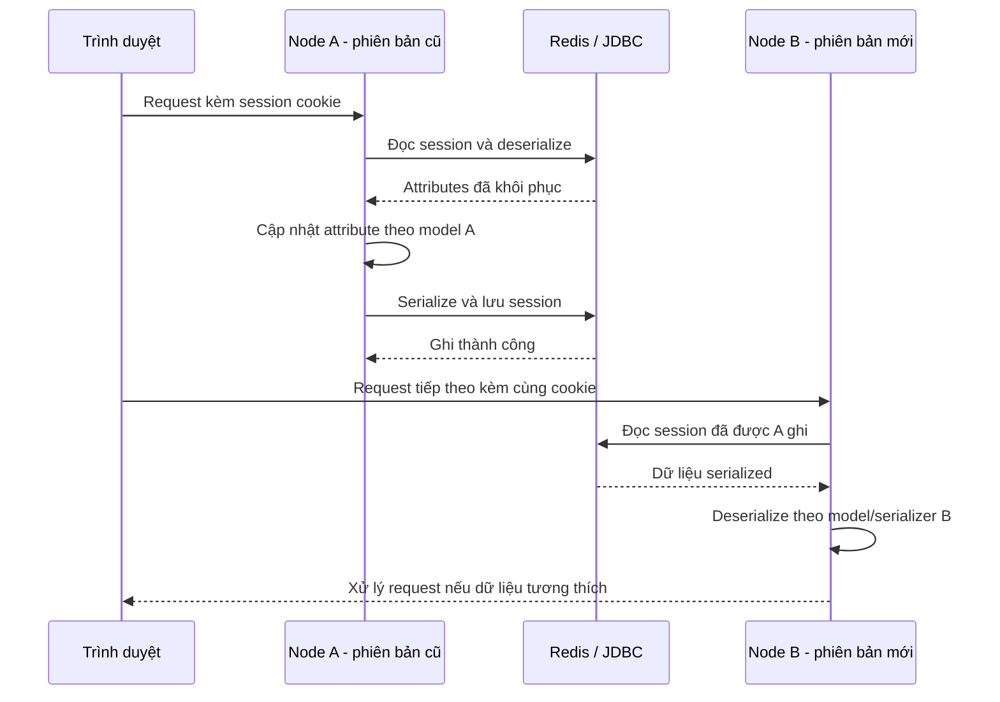
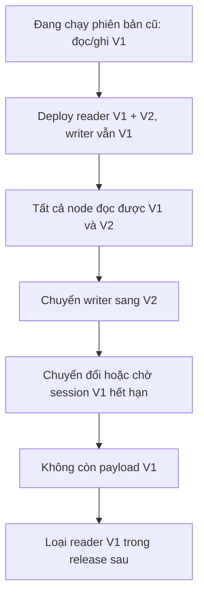

# Tương thích lớp dữ liệu và serializer trên các nút

Trong triển khai Spring Session nhiều instance, mọi node thường đọc và ghi session vào cùng một kho dữ liệu như Redis hoặc JDBC. Load balancer có thể chuyển request tiếp theo của người dùng từ node A sang node B. Vì vậy, B phải giải mã được dữ liệu mà A đã ghi, hiểu đúng ý nghĩa các thuộc tính và có thể tiếp tục cập nhật session.

Việc các node cùng kết nối một Redis hoặc database chưa đủ để bảo đảm tương thích. Các node còn phải thống nhất định dạng serialize, class được lưu, phiên bản thư viện, quy tắc chuyển đổi và ý nghĩa nghiệp vụ của dữ liệu. Một thay đổi class hoặc serializer có thể khiến session chỉ đọc được trên một số node, đặc biệt trong rolling deployment khi hai phiên bản ứng dụng cùng chạy.

## 1. Những lớp tương thích cần bảo đảm

Một session có thể chứa metadata của Spring Session, thuộc tính do ứng dụng đặt và `SecurityContext` do Spring Security lưu. Khi serialize, các giá trị này được chuyển thành byte hoặc JSON; khi deserialize, node khác phải tái tạo được object có kiểu và ý nghĩa phù hợp.

Có bốn lớp tương thích cần xem xét:

1. **Tương thích định dạng byte:** serializer của node đọc phải hiểu định dạng mà node ghi đã tạo. Java serialization, JSON, CBOR hoặc định dạng riêng không tự tương thích với nhau.
2. **Tương thích class và schema:** class, field, constructor, enum, package và type metadata phải có cách diễn giải tương thích giữa các phiên bản.
3. **Tương thích ngữ nghĩa:** dù deserialize thành công, các node phải hiểu giá trị theo cùng quy tắc. Ví dụ `status=1` không thể có nghĩa “đang xử lý” ở node A nhưng “đã hoàn tất” ở node B.
4. **Tương thích dependency/runtime:** phiên bản Spring Session, Spring Security, Jackson, Java và class custom phải hỗ trợ cùng dữ liệu trong giai đoạn các phiên bản chạy đồng thời.

Một lỗi ở bất kỳ lớp nào cũng có thể làm request thất bại hoặc tạo ra trạng thái sai. Do đó, kiểm thử “serialize rồi deserialize trên cùng một node” chưa đủ cho hệ thống nhiều instance.

## 2. Đường đi dữ liệu giữa các node

`SessionRepositoryFilter` trong ứng dụng Servlet hoặc `WebSessionManager` trong WebFlux đưa API session về repository. Repository dùng serializer/converter để ghi attributes vào kho dữ liệu. Node khác thực hiện thao tác ngược khi nhận request mang session ID tương ứng.



Sơ đồ mô tả tình huống node A và B có thể chạy hai phiên bản khác nhau. Nếu B không hiểu dữ liệu A ghi, lỗi thường chỉ xuất hiện sau khi load balancer chuyển request. Nếu B đọc được nhưng ghi một định dạng mà A không hiểu, lỗi có thể xuất hiện ở request sau quay lại A.

## 3. Chọn kiểu dữ liệu phù hợp để lưu trong session

Session attributes nên là dữ liệu nhỏ, ổn định và có mục đích rõ ràng. Không nên lưu trực tiếp toàn bộ entity hoặc object graph của tầng nghiệp vụ.

Ví dụ DTO có schema ổn định:

```java
import java.io.Serializable;

public final class CartSessionState implements Serializable {

    private static final long serialVersionUID = 1L;

    private final int schemaVersion;
    private final String cartId;
    private final int itemCount;

    public CartSessionState(int schemaVersion, String cartId, int itemCount) {
        this.schemaVersion = schemaVersion;
        this.cartId = cartId;
        this.itemCount = itemCount;
    }

    public int getSchemaVersion() {
        return schemaVersion;
    }

    public String getCartId() {
        return cartId;
    }

    public int getItemCount() {
        return itemCount;
    }
}
```

DTO này giữ một mã giỏ hàng, số lượng item và version schema. Dữ liệu chi tiết của giỏ hàng vẫn nằm trong database nghiệp vụ; session chỉ giữ thông tin cần để liên kết request với giỏ hàng.

Các kiểu nên tránh lưu trực tiếp:

- JPA entity có lazy proxy, quan hệ hai chiều hoặc nhiều association.
- `HttpServletRequest`, `HttpServletResponse`, `WebSession` hoặc object gắn với vòng đời request.
- Service, repository, connection, transaction, socket, stream, thread hoặc tài nguyên đang mở.
- Object lớn, mutable phức tạp hoặc thay đổi class liên tục theo từng lần release.
- Credential, access token hoặc dữ liệu bí mật không cần thiết.

Nếu một node cần dữ liệu mới nhất, nên lưu ID hoặc DTO snapshot nhỏ rồi truy vấn nguồn dữ liệu nghiệp vụ. Cách này giảm coupling giữa session và model nội bộ của từng service.

## 4. Java serialization và thay đổi class

Nếu repository dùng Java serialization, object và toàn bộ object graph phải có thể serialize. Class cần có mặt trên node đọc và phải tương thích với cấu trúc đã được ghi.

`serialVersionUID` giúp xác định phiên bản serialized class. Nên khai báo UID rõ ràng cho class session được lưu lâu:

```java
private static final long serialVersionUID = 1L;
```

Giữ nguyên UID có thể cho phép một số thay đổi tương thích như thêm field có thể nhận giá trị mặc định. Nhưng nó không chứng minh thay đổi class là an toàn. Xóa hoặc đổi kiểu field, thay đổi hierarchy, đổi enum constant hoặc thay đổi cách diễn giải giá trị có thể gây lỗi hoặc sai ngữ nghĩa dù deserialize không ném exception.

Ví dụ, phiên bản cũ lưu:

```java
class UserSessionState implements Serializable {
    private static final long serialVersionUID = 1L;
    private String userId;
    private String displayName;
}
```

Phiên bản mới đổi `userId` từ `String` sang một kiểu ID riêng. Dù code mới có thể chuyển đổi ID, dữ liệu byte cũ không nhất thiết có thể đọc trực tiếp vào class mới. Giải pháp tốt hơn là giữ DTO persisted ổn định và chuyển đổi từ DTO sang model mới ở tầng ứng dụng.

Không dùng class nội bộ hoặc anonymous class làm session schema. Tên class được compiler sinh ra có thể thay đổi giữa các lần build và khó duy trì tương thích.

## 5. JSON và schema có version

JSON giúp định dạng dễ quan sát và hỗ trợ schema rõ ràng hơn, nhưng JSON không tự giải quyết việc khôi phục kiểu Java. Serializer phải biết kiểu đích và cách diễn giải các field. Với dữ liệu đa hình, dùng type ID do ứng dụng quản lý và allowlist class được phép; không cho payload tùy ý chỉ định class name để khởi tạo.

Một envelope JSON có thể chứa loại và version:

```json
{
  "type": "cart-session-state",
  "version": 2,
  "value": {
    "cartId": "CART-42",
    "itemCount": 3,
    "currency": "VND"
  }
}
```

Converter đọc `type` và `version`, sau đó chọn DTO hoặc migration function tương ứng. Ví dụ version 1 không có `currency`; reader version 2 có thể gán mặc định theo quy tắc nghiệp vụ đã thống nhất. Không tự gán giá trị mặc định cho trường ảnh hưởng giá tiền, quyền truy cập hoặc trạng thái giao dịch nếu chưa có quyết định nghiệp vụ.

Quy tắc thiết kế schema:

- Dùng tên field và type ID ổn định, không phụ thuộc tên class Java nếu không cần.
- Xác định rõ field bắt buộc, field có thể thiếu, null và giá trị mặc định.
- Không đổi ý nghĩa field đang tồn tại; nếu semantics đổi, tạo field/version mới.
- Với enum, không xóa hoặc đổi tên constant khi dữ liệu cũ còn có thể tồn tại; có thể dùng mã chuỗi ổn định và mapping tường minh.
- Xác định cách xử lý field không được nhận diện để node mới có thể đọc dữ liệu cũ một cách có kiểm soát.
- Kiểm tra timezone, format thời gian, số thập phân và encoding giữa các node.

## 6. Cấu hình serializer nhất quán trên mọi node

Với Spring Session Data Redis, serializer cho session attributes thường được cung cấp qua bean được Spring Session nhận diện, phổ biến là `springSessionDefaultRedisSerializer`. Với Spring Session JDBC, việc chuyển `Object` thành `byte[]` và ngược lại được thực hiện qua `ConversionService`; cấu hình tùy chỉnh thường dùng bean `springSessionConversionService` theo phiên bản hỗ trợ.

Ví dụ cấu hình JSON cho Redis ở mức khái niệm:

```java
@Bean(name = "springSessionDefaultRedisSerializer")
RedisSerializer<Object> sessionSerializer(ObjectMapper sessionObjectMapper) {
    return new GenericJackson2JsonRedisSerializer(sessionObjectMapper);
}
```

Ví dụ trên giả định dự án đang dùng Jackson 2 và phiên bản Spring Data Redis có constructor tương ứng. API serializer có thể thay đổi theo major version; cần dùng đúng API của dependency được quản lý trong dự án. `ObjectMapper` phải được cấu hình thống nhất, gồm module cho các kiểu cần lưu, type metadata và validator phù hợp.

Với JDBC, `ConversionService` phải hỗ trợ cả hai chiều:

- `Object` thành `byte[]` khi ghi `SPRING_SESSION_ATTRIBUTES.ATTRIBUTE_BYTES`.
- `byte[]` thành object khi đọc attribute.

Không để node A dùng Java serialization trong khi node B dùng JSON trên cùng namespace/bảng, trừ khi converter được thiết kế để đọc cả hai định dạng và có thể phân biệt rõ format. Nếu không, lỗi deserialize sẽ phụ thuộc node nhận request.

Mọi node phải đồng nhất:

- Serializer implementation và cấu hình mapper.
- Phiên bản Jackson hoặc thư viện serialization khác.
- Module Spring Security cần thiết cho `SecurityContext`/Authentication.
- Type ID, allowlist và custom serializer/deserializer.
- Custom principal, DTO và class được lưu trong session.
- Quy tắc nén, mã hóa, key version và cách xoay khóa nếu có.

## 7. Spring Security và SecurityContext

Nếu ứng dụng lưu `SecurityContext` trong session, các object bên trong có thể gồm Authentication token, principal và authorities. Một node có thể xác thực người dùng bằng class principal riêng rồi lưu object đó; node khác cần có cùng class hoặc converter tương thích để khôi phục.

Với Jackson 2, Spring Security cung cấp các module Jackson có thể được đăng ký qua API `SecurityJackson2Modules` trong các phiên bản hỗ trợ. Các module này giúp xử lý những kiểu Spring Security mà chúng hỗ trợ. Chúng không tự động xử lý mọi custom principal, token của bên thứ ba hoặc mọi class do ứng dụng định nghĩa.

Các điểm cần kiểm tra:

1. Các node dùng cùng major/minor version Spring Security tương thích.
2. Custom principal có mặt trên mọi node và có schema ổn định.
3. Authorities có cùng cách biểu diễn và ý nghĩa.
4. Type metadata/validator cho phép đúng các class cần thiết.
5. Không serialize credential hoặc token nhạy cảm không cần thiết.
6. Kiểm thử đăng nhập thật và đọc SecurityContext ở node khác, không chỉ tạo object giả trong unit test.

Khi nâng Jackson hoặc Spring Security major version, kiểm tra lại module, serializer API và dữ liệu session cũ. Không ghép tùy ý module Jackson 2 với mapper Jackson 3.

## 8. Rolling deployment: ma trận đọc và ghi

Trong rolling deployment, phiên bản cũ và mới cùng chạy trong một khoảng thời gian. Điều quan trọng là không chỉ hỏi “node mới đọc được dữ liệu cũ không?” mà còn phải hỏi “node cũ có đọc được dữ liệu mới không?”.

| Writer | Reader | Điều kiện |
|---|---|---|
| Phiên bản cũ | Phiên bản cũ | Hành vi hiện tại phải tiếp tục hoạt động |
| Phiên bản cũ | Phiên bản mới | Bắt buộc nếu node mới nhận session được node cũ ghi |
| Phiên bản mới | Phiên bản mới | Bắt buộc sau khi nâng cấp hoàn tất |
| Phiên bản mới | Phiên bản cũ | Bắt buộc nếu node cũ còn phục vụ request hoặc cần rollback |

Nếu không thể hỗ trợ chiều phiên bản mới ghi và phiên bản cũ đọc, không được bật ghi format mới khi node cũ vẫn còn trong pool hoặc có thể được khôi phục. Cần một chiến lược deploy rõ ràng.

## 9. Chiến lược expand-migrate-contract

Một cách triển khai thay đổi serializer an toàn là chia thành các pha:

**Pha 1 — Expand reader:** phát hành phiên bản có thể đọc cả format cũ và format mới, nhưng vẫn ghi format cũ. Triển khai lên toàn bộ node. Trong pha này, dữ liệu hiện có tiếp tục được hiểu như trước.

**Pha 2 — Chuyển writer:** sau khi mọi node đã hỗ trợ format mới, bật ghi format mới. Các reader đều hiểu cả hai format nên session mới có thể được đọc ở mọi node.

**Pha 3 — Migrate hoặc chờ hết hạn:** dữ liệu format cũ có thể được chuyển đổi khi đọc/ghi lại, qua migration job có kiểm soát hoặc để session hết idle/absolute timeout tự nhiên. Không cần migration nếu số lượng session cũ nhỏ và thời gian tồn tại có giới hạn phù hợp.

**Pha 4 — Contract:** khi không còn dữ liệu cũ và không còn node có khả năng ghi format cũ, loại bỏ reader cũ trong một release sau.



Nếu cần rollback, giữ reader V1 và bảo đảm writer V2 chưa được bật cho tới khi phiên bản cũ có thể bị loại bỏ hoàn toàn hoặc rollback được thiết kế để hiểu V2. Một chiến lược chỉ tương thích theo chiều tiến không đủ cho rollback.

## 10. Thay đổi không tương thích và cách xử lý

Một số thay đổi có rủi ro cao đối với session data:

| Thay đổi | Rủi ro | Cách xử lý |
|---|---|---|
| Đổi Java class package/name | Java serialization hoặc type metadata không tìm thấy class cũ | Giữ compatibility class/alias hoặc chuyển DTO có type ID ổn định |
| Đổi kiểu field | Deserialize thất bại hoặc ép kiểu sai | Tạo version schema mới và migration rõ ràng |
| Xóa enum constant | Payload cũ không ánh xạ được | Giữ constant cũ trong thời gian tương thích hoặc dùng code mapping |
| Đổi tên JSON property | Reader cũ/mới không tìm thấy field | Hỗ trợ alias hoặc đọc cả tên cũ và mới trong giai đoạn chuyển tiếp |
| Thay serializer Java bằng JSON | Byte format hoàn toàn khác | Reader dual-format trước khi chuyển writer |
| Thay module Spring Security | SecurityContext/Authentication có thể đổi kiểu hoặc cấu trúc | Kiểm thử fixture và module tương ứng theo version |
| Bật mã hóa hoặc đổi encryption key | Node khác không giải mã được ciphertext | Dùng key ID/version và hỗ trợ nhiều key trong giai đoạn rotation |
| Thay đổi timezone/number format | Giá trị deserialize được nhưng ngữ nghĩa sai | Quy định UTC, precision và format thống nhất |

Không giải quyết lỗi bằng cách bắt exception rồi trả `null` cho session attribute. Điều đó che giấu lỗi tương thích và có thể làm mất trạng thái xác thực hoặc nghiệp vụ. Nếu payload không thể đọc an toàn, xử lý theo chính sách đã định: từ chối session, yêu cầu đăng nhập lại hoặc chạy migration có kiểm soát.

## 11. Mã hóa và nén cũng là một phần của định dạng

Nếu session payload được nén hoặc mã hóa trước khi lưu, các node cần thống nhất thứ tự xử lý, thuật toán, encoding và version metadata. Ví dụ, node A nén rồi mã hóa nhưng node B giải mã theo thứ tự ngược sẽ không đọc được payload.

Khi xoay encryption key:

- Gắn key identifier hoặc version vào envelope để reader biết khóa cần dùng.
- Trong giai đoạn chuyển tiếp, reader có thể giải mã bằng khóa hiện tại và khóa cũ được phép.
- Writer chỉ dùng khóa mới sau khi tất cả node đã có khả năng đọc khóa đó.
- Loại bỏ khóa cũ sau khi payload cũ hết hạn hoặc được migrate.
- Kiểm thử backup/restore và rollback; mất khóa có thể làm session không thể khôi phục.

Không đưa encryption key vào session, source code hoặc log. Dùng secret manager/KMS và phân quyền truy cập khóa theo instance. Nén không phải biện pháp bảo mật; mã hóa cũng không thay thế kiểm soát quyền truy cập Redis/JDBC.

## 12. Nhiều repository và namespace

Các node phải dùng cùng repository logic và cùng vùng dữ liệu. Với Redis, cần thống nhất endpoint/cluster, database hoặc namespace và serializer. Với JDBC, cần thống nhất database/schema, schema version, cột binary và conversion service.

Không để node A ghi vào namespace `app:sessions:v1` còn node B đọc `app:sessions:v2` nếu chưa có migration hoặc cơ chế dual-read. Tương tự, không để các node dùng database schema khác nhau trong khi cùng phục vụ session.

Nếu muốn đổi namespace để tách format mới, cần quyết định session cũ được xử lý thế nào. Một lựa chọn là chấp nhận người dùng đăng nhập lại sau khi chuyển namespace; lựa chọn khác là đọc cả namespace cũ và mới trong giai đoạn chuyển tiếp. Hãy cân nhắc số lượng session, yêu cầu trải nghiệm và khả năng rollback.

## 13. Kiểm thử tương thích giữa các node

Kiểm thử cần mô phỏng ít nhất hai phiên bản serializer hoặc hai instance có cấu hình khác nhau trong giai đoạn nâng cấp. Các test quan trọng:

1. **Round-trip cùng phiên bản:** node A ghi, node A đọc lại.
2. **Đọc chéo:** node A ghi payload, node B đọc; đảo chiều B ghi và A đọc nếu rollback cần hỗ trợ.
3. **Fixture cũ:** đọc payload được tạo bởi release trước, gồm các class và attributes còn tồn tại trong session production.
4. **Thiếu field:** kiểm tra reader xử lý field mới/thiếu field theo schema version.
5. **Field đổi kiểu hoặc enum:** xác nhận dữ liệu không tương thích bị phát hiện có chủ đích.
6. **Custom principal/SecurityContext:** đăng nhập thật trên node A, đọc principal và authorities trên node B.
7. **Mixed deployment:** chạy đồng thời hai phiên bản ứng dụng sau load balancer, luân phiên request với cùng cookie.
8. **Writer compatibility:** xác nhận node cũ không bị gửi payload mới nếu nó chưa hỗ trợ format mới.
9. **Serializer mismatch:** cố ý cấu hình khác serializer trên một node và xác nhận health check/deployment validation phát hiện sai lệch.
10. **Encryption rotation:** đọc payload được mã hóa bằng key cũ và ghi payload bằng key mới trong giai đoạn chuyển tiếp.
11. **Rollback:** triển khai phiên bản mới, tạo session mới, sau đó chạy lại phiên bản cũ và xác nhận dữ liệu vẫn đọc được nếu rollback là yêu cầu.

Nên giữ fixture serialization giả, không chứa dữ liệu cá nhân hoặc credential thật. Với Redis/JDBC, dùng Testcontainers hoặc môi trường tích hợp riêng để kiểm tra repository thực tế. Unit test converter không thay thế kiểm thử request qua hai node.

## 14. Health check và quan sát cấu hình serializer

Không nên chờ tới khi người dùng gặp lỗi mới phát hiện node dùng serializer khác. Có thể công bố metadata triển khai an toàn trong startup log hoặc endpoint quản trị nội bộ:

- Application build/version.
- Session repository type.
- Serializer/converter identifier và schema version.
- Jackson/Spring Security major version.
- Namespace hoặc database schema identifier không chứa secret.
- Compatibility mode hiện tại: đọc V1/V2, ghi V1 hay V2.

Không log payload, session ID, cookie hoặc encryption key. Một health check có thể so sánh serializer identifier giữa node với giá trị cấu hình triển khai mong đợi. Không nhất thiết phải serialize một session thật trong health endpoint; có thể dùng DTO giả và kiểm tra round-trip trong startup validation.

Các metrics cần theo dõi:

| Metric | Dấu hiệu |
|---|---|
| Serialize failures | Node không thể ghi attribute mới |
| Deserialize failures theo node/version | Một node không đọc được dữ liệu do node khác ghi |
| Session lookup miss tăng | Có thể khác namespace, repository hoặc cookie resolver |
| Authentication restore failures | SecurityContext hoặc principal không tương thích |
| Session size/attribute count | Payload tăng bất thường sau release |
| Rolling deployment version mix | Số lượng node đang chạy mỗi version |

Không dùng session ID, username hoặc tên principal làm metric label vì cardinality cao và có thể lộ dữ liệu.

## 15. Quy trình triển khai thay đổi model/serializer

Trước một release thay đổi session data, thực hiện các bước:

1. Liệt kê session attributes đang lưu và kiểu thực tế của từng attribute.
2. Xác định serializer, module, type metadata và schema version hiện tại.
3. Đánh giá thay đổi class/field/enum/package và xác định hướng tương thích đọc/ghi.
4. Tạo fixture giả từ format cũ và test converter mới đọc được.
5. Triển khai reader tương thích tới mọi node trước khi bật writer mới.
6. Xác nhận mọi node có cùng serializer configuration và classpath.
7. Chuyển writer theo pha; theo dõi lỗi deserialize và session restore.
8. Chờ payload cũ hết hạn hoặc migrate có kiểm soát.
9. Chỉ loại bỏ reader cũ khi không còn node rollback và không còn payload cũ.
10. Kiểm thử lại sau khi hoàn tất rolling deployment và xác nhận request có thể đi qua bất kỳ node nào.

Nếu thay đổi không thể tương thích, hãy chọn một cutover rõ ràng: đổi namespace, invalidation session hoặc yêu cầu đăng nhập lại theo kế hoạch. Không để một số node âm thầm đọc format mới còn node khác đọc format cũ trên cùng session store.

## 16. Lỗi thường gặp và hướng điều tra

| Hiện tượng | Nguyên nhân có thể | Hướng kiểm tra |
|---|---|---|
| Request lỗi chỉ khi chuyển sang node khác | Classpath hoặc serializer khác nhau | So sánh build/version, serializer ID và dependency versions |
| `InvalidClassException` | Java serialized class không tương thích | Kiểm tra `serialVersionUID`, field và fixture cũ |
| `ClassNotFoundException` | Node đọc thiếu class đã được node ghi sử dụng | Đồng bộ artifact và class custom trên mọi node |
| `InvalidTypeIdException` | JSON type ID không được nhận diện hoặc validator không cho phép | Kiểm tra schema version, type registry và allowlist |
| SecurityContext không khôi phục | Module Spring Security thiếu hoặc custom principal khác nhau | Kiểm tra module Jackson, Authentication type và test đăng nhập chéo node |
| Sau rollback người dùng bị lỗi session | Node cũ không đọc format mà node mới đã ghi | Kiểm tra writer cutover và chiều tương thích ngược |
| Chỉ một số session bị lỗi | Session cũ chứa class/field chỉ có trong release trước | Dùng fixture và chính sách migration/expiration |
| Session mất sau đổi namespace | Node đọc namespace mới nhưng session cũ ở namespace cũ | Xác nhận migration hoặc chủ đích yêu cầu đăng nhập lại |
| Lỗi giải mã sau xoay khóa | Node chưa có khóa cũ/mới tương ứng hoặc key ID không đúng | Kiểm tra key version và rollout key reader trước writer |

Khi điều tra, ghi exception type, application version, node, serializer ID và schema version. Không ghi session ID, cookie, SecurityContext hoặc raw serialized bytes vào log.

## 17. Nguyên tắc cần nhớ

- Mọi node dùng chung session store phải đọc được dữ liệu do các node khác ghi trong cùng giai đoạn triển khai.
- Tương thích bao gồm định dạng byte, class/schema, ngữ nghĩa dữ liệu và dependency/runtime.
- Lưu DTO nhỏ, ổn định; tránh entity, proxy và object gắn với tài nguyên runtime.
- Java serialization cần quản lý `serialVersionUID` và kiểm thử fixture cũ; JSON cần schema/type ID và quy tắc field rõ ràng.
- Cấu hình serializer, module Spring Security, custom principal và conversion service phải nhất quán giữa các node.
- Rolling deployment phải kiểm tra cả chiều node mới đọc dữ liệu cũ và node cũ đọc dữ liệu mới nếu cần rollback.
- Dùng chiến lược expand-migrate-contract: mở rộng reader trước, chuyển writer sau, rồi mới loại reader cũ.
- Mã hóa, nén, namespace và schema database cũng là một phần của hợp đồng dữ liệu.
- Kiểm thử đọc chéo node, mixed-version deployment, SecurityContext, rollback và dữ liệu fixture.
- Không che lỗi deserialize bằng cách trả `null`; không log session ID, cookie hoặc payload nhạy cảm.
