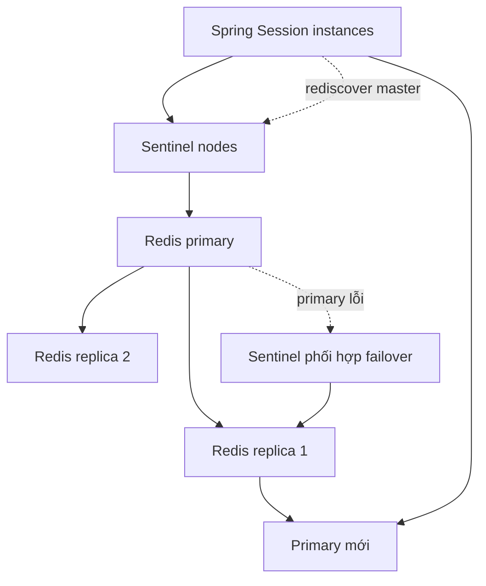
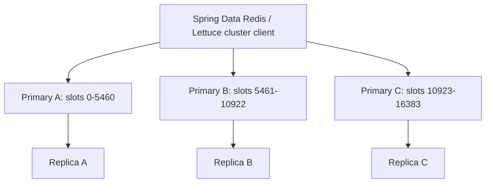

# Redis Sentinel, Redis Cluster và lựa chọn theo yêu cầu kho

Khi nhiều instance Spring Session cùng lưu session vào Redis, Redis trở thành một thành phần hạ tầng quan trọng của đường xử lý request. Nếu Redis ngừng phục vụ, đổi primary, phân vùng mạng hoặc hết dung lượng, người dùng có thể không đọc hoặc lưu được session dù các instance Spring vẫn khỏe. Vì vậy, lựa chọn topology Redis phải dựa trên yêu cầu về tính sẵn sàng, dung lượng, thông lượng, thời gian phục hồi, khả năng mất dữ liệu chấp nhận được và cách Spring Session sử dụng key/notification.

Redis Sentinel và Redis Cluster giải quyết hai nhóm nhu cầu khác nhau. Sentinel giám sát một primary cùng các replica và điều phối failover để tăng tính sẵn sàng cho một Redis dataset không phân mảnh. Redis Cluster phân chia keyspace thành nhiều slot trên nhiều primary, đồng thời hỗ trợ replica/failover cho từng shard. Cluster cung cấp sharding ngang; Sentinel không cung cấp sharding. Không có lựa chọn nào tự bảo đảm mọi lần ghi session đều được lưu bền vững hoặc mọi request đang chạy đều không bị gián đoạn khi failover.

Trong `SPRING_SESSION`, repository Redis của Spring Session dùng Spring Data Redis để đọc/ghi session và các key liên quan. Ứng dụng phải cấu hình connection factory phù hợp, thống nhất namespace và serializer giữa các instance, kiểm thử expiration events và xử lý lỗi datastore như một lỗi hạ tầng riêng. Bài học này giúp chọn Sentinel, Cluster hoặc dịch vụ Redis được quản lý theo yêu cầu thực tế.

## 1. Phân biệt Sentinel và Cluster

| Tiêu chí | Redis Sentinel | Redis Cluster |
|---|---|---|
| Mục tiêu chính | High availability cho một Redis primary và các replica | Sharding keyspace và high availability theo shard |
| Phân phối dữ liệu | Một dataset logic trên primary; replica sao chép dữ liệu | Key được phân vào 16.384 hash slot trên nhiều primary |
| Ghi dữ liệu | Client ghi vào primary hiện tại | Client định tuyến lệnh tới primary sở hữu slot của key |
| Failover | Sentinel bầu/chọn replica để thăng cấp thành primary | Replica của shard có thể được thăng cấp khi primary shard lỗi |
| Mở rộng dung lượng ghi | Chủ yếu tăng tài nguyên của một primary; replica không chia tải ghi | Thêm shard/primary để tăng dung lượng và phân phối tải |
| Multi-key operation | Có thể thực hiện trên một Redis dataset theo giới hạn Redis thường | Các key trong một multi-key command/script thường phải cùng hash slot |
| Client | Phải hiểu Sentinel để tìm primary mới | Phải hiểu cluster topology và xử lý `MOVED`/`ASK` redirect |
| Độ phức tạp vận hành | Thấp hơn Cluster, nhưng vẫn cần quorum, replica và client reconnect | Cao hơn do slot, shard, topology, rebalancing và giới hạn cross-slot |

Sentinel và Cluster đều có thể dùng replica và failover, nhưng chúng không thể thay thế nhau. Không thể bật Sentinel rồi mong dữ liệu tự được chia trên nhiều primary. Cũng không nên cấu hình Sentinel endpoints trong client cluster hoặc ngược lại.

## 2. Redis Sentinel hoạt động như thế nào?

Một triển khai Sentinel thường có:

- Một Redis primary nhận lệnh ghi.
- Một hoặc nhiều Redis replica sao chép dữ liệu từ primary.
- Nhiều tiến trình Sentinel giám sát primary/replica, trao đổi trạng thái và điều phối failover.

Ứng dụng kết nối tới các Sentinel node và hỏi primary hiện tại có tên logic, ví dụ `mymaster`. Khi primary bị coi là không khả dụng, Sentinel phối hợp theo quorum và majority để xác định failover, chọn một replica đủ điều kiện và quảng bá primary mới. Client có hỗ trợ Sentinel phát hiện thay đổi và kết nối lại tới primary mới.



Sentinel không nằm trên đường chuyển tiếp mọi lệnh Redis. Nó cung cấp thông tin topology và điều phối failover; ứng dụng sau đó kết nối trực tiếp tới Redis primary/replica theo cấu hình client.

### 2.1. Quorum và số lượng Sentinel

Sentinel cần đủ tiến trình để phân biệt primary thực sự lỗi với lỗi kết nối cục bộ. Một Sentinel có thể tự đánh dấu trạng thái subjectively down (SDOWN); để xác nhận objectively down (ODOWN), cần số phiếu đạt quorum được cấu hình. Việc thực hiện failover còn phụ thuộc majority của các Sentinel được biết và khả năng bầu leader.

Trong production, thường triển khai ít nhất ba Sentinel ở các failure domain khác nhau để tránh một máy hoặc một zone duy nhất quyết định toàn bộ hệ thống. Quorum không phải số replica; đó là số Sentinel cần đồng thuận cho đánh giá down. Cấu hình quorum quá thấp có thể gây failover giả; quá cao có thể khiến failover không xảy ra khi một phần Sentinel mất kết nối.

### 2.2. Replica và nguy cơ mất lần ghi gần nhất

Redis replication thông thường là bất đồng bộ. Primary có thể xác nhận một lệnh ghi trước khi replica nhận và áp dụng lệnh đó. Nếu primary hỏng ngay sau khi xác nhận, replica được thăng cấp có thể thiếu một số lần ghi gần nhất.

Với session store, hệ quả có thể là:

- Session mới vừa tạo không còn sau failover.
- Thuộc tính vừa cập nhật quay về giá trị trước đó.
- Session vừa bị xóa có thể xuất hiện lại nếu replica chưa nhận thao tác xóa.
- TTL hoặc metadata của một số key có thể khác trạng thái client vừa quan sát.

Không coi Sentinel là cơ chế đồng bộ ghi tuyệt đối. `WAIT` hoặc các cấu hình durability có thể cải thiện một số thuộc tính xác nhận replication, nhưng không biến Redis replication thành transaction bền vững tuyệt đối và cần được đánh giá theo topology/client. Session nên được xem là trạng thái xác thực tạm thời; dữ liệu nghiệp vụ quan trọng phải nằm ở kho có durability phù hợp.

## 3. Redis Cluster hoạt động như thế nào?

Redis Cluster chia keyspace thành 16.384 hash slot. Mỗi key được ánh xạ tới một slot bằng CRC16; các primary node sở hữu những dải slot khác nhau. Mỗi primary có thể có một hoặc nhiều replica để hỗ trợ failover.

Ví dụ một cluster ba primary:



Các dải slot trong sơ đồ chỉ minh họa cách chia; phân bổ thật có thể khác. Client cluster-aware có thể nhận redirect `MOVED` khi slot thuộc node khác và `ASK` trong quá trình slot migration. Lettuce/Spring Data Redis quản lý topology và redirect theo cấu hình client.

### 3.1. Sharding và failover

Cluster phân phối key trên nhiều primary, nên có thể mở rộng dung lượng và throughput ghi bằng cách thêm shard. Khi một primary không khả dụng, replica phù hợp có thể được bầu lên làm primary mới cho các slot của shard đó.

Failover của Cluster không có nghĩa toàn bộ cluster luôn phục vụ mọi lệnh trong mọi tình huống. Nếu một shard mất primary và không có replica đủ điều kiện, các slot thuộc shard đó có thể không khả dụng. Cluster cần đa số master có thể giao tiếp để duy trì trạng thái topology nhất quán theo điều kiện của Redis Cluster.

Trong production, không nên triển khai cluster chỉ với một primary hoặc bỏ replica rồi kỳ vọng high availability. Mô hình thường gặp là ít nhất ba primary trên các failure domain phù hợp, mỗi primary có replica ở node/zone khác. Số lượng và bố trí cụ thể phụ thuộc tải, cloud topology và SLA.

### 3.2. Multi-key và hash slot

Redis Cluster yêu cầu các key của một số lệnh nhiều key, transaction hoặc Lua script phải nằm cùng hash slot. Nếu không, server trả lỗi `CROSSSLOT`. Redis hỗ trợ hash tag: phần nằm trong cặp `{...}` được dùng để tính slot, giúp các key liên quan có thể cùng slot.

Ví dụ:

```text
cart:{user-42}:items
cart:{user-42}:metadata
```

Hai key trên dùng cùng hash tag `user-42`, vì vậy được ánh xạ tới cùng slot. Hash tag hữu ích khi thiết kế keyspace riêng của ứng dụng. Không nên tự đổi key format nội bộ Spring Session hoặc ép mọi session vào một hash tag toàn cục nếu chưa hiểu repository; điều đó có thể dồn toàn bộ tải vào một shard và triệt tiêu lợi ích sharding.

Spring Session có thể dùng nhiều key liên quan cho session, expiration và index. Mức độ tương thích Cluster phụ thuộc phiên bản Spring Session, repository, các thao tác Redis thực tế và cách key được tạo. Cần kiểm thử đúng phiên bản với cluster thật, đặc biệt các thao tác save, delete, expiration, principal index và event subscription. Không suy luận rằng mọi custom multi-key command sẽ hoạt động trên Cluster chỉ vì lệnh đọc/ghi một key thành công.

## 4. Cấu hình Spring Data Redis với Sentinel

Spring Session sử dụng `RedisConnectionFactory` do Spring Data Redis cung cấp. Với Lettuce, có thể cấu hình Sentinel bằng Java:

```java
import org.springframework.context.annotation.Bean;
import org.springframework.context.annotation.Configuration;
import org.springframework.data.redis.connection.RedisConnectionFactory;
import org.springframework.data.redis.connection.RedisSentinelConfiguration;
import org.springframework.data.redis.connection.lettuce.LettuceConnectionFactory;

@Configuration
public class RedisSentinelConnectionConfiguration {

    @Bean
    RedisConnectionFactory redisConnectionFactory() {
        RedisSentinelConfiguration sentinel =
                new RedisSentinelConfiguration()
                        .master("mymaster")
                        .sentinel("sentinel-1.internal", 26379)
                        .sentinel("sentinel-2.internal", 26379)
                        .sentinel("sentinel-3.internal", 26379);

        return new LettuceConnectionFactory(sentinel);
    }
}
```

Tên master phải khớp với cấu hình Sentinel. Danh sách Sentinel cần có nhiều địa chỉ có thể truy cập từ mọi instance Spring. Nếu Redis/Sentinel yêu cầu username, password hoặc TLS, cấu hình credentials và SSL theo Spring Data Redis/Lettuce version đang dùng; không ghi secret vào source control.

Với Spring Boot, có thể cấu hình bằng properties thay vì tự tạo factory. Ví dụ dạng phổ biến ở các phiên bản Boot mới:

```yaml
spring:
  data:
    redis:
      sentinel:
        master: mymaster
        nodes:
          - sentinel-1.internal:26379
          - sentinel-2.internal:26379
          - sentinel-3.internal:26379
```

Tên prefix cấu hình thay đổi theo phiên bản Spring Boot; một số bản cũ dùng `spring.redis.*`. Kiểm tra metadata cấu hình của đúng phiên bản dự án. Không khai báo đồng thời Sentinel và Cluster properties với kỳ vọng Spring Boot tự kết hợp hai topology.

### 4.1. Bật Spring Session trên Sentinel

Với ứng dụng Servlet, cấu hình Redis HTTP session dùng cùng `RedisConnectionFactory`:

```java
@Configuration
@EnableRedisHttpSession(
        redisNamespace = "customer-portal:session",
        maxInactiveIntervalInSeconds = 1800)
public class SessionConfiguration {
}
```

Với WebFlux, dùng cấu hình Redis WebSession tương ứng, chẳng hạn `@EnableRedisWebSession`, cùng reactive connection factory được hỗ trợ. Không trộn Servlet `HttpSession` repository với WebFlux `WebSession` chỉ bằng cách thay connection factory.

Tất cả instance của cùng ứng dụng phải dùng cùng namespace, serializer, session timeout và Sentinel master name. Nếu một node kết nối tới Redis khác hoặc dùng namespace khác, session có thể biến mất khi load balancer chuyển request sang node đó.

## 5. Cấu hình Spring Data Redis với Cluster

Với Lettuce, có thể cung cấp danh sách seed nodes cho `RedisClusterConfiguration`:

```java
import java.util.List;
import org.springframework.context.annotation.Bean;
import org.springframework.context.annotation.Configuration;
import org.springframework.data.redis.connection.RedisClusterConfiguration;
import org.springframework.data.redis.connection.RedisConnectionFactory;
import org.springframework.data.redis.connection.lettuce.LettuceConnectionFactory;

@Configuration
public class RedisClusterConnectionConfiguration {

    @Bean
    RedisConnectionFactory redisConnectionFactory() {
        RedisClusterConfiguration cluster =
                new RedisClusterConfiguration(List.of(
                        "redis-1.internal:6379",
                        "redis-2.internal:6379",
                        "redis-3.internal:6379"));

        return new LettuceConnectionFactory(cluster);
    }
}
```

Seed nodes chỉ giúp client khám phá topology; chúng không nhất thiết là toàn bộ node của cluster. Client cần truy cập được các địa chỉ node mà cluster quảng bá. Nếu firewall hoặc NAT làm client không kết nối được địa chỉ quảng bá, kết nối ban đầu có thể thành công nhưng lệnh tới slot khác thất bại.

Với Spring Boot, cấu hình phổ biến:

```yaml
spring:
  data:
    redis:
      cluster:
        nodes:
          - redis-1.internal:6379
          - redis-2.internal:6379
          - redis-3.internal:6379
        max-redirects: 5
```

Hãy kiểm tra prefix theo Spring Boot version. Cần cấu hình password/ACL và TLS phù hợp cho mọi node, không chỉ seed node.

### 5.1. Kết hợp với Spring Session

Spring Session tiếp tục dùng Redis repository và namespace đã chọn. Repository không cần biết ứng dụng có ba hay sáu primary; Spring Data Redis/Lettuce cluster client định tuyến theo key slot.

Tuy nhiên, cần xác minh các thao tác repository thực tế tương thích cluster. Đặc biệt kiểm thử:

- Tạo session và ghi nhiều attributes.
- Đọc session trên request sau và từ instance khác.
- Cập nhật hoặc xóa attribute.
- Invalidate session.
- Hết hạn key và dọn key phụ.
- Principal index nếu dùng indexed repository.
- Keyspace notifications và `SessionExpiredEvent` nếu ứng dụng phụ thuộc event.

Nếu custom repository hoặc custom Redis script thực hiện multi-key operation, bảo đảm các key liên quan cùng slot hoặc thiết kế lại thao tác. Khi gặp `CROSSSLOT`, không xử lý bằng cách retry vô hạn; phải sửa key placement hoặc command design.

## 6. Sentinel hay Cluster cho Spring Session?

Lựa chọn phụ thuộc loại vấn đề cần giải quyết:

### 6.1. Chọn Sentinel khi cần HA cho một dataset vừa phải

Sentinel phù hợp khi:

- Dung lượng session và throughput của một primary vẫn đủ.
- Yêu cầu chính là tự động phát hiện primary lỗi và failover.
- Muốn giữ mô hình keyspace Redis thông thường, ít ràng buộc cross-slot.
- Hệ thống chưa cần sharding ngang.
- Đội vận hành muốn topology đơn giản hơn Cluster.

Sentinel không làm tăng dung lượng ghi bằng cách chia key sang nhiều primary. Replica chủ yếu phục vụ failover và có thể dùng cho một số read workload nếu ứng dụng chấp nhận eventual consistency; không nên đọc session từ replica lag nếu cần dữ liệu mới nhất ngay sau save.

### 6.2. Chọn Cluster khi cần sharding và tăng dung lượng

Cluster phù hợp khi:

- Dataset hoặc throughput vượt khả năng hợp lý của một primary.
- Cần phân phối keyspace và tải ghi trên nhiều primary.
- Đội vận hành có thể quản lý slot, rebalancing, replica và cluster-aware clients.
- Repository và mọi custom command đã được kiểm thử với ràng buộc multi-key/slot.
- Có chiến lược quan sát key distribution, hot slots và failover từng shard.

Cluster có chi phí vận hành cao hơn và không phải lúc nào cũng nhanh hơn cho một workload session nhỏ. Nếu chỉ cần failover cho một dataset vừa phải, Sentinel hoặc managed Redis HA có thể phù hợp hơn.

### 6.3. Dịch vụ Redis được quản lý

Một số cloud provider cung cấp endpoint primary/replica, Sentinel-compatible endpoint hoặc Redis Cluster-compatible endpoint với failover do dịch vụ điều phối. Khi dùng managed service, cần xác minh:

- Endpoint có hỗ trợ giao thức Sentinel hay yêu cầu endpoint cấu hình riêng.
- Endpoint cluster có quảng bá địa chỉ node mà ứng dụng truy cập được không.
- ACL, TLS, subnet, security group và DNS failover hoạt động ra sao.
- Keyspace notifications có được phép bật và có áp dụng trên mọi primary không.
- Dịch vụ có giới hạn lệnh, connection, Pub/Sub hoặc script nào không.
- SLA, backup, persistence và cơ chế phục hồi dữ liệu.

Không giả định một endpoint tên “primary” có nghĩa là client cần cấu hình Sentinel; nhiều dịch vụ quản lý failover bằng DNS hoặc proxy riêng.

## 7. So sánh theo yêu cầu vận hành

| Yêu cầu | Sentinel | Cluster |
|---|---|---|
| Tự động chuyển primary khi lỗi | Có, qua Sentinel quorum/majority | Có, theo replica của từng shard |
| Chia dung lượng trên nhiều primary | Không | Có |
| Giữ mô hình một keyspace không shard | Có | Không; key được phân theo slot |
| Độ phức tạp multi-key | Redis multi-key semantics thông thường | Phải cùng slot cho các lệnh yêu cầu co-location |
| Mở rộng dung lượng ghi | Chủ yếu nâng cấp primary | Thêm primary/shard và rebalance slot |
| Client cần biết topology | Sentinel-aware | Cluster-aware |
| Rủi ro replica lag | Có | Có, theo từng shard |
| Vận hành event/notifications | Theo primary hiện tại và listener | Cần xét key nằm trên mọi primary và behavior của phiên bản |
| Phù hợp session store nhỏ/vừa | Thường phù hợp | Có thể quá phức tạp nếu không cần sharding |
| Phù hợp session store rất lớn | Giới hạn bởi một primary | Có thể mở rộng ngang |

Không chọn Cluster chỉ vì ứng dụng có nhiều instance Spring. Nhiều instance Spring có thể chia sẻ một Redis Sentinel primary; số lượng application nodes và số Redis shards là hai quyết định độc lập.

## 8. Failover ảnh hưởng request và session như thế nào?

Khi primary lỗi, có thể xuất hiện một khoảng thời gian client không ghi/đọc được. Với Sentinel, client cần phát hiện primary mới và tạo kết nối lại. Với Cluster, client cần cập nhật topology và xử lý redirect hoặc lỗi shard trong lúc failover.

Trong thời gian chuyển đổi:

- `findById` có thể timeout hoặc phát lỗi connection.
- `save` có thể thất bại trước khi lệnh tới primary mới.
- Client có thể timeout sau khi Redis đã nhận lệnh, khiến kết quả commit không xác định từ phía ứng dụng.
- Một số lần ghi gần nhất có thể mất do replication bất đồng bộ.
- Request tiếp theo có thể thấy session cũ hoặc không thấy session vừa tạo.

Không chuyển lỗi kết nối Redis thành `Mono.empty()`, `null` hoặc “session không tồn tại”. Đó là lỗi hạ tầng, cần được phân biệt với session thực sự hết hạn. Nếu biến outage thành anonymous session, ứng dụng có thể làm người dùng bị logout hàng loạt và che giấu lỗi Redis.

### 8.1. Retry có giới hạn và idempotency

Đối với thao tác đọc session, retry giới hạn với backoff có thể phù hợp cho một số lỗi kết nối tạm thời. Không retry lỗi authentication, ACL, serialization hoặc cấu hình sai.

Đối với thao tác ghi, timeout không cho biết lệnh đã commit hay chưa. Retry có thể ghi lại cùng dữ liệu hoặc lặp side effect nếu ứng dụng ghép session save với nghiệp vụ khác. Hãy:

- Dùng retry có giới hạn, backoff và jitter khi phù hợp.
- Phân loại transient error thay vì bắt mọi exception.
- Thiết kế nghiệp vụ quan trọng với idempotency key/transaction ở kho chính.
- Đọc lại trạng thái sau failover nếu cần xác định kết quả.
- Không retry vô hạn hoặc tạo retry storm từ mọi instance cùng lúc.

### 8.2. Session không phải dữ liệu nghiệp vụ bền vững

Redis session store có thể mất một phần dữ liệu gần nhất trong failover hoặc khi eviction. Không lưu đơn hàng, số dư, giao dịch thanh toán hoặc trạng thái phê duyệt duy nhất trong session. Session nên giữ thông tin xác thực và tham chiếu ngắn hạn; dữ liệu chính nằm trong database nghiệp vụ có durability và transaction phù hợp.

## 9. Expiration events và keyspace notifications

Spring Session Redis có thể dùng Redis keyspace notifications để nhận biết key hết hạn/xóa và phát các application events như `SessionExpiredEvent` hoặc `SessionDeletedEvent`, tùy repository và phiên bản. Redis Sentinel không tự phát event Spring; nó chỉ điều phối topology. Redis Cluster cũng không tự bảo đảm listener của ứng dụng nhận mọi event từ mọi shard.

Một cấu hình notification thường gặp cho Spring Session Redis là `notify-keyspace-events Egx`, gồm keyevent notifications cho nhóm generic và expired. Giá trị chính xác cần theo tài liệu Spring Session của phiên bản đang dùng và các event repository cần nhận.

Với managed Redis không cho phép ứng dụng `CONFIG SET`, Spring Session có thể được cấu hình không cố thay đổi Redis server configuration, ví dụ dùng `ConfigureRedisAction.NO_OP`. Khi đó, quản trị viên phải bật keyspace notifications ở dịch vụ; `NO_OP` không tự bật notification.

### 9.1. Sentinel và notifications

Khi Sentinel failover, listener cần theo dõi đúng Redis primary mới và kết nối lại theo cấu hình Sentinel. Nếu subscription còn gắn với node cũ hoặc listener container không phục hồi, session vẫn có thể hết TTL nhưng ứng dụng không nhận được expiration event.

Kiểm thử sau failover:

1. Tạo session với timeout ngắn.
2. Xác minh event expiration được nhận trước failover.
3. Thực hiện failover trong môi trường test.
4. Tạo session mới và chờ hết hạn.
5. Xác minh listener đã kết nối tới primary mới và event được xử lý theo implementation.

### 9.2. Cluster và notifications

Keyspace notifications trong Cluster cần được đánh giá theo node giữ key. Key được phân phối trên nhiều primary; một subscriber chỉ kết nối một node có thể không quan sát đầy đủ các event local của mọi node tùy cách Redis và listener được triển khai. Kiểm tra phiên bản Spring Session/Spring Data Redis có hỗ trợ subscribe theo cluster topology hay không và cấu hình listener tương ứng.

Không dựa vào expiration event như cơ chế duy nhất để thu hồi quyền. Pub/Sub notification có thể bị bỏ lỡ khi subscriber dừng hoặc trong quá trình failover. Request vẫn phải xác minh session hợp lệ; tác vụ cleanup/reconciliation có thể cần thiết cho dữ liệu phụ.

## 10. Namespace, serializer và tất cả application instances

Dù dùng Sentinel hay Cluster, mọi instance của cùng ứng dụng phải thống nhất:

- `redisNamespace`/key prefix.
- Serializer cho session attributes.
- Tên và cấu trúc thuộc tính được lưu.
- Session timeout và chính sách gia hạn.
- Cấu hình principal index nếu dùng.
- Redis ACL, TLS và credentials cần thiết.
- Spring Session/Spring Data Redis version trong giai đoạn rolling deployment.

Nếu một instance dùng serializer khác, session được ghi bởi node A có thể không đọc được bởi node B. Nếu namespace khác nhau, node B không tìm thấy session. Nếu node cấu hình Redis database hoặc cluster seed khác, request có thể đọc một kho khác dù cookie giống nhau.

Không đổi namespace, serializer và topology cùng lúc nếu chưa có migration plan. Thay đổi serializer có thể cần dual-read hoặc hết hạn session cũ; thay đổi topology cần kiểm tra key placement và notifications.

## 11. Connection pool, timeout và topology refresh

Failover chỉ hữu ích nếu ứng dụng có thể kết nối lại nhanh và an toàn. Cần cấu hình:

- Connection pool đủ cho concurrency thực tế nhưng không vượt giới hạn server.
- Connect timeout và command timeout phù hợp với latency mạng.
- Lettuce topology refresh/cluster refresh theo khả năng phiên bản khi dùng Cluster.
- DNS/network route tới mọi node được quảng bá.
- TLS và ACL đồng nhất trên primary, replica, Sentinel hoặc toàn bộ cluster nodes.
- Shutdown/reconnect behavior để connection cũ được thay thế sau failover.

Không đặt timeout quá ngắn khiến request bình thường thất bại khi mạng có jitter; cũng không đặt quá dài khiến thread/request bị giữ quá lâu trong outage. Đo p95/p99 latency, pool wait time và reconnect duration để điều chỉnh.

Với Cluster, `max-redirects` giới hạn số lần client theo redirect. Nếu quá thấp, topology migration có thể làm request thất bại; nếu quá cao, lỗi routing có thể kéo dài. Không tăng tùy tiện để che một cluster topology sai.

## 12. Dung lượng, eviction và persistence

Session store thường chứa nhiều key nhỏ nhưng có thể tăng nhanh theo số người dùng đồng thời, kích thước attributes và timeout. Sentinel không chia dung lượng; Cluster chia keyspace nhưng vẫn cần capacity planning theo từng shard.

Theo dõi:

- Memory used, fragmentation và headroom.
- Số session, số key expiration và kích thước attribute trung bình.
- Evicted keys và expired keys.
- Replication lag, failover count và link status.
- CPU, command latency và connection count theo node.
- Cluster slot distribution và hot keys/hot slots.

Eviction policy cần được chọn có chủ đích. Nếu Redis evict active session keys khi thiếu bộ nhớ, người dùng có thể bị logout bất ngờ. Chính sách `noeviction` giúp tránh tự động loại bỏ key nhưng khi hết memory, write sẽ lỗi; ứng dụng phải cảnh báo và xử lý capacity trước khi tới ngưỡng. Không có một policy đúng cho mọi dịch vụ; session store nên có memory headroom và giới hạn payload.

Redis RDB/AOF và replication có ảnh hưởng tới khả năng phục hồi sau restart/failover. Session thường là dữ liệu tạm có thể yêu cầu người dùng đăng nhập lại nếu mất; nếu yêu cầu giữ session lâu hơn, cần xác định durability và backup policy cụ thể. Không đánh đổi độ sẵn sàng của database nghiệp vụ để cố giữ một session cache.

## 13. Bảo mật kết nối Redis

Redis session store chứa session attributes và có thể chứa `SecurityContext`, principal, CSRF state hoặc dữ liệu xác thực khác. Bảo vệ kết nối và quyền truy cập:

- Chỉ cho application nodes và operator cần thiết truy cập network Redis.
- Dùng ACL username/password với quyền tối thiểu; tách credentials ứng dụng và quản trị.
- Dùng TLS khi kết nối qua network không tin cậy hoặc theo yêu cầu nền tảng.
- Không mở Redis/Sentinel/Cluster ports ra Internet công cộng.
- Không ghi password, cookie, session ID hoặc serialized values vào log.
- Tách môi trường và namespace; không dùng chung credentials staging/production.
- Quản lý secret qua secret manager hoặc cơ chế triển khai an toàn.

Trong Cluster, phải áp dụng ACL/TLS cho mọi node mà client có thể được redirect tới. Chỉ bảo vệ seed node nhưng để các node khác không thể truy cập hoặc không có credentials phù hợp sẽ tạo lỗi khó chẩn đoán.

## 14. Kiểm thử Sentinel failover

Kiểm thử cần mô phỏng lỗi primary trong môi trường không ảnh hưởng production:

1. Khởi chạy primary, ít nhất một replica và đủ Sentinel nodes theo cấu hình test.
2. Khởi chạy ít nhất hai instance Spring Session cùng namespace/serializer.
3. Đăng nhập và tạo session qua instance A.
4. Đọc session qua instance B để xác minh shared store.
5. Chặn/dừng primary trong test và chờ Sentinel failover.
6. Xác minh Lettuce/Spring Data Redis phát hiện primary mới và kết nối lại.
7. Tạo, đọc, cập nhật và xóa session sau failover.
8. Kiểm tra request trong thời gian chuyển đổi nhận lỗi phù hợp, không bị coi như session rỗng một cách âm thầm.
9. Kiểm tra keyspace notification và expiration event sau khi listener reconnect.
10. Ghi nhận session nào mất hoặc quay về trạng thái cũ do replication lag.

Không chỉ kiểm tra `PING` tới Redis mới. Cần kiểm tra các thao tác repository thật và cookie qua hai instance.

## 15. Kiểm thử Redis Cluster

Integration test cần dùng cluster có nhiều primary và replica nếu muốn kiểm tra failover thực:

1. Xác minh cluster state và slot coverage đầy đủ.
2. Khởi chạy hai instance Spring Session dùng cùng cluster seed nodes.
3. Tạo nhiều session với ID khác nhau để dữ liệu được phân bố trên các slot.
4. Đọc session từ node ứng dụng khác và xác minh namespace/serializer đồng nhất.
5. Thực hiện set/remove attributes, invalidate và expiration.
6. Xác minh các custom multi-key commands/scripts không phát `CROSSSLOT`.
7. Thực hiện slot migration/rebalance trong môi trường test và theo dõi `MOVED`/`ASK` redirect.
8. Tắt một primary và xác minh replica được thăng cấp, client cập nhật topology.
9. Kiểm tra listener nhận expiration events từ các shard theo cơ chế implementation.
10. Xác minh các lỗi slot/node không khả dụng được phân loại là datastore error.

Test đơn node hoặc mock connection factory không chứng minh Cluster compatibility. Dùng đúng Spring Session, Spring Data Redis, Lettuce và Redis Cluster versions của production.

## 16. Lựa chọn theo kịch bản

| Kịch bản | Lựa chọn ban đầu hợp lý | Lý do và điều kiện |
|---|---|---|
| Ứng dụng vừa, cần tự failover primary | Sentinel hoặc managed HA tương đương | Không cần sharding; giữ mô hình keyspace đơn giản |
| Session store lớn, một primary không đủ throughput/memory | Redis Cluster | Có thể phân phối key và tải trên nhiều primary; phải test repository và multi-key behavior |
| Dùng Redis managed service với endpoint failover riêng | Topology theo hợp đồng nhà cung cấp | Không tự giả định Sentinel/Cluster từ tên endpoint |
| Session là cache tạm, chấp nhận login lại khi sự cố | Sentinel/Cluster theo capacity và SLA | Đặt trọng tâm availability/cost; không cần durability như database chính |
| Có custom Lua script hoặc nhiều multi-key operations | Sentinel dễ hơn nếu chưa thiết kế slot | Cluster yêu cầu key cùng slot; phải thiết kế hash tags và test |
| Cần scale đọc bằng replica | Xem xét read routing riêng | Session read-after-write có thể bị stale nếu đọc replica lag |
| Đội vận hành chưa có năng lực Cluster | Sentinel/managed service | Tránh chi phí vận hành slot/rebalance trước khi thật sự cần |

Đừng chỉ dựa vào số application instances để quyết định Cluster. Hãy đo session count, write rate, payload size, Redis memory/CPU, latency và growth forecast. Nếu một primary còn đủ headroom, sharding có thể làm tăng độ phức tạp mà không cải thiện trải nghiệm.

## 17. Lỗi thường gặp và cách khắc phục

| Triệu chứng | Nguyên nhân có thể | Hướng xử lý |
|---|---|---|
| Sentinel client không tìm thấy primary | Master name sai, Sentinel không đủ quorum hoặc network không truy cập | Kiểm tra master name, quorum, Sentinel addresses và ACL/network |
| Failover xảy ra nhưng ứng dụng tiếp tục dùng primary cũ | Client chưa refresh topology hoặc connection không reconnect | Kiểm tra Lettuce/Spring Data Redis version, reconnect và Sentinel config |
| Session vừa ghi biến mất sau failover | Replica chưa nhận lần ghi cuối trước khi primary hỏng | Đánh giá replication lag/durability; không coi session là business source of truth |
| Cluster trả `MOVED`/`ASK` liên tục | Client không cluster-aware, topology sai hoặc node address không truy cập được | Dùng cluster connection factory và mở network tới mọi advertised nodes |
| `CROSSSLOT` | Multi-key command/script chạm các slot khác nhau | Thiết kế key co-location/hash tags cho key do ứng dụng quản lý hoặc đổi thao tác |
| Cluster state thiếu slot | Rebalance/failover chưa hoàn tất hoặc node hỏng | Khôi phục slot coverage và kiểm tra cluster health |
| Chỉ một số session không đọc được | Namespace, key distribution, serializer hoặc node lỗi | Kiểm tra key slot, namespace, serializer và lỗi theo shard |
| Expiration event thiếu sau failover | Listener chưa reconnect hoặc notifications chưa bật trên node mới | Kiểm tra listener container và `notify-keyspace-events` |
| Cluster không phát đủ expiration event | Listener không theo dõi mọi primary hoặc behavior version-specific | Xác minh cluster event subscription, kiểm thử trên từng shard |
| Redis write timeout bị coi là session mới | Exception bị đổi thành empty/null | Giữ lỗi datastore riêng với session-not-found/expired |
| Người dùng logout hàng loạt khi Redis đầy | Active session bị eviction hoặc save thất bại | Theo dõi memory/eviction, đặt headroom và policy có chủ đích |
| Seed node kết nối được nhưng lệnh thất bại | Cluster quảng bá địa chỉ node không thể truy cập từ ứng dụng | Sửa announce address, DNS, NAT, firewall và TLS/ACL trên mọi node |

## 18. Checklist triển khai production

Trước khi chọn và triển khai topology Redis cho Spring Session:

1. Đo session count, write rate, payload size, TTL, peak concurrency và memory growth.
2. Xác định yêu cầu RTO/RPO, mức gián đoạn và mức mất session có thể chấp nhận.
3. Chọn Sentinel nếu cần HA cho một dataset vừa đủ; chọn Cluster khi thực sự cần sharding ngang.
4. Xác minh topology/endpoint của managed service theo tài liệu nhà cung cấp.
5. Cấu hình `RedisConnectionFactory` đúng loại Sentinel hoặc Cluster; không trộn hai topology.
6. Bảo đảm mọi application nodes có thể truy cập Sentinel/primary hoặc tất cả Cluster nodes được quảng bá.
7. Đồng bộ namespace, serializer, timeout, ACL và TLS giữa mọi instance.
8. Kiểm tra keyspace notifications và listener nếu ứng dụng phụ thuộc session lifecycle events.
9. Kiểm thử create/read/update/delete/expire session trên đúng topology và đúng version.
10. Kiểm thử failover, reconnect, replication lag, `MOVED`/`ASK`, `CROSSSLOT` và node offline.
11. Cấu hình timeout, pool, topology refresh, retry giới hạn và observability.
12. Theo dõi memory, eviction, replication lag, slot coverage, failover, latency và lỗi repository.
13. Giữ dữ liệu nghiệp vụ quan trọng trong database có transaction/durability; chỉ dùng session cho trạng thái tạm và tham chiếu.

Sentinel phù hợp khi cần failover cho một Redis dataset không phân mảnh; Cluster phù hợp khi cần phân phối keyspace và tăng dung lượng trên nhiều primary. Với Spring Session, lựa chọn không chỉ dựa trên khả năng kết nối: cần xác minh key layout, multi-key constraints, TTL, expiration notifications, serializer và hành vi repository trong lúc failover. Khi topology, client và mọi instance Spring được cấu hình nhất quán, Redis có thể cung cấp session store chia sẻ đáng tin cậy hơn; các lỗi failover vẫn phải được xử lý như lỗi hạ tầng và không được làm mất tính toàn vẹn của dữ liệu nghiệp vụ.
