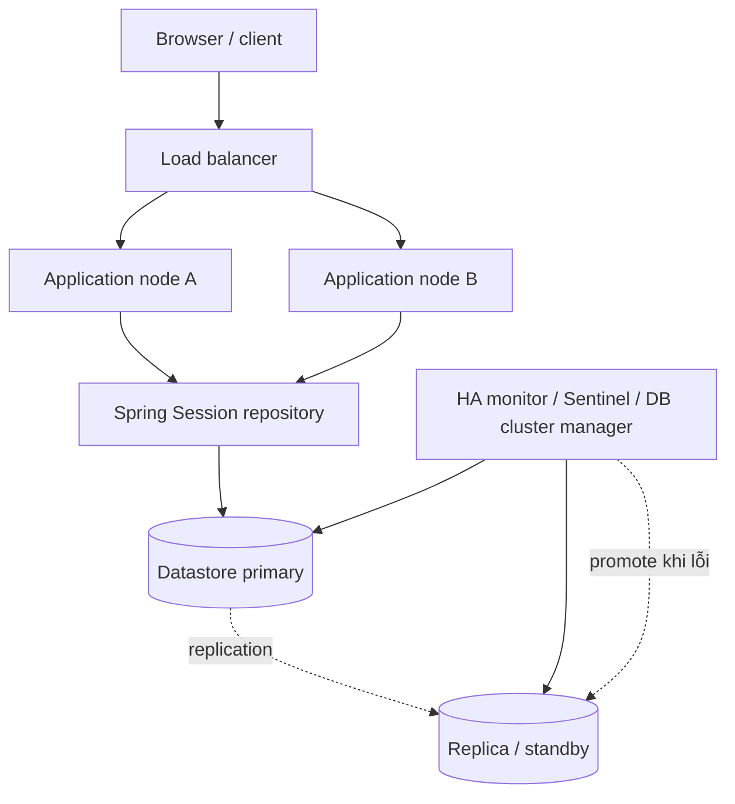

# Nhân bản dữ liệu, chuyển đổi dự phòng và giới hạn mất cập nhật

Spring Session cho phép nhiều instance ứng dụng đọc và ghi cùng trạng thái HTTP session thông qua một kho dữ liệu dùng chung như Redis hoặc JDBC. Khi kho dữ liệu được triển khai theo mô hình primary-replica hoặc primary-standby, dữ liệu còn được nhân bản sang nút dự phòng để hệ thống có thể tiếp tục phục vụ khi nút chính gặp sự cố.

Nhân bản và chuyển đổi dự phòng tăng tính sẵn sàng, nhưng không tự bảo đảm mọi lần ghi đã được xác nhận đều tồn tại sau mọi kiểu sự cố. Redis replication thường bất đồng bộ; database standby cũng có thể nhận transaction trễ nếu dùng asynchronous replication. Vì vậy, một request có thể đã nhận HTTP response thành công nhưng lần cập nhật session gần nhất vẫn chưa tới replica được chọn làm primary mới. Cần xác định RPO/RTO, hiểu semantics của datastore, thiết kế retry an toàn và không đặt dữ liệu nghiệp vụ không thể mất chỉ trong session.

## 1. Phân biệt ba vấn đề thường bị gọi chung là mất cập nhật

Trong hệ thống nhiều instance, có ít nhất ba dạng sự cố khác nhau:

1. **Concurrent lost update:** hai request cùng đọc một giá trị cũ, mỗi request sửa theo bản cũ rồi request ghi sau ghi đè thay đổi của request trước. Đây là race condition giữa các writer.
2. **Replication lag hoặc failover data loss:** primary đã nhận một lần ghi nhưng replica chưa nhận kịp; khi primary hỏng và replica được promote, lần ghi đó có thể biến mất.
3. **Client không biết kết quả commit:** datastore hoặc kết nối bị ngắt ngay sau khi gửi lệnh. Client không biết lệnh đã commit hay chưa và retry có thể tạo thao tác trùng.

Ba vấn đề cần các biện pháp khác nhau. Optimistic locking hoặc atomic update xử lý concurrent lost update ở dữ liệu nghiệp vụ. Replication mode, persistence và failover policy ảnh hưởng khả năng giữ lần ghi đã xác nhận. Idempotency key giúp xử lý retry khi kết quả commit không rõ.

| Vấn đề | Ví dụ | Biện pháp chính |
| --- | --- | --- |
| Concurrent lost update | Hai tab cùng cập nhật `cartState` | Versioning, transaction, atomic update hoặc merge |
| Replica chưa nhận lần ghi | Redis primary hỏng ngay sau khi ghi session | Chọn HA/persistence phù hợp, hiểu RPO, giảm cửa sổ replication lag |
| Kết quả ghi không rõ | Connection mất sau khi gửi `SET`/commit | Retry có giới hạn, thao tác idempotent và kiểm tra lại trạng thái |

Không nên cho rằng chuyển sang Redis Cluster, bật Sentinel hoặc tăng `FlushMode` sẽ tự giải quyết cả ba dạng lỗi.

## 2. Kiến trúc Spring Session với kho dữ liệu được nhân bản

Trong triển khai nhiều instance, các application node không nhân bản object `HttpSession` trực tiếp cho nhau. Mỗi node sử dụng Spring Session repository để đọc/ghi trạng thái trong một kho dùng chung. Hạ tầng datastore chịu trách nhiệm nhân bản dữ liệu sang standby/replica và chuyển vai trò khi có lỗi.



Các application node cần dùng cùng endpoint logic, namespace, schema, serializer và chính sách timeout. Endpoint logic có thể là Redis Sentinel, Redis Cluster hoặc địa chỉ writer của database HA. Không cấu hình một node ứng dụng ghi primary còn node khác đọc một replica độc lập nếu chưa chấp nhận semantics nhất quán yếu.

Sticky session ở load balancer không thay thế datastore dùng chung. Sticky routing chỉ cố gắng gửi request của một client tới cùng application node. Khi node đó hỏng, request có thể tới node khác; nếu session chỉ nằm trong heap của node cũ, trạng thái sẽ mất. Với Spring Session Redis/JDBC, các node đọc session từ repository chung nên có thể tiếp tục sau khi application node thay đổi.

## 3. Redis primary-replica replication

Redis replication thường hoạt động theo mô hình primary-replica. Application ghi vào primary; primary truyền các thay đổi sang một hoặc nhiều replica. Replica có thể phục vụ một số truy vấn đọc nếu ứng dụng chấp nhận dữ liệu trễ, nhưng các thao tác ghi thường đi tới primary hiện tại.

Trong mô hình mặc định phổ biến, replication là bất đồng bộ. Primary không nhất thiết đợi tất cả replica nhận và áp dụng một write trước khi trả kết quả cho client. Vì vậy:

- Request lưu session có thể thành công ở primary.
- Replica vẫn đang nhận dữ liệu hoặc đang xử lý backlog.
- Primary gặp sự cố trước khi write được replica áp dụng.
- Replica được promote có thể thiếu lần ghi gần nhất.

Điều này có thể làm người dùng bị yêu cầu đăng nhập lại, mất trạng thái wizard hoặc mất thuộc tính tạm trong session. Nếu ứng dụng lưu dữ liệu quan trọng như giỏ hàng có giá trị, tiến trình thanh toán hoặc draft không thể mất trong session, cần lưu bản chính trong database/service nghiệp vụ có durability phù hợp.

Replication lag thường được đo bằng thời gian hoặc lượng dữ liệu replica còn chậm so với primary. Lag tăng khi mạng chậm, replica quá tải, primary ghi nhiều hoặc replica đang thực hiện thao tác nặng. Một replica khỏe về kết nối chưa chắc đã theo kịp mọi write.

## 4. Redis Sentinel và Redis Cluster

Sentinel và Cluster giải quyết các phần khác nhau của bài toán Redis HA:

| Cơ chế | Mục đích | Cách failover khái quát | Điều cần lưu ý |
| --- | --- | --- | --- |
| Redis Sentinel | Theo dõi primary/replica và điều phối failover cho một nhóm primary | Sentinel thống nhất primary không khả dụng, chọn replica và promote thành primary mới | Không biến replication bất đồng bộ thành strong consistency |
| Redis Cluster | Chia dữ liệu thành hash slot trên nhiều primary, mỗi shard có replica | Replica của shard có thể được promote khi primary shard lỗi | Mỗi shard có replication riêng; failover và tính nhất quán vẫn phụ thuộc replication async |
| Redis primary-replica thủ công | Nhân bản dữ liệu, failover do vận hành hoặc hệ thống ngoài điều phối | Operator hoặc orchestrator thay đổi primary | Dễ xảy ra cấu hình lệch hoặc thời gian khôi phục dài nếu runbook không đầy đủ |

Sentinel không phải Redis Cluster và không phân vùng dữ liệu theo hash slot. Cluster không phải một cơ chế sao lưu; replica không thay thế backup độc lập. Cả hai đều cần theo dõi replica health, replication offset/lag, memory, persistence và khả năng kết nối của client.

Ứng dụng Spring nên kết nối thông qua cơ chế discovery/HA tương ứng thay vì ghim vào địa chỉ IP của primary hiện tại. Với Sentinel, client cần biết Sentinel nodes và tên master logic. Với Cluster, client cần danh sách seed nodes và khả năng cập nhật topology.

## 5. Cấu hình Spring Boot kết nối Redis Sentinel

Ví dụ cấu hình minh họa cho ứng dụng dùng Spring Session Redis và Redis Sentinel:

```yaml
spring:
  data:
    redis:
      username: ${REDIS_USERNAME:default}
      password: ${REDIS_PASSWORD}
      sentinel:
        master: session-master
        nodes:
          - redis-sentinel-1.internal:26379
          - redis-sentinel-2.internal:26379
          - redis-sentinel-3.internal:26379
  session:
    timeout: 30m
    redis:
      namespace: portal:sessions
      flush-mode: on-save
      save-mode: on-set-attribute
```

Tên property có thể khác giữa các phiên bản Spring Boot; hãy dùng metadata cấu hình của phiên bản dự án. Ví dụ giả định Sentinel đã được triển khai, có quorum phù hợp và các node Sentinel cùng giám sát master `session-master`. Không đặt password trực tiếp trong file cấu hình được commit.

Tất cả application instance phải dùng cùng master name, Sentinel endpoints, namespace và serializer. Sau failover, client cần phát hiện primary mới và kết nối lại. Kiểm tra phiên bản Lettuce/Jedis và cấu hình connection factory để bảo đảm client hỗ trợ topology/discovery đang dùng.

Không tự thêm `@EnableRedisHttpSession` nếu auto-configuration Spring Boot đã tạo repository/filter phù hợp. Trước khi tùy chỉnh, xác minh repository bean thực tế và tránh tạo hai cấu hình quản lý session đồng thời.

## 6. Kết nối Redis Cluster

Với Redis Cluster, các key được phân phối theo hash slot. Mỗi shard có primary và các replica của riêng nó. Cấu hình Spring Boot thường nhận danh sách cluster nodes để client khám phá topology:

```yaml
spring:
  data:
    redis:
      cluster:
        nodes:
          - redis-1.internal:6379
          - redis-2.internal:6379
          - redis-3.internal:6379
      password: ${REDIS_PASSWORD}
  session:
    timeout: 30m
    redis:
      namespace: portal:sessions
```

Đây là cấu hình khung; kiểm tra property prefix, TLS, ACL, topology refresh và timeout của client theo phiên bản Spring Boot/Redis client đang dùng. Mỗi node ứng dụng cần có khả năng cập nhật topology khi slot được chuyển hoặc primary shard được thay thế.

Không giả định mọi thao tác đa key trong repository đều được phân phối tùy ý qua nhiều slot. Redis Cluster áp dụng quy tắc hash slot cho multi-key command và transaction. Spring Session implementation cần tự xử lý các key theo cách tương thích; không viết code truy cập key nội bộ hoặc ghép lệnh Redis thủ công dựa trên cấu trúc key không được hỗ trợ.

## 7. Replica read và read-after-write consistency

Một số client Redis cho phép định tuyến đọc sang replica để giảm tải primary. Với session, lựa chọn này cần đặc biệt thận trọng. Nếu request A vừa đăng nhập và lưu session trên primary, request B ngay sau đó đọc từ replica chưa theo kịp, B có thể không tìm thấy session hoặc nhìn thấy attributes cũ.

Các tình huống dễ gặp:

- Đăng nhập thành công nhưng request tiếp theo bị xem là anonymous.
- Logout đã xóa session trên primary nhưng request khác đọc replica cũ vẫn thấy session trước đó.
- Cập nhật thuộc tính session được ghi ở primary nhưng trang tiếp theo đọc phiên bản cũ.
- Session ID vừa rotate nhưng replica chưa nhận bản cập nhật liên quan.

Đối với session và trạng thái xác thực, ưu tiên đọc từ primary hoặc dùng cấu hình bảo đảm read-after-write consistency theo khả năng client/repository. Không bật replica-preferred reads chỉ để giảm tải mà chưa kiểm thử các luồng login, logout, session fixation, attribute update và concurrent requests.

Replication async vẫn có thể tạo cửa sổ mất cập nhật khi failover ngay cả khi mọi request bình thường đều đọc primary. Đọc primary giảm stale reads trong vận hành bình thường; nó không tự biến failover thành zero data loss.

## 8. Acknowledgement, replication lag và giới hạn mất dữ liệu Redis

Một phản hồi thành công từ primary có nghĩa primary đã chấp nhận/thực hiện lệnh theo semantics của lệnh đó. Nó không mặc nhiên chứng minh mọi replica đã nhận write hoặc dữ liệu đã được fsync xuống thiết bị lưu trữ bền vững.

Redis có lệnh `WAIT` để chờ một số replica xác nhận đã xử lý các write trước đó trên cùng kết nối, trong một khoảng timeout. `WAIT` có thể giảm xác suất mất write khi primary hỏng ngay sau đó, nhưng không cung cấp strong consistency hay bảo đảm tuyệt đối rằng write sẽ sống sót qua mọi failover. Replica acknowledgement không đồng nghĩa với durable fsync.

Redis phiên bản mới còn có cơ chế `WAITAOF` liên quan tới xác nhận ghi AOF ở local/replica. Đây là cơ chế chuyên sâu, phụ thuộc phiên bản và cấu hình persistence; cần đánh giá semantics, độ trễ và khả năng tích hợp client. Không giả định Spring Session tự gọi `WAIT` hoặc `WAITAOF` cho mỗi lần lưu session.

Các yếu tố ảnh hưởng độ bền dữ liệu:

- Số replica và khoảng cách mạng tới replica.
- Replication lag và tải của primary/replica.
- Persistence mode như RDB, AOF và fsync policy.
- Cấu hình `min-replicas-to-write`/`min-replicas-max-lag` nếu được sử dụng.
- Timeout, network partition và quá trình Sentinel/Cluster chọn primary mới.
- Cách client nhận biết primary mới và retry lệnh.

Không có một property Spring Session đơn lẻ nào biến Redis HA thành kho dữ liệu strong-consistency. Nếu cần bảo đảm không mất một transaction nghiệp vụ đã xác nhận, hãy dùng datastore và commit policy được thiết kế cho yêu cầu đó.

## 9. JDBC database HA và standby replication

Với Spring Session JDBC, nhiều application instance cùng dùng một database hoặc một endpoint writer logic. Hệ quản trị database có thể dùng primary-standby replication, synchronous replication, asynchronous replication hoặc managed failover service.

| Kiểu replication | Khi primary commit | Rủi ro khi failover |
| --- | --- | --- |
| Asynchronous | Primary có thể xác nhận commit trước khi standby nhận WAL/log đầy đủ | Transaction gần nhất có thể chưa có trên standby được promote |
| Synchronous | Commit có thể chờ standby xác nhận theo mức cấu hình | Giảm cửa sổ mất commit đã xác nhận nhưng tăng latency và phụ thuộc standby/network |
| Synchronous apply/remote apply | Một số hệ thống có thể chờ standby áp dụng transaction trước khi xác nhận | Độ trễ cao hơn; semantics cụ thể phụ thuộc DB và cấu hình |

Không phải mọi hệ quản trị dùng cùng định nghĩa “synchronous”. Một số chế độ chờ ghi log vào standby, một số chờ flush hoặc apply. Hãy đọc tài liệu database và xác định failure model mà cấu hình bảo đảm. Đồng bộ replication cũng không bảo vệ khỏi xóa nhầm, lỗi logic, corruption được nhân bản hoặc mất toàn bộ site; vẫn cần backup độc lập.

Ứng dụng nên kết nối tới writer endpoint/VIP/managed database endpoint được nền tảng HA quản lý. Không cấu hình từng node Spring Session tới IP primary cố định nếu địa chỉ có thể đổi sau failover. Tất cả instance phải dùng cùng schema, table name, isolation policy và migration version.

## 10. JDBC connection pool sau failover

Khi database failover, connection đang mở tới primary cũ có thể bị reset hoặc trở thành connection lỗi. HikariCP hoặc pool khác không tự đảm bảo mọi connection hiện hữu sẽ chuyển sang primary mới nếu JDBC driver/endpoint không hỗ trợ failover.

Cần kiểm tra:

- JDBC URL dùng endpoint HA, DNS hoặc proxy có chuyển writer đúng cách.
- Driver có hỗ trợ reconnect/failover theo nền tảng database.
- Connection pool loại bỏ connection lỗi và tạo connection mới.
- Validation/keepalive không tạo tải quá mức nhưng phát hiện connection chết phù hợp.
- Transaction đang chạy khi failover được rollback hoặc trả lỗi rõ ràng.
- Retry chỉ xảy ra ở ranh giới an toàn; không tự retry thao tác không idempotent.

Một request lưu session có thể nhận lỗi khi database đang chuyển primary. Không nên nuốt exception rồi coi session đã được lưu. Phân biệt request thất bại chắc chắn với request có kết quả commit không rõ; với trường hợp không rõ, cần đọc lại trạng thái hoặc dùng idempotency/version để quyết định.

## 11. RPO và RTO cho session store

Hai chỉ số cần xác định trước khi chọn kiến trúc:

- **RPO (Recovery Point Objective):** lượng dữ liệu tối đa có thể chấp nhận mất khi xảy ra sự cố, thường biểu diễn bằng thời gian hoặc số lần ghi.
- **RTO (Recovery Time Objective):** thời gian tối đa chấp nhận để dịch vụ khôi phục sau sự cố.

Ví dụ, nếu RPO là 5 giây, hệ thống chấp nhận mất tối đa khoảng 5 giây dữ liệu session gần nhất trong failure model đã định nghĩa. Nếu RTO là 60 giây, hạ tầng cần phát hiện lỗi, promote replica, cập nhật topology và khôi phục kết nối trong khoảng thời gian đó.

Session có thể có mức quan trọng khác nhau:

| Dữ liệu trong session | Tác động khi mất | Cách xử lý |
| --- | --- | --- |
| Trạng thái tab, bộ lọc tìm kiếm | Người dùng phải chọn lại | Có thể chấp nhận RPO lớn hơn |
| Trạng thái wizard nhiều bước | Người dùng phải làm lại một phần | Cân nhắc lưu draft bền vững nếu chi phí làm lại cao |
| Authentication session | Người dùng có thể phải đăng nhập lại | Đánh giá UX và chính sách bảo mật; không hạ thấp yêu cầu thu hồi |
| Giỏ hàng có giá trị | Mất lựa chọn hoặc quantity | Lưu giỏ hàng chính trong database, session chỉ giữ cart ID |
| Thanh toán, đơn hàng, số dư | Có thể gây sai lệch tài chính | Không dùng session làm nguồn dữ liệu chính; cần transaction/audit/idempotency |

RPO/RTO phải gắn với failure model cụ thể: hỏng process, hỏng máy, mất availability zone, network partition hay mất toàn bộ region. Không có một con số “HA” chung áp dụng cho mọi trường hợp.

## 12. Spring Session flush/save mode không phải cam kết replication

Spring Session cung cấp `FlushMode` và `SaveMode` để điều khiển cách/ thời điểm ghi session. Ví dụ `FlushMode.ON_SAVE` thường lưu thay đổi tại bước save; `IMMEDIATE` yêu cầu ghi sớm hơn khi repository nhận biết thay đổi. `SaveMode.ON_SET_ATTRIBUTE`, `ON_GET_ATTRIBUTE` và `ALWAYS` quyết định thuộc tính nào được xem xét lưu.

Các chế độ này ảnh hưởng thời điểm dữ liệu được gửi tới datastore và lượng dữ liệu cần ghi. Chúng không bảo đảm replica đã nhận write, không ép database standby apply transaction và không thay thế durability policy.

Ví dụ, đổi sang `FlushMode.IMMEDIATE` có thể làm một thay đổi được gửi tới Redis sớm hơn trong request, nhưng primary vẫn có thể hỏng trước khi replica nhận thay đổi. Tương tự, `SaveMode.ALWAYS` có thể tăng số lần serialize/write nhưng không làm các lần ghi trở nên đồng bộ giữa các node.

Chọn mode theo workload và yêu cầu persistence của ứng dụng. Để giảm mất dữ liệu do failover, cần cấu hình HA/persistence của Redis/database và kiểm thử trên failure mode thực tế.

## 13. Retry, idempotency và kết quả commit không rõ

Khi connection bị ngắt trong lúc ghi, client có thể không biết lệnh đã được thực thi ở primary hay chưa. Nếu gửi lại lệnh, thao tác có thể được thực hiện hai lần. Với cập nhật session dạng đặt một giá trị cụ thể, ghi lặp đôi khi có thể idempotent; với increment, append, tạo record hoặc gửi message thì không mặc nhiên như vậy.

Các nguyên tắc:

- Retry kết nối với backoff và jitter, giới hạn số lần và tổng thời gian.
- Không retry vô hạn trong request thread.
- Phân biệt lỗi trước khi gửi lệnh, lỗi trong khi chờ phản hồi và lỗi sau commit chưa được xác nhận.
- Dùng idempotency key cho nghiệp vụ có side effect.
- Với cập nhật có version, đọc lại version/state trước khi quyết định thử lại.
- Nếu session save thất bại, không báo thành công một cách chắc chắn nếu nghiệp vụ phụ thuộc vào trạng thái đó.

Ví dụ, người dùng bấm “tạo đơn hàng” và server ghi đơn hàng thành công nhưng response bị mất do failover. Client gửi lại request. Nếu không có idempotency key, có thể tạo hai đơn hàng. Đây là lỗi nghiệp vụ cần giải quyết ở order service/database, không phải chỉ bằng Spring Session.

## 14. Serializer và tương thích dữ liệu khi failover/rolling deployment

Replication chuyển các byte hoặc record đã lưu giữa các node datastore; nó không chuyển đổi class Java hay schema session. Nếu application node phiên bản mới ghi một kiểu object mà node cũ không deserialize được, failover datastore thành công vẫn có thể làm request lỗi khi session được đọc.

Trong rolling deployment, phiên bản cũ và mới có thể cùng đọc/ghi session. Vì vậy:

- Dùng session attribute nhỏ, DTO ổn định, tránh lưu entity/framework object.
- Quản lý thay đổi schema/serialization theo hướng tương thích ngược trong thời gian rolling.
- Có version trong DTO nếu cần chuyển đổi định dạng.
- Giữ khả năng đọc dữ liệu cũ trong thời gian cần thiết hoặc chủ động invalidate session theo kế hoạch.
- Kiểm thử dữ liệu session được ghi bởi phiên bản trước trên phiên bản mới và ngược lại nếu hai phiên bản có thể cùng chạy.

Không nhầm replica promotion với application rollback. Datastore có thể khôi phục đúng các byte cũ nhưng application mới vẫn không hiểu format đó. Cũng không thay serializer chỉ trong một node; mọi node cần tương thích trong giai đoạn triển khai hỗn hợp.

## 15. Session expiration, index và event sau failover

Spring Session Redis có thể sử dụng TTL, các key phụ và keyspace notifications để quản lý hết hạn, principal index hoặc sự kiện vòng đời. Khi Redis failover hoặc subscriber mất kết nối, event Pub/Sub có thể bị trễ hoặc bỏ lỡ; Pub/Sub không phải hàng đợi bền vững phát lại toàn bộ thông điệp đã mất.

Vì vậy:

- Kiểm tra keyspace notifications và listener sau khi primary thay đổi.
- Xác minh TTL vẫn được áp dụng trên primary mới và các key liên quan.
- Không giả định event hết hạn/xóa luôn được giao đúng một lần tới mọi instance.
- Các tác vụ phụ thuộc event cần idempotent và có cơ chế đối soát nếu cần bảo đảm.
- Không dùng một event đã nhận làm nguồn chân lý duy nhất nếu có thể đọc lại trạng thái repository.

Với JDBC, scheduled cleanup có thể tiếp tục sau failover khi connection pool phục hồi, nhưng transaction đang chạy có thể rollback hoặc kết quả không rõ. Kiểm tra job cleanup, quyền database, index expiry và log sau khi database chuyển primary.

## 16. Quy trình failover và phục hồi ứng dụng

Khi primary datastore hỏng, một chuỗi sự kiện thường diễn ra:

1. Monitoring phát hiện primary không phản hồi hoặc bị phân vùng mạng.
2. Sentinel/Cluster/database manager xác định trạng thái và chọn standby/replica đủ điều kiện.
3. Replica được promote hoặc writer endpoint được chuyển sang primary mới.
4. Client hiện tại có thể nhận timeout, connection reset hoặc lỗi topology.
5. Connection factory/client phát hiện thay đổi và kết nối tới primary mới.
6. Các request mới tiếp tục đọc/ghi session; một số request đang chạy có thể thất bại và cần retry an toàn.
7. Monitoring xác nhận replication, persistence, session lookup và error rate trở lại bình thường.

Không nên để mỗi application node tự quyết định primary riêng. Dùng một HA control plane và discovery endpoint nhất quán. Nếu các node tạm thời nhìn thấy topology khác nhau, có thể xuất hiện lỗi ghi, redirect hoặc đọc stale.

Runbook vận hành nên xác định ai được quyền promote thủ công, cách xác minh primary hiện tại, cách kiểm tra replica lag, khi nào được phép failback và cách xử lý node cũ khi nó quay lại. Tránh đưa primary cũ trở lại như một writer độc lập khi chưa đồng bộ lại topology; split-brain có thể tạo hai nhánh dữ liệu khác nhau.

## 17. Kiểm thử failover có kiểm soát

Một integration test chỉ kiểm tra tạo/đọc session bình thường không chứng minh được HA. Cần kiểm thử chuyển đổi dự phòng trong môi trường tương tự production.

| Kịch bản | Điều cần xác minh |
| --- | --- |
| Tạo session rồi đọc từ node ứng dụng khác | Repository dùng chung và node khác khôi phục được session |
| Ghi session rồi theo dõi replica | Xác định replication lag và thời điểm replica nhận dữ liệu |
| Dừng primary Redis có kiểm soát | Sentinel/Cluster promote replica và client kết nối lại |
| Failover ngay sau một lần ghi | Xác định có thể mất lần ghi vừa xác nhận hay không theo cấu hình |
| Đọc session ngay sau failover | Request không bị stale-read ngoài chính sách đã chọn |
| Logout rồi failover | Session đã thu hồi không xuất hiện lại từ replica cũ |
| Database primary failover | Pool loại bỏ connection cũ và kết nối tới writer mới |
| Transaction đang chạy khi failover | Rollback/unknown outcome được xử lý an toàn |
| Client retry sau timeout | Không nhân đôi side effect nghiệp vụ |
| Rolling deployment trong lúc failover | Serializer/schema session tương thích giữa phiên bản |
| Event listener reconnect | Expiration/delete event và index được xử lý hoặc đối soát |
| Replica lag vượt ngưỡng | Cảnh báo và chính sách hạn chế ghi hoạt động đúng |

Để đo RPO, tạo các lần ghi có sequence/version và xác minh lần cuối cùng còn tồn tại sau failover. Để đo RTO, ghi thời điểm phát hiện lỗi, thời điểm primary mới được promote, thời điểm client phục hồi và thời điểm request session thành công ổn định. Không thử phá hủy primary production để kiểm tra; dùng môi trường staging có dữ liệu giả lập và kịch bản được phê duyệt.

## 18. Quan sát và cảnh báo

Theo dõi ở cả tầng application và datastore.

**Application/Spring Session:**

- Tỷ lệ lỗi đọc/ghi session và latency repository.
- Số request nhận lỗi Redis/JDBC, timeout, connection reset.
- Số session không tìm thấy bất thường sau login hoặc failover.
- Lỗi serialize/deserialize và lỗi schema.
- Tỷ lệ login/logout thất bại trong thời gian chuyển primary.
- Số lần retry và kết quả retry.

**Redis:**

- Replication offset và lag của từng replica.
- Trạng thái primary/replica, Sentinel quorum hoặc Cluster slot health.
- Failover count, failover duration và client reconnect.
- Memory, eviction, rejected connections và persistence/AOF health.
- Keyspace notification listener và event processing lag.

**JDBC database:**

- Replication lag, standby state và synchronous commit status.
- Connection pool active/idle, connection creation failure và validation error.
- Transaction rollback, deadlock, lock wait và commit latency.
- Query latency của session lookup/save/cleanup.
- Trạng thái backup và khả năng restore độc lập.

Không dùng session ID, cookie hoặc token làm metric label. Dùng correlation ID, node ID và loại lỗi; dữ liệu principal cần được ẩn danh hóa theo chính sách.

## 19. Lựa chọn kiến trúc theo mức mất dữ liệu chấp nhận được

| Nhu cầu | Hướng thiết kế |
| --- | --- |
| Session chỉ chứa trạng thái giao diện có thể tạo lại | Redis HA với async replication có thể phù hợp nếu chấp nhận một cửa sổ mất session |
| Cần giảm thời gian gián đoạn | Sentinel/Cluster hoặc managed Redis HA, client discovery/reconnect và kiểm thử failover |
| Cần giảm nguy cơ mất write gần nhất | Đánh giá replica acknowledgement, persistence và cấu hình đồng bộ theo semantics datastore |
| Session JDBC là một phần của DB HA | Chọn synchronous/asynchronous replication theo RPO/RTO và khả năng chịu latency |
| Dữ liệu nghiệp vụ không được mất | Lưu trong database/service có transaction và durability policy phù hợp; session chỉ giữ ID |
| Cần chống cập nhật đồng thời | Atomic operation, optimistic/pessimistic locking hoặc merge tại tầng nghiệp vụ |
| Cần retry an toàn | Idempotency key, version và kiểm tra kết quả commit trước khi lặp |

Không nên chọn synchronous replication chỉ vì nghe có vẻ an toàn hơn mà không đánh giá latency, availability và failure model. Ngược lại, không nên chấp nhận async replication nếu nghiệp vụ không thể chấp nhận mất các lần ghi đã xác nhận. Hãy định lượng yêu cầu trước khi chọn cấu hình.

## 20. Checklist triển khai và vận hành

- Tất cả application node dùng cùng Redis/database HA endpoint, namespace, schema và serializer.
- Không dùng sticky session thay cho shared repository.
- Xác định Redis Sentinel hay Cluster và hiểu mô hình replication của từng shard/primary.
- Với JDBC, dùng writer endpoint được HA manager quản lý và kiểm tra connection pool sau failover.
- Xác định RPO/RTO cho session và phân loại dữ liệu nào có thể mất.
- Không route session reads sang replica nếu chưa chấp nhận stale-read và đã kiểm thử login/logout.
- Hiểu rằng `FlushMode.IMMEDIATE` không bảo đảm replica đã nhận hoặc ghi bền vững.
- Theo dõi replication lag, failover, persistence, pool health và repository error rate.
- Retry có backoff, giới hạn và idempotency; xử lý kết quả commit không rõ.
- Giữ dữ liệu tài chính/nghiệp vụ quan trọng ngoài session; session chỉ giữ ID hoặc trạng thái tạm.
- Kiểm thử failover, logout, expiry, event listener, rolling deployment và concurrent requests.
- Có runbook promote/failback, backup/restore và đối soát dữ liệu sau sự cố.

## 21. Kết luận

Spring Session giúp nhiều application instance dùng chung session repository; Redis/JDBC HA giúp kho dữ liệu tiếp tục phục vụ khi primary gặp lỗi. Hai lớp này cần được thiết kế cùng nhau nhưng có bảo đảm khác nhau. Replication async có thể làm mất những lần ghi gần nhất khi failover; synchronous replication giảm cửa sổ đó theo semantics cụ thể nhưng có chi phí latency và availability. `SaveMode`/`FlushMode` điều khiển cách Spring Session ghi dữ liệu, không thay thế durability hoặc concurrency control của datastore.

Để giới hạn mất cập nhật, cần phân biệt race giữa request với mất write do replication lag, định lượng RPO/RTO, giữ session attributes nhỏ và có thể tái tạo, dùng transaction/version/idempotency cho dữ liệu nghiệp vụ, đồng thời kiểm thử failover thật. Khi primary mới được promote và mọi node kết nối lại đúng topology, request có thể tiếp tục dùng session repository chung với giới hạn mất dữ liệu đã được hiểu và chấp nhận.
