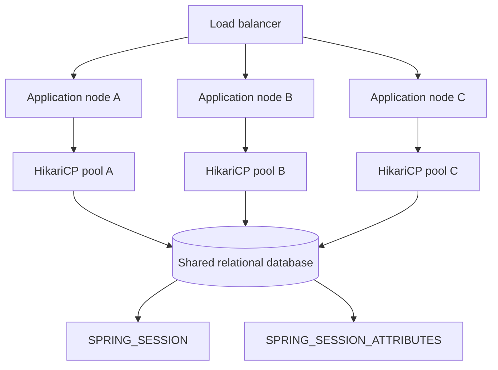

# JDBC, nhóm kết nối và tải bổ sung do mọi nút cùng truy cập

Khi triển khai Spring Session JDBC trên nhiều instance, mọi nút ứng dụng cùng đọc và ghi session vào một cơ sở dữ liệu dùng chung. Mỗi JVM có connection pool riêng, vì vậy tải lên database là tổng tải từ tất cả các pool, tất cả request và các tác vụ nền. Một cấu hình HikariCP hợp lý trên một máy vẫn có thể làm database quá tải khi số instance tăng, autoscaling hoặc rolling deployment khiến nhiều nút cùng hoạt động.

Thiết kế cần bắt đầu từ **ngân sách kết nối ở cấp database**, sau đó phân bổ cho từng node theo số replica tối đa có thể chạy đồng thời. Cần tính cả kết nối dành cho truy vấn nghiệp vụ, migration, scheduler, công cụ quản trị và khoảng dự phòng. Đồng thời phải đo số thao tác session trên mỗi request, thời gian giữ connection và thời điểm cleanup để hiểu tải thực tế.

## 1. Mô hình nhiều node cùng dùng một JDBC repository

Với Spring Session JDBC, mỗi node ứng dụng có `DataSource` và connection pool riêng. Các pool này không chia sẻ connection object với nhau; chúng cùng mở các connection độc lập đến database.



Ví dụ ba node, mỗi node có `maximumPoolSize=15`, tạo ra tổng khả năng mở tối đa 45 connection chỉ riêng ứng dụng này. Nếu node tăng lên 8, tổng khả năng mở thành 120. Database không biết đó là một pool lớn hay nhiều pool nhỏ; nó chỉ nhận tổng connection từ mọi client.

Spring Session JDBC cho phép session được chia sẻ giữa các instance, nhưng khả năng chia sẻ này cũng có nghĩa mọi instance tạo thêm tải đọc/ghi trên cùng schema, index, transaction và connection budget.

## 2. Một request tạo ra tải JDBC session như thế nào?

Không phải mọi request HTTP đều cần truy cập session. Nhưng khi request sử dụng `HttpSession`, Spring Session filter và repository có thể phải tìm session, đọc attribute, cập nhật metadata và lưu thay đổi khi request hoàn tất.

Các thao tác thường góp phần tạo tải:

- Tìm session theo `SESSION_ID` khi request mang cookie hợp lệ.
- Đọc các attribute từ `SPRING_SESSION_ATTRIBUTES`.
- Cập nhật `LAST_ACCESS_TIME` hoặc thông tin timeout theo chính sách repository.
- Insert/update attribute khi ứng dụng thay đổi session.
- Xóa session và các attribute khi logout hoặc invalidate.
- Tìm session theo principal khi có chức năng quản lý nhiều phiên.
- Cleanup các session đã hết hạn.

Số câu SQL thực tế phụ thuộc Spring Session version, `SaveMode`, `FlushMode`, loại request và repository implementation. Không nên giả định mỗi request luôn chỉ dùng một connection hoặc luôn phát ra đúng một câu SQL. Hãy quan sát query log/metrics trong môi trường kiểm thử có workload gần production.

### Tác động của kích thước session

Session chứa nhiều attribute hoặc object lớn làm tăng thời gian serialize, số byte ghi và thời gian thực hiện câu SQL. Nếu một request chỉ thay đổi một trường nhỏ nhưng repository phải ghi lại nhiều attribute, write amplification có thể tăng đáng kể.

Giữ session nhỏ, tránh lưu entity lớn, object có quan hệ lazy, dữ liệu giao dịch hoặc cache nghiệp vụ. Chỉ lưu định danh và trạng thái ngắn cần thiết cho luồng web; dữ liệu chuẩn nên nằm trong schema nghiệp vụ.

## 3. Mỗi node có một connection pool độc lập

HikariCP quản lý connection cho từng `DataSource` trong mỗi JVM. Các thuộc tính thường cần cân nhắc:

| Thuộc tính | Ý nghĩa |
|---|---|
| `maximumPoolSize` | Số connection tối đa pool có thể cấp |
| `minimumIdle` | Số connection nhàn rỗi tối thiểu pool cố gắng duy trì |
| `connectionTimeout` | Thời gian tối đa thread chờ lấy connection từ pool |
| `idleTimeout` | Thời gian connection nhàn rỗi có thể bị loại khi pool lớn hơn `minimumIdle` |
| `maxLifetime` | Tuổi thọ tối đa của connection trước khi pool thay thế |
| `validationTimeout` | Thời gian tối đa kiểm tra connection hợp lệ |
| `leakDetectionThreshold` | Ngưỡng ghi cảnh báo khi connection bị giữ quá lâu để hỗ trợ chẩn đoán |

Các thuộc tính này áp dụng cho một pool. Khi có nhiều node, cần nhân theo số node tối đa có thể chạy cùng lúc, kể cả trong quá trình deploy.

## 4. Tính ngân sách connection ở cấp database

Không đặt `maximumPoolSize` bằng toàn bộ `max_connections` của database trên từng node. Trước hết xác định số connection database có thể dành cho ứng dụng session sau khi trừ các nhu cầu khác.

Một công thức lập ngân sách đơn giản:

\[
P_{node} \leq \left\lfloor\frac{C_{db}-C_{reserve}-C_{other}-C_{headroom}}{N_{peak}}\right\rfloor
\]

Trong đó:

- `C_db`: giới hạn connection khả dụng của database.
- `C_reserve`: connection cần giữ cho DBA, health/monitoring, migration và tình huống vận hành.
- `C_other`: connection dành cho ứng dụng, worker hoặc dịch vụ khác.
- `C_headroom`: phần dự phòng khi tải tăng hoặc connection bị thay thế.
- `N_peak`: số node ứng dụng tối đa có thể cùng chạy, gồm cả replica cũ và mới trong rolling deployment.
- `P_node`: giới hạn pool tối đa trên mỗi node.

### Ví dụ phân bổ

Giả sử database cho phép tối đa 160 connection. Dự kiến giữ 30 connection cho quản trị và migration, 20 cho dịch vụ khác, 20 làm headroom. Ứng dụng Spring Session có thể chạy tối đa 9 node trong lúc autoscaling/rolling deployment.

| Khoản | Connection |
|---|---:|
| Giới hạn database | 160 |
| Quản trị và migration | 30 |
| Dịch vụ khác | 20 |
| Headroom | 20 |
| Ngân sách tối đa cho ứng dụng này | 90 |
| Số node cực đại | 9 |
| Pool tối đa mỗi node | 10 |

Với `maximumPoolSize=10`, tổng tối đa của 9 node là 90. Khi chỉ có 5 node, tổng khả năng mở tối đa là 50. Khi deploy tạm thời tăng lên 9 node, vẫn nằm trong ngân sách đã định.

Đây chỉ là giới hạn an toàn ban đầu. Pool tối ưu thực tế còn phụ thuộc thời gian giữ connection, CPU/IO database, locking, latency và throughput đo được. Không tăng pool chỉ vì thấy request đang chờ; pool lớn hơn có thể đẩy nhiều truy vấn đồng thời vào database và làm tình hình tệ hơn.

## 5. Tính concurrency từ tốc độ truy vấn và thời gian giữ connection

Một cách ước lượng hữu ích là áp dụng định luật Little cho thời gian connection bận:

\[
C_{busy} \approx \lambda_{db} \times W_{connection}
\]

Trong đó `λ_db` là số thao tác JDBC mỗi giây và `W_connection` là thời gian trung bình một thao tác giữ connection, tính bằng giây. Đây là ước lượng concurrency trung bình, không phải con số pool tối đa bắt buộc.

Ví dụ:

- 200 request/giây đi qua các endpoint có dùng session.
- Trung bình mỗi request phát sinh 2 thao tác JDBC session cần connection.
- Tốc độ thao tác là khoảng 400 thao tác/giây.
- Mỗi thao tác giữ connection trung bình 20 ms, tức 0,02 giây.

\[
C_{busy} \approx 400 \times 0.02 = 8
\]

Trung bình cần khoảng 8 connection bận cho phần thao tác session theo giả định này. Đỉnh tải, phân bố latency, truy vấn chậm, transaction dài và các query nghiệp vụ khác có thể làm concurrency cao hơn. Cần đo p95/p99 và peak window, sau đó kiểm tra database có xử lý được mức song song đó không.

Nếu mỗi request giữ connection lâu do lock hoặc truy vấn thiếu index, tăng pool có thể chỉ làm số truy vấn chờ lock tăng lên. Ưu tiên giảm thời gian giữ connection và cải thiện query plan trước khi tăng giới hạn.

## 6. Cấu hình HikariCP trên từng node

Ví dụ cấu hình Spring Boot cho một node:

```yaml
spring:
  datasource:
    url: jdbc:postgresql://db.internal:5432/appdb
    username: ${SESSION_DB_USERNAME}
    password: ${SESSION_DB_PASSWORD}
    hikari:
      maximum-pool-size: ${SESSION_DB_POOL_MAX:10}
      minimum-idle: ${SESSION_DB_POOL_MIN_IDLE:2}
      connection-timeout: 2000
      validation-timeout: 1000
      idle-timeout: 600000
      max-lifetime: 1740000
  session:
    jdbc:
      initialize-schema: never
    timeout: 30m
```

Đây là giá trị minh họa, không phải cấu hình mặc định nên áp dụng nguyên trạng. `maximum-pool-size` phải được tính từ tổng số node cực đại và ngân sách database. `minimum-idle` cũng nhân theo số node; ví dụ 9 node × 2 idle connection tạo ra khoảng 18 connection nhàn rỗi tối thiểu nếu tất cả pool duy trì đủ mức đó.

`max-lifetime` nên thấp hơn giới hạn tuổi thọ connection do database, proxy hoặc network infrastructure áp đặt, với một khoảng đệm phù hợp. `connection-timeout` cần phù hợp với latency mục tiêu của request; nếu chờ quá lâu, thread web có thể bị giữ và hàng đợi request tăng. Không đặt timeout quá thấp đến mức tạo lỗi giả khi tải đỉnh ngắn, nhưng cũng không để thread chờ vô hạn.

### Quản lý secret và endpoint

Không ghi username/password database vào file cấu hình được commit. Dùng secret manager hoặc biến môi trường được quản lý. Tất cả node phải kết nối đúng database/schema và có cùng quyền DML cần thiết.

Nếu có primary/replica, các thao tác session cần đọc dữ liệu nhất quán sau ghi. Đọc từ replica trễ có thể khiến request sau không thấy session vừa tạo, cập nhật hoặc logout. Chỉ dùng read replica nếu repository và topology bảo đảm consistency phù hợp; mặc định nên kiểm tra đường đọc/ghi session có cùng nguồn dữ liệu nhất quán.

## 7. Tính cả số node trong rolling deployment và autoscaling

Số node đang phục vụ bình thường chưa chắc là số node cực đại. Trong rolling deployment, orchestrator có thể khởi động node mới trước khi dừng node cũ. Autoscaling cũng có thể tăng replica trong vài phút khi tải lên cao.

Ví dụ deployment có 6 replica bình thường, `maxSurge=2` và có thể scale thêm 1 replica. Số node cùng chạy trong thời gian chuyển tiếp có thể vượt 6. Hãy dùng con số peak đồng thời từ cấu hình orchestrator và kịch bản vận hành thực tế để tính pool budget.

Nếu cấu hình mỗi node pool 20 connection theo giả định 6 node, tổng bình thường là 120. Khi rollout lên 8 node, tổng có thể thành 160; nếu database chỉ dành 140 connection cho ứng dụng, deployment có thể làm pool timeout dù lưu lượng người dùng không tăng.

Nên đặt pool size theo peak replica và kiểm thử rollout trong môi trường staging. Khi autoscaling, tăng số node có thể làm tổng connection tăng gần tuyến tính ngay cả khi request/second không đổi.

## 8. `minimumIdle` và tác động của nhiều pool

`minimumIdle` là mức connection nhàn rỗi pool cố gắng duy trì. Nếu đặt quá cao trên từng node, tổng connection nhàn rỗi của cụm có thể chiếm phần lớn ngân sách database.

Ví dụ 12 node, mỗi node `minimumIdle=10` có thể duy trì khoảng 120 connection nhàn rỗi. Những connection này vẫn tiêu thụ giới hạn database dù không thực hiện truy vấn tại thời điểm đó.

Nếu tải thay đổi mạnh, có thể chọn `minimumIdle` thấp hơn `maximumPoolSize` để pool co giãn theo nhu cầu. Tuy nhiên, cần đo thời gian tạo connection và đặc điểm tải; tạo mới connection quá thường xuyên cũng có chi phí. HikariCP có thể được cấu hình theo pool cố định hoặc linh hoạt tùy mục tiêu.

Không giả định `minimumIdle` bằng 0 là luôn tốt hoặc pool phải luôn đầy. Chọn mức phù hợp với peak traffic, thời gian mở kết nối và giới hạn tổng connection của cụm.

## 9. Session JDBC dùng chung và chi phí truy vấn

Các bảng Spring Session thường gồm `SPRING_SESSION` và `SPRING_SESSION_ATTRIBUTES`. Repository dùng session ID để tìm hàng session, sau đó đọc hoặc ghi attribute liên quan.

Các index quan trọng trong schema chuẩn thường gồm:

- Unique index trên `SESSION_ID` để tìm phiên theo ID.
- Index trên `EXPIRY_TIME` để hỗ trợ cleanup phiên hết hạn.
- Index trên `PRINCIPAL_NAME` để tra cứu session theo người dùng khi cần.
- Primary key ghép trên `SESSION_PRIMARY_ID` và `ATTRIBUTE_NAME` ở bảng attributes.

Thiếu index hoặc dùng schema không đúng phiên bản có thể làm truy vấn chậm, giữ connection lâu và gây pool saturation. Trước khi tăng pool, kiểm tra execution plan, số hàng đọc, index được dùng và thời gian query.

### Không truy vấn trực tiếp bảng session trong code nghiệp vụ

Ứng dụng nên dùng `HttpSession`, Spring Session API hoặc repository đã cung cấp. SQL tùy chỉnh để cập nhật bảng session có thể bỏ qua serialization, metadata, principal index và lifecycle. Nếu cần báo cáo hoặc công cụ quản trị, dùng API được hỗ trợ hoặc xây dựng tác vụ chỉ đọc có kiểm soát, không sửa cấu trúc nội bộ tùy tiện.

## 10. Tải bổ sung từ cleanup và tác vụ nền

Ngoài request của người dùng, database còn nhận tải từ cleanup session hết hạn, scheduler, migration và các tác vụ quản trị. Với nhiều node, cần xác định node nào chạy cleanup và tần suất ra sao.

Nếu mọi node cùng chạy một tác vụ cleanup lớn mà không có phối hợp, chúng có thể đồng thời quét/xóa cùng vùng dữ liệu, tạo SQL load và lock contention. Cách tổ chức phụ thuộc cơ chế cleanup của phiên bản Spring Session và kiến trúc scheduler:

- Xác nhận cleanup task nào được bật và cron/tần suất thực tế.
- Tránh chạy nhiều bản cleanup toàn bảng cùng lúc nếu không cần thiết.
- Dùng một scheduler leader, distributed lock hoặc job scheduler có cơ chế phân phối nếu cần chạy duy nhất.
- Nếu cleanup được chia partition, bảo đảm các node không xóa trùng và không bỏ sót dữ liệu.
- Theo dõi số hàng xóa, thời gian chạy, lock wait và tải I/O.

Không tự thêm một job xóa hàng session dựa trên SQL đơn giản nếu chưa hiểu quan hệ với bảng attributes và logic expiration của repository. Dùng cơ chế cleanup được Spring Session cung cấp hoặc một migration/maintenance job đã được kiểm thử.

## 11. Pool exhaustion và hàng đợi request

Pool exhaustion xảy ra khi mọi connection trong pool đang được sử dụng và request mới phải chờ. Nếu không có connection được trả về trước `connectionTimeout`, HikariCP ném lỗi timeout lấy connection.

Triệu chứng thường thấy:

- Tăng `pending threads`/số thread chờ connection.
- Tăng connection acquisition time.
- Request p95/p99 tăng, sau đó timeout hoặc trả lỗi 5xx.
- Hikari active connections chạm `maximumPoolSize` trong thời gian dài.
- Database có thể đang bận query, chờ lock hoặc không bận nhưng connection bị giữ quá lâu ở ứng dụng.

Pool timeout không đồng nghĩa database đã ngừng hoạt động. Có thể connection bị giữ lâu do transaction dài, code giữ connection khi gọi dịch vụ ngoài, query chậm hoặc leak.

### Không chữa pool exhaustion bằng cách tăng vô hạn

Tăng `maximumPoolSize` có thể giảm hàng đợi ngắn hạn, nhưng nếu database đã đạt giới hạn CPU, I/O hoặc lock, thêm connection chỉ làm nhiều truy vấn cùng tranh chấp hơn. Cần tìm nguyên nhân connection bận trước:

1. Query session chậm hoặc thiếu index.
2. Transaction/connection bị giữ qua đoạn code không cần database.
3. Connection leak hoặc đường code không đóng resource.
4. Cleanup job chạy trùng.
5. Nhiều node mới cùng khởi động và làm pool mở đồng loạt.
6. Database hoặc network có latency tăng.

## 12. Connection lifetime, validation và database failover

Database proxy, firewall hoặc load balancer có thể đóng connection lâu không hoạt động. `maxLifetime` của HikariCP nên được đặt thấp hơn giới hạn của hạ tầng để pool chủ động thay connection trước khi server cắt nó.

`validationTimeout` và cơ chế kiểm tra connection giúp phát hiện connection không còn hợp lệ. Không đặt validation timeout dài hơn connection timeout. Với failover, cần xác nhận driver và pool có thể loại bỏ connection cũ, mở connection mới và phục hồi request theo chính sách retry phù hợp.

Không retry vô hạn mọi thao tác ghi session. Một lần ghi có thể đã tới database nhưng response bị mất; retry không có thiết kế idempotent có thể lặp tác động. Hãy giới hạn retry, đặt backoff và đánh giá semantics từng thao tác.

Khi database failover, tất cả node có thể đồng thời phát hiện connection lỗi và cùng tạo connection mới. Đây là connection storm. Có thể giảm tác động bằng giới hạn pool hợp lý, backoff, rollout có kiểm soát và giám sát số lần tạo connection.

## 13. Transaction và thời điểm lưu session

Trong Servlet stack, Spring Session thường lưu session theo vòng đời request, thường ở giai đoạn filter hoàn tất request. Transaction nghiệp vụ trong controller/service có thể kết thúc ở thời điểm khác với thao tác lưu session.

Không mặc định rằng cập nhật bảng nghiệp vụ và cập nhật session luôn nằm trong cùng một transaction chỉ vì chúng dùng cùng `DataSource`. Điều đó phụ thuộc transaction manager, cách repository được cấu hình và thứ tự filter/transaction.

Ví dụ: service cập nhật đơn hàng trong `@Transactional`, sau đó request kết thúc và Spring Session lưu attribute. Nếu transaction nghiệp vụ rollback nhưng session đã được cập nhật theo một đường khác, trạng thái session có thể không phản ánh kết quả nghiệp vụ. Vì vậy:

- Không lưu trạng thái giao dịch chuẩn chỉ trong session.
- Không dùng session để bảo đảm atomicity giữa các bảng nghiệp vụ.
- Nếu một nghiệp vụ cần transaction, đặt dữ liệu cần nhất quán trong cùng transaction database.
- Kiểm tra transaction boundary và lỗi save session ở cuối request.
- Xác định cách xử lý nếu business commit thành công nhưng session save thất bại, hoặc ngược lại.

## 14. Chia sẻ schema và quyền truy cập giữa các node

Mọi node phải dùng schema tương thích và cùng hiểu cấu trúc session. Các điểm cần đồng nhất:

- Cùng database/catalog và schema name.
- Cùng tên bảng Spring Session hoặc cùng cấu hình table name.
- Cùng phiên bản schema đã được migration trước rollout.
- Tương thích serialization của session attribute giữa các phiên bản ứng dụng.
- Cùng cách ánh xạ principal name và kiểu dữ liệu.
- Đồng bộ thời gian hệ thống để tính toán expiry nhất quán.
- Tài khoản DB có quyền SELECT/INSERT/UPDATE/DELETE cần thiết.

Migration schema nên chạy như một bước triển khai có kiểm soát trước khi node mới sử dụng schema. Không để mỗi node tự chạy DDL khi khởi động. Với rolling deployment, áp dụng expand/contract nếu thay đổi schema có thể ảnh hưởng node cũ đang hoạt động.

Nếu node A và node B dùng hai schema hoặc database endpoint khác nhau, người dùng có thể đăng nhập ở A rồi request tiếp theo tới B không tìm thấy session. Đây thường là lỗi cấu hình topology hơn là lỗi cookie.

## 15. Giám sát pool ở từng node và database tổng

Chỉ nhìn metric một node không đủ để hiểu tải database. Cần theo dõi cả chỉ số theo node lẫn chỉ số tổng hợp.

### Metric HikariCP theo node

- Active connections.
- Idle connections.
- Pending threads đang chờ connection.
- Maximum pool size và minimum idle.
- Connection acquisition time.
- Connection usage duration.
- Timeout count và leak detection warning.
- Số connection được tạo/đóng theo thời gian.

### Metric database

- Tổng số connection đang mở và connection theo application/user.
- Active query, query latency và top SQL theo tổng thời gian.
- CPU, memory, disk I/O và buffer/cache hit.
- Lock wait, deadlock, transaction duration.
- Số hàng được đọc/cập nhật/xóa ở bảng session.
- Thời gian và số hàng của cleanup job.

### Metric ở tầng HTTP/session

- Request rate của endpoint dùng session.
- p50/p95/p99 latency.
- Số session create/read/save/delete.
- Kích thước session và số attribute.
- Lỗi repository, serialization và timeout.
- Tỷ lệ request bị pool timeout.

Gắn nhãn metric theo instance/pod để nhận diện một node có pool bận bất thường, đồng thời xem tổng của toàn cụm. Không gắn session ID hoặc principal nhạy cảm vào metric label vì cardinality và rủi ro lộ dữ liệu.

## 16. Kiểm thử tải với nhiều node

Kiểm thử một node không phản ánh được tổng tải khi mọi node dùng chung database. Kịch bản nên mô phỏng số replica cực đại và hành vi deployment.

Một kế hoạch thử nghiệm:

1. Dựng database cùng loại/version gần production và schema Spring Session đã migration.
2. Chạy nhiều application instance, mỗi instance có pool riêng và định danh metric riêng.
3. Tạo session qua node A, sau đó gửi request mang cùng cookie qua node B/C.
4. Tăng dần request rate và số session hoạt động.
5. Tạo workload chỉ đọc session, workload cập nhật attribute nhỏ và workload có session lớn.
6. Bật cleanup trong điều kiện kiểm soát và đo tải bổ sung.
7. Thực hiện rolling deployment để số node tăng tạm thời.
8. Thử autoscaling lên số replica tối đa.
9. Mô phỏng query chậm, lock wait và database connection limit.
10. Mô phỏng database failover hoặc network interruption.
11. Quan sát Hikari active/idle/pending, DB connection, query latency và HTTP p95/p99.
12. Xác nhận pool timeout và lỗi session không vượt ngưỡng chấp nhận.

Kết quả cần ghi lại request rate, số thao tác session mỗi request, connection busy, acquisition wait, query time và lỗi. Thử tăng pool theo từng bước nhỏ và quan sát database; không tối ưu chỉ dựa trên một con số throughput.

## 17. Các lỗi thường gặp và cách xử lý

| Hiện tượng | Nguyên nhân có thể | Cách điều tra |
|---|---|---|
| Database chạm giới hạn connection sau khi scale out | Tổng pool của mọi node vượt ngân sách | Tính lại `N_peak × maximumPoolSize` và pool của dịch vụ khác |
| Pool timeout trên một node | Query chậm, connection leak hoặc tải lệch | Xem active/pending và usage duration theo node |
| Pool timeout trên toàn cụm | Database quá tải, lock hoặc connection budget thiếu | Xem DB CPU, active query, lock wait và tổng connection |
| Deploy mới làm DB quá tải | Old/new node cùng chạy và mở pool | Tính max surge và giới hạn pool theo peak replica |
| Nhiều connection nhàn rỗi | `minimumIdle` cao trên nhiều node | Tính tổng minimum idle và điều chỉnh có đo lường |
| Query session chậm tăng dần | Thiếu index hoặc bảng session lớn | Xem execution plan, index và cleanup |
| Cleanup gây spike | Nhiều scheduler cùng chạy hoặc batch quá lớn | Điều phối cleanup và giới hạn tải theo batch |
| Node này thấy session, node khác không thấy | Khác DB/schema/table/serialization hoặc replica lag | So sánh cấu hình datasource và đường đọc/ghi |
| DB failover tạo connection storm | Mọi pool cùng reconnect | Giới hạn pool, backoff và quan sát connection creation rate |
| Session lưu thất bại cuối request | DB timeout hoặc lỗi transaction/serialization | Theo dõi repository exception và xác định response/error policy |

## 18. Checklist triển khai

- Tính connection budget từ giới hạn database và mọi client dùng chung.
- Dùng số node cực đại trong autoscaling và rolling deployment để chia pool.
- Cấu hình `maximumPoolSize`, `minimumIdle`, `connectionTimeout`, `maxLifetime` và validation có chủ đích.
- Không tăng pool vượt năng lực xử lý query/lock của database.
- Đo số thao tác session và thời gian giữ connection bằng workload gần production.
- Giữ session nhỏ, index schema đúng và cleanup có điều phối.
- Xác nhận mọi node dùng cùng database/schema, serializer và phiên bản schema tương thích.
- Chạy migration trước khi rollout; không để từng node cạnh tranh DDL.
- Theo dõi Hikari metrics theo node và DB metrics tổng hợp.
- Kiểm thử scale out, rolling deployment, cleanup, pool exhaustion và DB failover.
- Không dựa vào session để bảo đảm transaction nghiệp vụ.
- Bảo vệ secret DB và không ghi session ID vào log/metric label.

Khi nhiều node cùng dùng Spring Session JDBC, mỗi node mang theo một connection pool riêng và mọi pool cùng tiêu thụ giới hạn của database. Kích thước pool phải được tính theo tổng số replica cực đại, workload session, thời gian giữ connection và phần dự phòng cho dịch vụ khác. Kết hợp pool sizing có ngân sách, schema/index đúng, cleanup có điều phối và metric toàn cụm sẽ giúp hệ thống mở rộng mà không biến database thành nút thắt khi tăng số instance.
