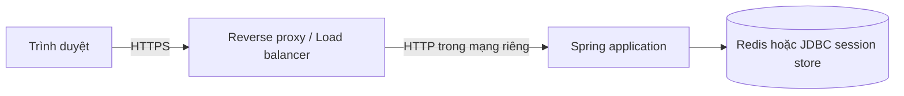

# TLS sau reverse proxy và nhận biết đúng nguồn yêu cầu an toàn

Trong production, ứng dụng Spring Session thường chạy phía sau reverse proxy hoặc load balancer. Trình duyệt kết nối HTTPS tới proxy; proxy có thể kết thúc TLS rồi chuyển request tới ứng dụng bằng HTTP trong mạng nội bộ. Khi đó, ứng dụng nhìn thấy kết nối TCP nội bộ là HTTP dù người dùng thực sự truy cập bằng HTTPS.

Nếu ứng dụng không nhận biết đúng thông tin được proxy chuyển tiếp, Spring có thể tạo redirect sai, đánh giá request là không an toàn hoặc phát hành session cookie thiếu thuộc tính `Secure`. Ngược lại, nếu ứng dụng tin mọi header chuyển tiếp mà không kiểm soát nguồn gửi, client có thể giả mạo scheme, host hoặc địa chỉ IP. Cấu hình đúng cần kết hợp ba lớp: proxy đáng tin cậy, xử lý forwarded headers nhất quán và chính sách cookie/session an toàn.

## 1. TLS termination và góc nhìn của ứng dụng

Một kiến trúc thường gặp:



Trình duyệt mã hóa request bằng TLS tới proxy. Proxy giải mã request, sau đó gửi HTTP tới ứng dụng trong mạng nội bộ. Ứng dụng có thể nhận được:

- `request.getScheme()` là `http`.
- `request.isSecure()` là `false`.
- `request.getServerPort()` là cổng nội bộ, ví dụ `8080`.
- Host/port của request là địa chỉ backend thay vì tên miền công khai.

Đây là góc nhìn của hop kết nối cuối cùng. Nếu ứng dụng dùng các giá trị này để tạo URL tuyệt đối, redirect hoặc quyết định thuộc tính cookie, kết quả có thể không khớp với kết nối HTTPS ban đầu.

Có hai mô hình triển khai chính:

1. **TLS termination tại proxy:** proxy nhận HTTPS và chuyển HTTP tới app qua mạng nội bộ được kiểm soát. Ứng dụng cần nhận forwarded headers từ proxy đáng tin cậy để biết scheme/host bên ngoài.
2. **TLS re-encryption:** proxy giải mã kết nối bên ngoài rồi thiết lập TLS mới tới ứng dụng. Ứng dụng nhận kết nối HTTPS ở hop nội bộ; forwarded headers vẫn có thể cần thiết để biết host hoặc thông tin client ban đầu.

TLS termination không tự làm mất an toàn nếu đoạn proxy-to-app nằm trong mạng riêng được bảo vệ, nhưng cần đánh giá rủi ro mạng và yêu cầu bảo mật. Nếu mạng nội bộ không đáng tin hoặc dữ liệu session/authentication nhạy cảm, dùng TLS giữa proxy và ứng dụng, có thể bổ sung mutual TLS để xác thực hai đầu.

## 2. Forwarded headers mang thông tin gì?

Reverse proxy có thể gửi header tiêu chuẩn `Forwarded` theo RFC 7239 hoặc các header phổ biến `X-Forwarded-*`.

| Header | Ý nghĩa thường dùng |
|---|---|
| `Forwarded` | Có thể chứa `for`, `by`, `host`, `proto` cho từng hop |
| `X-Forwarded-For` | Địa chỉ client hoặc chuỗi địa chỉ qua các proxy |
| `X-Forwarded-Proto` | Scheme bên ngoài, thường là `https` hoặc `http` |
| `X-Forwarded-Host` | Host mà client dùng để truy cập ứng dụng |
| `X-Forwarded-Port` | Port công khai mà client kết nối |
| `X-Forwarded-Prefix` | Prefix path bên ngoài nếu proxy mount ứng dụng dưới một path |

Ví dụ request tới proxy qua HTTPS có thể được chuyển tiếp như sau:

```http
Host: app.internal:8080
X-Forwarded-For: 198.51.100.24
X-Forwarded-Proto: https
X-Forwarded-Host: portal.example.com
X-Forwarded-Port: 443
```

Header là metadata do proxy gửi, không phải bằng chứng mật mã rằng request thực sự đến từ proxy. Một client có thể tự gửi header cùng tên. Ứng dụng chỉ được sử dụng chúng khi đường mạng bảo đảm request đến từ proxy được tin cậy và proxy đã loại bỏ hoặc ghi đè các giá trị do client tự cung cấp.

## 3. Ranh giới tin cậy: chỉ tin proxy đã xác thực

Đây là nguyên tắc quan trọng nhất: forwarded headers chỉ đáng tin khi chúng được tạo hoặc chuẩn hóa bởi một proxy mà ứng dụng kiểm soát.

Nếu backend có thể được truy cập trực tiếp từ Internet, kẻ tấn công có thể gửi:

```http
X-Forwarded-Proto: https
X-Forwarded-Host: attacker.example
X-Forwarded-For: 127.0.0.1
```

Nếu ứng dụng tin các giá trị này, request HTTP có thể bị đánh giá nhầm là HTTPS, URL có thể được tạo với host của kẻ tấn công và log có thể ghi nhận sai địa chỉ client. Tùy cách ứng dụng dùng forwarded host, rủi ro có thể gồm open redirect, link reset password sai domain, bypass kiểm tra IP hoặc cookie được phát hành theo ngữ cảnh giả.

Các biện pháp cần thực hiện:

1. Chỉ cho phép kết nối tới cổng ứng dụng từ reverse proxy/load balancer qua firewall, security group hoặc network policy.
2. Proxy ở ranh giới Internet phải xóa các forwarded headers do client gửi và tạo lại các giá trị từ kết nối mà proxy thực sự quan sát.
3. Các proxy nội bộ tiếp theo chỉ được thêm hop theo một quy tắc đã định; phải thống nhất thứ tự và số proxy tin cậy.
4. Không bật xử lý forwarded headers trên endpoint có thể truy cập trực tiếp từ mạng không tin cậy.
5. Không dùng `X-Forwarded-For` làm yếu tố xác thực duy nhất; địa chỉ IP chỉ là tín hiệu phụ và có thể thay đổi qua NAT, VPN hoặc proxy.

`ForwardedHeaderFilter` và `ForwardedHeaderTransformer` xử lý header; chúng không xác thực proxy gửi header. Ranh giới tin cậy phải được bảo đảm ở hạ tầng mạng và cấu hình reverse proxy.

## 4. Cấu hình reverse proxy ghi đè header

Ví dụ Nginx ở edge proxy, nơi proxy trực tiếp nhận kết nối từ client:

```nginx
server {
    listen 443 ssl;
    server_name portal.example.com;

    # ssl_certificate và ssl_certificate_key được cấu hình tại đây.

    location / {
        proxy_pass http://spring_app_upstream;
        proxy_set_header Host $host;

        # Ghi đè các header chuyển tiếp bằng thông tin proxy quan sát.
        proxy_set_header X-Forwarded-Proto $scheme;
        proxy_set_header X-Forwarded-Host $host;
        proxy_set_header X-Forwarded-Port $server_port;
        proxy_set_header X-Forwarded-For $remote_addr;

        # Không chuyển tiếp một Forwarded header không được chuẩn hóa.
        proxy_set_header Forwarded "";
    }
}
```

Đây là ví dụ cho một edge proxy trực tiếp nhìn thấy địa chỉ client. Nếu phía trước Nginx còn CDN, WAF hoặc load balancer, `$remote_addr` có thể là địa chỉ của hop trước đó. Khi ấy cần cấu hình trusted real-IP sources ở Nginx, chỉ tin các dải địa chỉ của proxy đã biết, rồi tạo lại header theo chuỗi đã chuẩn hóa. Không dùng cấu hình “tin mọi nguồn” để lấy IP từ header do client gửi.

Trong topology nhiều proxy, hãy lập sơ đồ thứ tự hop và xác định proxy nào được quyền thêm hoặc ghi đè từng header. Chỉ có một thành phần ở ranh giới tin cậy được phép chấp nhận giá trị ban đầu từ kết nối client; các hop phía sau phải tuân theo hợp đồng thống nhất.

Nếu ứng dụng được mount dưới một prefix, ví dụ bên ngoài `/portal` nhưng backend phục vụ `/`, proxy có thể gửi `X-Forwarded-Prefix`. Chỉ bật xử lý prefix nếu ứng dụng thực sự cần tạo URL theo prefix công khai; cấu hình sai có thể làm URL bị lặp hoặc mất path.

## 5. Bật xử lý forwarded headers trong Spring Boot

Spring Boot có thuộc tính `server.forward-headers-strategy` để chọn cách xử lý forwarded headers. Các giá trị thường dùng:

| Giá trị | Hành vi |
|---|---|
| `none` | Không áp dụng forwarded headers |
| `native` | Dùng khả năng xử lý của Servlet container hoặc server đang chạy |
| `framework` | Dùng cơ chế của Spring Framework như `ForwardedHeaderFilter` cho Servlet hoặc `ForwardedHeaderTransformer` cho WebFlux |

Ví dụ với ứng dụng Spring MVC/Servlet dùng Spring Session:

```yaml
server:
  forward-headers-strategy: framework

spring:
  session:
    timeout: 30m
```

`framework` yêu cầu proxy gửi header đúng định dạng và ứng dụng chỉ nhận traffic từ proxy đáng tin cậy. Nếu dùng `native`, cần cấu hình và xác minh đúng cách container xử lý forwarded headers. Hành vi native khác nhau theo Tomcat, Jetty, Undertow hoặc server khác.

Không cấu hình đồng thời nhiều lớp xử lý cùng một header nếu điều đó khiến giá trị bị áp dụng hai lần hoặc chuỗi proxy bị diễn giải sai. Chọn một cơ chế rõ ràng, sau đó kiểm tra giá trị request mà controller thực sự nhận.

### 5.1. Servlet và ForwardedHeaderFilter

Trong Spring Framework Servlet stack, `ForwardedHeaderFilter` bọc request để các API như scheme, host, port, secure flag và remote address phản ánh thông tin được forward. Spring Boot có thể đăng ký filter theo `server.forward-headers-strategy=framework`.

Nếu ứng dụng không dùng Boot auto-configuration và tự đăng ký filter, bảo đảm filter chạy trước các thành phần cần đọc request scheme/host, bao gồm Spring Security và phần tạo redirect/cookie. Tránh đăng ký filter hai lần.

`ForwardedHeaderFilter` có chế độ `removeOnly`, chỉ loại bỏ forwarded headers mà không dùng chúng để thay đổi request. Chế độ này hữu ích khi ứng dụng không tin header nhưng muốn ngăn chúng bị các thành phần phía sau sử dụng ngoài ý muốn. Nó không thay thế việc cấu hình proxy và firewall.

### 5.2. WebFlux và ForwardedHeaderTransformer

Trong WebFlux, forwarded headers được xử lý qua `ForwardedHeaderTransformer`, không dùng Servlet `ForwardedHeaderFilter`. Khi Spring Boot đặt `server.forward-headers-strategy=framework`, Boot có thể cấu hình transformer phù hợp.

Không thêm Servlet filter vào ứng dụng WebFlux thuần reactive. Hãy xác nhận `ServerHttpRequest` sau transformation có scheme, host và remote address đúng, đồng thời giữ các thao tác reactive trong pipeline.

## 6. Ảnh hưởng tới request.isSecure và cookie session

Spring Session phát session ID qua cookie hoặc resolver khác. Với cookie, thuộc tính `Secure` yêu cầu trình duyệt chỉ gửi cookie qua HTTPS. Nếu TLS kết thúc ở proxy nhưng ứng dụng nhìn thấy HTTP nội bộ, một serializer dựa trên `request.isSecure()` có thể không đặt `Secure` như mong đợi.

Với `DefaultCookieSerializer`, có thể cấu hình `useSecureCookie` tường minh:

```java
import org.springframework.context.annotation.Bean;
import org.springframework.context.annotation.Configuration;
import org.springframework.session.web.http.CookieSerializer;
import org.springframework.session.web.http.DefaultCookieSerializer;

@Configuration
class SessionCookieConfiguration {

    @Bean
    CookieSerializer cookieSerializer() {
        DefaultCookieSerializer serializer = new DefaultCookieSerializer();
        serializer.setCookieName("__Host-SESSION");
        serializer.setCookiePath("/");
        serializer.setUseSecureCookie(true);
        serializer.setUseHttpOnlyCookie(true);
        serializer.setSameSite("Lax");
        // Không đặt Domain: cookie giữ phạm vi host-only.
        return serializer;
    }
}
```

Tên cookie có tiền tố `__Host-` yêu cầu cookie được gửi với `Secure`, `Path=/` và không có thuộc tính `Domain` theo quy tắc trình duyệt hỗ trợ tiền tố này. Nếu chọn tên cookie khác, vẫn nên bật `Secure` và `HttpOnly` trong production HTTPS. Cấu hình `SameSite` phải phù hợp luồng đăng nhập và tích hợp của ứng dụng.

`setUseSecureCookie(true)` buộc cookie được phát hành với `Secure` kể cả khi request backend nhìn thấy HTTP. Đây thường là lựa chọn rõ ràng cho production chỉ phục vụ qua HTTPS. Nếu ứng dụng phải phục vụ cả HTTP local development, dùng profile riêng; không hạ cấu hình production để hỗ trợ môi trường phát triển.

Nếu để serializer tự suy ra Secure từ `request.isSecure()`, cần kiểm tra forwarded headers đã được xử lý trước khi Spring Session ghi cookie. Đừng chỉ kiểm tra cấu hình YAML; hãy xem header `Set-Cookie` thực tế qua đường đi từ proxy.

## 7. Cookie, SameSite và các luồng xác thực

Các thuộc tính cookie session cần được lựa chọn cùng chính sách xác thực:

| Thuộc tính | Mục đích | Cấu hình thường dùng |
|---|---|---|
| `Secure` | Chỉ gửi cookie qua HTTPS | Bật trong production |
| `HttpOnly` | Ngăn JavaScript đọc cookie session qua API cookie | Bật cho session cookie |
| `SameSite=Lax` | Hạn chế gửi cookie trong nhiều request cross-site | Phù hợp nhiều ứng dụng web thông thường |
| `SameSite=Strict` | Hạn chế mạnh hơn cookie cross-site | Có thể ảnh hưởng link đi từ site khác và callback đăng nhập |
| `SameSite=None` | Cho phép cookie trong ngữ cảnh cross-site | Cần `Secure` và bảo vệ CSRF phù hợp |
| `Path` | Giới hạn đường dẫn gửi cookie | `/` nếu cookie dùng toàn ứng dụng |
| `Domain` | Mở rộng phạm vi host nhận cookie | Ưu tiên không đặt để dùng host-only khi có thể |

Nếu dùng OAuth2/OIDC login với redirect qua identity provider, cần kiểm thử callback thực tế trước khi chọn `SameSite=Strict`. Nếu luồng yêu cầu cookie trong ngữ cảnh cross-site, có thể cần `SameSite=None; Secure` và cấu hình CSRF phù hợp. Không giảm SameSite cho toàn bộ ứng dụng chỉ để khắc phục một callback chưa được phân tích.

`Secure` bảo vệ cookie trên đường truyền trình duyệt tới server theo HTTPS; nó không mã hóa session data trong Redis/JDBC và không bảo vệ đoạn proxy-to-app nếu đoạn đó dùng HTTP qua mạng không tin cậy.

## 8. Spring Security và redirect HTTPS

Spring Security có thể yêu cầu request phải dùng HTTPS. Ví dụ với Spring Security hiện đại trên Servlet:

```java
import org.springframework.context.annotation.Bean;
import org.springframework.context.annotation.Configuration;
import org.springframework.security.config.annotation.web.builders.HttpSecurity;
import org.springframework.security.web.SecurityFilterChain;

@Configuration
class WebSecurityConfiguration {

    @Bean
    SecurityFilterChain securityFilterChain(HttpSecurity http) throws Exception {
        http.requiresChannel(channel ->
                channel.anyRequest().requiresSecure());
        return http.build();
    }
}
```

Nếu ứng dụng nằm sau proxy TLS termination nhưng không xử lý forwarded headers, Spring Security có thể thấy request HTTP và liên tục redirect sang HTTPS dù trình duyệt đã dùng HTTPS. Đây là redirect loop thường gặp.

Để xử lý:

1. Proxy phải đặt `X-Forwarded-Proto` hoặc `Forwarded: proto=https` đúng với kết nối ngoài.
2. Ứng dụng phải xử lý forwarded headers bằng một strategy thống nhất.
3. Backend chỉ nhận request từ proxy đáng tin cậy.
4. Kiểm tra `request.isSecure()` hoặc scheme của request sau khi filter/transformer chạy.
5. Kiểm thử redirect từ HTTP ngoài sang HTTPS và request HTTPS qua proxy để bảo đảm không có vòng lặp.

HSTS có thể được bật ở reverse proxy hoặc Spring Security response headers. Nếu TLS được kết thúc tại proxy, cấu hình HSTS ở edge thường thuận tiện vì proxy kiểm soát response công khai. Chỉ bật `includeSubDomains` khi tất cả subdomain liên quan đều hỗ trợ HTTPS; chính sách HSTS sai có thể gây khó truy cập các host chưa sẵn sàng.

## 9. Host header và tạo URL tuyệt đối

Forwarded host có thể ảnh hưởng URL mà ứng dụng tạo ra, ví dụ redirect sau đăng nhập, link xác nhận hoặc link reset password. Nếu ứng dụng tin `X-Forwarded-Host` từ client không đáng tin, kẻ tấn công có thể khiến ứng dụng tạo link với domain do họ kiểm soát.

Các biện pháp:

- Proxy ghi đè `Host`/`X-Forwarded-Host` bằng host đã được định tuyến và cho phép.
- Ứng dụng có allowlist domain công khai cho những URL nhạy cảm như reset password hoặc email xác thực.
- Không dùng host request không kiểm soát để tạo link bảo mật gửi qua email.
- Kiểm tra `X-Forwarded-Prefix` nếu proxy mount dưới path; tránh tạo redirect sai hoặc path traversal do prefix không tin cậy.
- Không cho phép arbitrary host chỉ vì forwarded-header strategy đã được bật.

## 10. Nhận biết địa chỉ client qua nhiều proxy

`X-Forwarded-For` có thể chứa nhiều địa chỉ, thường được thêm qua từng proxy. Ví dụ:

```http
X-Forwarded-For: 198.51.100.24, 203.0.113.10
```

Địa chỉ đầu chuỗi có thể là client ban đầu và địa chỉ sau là proxy trung gian, nhưng chỉ đúng khi chuỗi được xây dựng bởi các proxy đáng tin theo quy tắc đã biết. Nếu client được phép tự đặt header đầu tiên, giá trị đầu chuỗi có thể giả mạo.

Không tự lấy phần tử đầu tiên của `X-Forwarded-For` làm IP client trong mọi tình huống. Hãy cấu hình trusted proxy ranges/hop count ở thành phần chịu trách nhiệm phân tích chuỗi. Nếu dùng container native hoặc thư viện IP resolution, kiểm tra rõ quy tắc chọn địa chỉ và proxy nào được tin.

Địa chỉ client sau proxy hữu ích cho audit, rate limiting và troubleshooting, nhưng không thay thế xác thực người dùng. Người dùng hợp lệ có thể thay đổi IP do mạng di động, VPN hoặc NAT; một IP cũng có thể đại diện cho nhiều người dùng.

## 11. TLS giữa proxy và ứng dụng

Nếu proxy gửi HTTP tới ứng dụng, đường truyền nội bộ cần nằm trong network boundary được kiểm soát. Khi hạ tầng trải qua nhiều subnet, cluster hoặc cloud account, cân nhắc TLS re-encryption để bảo vệ dữ liệu session và thông tin xác thực trên hop nội bộ.

Với TLS re-encryption:

- Proxy xác thực certificate của backend để tránh kết nối nhầm server.
- Backend có thể xác thực client certificate của proxy nếu dùng mTLS.
- Certificate rotation phải được triển khai trước khi certificate cũ hết hạn.
- Health check và readiness probe phải dùng đúng scheme/certificate policy.
- Forwarded headers vẫn cần được xử lý nếu ứng dụng cần biết scheme/host công khai hoặc IP client ban đầu.

Không coi kết nối HTTPS nội bộ là lý do để tin mọi forwarded header. Client trực tiếp hoặc một workload khác vẫn có thể gửi header giả nếu mạng và proxy không giới hạn nguồn.

## 12. Cấu hình theo môi trường

Nên tách cấu hình production, staging và local để tránh dùng cùng chính sách cookie/TLS cho các môi trường khác nhau.

Ví dụ cấu hình production:

```yaml
server:
  forward-headers-strategy: framework

spring:
  session:
    timeout: 30m
```

Trong production, reverse proxy bắt buộc ghi đè forwarded headers và backend chỉ nhận traffic từ proxy. Cookie serializer có thể đặt `Secure=true` tường minh.

Ví dụ môi trường local không có TLS termination:

```yaml
server:
  forward-headers-strategy: none
```

Nếu local chạy HTTPS trực tiếp, có thể vẫn bật Secure cookie. Nếu local dùng HTTP, cấu hình cookie development riêng; không đưa cấu hình đó vào profile production. Với staging, nên mô phỏng kiến trúc proxy và TLS gần production để phát hiện redirect loop hoặc cookie thiếu Secure trước khi phát hành.

## 13. Kiểm thử forwarded headers và session cookie

Kiểm thử cần đi qua reverse proxy thật hoặc proxy test tương đương, không chỉ gọi ứng dụng trực tiếp. Các trường hợp quan trọng:

1. **HTTPS termination:** gửi request HTTPS tới proxy, kiểm tra ứng dụng nhận scheme `https` và secure flag đúng.
2. **Secure cookie:** tạo session qua proxy và xác nhận `Set-Cookie` chứa `Secure`, `HttpOnly`, `SameSite` và Path mong muốn.
3. **HTTP request ngoài:** proxy chuyển hướng HTTP sang HTTPS hoặc ứng dụng áp dụng chính sách secure channel theo thiết kế.
4. **Redirect:** đăng nhập, logout và callback OAuth2 không tạo redirect loop hoặc URL backend nội bộ.
5. **Host spoofing:** gửi `X-Forwarded-Host` giả từ client; xác nhận proxy ghi đè và ứng dụng không tạo link theo host giả.
6. **Proto spoofing:** gửi `X-Forwarded-Proto: https` qua kết nối HTTP; xác nhận proxy chuẩn hóa theo scheme thực tế.
7. **IP spoofing:** gửi `X-Forwarded-For` giả; xác nhận ứng dụng chỉ tin chuỗi được proxy chuẩn hóa.
8. **Direct backend access:** thử kết nối thẳng tới app từ mạng không được phép; firewall/network policy phải từ chối.
9. **Multi-hop proxy:** kiểm tra chuỗi proxy với số hop và trusted range đã cấu hình.
10. **WebFlux:** nếu dùng reactive stack, xác nhận `ForwardedHeaderTransformer` áp dụng scheme/host đúng và không có Servlet filter thừa.
11. **Cookie logout:** xác nhận cookie bị xóa với cùng Path/Domain và các thuộc tính phù hợp.
12. **Rolling deployment:** kiểm tra mọi node phát cookie và redirect giống nhau khi request luân phiên qua load balancer.

Trong test, ghi nhận giá trị scheme, secure flag, host và remote address đã được chuẩn hóa. Che cookie/session ID khỏi log và test report. Không lưu header raw chứa credential vào artefact CI.

## 14. Lỗi thường gặp và cách xử lý

| Hiện tượng | Nguyên nhân có thể | Hướng kiểm tra |
|---|---|---|
| Cookie session không có `Secure` | Backend thấy HTTP và serializer tự suy ra từ `isSecure()` | Kiểm tra forwarded strategy, thứ tự filter và `Set-Cookie`; cân nhắc Secure=true trong production |
| Redirect HTTPS lặp vô hạn | Spring Security thấy scheme HTTP phía backend | Kiểm tra `X-Forwarded-Proto`, proxy overwrite và framework/native strategy |
| Redirect trỏ tới host nội bộ | `Host`/forwarded host không được truyền đúng | Cấu hình proxy host header và kiểm tra URL được tạo |
| Client giả mạo địa chỉ IP | App tin `X-Forwarded-For` từ nguồn không tin cậy | Chặn direct backend, chuẩn hóa header tại edge và cấu hình trusted proxy |
| URL reset password chứa domain lạ | Ứng dụng tin `X-Forwarded-Host` tùy ý | Allowlist domain công khai và proxy ghi đè host |
| `request.isSecure()` khác nhau giữa node | Các instance dùng strategy hoặc proxy config khác nhau | Đồng bộ cấu hình và kiểm tra request sau xử lý trên mọi node |
| Cookie không được gửi trong OAuth2 callback | SameSite không phù hợp hoặc domain/path sai | Kiểm tra callback flow, SameSite và cookie scope |
| WebFlux không nhận forwarded scheme | Chỉ đăng ký Servlet filter hoặc transformer không được bật | Dùng `ForwardedHeaderTransformer`/Boot framework strategy |
| Header bị áp dụng hai lần | Vừa native container vừa framework filter xử lý cùng dữ liệu | Chọn một strategy và xác nhận container config |

## 15. Nguyên tắc triển khai

- Xác định rõ TLS termination hay TLS re-encryption; bảo vệ hop proxy-to-app theo mức tin cậy của mạng.
- Chỉ tin forwarded headers từ proxy đáng tin cậy; filter/transformer không xác thực người gửi header.
- Edge proxy phải xóa hoặc ghi đè các giá trị `Forwarded`/`X-Forwarded-*` do client tự gửi.
- Chặn truy cập trực tiếp vào backend từ mạng không tin cậy.
- Chọn một cơ chế xử lý: `server.forward-headers-strategy=none`, `native` hoặc `framework`; không xử lý trùng.
- Servlet dùng `ForwardedHeaderFilter`; WebFlux dùng `ForwardedHeaderTransformer` khi chọn framework strategy.
- Bật `Secure` và `HttpOnly` cho session cookie production; cấu hình SameSite theo luồng xác thực.
- Kiểm tra redirect, URL tuyệt đối, host và IP client sau khi proxy headers được chuẩn hóa.
- Không dùng forwarded IP làm cơ chế xác thực duy nhất; không tạo link nhạy cảm từ host tùy ý.
- Kiểm thử HTTPS qua proxy, header spoofing, cookie flags, redirect, multi-hop và mọi node sau load balancer.
