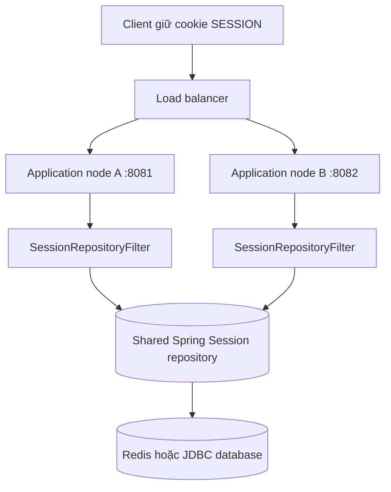

# Thử chuyển nút xử lý để chứng minh phiên không phụ thuộc một JVM

Spring Session cho phép nhiều instance của cùng ứng dụng sử dụng một kho session dùng chung như Redis hoặc JDBC. Để chứng minh session không phụ thuộc vào bộ nhớ của một JVM, hãy tạo phiên khi request được xử lý ở node A, gửi lại đúng cookie session cho node B, xác minh node B đọc được thuộc tính đã lưu, cập nhật thuộc tính tại B rồi đọc lại từ A. Sau đó có thể dừng A và tiếp tục request ở B để kiểm tra ứng dụng còn phục vụ được khi một application node mất.

Phép thử này cần giữ nguyên session cookie giữa các request và bảo đảm cả hai node dùng cùng repository, namespace/schema, serializer, timeout và cấu hình ứng dụng tương thích. Nếu load balancer đang bật sticky session, request có thể liên tục quay về A và tạo cảm giác session được chia sẻ dù thực tế chưa kiểm tra node B. Vì vậy, nên kiểm tra trực tiếp từng node trước, rồi mới kiểm tra qua load balancer.

## 1. Mục tiêu và phạm vi của phép thử

Một phiên Servlet truyền thống do container lưu trong heap của JVM có thể chỉ tồn tại trên instance đã tạo nó. Nếu request tiếp theo được chuyển sang instance khác, node đó không có bản session trong bộ nhớ cục bộ và có thể coi người dùng là anonymous hoặc tạo session mới.

Với Spring Session, `SessionRepositoryFilter` thay thế cách lưu trữ mặc định của `HttpSession` bằng repository được cấu hình. Nhiều application node có thể tải và lưu cùng session qua kho dùng chung. Cookie session ID vẫn do trình duyệt gửi; dữ liệu session được repository cung cấp cho node đang xử lý request.

Phép thử cần chứng minh bốn điều:

1. Node A tạo session và ghi một thuộc tính có giá trị dễ quan sát.
2. Node B nhận cùng session ID qua cookie và đọc đúng thuộc tính đó.
3. Node B cập nhật thuộc tính; node A đọc được giá trị mới, chứng minh hai node cùng ghi/đọc một repository.
4. Khi node A dừng, node B vẫn khôi phục được session và xử lý request tiếp theo.

Phép thử không chứng minh datastore không bao giờ mất dữ liệu khi Redis/database failover. Nó chỉ chứng minh session không bị gắn với heap của một application JVM trong điều kiện repository dùng chung đang hoạt động.

## 2. Kiến trúc cần có

Mỗi instance chạy cùng phiên bản ứng dụng và cùng cấu hình Spring Session. Chúng kết nối tới một endpoint logic của Redis hoặc cùng database/schema JDBC. Load balancer phân phối HTTP request tới các node, nhưng session data nằm ngoài JVM.



Node A và B có thể có heap, thread pool và process ID riêng. Điều duy nhất cần dùng chung cho session là repository và các cấu hình liên quan. Không cần chia sẻ Java object giữa hai JVM; mỗi node deserialize session data thành object cục bộ khi xử lý request.

## 3. Điều kiện trước khi chạy thử

Kiểm tra các điều kiện sau:

- Có ít nhất hai instance của cùng ứng dụng chạy đồng thời.
- Mỗi instance có một định danh riêng, ví dụ `node-a` và `node-b`, để biết request thực sự tới đâu.
- Cả hai node dùng cùng Redis logical primary/HA endpoint hoặc cùng JDBC writer/database.
- Cùng session namespace, table name, schema, serializer và session timeout.
- Cùng tên cookie, path, domain và chính sách `Secure`/`SameSite`.
- Spring Session filter được đăng ký trong cả hai application context.
- Không có một custom filter chạy trước `SessionRepositoryFilter` và tự tạo session container-local.
- Hai node có phiên bản code và định dạng session attributes tương thích.
- Test client có thể gửi cùng cookie tới từng node trực tiếp, bỏ qua sticky routing.

Nếu hai node dùng hai namespace Redis khác nhau, hai database/schema khác nhau hoặc hai tên cookie khác nhau, kết quả thất bại không chứng minh Spring Session không hoạt động; đó là cấu hình không thống nhất. Ngược lại, nếu test vô tình gửi hai cookie khác nhau, việc node B không đọc được session là kết quả không hợp lệ cho mục tiêu kiểm tra.

## 4. Cấu hình repository dùng chung

Ví dụ cấu hình Redis trong Spring Boot:

```yaml
server:
  port: ${SERVER_PORT:8080}

spring:
  data:
    redis:
      host: ${REDIS_HOST:localhost}
      port: ${REDIS_PORT:6379}
      password: ${REDIS_PASSWORD:}
  session:
    timeout: 30m
    redis:
      namespace: demo:shared-sessions

app:
  instance-id: ${INSTANCE_ID:local}
```

Hai process có thể dùng port khác nhau và `INSTANCE_ID` khác nhau, nhưng phải dùng cùng `REDIS_HOST`, `REDIS_PORT`, thông tin xác thực, namespace và timeout. Prefix property Redis có thể khác giữa các phiên bản Spring Boot; dùng cấu hình của phiên bản dự án. Nếu auto-configuration đã bật Spring Session Redis, không khai báo thêm `@EnableRedisHttpSession` chỉ để tạo một repository thứ hai.

Với JDBC, hai node phải dùng cùng datasource writer, database/schema và table name. Nếu dùng schema Spring Session chuẩn, migration/schema initialization phải được thực hiện một lần theo quy trình triển khai; không để mỗi node tự tạo một schema khác. Ví dụ cấu hình khung:

```yaml
spring:
  datasource:
    url: ${JDBC_URL}
    username: ${JDBC_USERNAME}
    password: ${JDBC_PASSWORD}
  session:
    jdbc:
      initialize-schema: never
      table-name: SPRING_SESSION
    timeout: 30m
```

Tên property và khả năng auto-configuration phụ thuộc phiên bản Boot/Spring Session. Dùng cùng URL logic tới writer HA, table name, schema và serializer trên tất cả node. Với production, schema nên được quản lý bằng migration tool hoặc DBA; `initialize-schema: never` minh họa trường hợp schema đã được tạo trước.

## 5. Tạo endpoint kiểm tra session

Để quan sát request đi qua node nào, cấu hình mỗi instance có một `app.instance-id`. Endpoint ghi tăng một counter trong session; endpoint đọc dùng `getSession(false)` để không vô tình tạo session mới khi cookie không hợp lệ.

```java
import java.util.Map;

import jakarta.servlet.http.HttpServletRequest;
import jakarta.servlet.http.HttpSession;

import org.springframework.beans.factory.annotation.Value;
import org.springframework.web.bind.annotation.GetMapping;
import org.springframework.web.bind.annotation.PostMapping;
import org.springframework.web.bind.annotation.RestController;

@RestController
class SessionProbeController {

    private final String instanceId;

    SessionProbeController(
            @Value("${app.instance-id:local}") String instanceId) {
        this.instanceId = instanceId;
    }

    @PostMapping("/probe/increment")
    Map<String, Object> increment(HttpSession session) {
        Integer current = (Integer) session.getAttribute("probeCounter");
        int next = (current == null ? 0 : current) + 1;
        session.setAttribute("probeCounter", next);
        return Map.of("instance", instanceId, "counter", next);
    }

    @GetMapping("/probe/read")
    Map<String, Object> read(HttpServletRequest request) {
        HttpSession session = request.getSession(false);
        if (session == null) {
            return Map.of("instance", instanceId, "sessionPresent", false);
        }

        Object counter = session.getAttribute("probeCounter");
        return Map.of(
                "instance", instanceId,
                "sessionPresent", true,
                "counter", counter == null ? 0 : counter
        );
    }
}
```

Endpoint này dành cho môi trường kiểm thử. Không công khai endpoint probe trong production nếu chưa có xác thực và giới hạn truy cập. Không trả `session.getId()` hoặc cookie ra response/log vì session ID là bearer credential. `instance` chỉ giúp xác nhận node đã xử lý request; `counter` là thuộc tính kiểm chứng việc chia sẻ dữ liệu.

Nếu ứng dụng dùng Spring Security, bảo vệ các endpoint probe bằng profile test hoặc quyền quản trị nội bộ. Nếu bật CSRF, POST cần gửi CSRF token hợp lệ hoặc dùng một test profile có cấu hình CSRF phù hợp. Không tắt CSRF toàn bộ ứng dụng chỉ để lệnh curl đơn giản hơn.

## 6. Khởi chạy hai instance

Có thể chạy hai process trên hai port khác nhau. Ví dụ với một JAR Spring Boot đã build:

```bash
java -jar app.jar --server.port=8081 --app.instance-id=node-a
java -jar app.jar --server.port=8082 --app.instance-id=node-b
```

Hai process phải nhận cùng biến môi trường hoặc cấu hình Redis/JDBC. Nếu chạy container, đưa cả hai container vào cùng network và trỏ tới cùng Redis/database service. Chỉ thay đổi port và instance ID; không tạo hai Redis namespace hay database schema riêng cho từng node.

Kiểm tra log startup để xác nhận mỗi node khởi động thành công, kết nối được repository và không có lỗi tạo filter/repository trùng. Nếu ứng dụng tự động đăng ký `SessionRepositoryFilter`, không thêm một registration thủ công khác.

## 7. Chuyển cùng cookie từ node A sang node B

Đầu tiên, gửi request ghi tăng counter tới node A và lưu cookie vào cookie jar:

```bash
curl -i -c cookies.txt -b cookies.txt \
  -X POST http://localhost:8081/probe/increment
```

Kết quả mong đợi có `instance` là `node-a` và `counter` là `1`. Response có thể phát `Set-Cookie` cho session ID. Cookie jar lưu cookie để dùng lại; không copy hoặc in session ID vào báo cáo.

Tiếp theo, gửi đúng cookie jar tới node B:

```bash
curl -i -b cookies.txt http://localhost:8082/probe/read
```

Kết quả mong đợi:

```json
{
  "instance": "node-b",
  "sessionPresent": true,
  "counter": 1
}
```

Node B đã đọc được counter do node A lưu. Bây giờ tăng counter ở node B:

```bash
curl -i -c cookies.txt -b cookies.txt \
  -X POST http://localhost:8082/probe/increment
```

Kết quả mong đợi là `instance=node-b`, `counter=2`. Cuối cùng đọc lại từ node A:

```bash
curl -i -b cookies.txt http://localhost:8081/probe/read
```

Kết quả mong đợi là `instance=node-a`, `sessionPresent=true`, `counter=2`. Chuỗi A → B → A chứng minh cả hai node đang đọc và ghi cùng session state trong repository dùng chung.

Các lệnh trên dùng cú pháp shell kiểu Bash. Trong PowerShell, có thể dùng `curl.exe` và giữ nguyên file cookie jar; nếu dùng alias `curl` của PowerShell cũ, cú pháp tham số có thể khác. Không gửi cookie jar lên hệ thống quản lý issue hoặc commit vào source control.

## 8. Chuyển node khi đi qua load balancer

Sau khi kiểm tra trực tiếp từng node, kiểm tra đường đi qua load balancer. Đảm bảo cả hai node đều nằm trong pool và có health check hợp lệ. Tạo session qua load balancer, sau đó tạo nhiều request để xác nhận request thực sự được phân phối tới cả A và B.

Nếu sticky session đang bật, load balancer có thể gắn client vào node A. Khi đó, các request tiếp theo không nhất thiết chuyển sang B dù B có thể đọc cùng session. Có thể tắt sticky routing trong môi trường test, dùng cơ chế chọn backend theo từng request, hoặc gọi trực tiếp node như bước trước.

Không tắt sticky session trong production nếu kiến trúc hoặc nghiệp vụ đang phụ thuộc vào nó mà chưa đánh giá. Mục tiêu của phép thử là chứng minh shared session repository có thể phục vụ node khác; việc bật/tắt affinity là một lựa chọn routing riêng.

Nếu dùng HTTP header để hiển thị instance, chỉ dùng giá trị chẩn đoán nội bộ và không đưa thông tin hạ tầng nhạy cảm ra endpoint công khai. Có thể trả `instanceId` trong test response thay vì thêm header toàn cục.

## 9. Dừng node A và tiếp tục ở node B

Sau khi xác minh counter là `2` ở cả hai node, dừng process A một cách bình thường. Không dừng Redis/database dùng chung. Tiếp tục gọi node B bằng cùng cookie jar:

```bash
curl -i -b cookies.txt http://localhost:8082/probe/read
```

Kết quả mong đợi vẫn là `sessionPresent=true`, `counter=2`. Tăng tiếp ở B rồi đọc lại ở B để xác nhận ứng dụng tiếp tục hoạt động mà không cần JVM A.

Phép thử này chứng minh application node có thể được thay thế trong khi session vẫn còn ở repository. Nó không kiểm tra datastore failover. Muốn kiểm tra Redis primary failover hoặc database standby promotion, phải tạo một bài kiểm thử HA riêng với môi trường datastore tương ứng.

Nếu session mất sau khi dừng A, hãy kiểm tra xem A có thực sự ghi vào repository dùng chung hay chỉ lưu trong memory, cookie jar có đúng không, session có hết timeout không và B có dùng cùng namespace/schema không.

## 10. Xác minh bằng Redis hoặc JDBC

### Redis

Hai node phải dùng cùng Redis logical primary/HA endpoint và namespace. Có thể quan sát keyspace/TTL bằng công cụ quản trị Redis theo quy trình vận hành, nhưng không phụ thuộc vào tên key nội bộ của Spring Session trong test ứng dụng. Cấu trúc key có thể thay đổi theo implementation/version và có các key phụ cho expiration/index.

Không xóa key Redis bằng tay trong lúc kiểm thử A → B → A. Không đọc hoặc ghi session payload trực tiếp để kết luận Spring Session hoạt động; API HTTP qua repository mới là đường kiểm chứng hành vi ứng dụng. Khi cần chẩn đoán, dùng metrics/log repository và lệnh read-only phù hợp, không in session ID hoặc payload ra console chia sẻ.

### JDBC

Hai node phải dùng cùng database/schema và table name, thường là `SPRING_SESSION` cùng bảng attributes tương ứng nếu dùng schema chuẩn. Có thể quan sát số lượng hàng hoặc thời điểm cập nhật bằng truy vấn read-only, nhưng không sửa/xóa trực tiếp hàng trong lúc test. Cần bảo đảm bảng đã được tạo đúng phiên bản và có quyền SELECT/INSERT/UPDATE/DELETE cần thiết cho repository.

Nếu một node dùng schema mặc định còn node kia dùng schema khác, hoặc một node dùng table name tùy chỉnh, session sẽ không được chia sẻ dù cả hai cùng kết nối một database server.

## 11. Kiểm thử tự động với hai application context

Ngoài kiểm thử thủ công, có thể khởi chạy hai application context với hai cổng ngẫu nhiên, cùng trỏ tới một Redis Testcontainers hoặc cùng database test. Test client giữ cookie từ context A và gửi cookie đó tới context B.

Một kịch bản integration test nên gồm:

1. Khởi chạy Redis/database dùng chung.
2. Khởi chạy node A và node B với `INSTANCE_ID` khác nhau nhưng repository config giống nhau.
3. Gửi POST tới A và lấy cookie session.
4. Gửi GET tới B với cookie vừa nhận; assert session tồn tại và counter đúng.
5. Gửi POST tới B; assert counter tăng.
6. Gửi GET tới A; assert counter mới đã được lưu.
7. Dừng context A; gửi GET tới B; assert session vẫn tồn tại.
8. Gửi logout hoặc hết hạn session; xác minh cả hai node đều không khôi phục phiên cũ.

Nếu dùng `MockMvc`, có thể kiểm tra controller và filter behavior trong một context, nhưng để chứng minh hai JVM độc lập nên dùng hai process hoặc ít nhất hai application context với server/repository tách biệt. Một test chỉ tạo hai request trong cùng một context không đủ chứng minh session không phụ thuộc một JVM.

Với test tự động, tránh dùng `Thread.sleep` dài để chờ Redis hoặc server. Chờ readiness bằng health endpoint, retry có deadline và poll trạng thái có giới hạn. Dọn container/context sau test để không giữ session hoặc port giữa các lần chạy.

## 12. Kiểm tra logout và timeout khi chuyển node

Chia sẻ session phải hoạt động theo cả hai chiều: node B đọc được phiên do A tạo, và thao tác thu hồi ở một node phải được phản ánh khi node khác nhận request sau đó.

Kịch bản logout:

1. Tạo session qua node A và giữ cookie.
2. Gửi request logout tới node B với cùng cookie.
3. Xác minh response logout xóa cookie theo đúng name/path/domain.
4. Gửi lại cookie cũ tới node A.
5. Kết quả mong đợi là session cũ không còn được khôi phục thành phiên hợp lệ.

Kịch bản timeout:

1. Tạo session với timeout ngắn trong test profile.
2. Chờ quá idle timeout theo cơ chế đồng bộ test có deadline.
3. Gửi cookie cũ tới node khác.
4. Xác minh session đã hết hạn theo repository và ứng dụng xử lý như phiên không tồn tại.

Không nhầm việc cookie vẫn còn trong cookie jar với việc session còn hợp lệ. Cookie là định danh client giữ; timeout và expiration ở repository quyết định session có thể được khôi phục hay không.

## 13. Các nguyên nhân làm phép thử thất bại

| Triệu chứng | Nguyên nhân có thể | Cách kiểm tra |
| --- | --- | --- |
| Node B trả `sessionPresent=false` | Cookie không được gửi, session chưa được lưu hoặc repository khác | Kiểm tra cookie jar, response `Set-Cookie`, namespace/schema và repository bean |
| Node B thấy counter bằng 0 | Node B tạo session mới hoặc đọc dữ liệu khác | Kiểm tra cùng cookie, cùng repository và filter registration |
| Node B đọc được nhưng node A không thấy cập nhật mới | Hai node ghi/đọc hai kho khác nhau, replica read stale hoặc cập nhật chưa flush | Kiểm tra endpoint, namespace, primary/read routing và save mode |
| Request luôn tới node A qua load balancer | Sticky session/affinity | Kiểm tra backend instance ID; bypass LB hoặc tắt affinity trong test |
| Node B lỗi deserialize | Serializer/class version không tương thích | So sánh dependency, classpath và phiên bản DTO/session attributes |
| Session mất sau khi restart node A | Session chỉ ở local memory hoặc datastore không bền | Kiểm tra Spring Session filter/repository và datastore persistence |
| Logout ở B nhưng cookie cũ còn dùng được ở A | Invalidate không tới repository chung hoặc request đọc stale replica | Kiểm tra logout handler, primary routing và repository state |
| Cả hai node tạo session mới mỗi request | Cookie name/path/domain/secure hoặc proxy không đúng | Kiểm tra `Set-Cookie` và cookie request |

Khi chẩn đoán, kiểm tra theo thứ tự: node thực tế xử lý request, cookie có được gửi đúng, session filter có chạy, repository bean là gì, endpoint/namespace/schema có giống nhau và datastore có nhận thay đổi không. Đừng bắt đầu bằng cách xóa toàn bộ Redis/database vì thao tác đó làm mất bằng chứng và có thể ảnh hưởng môi trường dùng chung.

## 14. Những gì phép thử không chứng minh

Kết quả A → B → A thành công không chứng minh:

- Redis/database không thể mất dữ liệu khi primary failover.
- Hai request đồng thời cập nhật cùng thuộc tính không xảy ra lost update.
- Serialization tương thích giữa mọi phiên bản ứng dụng tương lai.
- Logout tự hủy các request đã xác thực và đang chạy.
- Session được chia sẻ giữa hai ứng dụng độc lập có cookie/security policy khác nhau.
- Mọi WebSocket hoặc background job gắn với session sẽ tự chuyển node.

Đây là các bài toán riêng cần kiểm thử riêng: datastore HA/RPO, concurrency control, rolling deployment compatibility, revocation, WebSocket lifecycle và job cancellation.

## 15. Checklist trước khi xác nhận session không phụ thuộc một JVM

- Hai instance có định danh khác nhau và đã xác nhận request thực sự tới đúng node.
- Hai instance dùng cùng Spring Session repository và endpoint logic.
- Redis namespace hoặc JDBC schema/table name giống nhau.
- Cùng cookie name/path/domain và cùng serializer/session timeout.
- Tạo session ở A, đọc cùng thuộc tính ở B bằng đúng cookie.
- Cập nhật tại B, đọc lại giá trị mới ở A.
- Dừng A, tiếp tục đọc/ghi session ở B.
- Kiểm tra logout và timeout ở node khác bằng cookie cũ.
- Bypass sticky routing trong phần test trực tiếp từng node.
- Không log hoặc đưa session ID vào báo cáo.
- Phân biệt kết quả test application-node failover với datastore replication/failover.

## 16. Kết luận

Phép thử đáng tin cậy nhất là dùng một cookie session xuyên suốt chuỗi request A → B → A, kiểm tra một thuộc tính được ghi ở node đầu, cập nhật ở node thứ hai và đọc lại ở node đầu. Sau đó dừng node A nhưng giữ nguyên Redis/JDBC repository, rồi xác minh node B vẫn khôi phục được phiên. Nếu mọi bước đều thành công, dữ liệu session đang được quản lý ngoài JVM và có thể dùng bởi nhiều application instance.

Spring Session cung cấp lớp tích hợp để `HttpSession` làm việc với repository dùng chung; tính sẵn sàng khi node ứng dụng thay đổi còn phụ thuộc vào cấu hình repository, cookie, serializer, datastore và routing. Hãy kiểm tra trực tiếp từng node trước khi thử qua load balancer, giữ nguyên cookie, loại bỏ ảnh hưởng của sticky session và ghi nhận rõ giới hạn của phép thử. Điều đó giúp xác nhận đúng một điều quan trọng: phiên không bị gắn với bộ nhớ của một application JVM duy nhất.
