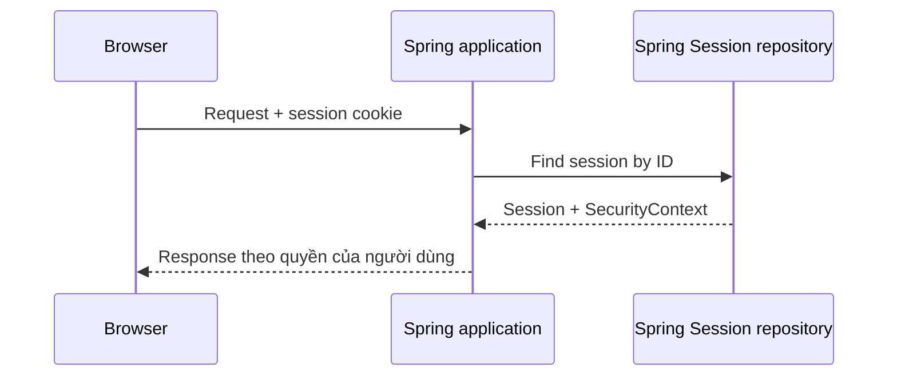

# Định danh phiên là bí mật và phải khó dự đoán

Session ID là định danh mà trình duyệt gửi trong mỗi request để server tìm đúng phiên đang hoạt động. Khi ứng dụng dùng Spring Session, ID này thường được gửi trong cookie, còn dữ liệu phiên nằm trong repository dùng chung như Redis hoặc JDBC. Ai lấy được một session ID còn hiệu lực có thể có khả năng sử dụng phiên của người dùng đó mà không cần biết mật khẩu. Vì vậy, session ID phải được xem như một **bí mật mang quyền truy cập** (bearer secret): khó đoán, khó bị đánh cắp, không được tiết lộ qua log hoặc URL và phải bị vô hiệu hóa khi phiên kết thúc.

Một session ID an toàn cần có tính ngẫu nhiên mật mã, đủ entropy, không chứa thông tin cá nhân và không thể suy ra từ ID của phiên khác. Cookie bảo vệ việc truyền ID nhưng không làm cho một ID dễ đoán trở nên an toàn. Tương tự, lưu session trong Redis/JDBC không tự bảo vệ cookie nếu ứng dụng gửi ID qua HTTP không mã hóa hoặc vô tình ghi cookie vào log.

## 1. Session ID là bearer secret

Trong mô hình session-based authentication, trình duyệt không gửi lại username và password ở mọi request. Thay vào đó, trình duyệt gửi session ID; server dùng ID đó để tra cứu session và khôi phục trạng thái xác thực.



Nếu kẻ tấn công có được cookie của một phiên đang đăng nhập, họ có thể gửi cùng ID từ thiết bị khác. Nếu server chấp nhận ID đó và không có biện pháp phát hiện bổ sung, request có thể được xử lý như request của chủ phiên. Đây là session hijacking.

Session ID vì thế có mức độ nhạy cảm tương tự một access token ngắn hạn. Không coi nó là dữ liệu vô hại chỉ vì nó không chứa username hoặc password. Người có ID hợp lệ có thể sử dụng quyền đã gắn với session đó.

### Session ID không phải thông tin định danh công khai

ID không nên chứa:

- Username, email, số điện thoại hoặc user ID nội bộ.
- Role, tenant, quyền truy cập hoặc trạng thái xác thực.
- Thời điểm đăng nhập, địa chỉ IP hoặc thông tin thiết bị.
- Một phần token có thể suy ra từ ID khác.

Hãy dùng một chuỗi opaque (không mang ý nghĩa nghiệp vụ). Server chỉ dùng nó làm khóa tra cứu; thông tin người dùng và quyền nằm trong session data hoặc hệ thống danh tính phía server.

## 2. Những thuộc tính cần có của một session ID

Một ID phù hợp cần đáp ứng các yêu cầu sau:

1. **Khó dự đoán:** người ngoài không thể suy ra ID tiếp theo từ các ID đã quan sát.
2. **Đủ entropy:** không gian giá trị đủ lớn để dò tìm ngẫu nhiên là bất khả thi trong thời gian phiên còn hiệu lực.
3. **Không tuần tự:** không tăng theo bộ đếm, timestamp, database sequence hoặc thứ tự tạo phiên.
4. **Không tái sử dụng có chủ đích:** ID cũ không được cấp lại cho một phiên khác trong cách triển khai thông thường.
5. **Opaque:** không mã hóa username hay dữ liệu nghiệp vụ vào ID rồi coi chuỗi đó là bí mật.
6. **Được truyền an toàn:** chỉ gửi qua kênh HTTPS và cơ chế lưu cookie/header phù hợp.
7. **Có thể thu hồi:** server có thể invalidate session và từ chối ID cũ.

Mục tiêu thiết kế phổ biến là ít nhất 128 bit entropy ngẫu nhiên từ bộ sinh số ngẫu nhiên an toàn cho mật mã (CSPRNG); với ID tự thiết kế, có thể dùng 256 bit để có biên an toàn rộng. Độ dài chuỗi hiển thị không đồng nghĩa với entropy: một chuỗi 40 ký tự tạo từ timestamp và bộ đếm vẫn dễ đoán hơn một chuỗi ngắn hơn được sinh từ nguồn ngẫu nhiên mật mã.

## 3. Vì sao ID tuần tự hoặc dựa trên thời gian không an toàn?

Các cách tạo ID sau không phù hợp cho session credential:

```java
// Không an toàn: ID tuần tự
String sessionId = "session-" + counter.incrementAndGet();

// Không an toàn: chỉ dựa vào thời gian
String sessionId = Long.toString(System.currentTimeMillis());

// Không an toàn: bộ sinh ngẫu nhiên thông thường
String sessionId = Integer.toHexString(new java.util.Random().nextInt());
```

Các ví dụ trên có thể tạo chuỗi khác nhau nhưng không bảo đảm tính khó dự đoán. Counter có thể được suy ra từ ID trước; timestamp thu hẹp không gian tìm kiếm; `java.util.Random` không được thiết kế cho mục đích sinh bí mật mật mã.

Không dùng các phép biến đổi như:

- `hash(username + timestamp)` nếu đầu vào có thể đoán.
- Mã hóa Base64 một user ID hoặc timestamp rồi gọi đó là token.
- UUID tự tạo từ dữ liệu tuần tự hoặc PRNG không an toàn.
- ID ngắn được rút gọn từ một giá trị lớn mà không phân tích entropy và collision.

Hãy để Spring Session và nền tảng bảo mật quản lý ID theo cơ chế được hỗ trợ. Nếu phải tự triển khai generator, dùng CSPRNG và tích hợp qua extension point được tài liệu của đúng phiên bản hỗ trợ; không thay ID generator bằng một helper rời mà repository không sử dụng.

## 4. Ví dụ sinh chuỗi ngẫu nhiên mật mã

Đoạn mã sau minh họa nguyên tắc tạo một opaque random value bằng `SecureRandom`. Nó là ví dụ về thuật toán, không phải bean thay thế trực tiếp cho generator của Spring Session:

```java
import java.security.SecureRandom;
import java.util.Base64;

final class OpaqueIdFactory {
    private static final SecureRandom RANDOM = new SecureRandom();

    String nextValue() {
        byte[] randomBytes = new byte[32]; // 256 bit
        RANDOM.nextBytes(randomBytes);
        return Base64.getUrlEncoder()
                .withoutPadding()
                .encodeToString(randomBytes);
    }
}
```

32 byte ngẫu nhiên tương ứng 256 bit entropy trước khi mã hóa. Base64 URL-safe không padding tạo chuỗi có thể truyền trong ngữ cảnh URL-safe, nhưng bản thân việc mã hóa không tạo thêm entropy; tính khó đoán đến từ `SecureRandom` và số byte ngẫu nhiên.

Nếu tùy biến session ID generator, hãy xác nhận:

- Spring Session version đang dùng có extension point nào và cách đăng ký ra sao.
- Mọi node đều dùng generator tương thích.
- Không có bước cắt chuỗi làm giảm entropy quá mức.
- Repository xử lý ID trùng theo cách an toàn.
- ID mới được dùng nhất quán trong cookie và repository.

Không cần tự viết generator chỉ để “tăng bảo mật” nếu generator mặc định của phiên bản đang dùng đã đáp ứng yêu cầu. Trước khi thay đổi, kiểm tra tài liệu và implementation của đúng release train.

## 5. Session ID và cookie trong Spring Session

Trong Servlet stack, Spring Session dùng `HttpSessionIdResolver` để đọc ID từ request và phát hành hoặc hết hạn ID trong response. Cấu hình cookie là cách phổ biến cho trình duyệt. `DefaultCookieSerializer` cho phép đặt tên cookie và các thuộc tính bảo vệ.

Ví dụ cấu hình cookie serializer:

```java
import org.springframework.context.annotation.Bean;
import org.springframework.context.annotation.Configuration;
import org.springframework.session.web.http.CookieSerializer;
import org.springframework.session.web.http.DefaultCookieSerializer;

@Configuration
class SessionCookieConfiguration {

    @Bean
    CookieSerializer cookieSerializer() {
        DefaultCookieSerializer serializer = new DefaultCookieSerializer();
        serializer.setCookieName("APPSESSION");
        serializer.setCookiePath("/");
        serializer.setUseHttpOnlyCookie(true);
        serializer.setUseSecureCookie(true);
        serializer.setSameSite("Lax");
        return serializer;
    }
}
```

Đây là cấu hình minh họa cho Servlet session cookie. Tên cookie có thể tùy chỉnh; không giả định mọi ứng dụng đều dùng `JSESSIONID` hoặc `SESSION`. Trong production, `Secure` nên được bật khi ứng dụng phục vụ qua HTTPS. Nếu TLS kết thúc tại reverse proxy, cấu hình rõ ràng thuộc tính Secure và chỉ tin forwarded headers từ proxy được kiểm soát.

### `HttpOnly`

`HttpOnly` ngăn JavaScript phía trình duyệt đọc trực tiếp cookie qua API như `document.cookie`. Nó làm giảm nguy cơ script đánh cắp session ID qua một lỗ hổng XSS, nhưng không ngăn script độc hại gửi request đã được xác thực từ trình duyệt nạn nhân. Vì vậy, vẫn phải phòng chống XSS bằng output encoding, CSP phù hợp và kiểm soát nội dung.

### `Secure`

`Secure` yêu cầu trình duyệt chỉ gửi cookie qua HTTPS. Nếu cookie session bị gửi qua HTTP không mã hóa, người nghe lén trên đường truyền có thể lấy ID. Dùng HTTPS trên toàn bộ đường truyền, bao gồm cả kết nối giữa proxy và ứng dụng nếu topology yêu cầu bảo mật end-to-end.

### `SameSite`

`SameSite=Lax` hoặc `Strict` có thể giảm một số request cross-site tự động mang cookie. `SameSite=None` cho phép cookie trong ngữ cảnh cross-site và cần `Secure` theo quy tắc trình duyệt hiện đại. SameSite là lớp phòng vệ bổ sung, không thay thế CSRF token và kiểm tra origin cho các thao tác thay đổi trạng thái.

### Path và Domain

Giới hạn `Path` và tránh đặt `Domain` rộng hơn nhu cầu giúp giảm phạm vi cookie được gửi. Nếu nhiều ứng dụng cùng domain, dùng cookie name và path phù hợp để tránh xung đột. Không dùng domain cha rộng nếu các subdomain không cùng mức tin cậy.

## 6. Không đưa session ID vào URL

Session ID không nên xuất hiện trong query string hoặc path. URL có thể được lưu ở:

- Browser history và bookmark.
- Reverse proxy, CDN và web server access log.
- Analytics, monitoring và hệ thống báo lỗi.
- Header `Referer` khi trình duyệt điều hướng sang trang khác.
- Screenshot, link được chia sẻ hoặc nội dung chat.

Nếu URL chứa session ID, một người nhận được link có thể sử dụng phiên của chủ link. URL cũng dễ bị sao chép và lưu trữ ngoài ý muốn.

Không dùng URL rewriting để truyền session ID nếu có thể dùng cookie. Với Servlet container, cấu hình tracking mode chỉ dùng cookie khi phù hợp. Spring Session cookie resolver giúp truyền ID trong cookie; tránh tự viết filter nối ID vào URL.

## 7. Không ghi session ID vào log, trace hoặc metric

Session ID có thể xuất hiện trong `Cookie`, `Set-Cookie`, custom header hoặc key của repository. Nếu access log hoặc tracing ghi nguyên request headers, bí mật này có thể bị lưu vào hệ thống log có nhiều người truy cập hơn hệ thống session.

Không log:

- Toàn bộ `Cookie` hoặc `Set-Cookie` header.
- Giá trị session ID nguyên vẹn.
- Remember-Me token hoặc bearer token.
- Redis key chứa trực tiếp session ID nếu key có thể dùng để chiếm quyền phiên.
- Toàn bộ session attribute khi debug.

Khi cần tương quan sự kiện, dùng request ID riêng hoặc một giá trị fingerprint được tạo bằng HMAC với khóa chỉ dành cho telemetry. Không dùng session ID làm metric label vì cardinality cao và có thể lộ thông tin nhạy cảm.

Ví dụ cách che giá trị trong log:

```java
String safeReference = hmacForTelemetry(sessionId);
log.info("Session operation completed, reference={}", safeReference);
```

`hmacForTelemetry` là helper nội bộ cần dùng khóa bảo vệ riêng, không phải hàm hash không khóa. Không log đầu vào hoặc khóa HMAC. Với phần lớn ứng dụng, request correlation ID là đủ và không cần tạo fingerprint từ session ID.

## 8. Bảo vệ session ID khi lưu ở Redis hoặc JDBC

Spring Session lưu session ID để tra cứu dữ liệu. Redis repository có thể dùng ID trong cấu trúc key/index; JDBC lưu ID trong cột session. Vì ID có thể là bearer secret, quyền truy cập kho dữ liệu phải được giới hạn.

Các biện pháp nên áp dụng:

- Dùng TLS cho kết nối ứng dụng đến Redis/database khi môi trường yêu cầu bảo vệ trên mạng.
- Bật ACL/credential riêng cho ứng dụng và giới hạn quyền vào đúng database, schema hoặc key namespace.
- Không chia sẻ tài khoản database/Redis quản trị cho mọi node nếu có thể dùng quyền tối thiểu.
- Bảo vệ backup, snapshot, dump và bản sao dữ liệu session như dữ liệu nhạy cảm.
- Không cho phép người dùng ứng dụng truy vấn tùy ý session của người khác.
- Hạn chế quyền đọc trực tiếp key/table session trong công cụ vận hành.
- Xóa hoặc hết hạn session đúng cách khi logout, thu hồi hoặc hết TTL.

Mã hóa dữ liệu at-rest có thể giảm rủi ro khi thiết bị lưu trữ bị truy cập trái phép, nhưng không thay thế kiểm soát quyền truy cập và bảo mật đường truyền. Nếu database bị chiếm quyền ở mức có thể đọc session ID và dữ liệu session, kẻ tấn công có thể có đủ thông tin để giả mạo phiên.

## 9. Session fixation và thay đổi ID sau xác thực

Session fixation xảy ra khi kẻ tấn công khiến nạn nhân sử dụng một session ID mà kẻ tấn công đã biết trước. Nếu ID đó vẫn được giữ sau khi nạn nhân đăng nhập, kẻ tấn công có thể dùng lại ID để truy cập phiên đã xác thực.

Biện pháp quan trọng là thay đổi session ID khi quyền của phiên được nâng lên, đặc biệt sau đăng nhập. Spring Security có cơ chế bảo vệ session fixation; với Servlet container hiện đại, chiến lược thường có thể đổi ID hiện tại thay vì giữ nguyên ID trước xác thực.

Ví dụ cấu hình rõ ràng trong Spring Security:

```java
http.sessionManagement(session -> session
        .sessionFixation(fixation -> fixation.changeSessionId()));
```

Chiến lược mặc định và API có thể phụ thuộc phiên bản Spring Security/Servlet container. Kiểm tra tài liệu phiên bản đang dùng và kiểm thử thực tế với Spring Session. Không tự vô hiệu hóa session fixation protection để giữ nguyên ID qua login.

Sau khi xác thực:

1. ID cũ không còn được dùng để truy cập session đã xác thực.
2. ID mới được gửi về client bằng cookie response.
3. Các attribute cần giữ được chuyển theo chiến lược bảo vệ đã chọn.
4. Repository và các node khác chỉ chấp nhận ID mới cho phiên đã xác thực.

Nên xem xét thay đổi ID thêm khi người dùng hoàn thành MFA/step-up authentication hoặc thay đổi đặc quyền quan trọng, tùy threat model. Việc rotate ID không thay thế re-authentication cho hành động nhạy cảm.

## 10. Thu hồi session và vô hiệu hóa ID cũ

Khi logout hoặc thu hồi session, ứng dụng cần vô hiệu hóa dữ liệu ở repository và yêu cầu client xóa cookie. Chỉ xóa cookie ở trình duyệt mà không xóa session phía server sẽ để ID cũ còn sử dụng được nếu bị lộ. Chỉ xóa session ở server mà không xóa cookie sẽ khiến trình duyệt tiếp tục gửi ID cũ và tạo thêm request không cần thiết.

Ví dụ cấu hình logout trong Spring Security:

```java
http.logout(logout -> logout
        .invalidateHttpSession(true)
        .clearAuthentication(true)
        .deleteCookies("APPSESSION"));
```

Tên cookie phải khớp với `DefaultCookieSerializer` thực tế. Việc xóa cookie còn phải phù hợp `Path` và `Domain` ban đầu; nếu cần scope tùy chỉnh, cấu hình logout handler hoặc cookie resolver tương ứng.

Với Spring Session dùng Redis/JDBC, invalidate phải được phản ánh vào repository dùng chung để các node khác cũng từ chối ID cũ. Không dựa vào việc người dùng đóng tab hoặc đóng trình duyệt như một thao tác logout đáng tin cậy.

## 11. TTL giới hạn thời gian sử dụng ID bị lộ

Session ID nên có thời gian hiệu lực giới hạn. Spring Session hỗ trợ idle timeout; repository xóa hoặc coi session là hết hạn khi vượt khoảng không hoạt động tối đa. Timeout ngắn hơn làm giảm khoảng thời gian ID bị đánh cắp có thể bị sử dụng, nhưng cần cân bằng trải nghiệm người dùng.

Idle timeout không phải absolute lifetime. Nếu người dùng gửi request đều đặn, session có thể được gia hạn. Với hệ thống nhạy cảm, cần thêm giới hạn tuổi thọ tuyệt đối của lần xác thực và yêu cầu xác thực lại khi vượt ngưỡng.

Không đặt TTL vô hạn cho session đăng nhập thông thường. Đồng thời không dùng cookie `Max-Age` làm cơ chế duy nhất để thu hồi ID; server phải kiểm tra session còn tồn tại và hợp lệ trong repository.

## 12. Giảm nguy cơ dò tìm session ID

ID có entropy cao khiến dò tìm ngẫu nhiên không khả thi về mặt thực tế, nhưng vẫn nên có lớp bảo vệ bổ sung:

- Rate limit request đến endpoint xác thực và các endpoint nhận session ID.
- Giám sát tỷ lệ session ID không tồn tại bất thường.
- Trả lỗi thống nhất, tránh tiết lộ chi tiết ID nào hợp lệ hoặc thuộc user nào.
- Giới hạn kích thước/định dạng header/cookie để tránh input quá lớn gây tiêu tốn tài nguyên.
- Không cho phép endpoint kiểm tra session ID tùy ý như một oracle công khai.
- Bảo vệ endpoint quản trị tra cứu session bằng quyền rõ ràng.

Rate limit không thay thế entropy. Nếu ID chỉ có vài triệu khả năng, một hệ thống lớn vẫn có thể bị dò bằng tốc độ đủ cao. Ngược lại, ID có entropy cao vẫn có thể bị đánh cắp qua XSS, malware, log hoặc thiết bị bị chiếm quyền; vì vậy phải bảo vệ cả quá trình tạo, truyền, lưu và thu hồi.

## 13. ID và các loại token khác

Session ID, CSRF token, Remember-Me token và access token có vai trò khác nhau:

| Giá trị | Mục đích | Vòng đời/kiểm tra |
|---|---|---|
| Session ID | Tìm session server-side | Repository, timeout, invalidate và rotation |
| CSRF token | Chứng minh request thay đổi trạng thái phù hợp với phiên/nguồn tin cậy | CSRF repository và cơ chế kiểm tra token |
| Remember-Me token | Tái xác thực người dùng sau khi session mất | Remember-Me service, token validity và revoke |
| Access token | Xác thực request theo token | Signature/introspection, issuer, audience, expiry và revoke policy |

Không dùng session ID làm CSRF token hoặc access token. Không cho phép Remember-Me cookie thay thế quy trình thu hồi session nếu chính sách yêu cầu logout hoàn toàn.

## 14. Cookie và CSRF

Cookie session thường được trình duyệt gửi tự động theo domain/path và SameSite policy. Điều này tạo ra bề mặt CSRF: một website khác có thể cố khiến trình duyệt gửi request đến ứng dụng đang đăng nhập.

`SameSite=Lax` hoặc `Strict` giảm một số trường hợp cookie được gửi cross-site, nhưng không thay thế CSRF protection trong mọi ứng dụng. Với Spring Security, giữ CSRF protection cho các ứng dụng trình duyệt dùng cookie xác thực. Nếu dùng `CookieCsrfTokenRepository`, phân biệt cookie CSRF với cookie session và cấu hình quyền đọc cookie phù hợp với frontend.

`HttpOnly` nên bật cho session cookie. Nếu frontend cần đọc CSRF token, dùng cookie riêng cho CSRF theo hướng dẫn Spring Security; không tắt HttpOnly của session cookie chỉ để JavaScript đọc session ID.

## 15. Triển khai nhiều node

Trong cụm nhiều instance, mọi node cần chấp nhận session ID được tạo bởi node khác vì chúng dùng chung repository. Một node không được tạo ID từ counter cục bộ có thể trùng hoặc có thể đoán ở node khác.

Các yêu cầu quan trọng:

- Mỗi node dùng CSPRNG an toàn từ runtime/hệ điều hành.
- Repository dùng chung được bảo vệ bằng TLS và quyền truy cập tối thiểu.
- Cookie name, path, domain, Secure, HttpOnly và SameSite nhất quán giữa node.
- Các node dùng cùng cấu hình namespace/schema và serialization tương thích.
- Không có sticky session như một điều kiện bảo mật; sticky routing chỉ là tối ưu hạ tầng nếu cần.
- Khi invalidate ở node A, node B phải không còn tìm thấy session cũ.
- Khi rotate ID sau đăng nhập ở node A, request tiếp theo đến node B phải dùng ID mới.

Không dùng IP hoặc hostname của node để tạo một phần ID. IP có thể thay đổi, node có thể bị tái tạo và giá trị đó không cung cấp entropy an toàn. ID phải độc lập với topology triển khai.

## 16. Kiểm thử bảo mật session ID

Một bộ kiểm thử nên xác minh các thuộc tính quan trọng:

1. Đăng nhập và xác nhận session ID được gửi trong cookie, không xuất hiện trong URL.
2. Kiểm tra cookie có `Secure`, `HttpOnly`, `SameSite`, `Path` và `Domain` phù hợp.
3. Xác nhận ID mới sau đăng nhập khác ID trước đăng nhập theo session fixation strategy.
4. Đăng xuất và xác nhận session bị xóa ở repository, cookie bị hết hạn.
5. Gửi lại ID cũ sau logout và xác nhận không khôi phục được danh tính.
6. Gửi cùng ID từ node khác trước logout để xác nhận session chia sẻ; gửi lại sau logout để xác nhận bị từ chối.
7. Kiểm tra ID không xuất hiện trong access log, trace, exception log hoặc metric label.
8. Kiểm tra request với ID ngẫu nhiên không tồn tại không làm lộ thông tin chủ session.
9. Kiểm tra Remember-Me hoặc token độc lập có hành vi đúng khi session hết hạn.
10. Kiểm tra TTL và absolute lifetime theo chính sách.

Không đánh giá chất lượng generator chỉ bằng cách tạo vài ID rồi nhìn xem chúng có vẻ ngẫu nhiên. Kiểm tra nguồn sinh ID và cấu hình framework; kiểm thử thống kê nhỏ không chứng minh an toàn mật mã. Nếu có yêu cầu compliance, dùng đánh giá bảo mật chuyên môn cho generator và toàn bộ luồng session.

## 17. Checklist xử lý sự cố lộ session ID

Nếu nghi ngờ session ID đã bị lộ:

1. Xác định phạm vi session và người dùng bị ảnh hưởng từ dữ liệu audit có bảo vệ.
2. Thu hồi session ở repository dùng chung để mọi node từ chối ID cũ.
3. Hết hạn cookie ở client khi có thể; thông báo người dùng đăng nhập lại.
4. Nếu Remember-Me hoặc access token cũng có thể lộ, thu hồi credential tương ứng.
5. Xóa hoặc hạn chế quyền truy cập log/trace có chứa cookie; xử lý theo chính sách lưu trữ và incident response.
6. Tìm nguồn rò rỉ: URL, referrer, access log, proxy, XSS, extension, screenshot hoặc thiết bị.
7. Sửa nguyên nhân gốc, bổ sung redaction và kiểm thử hồi quy.
8. Theo dõi request sử dụng ID cũ hoặc hành vi đăng nhập bất thường.

Không chỉ đổi cookie name hoặc restart ứng dụng để xử lý sự cố. Nếu ID cũ vẫn còn trong repository và còn được chấp nhận, nó có thể tiếp tục được dùng.

## 18. Những sai lầm thường gặp

| Sai lầm | Rủi ro | Cách làm phù hợp |
|---|---|---|
| Tạo ID từ timestamp hoặc counter | Dễ dự đoán và dò tìm | Dùng generator an toàn cho mật mã |
| Dùng `java.util.Random` | Không bảo đảm chống dự đoán | Dùng `SecureRandom` nếu tự sinh bí mật |
| Đưa ID vào URL | Lộ qua history, log và Referer | Truyền bằng cookie hoặc header được bảo vệ |
| Tắt `HttpOnly` cho session cookie | JavaScript có thể đọc ID | Giữ HttpOnly; dùng cookie riêng cho CSRF nếu cần |
| Không bật `Secure` | Cookie có thể bị gửi qua HTTP | HTTPS và Secure cookie |
| Không rotate ID sau login | Rủi ro session fixation | Dùng session fixation protection của Spring Security |
| Chỉ xóa cookie khi logout | Session server vẫn có thể còn hiệu lực | Invalidate repository và hết hạn cookie |
| Log toàn bộ request headers | Session ID có thể lọt vào log | Redact Cookie/Set-Cookie và token headers |
| Dùng ID làm CSRF token | Trộn hai cơ chế bảo vệ khác nhau | Dùng CSRF token riêng |
| Cho rằng TTL là absolute lifetime | Hoạt động liên tục có thể gia hạn phiên | Bổ sung absolute authentication lifetime nếu cần |

## 19. Nguyên tắc thiết kế

- Coi session ID là bearer secret có thể cho phép chiếm quyền phiên.
- Dùng ID opaque được sinh bằng nguồn ngẫu nhiên mật mã; mục tiêu thiết kế phổ biến là ít nhất 128 bit entropy.
- Không mã hóa thông tin cá nhân, timestamp hoặc counter vào ID.
- Giữ session ID trong cookie/header được bảo vệ; không đưa vào URL.
- Bật `Secure`, `HttpOnly` và SameSite phù hợp; dùng HTTPS trên toàn tuyến.
- Bảo vệ Redis/JDBC, backup và quyền đọc dữ liệu session.
- Không ghi cookie/session ID vào log, trace hoặc metric.
- Dùng session fixation protection để đổi ID khi xác thực thành công.
- Invalidate session ở repository và xóa cookie đúng scope khi logout.
- Kết hợp idle timeout với absolute lifetime theo mức độ nhạy cảm.
- Kiểm thử rotation, thu hồi, cookie attributes và hành vi trên nhiều node.

Session ID là chìa khóa tra cứu một phiên đã xác thực, nên phải được bảo vệ như một credential. Spring Session cung cấp cơ chế quản lý session và resolver, nhưng ứng dụng vẫn phải bảo đảm ID khó đoán, cookie được truyền an toàn, kho lưu trữ có quyền truy cập giới hạn và ID cũ bị vô hiệu hóa sau logout hoặc rotation. Khi coi ID là bí mật từ lúc sinh đến lúc thu hồi, hệ thống giảm đáng kể nguy cơ session fixation, session hijacking và rò rỉ thông tin xác thực qua hạ tầng vận hành.
