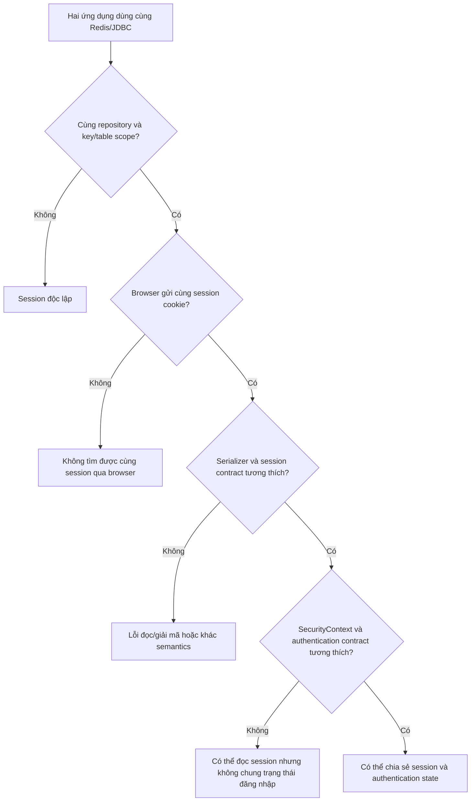
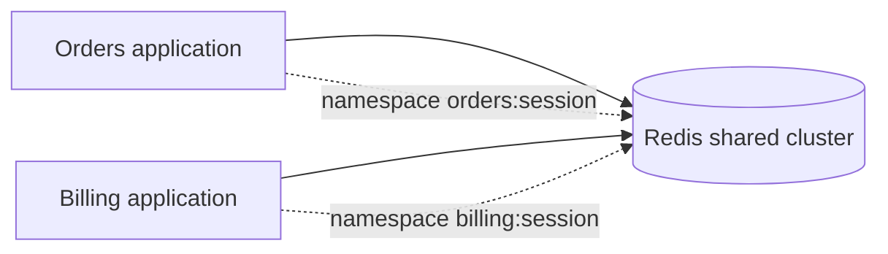
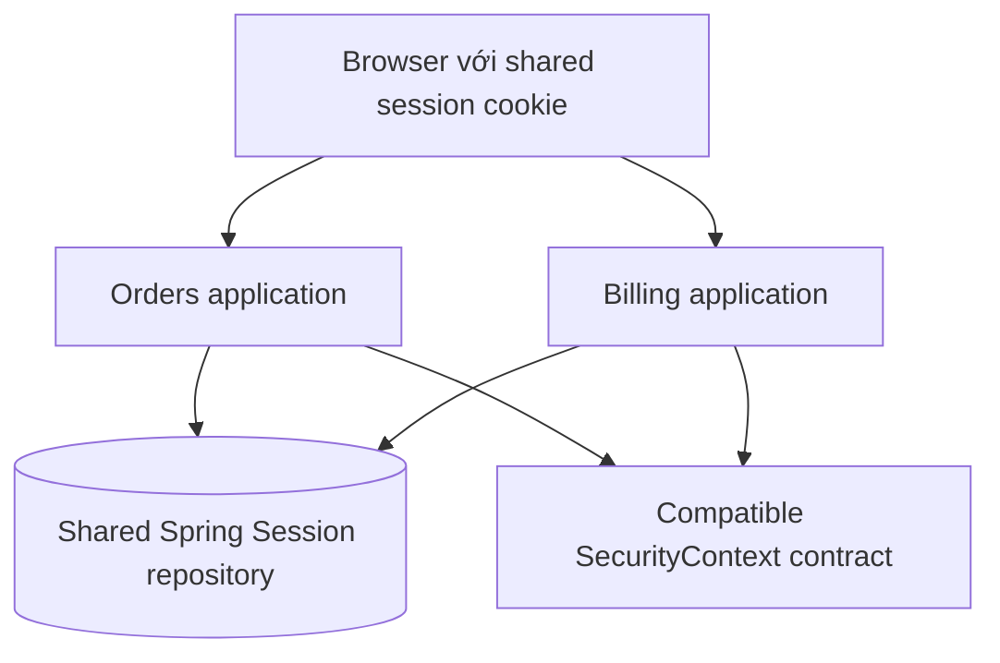
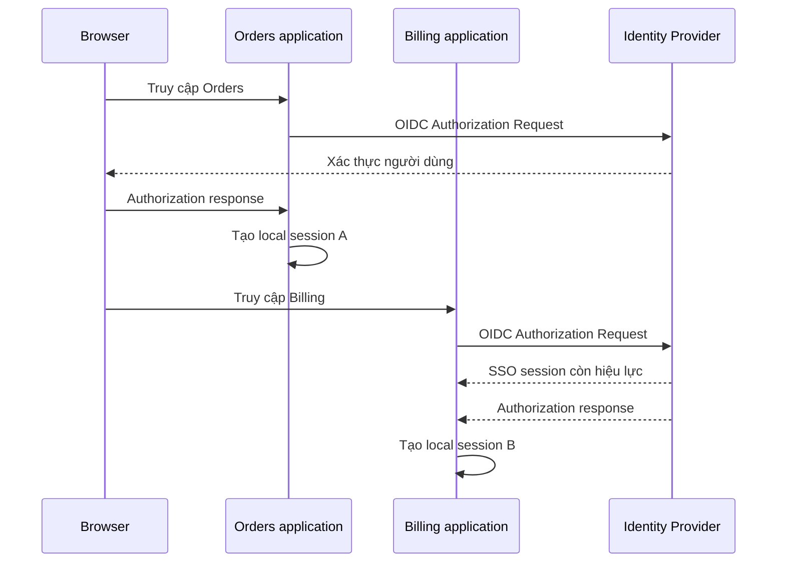

# Chung kho lưu trữ không tự đồng nghĩa chung phiên hoặc chung đăng nhập

Hai ứng dụng Spring có thể cùng kết nối một Redis server, cùng dùng một cụm JDBC hoặc thậm chí cùng một database/schema mà vẫn không chia sẻ session và không tự động đăng nhập người dùng cho nhau. Việc dùng chung hạ tầng chỉ nói rằng hai ứng dụng có thể truy cập cùng một dịch vụ lưu trữ. Để thực sự đọc cùng một session, chúng còn phải thống nhất vùng key/table, session ID mà trình duyệt gửi, cookie name/domain/path, định dạng dữ liệu và cách diễn giải session. Để cùng nhận diện người dùng đã xác thực, Spring Security ở mỗi ứng dụng còn phải khôi phục và tin cậy cùng một hợp đồng `SecurityContext`/principal.

Đây là các lớp độc lập: datastore, session repository, HTTP session cookie, session object và trạng thái xác thực. Cùng Redis không làm cookie của hai host tự chia sẻ; cùng cookie name không làm hai repository tìm thấy cùng key; cùng session ID cũng không bảo đảm ứng dụng thứ hai hiểu được dữ liệu xác thực đã serialize. Ngược lại, nếu cố ý dùng chung toàn bộ các lớp này, session ID trở thành credential dùng được ở nhiều ứng dụng và phạm vi ảnh hưởng của một lỗi bảo mật sẽ lớn hơn.

Trong `SPRING_SESSION`, bài học này giúp phân biệt chia sẻ hạ tầng với chia sẻ session và SSO, nhận biết những điều kiện kỹ thuật cần thiết khi chủ động chia sẻ session, đồng thời lựa chọn cách tích hợp phù hợp cho nhiều ứng dụng độc lập.

## 1. Năm lớp cần phân biệt

| Lớp | Câu hỏi cần trả lời | Ví dụ |
|---|---|---|
| Datastore | Các ứng dụng có kết nối cùng dịch vụ lưu trữ không? | Cùng Redis cluster hoặc cùng PostgreSQL server |
| Repository/keyspace | Chúng có đọc và ghi cùng vùng dữ liệu session không? | Cùng Redis namespace/key prefix hoặc cùng JDBC session tables/schema |
| Browser cookie | Trình duyệt có gửi cùng session ID tới cả hai ứng dụng không? | Cùng cookie name, domain, path và chính sách SameSite phù hợp |
| Session contract | Hai ứng dụng có deserialize và hiểu cùng session attributes không? | Cùng serializer, kiểu dữ liệu, version và tên attribute |
| Authentication contract | Ứng dụng thứ hai có khôi phục và chấp nhận cùng danh tính không? | `SecurityContextRepository`, principal và authorities tương thích |

Chia sẻ ở một lớp không tự động kéo theo chia sẻ ở lớp tiếp theo. Có thể hình dung:



Sơ đồ mô tả các điều kiện khái quát. Ứng dụng vẫn phải kiểm tra authorization riêng cho từng tài nguyên; việc khôi phục cùng `Authentication` không cấp quyền truy cập mọi endpoint của mọi ứng dụng.

## 2. Cùng Redis server nhưng namespace khác nhau

Redis có thể phục vụ nhiều ứng dụng và nhiều loại dữ liệu. Spring Session Redis dùng namespace để tạo vùng key riêng cho session. Ví dụ:

| Ứng dụng | Redis endpoint | Namespace |
|---|---|---|
| `orders.example.com` | `redis.internal:6379` | `orders:session` |
| `billing.example.com` | `redis.internal:6379` | `billing:session` |

Hai ứng dụng cùng host/cluster Redis nhưng repository tìm các key có prefix khác nhau. Session do ứng dụng Orders tạo sẽ không được Billing tìm thấy qua repository của Billing.

Ví dụ cấu hình riêng cho hai ứng dụng:

```java
// Trong ứng dụng Orders
@Configuration
@EnableRedisHttpSession(
        redisNamespace = "orders:session",
        maxInactiveIntervalInSeconds = 1800)
class OrdersSessionConfiguration {
}
```

```java
// Trong ứng dụng Billing
@Configuration
@EnableRedisHttpSession(
        redisNamespace = "billing:session",
        maxInactiveIntervalInSeconds = 1800)
class BillingSessionConfiguration {
}
```

Hai namespace khác nhau là một cách cô lập dữ liệu hợp lý. Cả hai ứng dụng vẫn có thể dùng chung Redis cluster, ACL infrastructure và quy trình vận hành mà không chia sẻ session.

Nếu chủ động muốn cùng session, hai ứng dụng phải dùng cùng namespace và cùng repository contract. Chỉ đổi namespace thành một chuỗi giống nhau vẫn chưa đủ: cookie, session ID, serializer và authentication state cũng phải tương thích.

Không nên dùng chung namespace một cách tình cờ chỉ vì cả hai ứng dụng giữ giá trị mặc định. Hãy cấu hình namespace tường minh, đặt tên theo application/session domain và kiểm tra cấu hình thực tế của từng môi trường.

## 3. Cùng JDBC database nhưng không nhất thiết cùng session tables

Hai ứng dụng có thể cùng kết nối một PostgreSQL/MySQL database nhưng dùng schema hoặc table khác nhau:

```text
database: platform
  schema orders:
    SPRING_SESSION
    SPRING_SESSION_ATTRIBUTES
  schema billing:
    SPRING_SESSION
    SPRING_SESSION_ATTRIBUTES
```

Trong ví dụ này, hai repository đọc/ghi các bảng thuộc schema khác nhau nên session độc lập. Cùng JDBC URL hoặc cùng database name không có nghĩa chúng dùng chung dữ liệu session.

Với `JdbcIndexedSessionRepository`, cần kiểm tra schema/table được cấu hình thực tế, quyền truy cập, primary key, index và serializer. Nếu hai ứng dụng cố ý dùng cùng các session tables và cùng session ID, chúng có thể đọc cùng bản ghi nếu cấu trúc, kiểu dữ liệu và cách ánh xạ tương thích. Nhưng việc dùng chung bảng không tự tạo ra một quy trình xác thực dùng chung.

Không sửa trực tiếp schema Spring Session để thêm tenant/application partition một cách tùy tiện. Nếu cần tách dữ liệu, dùng database/schema/table riêng hoặc cơ chế repository được hỗ trợ và kiểm thử. Nếu cần chia sẻ, phải có hợp đồng vận hành và migration rõ ràng cho cả hai ứng dụng.

## 4. Cookie quyết định trình duyệt gửi session ID tới đâu

Session cookie thường chứa session ID. Cookie được trình duyệt gửi theo các thuộc tính của nó, đặc biệt:

- **Name:** tên cookie, ví dụ `SESSION` hoặc `JSESSIONID`.
- **Domain:** host nào được nhận cookie. Cookie host-only chỉ gửi tới host đã đặt cookie; cookie có `Domain=example.com` có thể được gửi tới các subdomain phù hợp.
- **Path:** đường dẫn request phải khớp, ví dụ `/orders` hoặc `/`.
- **Secure:** chỉ gửi qua HTTPS khi được bật.
- **HttpOnly:** JavaScript không đọc trực tiếp được cookie.
- **SameSite:** kiểm soát việc gửi cookie trong ngữ cảnh cross-site.
- **Max-Age/Expires:** thời hạn cookie ở browser; khác với TTL session ở repository.

Ví dụ hai ứng dụng:

```text
https://orders.example.com/
https://billing.example.com/
```

Cookie host-only được tạo bởi `orders.example.com` không tự gửi tới `billing.example.com`, dù hai host có cùng parent domain. Muốn một cookie được gửi tới cả hai host, cookie cần domain scope phù hợp, chẳng hạn `example.com`, và path phù hợp như `/`. Điều này mở rộng phạm vi nhận credential tới các subdomain trong domain đó, nên chỉ làm khi các subdomain thuộc cùng ranh giới tin cậy.

Hai ứng dụng có cookie name giống nhau nhưng domain/path khác nhau vẫn có thể nhận các cookie khác nhau. Ngược lại, hai cookie cùng name/domain/path có thể xung đột hoặc ghi đè nhau nếu hai ứng dụng độc lập phát hành session ID riêng. Không dùng cookie name trùng nhau như một cách chia sẻ session.

## 5. Cấu hình cookie chung khi thực sự muốn chia sẻ Servlet session

Trong Servlet stack, Spring Session có thể cấu hình cookie thông qua `DefaultCookieSerializer`. Ví dụ minh họa cho một session domain có chủ đích dùng chung giữa các ứng dụng cùng trust boundary:

```java
@Bean(name = "springSessionDefaultCookieSerializer")
DefaultCookieSerializer springSessionCookieSerializer() {
    DefaultCookieSerializer serializer = new DefaultCookieSerializer();
    serializer.setCookieName("PLATFORM_SESSION");
    serializer.setCookiePath("/");
    serializer.setDomainName("example.com");
    serializer.setUseHttpOnlyCookie(true);
    serializer.setUseSecureCookie(true);
    serializer.setSameSite("Lax");
    return serializer;
}
```

Các ứng dụng tham gia chia sẻ phải thống nhất cookie name, domain, path và các thuộc tính có liên quan. `Secure=true` yêu cầu triển khai HTTPS. `SameSite=Lax` thường phù hợp cho các ứng dụng cùng site trên subdomain; nếu thực sự cần cookie trong ngữ cảnh cross-site, `SameSite=None` đòi hỏi `Secure=true` và vẫn chịu chính sách chặn third-party cookies của browser.

Đây là ví dụ cấu hình cho Servlet session cookie. Tên bean và API cần khớp Spring Session version của dự án. Với WebFlux, dùng cookie/session integration tương ứng của reactive stack; không mặc định rằng bean Servlet serializer điều khiển cookie của WebFlux.

### 5.1. Cùng site không đồng nghĩa cùng origin

Hai subdomain `orders.example.com` và `billing.example.com` khác origin vì hostname khác nhau, nhưng thường cùng site theo quy tắc schemeful same-site khi cùng scheme và registrable domain. Điều đó ảnh hưởng SameSite cookie, nhưng không bỏ qua CORS khi JavaScript gọi API cross-origin.

Nếu frontend ở `orders.example.com` gọi API ở `billing.example.com` bằng `fetch`, client có thể cần `credentials: "include"`; server phải cho phép origin cụ thể và bật credential support trong CORS. Không thể dùng `Access-Control-Allow-Origin: *` cùng credentialed requests. CORS điều khiển quyền đọc response từ JavaScript, không phải cơ chế xác thực và không thay thế CSRF protection.

### 5.2. Cookie domain rộng làm tăng phạm vi rủi ro

Cookie `Domain=example.com` được gửi tới các subdomain phù hợp. Nếu một subdomain bị chiếm quyền, cấu hình sai hoặc do bên thứ ba vận hành, request từ host đó có thể mang session cookie. `HttpOnly` ngăn JavaScript đọc cookie nhưng không ngăn server của subdomain nhận cookie trong HTTP request.

Chỉ dùng domain-wide session cookie khi tất cả subdomain nhận cookie thuộc cùng ranh giới tin cậy, được quản trị và bảo vệ tương đương. Nếu các ứng dụng có chủ sở hữu hoặc mức độ tin cậy khác nhau, ưu tiên host-only cookies và SSO qua identity provider.

Cookie prefix `__Host-` yêu cầu `Secure`, `Path=/` và không có `Domain`, vì vậy nó không thể được chia sẻ giữa các subdomain. Đây là lựa chọn tốt cho cookie host-only khi cần ràng buộc chặt với một host; nó không phù hợp với mô hình domain-wide shared cookie.

## 6. Cùng cookie vẫn chưa đủ để cùng session

Giả sử browser gửi cùng cookie `PLATFORM_SESSION=abc...` tới hai ứng dụng. Mỗi ứng dụng lấy giá trị cookie rồi hỏi repository của mình. Nếu repository khác namespace hoặc khác JDBC tables, chúng sẽ tìm hai vùng dữ liệu khác nhau và không tìm thấy cùng session.

Để cùng đọc một session, ít nhất cần:

1. Cùng session ID được browser gửi tới cả hai ứng dụng.
2. Cùng Redis namespace hoặc cùng JDBC session tables/schema theo repository contract.
3. Cùng loại repository và tương thích cách tạo/đọc session.
4. Cùng serializer và các kiểu dữ liệu attribute tương thích.
5. Cùng quy tắc timeout, expiration và session lifecycle.
6. Cùng chính sách về session fixation, đổi session ID và logout.

Nếu một ứng dụng dùng Redis còn ứng dụng kia dùng JDBC, cùng cookie name không giúp chúng tìm thấy cùng session. Muốn dùng hai backend khác nhau mà vẫn chia sẻ phiên, cần một lớp đồng bộ/chuyển đổi session được thiết kế riêng; Spring Session không tự đồng bộ hai repository độc lập.

## 7. Cùng session chưa chắc cùng đăng nhập

Một session object có thể chỉ chứa dữ liệu giao diện, giỏ hàng hoặc saved request. Đăng nhập dựa trên session còn cần trạng thái xác thực mà Spring Security có thể khôi phục.

Trong Servlet stack, `SecurityContext` thường được lưu qua `SecurityContextRepository` vào `HttpSession` khi ứng dụng dùng session-based authentication. Để ứng dụng B khôi phục cùng trạng thái đăng nhập, B cần:

- Dùng session repository đọc cùng session.
- Có serializer đọc được kiểu `SecurityContext`, `Authentication`, principal và authorities.
- Dùng Spring Security configuration có thể nạp context từ session.
- Hiểu cùng principal contract, issuer/tenant và cách diễn giải authorities.
- Không cấu hình security stateless hoặc repository không lưu context nếu mong muốn session-based login.
- Có chính sách session fixation, logout và context invalidation tương thích.

Ví dụ, ứng dụng A lưu một `SecurityContext` có principal kiểu `com.example.orders.UserPrincipal`, còn ứng dụng B không có class đó hoặc dùng phiên bản class khác. B có thể gặp lỗi deserialize, class incompatibility hoặc không thể diễn giải authorities. Nếu cả hai đọc được object nhưng dùng role mapping khác nhau, authorization vẫn có thể khác.

Không nên serialize các implementation principal phức tạp, chứa entity Hibernate, lazy proxy, password hoặc dependency nội bộ của một ứng dụng rồi kỳ vọng ứng dụng khác hiểu được. Nếu thật sự chia sẻ authentication state, định nghĩa principal contract nhỏ, ổn định và không chứa bí mật không cần thiết; version hóa thay đổi và kiểm thử rolling deployment.

## 8. SessionCreationPolicy có thể ngăn ứng dụng dùng session để lưu đăng nhập

Spring Security có `SessionCreationPolicy` để điều khiển việc sử dụng `HttpSession`:

| Policy | Ý nghĩa khái quát |
|---|---|
| `ALWAYS` | Luôn tạo session nếu chưa có |
| `IF_REQUIRED` | Tạo session khi security cần; thường dùng cho web application session-based |
| `NEVER` | Không tự tạo session nhưng vẫn có thể dùng session đã tồn tại |
| `STATELESS` | Security không dùng `HttpSession` để lưu/khôi phục SecurityContext |

Nếu ứng dụng A dùng `IF_REQUIRED` và lưu `SecurityContext` vào session nhưng ứng dụng B dùng `STATELESS`, B có thể đọc một số session attributes qua code khác nhưng Spring Security không khôi phục đăng nhập từ session. Vì vậy, “cùng repository” không đồng nghĩa “cùng authentication behavior”.

Với API bearer token, `STATELESS` thường là lựa chọn có chủ đích. Với web app dùng form login và session cookie, `IF_REQUIRED` cùng `SecurityContextRepository` session-based phù hợp hơn. Không thay đổi policy chỉ để ép hai ứng dụng chia sẻ đăng nhập nếu kiến trúc xác thực không được thiết kế cho việc đó.

## 9. Ba mô hình kiến trúc thường gặp

### 9.1. Cùng hạ tầng, session riêng



Hai ứng dụng cùng Redis nhưng namespace khác nhau và cookie host-only riêng. Đây thường là lựa chọn tốt khi ứng dụng độc lập, release riêng và có ranh giới bảo mật khác nhau.

Ưu điểm:

- Tách vòng đời session và quyền truy cập.
- Logout ở ứng dụng này không vô tình xóa session của ứng dụng kia.
- Có thể nâng cấp serializer hoặc session attributes độc lập.
- Dễ giới hạn blast radius khi một ứng dụng bị compromise.

Người dùng vẫn có thể có trải nghiệm đăng nhập một lần thông qua SSO ở identity provider; mỗi ứng dụng tạo session local riêng sau khi xác thực.

### 9.2. Cùng session domain có chủ đích



Hai ứng dụng được thiết kế như các phần của một trust boundary, dùng cùng cookie, repository/keyspace, serializer và authentication contract. Đây là chia sẻ session thực sự. Cần phối hợp deploy, session fixation, logout, timeout, schema và compatibility; một thay đổi ở một ứng dụng có thể làm session của ứng dụng kia không đọc được.

Mô hình này phù hợp trong một số hệ thống legacy hoặc các web module được quản trị như một sản phẩm thống nhất. Nó tạo coupling lớn hơn và yêu cầu kiểm soát chặt các subdomain nhận cookie.

### 9.3. SSO qua identity provider, session local từng ứng dụng



Mỗi ứng dụng giữ session riêng, nhưng identity provider xác thực người dùng chung. Khi người dùng đã có phiên đăng nhập ở IdP, lần truy cập ứng dụng khác có thể hoàn tất mà không yêu cầu nhập lại mật khẩu, tùy chính sách IdP và flow.

Đây thường là cách tách biệt tốt hơn giữa identity và session runtime của từng ứng dụng. Logout local, logout tại IdP và token revocation là các khái niệm khác nhau; phải thiết kế logout propagation theo OIDC/provider hỗ trợ.

## 10. Vì sao SSO không cần dùng chung Spring Session repository?

SSO chia sẻ kết quả xác thực hoặc danh tính qua một giao thức identity, thường là OpenID Connect/OAuth 2.0. Mỗi ứng dụng có thể:

1. Chuyển browser tới identity provider.
2. Nhận authorization response theo flow được bảo vệ.
3. Xác minh issuer, audience, signature, state, nonce và các điều kiện liên quan.
4. Tạo local `Authentication` theo mapping của ứng dụng.
5. Tạo session local trong Spring Session repository riêng.

Vì vậy, người dùng có thể đăng nhập một lần ở cấp IdP nhưng Orders và Billing vẫn có session ID và session data riêng. Nếu session của Orders bị xóa, session Billing không nhất thiết bị xóa; ứng dụng có thể yêu cầu xác thực lại với IdP và nhận SSO response nếu phiên IdP vẫn hợp lệ.

Không chia sẻ session ID hoặc `SecurityContext` giữa các ứng dụng chỉ để đạt trải nghiệm SSO. Dùng giao thức identity chuẩn giúp mỗi ứng dụng kiểm soát quyền và session lifetime độc lập.

## 11. Logout khi session riêng và khi session dùng chung

Hai mô hình có hành vi khác nhau:

| Hành động | Session riêng + SSO | Shared Spring Session |
|---|---|---|
| Logout khỏi Orders | Xóa local session Orders | Có thể xóa session dùng chung, khiến Billing cũng mất session |
| Logout khỏi Billing | Xóa local session Billing | Có thể làm mất session mà Orders đang dùng |
| Logout tại IdP | Có thể ảnh hưởng lần xác thực tiếp theo; propagation tùy OIDC/provider | Không tự xóa mọi shared session nếu chưa tích hợp logout propagation |
| Thu hồi một session ID | Chỉ ảnh hưởng ứng dụng sở hữu session đó | Ảnh hưởng mọi ứng dụng cùng đọc session ID đó |
| Thay đổi session schema | Có thể nâng cấp từng ứng dụng | Cần tương thích giữa tất cả consumer cùng lúc |

Trong shared session model, logout ở một ứng dụng có thể invalidate session mà ứng dụng khác đang sử dụng. Nếu đây là hành vi mong muốn, phải xác định rõ và kiểm thử. Nếu không, hãy dùng session domain riêng và SSO.

Trong SSO model, logout khỏi một ứng dụng thường chỉ xóa local session. Để logout khỏi tất cả ứng dụng, cần front-channel/back-channel logout hoặc cơ chế revocation mà IdP và các ứng dụng cùng hỗ trợ. Không tuyên bố “logout everywhere” chỉ vì local session đã bị invalidate.

## 12. Session fixation, cookie rotation và session ID

Spring Security có session fixation protection để đổi session ID hoặc tạo session mới sau khi xác thực thành công. Nếu nhiều ứng dụng chia sẻ cùng session domain, chúng cần hiểu hành vi đổi ID và cách browser nhận cookie mới.

Các tình huống cần xử lý:

- Người dùng đăng nhập qua ứng dụng A và session ID được rotate.
- Browser gửi cookie mới tới A và B theo domain/path.
- Ứng dụng B không được tiếp tục dùng ID cũ nếu session cũ đã bị invalidate.
- Nếu ứng dụng B đang có request chạy, request đó có thể giữ snapshot session cũ.
- Logout từ A có thể xóa session dùng chung; B phải xử lý request tiếp theo như unauthenticated.

Session ID là bearer credential. Không đưa nó vào URL, JSON, analytics hoặc log. Dùng HTTPS, `Secure`, `HttpOnly`, `SameSite` phù hợp và giới hạn domain cookie. Không dùng một session ID như token tích hợp giữa backend services; service-to-service authentication cần cơ chế riêng.

## 13. Serializer và session attribute contract

Nếu nhiều ứng dụng đọc cùng session, serializer là một phần của hợp đồng tích hợp. Cần thống nhất:

- Kiểu serializer (Java serialization, JSON hoặc serializer khác).
- Cách biểu diễn principal, authorities và session attributes.
- Tên attribute và version của schema.
- Cách xử lý class không còn tồn tại hoặc field thay đổi.
- Charset, date/time format, enum representation và null semantics.
- Kích thước tối đa và loại dữ liệu được phép lưu.

Không lưu trực tiếp toàn bộ entity, Hibernate proxy, request object, servlet object hoặc service object trong session. Những kiểu này gắn chặt với implementation một ứng dụng và thường không an toàn để serialize/chia sẻ.

Nếu phải chia sẻ session, ưu tiên DTO nhỏ, ổn định và có version. Tuy nhiên, `SecurityContext` của Spring Security vẫn là object có contract riêng; không thể chỉ chuyển sang JSON tùy ý rồi giả định Spring Security tự khôi phục đúng. Cần cấu hình serializer/repository và context contract tương thích, đồng thời kiểm thử login ở A và restore ở B.

### 13.1. Rolling deployment và tương thích phiên bản

Khi ứng dụng A deploy phiên bản mới trước B, session có thể được ghi bằng schema mới mà B chưa đọc được. Ngược lại, B có thể ghi field cũ mà A đã bỏ.

Chiến lược triển khai nên gồm:

1. Thay đổi theo hướng tương thích ngược trước: consumer mới đọc được dữ liệu cũ.
2. Nếu cần, hỗ trợ đọc hai version trong giai đoạn chuyển tiếp.
3. Tránh đổi serializer và class principal cùng lúc nếu chưa có migration.
4. Giữ thời gian hỗ trợ ít nhất bằng session TTL tối đa hoặc có kế hoạch invalidate session.
5. Kiểm thử old app/new app cùng đọc và ghi trong rolling deployment.

Nếu không thể duy trì tương thích, có thể chủ động kết thúc các session cũ và yêu cầu người dùng đăng nhập lại. Điều này thường an toàn hơn để một ứng dụng đọc sai dữ liệu xác thực.

## 14. Authorization vẫn thuộc từng ứng dụng

Ngay cả khi hai ứng dụng khôi phục cùng principal, mỗi ứng dụng vẫn cần quyết định quyền truy cập tài nguyên của mình.

Ví dụ, principal có authority `ROLE_USER` trong hệ thống identity. Ứng dụng Orders có thể cho phép xem đơn hàng của chính user; Billing có thể yêu cầu thêm quyền `BILLING_VIEW`. Không suy ra quyền Billing từ việc user đã đăng nhập vào Orders.

Các nguyên tắc:

- Xác minh principal/tenant ở mỗi ứng dụng.
- Mapping authority theo policy của ứng dụng đích.
- Không tin role hoặc user ID do client gửi trong header/body.
- Kiểm tra ownership của từng resource (IDOR/BOLA prevention).
- Nếu dùng token từ IdP, xác minh issuer/audience/scope và không dùng token dành cho API A ở API B nếu audience không phù hợp.
- Không dùng session sharing như cơ chế ủy quyền service-to-service.

Authentication trả lời “người gọi là ai”; authorization trả lời “người đó được làm gì ở ứng dụng này”. Hai ứng dụng có thể chia sẻ authentication state nhưng vẫn có policy authorization khác nhau.

## 15. Rủi ro bảo mật khi chia sẻ session giữa subdomain

Chia sẻ cookie trên parent domain làm tăng số host nhận session credential. Cần xem xét:

- Subdomain takeover hoặc DNS/configuration lỗi.
- Một ứng dụng yếu hơn trở thành đường truy cập tới session của ứng dụng nhạy cảm hơn.
- XSS ở một ứng dụng có thể thực hiện request cùng origin và khai thác session, dù cookie `HttpOnly` ngăn đọc trực tiếp giá trị.
- CSRF trên bất kỳ ứng dụng nào dùng cookie tự động gửi.
- Cookie tossing/cookie shadowing do nhiều host phát cookie cùng tên với domain/path khác nhau.
- Logout/rotation ở một app ảnh hưởng các app khác.
- Quyền truy cập Redis/JDBC quá rộng làm lộ session của nhiều sản phẩm.

Biện pháp giảm rủi ro:

1. Chỉ chia sẻ cookie khi các ứng dụng có cùng trust boundary và chủ sở hữu vận hành.
2. Giới hạn domain/path cookie ở mức nhỏ nhất đáp ứng kiến trúc.
3. Bật HTTPS, `Secure`, `HttpOnly`, SameSite phù hợp và CSRF protection.
4. Dùng ACL/database/schema riêng và quyền datastore tối thiểu.
5. Tách session namespace theo ứng dụng nếu không có nhu cầu share thực sự.
6. Không trả session ID hoặc serialized session ra API.
7. Kiểm thử logout, session fixation và revocation trên tất cả consumer.

## 16. Cấu hình hai ứng dụng session riêng nhưng dùng chung Redis

Đây là mẫu thường dùng khi muốn tiết kiệm hạ tầng nhưng giữ ranh giới session. Cả hai ứng dụng kết nối cùng Redis endpoint, nhưng namespace và cookie name riêng.

```java
// Orders
@Configuration
@EnableRedisHttpSession(redisNamespace = "orders:session")
class OrdersSessionConfiguration {
}
```

```java
// Billing
@Configuration
@EnableRedisHttpSession(redisNamespace = "billing:session")
class BillingSessionConfiguration {
}
```

Cookie serializer cũng có thể dùng tên khác nhau:

```java
// Trong Orders
serializer.setCookieName("ORDERS_SESSION");
serializer.setCookiePath("/");
serializer.setUseHttpOnlyCookie(true);
serializer.setUseSecureCookie(true);
```

```java
// Trong Billing
serializer.setCookieName("BILLING_SESSION");
serializer.setCookiePath("/");
serializer.setUseHttpOnlyCookie(true);
serializer.setUseSecureCookie(true);
```

Đặt cookie host-only bằng cách không cấu hình `Domain` nếu không cần chia sẻ qua subdomain. Hai ứng dụng vẫn có thể dùng cùng Redis cluster, nhưng session ID và session data độc lập. Ví dụ chỉ minh họa các thuộc tính chính; cấu hình thực tế cần khớp Spring Boot/Spring Session version và cách ứng dụng đăng ký bean.

## 17. Kiểm thử: chứng minh điều gì được chia sẻ?

Không nên chỉ kiểm tra hai ứng dụng có cùng Redis host. Hãy tạo integration test theo từng lớp:

| Kiểm thử | Cách thực hiện | Kết quả mong đợi khi session riêng |
|---|---|---|
| Cùng datastore | Cả A và B kết nối cùng Redis endpoint | Cùng hạ tầng nhưng chưa kết luận session chung |
| Namespace khác nhau | A tạo session; B tìm cùng ID trong namespace riêng | B không tìm thấy session A |
| Cookie khác nhau | Browser giữ cookie riêng cho A và B | Mỗi app nhận session ID riêng |
| Cookie host-only | A ở subdomain khác B | Cookie A không được gửi tới B |
| JDBC schema khác nhau | A/B dùng schema hoặc tables khác | Session tách biệt dù cùng database server |
| Logout local | Logout ở A | Session B vẫn còn nếu repository/cookie riêng |

Nếu chủ động xây shared session, kiểm thử bổ sung:

| Kiểm thử | Cách thực hiện | Kết quả cần xác minh |
|---|---|---|
| Shared repository | A tạo session, B đọc cùng session ID trong cùng namespace/table | B đọc đúng session attributes |
| Shared cookie | Browser gửi cookie phù hợp tới A và B | Cả hai nhận cùng ID; không có cookie collision |
| Serializer compatibility | A ghi, B deserialize; sau đó B ghi và A đọc | Hai chiều tương thích với schema/version |
| Shared authentication | Login ở A, gọi endpoint yêu cầu auth ở B | B khôi phục principal theo contract đã định nghĩa |
| Authorization isolation | Cùng principal gọi endpoint A và B | Mỗi app vẫn áp dụng policy riêng |
| Session fixation | Login/rotate ID ở A rồi request B | B dùng ID mới theo cookie và không chấp nhận session cũ |
| Logout | Logout ở A rồi gọi B | B xử lý session đã invalidate theo chính sách |
| Concurrent requests | A và B cùng cập nhật session | Xác định semantics và xử lý lost update |
| Rolling deploy | App A/B chạy hai phiên bản khác nhau | Session schema tương thích trong thời gian chuyển tiếp |
| Cookie security | Kiểm tra Domain, Path, Secure, HttpOnly, SameSite | Browser gửi cookie đúng host/site và bảo vệ theo policy |

Dùng browser automation hoặc HTTP client có cookie jar để kiểm tra cookie thực tế; dùng Redis/JDBC integration test để xác minh repository. Unit test mock `HttpSession` không chứng minh browser gửi cookie hoặc hai app deserialize cùng dữ liệu.

## 18. Lỗi thường gặp và cách xử lý

| Triệu chứng | Nguyên nhân có thể | Cách xử lý |
|---|---|---|
| Hai app cùng Redis nhưng không thấy session của nhau | Namespace hoặc JDBC tables/schema khác | Kiểm tra key prefix, repository và schema/table thực tế |
| Cookie name giống nhau nhưng session vẫn riêng | Cookie domain/path khác hoặc repository khác | Kiểm tra browser cookie jar và repository scope |
| App B nhận cookie nhưng không tìm thấy session | Cookie ID không có trong keyspace/table của B | Đồng bộ repository chỉ khi chủ đích share; nếu không, giữ cookie riêng |
| App B tìm thấy session nhưng deserialize lỗi | Serializer hoặc class principal/attribute không tương thích | Chuẩn hóa schema/serializer, migration hoặc tách session |
| App B đọc session nhưng vẫn anonymous | `SecurityContext` không được lưu/khôi phục hoặc policy stateless | Kiểm tra `SecurityContextRepository`, `SessionCreationPolicy` và authentication flow |
| Login ở A làm B logout | A rotate/invalidate session hoặc cookie collision | Xác định session domain, cookie name/path và chiến lược rotation |
| Logout A không logout B dù mong muốn | Session repository/cookie tách biệt hoặc logout propagation thiếu | Nếu cần global logout, thiết kế IdP logout/revocation hoặc shared-session contract rõ ràng |
| Cookie gửi tới subdomain không mong muốn | Domain scope quá rộng | Dùng host-only cookie hoặc thu hẹp domain/path |
| CORS request không mang cookie | Client không gửi credentials hoặc CORS response sai | Dùng `credentials: include`, allow origin cụ thể và allow credentials |
| Cross-site cookie bị browser bỏ | SameSite/third-party cookie policy | Đánh giá site boundary, `SameSite=None; Secure` và browser restrictions |
| Hai app ghi đè session attributes | Cùng session được cập nhật đồng thời hoặc schema khác nhau | Giảm chia sẻ state, dùng versioning và kiểm thử concurrency |

## 19. Quy trình chọn kiến trúc

Trước khi chia sẻ session giữa nhiều ứng dụng, hãy trả lời theo thứ tự:

1. Mục tiêu là dùng chung Redis/JDBC để tiết kiệm hạ tầng, hay thật sự cần cùng session ID và trạng thái đăng nhập?
2. Các ứng dụng có cùng chủ sở hữu, trust boundary, chính sách bảo mật và vòng đời deploy không?
3. Có thể dùng SSO qua OIDC/identity provider để mỗi ứng dụng giữ local session riêng không?
4. Nếu bắt buộc share session, repository/keyspace/table, cookie, serializer, principal và `SecurityContext` có thể thống nhất không?
5. Logout, session fixation, timeout, concurrent updates và rolling deployment sẽ hoạt động ra sao?
6. Cookie domain/path có mở rộng credential tới các host không đáng tin cậy không?
7. Có thể thu hồi session và xử lý lỗi một ứng dụng mà không ảnh hưởng các ứng dụng còn lại không?
8. Đã có integration test từ browser qua cả hai ứng dụng và datastore thật chưa?

Nếu chỉ cần dùng chung hạ tầng, dùng chung Redis/JDBC nhưng tách namespace/schema và cookie. Nếu cần trải nghiệm đăng nhập một lần giữa các ứng dụng độc lập, ưu tiên identity provider và SSO để mỗi ứng dụng có session local. Chỉ chia sẻ trực tiếp Spring Session khi các ứng dụng được thiết kế như một session domain thống nhất, cùng trust boundary và chấp nhận coupling về cookie, serialization, security context, logout và deploy.

Chung kho lưu trữ là quyết định hạ tầng; chung session là quyết định về repository, cookie và dữ liệu; chung đăng nhập là quyết định về identity và authentication contract. Giữ ba quyết định này tách bạch giúp tránh nhầm lẫn rằng hai ứng dụng cùng Redis hoặc JDBC sẽ tự nhận phiên của nhau. Với phần lớn hệ thống gồm nhiều ứng dụng độc lập, SSO qua identity provider kết hợp session local riêng thường tạo ranh giới bảo mật và khả năng triển khai rõ ràng hơn so với chia sẻ trực tiếp session ID và `SecurityContext`.
