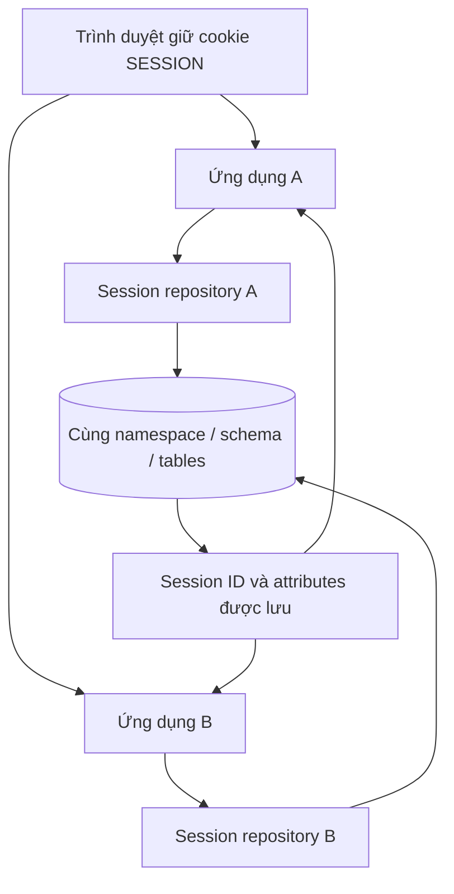

# Namespace, repository và định dạng dữ liệu phải tương thích khi chủ động chia sẻ

Hai ứng dụng Spring có thể cùng đọc một HTTP session nếu chúng được cấu hình để dùng chung kho session, cùng namespace hoặc cùng bảng dữ liệu, cùng cách serialize thuộc tính và cùng cơ chế trao đổi session ID với trình duyệt. Chỉ kết nối tới cùng một Redis server hoặc cùng một database là chưa đủ. Nếu namespace, schema/table, cookie hoặc serializer khác nhau, ứng dụng còn lại có thể không tìm thấy session, không đọc được thuộc tính hoặc đọc dữ liệu sai định dạng.

Chia sẻ session giữa ứng dụng là một quyết định kiến trúc có tác động bảo mật lớn. Hai ứng dụng cùng đọc được session có thể cùng nhìn thấy các thuộc tính của nhau; logout hoặc invalidate từ ứng dụng này có thể làm phiên ở ứng dụng kia mất hiệu lực. Vì vậy, cần chia sẻ có chủ đích, thống nhất các cấu hình kỹ thuật, giới hạn dữ liệu dùng chung và kiểm thử tương thích giữa các phiên bản ứng dụng.

## 1. Điều kiện để hai ứng dụng thực sự dùng chung một session

Để ứng dụng A tạo session và ứng dụng B khôi phục đúng session đó, cần đồng thời thỏa mãn các điều kiện sau:

1. Trình duyệt gửi cùng session ID tới cả hai ứng dụng. Cookie name, domain, path, Secure và SameSite phải cho phép request tới ứng dụng B mang đúng cookie.
2. Cả hai ứng dụng đọc cùng kho dữ liệu và cùng vùng dữ liệu session. Với Redis, namespace và Redis logical database/cluster phải trùng; với JDBC, database, schema, table name và cấu trúc bảng phải trùng.
3. Hai repository phải tương thích về mô hình session và cách đọc/ghi dữ liệu. Cùng dùng Redis nhưng một bên dùng repository hoặc key format khác không bảo đảm có thể đọc dữ liệu của nhau.
4. Cả hai ứng dụng phải serialize/deserialize session attributes theo định dạng tương thích và hiểu các kiểu dữ liệu được lưu.
5. Timeout, cách lưu, security context và quy tắc vòng đời phải được thống nhất hoặc có thiết kế tương thích rõ ràng.



Cookie chỉ mang session ID; dữ liệu session nằm trong repository. Hai ứng dụng phải cùng hiểu cả định danh lẫn dữ liệu phía server. Nếu chỉ chia sẻ cookie mà dùng hai repository riêng, ứng dụng B nhận được ID nhưng không tìm thấy session. Nếu dùng chung repository nhưng cookie không được gửi tới B, B cũng không biết session ID cần tải.

## 2. Phân biệt chia sẻ hạ tầng với chia sẻ session

Hai ứng dụng cùng kết nối một Redis endpoint không có nghĩa chúng đang chia sẻ session. Namespace Redis có thể tách keyspace của từng ứng dụng. Tương tự, hai ứng dụng kết nối cùng database server nhưng dùng schema hoặc bảng khác nhau vẫn lưu session độc lập.

| Cấu hình | Kết quả |
| --- | --- |
| Cùng Redis server, khác namespace | Session tách biệt |
| Cùng Redis server và cùng namespace, serializer tương thích | Có thể chia sẻ session nếu repository/key format cũng tương thích |
| Cùng database server, khác database/schema/table | Session tách biệt |
| Cùng database/schema/table và repository tương thích | Có thể chia sẻ session nếu cookie và serialization cũng tương thích |
| Cùng cookie name nhưng repository riêng | B nhận ID nhưng không có session tương ứng |
| Cùng repository nhưng cookie path/domain không phù hợp | Browser không gửi cùng ID tới cả hai ứng dụng |

Không nên dùng chung namespace hoặc bảng chỉ vì muốn tiết kiệm tài nguyên. Nếu mục tiêu chỉ là dùng cùng Redis cluster, hãy đặt namespace riêng cho từng ứng dụng. Chỉ trùng namespace khi thật sự muốn hai ứng dụng cùng quản lý một tập session.

## 3. Chia sẻ session qua Redis namespace

Spring Session Redis đặt các key session dưới một namespace. Namespace giúp phân biệt dữ liệu session của ứng dụng này với ứng dụng khác trong cùng Redis. Nếu hai ứng dụng cần chia sẻ cùng session, chúng phải dùng cùng namespace, cùng Redis database/cluster và repository có key format tương thích.

Ví dụ cấu hình Spring Boot cho hai ứng dụng có chủ đích chia sẻ session:

```yaml
spring:
  data:
    redis:
      host: ${REDIS_HOST}
      port: ${REDIS_PORT:6379}
      username: ${REDIS_USERNAME:default}
      password: ${REDIS_PASSWORD}
  session:
    timeout: 30m
    redis:
      namespace: company:shared-web-session
```

Ứng dụng A và B cần cùng `namespace`, endpoint Redis, database index, serializer và các thiết lập repository có ảnh hưởng tới cấu trúc dữ liệu. Property prefix có thể thay đổi theo phiên bản Spring Boot; hãy dùng đúng metadata cấu hình của phiên bản đang chạy.

Nếu mỗi ứng dụng dùng namespace riêng, ví dụ `app-a:sessions` và `app-b:sessions`, thì session được tách biệt dù cùng Redis server. Đó thường là lựa chọn phù hợp khi hai ứng dụng độc lập về đăng nhập hoặc có ranh giới bảo mật khác nhau.

Không tự đọc/ghi các Redis key nội bộ của Spring Session để mô phỏng chia sẻ. Cấu trúc key, expiration key, principal index và serialization là chi tiết implementation có thể thay đổi theo phiên bản. Hãy dùng repository API và kiểm thử qua HTTP request thật.

## 4. Chia sẻ session qua JDBC schema và table name

Với Spring Session JDBC, các ứng dụng cần truy cập cùng database, schema và các bảng session. Schema chuẩn thường có bảng metadata `SPRING_SESSION` và bảng attributes `SPRING_SESSION_ATTRIBUTES`. Repository dùng các bảng này để tìm session theo ID, lưu metadata và đọc/ghi attributes.

Ví dụ cấu hình khung:

```yaml
spring:
  datasource:
    url: ${SESSION_JDBC_URL}
    username: ${SESSION_JDBC_USERNAME}
    password: ${SESSION_JDBC_PASSWORD}
  session:
    jdbc:
      initialize-schema: never
      table-name: SPRING_SESSION
    timeout: 30m
```

Hai ứng dụng cần trỏ tới cùng schema/table và cùng định nghĩa cột, khóa chính, index, kiểu dữ liệu. Nếu ứng dụng A dùng `APP_A_SESSION`, còn B dùng `APP_B_SESSION`, chúng không chia sẻ session. Nếu một ứng dụng đặt `currentSchema=app_a` còn ứng dụng kia dùng `currentSchema=app_b`, việc cùng kết nối một PostgreSQL server cũng không làm dữ liệu trở nên chung.

Trong production, nên tạo schema một lần bằng Flyway/Liquibase hoặc quy trình DBA, rồi để ứng dụng dùng `initialize-schema: never`. Không để hai ứng dụng tự chạy schema initialization cạnh tranh lúc khởi động. Khi thay đổi schema, migration phải tương thích với tất cả ứng dụng đang cùng sử dụng bảng.

## 5. Repository implementation phải tương thích

`SessionRepository` là abstraction để tạo, tìm, lưu và xóa session. Tuy nhiên, không phải mọi implementation dùng cùng backend đều có cùng cấu trúc dữ liệu hoặc cùng tính năng.

Ví dụ, các repository Redis có thể khác nhau về việc hỗ trợ principal index, key layout và event handling. JDBC repository indexed có schema và cột phục vụ tra cứu principal. Một repository tùy chỉnh có thể dùng cấu trúc riêng. Vì vậy, cần thống nhất implementation và phiên bản tương thích, không chỉ thống nhất tên công nghệ Redis/JDBC.

Với hai ứng dụng cùng chia sẻ session, cần xác định:

- Cả hai dùng Servlet `HttpSession` integration hay WebFlux `WebSession` integration.
- Repository cụ thể nào được tạo ở mỗi ứng dụng.
- Cùng key/table layout và quy ước session ID.
- Cùng chính sách save/flush có ảnh hưởng tới cách cập nhật dữ liệu.
- Cùng cơ chế expiration và event handling.
- Có dùng principal index hay không; nếu có, resolver và index semantics phải tương thích.

Không trộn Servlet repository với reactive repository rồi giả định chúng tự đọc cùng dữ liệu chỉ vì dùng chung Redis. Servlet dùng `HttpSession` và repository blocking; WebFlux dùng `WebSession`, `WebSessionStore` và repository reactive. Chia sẻ session giữa hai stack cần kiểm tra rõ integration và format được Spring Session hỗ trợ ở đúng phiên bản. Không mặc định hai mô hình có thể thay thế trực tiếp.

## 6. Cookie phải được gửi tới cả hai ứng dụng

Để browser gửi cùng session ID tới hai ứng dụng, cookie cần có tên và phạm vi phù hợp. Nếu hai ứng dụng chạy dưới cùng host nhưng context path khác nhau, cookie path mặc định có thể giới hạn ở một context. Nếu hai ứng dụng chạy trên subdomain khác nhau, cookie host-only của một subdomain không tự được gửi sang subdomain còn lại.

Ví dụ:

- Ứng dụng A: `https://app-a.example.com`
- Ứng dụng B: `https://app-b.example.com`
- Cookie cần được cấu hình để có thể gửi tới cả hai host, thường thông qua domain chung `example.com` và path `/`.

Ví dụ cấu hình `DefaultCookieSerializer` cho Servlet Spring Session:

```java
@Bean
DefaultCookieSerializer cookieSerializer() {
    DefaultCookieSerializer serializer = new DefaultCookieSerializer();
    serializer.setCookieName("SESSION");
    serializer.setDomainName("example.com");
    serializer.setCookiePath("/");
    serializer.setUseHttpOnlyCookie(true);
    serializer.setUseSecureCookie(true);
    serializer.setSameSite("Lax");
    return serializer;
}
```

Đây là ví dụ cho các ứng dụng Servlet dùng cùng cookie serializer. Nếu cấu hình bằng Spring Boot properties hoặc resolver tùy chỉnh, bảo đảm kết quả `Set-Cookie` tương đương trên cả hai ứng dụng. Không tạo hai cookie cùng tên nhưng khác path/domain nếu mục tiêu là chia sẻ một session ID; trình duyệt có thể gửi nhiều cookie trùng tên và server xử lý không như mong đợi.

Chỉ đặt domain chung khi các subdomain đều thuộc cùng vùng tin cậy. Cookie domain rộng làm tăng số host nhận được bearer session ID. Nếu hai ứng dụng không cùng mức tin cậy, không nên mở rộng cookie domain để chia sẻ session.

## 7. SameSite, Secure, HttpOnly và CSRF

Cookie domain/path quyết định host/path nào nhận cookie; `SameSite` điều khiển một phần hành vi gửi cookie trong ngữ cảnh cross-site. Hai subdomain cùng site thường khác với hai domain hoàn toàn khác site. Nếu luồng thực sự cross-site và cần gửi cookie, có thể cần `SameSite=None; Secure`, cùng cấu hình CORS credentials và origin cụ thể. Không dùng `SameSite=None` rộng rãi khi không cần.

Các thuộc tính cần thống nhất:

| Thuộc tính | Ý nghĩa | Lưu ý khi chia sẻ |
| --- | --- | --- |
| `Domain` | Phạm vi host nhận cookie | Domain cha có thể chia sẻ cho subdomain, nhưng mở rộng vùng nhận credential |
| `Path` | Phạm vi đường dẫn nhận cookie | Dùng `/` nếu nhiều context path trên cùng host cần cookie |
| `Secure` | Chỉ gửi qua HTTPS | Cần bật trong production; kiểm tra TLS termination/proxy |
| `HttpOnly` | JavaScript không đọc cookie trực tiếp | Không ngăn browser tự gửi cookie hoặc chặn XSS thực thi request |
| `SameSite` | Hạn chế gửi cookie trong request cross-site | Chọn theo luồng; `None` cần `Secure` trên trình duyệt hiện đại |
| `Max-Age`/`Expires` | Thời gian browser giữ cookie | Không quyết định TTL session phía server |

Chia sẻ cookie không làm CSRF protection tự động được chia sẻ đúng. Mỗi ứng dụng cần bảo vệ endpoint thay đổi trạng thái. Nếu hai ứng dụng dùng session cookie chung, một trang độc hại có thể cố gửi request tới một trong hai host; cần CSRF token, SameSite policy, origin checks và authorization phù hợp.

Nếu TLS kết thúc ở reverse proxy, ứng dụng cần nhận biết đúng scheme HTTPS hoặc cấu hình cookie secure tường minh. Chỉ tin forwarded headers do proxy tin cậy ghi lại.

## 8. Định dạng serialization phải tương thích

Session attributes thường là object Java được repository serialize trước khi lưu. Khi ứng dụng B đọc session do A ghi, B phải deserialize được mọi attribute mà nó cần. Cùng Redis namespace hoặc cùng JDBC table nhưng serializer khác nhau có thể khiến dữ liệu không đọc được hoặc tạo lỗi runtime.

Với Redis, cấu hình serializer có thể được cung cấp qua bean `springSessionDefaultRedisSerializer` trong các phiên bản/tích hợp hỗ trợ. Nếu ứng dụng A dùng Java serialization còn B dùng JSON serializer, hai bên không thể mặc định đọc cùng payload. Ngay cả khi cùng serializer, khác cấu hình type metadata, class name, module hoặc naming policy cũng có thể gây lỗi.

Với JDBC, repository lưu attributes theo cơ chế serialization/conversion của implementation. Hai ứng dụng cần cùng quy ước và kiểu dữ liệu tương thích. Không giả định cột BLOB chứa object Java có thể được đọc bởi bất kỳ phiên bản Java/classpath nào.

Nguyên tắc an toàn:

- Chỉ lưu DTO nhỏ, ổn định và được thiết kế để chia sẻ.
- Tránh lưu entity ORM, proxy Hibernate, request/response, stream, connection hoặc object phụ thuộc framework nội bộ.
- Giữ class/package/type metadata tương thích trong giai đoạn rolling deployment.
- Có version rõ ràng cho DTO nếu cần thay đổi schema.
- Kiểm thử deserialize payload cũ trên từng ứng dụng trước khi triển khai.
- Không thay serializer riêng lẻ ở một ứng dụng đang cùng namespace/bảng.

## 9. Chia sẻ DTO thay vì chia sẻ object nội bộ của ứng dụng

Giả sử ứng dụng A lưu một object `com.company.appa.UserProfile` vào session. Ứng dụng B không có class đó hoặc có class cùng tên nhưng khác cấu trúc. Việc deserialize có thể thất bại, hoặc thành công nhưng dữ liệu có semantics khác.

Tốt hơn là tạo một contract trung lập, ví dụ `SharedUserContext` trong thư viện contract versioned hoặc dùng một định dạng dữ liệu ổn định:

```java
public record SharedUserContext(
        String userId,
        String tenantId,
        String displayName,
        int schemaVersion) implements Serializable {
}
```

Ví dụ chỉ minh họa DTO nhỏ. Hai ứng dụng phải dùng cùng định nghĩa tương thích và serializer hỗ trợ record/kiểu tương ứng. Không lưu quyền hoặc quyết định authorization chỉ dựa vào `displayName`; ứng dụng cần tải quyền từ nguồn tin cậy hoặc xác minh claims theo chính sách bảo mật.

Đặt tên thuộc tính có namespace để tránh va chạm:

```java
session.setAttribute("com.example.shared.user-context.v1", context);
```

Không dùng các key quá chung như `user`, `profile`, `cart` nếu nhiều ứng dụng có thể dùng cùng session. Key có namespace và version giúp giảm xung đột, đồng thời làm rõ contract của dữ liệu.

## 10. SecurityContext không phải DTO chia sẻ tùy tiện

Spring Security có thể lưu `SecurityContext` vào HTTP session. Khi hai ứng dụng cùng đọc session, ứng dụng B có thể nhìn thấy attribute bảo mật nếu repository/serializer cho phép. Tuy nhiên, việc deserialize được `SecurityContext` không có nghĩa ứng dụng B nên tin cậy nó như một phiên đăng nhập hợp lệ.

Các vấn đề cần đánh giá:

- Hai ứng dụng có cùng phiên bản Spring Security và các class liên quan không?
- `Authentication` có chứa custom principal class chỉ tồn tại trong một ứng dụng không?
- Hai ứng dụng có cùng trust boundary, issuer, tenant và quy tắc authorization không?
- Một ứng dụng có thể cấp quyền cao hơn ứng dụng còn lại không?
- Khi một ứng dụng đổi role hoặc khóa tài khoản, ứng dụng kia có đọc lại trạng thái mới không?
- Session fixation, ID rotation và logout có cùng semantics ở cả hai ứng dụng không?

Không chia sẻ `SecurityContext` giữa hai ứng dụng độc lập chỉ vì muốn có SSO. Nếu cần đăng nhập một lần giữa nhiều ứng dụng, thường nên dùng OAuth 2.0/OpenID Connect hoặc một identity provider chung. Mỗi ứng dụng nhận token/assertion và tạo security context riêng theo audience, issuer, scope và authorization policy của chính nó.

Chia sẻ session trực tiếp phù hợp hơn khi hai ứng dụng là các thành phần được thiết kế như một hệ thống thống nhất, cùng trust boundary, cùng contract và cùng vòng đời bảo mật. Đây là coupling mạnh: thay đổi security class hoặc serializer của một bên có thể ảnh hưởng bên còn lại.

## 11. Timeout, idle time và Save/Flush mode phải thống nhất

Hai ứng dụng cùng cập nhật một session nhưng cấu hình timeout khác nhau có thể tạo hành vi khó dự đoán. Một ứng dụng có thể mong session hết hạn sau 30 phút, ứng dụng khác mong 8 giờ. Session metadata và cách refresh last access time do repository quản lý; request từ một ứng dụng có thể kéo dài thời gian tồn tại của session dùng chung theo semantics của implementation.

Nên thống nhất:

- Idle timeout và chính sách absolute lifetime nếu có.
- Quy tắc refresh `lastAccessTime`.
- SaveMode và FlushMode phù hợp với cùng workload.
- Cách xử lý session expiration, cleanup và event listener.
- Quy tắc thay đổi session ID sau authentication.

`SaveMode`/`FlushMode` quyết định thuộc tính nào được ghi và thời điểm ghi; chúng không phải cơ chế merge hai ứng dụng. Nếu A và B cùng ghi một attribute, last-write-wins hoặc race condition vẫn có thể xảy ra. Dùng versioning/transaction cho dữ liệu cần nhất quán, không dựa vào session sharing để đồng bộ nghiệp vụ.

Cookie `Max-Age` cũng cần được phân biệt với server session timeout. Browser có thể giữ cookie lâu hơn session, nhưng repository vẫn có thể từ chối session đã hết hạn. Ngược lại, server session còn tồn tại nhưng browser đã xóa session cookie thì client không còn ID để gửi lại.

## 12. Logout và session destruction ảnh hưởng cả hai ứng dụng

Khi hai ứng dụng dùng cùng session ID và repository, thao tác invalidate từ ứng dụng A có thể làm session không còn được khôi phục ở B. Đây là hệ quả cần chủ động chấp nhận khi chia sẻ.

Các tình huống cần định nghĩa:

- Người dùng logout ở A: có phải logout khỏi B luôn không?
- Session hết hạn do B không hoạt động: A còn được tiếp tục dùng session không?
- A đổi session ID sau đăng nhập: cookie cập nhật có được gửi tới B không?
- A xóa một attribute: B có còn giả định attribute đó tồn tại không?
- Hai ứng dụng có cùng logout URL hoặc cookie name nhưng domain/path khác nhau không?
- Session destroy event có được xử lý trên cả hai ứng dụng, đặc biệt nếu mỗi bên giữ WebSocket hoặc tài nguyên dài hạn không?

Cookie deletion chỉ ảnh hưởng response tới browser; repository invalidate mới làm session dùng chung mất hiệu lực. Nếu có remember-me token, refresh token hoặc JWT độc lập, invalidate shared session không tự thu hồi các credential đó.

Không giả định application event trong JVM A tự được phát tới application context B. Nếu ứng dụng cần đóng WebSocket hoặc thu hồi tài nguyên trên cả hai bên, cần một cơ chế event distribution hoặc kiểm tra trạng thái thu hồi phù hợp.

## 13. Namespace attribute và quyền sở hữu dữ liệu

Khi nhiều ứng dụng cùng ghi vào một session, cần quy định rõ ứng dụng nào sở hữu từng thuộc tính. Nếu không, một ứng dụng có thể vô tình ghi đè hoặc xóa dữ liệu mà ứng dụng kia đang sử dụng.

Ví dụ contract:

| Attribute key | Chủ sở hữu | Định dạng | Quy tắc thay đổi |
| --- | --- | --- | --- |
| `com.example.identity.context.v1` | Identity gateway | DTO version 1 | Chỉ gateway ghi; app khác chỉ đọc |
| `com.example.checkout.cart-ref.v1` | Checkout | String ID | Checkout cập nhật; app khác không sửa |
| `com.example.portal.locale.v1` | Portal | String locale | Có thể cập nhật theo request người dùng |

Không chia sẻ toàn bộ session object như một API không có version. Xác định rõ key, kiểu dữ liệu, version, owner, null/removal semantics và thời hạn tương thích. Nếu một ứng dụng không hiểu key mới, nó phải bỏ qua an toàn thay vì deserialize hoặc ghi đè dữ liệu không biết.

Nếu hai ứng dụng cần chia sẻ trạng thái nghiệp vụ phức tạp, hãy tạo API/service hoặc database contract rõ ràng thay vì dùng session như message bus hay database chung. Session là trạng thái ngắn hạn gắn với trình duyệt; không phải kho trao đổi dữ liệu bền vững giữa các service.

## 14. Rolling deployment và thay đổi serializer

Trong lúc triển khai phiên bản mới, ứng dụng A phiên bản cũ và B phiên bản mới có thể cùng đọc/ghi một session. Nếu phiên bản mới ghi attribute mà phiên bản cũ không deserialize được, request quay lại phiên bản cũ có thể lỗi. Tình huống tương tự xảy ra khi hai ứng dụng triển khai độc lập nhưng dùng chung namespace/table.

Chiến lược triển khai an toàn:

1. Xác định tất cả consumer của session contract.
2. Thêm field mới theo hướng backward-compatible; không đổi kiểu field hiện có ngay lập tức.
3. Để các phiên bản cũ bỏ qua field mới nếu serializer cho phép.
4. Triển khai reader tương thích trước, sau đó mới bật writer tạo format mới.
5. Nếu phải đổi format không tương thích, dùng namespace/table version mới và migration có kế hoạch, hoặc invalidate session có kiểm soát.
6. Giữ khả năng rollback trong thời gian phiên cũ còn tồn tại.
7. Kiểm thử dữ liệu ghi bởi từng phiên bản được đọc bởi mọi phiên bản còn chạy.

Với Java serialization, thay đổi class có thể gây `InvalidClassException`, `serialVersionUID` mismatch hoặc lỗi khi object graph tham chiếu tới class không còn. Với JSON, thay đổi type metadata, tên property, polymorphic typing hoặc cấu trúc nested object cũng có thể làm reader cũ thất bại. Không coi JSON mặc nhiên tương thích ngược; cần schema evolution rõ ràng.

## 15. Rủi ro bảo mật khi dùng chung namespace

Một ứng dụng có quyền đọc/ghi namespace chung có thể tác động tới session của ứng dụng còn lại. Nếu một ứng dụng có lỗ hổng hoặc tài khoản datastore bị lộ, phạm vi ảnh hưởng có thể mở rộng tới mọi session dùng chung.

Các biện pháp:

- Chỉ chia sẻ giữa ứng dụng có cùng trust boundary và chủ sở hữu vận hành đáng tin cậy.
- Dùng Redis ACL/database credential hoặc database role giới hạn đúng quyền cần thiết.
- Không cấp quyền đọc toàn bộ Redis/database cho ứng dụng không cần chia sẻ session.
- Bảo vệ cookie bằng HTTPS, `Secure`, `HttpOnly`, `SameSite` và domain/path hẹp nhất có thể.
- Không log session ID, cookie, serialized payload hoặc `SecurityContext`.
- Không lưu secret, access token dài hạn hoặc dữ liệu nhạy cảm không cần thiết trong session.
- Xác minh authorization tại mỗi ứng dụng; không tin một attribute role do ứng dụng khác có thể ghi.
- Có quy trình logout-all và thu hồi credential khi một ứng dụng bị xâm nhập.

Nếu hai ứng dụng có mức tin cậy khác nhau, hãy dùng namespace riêng và cơ chế SSO/token exchange. Chia sẻ cùng cookie domain và namespace có thể làm tăng blast radius đáng kể.

## 16. Kiểm thử chia sẻ session giữa hai ứng dụng

Kiểm thử cần chạy hai ứng dụng độc lập, không chỉ hai controller trong cùng một Spring context. Mỗi ứng dụng phải khởi động repository riêng nhưng trỏ tới cùng kho dữ liệu đã cấu hình để chia sẻ.

| Kịch bản | Điều cần xác minh |
| --- | --- |
| Login/tạo session tại A | Browser nhận cookie với đúng name/domain/path |
| Request tới B dùng cùng cookie | B tìm thấy session ID trong cùng repository |
| A ghi DTO dùng chung | B deserialize đúng và đọc được field/version |
| B ghi attribute thuộc B | A không bị ghi đè key thuộc A |
| Dùng namespace khác | B không đọc session của A, xác nhận namespace tạo ranh giới |
| Dùng serializer khác | Test phát hiện lỗi deserialize hoặc contract mismatch trước production |
| Timeout khác nhau | Xác minh chính sách expiry và last access theo thiết kế |
| Logout ở A | B không khôi phục được session cũ theo yêu cầu |
| Session ID rotation ở A | Browser gửi ID mới tới B và B khôi phục đúng session |
| Rolling deployment | Payload phiên bản cũ/mới đọc được theo compatibility matrix |
| Redis/JDBC failure | Lỗi repository được phân biệt với session không tồn tại |

Một quy trình test thực tế:

1. Khởi chạy Redis hoặc database test.
2. Khởi chạy ứng dụng A và B với cùng repository config, namespace/schema, serializer và cookie policy.
3. Gửi login hoặc endpoint tạo session tới A, giữ cookie jar mà không in session ID.
4. Gửi cookie jar tới B và xác minh B đọc được một DTO dùng chung.
5. Ghi một thuộc tính từ B rồi đọc lại ở A.
6. Thử logout/invalidate từ A và gửi cookie cũ tới B.
7. Thử namespace hoặc serializer khác trong một profile test riêng để xác nhận test có thể phát hiện cấu hình lệch.
8. Lặp lại với phiên bản ứng dụng cũ/mới nếu có rolling deployment.

Với Redis, có thể dùng Testcontainers và xác minh cả hai ứng dụng kết nối cùng logical database/namespace. Với JDBC, dùng cùng schema và migration. Không đọc hoặc sửa trực tiếp key/row nội bộ để thay thế kiểm thử qua Spring Session API.

## 17. Chẩn đoán lỗi thường gặp

**Ứng dụng B nhận cookie nhưng không tìm thấy session.** Kiểm tra cookie có đúng ID không, hai ứng dụng có cùng Redis database/namespace hoặc JDBC schema/table không, repository implementation có tương thích không và request có đi qua Spring Session filter không.

**B tìm thấy session nhưng deserialize lỗi.** So sánh serializer, type metadata, classpath, package, `serialVersionUID` và DTO version. Xác minh ứng dụng A có lưu object chỉ tồn tại trong module riêng không.

**Cả hai ứng dụng cùng dùng Redis nhưng session tách biệt.** Kiểm tra `spring.session.redis.namespace`, Redis database index, cluster endpoint và repository key format. Cùng host/port không có nghĩa cùng namespace.

**Cùng database nhưng B không thấy session.** Kiểm tra JDBC URL, current schema, table name, case sensitivity, transaction visibility và quyền database. Xác minh migration đã tạo đúng bảng cho cả hai ứng dụng.

**Cookie không được gửi tới ứng dụng B.** Kiểm tra cookie domain, path, name, HTTPS, `Secure`, `SameSite`, browser third-party cookie policy và proxy. Cookie host-only của A không tự gửi tới subdomain B.

**Logout ở A không làm B logout.** Kiểm tra hai bên có thật sự dùng cùng repository/namespace/table không, logout có invalidate session phía server hay chỉ xóa cookie, và B có đọc stale replica không.

**B làm hỏng thuộc tính A.** Kiểm tra attribute key trùng, kiểu dữ liệu hoặc serializer không thống nhất, `SaveMode`/`FlushMode`, và hai ứng dụng cùng ghi một snapshot. Xác định owner/version cho từng attribute.

**Một app ghi được nhưng app còn lại lỗi khi deploy mới.** Kiểm tra rolling compatibility của DTO, serializer, SecurityContext và schema. Không thay đổi class/format không tương thích trong khi phiên cũ còn được sử dụng.

## 18. Khi nào nên dùng SSO thay cho chia sẻ session?

Chia sẻ session trực tiếp tạo sự phụ thuộc runtime giữa các ứng dụng: cùng cookie, repository, serializer, session lifecycle và có thể cả classpath. Điều này phù hợp khi các ứng dụng là một hệ thống thống nhất và được vận hành theo cùng một contract.

Nếu các ứng dụng có vòng đời release, nhóm vận hành, miền bảo mật hoặc nền tảng khác nhau, nên cân nhắc SSO bằng OpenID Connect/OAuth 2.0:

- Identity provider quản lý đăng nhập tập trung.
- Mỗi ứng dụng nhận token/assertion dành cho audience của nó.
- Mỗi ứng dụng tự tạo session cục bộ hoặc dùng access token stateless.
- Logout/central logout được xử lý qua giao thức và cơ chế token/session tương ứng.
- Không cần chia sẻ serialized `SecurityContext` hay toàn bộ session attributes.

SSO không tự giải quyết mọi vấn đề logout toàn cục, nhưng tạo ranh giới giao thức rõ hơn so với việc hai ứng dụng cùng đọc/ghi một object session. Không dùng chung Redis namespace như một cách thay thế identity protocol khi các ứng dụng độc lập.

## 19. Quy trình thiết kế chia sẻ có chủ đích

1. Xác nhận lý do nghiệp vụ cần chia sẻ session; nếu chỉ cần SSO, đánh giá OIDC/OAuth 2.0 trước.
2. Xác định ứng dụng nào được phép đọc/ghi và cùng trust boundary hay không.
3. Chọn Redis hoặc JDBC repository và thống nhất implementation/version.
4. Thống nhất Redis namespace hoặc JDBC database/schema/table name.
5. Thống nhất serializer, DTO, type metadata và versioning.
6. Thống nhất cookie name/domain/path/SameSite/Secure và session ID resolver.
7. Thống nhất timeout, SaveMode/FlushMode, session ID rotation, logout và expiration events.
8. Đặt namespace riêng cho session attributes, xác định owner và quyền ghi từng key.
9. Kiểm thử hai ứng dụng độc lập, logout, timeout, serializer mismatch và rolling deployment.
10. Giám sát repository error, deserialize failure và session lifecycle; không log credential.

## 20. Checklist trước khi đưa vào production

- [ ] Chia sẻ session là yêu cầu có chủ đích và hai ứng dụng cùng trust boundary.
- [ ] Hai ứng dụng dùng cùng repository implementation và phiên bản tương thích.
- [ ] Redis namespace/database hoặc JDBC schema/table name giống nhau.
- [ ] Cookie name/domain/path cho phép browser gửi cùng session ID tới cả hai ứng dụng.
- [ ] `Secure`, `HttpOnly`, `SameSite` và CSRF policy được cấu hình phù hợp.
- [ ] Serializer và DTO contract tương thích; không lưu object nội bộ khó deserialize.
- [ ] Attribute key có namespace, version và owner rõ ràng.
- [ ] Timeout, SaveMode/FlushMode và expiration semantics thống nhất.
- [ ] Logout ở một ứng dụng có hành vi được xác định đối với ứng dụng còn lại.
- [ ] SecurityContext được chia sẻ chỉ khi có thiết kế trust/compatibility rõ ràng.
- [ ] Có test login A → request B → update B → read A → logout.
- [ ] Có test rolling deployment và serializer compatibility.
- [ ] Có phương án tách namespace/thu hồi nếu một ứng dụng bị xâm nhập.

Chia sẻ session giữa các ứng dụng chỉ hoạt động ổn định khi cả định danh phía browser, repository, namespace/schema, serializer và vòng đời bảo mật tương thích. Cùng kết nối Redis hoặc database là chưa đủ. Hãy xác định rõ dữ liệu nào được chia sẻ, ứng dụng nào sở hữu từng attribute, cách logout/timeout tác động lên mọi bên và cách duy trì tương thích khi triển khai phiên bản mới. Nếu các ứng dụng độc lập về trust boundary hoặc vòng đời, dùng SSO qua giao thức chuẩn và giữ session riêng thường tạo ranh giới an toàn, dễ vận hành hơn.
