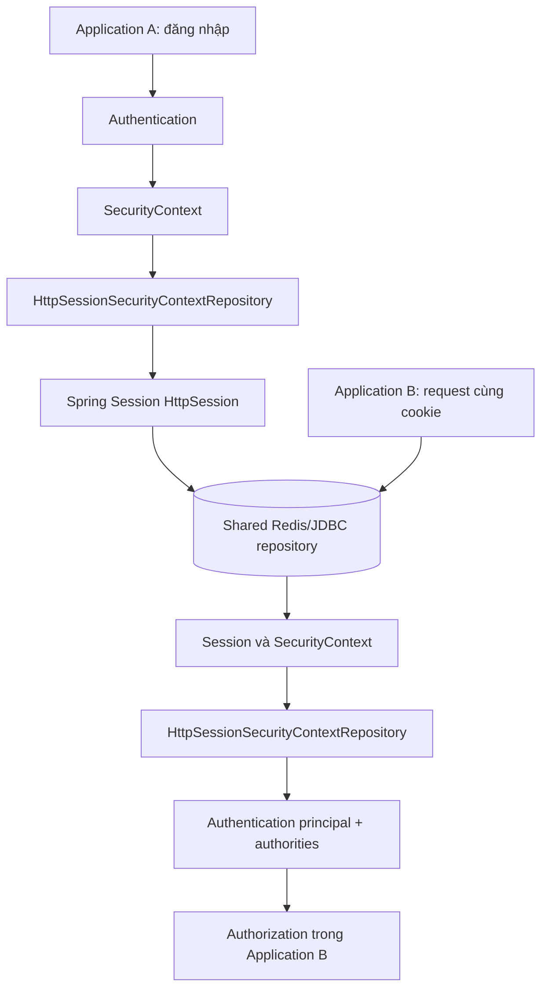

# Chia sẻ `SecurityContext` và yêu cầu tương thích kiểu principal

Khi nhiều ứng dụng Spring dùng chung session repository, một ứng dụng có thể tạo session sau đăng nhập và ứng dụng khác đọc lại session đó qua cùng session ID. Nếu session chứa `SecurityContext`, ứng dụng thứ hai có thể khôi phục `Authentication` và nhận diện người dùng đã đăng nhập. Cách làm này chỉ hoạt động ổn định khi các ứng dụng thống nhất cách lưu session, cookie, serializer và kiểu dữ liệu principal được lưu trong `SecurityContext`.

Chia sẻ Redis/JDBC không tự làm cho mọi `SecurityContext` tương thích. Session có thể được tìm thấy nhưng quá trình deserialize thất bại vì thiếu class principal, `serialVersionUID` khác nhau hoặc cấu trúc object thay đổi. Ngay cả khi deserialize thành công, code ứng dụng vẫn có thể lỗi nếu ứng dụng B ép kiểu principal sang một class riêng mà ứng dụng A đã lưu. Cần thiết kế một hợp đồng principal ổn định, triển khai cùng phiên bản tương thích ở mọi ứng dụng và kiểm thử round-trip giữa các ứng dụng thật.

## 1. `SecurityContext` nằm trong session như thế nào?

Spring Security dùng `SecurityContext` để giữ thông tin xác thực hiện tại. Đối tượng này chứa `Authentication`, thường gồm principal, authorities, details và trạng thái xác thực. Trong mô hình Servlet stateful, `HttpSessionSecurityContextRepository` là implementation phổ biến để lưu và tải `SecurityContext` từ `HttpSession`.



Trong Spring Session, `HttpSession` là abstraction được lưu ở kho dùng chung. Cookie thường mang session ID để các ứng dụng tìm cùng session. Nếu ứng dụng A và B cùng truy cập repository và cùng nhận diện session ID, B có thể tải attribute `SPRING_SECURITY_CONTEXT` do A lưu.

Điều này không có nghĩa ứng dụng B tự động tin cậy A. B đang nhận một đối tượng xác thực được lưu trong kho dùng chung. Nếu hai ứng dụng không cùng trust boundary hoặc không có cùng chính sách xác thực, chia sẻ SecurityContext có thể mở rộng quyền vượt quá thiết kế ban đầu.

## 2. Điều kiện để hai ứng dụng nhìn thấy cùng session

Trước khi xem xét kiểu principal, cần bảo đảm hai ứng dụng thực sự trỏ đến cùng một session:

- Cùng Redis deployment hoặc cùng database/schema chứa Spring Session.
- Cùng Redis namespace hoặc cùng tên bảng/schema JDBC.
- Cùng session ID cookie name và cookie scope phù hợp.
- Cùng hiểu về serialization và phiên bản cấu trúc session.
- Cùng chính sách timeout, invalidate và session ID rotation.
- Các filter của Spring Session được đăng ký đúng trong cả hai ứng dụng.

Ví dụ hai ứng dụng `portal.example.com` và `billing.example.com` có thể dùng cookie chung tên `APPSESSION`, domain `example.com`, path `/` và một Redis namespace chung. Trình duyệt gửi cookie đó đến cả hai host theo domain scope; mỗi ứng dụng dùng session ID để đọc cùng session trong Redis.

Cookie domain chỉ quyết định trình duyệt gửi cookie đến host nào. Nó không kết nối hai repository khác nhau và không bảo đảm ứng dụng B có thể deserialize dữ liệu của A.

### Ví dụ cấu hình cookie

Với Servlet Spring Session, có thể cấu hình `DefaultCookieSerializer`:

```java
import org.springframework.context.annotation.Bean;
import org.springframework.context.annotation.Configuration;
import org.springframework.session.web.http.CookieSerializer;
import org.springframework.session.web.http.DefaultCookieSerializer;

@Configuration
class SharedSessionCookieConfiguration {

    @Bean
    CookieSerializer cookieSerializer() {
        DefaultCookieSerializer serializer = new DefaultCookieSerializer();
        serializer.setCookieName("APPSESSION");
        serializer.setCookieDomainName("example.com");
        serializer.setCookiePath("/");
        serializer.setUseSecureCookie(true);
        serializer.setUseHttpOnlyCookie(true);
        serializer.setSameSite("Lax");
        return serializer;
    }
}
```

Đây là cấu hình minh họa cho hai ứng dụng cùng miền gốc và chạy HTTPS. Chỉ chia sẻ cookie trên domain cha nếu tất cả subdomain được phép nhận credential này và nằm trong cùng trust boundary. Nếu một subdomain ít tin cậy bị chiếm quyền, cookie domain rộng có thể làm tăng phạm vi ảnh hưởng.

## 3. `SecurityContextRepository` phải tương thích

Trong Servlet stack, `HttpSessionSecurityContextRepository` lưu `SecurityContext` vào `HttpSession` và tải lại ở request sau. Hai ứng dụng muốn chia sẻ cùng SecurityContext cần có cấu hình lưu trữ tương thích.

Có thể khai báo repository rõ ràng:

```java
import org.springframework.context.annotation.Bean;
import org.springframework.context.annotation.Configuration;
import org.springframework.security.web.context.HttpSessionSecurityContextRepository;
import org.springframework.security.web.context.SecurityContextRepository;

@Configuration
class SecurityContextConfiguration {

    @Bean
    SecurityContextRepository securityContextRepository() {
        return new HttpSessionSecurityContextRepository();
    }
}
```

Sau đó gắn repository vào cấu hình security chain theo API của phiên bản Spring Security đang dùng:

```java
http.securityContext(context -> context
        .securityContextRepository(securityContextRepository));
```

Ví dụ trên thể hiện ý tưởng dùng cùng loại repository. Ứng dụng thực tế cần kiểm tra quy tắc bean và filter chain, đặc biệt nếu có nhiều `SecurityFilterChain`, custom authentication filter hoặc cấu hình explicit-save. Trong các phiên bản Spring Security hiện đại, thành phần xác thực tùy chỉnh có thể cần gọi `SecurityContextRepository.saveContext(...)` rõ ràng; chỉ đặt `SecurityContextHolder` không bảo đảm context đã được lưu cho request tiếp theo.

Nếu một ứng dụng dùng `NullSecurityContextRepository`, `RequestAttributeSecurityContextRepository` hoặc một repository stateless khác, nó sẽ không có cùng hành vi lưu SecurityContext vào session. Cần kiểm tra repository thực tế của từng filter chain thay vì suy luận từ việc cả hai ứng dụng đều có Spring Security.

## 4. Principal là phần dễ gây lỗi tương thích nhất

Principal thường được truy cập qua `Authentication.getPrincipal()`. Kiểu thực tế phụ thuộc cơ chế xác thực:

| Cơ chế | Principal thường gặp |
|---|---|
| Username/password | `UserDetails` implementation hoặc username `String` |
| OAuth2 Login | `OAuth2User` implementation |
| OpenID Connect | `OidcUser` implementation |
| JWT resource server | `Jwt` hoặc principal wrapper tương ứng |
| Custom authentication | Class do ứng dụng tự định nghĩa |

Giả sử ứng dụng A lưu `com.acme.portal.PortalUserPrincipal`, nhưng ứng dụng B chỉ có class `com.acme.billing.BillingUserPrincipal`. B không thể tự chuyển object A thành class B chỉ vì hai class có cùng field `id`, `username` và `roles`.

Nếu dùng Java serialization, class name và cấu trúc serialized object có ý nghĩa. Nếu dùng JSON serializer, type metadata và mapping cấu trúc cũng phải được định nghĩa rõ. Tương thích không chỉ là hai class có field giống nhau; cần hợp đồng serialization ổn định và cách ánh xạ sang kiểu mà ứng dụng B hiểu.

## 5. Các dạng lỗi khi principal không tương thích

| Tình huống | Lỗi có thể gặp | Nguyên nhân |
|---|---|---|
| Ứng dụng B không có class principal của A | `ClassNotFoundException` khi deserialize | Class chỉ tồn tại trong artifact A |
| Cùng tên class nhưng serialized form không tương thích | `InvalidClassException` | `serialVersionUID` hoặc cấu trúc serialized thay đổi |
| Deserialize thành công nhưng code ép kiểu sang class khác | `ClassCastException` | Principal runtime không phải kiểu B mong đợi |
| B dùng interface chung nhưng principal A không triển khai | `ClassCastException` hoặc lỗi kiểm tra kiểu | Hợp đồng principal không thống nhất |
| Authority được serialize nhưng B hiểu role khác | Truy cập bị từ chối hoặc cấp quyền sai | Quy ước authority không tương thích |
| JSON type metadata trỏ đến class không có ở B | Lỗi mapping/deserialization | Serializer và type registry không đồng nhất |

Các lỗi này có thể chỉ xuất hiện khi request được load ở ứng dụng B, nên một ứng dụng đơn lẻ vẫn chạy bình thường. Cần kiểm thử chéo ứng dụng trước khi rollout.

## 6. Dùng một principal contract ổn định

Một giải pháp là đặt kiểu principal dùng chung trong một thư viện contract nhỏ, được các ứng dụng cùng phụ thuộc. Hợp đồng nên chứa dữ liệu định danh và thuộc tính cần thiết, không chứa entity persistence hoặc object phụ thuộc framework cụ thể.

Ví dụ:

```java
import java.io.Serializable;
import java.util.Set;

public record SharedPrincipal(
        String subjectId,
        String tenantId,
        Set<String> authorities,
        int contractVersion) implements Serializable {
}
```

Các ứng dụng A và B cùng sử dụng một phiên bản tương thích của thư viện contract. Cả hai hiểu `subjectId` là định danh ổn định, `tenantId` xác định phạm vi tenant và `authorities` là tập quyền theo một quy ước thống nhất.

Nếu dùng Java serialization, phải quản lý khả năng tương thích serialized form, gồm `serialVersionUID` nếu class không phải record hoặc khi cần kiểm soát rõ. Với record và Java serialization, vẫn cần quản lý thay đổi schema/field và kiểm thử giữa các phiên bản JDK/runtime được hỗ trợ. `Serializable` chỉ cho phép serialize theo cơ chế Java; nó không tự bảo đảm tương thích phiên bản hoặc an toàn khi deserialize dữ liệu không tin cậy.

Không đưa password, refresh token, private key hoặc credential thô vào principal contract. Nếu `Authentication` có credential tạm thời, cần bảo đảm credential được xóa sau xác thực theo chính sách của Spring Security.

## 7. Dùng interface chung không tự giải quyết serialization

Có thể định nghĩa interface:

```java
public interface SharedPrincipalView {
    String subjectId();
    String tenantId();
    Set<String> authorities();
}
```

Interface giúp code nghiệp vụ phụ thuộc abstraction thay vì class cụ thể. Tuy nhiên, nếu session chứa object `PortalPrincipal` thì ứng dụng B vẫn cần deserialize class `PortalPrincipal` trước khi ép kiểu sang `SharedPrincipalView`. Vì vậy, interface không thay thế việc chia sẻ class implementation hoặc dùng serializer có mapping rõ ràng.

Các lựa chọn thường dùng:

1. **Chia sẻ cùng class principal:** các ứng dụng phụ thuộc cùng thư viện và phiên bản tương thích.
2. **Dùng principal chuẩn của Spring Security:** chỉ khi mọi ứng dụng thực sự dùng cùng implementation và cùng semantics.
3. **Lưu DTO/claim ổn định:** serializer ánh xạ một schema chung thành kiểu nội bộ của từng ứng dụng, thay vì deserialize class ứng dụng A trực tiếp.
4. **Không chia sẻ SecurityContext:** dùng OIDC/OAuth2 hoặc cơ chế SSO để mỗi ứng dụng tự xác thực token và tạo Authentication riêng.

Lựa chọn cuối thường giảm coupling khi các ứng dụng có vòng đời phát hành và quyền truy cập khác nhau. Chia sẻ session phù hợp hơn khi các ứng dụng thuộc cùng một hệ thống, cùng trust boundary và có thể phối hợp nâng cấp.

## 8. Tương thích `Authentication` và `GrantedAuthority`

Không chỉ principal cần tương thích. Toàn bộ object graph của `SecurityContext` có thể chứa:

- Implementation `Authentication`.
- Principal.
- Collection các `GrantedAuthority`.
- Authentication details.
- Các attribute của principal như OAuth2 claims.
- Object tùy chỉnh do authentication provider hoặc filter tạo.

Nếu `GrantedAuthority` implementation tùy chỉnh chỉ có trong ứng dụng A, ứng dụng B cũng cần class đó hoặc serializer mapping phù hợp. Nếu ứng dụng A dùng authority `ROLE_BILLING_ADMIN` nhưng B dùng `BILLING_ADMIN`, deserialize có thể thành công nhưng authorization decision khác nhau.

Nên thống nhất:

- Tên authority và quy tắc tiền tố `ROLE_`.
- Cách biểu diễn scope, permission và tenant role.
- Kiểu dữ liệu authority trong serialized form.
- Cách xử lý authority không còn tồn tại sau khi quyền người dùng thay đổi.
- Phiên bản contract và quy trình rollout khi thêm/bỏ quyền.

Ứng dụng B không nên tin mọi authority chỉ vì chúng được lưu trong session chung. Cần xác định liệu B có chấp nhận authority do A cấp hay phải ánh xạ/kiểm tra lại theo policy riêng.

## 9. Java serialization và yêu cầu classpath

Nếu repository dùng Java serialization, ứng dụng đọc session cần có class tương ứng trên classpath và tương thích với serialized form được ghi. Một số nguyên nhân lỗi phổ biến:

- Class principal được đổi package hoặc tên.
- Field bị xóa/đổi kiểu mà không có chiến lược tương thích.
- `serialVersionUID` thay đổi.
- Một field tham chiếu tới class chỉ có trong ứng dụng A.
- Ứng dụng A và B chạy phiên bản thư viện principal khác nhau trong rolling deployment.
- Class có `readObject`/custom serialization thay đổi hành vi.

Không nên serialize trực tiếp JPA entity hoặc object graph lớn làm principal. Entity có thể chứa lazy proxy, quan hệ vòng, class enhancement hoặc field không cần thiết. Hãy ánh xạ sang một principal DTO nhỏ, ổn định và có dữ liệu tối thiểu.

### Rolling deployment và mixed versions

Trong thời gian rollout, node A có thể ghi session bằng phiên bản contract mới trong khi node B vẫn chạy phiên bản cũ. Nếu B không hiểu serialized form mới, request được load trên B sẽ lỗi.

Quy trình an toàn nên dùng expand/contract:

1. Phát hành phiên bản có thể đọc cả schema cũ và mới nếu cần.
2. Triển khai thư viện contract tương thích lên toàn bộ node.
3. Chỉ sau khi mọi node đọc được định dạng mới, bắt đầu ghi field/type mới.
4. Theo dõi session cũ và chờ chúng hết hạn hoặc migrate có kiểm soát.
5. Gỡ hỗ trợ định dạng cũ trong release sau khi không còn session cũ.

Nếu không thể bảo đảm đọc chéo phiên bản, chọn chiến lược invalidate session trong thời gian nâng cấp và yêu cầu người dùng đăng nhập lại. Đây là quyết định sản phẩm/bảo mật cần thông báo trước, không nên để lỗi deserialize xảy ra ngẫu nhiên.

## 10. JSON serializer và type metadata

JSON có thể giúp chia sẻ dữ liệu qua schema rõ ràng hơn, nhưng không tự giải quyết tương thích. Nếu JSON serializer ghi class metadata đầy đủ, ứng dụng B vẫn cần biết cách ánh xạ type đó. Nếu serializer dùng default typing quá rộng, dữ liệu deserialize có thể mở ra rủi ro polymorphic deserialization và gadget chain khi kho lưu trữ bị ghi bởi nguồn không tin cậy.

Khi chọn serializer:

- Ưu tiên schema/DTO rõ ràng và allowlist type cần thiết.
- Không bật polymorphic default typing rộng mà không hiểu rủi ro.
- Không deserialize session data từ Redis/database mà nhiều ứng dụng hoặc người dùng không tin cậy có thể ghi tùy ý.
- Phiên bản serializer và module Java/Jackson phải tương thích giữa ứng dụng.
- Kiểm thử dữ liệu được ghi bởi phiên bản cũ và đọc bởi phiên bản mới, cũng như ngược lại trong giai đoạn rollout.
- Có kế hoạch khi thay serializer vì dữ liệu cũ có thể không đọc được bằng serializer mới.

Spring Session Redis cho phép cấu hình serializer riêng theo extension point của phiên bản đang dùng. Tên bean và API cấu hình có thể khác theo Spring Session/Spring Data Redis version; cần dùng tài liệu đúng release train thay vì sao chép cấu hình cũ một cách máy móc.

## 11. Không chia sẻ principal chứa framework hoặc application object

Các kiểu sau thường tạo coupling không cần thiết:

- JPA entity hoặc Hibernate proxy.
- Principal class nằm trong package riêng của một ứng dụng.
- OAuth2 client object chứa token hoặc cấu trúc phụ thuộc provider.
- Object có reference tới service, repository, servlet request hoặc application context.
- Collection chứa implementation không ổn định hoặc không serializable.

Principal chia sẻ nên nhỏ, bất biến và chứa dữ liệu định danh tối thiểu. Ví dụ `subjectId`, `tenantId`, `authorities` và `contractVersion` thường đủ cho nhiều luồng. Ứng dụng cần thông tin hồ sơ chi tiết nên truy vấn user service bằng ID ổn định, thay vì nhét toàn bộ hồ sơ vào session.

## 12. Tách biệt trust boundary giữa các ứng dụng

Chia sẻ SecurityContext có nghĩa ứng dụng B chấp nhận danh tính và authority mà ứng dụng A đã lưu. Nếu A có lỗ hổng cho phép ghi hoặc sửa session, B có thể chịu ảnh hưởng. Nếu một ứng dụng chỉ cần biết user ID nhưng không nên nhận toàn bộ quyền quản trị của ứng dụng khác, không nên chia sẻ nguyên SecurityContext.

Trước khi chia sẻ, cần xác định:

- Các ứng dụng có cùng chủ sở hữu và mức độ tin cậy không?
- Mọi ứng dụng có cùng yêu cầu MFA, authentication freshness và session timeout không?
- Authority của A có ý nghĩa tương đương ở B không?
- Một ứng dụng có thể ghi attribute hoặc principal tùy ý vào session dùng chung không?
- Có cần phân vùng namespace, quyền Redis ACL hoặc quyền SQL theo ứng dụng không?
- Khi một ứng dụng bị xâm nhập, phạm vi session nào bị ảnh hưởng?

Không cấp quyền ghi toàn bộ Redis hoặc schema session cho ứng dụng chỉ cần đọc một phần dữ liệu. Dùng network policy, TLS, ACL và secret riêng theo nguyên tắc least privilege. Tuy nhiên, nếu cả hai ứng dụng cùng cần ghi cùng session thì quyền phải đủ cho các thao tác repository; cần đánh giá đây là một trust boundary chung.

## 13. Tên attribute và xung đột giữa ứng dụng

Hai ứng dụng dùng chung session cũng chia sẻ namespace attribute. Nếu cả hai cùng ghi attribute tên `user`, `context`, `locale` hoặc `cart`, chúng có thể ghi đè dữ liệu của nhau hoặc diễn giải cùng dữ liệu theo kiểu khác.

Để giảm xung đột:

- Dùng tên attribute có namespace, ví dụ `portal.preferences` và `billing.workflow`.
- Dành riêng tên `SPRING_SECURITY_CONTEXT` cho Spring Security; không tự ghi object không tương thích vào key này.
- Định nghĩa rõ ứng dụng nào sở hữu attribute nào.
- Tránh lưu object application-specific nếu không cần chia sẻ.
- Phiên bản hóa schema attribute khi cần chuyển đổi.
- Không để một ứng dụng ghi đè SecurityContext của ứng dụng khác ngoài luồng xác thực được kiểm soát.

Ngay cả khi principal type tương thích, một ứng dụng có thể ghi `SecurityContext` mới với authorities khác và ảnh hưởng đến request của ứng dụng còn lại. Cần xác định một nguồn xác thực có thẩm quyền và quy trình cập nhật context thống nhất.

## 14. Logout và thay đổi quyền giữa các ứng dụng

Khi A và B dùng chung một session repository và cùng session ID, invalidate session từ A có thể làm B không còn tìm thấy session ở request tiếp theo. Nhưng một request B đã tải SecurityContext trước khi A logout có thể tiếp tục xử lý đến khi request kết thúc. Việc xóa session không tự hủy request đang chạy.

Các điểm cần kiểm thử:

- Logout ở A rồi gửi request mới đến B với cookie cũ.
- Thu hồi session từ trang quản lý thiết bị và kiểm tra mọi ứng dụng từ chối ID cũ.
- Thay đổi role/authority ở user service và xác định khi nào session context được cập nhật.
- Thay đổi mật khẩu hoặc thu hồi tài khoản có làm vô hiệu hóa các session trên mọi ứng dụng không.
- Request đang chạy đồng thời với logout có thể hoàn tất hay phải bị từ chối ở bước nghiệp vụ nhạy cảm.

Nếu quyền có thể bị thu hồi khẩn cấp, không nên chỉ dựa vào SecurityContext cache trong session. Có thể cần kiểm tra trạng thái tài khoản hoặc version quyền ở một nguồn có thẩm quyền trong các thao tác nhạy cảm.

## 15. Cookie chung và CSRF giữa các ứng dụng

Cookie session domain rộng có thể được gửi tới nhiều subdomain. Điều này tạo điều kiện chia sẻ session nhưng cũng mở rộng phạm vi cookie. Các ứng dụng phải thống nhất `Secure`, `HttpOnly`, `SameSite`, `Path`, `Domain` và tên cookie.

CSRF token không nhất thiết được chia sẻ đúng cách chỉ vì session được chia sẻ. Mỗi ứng dụng có thể có CSRF repository, token format hoặc request matcher riêng. Không giả định token CSRF do A phát hành luôn hợp lệ ở B.

Nếu frontend gọi cross-origin API, CORS và cookie credentials cần được cấu hình riêng. CORS không thay thế CSRF protection. Chỉ cho phép origin cụ thể, không dùng wildcard với credentials và không bật cookie cross-site rộng hơn nhu cầu.

## 16. Cách tổ chức hai ứng dụng dùng chung principal contract

Một cách triển khai có thể gồm:

1. Thư viện `identity-contract` định nghĩa `SharedPrincipal` và quy ước authorities.
2. Ứng dụng A xác thực người dùng, ánh xạ danh tính sang `SharedPrincipal`.
3. Spring Security lưu `SecurityContext` vào `HttpSession` thông qua `HttpSessionSecurityContextRepository`.
4. Spring Session ghi session vào Redis/JDBC repository dùng chung.
5. Ứng dụng B nhận cùng cookie, tải session và deserialize bằng contract tương thích.
6. B kiểm tra kiểu principal, tenant và authorities theo policy của chính B trước khi cấp quyền.
7. Hai ứng dụng triển khai version contract theo quy trình tương thích.

Không nên để B tin mọi role mà A gửi nếu hai ứng dụng có mô hình quyền khác nhau. Có thể ánh xạ shared authority sang permission nội bộ hoặc kiểm tra thêm tại service có thẩm quyền.

## 17. Kiểm thử tương thích chéo ứng dụng

Unit test trong từng ứng dụng không đủ để chứng minh chia sẻ SecurityContext hoạt động. Cần integration test dùng đúng serializer, repository, cookie và phiên bản contract của cả A lẫn B.

### Kiểm thử round-trip A ghi, B đọc

1. Khởi chạy Redis/JDBC test repository dùng chung.
2. Khởi chạy ứng dụng A với cấu hình Spring Session và SecurityContextRepository production-like.
3. Đăng nhập qua A và nhận session cookie.
4. Xác nhận A lưu SecurityContext với principal contract dự kiến.
5. Gửi cookie đó tới ứng dụng B trên cùng domain scope trong test client.
6. Xác nhận B khôi phục được `Authentication` và principal đúng kiểu/hợp đồng.
7. Xác nhận B đọc đúng `subjectId`, `tenantId` và authorities.
8. Kiểm tra endpoint B thực hiện authorization đúng theo policy của B.
9. Logout tại A và gửi lại cookie cũ tới B; xác nhận B không khôi phục context cũ.

### Kiểm thử tương thích phiên bản

- A ghi bằng contract version N, B đọc bằng version N.
- A ghi bằng version N, B đọc bằng version N+1.
- A và B cùng chạy mixed version trong rolling deployment.
- Test class bị thiếu, field đổi kiểu, authority mới và serializer metadata không hợp lệ.
- Xác nhận lỗi deserialize được xử lý an toàn, không biến thành xác thực anonymous một cách im lặng nếu policy yêu cầu báo lỗi.

Test phải kiểm tra response cookie, session repository và SecurityContext. Một test chỉ khởi tạo `MockHttpSession` không xác minh serializer thực tế của Redis/JDBC.

## 18. Chẩn đoán lỗi thường gặp

| Hiện tượng | Nguyên nhân có thể | Cách kiểm tra |
|---|---|---|
| B không thấy người dùng đăng nhập ở A | Cookie không được gửi, repository/namespace khác hoặc B dùng stateless context repository | Kiểm tra cookie, Redis namespace/JDBC schema và `SecurityContextRepository` |
| B tìm thấy session nhưng deserialize lỗi | Thiếu principal class, class version hoặc serializer không tương thích | Xem nguyên nhân gốc `ClassNotFoundException`, `InvalidClassException` hoặc mapping error |
| Deserialize thành công nhưng controller lỗi ép kiểu | B cast sang principal class riêng | Kiểm tra runtime class của `Authentication.getPrincipal()` |
| B nhận principal nhưng thiếu role | Authority contract khác nhau hoặc resolver/mapping không thống nhất | So sánh authority names và mapping |
| B không lưu context sau custom login | Filter chỉ đặt `SecurityContextHolder` nhưng không save repository | Kiểm tra explicit-save và lời gọi `saveContext` |
| Logout A nhưng B vẫn xử lý request đang chạy | B đã tải context trước khi invalidate | Xác định semantics request in-flight và kiểm tra lại quyền ở bước nhạy cảm |
| Sau deploy mới, chỉ một số session lỗi | Mixed versions không đọc được serialized form cũ/mới | Kiểm tra contract version và rollout sequence |
| Cookie được gửi nhưng session không tìm thấy | Domain/path/name hoặc repository không đồng nhất | So sánh Set-Cookie, namespace và schema |

Không log toàn bộ serialized SecurityContext, cookie hoặc session ID để điều tra. Ghi nhận class name đã được allowlist, contract version, loại lỗi và correlation ID; che principal identifier theo chính sách dữ liệu.

## 19. Checklist thiết kế

- Xác định rõ các ứng dụng có cùng trust boundary và có được phép chia sẻ Authentication hay không.
- Cùng dùng session repository, namespace/schema và cookie scope phù hợp.
- Cấu hình `SecurityContextRepository` tương thích trong từng filter chain.
- Xác định kiểu principal runtime và toàn bộ object graph được serialize.
- Ưu tiên principal DTO nhỏ, ổn định, bất biến và dùng chung contract.
- Quản lý classpath, serializer, type metadata và phiên bản contract.
- Chuẩn hóa authorities, tenant và semantics quyền giữa ứng dụng.
- Không lưu entity JPA, proxy hoặc credential nhạy cảm trong principal.
- Phân vùng quyền Redis/JDBC và cookie domain theo least privilege.
- Kiểm thử round-trip A ghi/B đọc, mixed-version rollout, logout và thu hồi quyền.
- Có kế hoạch xử lý session cũ khi thay đổi principal schema hoặc serializer.
- Nếu các ứng dụng không cùng trust boundary, cân nhắc OIDC/OAuth2 SSO thay vì chia sẻ nguyên SecurityContext.

Chia sẻ `SecurityContext` giữa các ứng dụng Spring đòi hỏi nhiều hơn việc trỏ chúng đến cùng Redis hoặc JDBC. Cả hai phải dùng cùng session ID, repository, `SecurityContextRepository` và một hợp đồng principal/authority có thể deserialize và diễn giải nhất quán. Principal DTO ổn định, serializer được quản lý phiên bản, quyền truy cập kho dữ liệu tối thiểu và integration test chéo ứng dụng giúp giảm lỗi classpath, ép kiểu và cấp quyền sai. Nếu các ứng dụng có mức tin cậy hoặc vòng đời khác nhau, cơ chế SSO dựa trên OIDC/OAuth2 thường tạo ranh giới rõ hơn so với việc chia sẻ trực tiếp toàn bộ SecurityContext.
