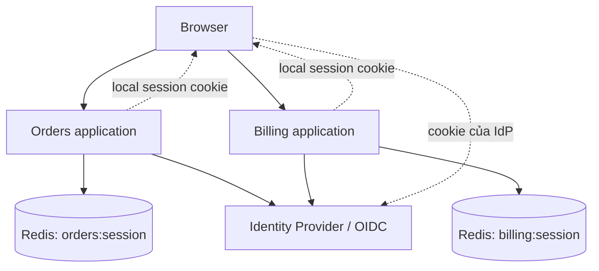
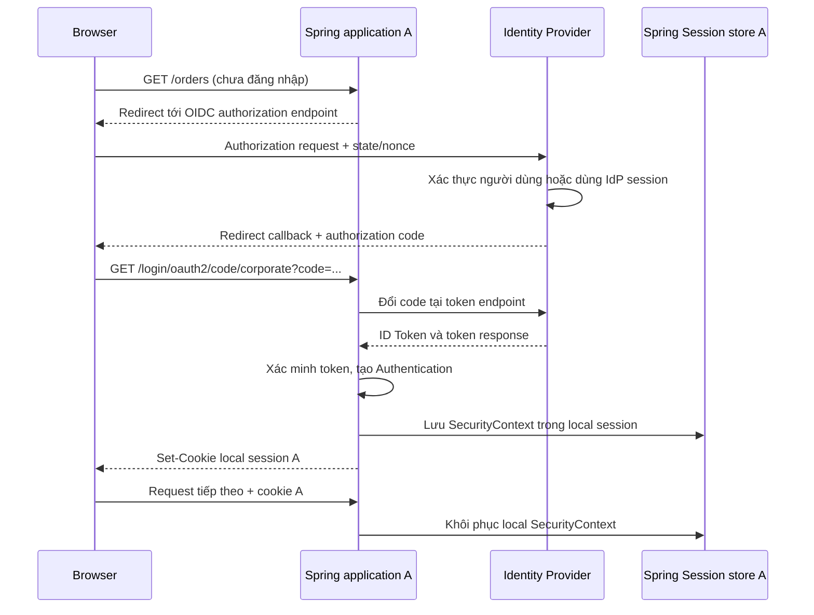

# SSO qua nhà cung cấp danh tính khác với dùng chung kho phiên

Single Sign-On (SSO) cho phép người dùng xác thực một lần tại nhà cung cấp danh tính (Identity Provider, IdP) rồi truy cập nhiều ứng dụng mà không phải nhập lại thông tin đăng nhập ở mỗi ứng dụng. SSO không yêu cầu các ứng dụng phải dùng chung Redis, JDBC session tables hoặc cùng một session ID. Mỗi ứng dụng Spring có thể giữ session local riêng bằng Spring Session, trong khi IdP duy trì phiên đăng nhập của người dùng ở miền của IdP và phát hành kết quả xác thực qua một giao thức như OpenID Connect (OIDC).

Đây là điểm khác biệt quan trọng: dùng chung kho phiên là cách chia sẻ trạng thái runtime giữa các ứng dụng; SSO là cách các ứng dụng tin cậy một hệ thống identity chung. Hai ứng dụng cùng Redis vẫn có thể có session hoàn toàn độc lập. Ngược lại, hai ứng dụng dùng hai kho session khác nhau vẫn có thể cung cấp trải nghiệm SSO nếu cùng tích hợp với IdP và xác minh đúng kết quả xác thực.

Trong `SPRING_SESSION`, Spring Session quản lý session local của từng ứng dụng qua Redis/JDBC. Spring Security xử lý đăng nhập OIDC, xác minh danh tính và lưu `SecurityContext` vào session local theo cấu hình. Bài học này trình bày luồng SSO, cách cấu hình ứng dụng Spring, ranh giới giữa cookie session và token, logout, triển khai nhiều instance và kiểm thử để tránh nhầm lẫn giữa SSO với shared session.

## 1. Ba khái niệm không nên nhập làm một

| Khái niệm | Nó chia sẻ điều gì? | Thành phần thường chịu trách nhiệm |
|---|---|---|
| Dùng chung datastore | Cùng truy cập Redis/JDBC hoặc hạ tầng database | Hạ tầng và cấu hình kết nối |
| Dùng chung Spring Session | Cùng session ID, repository/keyspace/table và session contract | Spring Session, cookie và serializer |
| SSO | Cùng tin cậy một IdP để xác thực người dùng | OIDC, Spring Security OAuth2 Client và IdP |

Ví dụ có hai ứng dụng `orders.example.com` và `billing.example.com`:

- Orders lưu session vào Redis namespace `orders:session`, cookie host-only `ORDERS_SESSION`.
- Billing lưu session vào cùng Redis cluster nhưng namespace `billing:session`, cookie host-only `BILLING_SESSION`.
- Cả hai đăng nhập qua `login.example-idp.com` bằng OIDC.
- Browser giữ cookie đăng nhập của IdP trên domain IdP. Khi Billing chuyển browser tới IdP, IdP nhận cookie của chính nó, thấy người dùng đã đăng nhập và có thể hoàn tất authorization flow mà không hỏi lại mật khẩu.
- Billing tạo session local riêng sau khi nhận callback hợp lệ.



Người dùng có trải nghiệm SSO, nhưng hai session local vẫn độc lập. Logout khỏi Orders có thể chỉ xóa session Orders; session Billing vẫn tồn tại cho tới khi hết hạn hoặc nhận được thông báo logout/revocation theo cơ chế đã tích hợp.

## 2. SSO dựa trên OIDC, không dựa trên việc chia sẻ session ID

OAuth 2.0 là framework ủy quyền. OpenID Connect mở rộng OAuth 2.0 để cung cấp lớp xác thực và thông tin danh tính. Với ứng dụng web Spring cần biết người dùng là ai, `oauth2Login()` thường tích hợp OIDC khi client yêu cầu scope `openid`.

Trong OIDC Authorization Code Flow:

1. Người dùng truy cập ứng dụng A chưa có local session đã xác thực.
2. Spring Security chuyển browser tới authorization endpoint của IdP.
3. Ứng dụng tạo và kiểm tra `state`; với OIDC còn có `nonce` để liên kết ID Token với yêu cầu xác thực.
4. Người dùng đăng nhập tại IdP. IdP có thể dùng phiên đăng nhập IdP hiện tại, nên không cần hỏi lại credentials.
5. IdP chuyển browser về redirect URI của ứng dụng với authorization code.
6. Backend ứng dụng đổi code lấy token qua token endpoint, đồng thời xác minh phản hồi theo giao thức và cấu hình client.
7. Ứng dụng xác minh ID Token: chữ ký, issuer, audience, thời hạn, nonce và các claim bắt buộc.
8. Spring Security tạo `Authentication`; ứng dụng tạo hoặc tiếp tục session local và lưu `SecurityContext` theo cấu hình.
9. Request tiếp theo dùng cookie session local của ứng dụng, không cần gửi authorization code hay ID Token mỗi lần.



Ứng dụng B thực hiện một authorization flow tương tự. Nếu browser còn IdP session, IdP có thể xác thực lại một cách im lặng theo chính sách, nhưng B vẫn tạo session local của riêng B.

## 3. IdP session và application session có vòng đời khác nhau

Trong kiến trúc SSO có ít nhất hai loại session:

| Session | Được tạo ở đâu? | Cookie thuộc domain nào? | Mục đích |
|---|---|---|---|
| IdP session | Hệ thống identity provider | Domain của IdP | Duy trì trạng thái đăng nhập tại IdP và hỗ trợ SSO |
| Application session | Từng ứng dụng Spring | Domain của ứng dụng | Duy trì `SecurityContext` và trạng thái riêng của ứng dụng |

Cookie IdP thường không được gửi tới `orders.example.com` hoặc `billing.example.com`; nó được browser gửi tới domain IdP khi browser điều hướng hoặc gửi request tới IdP. Ứng dụng không cần đọc cookie IdP. Nó nhận kết quả qua OIDC callback và xác minh kết quả đó.

Cookie session của Orders chỉ cần được gửi tới Orders; cookie của Billing chỉ cần được gửi tới Billing. Cách này tránh phải đặt session cookie trên parent domain và không cần chia sẻ session ID giữa các subdomain.

Việc IdP session còn hiệu lực không bảo đảm application session còn hiệu lực. Orders session có thể hết TTL trong Redis trong khi IdP session vẫn còn. Khi người dùng truy cập lại Orders, ứng dụng có thể redirect tới IdP và nhận xác thực mới mà không cần người dùng nhập lại mật khẩu. Ngược lại, xóa IdP session không nhất thiết tự xóa mọi application session đang tồn tại nếu chưa cấu hình logout propagation.

## 4. Cấu hình OIDC client trong Spring Boot

Một ứng dụng Servlet có thể dùng Spring Security OAuth2 Client. Cấu hình mẫu:

```yaml
spring:
  security:
    oauth2:
      client:
        registration:
          corporate:
            provider: corporate-idp
            client-id: orders-web
            client-secret: ${OIDC_CLIENT_SECRET}
            authorization-grant-type: authorization_code
            redirect-uri: "{baseUrl}/login/oauth2/code/{registrationId}"
            scope:
              - openid
              - profile
              - email
        provider:
          corporate-idp:
            issuer-uri: https://login.example-idp.com/realms/platform
```

`issuer-uri` cho phép Spring Security khám phá metadata OIDC từ provider configuration endpoint. Trong production, dùng HTTPS và lưu client secret trong secret manager hoặc biến môi trường được bảo vệ. Không commit secret vào repository.

Spring Security filter chain có thể cấu hình:

```java
@Bean
SecurityFilterChain securityFilterChain(HttpSecurity http) throws Exception {
    http
        .authorizeHttpRequests(auth -> auth
            .requestMatchers("/", "/assets/**", "/error").permitAll()
            .anyRequest().authenticated())
        .oauth2Login(Customizer.withDefaults())
        .sessionManagement(session -> session
            .sessionCreationPolicy(SessionCreationPolicy.IF_REQUIRED));

    return http.build();
}
```

Khi OIDC login thành công, Spring Security tạo `Authentication` và session-based web app có thể lưu `SecurityContext` vào `HttpSession` theo repository đang cấu hình. Spring Session có thể thay thế backing store của `HttpSession` bằng Redis/JDBC mà không làm IdP session trở thành Spring Session.

Các ứng dụng nên có client registration riêng, ví dụ `orders-web` và `billing-web`, redirect URI riêng và scopes tối thiểu. Có thể cùng dùng một IdP realm/tenant, nhưng không nhất thiết phải dùng chung client ID hoặc client secret.

## 5. Cấu hình Spring Session local cho từng ứng dụng

Orders và Billing có thể dùng cùng Redis cluster nhưng tách namespace:

```java
// Ứng dụng Orders
@Configuration
@EnableRedisHttpSession(
        redisNamespace = "orders:session",
        maxInactiveIntervalInSeconds = 1800)
class OrdersSessionConfiguration {
}
```

```java
// Ứng dụng Billing
@Configuration
@EnableRedisHttpSession(
        redisNamespace = "billing:session",
        maxInactiveIntervalInSeconds = 1800)
class BillingSessionConfiguration {
}
```

Mỗi ứng dụng có cookie serializer riêng, ví dụ `ORDERS_SESSION` và `BILLING_SESSION`, thường để cookie host-only bằng cách không đặt Domain. `Secure`, `HttpOnly`, `SameSite` và Path phải phù hợp với deployment. Việc tách namespace và cookie giúp logout, timeout và schema session độc lập.

Với JDBC, có thể dùng `JdbcIndexedSessionRepository` và schema/table riêng cho từng ứng dụng, hoặc ít nhất có ranh giới dữ liệu rõ ràng. Cùng database server không có nghĩa hai ứng dụng dùng chung session tables.

Spring Boot có thể auto-configure Spring Session theo dependency và properties của phiên bản dự án. Nếu dùng annotation cấu hình tường minh, tránh tạo nhiều repository/connection factory cạnh tranh với auto-configuration. Hãy kiểm tra đúng Spring Boot/Spring Session version và xác minh bean thực tế.

### 5.1. WebFlux cũng có thể dùng OIDC và local WebSession

Trong WebFlux, dùng `SecurityWebFilterChain` và reactive OAuth2 client/security integration; session được quản lý bằng `WebSession` và `ReactiveSessionRepository`. Không dùng Servlet `SecurityFilterChain`, `HttpSession` hoặc `@EnableRedisHttpSession` cho WebFlux chỉ vì hai ứng dụng cùng dùng OIDC.

Mô hình vẫn giống nhau: browser xác thực với IdP, ứng dụng nhận callback, Spring Security tạo principal/authentication, rồi lưu trạng thái local theo session repository của ứng dụng. Mỗi reactive application có thể dùng namespace/repository riêng.

## 6. Xác định danh tính người dùng ổn định

OIDC ID Token có claim `iss` (issuer) và `sub` (subject). Cặp `(iss, sub)` là định danh ổn định trong phạm vi issuer theo contract OIDC. Không nên dùng email làm khóa người dùng duy nhất vì email có thể đổi, có thể chưa được xác minh hoặc có thể được tái sử dụng tùy chính sách IdP.

Một ứng dụng có thể ánh xạ OIDC principal sang internal user ID:

```java
String issuer = oidcUser.getIssuer().toString();
String subject = oidcUser.getSubject();

UserAccount account = accountService.findOrProvision(issuer, subject);
```

Ví dụ chỉ minh họa cách định danh; cần xử lý provisioning, liên kết tài khoản và tenant theo chính sách thực tế. Nếu nhiều IdP có thể cấp cùng giá trị `sub`, không bỏ qua issuer. Nếu ứng dụng có multi-tenant, tenant context cũng phải được xác minh từ nguồn tin cậy.

Các ứng dụng có thể ánh xạ cùng `(iss, sub)` về một internal user ID dùng chung trong hệ thống identity. Điều đó cho phép chúng nhận diện cùng một người dùng mà không cần chia sẻ application session hoặc cookie session.

## 7. Authentication và authorization vẫn được thực hiện ở từng ứng dụng

SSO chứng minh danh tính theo issuer tin cậy; nó không tự cấp toàn bộ quyền trong mọi ứng dụng. Orders có thể cho phép `ROLE_CUSTOMER` xem đơn hàng; Billing có thể yêu cầu `BILLING_READ` hoặc `BILLING_ADMIN`.

Mỗi ứng dụng cần:

- Xác minh issuer và audience của token theo client configuration.
- Ánh xạ claims/authorities theo policy riêng.
- Kiểm tra quyền truy cập từng resource, bao gồm ownership để tránh IDOR/BOLA.
- Không tin role, user ID hoặc tenant do browser gửi trong header/body.
- Chỉ dùng access token cho resource server có audience/scope phù hợp.
- Không dùng ID Token làm bearer token gọi API nếu API không định nghĩa ID Token là loại credential đó.

ID Token được phát hành cho OIDC client để thông báo kết quả xác thực. Access Token dành cho resource server/API theo audience và scope. Hai loại token có mục đích khác nhau.

## 8. Access token, refresh token và application session

Một web application có thể giữ local session cookie cho browser và giữ OAuth2 authorized client/token phía server. Spring Security có các abstraction như `OAuth2AuthorizedClientRepository` và `OAuth2AuthorizedClientService` để quản lý authorized client. Cách lưu mặc định có thể gắn với `HttpSession` tùy cấu hình.

Các nguyên tắc:

- Browser thường chỉ cần application session cookie; không cần đưa access token hoặc refresh token vào JavaScript storage.
- Giữ token phía server khi kiến trúc là confidential web application, bảo vệ token store như credential.
- Access Token có audience/scope giới hạn cho API cần gọi.
- Refresh Token có khả năng tạo Access Token mới nên phải bảo vệ nghiêm ngặt, rotation/revocation theo IdP.
- Không ghi token vào log, URL, exception message hoặc telemetry.
- Không chia sẻ token giữa ứng dụng chỉ vì chúng dùng chung Redis. Nếu một token cần dùng cho API khác, phải xác minh audience/scope và delegated authorization.

Nếu authorized client được lưu trong application session, namespace tách biệt sẽ giữ token riêng giữa các ứng dụng. Đây thường là điều mong muốn: Billing không cần đọc token mà Orders đang dùng.

## 9. SSO không yêu cầu chia sẻ cookie giữa các ứng dụng

Trong SSO, browser có thể giữ ba loại cookie riêng:

| Cookie | Domain | Mục đích |
|---|---|---|
| IdP session cookie | `login.example-idp.com` | Duy trì phiên đăng nhập tại IdP |
| Orders session cookie | `orders.example.com` | Duy trì session local Orders |
| Billing session cookie | `billing.example.com` | Duy trì session local Billing |

Khi user vào Billing, Billing redirect browser tới IdP. Browser gửi cookie IdP tới IdP theo domain cookie. IdP dùng session đó để hoàn tất authorization flow, sau đó browser quay về Billing. Billing phát cookie local riêng.

Không cần cấu hình `Domain=example.com` cho session cookie chỉ để đạt SSO. Cookie domain-wide có thể khiến mọi subdomain phù hợp nhận cùng credential, làm tăng blast radius khi một subdomain bị compromise. Host-only session cookies thường là ranh giới tốt hơn cho các ứng dụng độc lập.

## 10. CSRF, state và nonce trong SSO

Các lớp chống giả mạo có mục đích khác nhau:

- `state` liên kết authorization response với authorization request mà client đã khởi tạo và giúp chống login CSRF/response injection.
- `nonce` liên kết ID Token nhận được với OIDC authentication request, giúp chống replay/substitution trong flow OIDC.
- PKCE dùng code verifier/challenge để bảo vệ authorization code khỏi bị chặn và sử dụng trái phép; nên dùng theo best practice của client/provider.
- CSRF token của ứng dụng bảo vệ các request thay đổi trạng thái được xác thực bằng cookie session sau khi login.

Không thay thế CSRF protection của application endpoints bằng OIDC `state`. `state` bảo vệ callback flow; CSRF token/SameSite và các biện pháp tương ứng bảo vệ các request sau đăng nhập. Cũng không tự tạo state/nonce yếu bằng timestamp hoặc username; dùng cơ chế do Spring Security quản lý trừ khi có yêu cầu custom rõ ràng.

Với callback endpoint, giữ redirect URI chính xác đã đăng ký ở IdP, không cho phép redirect tới URL do client tùy ý cung cấp. Kiểm tra cấu hình reverse proxy/forwarded headers để `{baseUrl}` được tạo đúng scheme/host bên ngoài.

## 11. Logout local khác logout SSO

Có nhiều hành động logout:

| Hành động | Tác động |
|---|---|
| Local application logout | Xóa `SecurityContext`, invalidate local Spring Session và xóa local session cookie |
| IdP logout | Kết thúc hoặc thay đổi IdP browser session theo chính sách provider |
| RP-initiated logout | Ứng dụng yêu cầu IdP kết thúc phiên đăng nhập qua endpoint end-session nếu được hỗ trợ |
| Front-channel logout | IdP thông báo qua browser tới các ứng dụng relying party; phụ thuộc hỗ trợ và browser behavior |
| Back-channel logout | IdP gửi thông báo server-to-server tới ứng dụng để ứng dụng thu hồi local sessions liên quan |
| Token revocation | Thu hồi token tại authorization server theo endpoint/chính sách hỗ trợ |

Local logout không tự kết thúc IdP session. Người dùng có thể logout khỏi Orders, truy cập Billing và được SSO tự động trở lại nếu IdP session còn hiệu lực.

Ngược lại, logout tại IdP không nhất thiết xóa local session của tất cả ứng dụng nếu các ứng dụng không nhận hoặc không xử lý logout notification. Cần xác định rõ sản phẩm mong muốn “logout khỏi ứng dụng hiện tại”, “logout khỏi IdP” hay “logout khỏi tất cả ứng dụng”.

### 11.1. Cấu hình logout local

Với Spring Security Servlet, logout local có thể dùng DSL chuẩn:

```java
http.logout(logout -> logout
        .logoutUrl("/logout")
        .invalidateHttpSession(true)
        .clearAuthentication(true)
        .deleteCookies("ORDERS_SESSION"));
```

Cookie name phải khớp cookie serializer của ứng dụng. Spring Session cookie resolver có thể cần được cấu hình để xóa đúng cookie name/path/domain. Không mặc định tên là `JSESSIONID` nếu ứng dụng đã dùng cookie name riêng.

Nếu cần RP-initiated logout, cấu hình OIDC logout phù hợp với IdP và Spring Security version; redirect tới end-session endpoint phải dùng post-logout redirect URI đã đăng ký và xử lý `id_token_hint` theo yêu cầu provider. Không tự ghép URL logout tùy tiện hoặc gửi token vào query string nếu provider không yêu cầu theo chuẩn.

### 11.2. Back-channel logout và ánh xạ tới local session

Back-channel logout thường mang một logout token có claims và sự kiện logout theo OIDC Back-Channel Logout specification. Ứng dụng phải xác minh chữ ký, issuer, audience, thời gian và các điều kiện token; sau đó ánh xạ `sid` hoặc `sub` cùng issuer tới local sessions cần thu hồi theo contract đã thiết kế.

Không giả định claim `sid` của IdP giống Spring Session ID. Đây là định danh session của IdP, không phải local cookie session ID. Ứng dụng cần lưu mapping an toàn giữa issuer/subject/IdP sid và local session identifiers hoặc principal index. Mapping không được công bố cho client.

Nếu provider không hỗ trợ back-channel logout, hoặc app không triển khai endpoint/validation, việc logout tại IdP có thể không lập tức kết thúc local sessions. Khi yêu cầu thu hồi mạnh, cần chính sách TTL ngắn, kiểm tra trạng thái tài khoản, token introspection/revocation hoặc cơ chế notification đáng tin cậy.

## 12. Session timeout và token lifetime là các đồng hồ riêng

Trong hệ thống SSO, cần phân biệt:

- Idle timeout của Spring Session local.
- Absolute session lifetime của ứng dụng.
- Thời hạn IdP session.
- `exp` của ID Token.
- Thời hạn Access Token.
- Refresh Token lifetime/rotation/revocation policy.

Một local session có thể hết hạn trước Access Token hoặc ngược lại. Không được tiếp tục dùng Access Token đã hết hạn chỉ vì Spring Session còn sống. Cũng không nên giữ local session vô hạn chỉ vì IdP session còn tồn tại.

Khi local session hết hạn, ứng dụng có thể redirect tới IdP. Nếu IdP session còn hợp lệ, người dùng có thể được xác thực lại mà không nhập credentials. Nếu IdP session đã hết hạn, IdP yêu cầu xác thực theo policy.

Nếu người dùng bị khóa hoặc quyền bị thu hồi, chỉ chờ local session TTL có thể quá lâu. Cần cơ chế account status/version check, token revocation, back-channel logout hoặc policy session invalidation phù hợp với mức độ nhạy cảm.

## 13. Triển khai nhiều instance của cùng một ứng dụng

Spring Session giúp các instance của một ứng dụng cùng khôi phục local session khi request được load balancer chuyển tới node khác. Tất cả node của cùng ứng dụng phải thống nhất:

- Redis namespace hoặc JDBC session tables/schema.
- Cookie name/domain/path và serializer.
- Spring Session/Spring Security version tương thích.
- Cách serialize `SecurityContext`, principal và authorized client nếu được lưu trong session.
- Session timeout và cookie policy.
- OIDC client registration, issuer, redirect URI và secret.
- Forwarded headers/base URL sau reverse proxy.

Nếu một node dùng namespace khác, user có thể đăng nhập ở node A nhưng bị anonymous khi request tiếp theo tới node B. Nếu serializer khác, node B có thể lỗi khi đọc `SecurityContext`. Nếu redirect URI được dựng theo internal host, IdP có thể từ chối callback hoặc redirect sai.

Các ứng dụng khác nhau có thể dùng chung Redis cluster nhưng nên tách namespace/schema và credentials theo nguyên tắc least privilege. Mỗi ứng dụng có thể chạy nhiều instance của riêng nó, tất cả cùng local session repository; Orders và Billing không cần dùng chung session repository.

## 14. Lựa chọn giữa shared session và SSO

| Tiêu chí | Shared Spring Session | SSO qua IdP, local session riêng |
|---|---|---|
| Cơ chế chính | Chia sẻ session ID và session data | Chia sẻ trust về identity qua giao thức |
| Yêu cầu cookie | Thường cần browser gửi cùng session cookie tới consumer | Mỗi app có cookie riêng; browser điều hướng tới IdP |
| Repository | Cùng keyspace/table và contract | Có thể hoàn toàn riêng |
| Serializer | Phải tương thích giữa consumer | Mỗi app có thể dùng serializer riêng |
| Coupling deploy | Cao, session schema/security context phải tương thích | Thấp hơn; mỗi app quản lý local session |
| Logout | Invalidate session có thể ảnh hưởng mọi consumer | Cần local logout và logout propagation nếu muốn global logout |
| Authorization | Vẫn phải kiểm tra riêng | Vẫn phải kiểm tra riêng |
| Ranh giới tin cậy | Consumer chia sẻ credential/session domain | Mỗi app tin cậy IdP nhưng giữ runtime state riêng |
| Phù hợp | Các module thuộc cùng một ứng dụng/trust boundary | Nhiều ứng dụng độc lập cần trải nghiệm đăng nhập chung |

Shared session có thể hữu ích với các module legacy được triển khai như một hệ thống thống nhất. Với các ứng dụng độc lập, release riêng hoặc có mức độ tin cậy khác nhau, SSO qua IdP thường tạo ranh giới tốt hơn: identity chung, local sessions riêng.

## 15. Bảo vệ OIDC client và callback

OIDC login là một phần của authentication boundary. Các yêu cầu quan trọng:

1. Chỉ dùng HTTPS trong production.
2. Đăng ký redirect URI chính xác; tránh wildcard quá rộng.
3. Giữ `client-secret` trong secret manager, không trong source control.
4. Dùng authorization code flow; bật PKCE theo best practice và hỗ trợ của provider/client.
5. Bảo đảm Spring Security quản lý state/nonce và xác minh ID Token.
6. Kiểm tra issuer, audience, signature, expiration, nonce và thuật toán được chấp nhận.
7. Không cho phép open redirect qua return URL do client tự cung cấp.
8. Không ghi authorization code, ID Token, Access Token hoặc Refresh Token vào log.
9. Chỉ yêu cầu scopes/claims cần thiết; tránh thu thập profile không phục vụ ứng dụng.
10. Có quy trình rotate client secret và cập nhật cấu hình không làm lộ secret.

Nếu dùng JWT access token để bảo vệ API, resource server phải xác minh token theo issuer/audience và key rotation; không chỉ giải mã payload rồi tin claims. Nếu dùng opaque token, dùng introspection theo contract authorization server.

## 16. Kiểm thử SSO và local Spring Session

Kiểm thử phải chứng minh hai điều riêng: IdP xác thực người dùng chung và từng ứng dụng giữ local session đúng cách.

### 16.1. Kiểm thử đăng nhập từ hai ứng dụng

1. Mở Orders trong browser mới và đăng nhập qua IdP.
2. Xác minh Orders tạo local session cookie riêng và session record trong namespace/table Orders.
3. Mở Billing trong cùng browser.
4. Xác minh browser được redirect tới IdP và IdP dùng IdP session hiện có theo policy.
5. Xác minh Billing nhận callback hợp lệ, tạo local session cookie riêng và record riêng.
6. Xác minh request tiếp theo tới Orders/Billing khôi phục local `SecurityContext` mà không gọi lại IdP ở mỗi request.
7. Xóa local session Orders và xác minh Billing vẫn hoạt động; truy cập Orders lại để kiểm tra SSO re-authentication.

### 16.2. Ma trận kiểm thử

| Trường hợp | Cách kiểm tra | Kết quả mong đợi |
|---|---|---|
| Cùng IdP, repository riêng | Login A rồi truy cập B | B xác thực qua IdP, tạo session B riêng |
| Cùng Redis, namespace riêng | A tạo session; B thử đọc cùng ID trong namespace B | B không đọc session A |
| Cookie host-only | Kiểm tra browser cookie jar giữa subdomain | Cookie A không tự gửi tới B |
| IdP session còn hiệu lực | Mở ứng dụng B sau khi login A | IdP có thể hoàn tất flow mà không yêu cầu nhập lại credentials |
| IdP session hết hạn | Mở ứng dụng khác | IdP yêu cầu xác thực theo policy |
| Local session hết hạn | Giữ IdP session còn hiệu lực rồi xóa session A | A redirect IdP và có thể tạo local session mới |
| Logout local | Logout A | Session A bị xóa; B vẫn còn theo mô hình local session |
| Logout IdP | Kết thúc IdP session | Lần authorization tiếp theo không được dùng phiên IdP cũ |
| Back-channel logout | Gửi logout token hợp lệ/không hợp lệ | Chỉ token hợp lệ được xử lý và local sessions liên quan bị thu hồi |
| Token audience sai | Dùng token dành cho API khác | Resource server từ chối |
| State/nonce sai | Sửa callback response | Authentication flow bị từ chối |
| Redirect URI sai | Dùng host/scheme không đăng ký | IdP hoặc client từ chối callback |
| Rolling deployment | Hai node cùng app chạy hai phiên bản | Cả hai đọc local session và principal contract tương thích |
| Hai app có authority khác nhau | Cùng principal gọi endpoint A và B | Mỗi app áp dụng authorization policy riêng |

### 16.3. Công cụ kiểm thử

- Dùng IdP test realm hoặc test container/mock OIDC provider để kiểm soát claims, key rotation và logout.
- Dùng browser automation hoặc HTTP client cookie jar để quan sát redirect, cookie và callback.
- Dùng Redis/JDBC integration test để xác minh local session được lưu đúng namespace/table.
- Dùng hai instance của cùng ứng dụng để kiểm tra session failover giữa node.
- Dùng mock OIDC login support của Spring Security cho unit/controller test, nhưng không coi đó là thay thế end-to-end OIDC protocol test.
- Kiểm tra log/telemetry để bảo đảm token và cookie không bị ghi ra.

## 17. Lỗi thường gặp và cách khắc phục

| Triệu chứng | Nguyên nhân có thể | Hướng xử lý |
|---|---|---|
| Hai ứng dụng cùng Redis nhưng không SSO | Chỉ chia sẻ datastore, không có OIDC/identity flow | Tích hợp cả hai với IdP hoặc thiết kế shared session có chủ đích |
| SSO hoạt động dù session store khác nhau | Đây là hành vi đúng: IdP xác thực chung, app session riêng | Giữ ranh giới local session và kiểm tra logout policy |
| User login ở A nhưng B vẫn hỏi credentials | B không redirect tới cùng IdP, IdP session hết hạn hoặc policy yêu cầu re-auth | Kiểm tra issuer, IdP cookie, prompt/max_age và client config |
| B login được nhưng mỗi request lại anonymous | Local `SecurityContext` không được lưu/khôi phục | Kiểm tra Spring Session, `SecurityContextRepository`, cookie và `SessionCreationPolicy` |
| Callback bị `redirect_uri_mismatch` | External scheme/host hoặc redirect URI không khớp | Kiểm tra registered URI và forwarded headers/reverse proxy |
| `invalid_state` hoặc nonce mismatch | Session/cookie callback không ổn định, nhiều node dùng state store khác nhau hoặc flow bị sửa | Đồng bộ local session giữa các node và giữ state/nonce validation |
| ID Token deserialize/validation lỗi | Issuer, audience, key hoặc clock sai | Kiểm tra discovery metadata, JWK, client ID và clock synchronization |
| Logout A nhưng B vẫn đăng nhập | Chỉ local logout, chưa có SLO/back-channel propagation | Xác định logout semantics và tích hợp provider notification nếu cần |
| Logout IdP nhưng local session còn hiệu lực | Không có back-channel/front-channel logout hoặc local validation | Thêm logout propagation, TTL phù hợp hoặc account/token status check |
| Token của A bị dùng gọi API B | Audience/scope không được giới hạn | Kiểm tra audience, scope và resource server validation |
| Cookie session bị gửi tới nhiều subdomain | Domain cookie quá rộng | Dùng host-only cookies cho từng app |
| Token xuất hiện trong log | Logging callback/header/body quá chi tiết | Redact authorization code, tokens, cookie và secret |

## 18. Quy trình lựa chọn và triển khai

Khi nhiều ứng dụng cần trải nghiệm đăng nhập chung, thực hiện theo thứ tự:

1. Xác định yêu cầu là SSO hay thực sự cần chia sẻ cùng session state.
2. Nếu các ứng dụng độc lập, ưu tiên OIDC với IdP và local session riêng.
3. Tạo OIDC client registration riêng cho mỗi ứng dụng, với redirect URI và scopes tối thiểu.
4. Dùng Spring Security `oauth2Login()` để xử lý authorization code, state, nonce và xác minh ID Token.
5. Ánh xạ danh tính bằng issuer + subject hoặc internal user ID ổn định; không dùng email làm khóa duy nhất.
6. Cấu hình Spring Session riêng cho mỗi app: namespace/schema, cookie name và timeout.
7. Bảo vệ local session cookie bằng HTTPS, `Secure`, `HttpOnly`, SameSite và host-only scope khi phù hợp.
8. Lưu access/refresh token phía server nếu cần; bảo vệ authorized client store và không gửi token vào browser storage/log.
9. Xác định rõ local logout, IdP logout, back-channel/front-channel logout và token revocation.
10. Kiểm thử hai ứng dụng với IdP thật/test provider, datastore thật và nhiều instance.
11. Theo dõi authentication failures, callback errors, token refresh failures, local session creation/expiration và logout propagation.

SSO và shared Spring Session giải quyết hai vấn đề khác nhau. SSO cho phép nhiều ứng dụng tin cậy một IdP để nhận diện cùng người dùng, trong khi mỗi ứng dụng vẫn giữ session local riêng trong Redis/JDBC của nó. Shared session lại yêu cầu các ứng dụng cùng đọc một session ID và hiểu cùng repository, cookie, serializer cùng authentication contract. Với các ứng dụng độc lập, dùng OIDC SSO kết hợp Spring Session riêng thường giúp giảm coupling và giới hạn phạm vi ảnh hưởng; cần thiết kế logout propagation riêng nếu yêu cầu kết thúc phiên trên mọi ứng dụng cùng lúc.
