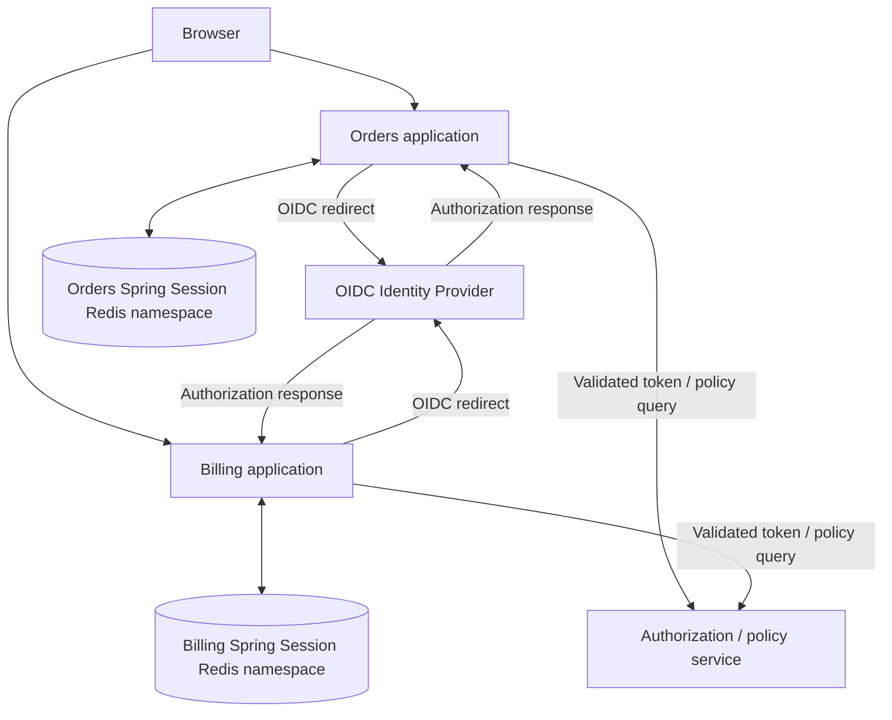

# Tránh dùng dữ liệu do một ứng dụng ghi làm bằng chứng cấp quyền không kiểm chứng

Khi nhiều ứng dụng Spring dùng chung Redis, JDBC hoặc cookie session, dữ liệu do ứng dụng A ghi có thể được ứng dụng B đọc. Khả năng chia sẻ này hữu ích cho trạng thái người dùng và trải nghiệm liền mạch, nhưng không có nghĩa mọi thuộc tính trong session đều là bằng chứng cấp quyền đáng tin cậy.

Một thuộc tính như `isAdmin=true`, `tenantId=...`, `mfaPassed=true` hoặc `paymentApproved=true` chỉ là dữ liệu. Ứng dụng B phải biết ai đã ghi nó, dữ liệu được bảo vệ ra sao, có còn mới không, được phát hành cho ứng dụng nào và người ghi có quyền quyết định điều đó hay không. Nếu không xác minh được nguồn gốc và phạm vi, không dùng thuộc tính đó để cấp quyền.

Spring Session cung cấp cơ chế lưu và nạp session từ repository dùng chung; nó không tự định nghĩa ranh giới tin cậy giữa các ứng dụng, không ký mọi session attribute và không thay thế giao thức xác thực liên ứng dụng. Bài học này trình bày cách phân vùng session, xác minh dữ liệu chia sẻ, thiết kế SSO/authorization an toàn và kiểm thử các tình huống ứng dụng này ghi dữ liệu nhưng ứng dụng khác cố dùng nó làm căn cứ cấp quyền.

## 1. Dữ liệu server-side không mặc nhiên là dữ liệu đáng tin

### 1.1. Session dùng chung mở rộng phạm vi ảnh hưởng

Trong ứng dụng Servlet, `SessionRepositoryFilter` tích hợp `HttpSession` với Spring Session repository. Khi nhiều ứng dụng dùng chung Redis namespace, JDBC table hoặc cùng session cookie, chúng có thể truy cập cùng một session ID và một phần session attributes.

Ví dụ:

1. Ứng dụng A xác thực người dùng và ghi `userRole=ADMIN` vào session.
2. Ứng dụng B nhận cùng cookie và nạp session từ kho dùng chung.
3. B đọc `userRole` rồi cho phép truy cập chức năng quản trị.
4. Nếu A ghi giá trị đó từ một nguồn chưa xác minh, hoặc một ứng dụng khác có thể sửa session, B đã biến dữ liệu không đáng tin thành quyền truy cập.

Việc dữ liệu nằm trong Redis/JDBC thay vì trong browser chỉ chứng minh dữ liệu được lưu ở server. Nó không chứng minh writer đã được ủy quyền, payload chưa bị sửa, hoặc dữ liệu phù hợp với quyết định của ứng dụng đang đọc.

### 1.2. Những loại dữ liệu không nên tự động trở thành quyền

| Session attribute hoặc dữ liệu chia sẻ | Rủi ro nếu dùng trực tiếp để cấp quyền |
|---|---|
| `isAdmin`, `role`, `authorities` | Ứng dụng ghi dữ liệu có thể không có thẩm quyền gán vai trò trong ứng dụng đọc |
| `tenantId`, `organizationId` | Có thể bị sửa để truy cập dữ liệu tenant khác hoặc không khớp với principal hiện tại |
| `mfaPassed`, `verified=true` | Không có thời điểm, phương thức, assurance level hoặc phạm vi giao dịch được xác minh |
| `accountEnabled`, `accountStatus` | Dữ liệu cũ có thể tiếp tục cho phép truy cập sau khi tài khoản bị khóa |
| `paymentApproved`, `refundAllowed` | Một cờ trong session không chứng minh giao dịch đã được hệ thống thanh toán xác nhận |
| `isOwner`, `canEdit` | Không bảo đảm người dùng hiện tại là chủ sở hữu tài nguyên cụ thể |
| `userId` hoặc email | Không tự chứng minh danh tính nếu không gắn với Authentication đã xác minh |

Session có thể lưu dữ liệu giao diện, lựa chọn ngôn ngữ, ID bản nháp hoặc tham chiếu quy trình. Quyết định bảo mật cần dựa trên Authentication đã xác minh và chính sách/nguồn dữ liệu có thẩm quyền.

### 1.3. Bốn câu hỏi trước khi tin dữ liệu chia sẻ

Trước khi dùng một thuộc tính từ ứng dụng khác, cần trả lời:

1. **Nguồn gốc:** Ai đã tạo dữ liệu? Writer có quyền phát hành loại khẳng định này không?
2. **Tính toàn vẹn:** Có thể phát hiện payload bị sửa hoặc giả mạo không?
3. **Phạm vi:** Dữ liệu dành cho subject, tenant, ứng dụng và hành động nào?
4. **Tính mới:** Dữ liệu có thời hạn, version hoặc cơ chế thu hồi không?

Nếu không trả lời được một trong các câu hỏi trên, hãy xem dữ liệu đó là thông tin tham khảo, không phải bằng chứng cấp quyền.

## 2. Spring Session là kho trạng thái, không phải giao thức ủy quyền liên ứng dụng

### 2.1. Repository chỉ cung cấp thao tác lưu và đọc

`SessionRepository` và các triển khai như `RedisIndexedSessionRepository` hoặc `JdbcIndexedSessionRepository` cung cấp API tạo, tìm, lưu và xóa session. Repository không biết ý nghĩa nghiệp vụ của `isAdmin`, `mfaPassed` hay `paymentApproved`.

Khi ứng dụng B đọc session attribute, Spring Session không tự gọi IdP hoặc authorization service để xác minh rằng ứng dụng A có quyền phát hành thuộc tính đó. Việc xác minh là trách nhiệm của kiến trúc bảo mật ứng dụng.

### 2.2. Chia sẻ `SecurityContext` có thể chia sẻ luôn niềm tin

Trong tích hợp Servlet phổ biến, Spring Security lưu `SecurityContext` vào `HttpSession` thông qua `HttpSessionSecurityContextRepository`. Nếu hai ứng dụng cùng đọc một session và cùng dùng key/format tương thích, ứng dụng B có thể khôi phục Authentication do ứng dụng A đã lưu.

Đây có thể là chủ ý trong một security domain được quản trị thống nhất, nhưng là rủi ro nếu hai ứng dụng có mức tin cậy hoặc chính sách xác thực khác nhau. Ví dụ, ứng dụng A chỉ yêu cầu mật khẩu nhưng ứng dụng B cần MFA; B không được suy ra `MFA` chỉ vì A đã tạo Authentication.

`SecurityContext` được chia sẻ cũng không thay thế kiểm tra quyền trên từng endpoint. Ứng dụng B vẫn phải xác định authority có ý nghĩa trong chính ứng dụng B và kiểm tra quyền truy cập tài nguyên cụ thể.

### 2.3. Cùng Redis không có nghĩa cùng một miền bảo mật

Hai ứng dụng có thể dùng chung một Redis cluster cho cache, queue và session. Không nên vì dùng chung hạ tầng mà cấp cho cả hai quyền đọc/ghi mọi key. Redis namespace giúp phân biệt dữ liệu logic nhưng không tự tạo ranh giới bảo mật nếu ACL/credential vẫn cho phép truy cập toàn bộ keyspace.

Tương tự, cùng một JDBC database không có nghĩa mọi ứng dụng nên dùng chung database user có quyền đọc/ghi tất cả bảng session. Quyền truy cập kho cần được giới hạn theo ứng dụng và nhu cầu thực tế.

## 3. Tách session theo ứng dụng và theo miền tin cậy

### 3.1. Mặc định nên dùng namespace riêng

Nếu hai ứng dụng không chủ ý chia sẻ cùng một session, dùng namespace khác nhau. Ví dụ, mỗi ứng dụng khai báo Redis namespace riêng:

```java
// Ứng dụng orders
@Configuration
@EnableRedisHttpSession(
    redisNamespace = "orders:session",
    maxInactiveIntervalInSeconds = 1800
)
class OrdersSessionConfiguration {
}
```

```java
// Ứng dụng billing
@Configuration
@EnableRedisHttpSession(
    redisNamespace = "billing:session",
    maxInactiveIntervalInSeconds = 900
)
class BillingSessionConfiguration {
}
```

Hai ứng dụng vẫn có thể dùng cùng Redis deployment, nhưng session key được tách theo namespace. Cấu hình thực tế phải bảo đảm mỗi ứng dụng chỉ dùng đúng repository và namespace dự kiến; không tạo bean cấu hình session trùng lặp với auto-configuration.

Với JDBC, cân nhắc table prefix/schema hoặc database user riêng theo khả năng repository và database. Đảm bảo ứng dụng A không thể sửa bảng session của B chỉ vì hai ứng dụng dùng cùng database server.

### 3.2. Tách cookie cũng là một phần của ranh giới

Nếu hai ứng dụng nằm ở các subdomain khác nhau, cookie `Domain=.example.com` có thể được gửi tới nhiều subdomain. Cookie có cùng tên, path và domain có thể tạo xung đột hoặc khiến browser gửi session ID tới ứng dụng không dự kiến.

Nếu không cần chia sẻ session, ưu tiên cookie host-only và tên riêng, ví dụ `ORDERS_SESSION` và `BILLING_SESSION`. Giữ `Secure`, `HttpOnly`, `SameSite` và `Path` phù hợp. Không đặt domain cha chỉ để tiện dùng chung cookie khi hai ứng dụng thuộc các miền tin cậy khác nhau.

### 3.3. Giới hạn quyền ở Redis

Tạo Redis ACL user riêng cho từng ứng dụng, chỉ cho phép các command và key pattern cần thiết. Ví dụ về ý tưởng key pattern:

```text
orders-user  -> ~orders:session:*
billing-user -> ~billing:session:*
```

Tên key thực tế phụ thuộc phiên bản Spring Session và cấu hình namespace; cần kiểm tra key pattern thực tế trước khi triển khai ACL. Không cấp `orders-user` quyền ghi `billing:session:*`, và không cấp quyền quản trị Redis cho tài khoản ứng dụng.

Nếu dùng Redis Cluster, ACL phải tương thích với các key và command mà repository thực sự dùng. Kiểm thử đầy đủ đọc/ghi, expiration, index và cleanup sau khi siết quyền.

### 3.4. Giới hạn quyền ở JDBC

Với JDBC, dùng database user/schema riêng khi có thể. Nếu nhiều ứng dụng dùng chung bảng session, credential của mỗi ứng dụng có thể có quyền quá rộng. Tách schema/table hoặc cung cấp một service trung gian để chỉ ứng dụng có thẩm quyền mới đọc/ghi dữ liệu tương ứng.

Không cho một ứng dụng có quyền `UPDATE` toàn bộ bảng session của ứng dụng khác nếu nó chỉ cần tra cứu một thông tin công khai. Dùng quyền tối thiểu và audit thao tác quản trị.

## 4. Thiết kế chia sẻ đăng nhập an toàn

### 4.1. Ưu tiên Identity Provider và OIDC

Khi nhiều ứng dụng cần nhận biết cùng một người dùng, OpenID Connect (OIDC) thường là ranh giới phù hợp hơn việc chia sẻ trực tiếp session store. Mỗi ứng dụng là một relying party/client riêng, chuyển browser tới Identity Provider (IdP), rồi nhận kết quả đăng nhập qua authorization code flow.

IdP phát ID Token để client hiểu danh tính người dùng và có thể phát access token cho API/resource server. Mỗi ứng dụng xác minh token theo cấu hình của nó, bao gồm chữ ký, issuer, audience, thời hạn và các claim bắt buộc. Ứng dụng B không cần đọc session attribute do A ghi để biết người dùng đã đăng nhập.

OIDC SSO vẫn có thể tạo trải nghiệm đăng nhập liền mạch vì IdP giữ session SSO riêng. Mỗi ứng dụng vẫn có local Spring Session riêng, với timeout và logout phù hợp.

### 4.2. Xác minh issuer, chữ ký, audience và thời hạn

Với API dùng JWT bearer token, Spring Security Resource Server có thể xác minh chữ ký qua issuer/JWK metadata và kiểm tra các claim chuẩn. Ví dụ cấu hình issuer:

```yaml
spring:
  security:
    oauth2:
      resourceserver:
        jwt:
          issuer-uri: https://id.example.com/issuer
```

Issuer validation một mình chưa đủ nếu token có thể được phát cho nhiều API. Resource server cần kiểm tra `aud` có chứa định danh chính xác của API hiện tại. Không chấp nhận token chỉ vì chữ ký hợp lệ nếu token được phát cho ứng dụng khác.

Ví dụ bổ sung audience validator:

```java
import org.springframework.beans.factory.annotation.Value;
import org.springframework.context.annotation.Bean;
import org.springframework.security.oauth2.core.DelegatingOAuth2TokenValidator;
import org.springframework.security.oauth2.core.OAuth2Error;
import org.springframework.security.oauth2.core.OAuth2TokenValidator;
import org.springframework.security.oauth2.core.OAuth2TokenValidatorResult;
import org.springframework.security.oauth2.jwt.Jwt;
import org.springframework.security.oauth2.jwt.JwtValidators;
import org.springframework.security.oauth2.jwt.NimbusJwtDecoder;

@Bean
NimbusJwtDecoder jwtDecoder(
        @Value("${security.issuer-uri}") String issuer,
        @Value("${security.audience}") String audience) {

    NimbusJwtDecoder decoder = NimbusJwtDecoder.withIssuerLocation(issuer).build();
    OAuth2TokenValidator<Jwt> issuerAndTime =
        JwtValidators.createDefaultWithIssuer(issuer);
    OAuth2TokenValidator<Jwt> audienceCheck = jwt ->
        jwt.getAudience().contains(audience)
            ? OAuth2TokenValidatorResult.success()
            : OAuth2TokenValidatorResult.failure(
                new OAuth2Error("invalid_token", "Token audience is not intended for this API", null));

    decoder.setJwtValidator(
        new DelegatingOAuth2TokenValidator<>(issuerAndTime, audienceCheck));
    return decoder;
}
```

Đoạn mã minh họa cần được đối chiếu với phiên bản Spring Security/BOM đang dùng. Ngoài `iss`, `aud`, `exp` và `nbf`, ứng dụng có thể cần kiểm tra `azp`, `client_id`, scope, tenant hoặc assurance claim theo hợp đồng token. Không tự giải mã Base64 JWT rồi tin payload mà bỏ qua chữ ký.

### 4.3. Phân quyền theo scope và chính sách của ứng dụng

Sau khi token được xác minh, API có thể yêu cầu scope tương ứng:

```java
@PreAuthorize("hasAuthority('SCOPE_orders.read')")
public Order getOrder(UUID orderId) {
    // Tải và kiểm tra quyền trên chính tài nguyên này.
}
```

Scope xác định quyền tổng quát mà token được cấp. Ứng dụng vẫn cần kiểm tra quyền trên tài nguyên cụ thể, tenant và quan hệ sở hữu. Token có `orders.read` không đồng nghĩa người dùng được đọc mọi đơn hàng.

### 4.4. Token có audience khác nhau

Không chuyển access token phát cho API A sang API B nếu `aud` không bao gồm B. Nếu B cần gọi A, B nên dùng OAuth2 client credentials hoặc token exchange theo kiến trúc IdP, không lấy session cookie của browser làm credential service-to-service.

## 5. Khi nào chia sẻ session trực tiếp có thể chấp nhận?

### 5.1. Cùng một security domain được quản trị thống nhất

Chia sẻ session trực tiếp có thể phù hợp khi nhiều ứng dụng thực sự thuộc cùng một miền bảo mật, có cùng chủ thể vận hành, cùng tiêu chuẩn xác thực và cùng vòng đời session. Ví dụ, các module web được triển khai như một sản phẩm thống nhất và cùng tin cậy một authentication pipeline.

Trước khi bật chia sẻ, cần xác định:

- Ứng dụng nào được phép tạo Authentication và authority?
- Ứng dụng nào chỉ được đọc trạng thái đã xác minh?
- Authority nào có ý nghĩa chung, authority nào chỉ có ý nghĩa cục bộ?
- Các ứng dụng có cùng yêu cầu MFA, re-authentication và session timeout không?
- Phiên bản Spring Security, serializer và principal class có tương thích không?
- Cách thu hồi session và xử lý khi một ứng dụng bị xâm nhập là gì?

Nếu không thể trả lời rõ, không nên chia sẻ `SecurityContext` trực tiếp.

### 5.2. Hợp đồng dữ liệu phải có version và phạm vi

Nếu vẫn chia sẻ một số thuộc tính, dùng envelope có schema rõ ràng:

```json
{
  "schemaVersion": 2,
  "issuer": "identity-gateway",
  "subject": "user-4821",
  "audience": "orders-web",
  "issuedAt": "2026-11-26T10:00:00Z",
  "expiresAt": "2026-11-26T10:05:00Z",
  "claims": {
    "displayName": "Nguyen A",
    "locale": "vi"
  }
}
```

Ví dụ này chỉ minh họa cấu trúc dữ liệu, chưa phải bằng chứng được ký. `issuer`, `audience`, `issuedAt` và `expiresAt` chỉ có giá trị bảo mật khi được bảo vệ bằng chữ ký/MAC hoặc được lấy từ một nguồn server-side mà reader có thể xác minh. Không tin một JSON object chỉ vì nó có các field đó.

Chỉ chia sẻ những claim cần thiết. `displayName` và `locale` thường là dữ liệu hiển thị; không nên nhét toàn bộ role, quyền quản trị hoặc dữ liệu nhạy cảm vào một object dùng chung.

### 5.3. Quyền của writer phải tương ứng với claim

Một ứng dụng có thể được phép cập nhật `locale` nhưng không được phép ghi `role=ADMIN`. Nếu mọi ứng dụng đều có quyền ghi toàn bộ session hash, tách namespace không đủ để bảo đảm claim-level authority.

Giải pháp tốt hơn là lưu dữ liệu profile ở service sở hữu profile, quyền ở authorization service hoặc IdP, và session chỉ chứa reference/claim đã được xác minh. Nếu bắt buộc dùng shared store, tách key theo loại dữ liệu và cấp ACL riêng; không cho ứng dụng ít tin cậy sửa dữ liệu quyền.

## 6. Xác minh chữ ký cho authorization assertion

### 6.1. Khi cần assertion ngoài access token

Trong một số hệ thống cũ, một ứng dụng phát hành assertion cho ứng dụng khác. Assertion phải được ký bởi issuer có thẩm quyền và được reader xác minh. Không dùng HMAC key chung cho tất cả ứng dụng nếu mỗi ứng dụng có mức tin cậy khác nhau: bất kỳ ứng dụng nào giữ shared secret cũng có thể giả mạo assertion của issuer.

Ưu tiên chữ ký bất đối xứng: issuer giữ private key, reader chỉ có public key. Reader có thể xác minh chữ ký nhưng không thể tự phát hành claim mới.

### 6.2. Các thuộc tính bắt buộc của assertion

Một assertion dùng cho quyết định quyền cần xác định:

- `iss`: issuer được tin cậy.
- `sub`: subject mà assertion nói tới.
- `aud`: đúng ứng dụng/API nhận assertion.
- `iat` và `exp`: thời điểm phát hành và hết hạn ngắn.
- `jti`: định danh duy nhất để chống replay nếu cần.
- `scope`/`permissions`: quyền hẹp, chỉ đủ cho thao tác được yêu cầu.
- `tenant`: tenant đã được xác minh và gắn với subject.
- `auth_time`/`acr`/`amr`: thông tin xác thực hoặc assurance nếu nghiệp vụ cần.

Reader phải xác minh chữ ký, issuer, audience, thời hạn, thuật toán được phép, key ID và claim bắt buộc. Không chấp nhận `alg=none`, thuật toán yếu hoặc key do payload tự cung cấp ngoài nguồn tin cậy.

### 6.3. Key rotation và thu hồi

Issuer cần xoay signing key theo quy trình. Reader lấy public key từ JWKS endpoint đã cấu hình, cache có giới hạn và xử lý `kid` không nhận biết theo chính sách an toàn. Giữ public key cũ trong khoảng chuyển tiếp đủ để xác minh token chưa hết hạn, rồi loại bỏ.

Assertion ngắn hạn giúp giảm cửa sổ rủi ro nhưng không thay thế revocation khi quyền bị thu hồi khẩn cấp. Với thao tác nhạy cảm, có thể kiểm tra trạng thái account/permission trực tiếp hoặc dùng token introspection/denylist.

### 6.4. Replay protection

Nếu assertion cấp quyền cho một hành động một lần, lưu `jti` đã sử dụng trong kho chống replay với TTL đến sau thời điểm token hết hạn. Với request cần chống lặp, dùng idempotency key gắn với subject, audience và thao tác. Không dùng `jti` làm session ID.

## 7. Phân quyền tại ứng dụng đọc dữ liệu

### 7.1. Dùng `Authentication` đã được xác minh

Ứng dụng B nên lấy principal từ SecurityContext được xác thực qua security filter chain, không tự đọc `userId` từ một thuộc tính tùy ý rồi coi đó là danh tính.

Ví dụ dùng method security:

```java
import java.util.UUID;
import org.springframework.security.access.prepost.PreAuthorize;
import org.springframework.stereotype.Service;

@Service
public class OrderQueryService {

    private final OrderRepository orders;

    public OrderQueryService(OrderRepository orders) {
        this.orders = orders;
    }

    @PreAuthorize("@orderAuthorization.canRead(authentication, #orderId)")
    public Order getOrder(UUID orderId) {
        return this.orders.findById(orderId).orElseThrow(OrderNotFoundException::new);
    }
}
```

`OrderAuthorization` phải kiểm tra quan hệ subject–tenant–resource từ nguồn có thẩm quyền, không chỉ đọc `canRead=true` trong session. Nếu dùng custom bean trong SpEL, bật method security bằng `@EnableMethodSecurity` và kiểm thử quyền ở service layer.

### 7.2. Ví dụ kiểm tra ACL ở nguồn dữ liệu

```java
@Component("orderAuthorization")
public class OrderAuthorization {

    private final OrderAclRepository aclRepository;

    public OrderAuthorization(OrderAclRepository aclRepository) {
        this.aclRepository = aclRepository;
    }

    public boolean canRead(Authentication authentication, UUID orderId) {
        if (authentication == null || !authentication.isAuthenticated()) {
            return false;
        }
        String subject = authentication.getName();
        return this.aclRepository.existsActiveGrant(subject, orderId, "ORDER_READ");
    }
}
```

Repository phải kiểm tra grant còn hiệu lực và ràng buộc tenant/subject theo schema thực tế. Không dùng tên quyền từ request hoặc session attribute làm tham số tin cậy nếu caller có thể sửa nó.

### 7.3. Kiểm tra tenant và resource ownership

Không nhận `tenantId` từ request rồi tin trực tiếp. Xác định tenant từ principal đã xác minh hoặc tra cứu membership của subject. Khi tải resource, ràng buộc tenant ngay trong query hoặc ACL check để tránh IDOR/cross-tenant access.

Ví dụ truy vấn nên có cả resource ID và tenant ID đã xác minh:

```sql
SELECT *
FROM ORDERS
WHERE ORDER_ID = :orderId
  AND TENANT_ID = :verifiedTenantId;
```

Nếu không tìm thấy bản ghi trong tenant hiện tại, trả response phù hợp mà không tiết lộ tài nguyên có tồn tại ở tenant khác hay không.

## 8. Dữ liệu profile và quyền cần có nguồn sự thật riêng

### 8.1. Phân loại dữ liệu

| Loại dữ liệu | Nguồn sự thật nên dùng | Session có thể lưu? |
|---|---|---|
| Tên hiển thị, locale, theme | Profile service/database | Có thể cache tạm để hiển thị |
| Vai trò quản trị toàn hệ thống | Identity/authorization service | Chỉ cache claim đã xác minh với thời hạn rõ ràng nếu cần |
| Membership tenant | Tenant/organization service | Không dùng bản sao cũ làm quyết định cuối cùng cho thao tác nhạy cảm |
| Quyền trên một tài nguyên | ACL/policy service hoặc database sở hữu tài nguyên | Không dùng cờ boolean tùy ý |
| Trạng thái MFA | Authentication provider hoặc record xác minh có thời điểm/phạm vi | Có thể giữ assurance claim đã xác minh, nhưng cần kiểm tra tuổi và mức assurance |
| Trạng thái thanh toán | Payment/order service | Không dùng session flag làm bằng chứng thanh toán |

### 8.2. Cache quyền phải có TTL và invalidation

Nếu hiệu năng yêu cầu cache entitlement, ghi rõ thời hạn cache và chính sách invalidation khi quyền thay đổi. Với quyền quản trị, thu hồi membership hoặc khóa tài khoản, cache stale có thể tạo cửa sổ truy cập không hợp lệ.

Có thể dùng version/epoch của quyền: mỗi thay đổi permission tăng `authorizationVersion`; cache/session chỉ hợp lệ khi version khớp với nguồn hiện tại. Nếu dùng event để invalidation, cần có cơ chế đối soát vì message có thể bị bỏ lỡ.

### 8.3. Quyền có thể phụ thuộc thời điểm và hành động

Claim `mfaPassed=true` thiếu thông tin quan trọng: MFA được thực hiện khi nào, bằng phương thức nào, cho audience nào và có đủ mạnh cho hành động hiện tại không. Với thao tác nhạy cảm, kiểm tra `auth_time`, `acr`, `amr` hoặc yêu cầu step-up authentication theo policy.

## 9. Xử lý serializer và dữ liệu không đáng tin

### 9.1. Serialization không phải chữ ký

Jackson JSON, Java serialization hoặc serializer tùy chỉnh chỉ chuyển đổi object thành bytes và ngược lại. Nó không chứng minh writer có thẩm quyền hoặc payload chưa bị thay đổi. Serializer an toàn cũng không thay thế authorization.

Không bật polymorphic deserialization không giới hạn chỉ để chia sẻ object giữa ứng dụng. Ưu tiên DTO có schema rõ, type allowlist và version. Tránh serialize toàn bộ object graph của framework hoặc domain entity vào session.

### 9.2. Bảo vệ dữ liệu khi truyền và lưu

- Dùng TLS giữa ứng dụng và Redis/JDBC endpoint.
- Bật Redis ACL hoặc database least privilege.
- Hạn chế network access của session store.
- Dùng encryption at rest theo khả năng hạ tầng nếu dữ liệu nhạy cảm cần bảo vệ.
- Không log cookie, session ID, token hoặc session attributes đầy đủ.
- Xóa dữ liệu nhạy cảm khi không còn cần và đặt timeout hợp lý.

Mã hóa at rest bảo vệ dữ liệu lưu trên thiết bị/volume nhưng không tự ngăn ứng dụng được cấp quyền đọc dữ liệu giải mã. Phân quyền truy cập và xác minh nguồn gốc vẫn cần thiết.

## 10. Thu hồi session và quyền khi một ứng dụng bị xâm nhập

### 10.1. Xóa session theo principal

Nếu dùng repository hỗ trợ `FindByIndexNameSessionRepository`, ứng dụng có thể tra cứu session theo principal rồi xóa session ID:

```java
Map<String, ? extends Session> sessions =
    sessionRepository.findByPrincipalName(principalName);

for (String sessionId : sessions.keySet()) {
    sessionRepository.deleteById(sessionId);
}
```

Chỉ thực hiện thao tác này sau khi xác minh principal và quyền quản trị. Nếu các ứng dụng chia sẻ cùng session namespace, xóa session có thể đăng xuất người dùng khỏi nhiều ứng dụng cùng lúc. Hành vi đó phải được thiết kế và thông báo rõ.

### 10.2. Credential version để chặn session stale

Khi một ứng dụng hoặc credential bị xâm nhập, xóa session hiện có có thể chưa đủ nếu request đã nạp session hoặc session được tạo lại trong lúc xử lý. Một `credentialVersion` hoặc `authorizationVersion` trên bản ghi user có thể giúp chặn các session mang version cũ.

Khi incident xảy ra, tăng version ở nguồn sự thật; mọi ứng dụng đọc phải so sánh version trước khi cho phép thao tác nhạy cảm. Đây là cơ chế toàn hệ thống chỉ khi mọi ứng dụng đều thực thi cùng hợp đồng. Nếu một ứng dụng bỏ qua version check, nó vẫn có thể tin session cũ.

### 10.3. Thu hồi token và IdP session

Xóa Spring Session không tự thu hồi OAuth2 refresh token, API key hoặc IdP SSO session. Incident response cần liệt kê từng credential, thu hồi tại nguồn phát hành và kiểm tra rằng ứng dụng khác không tiếp tục chấp nhận token cũ.

### 10.4. Phân vùng blast radius

Nếu ứng dụng A bị xâm nhập, không nên để A có quyền ghi mọi session hoặc claim của B. Tách namespace, ACL, database credentials và issuer keys giúp giảm phạm vi ảnh hưởng. Một ứng dụng không nên giữ private signing key của issuer chung nếu nó không có thẩm quyền phát hành assertion cho mọi ứng dụng.

## 11. Ví dụ kiến trúc tham khảo

### 11.1. SSO với local session riêng



Mỗi ứng dụng có local Spring Session riêng. IdP cung cấp SSO; authorization service hoặc nguồn dữ liệu nghiệp vụ cung cấp quyền. Không cần cho Orders và Billing ghi trực tiếp session của nhau.

### 11.2. Chia sẻ session có kiểm soát trong cùng security domain

Nếu có lý do kỹ thuật bắt buộc chia sẻ session, cần một hợp đồng chung:

- Danh sách ứng dụng được tin cậy và vai trò của từng ứng dụng.
- Namespace/cookie/serializer tương thích.
- Redis ACL/JDBC permissions chỉ cấp đúng quyền.
- Schema version và quy tắc migration.
- Principal format và authority mapping thống nhất.
- Cơ chế thu hồi, audit và incident response chung.
- Kiểm thử ứng dụng không thể tự gán quyền vượt thẩm quyền.

Không cho phép ứng dụng chỉ sở hữu profile ghi authority quản trị. Nếu cần chia sẻ Authentication, mọi ứng dụng phải tin cậy authentication pipeline phát hành nó và vẫn áp dụng authorization cục bộ.

## 12. Kiểm thử ranh giới tin cậy

### 12.1. Kiểm thử thuộc tính giả mạo

1. Ứng dụng A ghi `isAdmin=true` vào session từ dữ liệu đầu vào không tin cậy.
2. Dùng cùng session cookie truy cập ứng dụng B.
3. Xác minh B không cấp quyền quản trị chỉ dựa trên thuộc tính này.
4. Xác minh B dùng Authentication đã xác minh và policy/ACL riêng.

### 12.2. Kiểm thử namespace và ACL

1. Xác minh Orders chỉ đọc/ghi `orders:session:*`.
2. Thử dùng credential Orders đọc hoặc ghi `billing:session:*`; thao tác phải bị từ chối.
3. Kiểm tra cookie của Orders không bị gửi tới Billing nếu không chủ ý chia sẻ.
4. Kiểm tra ứng dụng không thể sửa bảng/session của ứng dụng khác.

### 12.3. Kiểm thử token audience

1. Phát token hợp lệ cho API Orders.
2. Gửi token đó tới API Billing.
3. Xác minh Billing từ chối vì `aud` không dành cho Billing.
4. Gửi token đúng issuer, signature, audience và scope; xác minh request chỉ được quyền trong phạm vi scope và resource.
5. Kiểm thử token hết hạn, sai issuer, sai chữ ký và `nbf` trong tương lai.

### 12.4. Kiểm thử stale authorization

1. Tạo session chứa version quyền hiện tại.
2. Thu hồi membership hoặc nâng `authorizationVersion` ở nguồn sự thật.
3. Gửi request tới từng ứng dụng.
4. Xác minh cache/session cũ không tiếp tục cấp quyền quá thời hạn cho phép.
5. Mô phỏng mất event invalidation để kiểm tra TTL/đối soát dự phòng.

### 12.5. Kiểm thử serializer và payload

Thử payload thiếu field, schema version cũ, type không được phép và dữ liệu hỏng. Ứng dụng phải từ chối hoặc xử lý tương thích theo chính sách; không được tự nâng quyền khi giải mã thất bại. Không deserialize class tùy ý lấy từ payload.

### 12.6. Kiểm thử thu hồi liên ứng dụng

Nếu các ứng dụng cố ý chia sẻ session, tạo session ở A rồi thu hồi ở B. Xác minh hành vi logout ở cả hai ứng dụng đúng với chính sách. Nếu mỗi ứng dụng có namespace riêng, xác minh thu hồi ở A không ảnh hưởng B trừ khi có yêu cầu logout toàn hệ thống.

## 13. Lỗi thường gặp và cách xử lý

| Hiện tượng | Nguyên nhân có thể | Hướng xử lý |
|---|---|---|
| Ứng dụng B cho quyền admin dựa trên session attribute | Tin `isAdmin`/`role` do A ghi mà không xác minh | Dùng Authentication/token đã xác minh và policy của B |
| Hai ứng dụng vô tình dùng chung `SecurityContext` | Cùng cookie, namespace và key session | Tách namespace/cookie hoặc xác định rõ cùng security domain |
| Redis ACL không ngăn ứng dụng A đọc session B | ACL key pattern quá rộng hoặc dùng chung credential | Tạo ACL user riêng, kiểm tra key pattern thực tế |
| Token hợp lệ nhưng dùng sai API | Chỉ kiểm tra chữ ký/issuer, không kiểm tra audience | Bắt buộc `aud` đúng resource server |
| Quyền đã thu hồi nhưng session vẫn cho phép | Cache/session chứa claim cũ | TTL ngắn, version check, invalidation và nguồn quyền có thẩm quyền |
| Tenant bị truy cập chéo | Tin `tenantId` từ request/session | Lấy tenant từ principal đã xác minh và ràng buộc trong query/ACL |
| MFA flag cũ vẫn được tin | Không kiểm tra thời điểm/phương thức/assurance | Kiểm tra `auth_time`, `acr`, `amr` hoặc step-up |
| Ứng dụng khác sửa session attribute | Shared store credential có quyền ghi quá rộng | Least privilege, tách key/schema và audit writer |
| JSON giải mã thành kiểu không mong muốn | Schema/type metadata không được kiểm soát | DTO versioned, type allowlist và fail closed |
| Xóa session không logout khỏi IdP | Local session khác IdP SSO session | Dùng OIDC RP-Initiated/Single Logout theo hỗ trợ provider |

## 14. Checklist thiết kế an toàn

Trước khi chia sẻ session hoặc dữ liệu giữa ứng dụng:

1. Xác định rõ ứng dụng nào thuộc cùng security domain và ứng dụng nào là trust boundary riêng.
2. Mặc định dùng namespace, cookie và database/Redis permissions riêng.
3. Không dùng `role`, `isAdmin`, `tenantId`, `mfaPassed` hoặc approval flag từ session làm bằng chứng nếu chưa xác minh nguồn và phạm vi.
4. Ưu tiên OIDC/OAuth2 cho xác thực và ủy quyền liên ứng dụng; mỗi resource server kiểm tra issuer, signature, audience, time và scope.
5. Kiểm tra quyền trên tài nguyên/tenant tại ứng dụng sở hữu tài nguyên.
6. Nếu dùng signed assertion, xác minh issuer, audience, thời hạn, key, scope và replay policy.
7. Nếu chia sẻ `SecurityContext`, bảo đảm authentication pipeline, authority mapping và session lifecycle được quản trị thống nhất.
8. Dùng Redis ACL/JDBC least privilege và TLS; namespace không thay thế quyền truy cập.
9. Version hóa schema/claims, đặt TTL và có invalidation khi quyền thay đổi.
10. Kiểm thử giả mạo session attribute, sai audience, stale permission, ACL và thu hồi ở nhiều ứng dụng.
11. Không log raw session ID, cookie hoặc bearer token.
12. Có quy trình thu hồi credential và giới hạn blast radius khi một ứng dụng bị xâm nhập.

Spring Session giúp chia sẻ trạng thái phiên qua Redis/JDBC, nhưng dữ liệu do một ứng dụng ghi không tự trở thành bằng chứng cấp quyền cho ứng dụng khác. Hãy tách session theo miền tin cậy, giới hạn quyền truy cập kho, xác minh token/assertion theo issuer và audience, rồi áp dụng authorization tại ứng dụng sở hữu tài nguyên. Chỉ chia sẻ trực tiếp session hoặc `SecurityContext` khi các ứng dụng có cùng chính sách xác thực, authority và vận hành được thống nhất rõ ràng.

## Tài liệu tham khảo

- [Spring Session — HttpSession Integration](https://docs.spring.io/spring-session/reference/http-session.html)
- [Spring Session — Redis Configuration](https://docs.spring.io/spring-session/reference/configuration/redis.html)
- [Spring Session — JDBC Configuration](https://docs.spring.io/spring-session/reference/configuration/jdbc.html)
- [Spring Security — OAuth 2.0 Resource Server JWT](https://docs.spring.io/spring-security/reference/servlet/oauth2/resource-server/jwt.html)
- [Spring Security — Method Security](https://docs.spring.io/spring-security/reference/servlet/authorization/method-security.html)
- [OpenID Connect Core 1.0](https://openid.net/specs/openid-connect-core-1_0.html)
- [OAuth 2.0 Security Best Current Practice — RFC 9700](https://www.rfc-editor.org/rfc/rfc9700)
- [Redis ACL](https://redis.io/docs/latest/operate/oss_and_stack/management/security/acl/)
