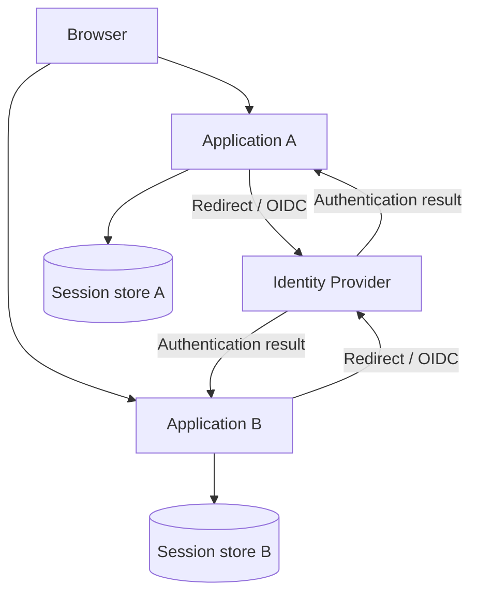

# Lựa chọn tách phiên khi ứng dụng có vòng đời hoặc yêu cầu bảo mật khác nhau

Nhiều ứng dụng trong cùng một tổ chức có thể cần nhận biết cùng một người dùng, nhưng điều đó không có nghĩa chúng nên dùng chung một `HttpSession`. Một ứng dụng bán hàng, trang quản trị, cổng đối tác và hệ thống hỗ trợ có thể có thời hạn đăng nhập, mức độ nhạy cảm, quyền truy cập và chu kỳ phát hành rất khác nhau. Chia sẻ toàn bộ session giúp trải nghiệm đăng nhập liền mạch, nhưng cũng tạo liên kết chặt giữa các ứng dụng về cookie, serializer, schema, timeout, logout và cấu hình bảo mật.

Spring Session cho phép lưu session trong kho dùng chung như Redis hoặc JDBC, nhờ đó nhiều instance hoặc nhiều ứng dụng có thể truy cập cùng trạng thái nếu chúng dùng chung định danh cookie, repository namespace/schema và định dạng dữ liệu tương thích. Tuy nhiên, khả năng kỹ thuật không tự quyết định rằng chia sẻ là lựa chọn đúng. Khi ứng dụng có vòng đời hoặc yêu cầu bảo mật khác nhau, thường nên chia sẻ danh tính qua một cơ chế SSO và giữ session cục bộ riêng cho từng ứng dụng.

## 1. Phân biệt chia sẻ danh tính và chia sẻ session

Hai khái niệm thường bị nhầm lẫn:

| Khái niệm | Điều được chia sẻ | Mục tiêu |
|---|---|---|
| Chia sẻ session HTTP | Cùng session ID và cùng dữ liệu `HttpSession` | Các ứng dụng truy cập cùng một trạng thái server-side |
| SSO (Single Sign-On) | Bằng chứng xác thực hoặc danh tính do IdP phát hành | Người dùng đăng nhập một lần và truy cập nhiều ứng dụng |
| Chia sẻ dữ liệu nghiệp vụ | Hồ sơ, giỏ hàng, đơn hàng hoặc quyền từ API/database | Các ứng dụng cùng sử dụng dữ liệu nghiệp vụ |
| Chia sẻ cookie | Trình duyệt gửi một cookie đến nhiều host/path phù hợp | Chuyển session identifier hoặc token theo phạm vi cookie |

SSO không yêu cầu các ứng dụng dùng chung session ID. Trong mô hình phổ biến, Identity Provider (IdP) xác thực người dùng; mỗi ứng dụng nhận kết quả xác thực, tạo session riêng và phát cookie riêng. Khi người dùng mở ứng dụng khác, ứng dụng đó chuyển hướng đến IdP; IdP có thể nhận biết người dùng đã đăng nhập và trả kết quả mà không yêu cầu nhập lại mật khẩu.

Chia sẻ session trực tiếp làm các ứng dụng phụ thuộc vào cùng cấu trúc dữ liệu session. SSO chia sẻ danh tính theo giao thức và để mỗi ứng dụng tự quản lý session, timeout, quyền cục bộ và vòng đời triển khai.

## 2. Khi nào nên dùng chung Spring Session?

Chia sẻ session có thể hợp lý khi các ứng dụng thực sự là các phần của cùng một sản phẩm, cùng trust boundary và cần cùng trạng thái phiên.

Ví dụ:
- Một web application được tách thành nhiều module hoặc nhiều deployment nhưng cùng một phiên bản hợp đồng session.
- Hai ứng dụng nội bộ cùng đội sở hữu, cùng chính sách xác thực và cùng chu kỳ nâng cấp.
- Một ứng dụng được chia thành frontend/backend Servlet nhưng cần duy trì cùng một session HTTP theo thiết kế đã kiểm thử.
- Các instance của cùng một ứng dụng cần chia sẻ session khi load balancer chuyển request sang node khác.

Điều kiện quan trọng:
- Cùng tin cậy nguồn dữ liệu session và cùng nhóm vận hành.
- Cùng cookie name, domain, path và cách resolve session ID.
- Cùng Redis namespace hoặc JDBC schema/table.
- Cùng serializer, classpath và hợp đồng thuộc tính.
- Cùng cách xử lý timeout, logout, session fixation và thu hồi.
- Cùng chính sách bảo mật cho mọi thuộc tính có thể được đọc bởi các ứng dụng.

Nếu một ứng dụng không thể đáp ứng các điều kiện này, chia sẻ session sẽ biến khác biệt cục bộ thành lỗi liên ứng dụng.

## 3. Khi nào nên tách session?

Nên cân nhắc tách session khi các ứng dụng có một hoặc nhiều khác biệt sau:

| Khác biệt | Vì sao nên tách |
|---|---|
| Idle timeout khác nhau | Một ứng dụng có thể gia hạn hoặc làm hết hạn session của ứng dụng kia |
| Mức độ nhạy cảm khác nhau | Phiên quản trị không nên phụ thuộc vào cookie của trang công khai |
| Quyền và principal khác nhau | Một ứng dụng có thể hiểu sai hoặc cấp quá nhiều quyền từ SecurityContext dùng chung |
| Chu kỳ phát hành khác nhau | Serializer hoặc DTO thay đổi ở một ứng dụng có thể làm hỏng session của ứng dụng khác |
| Đội vận hành khác nhau | Sự cố Redis/JDBC hoặc thay đổi cấu hình của một bên ảnh hưởng bên còn lại |
| Yêu cầu audit khác nhau | Cần ghi nhận, thu hồi và điều tra phiên theo từng ứng dụng |
| Tenant hoặc vùng dữ liệu khác nhau | Tránh rò rỉ session giữa tenant, môi trường hoặc hệ thống |
| Quy định bảo mật khác nhau | Có thể cần cookie, khóa mã hóa, ACL hoặc retention riêng |

Ví dụ, trang quản trị có thể cần idle timeout 10 phút, xác thực đa yếu tố và thu hồi phiên ngay khi nhân viên nghỉ việc. Trang khách hàng có thể dùng timeout 30 phút và quy trình đăng nhập khác. Nếu cùng một session record, hai chính sách timeout và xác thực có thể xung đột.

Tách session không ngăn người dùng có trải nghiệm SSO. Nó chỉ đặt ranh giới session riêng sau khi danh tính được xác nhận.

## 4. Các lớp cần thống nhất nếu chia sẻ session

Để hai ứng dụng thực sự dùng chung một session, cần đồng bộ nhiều lớp:

1. **Cookie resolver:** trình duyệt phải gửi cùng session identifier đến cả hai ứng dụng.
2. **Session repository:** cả hai ứng dụng phải tìm cùng record theo ID.
3. **Namespace/schema:** key Redis hoặc bảng JDBC phải trùng khớp.
4. **Serializer:** dữ liệu thuộc tính phải được giải mã tương thích.
5. **Session attributes:** hai ứng dụng phải hiểu cùng ý nghĩa và kiểu dữ liệu.
6. **Timeout:** các bên phải có chính sách hết hạn tương thích.
7. **Security context:** principal, Authentication và authorities phải có semantics chung.
8. **Lifecycle events:** logout, expiration và session ID rotation phải có tác động được dự kiến ở cả hai bên.

Chỉ trùng cookie name chưa đủ. Nếu hai ứng dụng dùng namespace Redis khác nhau, cùng cookie có thể resolve thành hai session khác nhau hoặc không tìm thấy session. Ngược lại, nếu vô tình dùng chung namespace và cookie, một ứng dụng có thể đọc dữ liệu session của ứng dụng kia ngoài dự kiến.

## 5. Cookie scope quyết định trình duyệt gửi session ID đi đâu

Cookie được giới hạn bởi domain, path, secure context và các thuộc tính khác. Với cookie host-only mặc định, cookie được gửi đến host đã tạo nó. Nếu đặt `Domain=example.com`, cookie có thể được gửi đến các subdomain phù hợp như `app.example.com` và `admin.example.com`.

Ví dụ cấu hình cookie Spring Session:

```java
@Bean
CookieSerializer cookieSerializer() {
    DefaultCookieSerializer serializer = new DefaultCookieSerializer();
    serializer.setCookieName("ORGSESSION");
    serializer.setDomainName("example.com");
    serializer.setCookiePath("/");
    serializer.setUseHttpOnlyCookie(true);
    serializer.setUseSecureCookie(true);
    serializer.setSameSite("Lax");
    return serializer;
}
```

Cấu hình này minh họa cookie được chia sẻ trên các subdomain của `example.com`. Chỉ sử dụng domain cha nếu tất cả subdomain nằm trong cùng trust boundary. Một subdomain yếu hoặc có thể bị takeover có thể nhận cookie session dùng chung.

Không cần chia sẻ cookie domain chỉ vì các ứng dụng thuộc cùng tổ chức. Cookie host-only và SSO redirect thường tạo ranh giới an toàn hơn.

## 6. Cookie name, path và va chạm giữa các ứng dụng

Cookie được phân biệt bởi ít nhất name, domain và path. Nếu hai ứng dụng cùng phát cookie có cùng name, domain và path, trình duyệt có thể gửi nhiều giá trị cùng tên hoặc ghi đè cookie theo cách gây khó dự đoán.

Ví dụ:
- Ứng dụng A phát cookie `SESSION` cho path `/`.
- Ứng dụng B cũng phát cookie `SESSION` cho path `/`.
- Cả hai dùng domain `example.com`.

Khi đó, browser cookie jar có thể chứa xung đột giữa hai ứng dụng. Server có thể đọc nhầm ID hoặc xử lý cookie không theo ý định.

Nếu tách session, dùng cookie name riêng, ví dụ `APPASESSION` và `ADMINSESSION`. Có thể dùng prefix `__Host-` khi phù hợp: cookie phải có `Secure`, `Path=/` và không được đặt `Domain`, do đó nó chỉ gắn với host phát hành. Đây là lựa chọn hữu ích để giảm phạm vi cookie, nhưng mỗi ứng dụng phải có host phù hợp và HTTPS.

Thuộc tính `Path` giúp giới hạn request path mà browser gửi cookie, nhưng không phải ranh giới bảo mật đủ mạnh giữa các ứng dụng cùng host. Không dùng path khác nhau như biện pháp duy nhất để cách ly session.

## 7. SameSite, Secure, HttpOnly và CSRF

Cookie session là bearer credential: ai có session ID hợp lệ có thể thử sử dụng phiên đó. Cần bảo vệ cookie:

- `Secure`: chỉ gửi qua HTTPS.
- `HttpOnly`: JavaScript phía client không đọc trực tiếp cookie.
- `SameSite`: kiểm soát một số tình huống browser gửi cookie trong điều hướng/request cross-site.
- Domain/Path: giới hạn host và đường dẫn nhận cookie.
- Session ID phải đủ ngẫu nhiên, không chứa dữ liệu người dùng có thể đoán.

`SameSite=Lax` thường phù hợp với nhiều ứng dụng web; `Strict` hạn chế thêm việc gửi cookie cross-site nhưng có thể ảnh hưởng luồng điều hướng từ bên ngoài; `None` cho phép cookie trong ngữ cảnh cross-site và yêu cầu `Secure` trên browser hiện đại.

SameSite không thay thế CSRF protection. Ứng dụng dùng cookie session vẫn phải cấu hình CSRF token và kiểm tra origin theo mô hình phù hợp. CORS cũng không mở rộng cookie domain: CORS kiểm soát việc JavaScript đọc response và gửi credential cross-origin theo chính sách browser, không khiến cookie host-only tự động được chia sẻ giữa các domain.

## 8. Tách Redis namespace theo ứng dụng

Spring Session Redis cho phép cấu hình namespace. Nếu hai ứng dụng dùng chung Redis cluster nhưng cần session riêng, hãy dùng namespace khác nhau.

Ví dụ với Spring Boot:

```yaml
spring:
  session:
    store-type: redis
    redis:
      namespace: app-a:sessions
```

Ứng dụng B dùng namespace khác:

```yaml
spring:
  session:
    store-type: redis
    redis:
      namespace: admin:sessions
```

Với cấu hình Java tường minh, `@EnableRedisHttpSession` hoặc indexed variant có thể nhận thuộc tính namespace theo API phiên bản đang dùng. Kiểm tra tên thuộc tính và annotation trong dependency thực tế; không trộn cấu hình auto-configuration với annotation tường minh nếu cả hai cùng đăng ký repository.

Namespace tách keyspace nhưng không tự tạo quyền truy cập độc lập. Nếu cần cô lập bảo mật, cấp ACL/credential Redis phù hợp, giới hạn key pattern và network access. Hai namespace trong cùng Redis user có thể vẫn cùng quyền đọc/ghi nếu ACL không giới hạn.

## 9. Tách JDBC schema, bảng và DataSource

Với Spring Session JDBC, hai ứng dụng có thể dùng cùng database server nhưng bảng/schema riêng.

Ví dụ:
- Ứng dụng A dùng schema `APP_A` hoặc bảng `APP_A_SESSION`.
- Ứng dụng B dùng schema `ADMIN` hoặc bảng `ADMIN_SESSION`.

Spring Session JDBC có cấu hình table name và có thể dùng DataSource riêng. Nếu ứng dụng có nhiều DataSource, `@SpringSessionDataSource` có thể đánh dấu nguồn kết nối dành cho Spring Session. Cần cấu hình migration, quyền runtime và query để trỏ đúng schema/table.

Tách bảng nhưng dùng chung tài khoản DB có quyền toàn schema chỉ tạo ranh giới logic. Nếu cần isolation, dùng DB role riêng với quyền tối thiểu trên các bảng session tương ứng. Với ứng dụng có mức độ nhạy cảm cao, cân nhắc database hoặc cluster riêng.

## 10. Không chia sẻ SecurityContext một cách vô điều kiện

Spring Security lưu `SecurityContext` vào session thông qua `HttpSessionSecurityContextRepository`. Nếu hai ứng dụng dùng chung session, ứng dụng thứ hai có thể đọc thuộc tính `SPRING_SECURITY_CONTEXT`.

Điều này chỉ an toàn khi cả hai ứng dụng có cùng cách hiểu:
- Principal class và định danh principal.
- Authentication implementation.
- Authorities và ý nghĩa role.
- Authentication assurance level, ví dụ MFA đã hoàn tất hay chưa.
- Tenant, organization và phạm vi dữ liệu.
- Serializer và module cần thiết.
- Chính sách thu hồi, reauthentication và session fixation.

Một ứng dụng quản trị không nên tin một `Authentication` được tạo cho ứng dụng khách hàng nếu nó không xác minh mức xác thực và quyền tương ứng. Có thể cùng username nhưng quyền trong hai ứng dụng khác nhau.

Thông thường, mỗi ứng dụng nên tạo SecurityContext cục bộ từ assertion/token do IdP cấp, rồi áp dụng authorization riêng. Không dùng chung object `SecurityContext` chỉ để tránh triển khai lại đăng nhập.

## 11. Khác biệt timeout gây xung đột

Spring Session lưu `maxInactiveInterval` trong session. Khi cùng một session record được nhiều ứng dụng truy cập, các ứng dụng có thể đọc hoặc cập nhật timeout theo cấu hình của mình.

Ví dụ:
- Ứng dụng A muốn idle timeout 15 phút.
- Ứng dụng B muốn idle timeout 2 giờ.
- A và B cùng dùng một session ID và cùng repository record.

Một request của B có thể làm mới `lastAccessedTime` hoặc ghi lại interval theo chính sách B. Điều đó có thể kéo dài session mà A mong muốn hết hạn sớm. Ngược lại, A có thể làm session của B hết hạn sớm hơn yêu cầu.

Cookie `Max-Age` hoặc `Expires` là vòng đời cookie ở browser; nó không thay thế idle timeout server-side. Absolute login lifetime cũng là chính sách khác, thường cần lưu thời điểm xác thực ban đầu và kiểm tra riêng.

Nếu timeout khác nhau, tách session là lựa chọn đơn giản và dễ kiểm chứng hơn. SSO có thể giữ phiên tại IdP riêng, còn mỗi ứng dụng áp dụng idle timeout cục bộ.

## 12. Logout cục bộ và logout toàn hệ thống

Khi hai ứng dụng dùng chung đúng một session ID và cùng repository record, việc một ứng dụng invalidate session có thể khiến ứng dụng kia mất phiên. Đây là logout toàn session, dù người dùng chỉ bấm logout trong một ứng dụng.

Nếu mỗi ứng dụng có session riêng, logout ở A chỉ xóa session A. Muốn logout toàn hệ thống, cần cơ chế SSO logout hoặc back-channel/front-channel logout để IdP thông báo các relying party thu hồi local session.

Phân biệt:
- **Local logout:** kết thúc session của một ứng dụng.
- **IdP logout:** kết thúc phiên đăng nhập tại Identity Provider.
- **Global logout:** thu hồi các phiên cục bộ liên quan ở nhiều ứng dụng theo giao thức và chính sách.
- **Token revocation:** vô hiệu hóa token hoặc refresh token theo khả năng của IdP/resource server.

Không giả định xóa cookie tại một host sẽ xóa cookie ở mọi host hoặc vô hiệu hóa session record trên server. Logout cần xóa/thu hồi trạng thái server-side và cookie phù hợp với từng ứng dụng.

## 13. SSO với session cục bộ riêng cho từng ứng dụng

Một kiến trúc thường phù hợp hơn khi vòng đời khác nhau:



Luồng:
1. Người dùng truy cập ứng dụng A.
2. A chuyển hướng đến IdP nếu chưa có phiên cục bộ.
3. IdP xác thực người dùng và trả authorization response.
4. A xác minh response, ánh xạ principal/claims và tạo session A.
5. Người dùng truy cập B.
6. B chuyển hướng đến IdP; nếu IdP session còn hợp lệ, người dùng không cần nhập lại credential.
7. B xác minh response và tạo session B với timeout/quyền riêng.

OIDC Authorization Code Flow với PKCE là lựa chọn phổ biến cho browser/public clients và ứng dụng hiện đại. Với server-side web app/BFF, confidential client có thể dùng client authentication phù hợp. Mỗi ứng dụng cần xác minh issuer, audience/client, signature, state, nonce và redirect URI theo giao thức.

Không chia sẻ cookie session của IdP trực tiếp cho các ứng dụng. IdP giữ cookie trong domain riêng; ứng dụng nhận kết quả xác thực qua redirect và tạo local session.

## 14. Cookie domain khác nhau hoặc ứng dụng ở domain khác nhau

Nếu các ứng dụng ở `app-a.example.com` và `admin.example.com`, cookie host-only của A không tự gửi đến B. Có thể đặt Domain ở parent domain, nhưng điều đó mở rộng phạm vi cookie tới các subdomain phù hợp và tăng trust boundary.

Nếu các ứng dụng ở hai registrable domain khác nhau, ví dụ `shop.example` và `admin.example.net`, browser không cho một cookie first-party thông thường được chia sẻ giữa hai domain. Third-party cookie cũng bị hạn chế bởi browser policy và không nên là nền tảng SSO.

Dùng redirect đến IdP có domain riêng để thiết lập danh tính và local session trên từng domain. Không truyền session ID trong query string hoặc URL fragment để “chia sẻ” giữa các domain; URL có thể xuất hiện trong history, logs, referrer và analytics.

## 15. CORS không phải cơ chế chia sẻ session

Một frontend ở `https://portal.example.com` có thể gọi API ở `https://api.example.com`. Đây là cross-origin request nhưng có thể cùng site tùy scheme và registrable domain. Để browser gửi cookie, frontend phải cấu hình credential phù hợp, server phải trả `Access-Control-Allow-Credentials: true` và chỉ định origin cụ thể, không dùng wildcard.

Tuy vậy, request chỉ mang cookie nếu domain/path/SameSite/Secure cho phép. CORS không thay đổi Domain hoặc Path của cookie, không chia sẻ session repository và không xác minh quyền người dùng.

Khi dùng cookie credential cross-origin:
- Không dùng `Access-Control-Allow-Origin: *` cùng credentials.
- Chỉ allowlist origin cần thiết.
- Bảo vệ CSRF.
- Cấu hình cookie phù hợp với SameSite và HTTPS.
- Xác minh `Origin` hoặc cơ chế anti-CSRF ở endpoint nhạy cảm.

Nếu API thuộc một ứng dụng khác có trust boundary riêng, cân nhắc token audience-scoped hoặc BFF thay vì chia sẻ session cookie rộng.

## 16. BFF và gateway có thể giảm phạm vi cookie

Backend-for-Frontend (BFF) có thể giữ session cookie tại một host frontend/backend riêng. BFF xác thực người dùng, giữ token ở server-side và gọi các API phía sau bằng credential phù hợp.

Ưu điểm:
- Browser chỉ cần một cookie host-only đến BFF.
- Token truy cập API không phải lưu trong JavaScript/browser storage.
- Mỗi backend service vẫn có authorization riêng.
- Các service không cần dùng chung `HttpSession`.
- BFF có thể quản lý refresh token và logout theo chính sách tập trung.

Gateway có thể xác thực token và chuyển identity claims đến service, nhưng không nên biến một header do client tự gửi thành danh tính đáng tin cậy. Gateway phải loại bỏ header giả mạo từ bên ngoài và tự đặt claims đã xác minh trên kết nối tin cậy.

BFF không loại bỏ CSRF nếu browser dùng cookie. Nó cũng không thay thế authorization ở service cho các thao tác dữ liệu nhạy cảm.

## 17. Chia sẻ một phần dữ liệu thay vì toàn bộ session

Đôi khi ứng dụng chỉ cần một số trạng thái chung, ví dụ locale, cart ID hoặc trạng thái onboarding. Không nhất thiết chia sẻ toàn bộ `HttpSession`.

Các lựa chọn:
- Lưu dữ liệu nghiệp vụ trong service/API dùng chung.
- Dùng profile service để cung cấp user preferences.
- Lưu cart trong cart service theo user ID.
- Dùng token claim cho thông tin danh tính ổn định và không nhạy cảm.
- Dùng message/event để đồng bộ trạng thái không yêu cầu đọc đồng bộ.
- Dùng cache có namespace và TTL riêng cho dữ liệu chia sẻ.

Giữ session cục bộ nhỏ, chứa ID tham chiếu và trạng thái tương tác tạm thời. Cách này giảm coupling serializer và vòng đời giữa ứng dụng. Dữ liệu nghiệp vụ cần transaction hoặc audit nên nằm trong domain service/database có thẩm quyền.

Không sao chép toàn bộ session A sang session B theo định kỳ. Việc sao chép tạo thêm bản dữ liệu cũ, làm khó logout, thu hồi và xử lý cập nhật đồng thời.

## 18. Nếu vẫn cần chia sẻ session: tạo hợp đồng chung

Trong trường hợp chia sẻ session là yêu cầu có chủ đích, hãy định nghĩa một hợp đồng session versioned:

```java
public record SharedUserContext(
        int schemaVersion,
        String subject,
        String tenantId,
        List<String> applicationScopes,
        Instant authenticatedAt,
        Instant mfaAuthenticatedAt
) implements Serializable {
}
```

Hợp đồng nên:
- Chứa ít trường và kiểu dữ liệu ổn định.
- Không chứa entity JPA, request object hoặc dependency-specific object.
- Có `schemaVersion` và quy tắc tương thích.
- Phân biệt danh tính, mức xác thực và quyền theo ứng dụng.
- Không chứa credential thô hoặc refresh token nếu không có yêu cầu rõ.
- Có allowlist serializer và giới hạn deserialization.
- Được version hóa cùng quá trình rolling deployment.

Đặt tên thuộc tính session theo namespace, ví dụ `appA.userContext` và `appB.workflow`, để tránh va chạm key. Namespace thuộc tính chỉ giảm xung đột tên; nó không tạo ranh giới bảo mật nếu hai ứng dụng đều có thể đọc toàn bộ session.

## 19. Cấu hình serializer và classpath tương thích

Khi dùng chung Redis/JDBC session, cả hai ứng dụng phải đọc được dữ liệu mà bên kia ghi. Với Java Serialization, class, package, `serialVersionUID` và object graph phải tương thích. Với JSON, hai bên phải dùng type ID, schema và Jackson modules phù hợp.

Một ứng dụng cập nhật principal class có thể làm ứng dụng kia không deserialize được session. Một ứng dụng thêm class vào allowlist nhưng ứng dụng kia chưa có class đó cũng có thể phát sinh lỗi.

Trước khi chia sẻ:
1. Liệt kê các session attributes được ghi bởi mỗi ứng dụng.
2. Xác định kiểu Java thực tế và serializer.
3. Kiểm tra mọi ứng dụng có thể deserialize các payload hợp lệ.
4. Dùng logical type ID và DTO versioned nếu dùng JSON polymorphic.
5. Kiểm thử rolling deployment khi phiên bản cũ và mới cùng chạy.
6. Có kế hoạch thu hồi/migration session cũ khi schema thay đổi.

Nếu hai ứng dụng phát hành độc lập, việc duy trì hợp đồng serialization chung có thể tốn chi phí hơn dùng SSO và session cục bộ.

## 20. Cô lập quyền truy cập kho session

Chia sẻ một Redis cluster không bắt buộc chia sẻ cùng quyền truy cập. Có thể tách:
- Redis namespace/key prefix.
- ACL user và key pattern.
- Credential/secret.
- Network policy.
- Database/schema/table.
- DataSource và connection pool.
- Encryption key nếu ứng dụng mã hóa payload ở tầng ứng dụng.

Với JDBC, tài khoản runtime của app A chỉ nên có quyền trên bảng session A; app B chỉ trên bảng session B. Migration user có thể có quyền DDL riêng, còn runtime user chỉ cần quyền đọc/ghi cần thiết.

Với Redis, ACL phải giới hạn key pattern và command cần dùng. Namespace khác nhau nhưng cùng một credential có quyền `~*` không tạo isolation thực tế.

Nếu ứng dụng có mức độ nhạy cảm khác nhau, cân nhắc store hoặc cluster riêng để tách blast radius, capacity và lịch bảo trì.

## 21. Session ID rotation, fixation và logout giữa ứng dụng

Session ID là bearer credential. Khi người dùng đăng nhập, Spring Security cần bảo vệ session fixation bằng cách đổi ID theo chiến lược phù hợp. Nếu hai ứng dụng cùng session, cần hiểu việc đổi ID từ một bên tác động thế nào đến bên còn lại.

Các tình huống:
- App A đổi ID sau login; App B đang giữ cookie cũ.
- App A invalidate session; App B vẫn đang có socket hoặc request đang chạy.
- App B cập nhật thuộc tính và ghi đè trạng thái vừa thay đổi ở A.
- Một ứng dụng dùng cookie resolver khác hoặc cookie name khác.
- Một ứng dụng logout local nhưng thực tế xóa session record dùng chung.

Với shared session, các thao tác này cần được coi là thay đổi toàn cục của phiên. Nếu yêu cầu mỗi ứng dụng có thể đăng xuất độc lập, hãy dùng session riêng. Nếu cần global logout, dùng SSO logout và cơ chế thu hồi được thiết kế cho nhiều ứng dụng.

## 22. Kiểm thử quyết định chia sẻ hay tách session

Một bài kiểm thử tích hợp nên chứng minh các ranh giới đã chọn.

**Nếu chia sẻ session:**
1. Đăng nhập qua ứng dụng A.
2. Gửi cookie đến B trong môi trường test cùng domain.
3. Xác nhận B resolve cùng session record.
4. Xác nhận B chỉ đọc các thuộc tính được phép.
5. Cập nhật thuộc tính ở A và đọc ở B.
6. Logout hoặc invalidate ở A và xác nhận B nhận đúng hành vi.
7. Kiểm tra timeout khi hai ứng dụng có cấu hình khác nhau.
8. Kiểm thử serializer và rolling deployment.

**Nếu tách session và dùng SSO:**
1. Đăng nhập ở A qua IdP.
2. Xác nhận A tạo cookie/session riêng.
3. Mở B và xác nhận redirect đến IdP không yêu cầu nhập lại khi IdP session còn hiệu lực.
4. Xác nhận B tạo local session ID khác A.
5. Logout local ở A và kiểm tra B vẫn hoạt động theo chính sách.
6. Thực hiện IdP/global logout và xác nhận các local session bị thu hồi theo giao thức.
7. Kiểm tra cookie domain, SameSite, CSRF và CORS.

Dùng browser integration test hoặc WebTestClient/MockMvc phù hợp với từng ứng dụng. Test chỉ mock `SessionRepository` không chứng minh browser gửi cookie đúng domain/path hoặc CORS/SameSite hoạt động đúng.

## 23. Quy trình ra quyết định

Có thể dùng các câu hỏi sau:

1. Hai ứng dụng có cùng chủ sở hữu và cùng trust boundary không?
2. Có cần cùng trạng thái session server-side, hay chỉ cần biết cùng danh tính?
3. Idle timeout và absolute lifetime có giống nhau không?
4. Logout ở một ứng dụng có được phép kết thúc phiên ở ứng dụng kia không?
5. Hai ứng dụng có thể duy trì cùng serializer, principal và schema trong mọi lần phát hành không?
6. Cookie domain có cần mở rộng đến subdomain khác không?
7. Nếu một ứng dụng bị xâm nhập, có chấp nhận nó đọc session của ứng dụng còn lại không?
8. Có yêu cầu audit, MFA hoặc thu hồi quyền khác nhau không?
9. Có thể dùng OIDC/SAML hoặc BFF để chia sẻ danh tính mà vẫn giữ session riêng không?
10. Chi phí vận hành hợp đồng session chung có thấp hơn lợi ích nhận được không?

Nếu câu trả lời cho các câu hỏi về timeout, logout, trust boundary hoặc serializer khác nhau, ưu tiên tách session. Nếu chỉ cần trải nghiệm đăng nhập liền mạch, ưu tiên SSO.

## 24. Ma trận lựa chọn

| Tình huống | Lựa chọn khuyến nghị | Lý do |
|---|---|---|
| Nhiều replica của cùng một ứng dụng | Chung Spring Session repository | Cùng hợp đồng và vòng đời |
| Hai module cùng sản phẩm, cùng trust boundary | Có thể chung session | Chỉ khi cookie, schema, timeout và logout đồng nhất |
| Trang khách hàng và trang quản trị | Session riêng + SSO | Quyền, MFA và timeout khác nhau |
| Ứng dụng thuộc hai domain khác nhau | Session riêng + IdP | Cookie không thể chia sẻ first-party giữa domain |
| Hai đội phát hành độc lập | Session riêng + SSO/API | Tránh coupling serializer và schema |
| Cần chia sẻ giỏ hàng hoặc profile | Dùng service dữ liệu chung | Chia sẻ dữ liệu nghiệp vụ thay vì toàn bộ session |
| Cần global logout | SSO logout + local session revocation | Có thể thu hồi từng ứng dụng theo giao thức |
| Ứng dụng có mức độ nhạy cảm khác nhau | Store, namespace và cookie riêng | Giảm blast radius và quyền truy cập chéo |

## 25. Checklist triển khai an toàn

- Chọn rõ chia sẻ session hay chỉ chia sẻ danh tính.
- Nếu chia sẻ, xác định cùng trust boundary và chủ sở hữu vận hành.
- Thống nhất cookie name, domain, path, Secure, HttpOnly và SameSite.
- Không mở cookie domain tới mọi subdomain nếu không cần.
- Tách cookie name và namespace khi tách ứng dụng.
- Redis namespace hoặc JDBC schema/table phải được cấu hình rõ.
- Credential và ACL phải giới hạn theo ứng dụng.
- Serializer, principal và schema phải tương thích nếu chia sẻ.
- Không chia sẻ `SecurityContext` nếu semantics quyền khác nhau.
- Timeout, absolute lifetime và logout phải có quy tắc thống nhất.
- Không coi CORS là cơ chế chia sẻ hoặc bảo vệ session.
- Bảo vệ CSRF cho cookie-based authentication.
- Ưu tiên OIDC/SAML SSO khi ứng dụng có vòng đời khác nhau.
- Kiểm thử browser cookie behavior, login, logout, timeout và rolling deployment.
- Có quy trình thu hồi session và xử lý khi store lỗi.

Spring Session cho phép nhiều ứng dụng dùng chung session repository, nhưng chia sẻ chỉ phù hợp khi chúng có cùng ranh giới tin cậy, hợp đồng dữ liệu và chính sách vòng đời. Khi ứng dụng khác nhau về timeout, quyền, MFA, logout, serializer hoặc đội vận hành, hãy giữ session riêng và chia sẻ danh tính qua SSO. Cách tiếp cận này duy trì trải nghiệm đăng nhập liền mạch trong khi mỗi ứng dụng kiểm soát cookie, SecurityContext, timeout và thu hồi phiên theo yêu cầu của mình.

