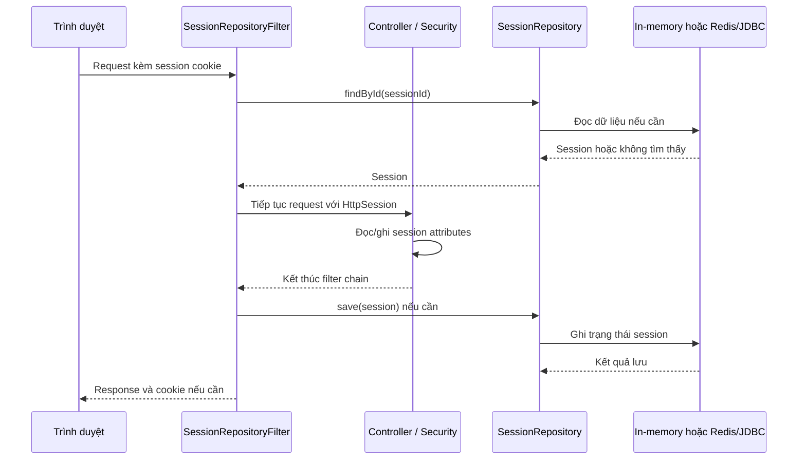
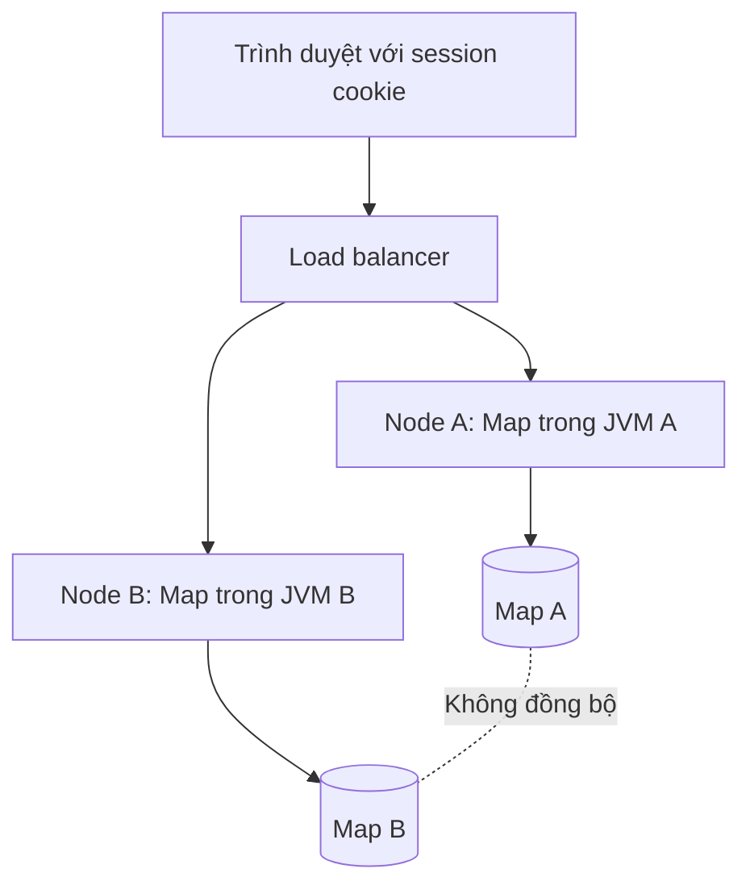

# Phân biệt tạo trong bộ nhớ với lưu vào kho bền vững

Spring Session tách API quản lý phiên khỏi nơi lưu dữ liệu. Ứng dụng Servlet tiếp tục thao tác với `HttpSession`, còn Spring Session chuyển các thao tác đó tới một `SessionRepository`. Repository có thể giữ session trong bộ nhớ của một tiến trình hoặc ghi vào kho dữ liệu bên ngoài như Redis, JDBC hay một hệ thống lưu trữ tùy chỉnh.

Hai việc thường bị nhầm lẫn là **tạo một đối tượng session** và **lưu session vào một kho có khả năng tồn tại qua vòng đời request, restart hoặc nhiều instance**. `createSession()` tạo một session object và cấp định danh; nó không nhất thiết ghi dữ liệu vào kho bền vững. Việc lưu thường diễn ra khi repository nhận `save(session)` theo vòng đời của filter hoặc theo logic ứng dụng.

## 1. Session object, repository và storage là ba lớp khác nhau

Một session có thể được nhìn qua ba lớp:

1. **Session object:** đại diện trạng thái của một phiên, gồm ID, thời điểm tạo, lần truy cập cuối, idle timeout và các attributes.
2. **SessionRepository:** hợp đồng để tạo, tìm, lưu và xóa session. Trong Servlet, API imperative thường là `SessionRepository<S extends Session>`.
3. **Storage backend:** nơi repository giữ dữ liệu, ví dụ một `Map` trong JVM, Redis, bảng JDBC hoặc kho tùy chỉnh.

`MapSession` là một implementation session object. `MapSessionRepository` là repository sử dụng một map làm storage. `JdbcIndexedSessionRepository` là repository dùng database quan hệ. Hai repository có thể cung cấp API tương tự nhưng khác nhau về phạm vi chia sẻ, durability, latency và vận hành.

| Thành phần | Câu hỏi nó trả lời |
|---|---|
| `MapSession` hoặc session implementation khác | Phiên có ID, metadata và attributes nào? |
| `SessionRepository` | Làm thế nào để tạo, tìm, lưu và xóa phiên? |
| `ConcurrentHashMap` | Dữ liệu có nằm trong bộ nhớ của JVM hiện tại không? |
| Redis/JDBC/custom store | Dữ liệu được chia sẻ và phục hồi qua những tiến trình nào? |

Không nên kết luận một session đã bền vững chỉ vì `createSession()` trả về một object hợp lệ hoặc vì response đã phát cookie chứa session ID.

## 2. Tạo session trong bộ nhớ

Repository in-memory giữ dữ liệu trong RAM của một tiến trình. Ví dụ đơn giản với `MapSessionRepository`:

```java
import java.util.concurrent.ConcurrentHashMap;

import org.springframework.context.annotation.Bean;
import org.springframework.context.annotation.Configuration;
import org.springframework.session.MapSessionRepository;

@Configuration
class InMemorySessionConfiguration {

    @Bean
    MapSessionRepository sessionRepository() {
        return new MapSessionRepository(new ConcurrentHashMap<>());
    }
}
```

`MapSessionRepository` lưu các `MapSession` trong map được truyền vào constructor. `ConcurrentHashMap` cho phép nhiều thread truy cập cấu trúc map an toàn ở mức thao tác map. Nó không biến dữ liệu thành dữ liệu bền vững và cũng không tự giải quyết mọi race condition khi nhiều request cùng sửa một session object.

Ví dụ sử dụng trực tiếp repository để minh họa vòng đời:

```java
import java.time.Duration;

import org.springframework.session.MapSession;
import org.springframework.session.MapSessionRepository;

MapSessionRepository repository =
        new MapSessionRepository(new ConcurrentHashMap<>());

MapSession session = repository.createSession();
session.setMaxInactiveInterval(Duration.ofMinutes(30));
session.setAttribute("cartId", "CART-42");

repository.save(session);

MapSession restored = repository.findById(session.getId());
String cartId = restored.getAttribute("cartId");
```

Ví dụ gọi repository trực tiếp để làm rõ sự khác nhau giữa tạo object và lưu object. Trong ứng dụng web, `SessionRepositoryFilter` thường điều phối việc lưu session theo vòng đời request; controller thông thường không cần tự gọi repository như đoạn minh họa.

### 2.1. Đặc tính của in-memory storage

- Dữ liệu chỉ tồn tại trong heap của tiến trình đang chạy.
- Restart, crash hoặc redeploy tiến trình làm mất map nếu không có cơ chế phục hồi riêng.
- Node A và node B có map độc lập; cùng session ID không khiến dữ liệu tự xuất hiện ở node còn lại.
- Không có backup/restore hoặc replication chỉ nhờ `ConcurrentHashMap`.
- Latency đọc/ghi thường thấp và không cần network round trip tới storage ngoài.
- Dung lượng bị giới hạn bởi RAM và garbage collection của JVM.

In-memory phù hợp với unit test, demo, môi trường local hoặc ứng dụng một instance chấp nhận mất session khi restart. Nó không phải lựa chọn mặc định cho hệ thống nhiều instance cần duy trì đăng nhập qua deployment.

## 3. Lưu vào kho bền vững

Repository bền vững ghi session vào một hệ thống nằm ngoài heap của application process. Ví dụ:

- Redis repository ghi session attributes và metadata vào Redis.
- JDBC repository ghi metadata và attributes vào các bảng session.
- Custom repository có thể ghi vào document store, key-value store, database khác hoặc dịch vụ nội bộ.

Khi process khởi động lại, repository mới kết nối lại backend và có thể tìm các session còn hạn nếu dữ liệu vẫn tồn tại, backend còn truy cập được và serializer/schema tương thích.

“Bền vững” không có nghĩa dữ liệu không thể mất trong mọi tình huống. Độ bền thực tế phụ thuộc cấu hình persistence, replication, backup, transaction, eviction, failover và chính sách retention của backend.

| Tiêu chí | In-memory trong một JVM | Kho bền vững dùng chung |
|---|---|---|
| Sau restart ứng dụng | Mất dữ liệu trong map | Có thể đọc lại nếu backend giữ dữ liệu |
| Nhiều instance | Mỗi node có map riêng | Các node có thể cùng truy cập một kho |
| Latency | Thường thấp | Có network/database latency |
| Failure domain | Gắn với process/host | Gắn với backend và đường kết nối |
| Backup/restore | Không có sẵn | Có thể dùng cơ chế của backend |
| Vận hành | Đơn giản | Cần quản lý kết nối, dung lượng, HA và bảo mật |
| Phù hợp | Test, local, single instance đơn giản | Production nhiều node hoặc cần giữ phiên qua restart |

## 4. Tạo session không đồng nghĩa ghi xuống storage

Hợp đồng `SessionRepository` có các thao tác cốt lõi:

```java
public interface SessionRepository<S extends Session> {
    S createSession();
    void save(S session);
    S findById(String id);
    void deleteById(String id);
}
```

Đây là hình dạng API imperative ở mức khái niệm; generic type và chi tiết API cần đối chiếu phiên bản Spring Session của dự án.

- `createSession()` tạo một session object mới và thường cấp ID. Repository có thể chưa ghi object đó xuống backend ở thời điểm này.
- `save(session)` yêu cầu repository lưu trạng thái hiện tại. Với backend bền vững, đây là điểm ghi dữ liệu vào Redis/database theo semantics của implementation.
- `findById(id)` tìm session đã được lưu và còn hợp lệ. Session hết hạn hoặc không tồn tại thường được biểu diễn bằng kết quả không tìm thấy (`null` trong API imperative chuẩn).
- `deleteById(id)` xóa session theo ID khỏi repository.

Một ứng dụng có thể tạo session, thay đổi nhiều attributes trong request rồi chỉ lưu ở giai đoạn cuối. Nếu process chết trước khi save hoàn tất, thay đổi mới nhất có thể không tồn tại trong kho. Với `FlushMode`, `SaveMode` và repository implementation khác nhau, thời điểm và phạm vi ghi có thể khác; không suy ra mọi lần `setAttribute()` đều lập tức tạo một transaction bền vững.

## 5. Spring Session điều phối save trong ứng dụng Servlet

Trong ứng dụng Servlet, `SessionRepositoryFilter` bọc request/response để lời gọi `HttpSession` được ánh xạ sang session của Spring Session. Filter tìm session theo ID, cho phép ứng dụng thao tác attributes, sau đó lưu thay đổi theo chính sách repository và flush mode.

Luồng khái quát:



Với in-memory repository, bước đọc/ghi tác động tới map trong JVM. Với Redis/JDBC, repository tương tác với backend bên ngoài. API `HttpSession` mà controller nhìn thấy có thể giống nhau, nhưng failure mode và phạm vi dữ liệu rất khác.

Nếu save thất bại ở backend bền vững, request có thể gặp lỗi ở giai đoạn cuối hoặc tại thời điểm ghi tùy flush mode. Không giả định response đã được gửi thành công đồng nghĩa session đã lưu thành công. Cần quan sát lỗi repository và kiểm thử thời điểm response commit.

## 6. Thiết kế custom repository bền vững

Khi tự triển khai `SessionRepository`, cần định nghĩa rõ mapping từ session object sang storage record. Một repository bền vững thường phải xử lý:

1. **ID:** tạo ID đủ ngẫu nhiên, khó đoán và không tái sử dụng ngoài chính sách.
2. **Metadata:** lưu creation time, last access time, max inactive interval và expiry time.
3. **Attributes:** serialize từng attribute hoặc một payload có version.
4. **Save semantics:** xác định insert/update, upsert, transaction và xử lý ghi lặp.
5. **Find semantics:** không trả session đã hết hạn; chuyển dữ liệu thành object có đúng kiểu.
6. **Delete semantics:** xóa metadata và attributes liên quan một cách nhất quán.
7. **Concurrency:** xử lý hai request cùng đọc và cập nhật một session.
8. **Cleanup:** dọn dữ liệu hết hạn mà không làm hỏng phiên đang được cập nhật.
9. **Failure handling:** timeout, retry có giới hạn, lỗi serialization và backend unavailable.
10. **Observability:** metrics cho latency, error, lookup miss, save và cleanup.

Không nên chỉ serialize toàn bộ `MapSession` thành một blob mà không có kế hoạch version hóa, expiration, concurrency và bảo mật. Thiết kế payload phải có khả năng được đọc bởi các node đang chạy đồng thời trong quá trình deploy.

## 7. Ví dụ mô hình record lưu trữ

Một custom JDBC/document repository có thể lưu metadata và payload theo cấu trúc tương tự:

| Trường | Mục đích |
|---|---|
| `session_id` | Định danh phiên, có unique constraint/index |
| `created_at` | Thời điểm tạo |
| `last_accessed_at` | Lần truy cập cuối |
| `max_inactive_seconds` | Idle timeout |
| `expires_at` | Deadline expiration để truy vấn hiệu quả |
| `payload` | Attributes đã serialize |
| `payload_version` | Phiên bản schema/serializer |
| `updated_at` | Thời điểm ghi gần nhất, nếu cần audit/optimistic concurrency |

`expires_at` thường được tính từ `last_accessed_at + max_inactive_interval`. Tuy nhiên, phải thống nhất đơn vị thời gian, timezone và cách làm tròn. Dùng UTC cho timestamp lưu trữ và tránh so sánh deadline bằng đồng hồ khác nhau giữa các node nếu database có thể cung cấp thời gian nhất quán.

Ví dụ SQL minh họa, không phải schema chuẩn của Spring Session:

```sql
CREATE TABLE APP_SESSION (
    SESSION_ID VARCHAR(200) PRIMARY KEY,
    CREATED_AT TIMESTAMP NOT NULL,
    LAST_ACCESSED_AT TIMESTAMP NOT NULL,
    MAX_INACTIVE_SECONDS INTEGER NOT NULL,
    EXPIRES_AT TIMESTAMP NOT NULL,
    PAYLOAD_VERSION INTEGER NOT NULL,
    PAYLOAD BLOB NOT NULL
);

CREATE INDEX IDX_APP_SESSION_EXPIRES_AT
    ON APP_SESSION (EXPIRES_AT);
```

Kiểu binary chính xác phụ thuộc database. PostgreSQL thường dùng `BYTEA`; MySQL có thể dùng `BLOB`; SQL Server có `VARBINARY`. Khi triển khai thực tế, cần schema migration phù hợp và kiểm thử với database dialect được hỗ trợ.

## 8. Expiration và cleanup

Session có idle timeout. Khi không có request trong khoảng `maxInactiveInterval`, session hết hạn logic. Repository phải từ chối session hết hạn khi `findById()` được gọi, kể cả khi dữ liệu vật lý chưa được xóa.

Hai việc cần tách biệt:

- **Kiểm tra expiration:** bảo đảm session quá hạn không được khôi phục hoặc dùng để xác thực.
- **Cleanup:** xóa record/attributes hết hạn để thu hồi dung lượng.

Với in-memory map, repository có thể kiểm tra expiration khi đọc và chạy cleanup định kỳ để xóa entry cũ. Nếu không cleanup, map có thể tăng mãi dù session hết hạn. Với Redis, TTL có thể giúp backend tự xóa key; với JDBC, thường cần scheduled cleanup và index trên cột expiry.

Không dựa vào cleanup chạy đúng thời điểm để bảo vệ quyền truy cập. Cleanup có thể trễ hoặc thất bại; repository vẫn phải kiểm tra deadline khi đọc. Không xóa session bằng SQL/Redis command tùy tiện vì có thể bỏ sót dữ liệu phụ hoặc phá cấu trúc index của repository.

## 9. Bộ nhớ cục bộ không phải kho chia sẻ nhiều node

Giả sử load balancer phân phối request như sau:



Người dùng đăng nhập ở node A; A lưu session trong map A và phát cookie. Request tiếp theo đi tới B mang cùng session ID, nhưng B tra map B và không tìm thấy phiên. Người dùng có thể bị xem là chưa đăng nhập.

Sticky session có thể khiến request thường quay lại node A, nhưng không tạo durability. Khi A restart, scale-in, crash hoặc bị thay thế, map mất và session không còn. Sticky session chỉ là một chiến lược định tuyến; nó không thay thế shared session store nếu cần tính sẵn sàng và chia sẻ dữ liệu.

Với production nhiều instance, thường chọn một repository dùng chung như Redis/JDBC hoặc backend phù hợp. Tất cả node phải dùng cùng endpoint/schema/namespace, serializer, timeout và cấu hình cookie/session ID resolver.

## 10. In-memory vẫn có thể có concurrency bug

`ConcurrentHashMap` bảo vệ thao tác cấu trúc map như `get`, `put`, `remove`; nó không tự làm mọi thao tác trên object session trở thành atomic. Nếu hai request cùng lấy một mutable session object và thay đổi attributes đồng thời, có thể xảy ra lost update hoặc trạng thái một phần.

Ví dụ:

1. Request A đọc `cartCount = 1`.
2. Request B cũng đọc `cartCount = 1`.
3. A tăng thành 2 và lưu.
4. B tăng từ giá trị cũ thành 2 và lưu.

Kết quả cuối là 2 thay vì 3. Cùng vấn đề có thể xảy ra với backend bền vững nếu repository không có chiến lược concurrency. Durability và concurrency là hai thuộc tính khác nhau.

Các chiến lược thường dùng:

- Defensive copy khi đọc và ghi để request không cùng sửa một object mutable trong map.
- Atomic replace hoặc compute/update có kiểm soát cho một key.
- Version number và optimistic locking để phát hiện update dựa trên snapshot cũ.
- Transaction/locking ở database khi cần tính nguyên tử phù hợp.
- Chuyển dữ liệu nghiệp vụ có cập nhật đồng thời cao ra khỏi session và lưu trong kho chuyên dụng.

Không dùng session làm nơi lưu số dư, trạng thái thanh toán hoặc dữ liệu cần transaction mạnh chỉ vì repository có thể lưu bền vững.

## 11. Lựa chọn giữa in-memory và persistent repository

| Nhu cầu | In-memory | Persistent/shared store |
|---|---|---|
| Unit test logic session | Rất phù hợp | Có thể dùng integration test riêng |
| Local development | Đơn giản, ít phụ thuộc | Gần production hơn nếu cần kiểm thử backend |
| Restart không mất phiên | Không đáp ứng nếu không có snapshot riêng | Có thể đáp ứng theo cấu hình backend |
| Nhiều instance cùng đọc/ghi | Không tự đáp ứng | Có thể đáp ứng nếu cùng kho và serializer |
| Latency tối thiểu | Thường tốt | Có thêm network/database overhead |
| Cần backup/restore | Không có sẵn | Dựa vào khả năng backend |
| Cần audit/retention tập trung | Khó quản lý phân tán theo process | Dễ quản lý hơn qua backend chung |
| Failure dependency | Ít phụ thuộc ngoài | Backend có thể trở thành dependency quan trọng |

Quyết định dựa trên yêu cầu sản phẩm: người dùng có cần giữ đăng nhập sau deploy không, có bao nhiêu instance, session có cần chia sẻ giữa node không, downtime backend ảnh hưởng ra sao và ngân sách vận hành thế nào.

## 12. Failure mode của kho bền vững

Persistent store làm session sống lâu hơn process nhưng tạo dependency vận hành mới.

| Sự cố | Tác động | Hướng xử lý |
|---|---|---|
| Redis/JDBC unavailable | Không tìm hoặc lưu được session | Timeout rõ ràng, health check, circuit/alert và chính sách lỗi request |
| Connection pool cạn | Request chờ lấy connection, tăng latency | Theo dõi pool, giới hạn concurrency và cấu hình timeout |
| Serializer không tương thích | Không khôi phục được attributes | Version hóa payload và triển khai reader tương thích |
| Backend failover | Có thể có gián đoạn hoặc mất một số ghi tùy durability | Kiểm thử failover, replication và recovery semantics |
| Eviction/memory pressure | Redis có thể loại key session trước TTL theo policy | Theo dõi eviction và cấu hình memory policy phù hợp |
| Database cleanup chậm | Bảng session tăng và query chậm | Index expiry, batch cleanup và giám sát lock |
| Ghi thành công một phần | Metadata và attributes có thể không đồng nhất nếu transaction thiết kế sai | Dùng transaction hoặc atomic write phù hợp backend |

Không tự fallback sang map local khi shared repository gặp lỗi mà không có thiết kế rõ. Nếu node A fallback local còn node B tiếp tục dùng Redis, hai node có thể tạo hai phiên khác nhau cho cùng người dùng. Fallback âm thầm còn có thể làm session mất sau khi request chuyển node.

## 13. Bảo mật và vòng đời định danh

Session ID cần đủ ngẫu nhiên, khó đoán và được bảo vệ như bearer credential. Repository tùy chỉnh phải tránh dùng user ID, email hoặc số thứ tự làm session ID. Khi xác thực thành công hoặc có thay đổi đặc quyền, ứng dụng cần có chính sách đổi session ID để giảm rủi ro session fixation.

Các điểm cần bảo vệ:

- Dùng HTTPS và cookie `Secure`, `HttpOnly`, `SameSite` phù hợp.
- Không ghi session ID, cookie hoặc raw payload vào log.
- Hạn chế quyền đọc/ghi storage cho service account của ứng dụng.
- Mã hóa dữ liệu nhạy cảm khi yêu cầu bảo mật và quản lý key rotation.
- Giới hạn session attributes; không lưu password hoặc credential không cần thiết.
- Xóa session ở repository khi logout/invalidate; xóa cookie đúng scope ở client.
- Đảm bảo `findById()` không trả session hết hạn chỉ vì cleanup vật lý chưa chạy.

## 14. Kiểm thử sự khác nhau giữa memory và persistence

Một bài test chỉ tạo session và đọc lại ngay trong cùng repository không chứng minh dữ liệu bền vững. Cần test theo các failure boundary thực tế.

Các kịch bản nên có:

1. **Create vs save:** gọi `createSession()`, đặt attribute và xác nhận repository chỉ ghi theo semantics của `save()`.
2. **Read-after-save:** lưu session rồi tạo repository instance mới kết nối cùng backend và đọc lại session.
3. **Restart simulation:** khởi động lại application context nhưng giữ backend; xác nhận session vẫn đọc được nếu backend bảo toàn dữ liệu.
4. **In-memory restart:** tạo repository mới với map mới và xác nhận session cũ không tồn tại.
5. **Two nodes:** ghi ở node A và đọc ở node B với cùng repository backend.
6. **Expiration:** xác nhận repository từ chối session hết hạn dù cleanup chưa xóa record.
7. **Cleanup:** chạy cleanup và xác nhận metadata/attributes được dọn đúng.
8. **Concurrent update:** gửi hai request cùng session và xác nhận chiến lược concurrency không làm mất cập nhật quan trọng.
9. **Backend unavailable:** ngắt Redis/database và xác nhận lỗi được xử lý theo policy, không fallback local âm thầm.
10. **Serialization compatibility:** ghi payload bằng phiên bản trước và đọc bằng phiên bản mới.

Với in-memory repository, unit test có thể đủ cho logic cơ bản. Với Redis/JDBC/custom persistent repository, cần integration test bằng backend thực tế hoặc container tương ứng. Test restart nên phân biệt restart application với restart backend; hai sự kiện có semantics khác nhau.

## 15. Checklist thiết kế custom repository

Trước khi chọn hoặc tự viết repository, trả lời:

- Session có cần tồn tại qua restart ứng dụng không?
- Có cần chia sẻ giữa nhiều node hoặc nhiều ứng dụng không?
- Backend có bảo đảm durability/replication/backup theo yêu cầu không?
- `createSession()` cấp ID như thế nào và khi nào dữ liệu được ghi?
- `save()` có atomic không; lỗi một phần được xử lý ra sao?
- `findById()` kiểm tra expiration ở đâu?
- `deleteById()` xóa cả attributes và index phụ như thế nào?
- Serializer có version và tương thích rolling deployment không?
- Nhiều request cùng cập nhật session được xử lý ra sao?
- Cleanup, metrics, timeout, retry và health check được thiết kế thế nào?
- Có test chứng minh đọc chéo node và phục hồi sau restart không?

Nếu chỉ cần local/test, `MapSessionRepository` thường đủ đơn giản. Nếu cần production nhiều node, chọn repository dùng chung được hỗ trợ hoặc thiết kế custom repository với hợp đồng lưu trữ, concurrency, expiration và failure behavior rõ ràng.

## 16. Nguyên tắc cần nhớ

- `createSession()` tạo session object; việc ghi bền vững thường xảy ra khi repository thực hiện `save()`.
- `MapSessionRepository` giữ session trong map của JVM; restart process làm mất dữ liệu trong map.
- `ConcurrentHashMap` bảo vệ thao tác map nhưng không tự giải quyết race condition trên mutable session object.
- Redis/JDBC/custom backend có thể giữ session qua restart và chia sẻ giữa node, tùy durability, HA và cấu hình backend.
- Persistent storage không tự bảo đảm concurrency, transaction hoặc không mất dữ liệu trong mọi failure.
- `findById()` phải từ chối session hết hạn ngay cả khi cleanup vật lý chưa xóa record.
- Repository tùy chỉnh phải xác định ID, metadata, attributes, serialization, save/delete semantics, concurrency và cleanup.
- Tất cả node cần cùng repository, namespace/schema, serializer và timeout policy.
- Không fallback âm thầm từ shared store sang local map khi backend lỗi.
- Kiểm thử create/save, restart, hai node, expiration, cleanup, concurrent update và backend outage.
