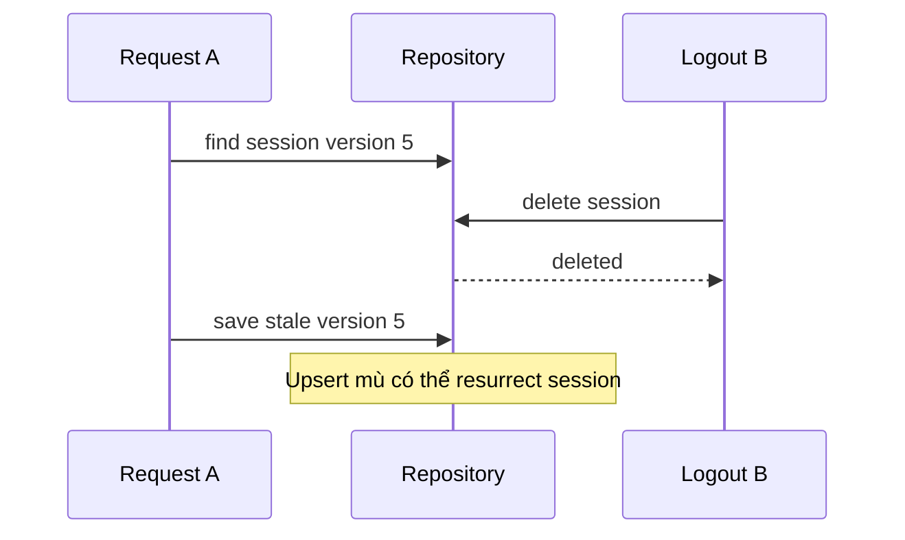

# Lưu thay đổi, xóa thuộc tính và xóa phiên an toàn khi bị gọi lặp

Repository tùy chỉnh của Spring Session phải chịu được việc cùng một thao tác được gọi nhiều lần. Điều này thường xảy ra khi request retry sau timeout, worker xử lý lại message, client gửi lại request hoặc hai node cùng chạy một luồng cleanup. Nếu lần lưu thứ hai tạo bản ghi trùng, lần xóa thứ hai ném lỗi không cần thiết hoặc một lần lưu đến muộn khôi phục session đã bị xóa, trạng thái phiên sẽ không nhất quán.

Thiết kế cần xác định rõ semantics của `save`, `removeAttribute` và `deleteById`. Với cùng một đầu vào và cùng một phiên bản trạng thái, gọi lại thao tác phải hội tụ về cùng kết quả cuối. Đặc biệt, repository phải lưu được việc một attribute đã bị xóa; chỉ ghi đè các attribute còn hiện diện sẽ để lại dữ liệu cũ. Xóa session cần xử lý cả dữ liệu chính, attribute, index và TTL, đồng thời ngăn một request cũ ghi lại phiên sau khi logout hoặc thu hồi.

## 1. Idempotency trong repository là gì?

Một thao tác là idempotent khi thực hiện một lần hay nhiều lần với cùng ý định đều tạo ra cùng trạng thái cuối. Ví dụ, xóa một session đã không còn tồn tại vẫn được coi là thành công; không cần tạo một lỗi nghiệp vụ chỉ vì lần xóa trước đã hoàn tất.

| Thao tác | Hành vi idempotent mong muốn |
|---|---|
| `save(session)` | Lưu cùng trạng thái session không tạo bản ghi trùng hoặc làm thay đổi dữ liệu ngoài ý muốn |
| `removeAttribute(name)` | Attribute không tồn tại vẫn giữ trạng thái không tồn tại |
| `deleteById(id)` | Session đã bị xóa vẫn được coi là đã xóa |
| Cleanup hết hạn | Chạy lại không làm hỏng dữ liệu hoặc báo lỗi chỉ vì hàng đã bị xóa |
| Xử lý sự kiện logout | Sự kiện lặp không khôi phục hoặc xóa nhầm session khác |

Idempotency đặc biệt quan trọng trong hệ thống phân tán vì caller có thể không biết thao tác trước đã commit hay chưa. Ví dụ, database đã commit `DELETE`, nhưng kết nối đứt trước khi ứng dụng nhận được kết quả. Caller retry là hành vi hợp lý; repository phải xử lý được trường hợp dữ liệu đã biến mất.

Idempotent không có nghĩa là bỏ qua mọi lỗi. Nếu database không khả dụng, transaction rollback hoặc Redis timeout, repository phải phát lỗi để caller biết thao tác chưa được xác nhận. Chỉ trường hợp “đối tượng không còn tồn tại” mới thường là kết quả thành công đối với một lệnh xóa.

## 2. Hợp đồng cơ bản của `SessionRepository`

Trong Spring Session, `SessionRepository<S extends Session>` cung cấp các thao tác chính:

```java
public interface SessionRepository<S extends Session> {
    S createSession();
    void save(S session);
    S findById(String id);
    void deleteById(String id);
}
```

Repository tùy chỉnh triển khai hợp đồng này cho kho dữ liệu riêng. `save` phải lưu trạng thái session theo semantics mà implementation công bố; `findById` trả về session nếu tìm thấy và hợp lệ; `deleteById` xóa phiên theo ID. Interface không tự cung cấp transaction, optimistic locking hoặc idempotency cho store bên dưới. Những đặc tính đó cần được đảm bảo bởi cách triển khai repository.

`Session` cung cấp các thao tác attribute và metadata như:

```java
session.getId();
session.getAttributeNames();
session.getAttribute("cartId");
session.setAttribute("cartId", "cart-2048");
session.removeAttribute("cartId");
session.setLastAccessedTime(Instant.now());
session.setMaxInactiveInterval(Duration.ofMinutes(30));
```

Tên method và kiểu dữ liệu trên thuộc abstraction Spring Session hiện đại; cần dùng API tương ứng với phiên bản dependency của dự án. Trong custom repository, không nên tự suy ra dirty state chỉ từ một vài field nếu implementation cần theo dõi thêm attribute bị xóa.

## 3. Lưu cùng một session nhiều lần

`save(session)` thường được gọi khi session thay đổi hoặc khi vòng đời request hoàn tất. Cùng một session có thể được lưu lại nhiều lần do filter lifecycle, retry hoặc logic nghiệp vụ. Custom repository nên dùng session ID làm khóa ổn định để thao tác ghi là upsert hoặc update theo khóa, thay vì mỗi lần save lại insert một session mới.

Ví dụ dùng repository trong service:

```java
import org.springframework.session.Session;
import org.springframework.session.SessionRepository;

class PreferenceService<S extends Session> {
    private final SessionRepository<S> repository;

    PreferenceService(SessionRepository<S> repository) {
        this.repository = repository;
    }

    void changeLocale(String sessionId, String locale) {
        S session = repository.findById(sessionId);
        if (session == null) {
            throw new SessionExpiredException();
        }

        session.setAttribute("locale", locale);
        repository.save(session);
    }
}
```

Nếu cùng một trạng thái được save hai lần, repository không nên tạo hai session record hoặc hai bộ attribute. Trong JDBC, session ID cần được ràng buộc duy nhất; thao tác insert/update phải xử lý conflict theo thiết kế schema. Trong Redis, session ID và key namespace cần xác định duy nhất cho session đó.

### Save retry không được gia hạn TTL ngoài ý muốn

Nếu một lần save bị timeout ở phía client, caller có thể retry. Khi retry cùng snapshot, repository không nên tự đặt expiry thành “thời điểm retry + timeout” nếu thao tác đó không tương đương một lần truy cập mới. Việc gia hạn idle timeout phải dựa trên semantics last-access của session, không phải số lần retry lưu dữ liệu.

Hãy tính expiry từ metadata session như `lastAccessedTime + maxInactiveInterval` hoặc theo cách implementation Spring Session quy định. Lặp lại save cùng snapshot phải hội tụ về cùng expiry, trừ khi có một request thực sự cập nhật last-access time.

## 4. Lưu attribute bị thay đổi và attribute bị xóa

Đây là lỗi thường gặp trong custom repository: code đọc các attribute hiện tại và upsert chúng, nhưng không xóa attribute đã bị gỡ khỏi session.

Giả sử session ban đầu có:

```text
locale = vi-VN
cartId = cart-2048
checkoutStep = 3
```

Ứng dụng gọi:

```java
session.removeAttribute("checkoutStep");
repository.save(session);
```

Sau khi save, repository phải đảm bảo `checkoutStep` không còn trong dữ liệu lưu trữ. Nếu implementation chỉ lặp qua `session.getAttributeNames()` và ghi các giá trị hiện diện, hàng/cấu trúc `checkoutStep` cũ vẫn còn nếu không có bước xóa.

Có hai chiến lược phổ biến:

1. **Thay toàn bộ snapshot:** trong một transaction/atomic operation, xóa tập attribute cũ rồi ghi tập attribute hiện tại.
2. **Theo dõi delta:** lưu danh sách attribute được set và danh sách attribute bị remove; áp dụng upsert và delete tương ứng.

Chiến lược snapshot đơn giản hơn nhưng có thể ghi nhiều dữ liệu và dễ gây lost update nếu hai request cùng session. Chiến lược delta giảm write amplification nhưng đòi hỏi dirty tracking chính xác, đặc biệt với mutable object và thao tác lặp.

## 5. Xóa attribute phải có semantics rõ ràng

`Session.removeAttribute(name)` thể hiện ý định loại bỏ một attribute. Repository phải chuyển ý định này thành thao tác xóa bền vững ở store.

Một thao tác remove idempotent có các tính chất:

- Attribute đang tồn tại sẽ bị xóa.
- Attribute không tồn tại vẫn giữ trạng thái không tồn tại.
- Gọi remove nhiều lần không tạo lỗi chỉ vì lần trước đã xóa.
- Save sau remove không làm attribute cũ xuất hiện lại.
- Một request cũ không được ghi lại snapshot có attribute đã bị xóa nếu chính sách concurrency yêu cầu bảo vệ thao tác remove mới hơn.

Ví dụ:

```java
void removeCheckoutStep(Session session) {
    session.removeAttribute("checkoutStep");
    repository.save(session);
}
```

Gọi method trên lần thứ hai với session đã được tải lại mà attribute không còn, kết quả cuối vẫn là attribute vắng mặt. Không cần phân biệt lỗi “không tìm thấy attribute” với thành công nếu semantics API chỉ yêu cầu xóa.

### Không nhầm giá trị null với attribute đã bị xóa

Một số serializer hoặc data model có thể biểu diễn giá trị null khác với việc không có attribute. Nếu domain cho phép null, cần quy định rõ null có nghĩa là một giá trị hay là lệnh xóa. Dùng `removeAttribute` để thể hiện ý định xóa rõ ràng và không dựa vào quy ước null ngầm định của một serializer.

Ở tầng store, nên có cách phân biệt:

- Attribute không tồn tại.
- Attribute tồn tại với giá trị null (nếu được hỗ trợ).
- Attribute bị đánh dấu xóa trong delta.

Không để một bản ghi null cũ được deserialize như giá trị hợp lệ sau khi ứng dụng đã yêu cầu remove.

## 6. Theo dõi attribute bị xóa bằng tombstone hoặc dirty set

Nếu repository chỉ nhận snapshot session cuối request, nó cần biết attribute nào đã bị xóa so với trạng thái lưu trước đó. Có thể lưu một dirty set gồm hai nhóm:

```text
attributesToUpsert = { locale, cartId }
attributesToRemove = { checkoutStep }
```

Khi save:

1. Upsert các attribute trong `attributesToUpsert`.
2. Xóa các attribute trong `attributesToRemove`.
3. Cập nhật metadata session.
4. Commit tất cả trong một transaction hoặc atomic unit phù hợp.

Nếu delta được chuyển qua message hoặc retry queue, thao tác xóa cần được biểu diễn tường minh. Chỉ gửi danh sách attribute còn hiện diện sẽ không cho consumer biết những attribute nào phải xóa.

Tombstone là một dấu ghi nhận rằng một attribute hoặc session đã bị xóa. Nó hữu ích khi xóa và ghi có thể đến sai thứ tự. Tuy nhiên, tombstone cần TTL/cleanup và version để tránh bị xóa quá sớm khi còn request cũ có thể gửi update muộn.

## 7. Xóa session phải xóa cả dữ liệu liên quan

Một session trong store có thể gồm nhiều thành phần:

- Bản ghi metadata: ID, creation time, last access, max inactive interval, expiry.
- Các attribute của session.
- Principal index hoặc secondary index.
- Key expiration hoặc metadata hỗ trợ cleanup.
- Tombstone/version nếu custom repository dùng để chống ghi lại dữ liệu cũ.

`deleteById(id)` phải xóa hoặc vô hiệu hóa tất cả thành phần thuộc session đó theo một quy tắc nhất quán. Nếu chỉ xóa metadata nhưng để attribute, dữ liệu cũ có thể trở thành orphan. Nếu chỉ xóa attribute mà metadata còn, repository có thể trả về session rỗng nhưng vẫn coi phiên tồn tại.

Với JDBC, có thể dùng foreign key `ON DELETE CASCADE` nếu schema và migration hỗ trợ; hoặc xóa attribute rows rồi xóa session row trong cùng transaction. Với Redis, nếu session dùng nhiều key hoặc index, cần xóa đúng tập key thuộc session và cập nhật index tương ứng. Không hardcode key nội bộ của implementation Spring Session nếu custom repository không sở hữu schema đó.

## 8. `deleteById` nên idempotent

Xóa một session có thể được gọi bởi logout, quản trị thu hồi, cleanup hết hạn hoặc worker retry. Nếu session đã bị xóa, lần gọi tiếp theo nên hoàn tất như một thao tác xóa thành công.

Ví dụ ở tầng service:

```java
void revokeSession(String sessionId) {
    repository.deleteById(sessionId);
}
```

Không cần gọi `findById` trước khi xóa chỉ để tránh lỗi “không tồn tại”. Cặp thao tác find-then-delete có race: session có thể biến mất giữa hai lệnh. Tốt hơn là gọi delete trực tiếp với semantics idempotent.

Ở JDBC, `DELETE ... WHERE SESSION_ID = ?` có thể trả số hàng bằng 0 nếu không có session. Đây thường là kết quả thành công của lệnh xóa idempotent. Cần phân biệt số hàng bị xóa bằng 0 với lỗi SQL, timeout hoặc transaction rollback.

Ở Redis, lệnh xóa key không tồn tại thường trả kết quả “không xóa key nào” chứ không phải lỗi. Nếu cần xóa nhiều key và cập nhật index, hãy dùng transaction/script hoặc cơ chế atomic phù hợp để tránh trạng thái dở dang.

## 9. JDBC: transaction cho metadata và attribute

Một custom JDBC repository có thể lưu metadata ở bảng session và attribute ở bảng riêng. Khi xóa, cần bảo đảm hai phần được xử lý trong một transaction:

```sql
DELETE FROM APP_SESSION_ATTRIBUTES
WHERE SESSION_PRIMARY_ID = ?;

DELETE FROM APP_SESSIONS
WHERE SESSION_ID = ?;
```

Ví dụ này minh họa thứ tự và quan hệ dữ liệu; tên bảng/cột phải theo schema custom thực tế. Hai lệnh cần nằm trong cùng transaction nếu không dùng cascade. Nếu lệnh xóa attribute thành công nhưng lệnh xóa metadata thất bại và transaction không rollback, dữ liệu có thể ở trạng thái không nhất quán.

Đối với save, cập nhật metadata và các attribute cần ghi cũng nên được bao trong transaction nếu nghiệp vụ yêu cầu chúng xuất hiện như một snapshot nhất quán. Ràng buộc unique trên session ID và khóa chính attribute giúp ngăn duplicate rows khi retry.

### Lặp lại transaction sau lỗi không rõ kết quả

Nếu connection bị đứt trong lúc commit, client có thể không biết database đã commit hay chưa. Khi retry:

- Upsert theo khóa ổn định thay vì insert bản ghi mới không có khóa idempotency.
- Delete theo khóa có thể chạy lại an toàn.
- Dùng transaction và constraint để tránh duplicate.
- Nếu thao tác gồm nhiều bước ngoài transaction, cần trạng thái/marker để phục hồi.

Không coi mọi exception từ JDBC là “session không tồn tại”. Chỉ coi row count bằng 0 là kết quả không có hàng; lỗi kết nối, deadlock hoặc constraint violation phải được phân loại và xử lý riêng.

## 10. Redis: xóa nhiều cấu trúc theo cách nguyên tử

Custom Redis repository có thể lưu session metadata và attribute trong một hash, hoặc nhiều key riêng; có thể còn principal index và key phục vụ expiration. Cách xóa phải khớp đúng data model của repository.

Nếu cần xóa nhiều key và cập nhật index, một thao tác nhiều bước không nguyên tử có thể để lại trạng thái dở dang khi process dừng giữa chừng. Các lựa chọn gồm:

- Redis Lua script để kiểm tra version và xóa các key/index trong một lần thực thi nguyên tử.
- Redis transaction (`MULTI`/`EXEC`) khi các thao tác và điều kiện phù hợp.
- Một tombstone đánh dấu session đã bị thu hồi, sau đó cleanup các key phụ theo cơ chế retry.

Không nên dùng một script xóa tùy tiện mọi key có prefix chung nếu prefix được chia sẻ bởi nhiều ứng dụng hoặc tenant. Tính key namespace từ cấu hình và bảo đảm chỉ xóa đúng session được ủy quyền.

Nếu Redis Cluster được dùng, các key tham gia một script/transaction cần tuân theo quy tắc hash slot của topology. Thiết kế key tag phù hợp nếu cần atomic multi-key operation. Kiểm thử trên topology tương đương production; một Redis standalone test có thể không bộc lộ lỗi cross-slot.

## 11. Nguy cơ save đến muộn làm sống lại session đã xóa

Đây là race condition quan trọng nhất khi thao tác bị gọi lặp và chạy trên nhiều node:

1. Request A tải session phiên bản 5.
2. Request B logout và xóa session khỏi repository.
3. Request A tiếp tục xử lý snapshot cũ và gọi `save(session)`.
4. Nếu save là upsert không có kiểm tra trạng thái, session có thể được tạo lại.



Idempotent `deleteById` một mình chưa đủ để ngăn tình huống này. Repository cần quy tắc xác định save nào được phép sau delete.

Các chiến lược thường dùng:

- **Version/CAS:** save chỉ thành công nếu version hiện tại vẫn khớp version mà caller đã đọc.
- **Deletion tombstone:** ghi trạng thái revoked/deleted với generation; save cũ không được ghi đè tombstone.
- **Fencing token:** mỗi vòng đời session có generation tăng dần; thao tác cũ mang generation thấp bị từ chối.
- **Atomic compare-and-set:** kiểm tra trạng thái và ghi trong một lệnh nguyên tử hoặc transaction.
- **Không upsert session đã bị thu hồi:** tách create và update semantics trong custom store nếu cần.

Interface `SessionRepository` cơ bản không tự mang version/CAS trong chữ ký `save`. Nếu yêu cầu chống resurrection nghiêm ngặt, custom repository có thể dùng metadata version/tombstone nội bộ hoặc một service/repository mở rộng có hợp đồng rõ. Không giả định `save` chuẩn tự giải quyết race này.

## 12. Version và fencing token

Một mô hình dữ liệu minh họa:

```text
sessionId: opaque-id
generation: 12
version: 37
state: ACTIVE | DELETED
attributes: ...
```

Khi tạo session mới, cấp generation mới. Khi logout, chuyển trạng thái sang `DELETED` hoặc ghi tombstone với generation hiện tại. Một request cũ mang generation thấp hơn không thể chuyển session trở lại `ACTIVE`.

Version tăng khi cập nhật thành công. Save có thể dùng điều kiện tương đương:

```sql
UPDATE APP_SESSIONS
SET VERSION = VERSION + 1,
    LAST_ACCESS_TIME = ?,
    EXPIRY_TIME = ?
WHERE SESSION_ID = ?
  AND VERSION = ?
  AND STATE = 'ACTIVE';
```

Đây là SQL minh họa cho custom schema, không phải câu SQL chuẩn của Spring Session JDBC. Nếu số hàng cập nhật bằng 0, repository cần phân biệt session đã bị xóa/hết hạn với version conflict và trả kết quả phù hợp.

Không dùng timestamp của từng node làm fencing token nếu đồng hồ có thể lệch. Counter/version được tăng nguyên tử ở store thường phù hợp hơn. Nếu ID session được tạo lại sau một khoảng thời gian, generation giúp phân biệt vòng đời cũ và mới.

## 13. Save idempotent không đồng nghĩa với merge an toàn

Giả sử hai request cùng tải session snapshot:

- A đổi `locale` thành `en-US`.
- B đổi `theme` thành `dark`.

Nếu mỗi save ghi toàn bộ snapshot cũ, request ghi sau có thể làm mất thay đổi của request trước dù chúng sửa hai attribute khác nhau. Nếu repository ghi delta theo attribute, hai thay đổi có thể được giữ lại, nhưng semantics phụ thuộc dirty tracking và atomicity.

Khi cùng sửa một attribute, cần optimistic locking hoặc quy tắc last-write-wins được chấp nhận. Idempotency xử lý việc lặp lại cùng một thao tác; concurrency control xử lý các thao tác khác nhau cạnh tranh. Hai yêu cầu này không thay thế nhau.

## 14. Expiration và cleanup cũng phải chịu được gọi lặp

Session hết hạn có thể được phát hiện bởi request, TTL của Redis hoặc cleanup job JDBC. Nhiều node có thể cùng phát hiện một session hết hạn và cùng yêu cầu xóa.

Cleanup nên:

- Chọn session theo expiry đã xác định.
- Xóa metadata và attribute trong một transaction/atomic operation phù hợp.
- Chấp nhận session đã bị node khác xóa trước đó.
- Không xóa session mới nếu cùng ID/generation đã được tái sử dụng trái với giả định cũ.
- Có batch size và giới hạn tải để tránh cleanup tạo spike.
- Có thể retry an toàn sau lỗi tạm thời.

Với JDBC, dùng điều kiện expiry trong câu delete và ràng buộc quan hệ phù hợp. Với Redis, TTL và keyspace cleanup cần nhất quán với index phụ. Không xóa một principal index chỉ dựa vào session ID cũ nếu index đó có thể đã được cập nhật cho generation mới.

## 15. Event, retry và at-least-once delivery

Một số hệ thống phát sự kiện khi session được tạo, cập nhật hoặc xóa. Message broker thường cung cấp delivery ít nhất một lần, nghĩa là consumer có thể nhận cùng event nhiều lần. Consumer không nên giả định mỗi event chỉ đến đúng một lần.

Ví dụ event:

```json
{
  "eventId": "evt-9f31",
  "sessionId": "opaque-session-id",
  "generation": 12,
  "type": "SESSION_REVOKED"
}
```

Payload chỉ minh họa cấu trúc. Trong thực tế, tránh đưa session ID thô vào topic/log không cần thiết; có thể dùng reference nội bộ hoặc bảo vệ topic bằng quyền truy cập phù hợp.

Consumer có thể ghi nhận `eventId` đã xử lý hoặc dùng generation để loại bỏ event cũ. Nếu sự kiện revoke đến hai lần, lần thứ hai phải không gây lỗi. Nếu event `SESSION_SAVED` cũ đến sau `SESSION_REVOKED`, consumer không được khôi phục session đã bị thu hồi.

## 16. Xử lý lỗi và phân loại kết quả

Không nên gom mọi kết quả thành success hoặc not-found. Cần phân biệt:

| Kết quả | Ý nghĩa | Hành vi phù hợp |
|---|---|---|
| Delete thành công, có hàng/key bị xóa | Session đã bị xóa | Hoàn tất |
| Delete thành công, không có hàng/key | Session đã không tồn tại | Coi là idempotent success |
| Save thành công | Trạng thái đã được ghi | Trả kết quả thành công |
| Save bị version conflict | Snapshot đã cũ | Reload/merge hoặc trả conflict theo policy |
| Database/Redis unavailable | Không xác nhận được thao tác | Phát lỗi, retry có giới hạn |
| Serialization failure | Dữ liệu không tương thích hoặc hỏng | Ghi nhận lỗi, cách ly/thu hồi theo policy |
| Transaction rollback | Thay đổi chưa commit | Retry nếu an toàn và còn trong budget |

Không bắt `Exception` rồi bỏ qua trong `deleteById`. Cách đó có thể khiến logout được báo thành công trong khi session vẫn tồn tại. Với lỗi hạ tầng, trả lỗi phù hợp hoặc đưa vào retry/compensation có quan sát được.

## 17. Ví dụ kiểm thử idempotency

Các test nên xác nhận trạng thái cuối sau khi lặp thao tác, không chỉ xác nhận method không ném exception.

### Xóa attribute hai lần

```java
@Test
void removingAnAttributeTwiceLeavesItAbsent() {
    Session session = repository.createSession();
    session.setAttribute("checkoutStep", 2);
    repository.save(session);

    Session loaded = repository.findById(session.getId());
    loaded.removeAttribute("checkoutStep");
    repository.save(loaded);

    Session loadedAgain = repository.findById(session.getId());
    loadedAgain.removeAttribute("checkoutStep");
    repository.save(loadedAgain);

    Session finalState = repository.findById(session.getId());
    assertThat(finalState.getAttribute("checkoutStep")).isNull();
}
```

Đây là ví dụ test ở mức contract; `repository` và kiểu `Session` được cung cấp bởi fixture của dự án. Nếu hệ thống phân biệt null và attribute không tồn tại, hãy assert thêm `getAttributeNames()` không chứa tên attribute.

### Xóa session hai lần

```java
@Test
void deletingTheSameSessionTwiceIsSafe() {
    Session session = repository.createSession();
    repository.save(session);

    repository.deleteById(session.getId());
    repository.deleteById(session.getId());

    assertThat(repository.findById(session.getId())).isNull();
}
```

Test xác nhận delete lần hai không làm hỏng luồng và session không còn được tìm thấy. Với API cụ thể, điều chỉnh kiểu generic và fixture cho repository đang triển khai.

### Save retry và delete race

Các test bổ sung:

1. Gọi save hai lần với cùng snapshot và xác nhận không có duplicate session/attribute.
2. Mô phỏng timeout sau commit rồi retry save/delete.
3. Tải session ở request A, delete ở request B, sau đó thử save snapshot A; xác nhận tombstone/version ngăn resurrection nếu đó là yêu cầu.
4. Hai request xóa cùng session cùng lúc; cả hai đều hoàn tất mà không để orphan attributes.
5. Hai request xóa cùng attribute; attribute cuối cùng vẫn vắng mặt.
6. Gây lỗi giữa bước xóa metadata và attributes; xác nhận transaction rollback hoặc cleanup retry phục hồi được.
7. Chạy test trên Redis/JDBC thật và từ nhiều application node.

## 18. Quan sát và vận hành

Để phát hiện lỗi gọi lặp và resurrection, nên theo dõi:

- Số lần save/delete/remove được retry.
- Tỷ lệ delete trả kết quả không có hàng/key.
- Số duplicate key/constraint violation.
- Số version conflict và stale-write rejection.
- Số session bị tạo lại ngay sau revoke.
- Số orphan attribute hoặc tombstone tồn tại quá lâu.
- Lỗi transaction, Redis script và serialization.
- Độ trễ save/delete và cleanup backlog.

Không dùng session ID làm metric label. Dùng operation type, repository name, outcome và application instance. Log correlation ID cùng fingerprint được bảo vệ nếu cần điều tra một session cụ thể.

## 19. Nguyên tắc thiết kế

- Dùng session ID làm khóa ổn định cho upsert; save lặp cùng snapshot không tạo duplicate.
- Phân biệt attribute hiện diện, attribute bị xóa và giá trị null.
- Đảm bảo `removeAttribute` được phản ánh xuống store, không chỉ bỏ khỏi object trong bộ nhớ.
- Dùng transaction hoặc atomic operation để cập nhật metadata và attributes nhất quán.
- Thiết kế `deleteById` sao cho xóa session không tồn tại vẫn là thành công.
- Xóa cả metadata, attributes, principal index và dữ liệu phụ thuộc theo data model.
- Ngăn stale save khôi phục session đã logout bằng version, tombstone, generation hoặc CAS khi cần.
- Phân biệt idempotency với concurrency control; save lặp không tự giải quyết lost update.
- Không nuốt lỗi database/Redis; chỉ coi not-found là kết quả hợp lệ của delete.
- Kiểm thử retry sau timeout, delete lặp, remove lặp, race giữa save/delete và cleanup nhiều node.
- Theo dõi retry, conflict, orphan data và dấu hiệu session resurrection.

Repository tùy chỉnh an toàn cần hội tụ về cùng trạng thái khi `save`, `removeAttribute` hoặc `deleteById` bị gọi lặp. Việc lưu phải phản ánh cả attribute mới lẫn attribute đã xóa; việc xóa phải xử lý toàn bộ dữ liệu liên quan và coi not-found là kết quả hợp lệ. Trong môi trường nhiều request và nhiều node, cần thêm transaction, version hoặc tombstone để một lần save cũ không làm sống lại session đã bị thu hồi. Kiểm thử retry và race trên store thật là cách xác nhận những bảo đảm này.
