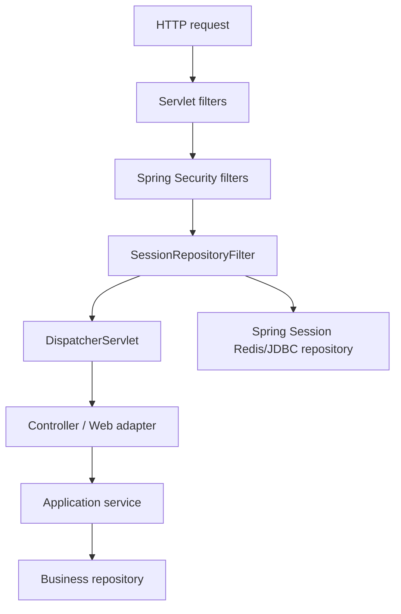
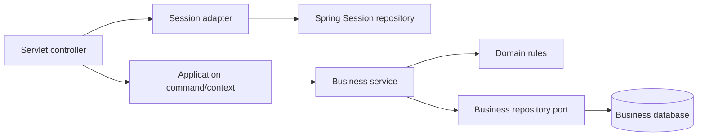

# Kiểm thử logic nghiệp vụ độc lập với bộ lọc và kho phiên

Một ứng dụng Servlet dùng Spring Session thường có nhiều thành phần chạy quanh một request: Servlet filters, Spring Security, `SessionRepositoryFilter`, controller, service nghiệp vụ và Redis/JDBC session repository. Khi kiểm thử quy tắc nghiệp vụ, việc khởi động toàn bộ filter chain và datastore làm test chậm, khó cô lập nguyên nhân lỗi và khiến test phụ thuộc hạ tầng. Phần lớn logic nghiệp vụ không cần biết request đi qua filter nào hoặc session được lưu ở Redis hay JDBC; nó chỉ cần các dữ liệu đầu vào đã được xác thực và các cổng truy cập dữ liệu nghiệp vụ.

Vì vậy, nên tách ranh giới: lớp web lấy principal, session attributes và request data; lớp application/service nhận các giá trị có kiểu rõ ràng và thực hiện quy tắc; repository nghiệp vụ đọc/ghi dữ liệu nghiệp vụ. Unit test của service có thể chạy bằng JUnit và Mockito mà không dựng Servlet container, Spring Security filter chain hoặc Spring Session store. Các test filter, session persistence và Redis/JDBC được thực hiện ở những tầng riêng với mục tiêu cụ thể.

Trong `SPRING_SESSION`, cách tách này giúp kiểm thử nhanh và ổn định, đồng thời tránh nhầm `MockHttpSession` với session được lưu qua Spring Session. Bài học tập trung vào thiết kế service độc lập với Servlet/session, các kỹ thuật kiểm thử từng lớp và cách bổ sung integration test khi cần xác minh filter hoặc kho phiên thật.

## 1. Phân biệt các lớp trong một request Servlet

Một request có thể đi qua chuỗi thành phần như sau:



Thứ tự thực tế giữa các filter phụ thuộc cấu hình; sơ đồ thể hiện các trách nhiệm ở mức khái quát. `SessionRepositoryFilter` bọc request/response để `HttpSession` làm việc với Spring Session repository. Spring Security xác thực và đặt `Authentication` vào security context. Controller đọc thông tin request/session rồi gọi service. Service thực hiện quy tắc nghiệp vụ và truy cập kho dữ liệu nghiệp vụ.

Không phải mọi lớp đều cần được dựng trong mọi test:

| Lớp | Trách nhiệm | Test phù hợp |
|---|---|---|
| Domain/service | Quy tắc nghiệp vụ, kiểm tra điều kiện, quyết định kết quả | Unit test JUnit, mock repository nghiệp vụ |
| Controller | Mapping HTTP, validation, chuyển dữ liệu web thành command | MVC slice hoặc `MockMvc` standalone |
| Security/filter chain | Authentication, authorization, CSRF, session fixation | Security integration test với filters bật |
| Spring Session repository | Tạo/đọc/lưu/xóa session, TTL, serialization | Repository integration test với Redis/JDBC |
| Toàn ứng dụng | Cấu hình, filter order, cookie và tương tác end-to-end | `@SpringBootTest` và datastore test |

Một test service không chạy filter chain là đúng với mục tiêu của nó. Test đó không chứng minh endpoint được bảo vệ đúng hoặc session được persist; những điều đó cần test khác.

## 2. Thiết kế service không phụ thuộc HttpServletRequest hoặc HttpSession

Service nghiệp vụ nên nhận dữ liệu mà nó cần, ví dụ `userId`, `cartId`, `workflowId` hoặc một command object. Tránh để service tự đọc:

- `HttpServletRequest`, `HttpServletResponse` hoặc `HttpSession`.
- `SecurityContextHolder` hoặc `RequestContextHolder` theo cách tĩnh.
- Cookie name, session ID hoặc request headers.
- `SessionRepository` nếu nghiệp vụ không thực sự quản lý session lifecycle.

Các dependency này làm service phụ thuộc môi trường web và khiến unit test phải dựng thêm context. Thay vào đó, adapter web lấy dữ liệu từ principal/session rồi truyền các giá trị cần thiết vào service.

Ví dụ một giỏ hàng tạm có `cartId` được giữ trong session. Controller có thể lấy `cartId` bằng `@SessionAttribute`, còn service chỉ nhận user ID và cart ID:

```java
@RestController
@RequestMapping("/api/cart")
public class CartController {

    private final CartService cartService;

    public CartController(CartService cartService) {
        this.cartService = cartService;
    }

    @PostMapping("/items")
    public CartView addItem(
            Principal principal,
            @SessionAttribute("app.cart.id") UUID cartId,
            @Valid @RequestBody AddItemRequest request) {

        Cart cart = cartService.addItem(
                principal.getName(), cartId,
                request.sku(), request.quantity());

        return CartView.from(cart);
    }
}
```

Các kiểu request/response minh họa có thể được khai báo như sau:

```java
public record AddItemRequest(
        @NotBlank String sku,
        @Positive int quantity) {
}

public record CartView(UUID cartId, int totalItems) {
    public static CartView from(Cart cart) {
        int total = cart.quantities().values().stream()
                .mapToInt(Integer::intValue)
                .sum();
        return new CartView(cart.id(), total);
    }
}
```

Controller là ranh giới chuyển đổi: principal trở thành định danh người dùng, session attribute trở thành `cartId`, request body trở thành tham số service. Service không cần biết `cartId` đến từ session, URL hay một workflow khác. Trong ứng dụng thực tế, `principal.getName()` phải được ánh xạ tới định danh canonical đáng tin cậy; không dùng username do client tự gửi.

### 2.1. Tách session context thành kiểu dữ liệu rõ ràng

Nếu nhiều endpoint cần cùng một nhóm thông tin từ session, có thể tạo một value object ở tầng application:

```java
public record CartContext(String userId, UUID cartId) {
}
```

Controller hoặc một adapter/resolver tạo `CartContext` từ authentication và session. Service nhận context đó:

```java
public CartView getCart(CartContext context) {
    return cartRepository.findByIdAndOwnerId(
                    context.cartId(), context.userId())
            .map(CartView::from)
            .orElseThrow(CartNotFoundException::new);
}
```

`CartContext` không nên chứa `HttpSession`, cookie hoặc toàn bộ `Authentication`. Nó chỉ chứa dữ liệu cần cho use case. Điều này làm API service dễ hiểu và dễ test.

### 2.2. Không dùng session làm kho dữ liệu nghiệp vụ chính

Session có thể giữ ID tham chiếu, bước hiện tại của wizard hoặc tùy chọn giao diện. Dữ liệu như đơn hàng, số dư, tồn kho, phê duyệt và quyền sở hữu phải được lưu ở kho nghiệp vụ có transaction/consistency phù hợp. Nếu service chỉ thao tác repository nghiệp vụ, unit test không cần Spring Session repository.

Nếu use case thực sự quản lý stateful workflow trong session, hãy mô hình hóa trạng thái thành một đối tượng thuần, ví dụ `CheckoutState`, rồi test các chuyển trạng thái của đối tượng đó độc lập. Việc serialize/deserialize đối tượng vào `HttpSession` được test riêng ở adapter/persistence layer.

## 3. Unit test service bằng JUnit và Mockito

Unit test service chỉ dựng đối tượng cần kiểm thử cùng dependency trực tiếp. Không cần `@SpringBootTest`, không cần khởi động Redis, không cần `MockHttpSession` và không cần chạy filter chain.

Ví dụ domain và repository:

```java
public record Cart(
        UUID id,
        String ownerId,
        Map<String, Integer> quantities) {

    public Cart add(String sku, int quantity) {
        if (sku == null || sku.isBlank()) {
            throw new IllegalArgumentException("SKU không hợp lệ");
        }
        if (quantity <= 0) {
            throw new IllegalArgumentException("Số lượng phải lớn hơn 0");
        }

        Map<String, Integer> updated = new HashMap<>(quantities);
        updated.merge(sku, quantity, Integer::sum);
        return new Cart(id, ownerId, Map.copyOf(updated));
    }
}
```

```java
public interface CartRepository {
    Optional<Cart> findByIdAndOwnerId(UUID cartId, String ownerId);
    void save(Cart cart);
}
```

Service chỉ làm việc với các kiểu Java và repository nghiệp vụ:

```java
@Service
public class CartService {

    private final CartRepository cartRepository;

    public CartService(CartRepository cartRepository) {
        this.cartRepository = cartRepository;
    }

    public Cart addItem(
            String ownerId, UUID cartId, String sku, int quantity) {

        if (ownerId == null || ownerId.isBlank()) {
            throw new IllegalArgumentException("Thiếu người dùng");
        }

        Cart current = cartRepository
                .findByIdAndOwnerId(cartId, ownerId)
                .orElseThrow(CartNotFoundException::new);

        Cart updated = current.add(sku, quantity);
        cartRepository.save(updated);
        return updated;
    }
}
```

Exception nghiệp vụ có thể là một kiểu runtime exception nhỏ:

```java
public class CartNotFoundException extends RuntimeException {
    public CartNotFoundException() {
        super("Không tìm thấy giỏ hàng");
    }
}
```

`findByIdAndOwnerId` đưa điều kiện ownership vào truy vấn repository, tránh đọc cart theo ID rồi quên kiểm tra chủ sở hữu. Service không biết `ownerId` lấy từ OIDC principal, session hay test fixture.

### 3.1. Test đường đi thành công

```java
@ExtendWith(MockitoExtension.class)
class CartServiceTest {

    @Mock
    CartRepository cartRepository;

    @InjectMocks
    CartService cartService;

    @Test
    void addsItemToOwnedCart() {
        UUID cartId = UUID.randomUUID();
        Cart existing = new Cart(
                cartId, "user-42", Map.of("sku-a", 1));

        when(cartRepository.findByIdAndOwnerId(cartId, "user-42"))
                .thenReturn(Optional.of(existing));

        Cart result = cartService.addItem(
                "user-42", cartId, "sku-b", 2);

        assertThat(result.quantities())
                .containsEntry("sku-a", 1)
                .containsEntry("sku-b", 2);
        verify(cartRepository).save(result);
    }
}
```

Test này kiểm tra quy tắc thêm sản phẩm và tương tác với repository nghiệp vụ. Nó không cần tạo Spring application context. `MockitoExtension` khởi tạo mock và inject dependency cho test.

### 3.2. Test quyền sở hữu và input không hợp lệ

```java
@Test
void doesNotUpdateCartOwnedByAnotherUser() {
    UUID cartId = UUID.randomUUID();
    when(cartRepository.findByIdAndOwnerId(cartId, "user-42"))
            .thenReturn(Optional.empty());

    assertThatThrownBy(() -> cartService.addItem(
            "user-42", cartId, "sku-a", 1))
            .isInstanceOf(CartNotFoundException.class);

    verify(cartRepository, never()).save(any());
}

@Test
void rejectsNonPositiveQuantity() {
    UUID cartId = UUID.randomUUID();
    Cart existing = new Cart(cartId, "user-42", Map.of());
    when(cartRepository.findByIdAndOwnerId(cartId, "user-42"))
            .thenReturn(Optional.of(existing));

    assertThatThrownBy(() -> cartService.addItem(
            "user-42", cartId, "sku-a", 0))
            .isInstanceOf(IllegalArgumentException.class);

    verify(cartRepository, never()).save(any());
}
```

Test ownership nên xác minh truy vấn được gọi với đúng user ID. Nếu hệ thống trả `404` cho cả tài nguyên không tồn tại và không thuộc người gọi, test cần xác minh cả hai trường hợp không làm lộ sự tồn tại của tài nguyên.

## 4. Unit test không cần mock Spring Session repository

Một lỗi thiết kế phổ biến là đưa `SessionRepository` vào mọi service chỉ vì ứng dụng có Spring Session. Điều này khiến service phụ thuộc cách lưu session dù use case chỉ cần `userId` hoặc `cartId`.

Không nên viết service như sau nếu mục tiêu chỉ là xử lý giỏ hàng:

```java
public Cart addItem(HttpServletRequest request, String sku, int quantity) {
    HttpSession session = request.getSession(false);
    String userId = (String) session.getAttribute("userId");
    // Quy tắc nghiệp vụ bị trộn với cách lấy session.
    ...
}
```

Thiết kế này buộc unit test phải tạo request/session hoặc mock static context. Nó cũng làm service khó tái sử dụng từ message consumer, scheduler hoặc REST API stateless.

Hãy chuyển việc lấy user/cart context lên web adapter. Nếu một service thật sự phải thao tác session, tách thành một component có trách nhiệm rõ ràng, ví dụ `CheckoutSessionStore`, rồi test component đó riêng bằng fake repository hoặc integration test. Không để mọi quy tắc nghiệp vụ biết về Spring Session.

## 5. Test controller độc lập với filter chain

Sau khi service đã được unit test, có thể kiểm tra controller mapping riêng. `MockMvcBuilders.standaloneSetup(...)` dựng controller và MVC infrastructure cần thiết mà không tự đăng ký toàn bộ Spring Security filter chain hoặc Spring Session filter.

Ví dụ controller ở trên nhận `Principal` và `@SessionAttribute`. Một test standalone có thể cung cấp principal và session attribute trực tiếp:

```java
@Test
void mapsSessionContextToServiceArguments() throws Exception {
    UUID cartId = UUID.randomUUID();
    CartService service = mock(CartService.class);
    Cart cart = new Cart(cartId, "user-42", Map.of("sku-a", 2));
    when(service.addItem("user-42", cartId, "sku-a", 2))
            .thenReturn(cart);

    CartController controller = new CartController(service);
    MockMvc mvc = MockMvcBuilders.standaloneSetup(controller).build();

    mvc.perform(post("/api/cart/items")
            .principal(() -> "user-42")
            .sessionAttr("app.cart.id", cartId)
            .contentType(MediaType.APPLICATION_JSON)
            .content("""
                    {"sku":"sku-a","quantity":2}
                    """))
            .andExpect(status().isOk());

    verify(service).addItem("user-42", cartId, "sku-a", 2);
}
```

Test này xác minh controller nhận được principal, lấy đúng session attribute, parse request body và gọi service với tham số đã chuyển đổi. Nó không xác minh user đã thực sự đăng nhập, CSRF hợp lệ hay session attribute được lưu ở Redis.

`standaloneSetup` phù hợp khi controller có dependency rõ ràng và cần test mapping nhanh. Với validation, exception advice, converter hoặc MVC configuration tùy chỉnh, có thể cần đăng ký các thành phần tương ứng vào standalone setup hoặc dùng `@WebMvcTest` để kiểm tra cấu hình MVC slice.

## 6. MockMvc session và MockHttpSession dùng để làm gì?

`MockHttpSession` là đối tượng session trong bộ nhớ phục vụ test Servlet. Nó cho phép gắn attributes vào request mà không cần khởi chạy session repository thật.

Ví dụ:

```java
MockHttpSession session = new MockHttpSession();
session.setAttribute("app.cart.id", cartId);

mvc.perform(get("/api/cart")
        .session(session)
        .principal(() -> "user-42"))
    .andExpect(status().isOk());
```

Hoặc dùng `.sessionAttr("app.cart.id", cartId)` để thêm attribute vào session do MockMvc quản lý.

Những test này hữu ích để xác minh controller/argument resolver xử lý session attribute. Tuy nhiên:

- `MockHttpSession` không ghi session vào Redis hoặc JDBC.
- Nó không kiểm tra `SessionRepositoryFilter` có được đăng ký đúng thứ tự không.
- Nó không kiểm tra cookie serializer, cookie name, domain, path hoặc SameSite.
- Nó không kiểm tra TTL, expiration event hoặc session sharing giữa các instance.
- Việc dùng `.session(mockSession)` giữ đối tượng mock trong test; không tương đương browser gửi cookie session ID và server khôi phục session từ repository.

Đừng dùng test `MockHttpSession` để kết luận Spring Session Redis/JDBC đã hoạt động. Dùng đúng loại test theo điều cần chứng minh.

## 7. Khi nào dùng @WebMvcTest?

`@WebMvcTest` tạo MVC slice với controller, MVC converters, validation và các thành phần web được chọn. Nó không nạp toàn bộ application context và thường mock service dependencies.

Có hai hướng test khác nhau:

### 7.1. Chỉ kiểm tra MVC, không chạy filters

Nếu mục tiêu là route mapping, JSON serialization, validation và chuyển đổi dữ liệu, có thể dùng:

```java
@WebMvcTest(CartController.class)
@AutoConfigureMockMvc(addFilters = false)
class CartControllerMvcTest {
    // Mock CartService và kiểm tra mapping/validation.
}
```

`addFilters = false` loại các filter khỏi MockMvc test. Điều này giúp cô lập controller nhưng đồng nghĩa test không xác minh authentication, authorization, CSRF, session fixation, `SessionRepositoryFilter` hoặc các filter khác. Không được coi test này là security test.

### 7.2. Kiểm tra security filter chain

Khi cần xác minh bảo mật endpoint, giữ filters bật và cung cấp cấu hình security cần thiết:

```java
@WebMvcTest(CartController.class)
@Import(SecurityConfiguration.class)
class CartControllerSecurityTest {
    // Mock service, bật Spring Security filters.
}
```

Có thể dùng Spring Security test support như `@WithMockUser`, `user(...)` và `csrf()` để tạo request test. Ví dụ với endpoint POST dùng cookie/session authentication, test nên xác minh:

- Anonymous request bị từ chối hoặc chuyển tới login theo policy.
- User đã xác thực có thể gọi endpoint được phép.
- User thiếu authority không truy cập được chức năng bị giới hạn.
- POST thiếu CSRF token bị từ chối khi CSRF được bật.
- POST có CSRF token hợp lệ tiếp tục tới controller.
- Session fixation protection và logout được kiểm tra ở integration test phù hợp.

Các test này vẫn có thể mock service và không cần Redis. Mục tiêu là kiểm tra filter/security behavior, không phải persistence session.

## 8. Phân biệt test filter với test logic nghiệp vụ

Một endpoint có thể bị từ chối trước khi controller được gọi. Nếu test chỉ muốn kiểm tra quy tắc tính toán, không cần dựng security filters. Nếu test muốn chứng minh request anonymous bị chặn, phải chạy filters.

| Câu hỏi kiểm thử | Filters | Spring Session store thật | Nên dùng |
|---|---:|---:|---|
| Công thức tính tổng giỏ hàng đúng không? | Không | Không | Unit test service/domain |
| User không sở hữu cart có bị từ chối không? | Không bắt buộc nếu service nhận user ID và repository kiểm tra ownership | Không | Unit test service + repository behavior |
| Controller lấy đúng cart ID từ session attribute không? | Không | Không | Standalone MockMvc hoặc MVC slice |
| Anonymous không truy cập endpoint được bảo vệ? | Có | Không nhất thiết | Security MockMvc test |
| CSRF filter từ chối POST thiếu token? | Có | Không nhất thiết | Security MockMvc test |
| `HttpSession` được lưu trong Redis? | Có filter Spring Session | Có | Integration test với Redis |
| Session được chia sẻ giữa hai instance? | Có | Có | Multi-instance integration test |
| TTL và expiration event hoạt động? | Có session integration | Có | Redis/JDBC repository integration test |

Đừng thêm Redis container vào mọi unit test. Ngược lại, đừng mock session repository trong test rồi tuyên bố TTL hoặc cross-instance behavior đã được xác minh.

## 9. Test Spring Session repository ở một tầng riêng

Khi mục tiêu là xác minh session persistence, tạo integration test với repository thật. Có thể dùng Redis Testcontainers hoặc database test phù hợp với JDBC repository. Test nên kiểm tra các thao tác repository trực tiếp hoặc request qua filter chain tùy phạm vi.

Với `SessionRepository` đồng bộ, có thể kiểm tra contract cơ bản:

```java
@SpringBootTest
class SessionRepositoryIntegrationTest {

    @Autowired
    SessionRepository<? extends Session> sessionRepository;

    @Test
    void savesAndLoadsSession() {
        verifyRepositoryContract(sessionRepository);
    }

    private static <S extends Session> void verifyRepositoryContract(
            SessionRepository<S> repository) {
        S session = repository.createSession();
        session.setAttribute("app.test.marker", "value-1");
        repository.save(session);

        S loaded = repository.findById(session.getId());
        assertThat(loaded).isNotNull();
        assertThat(loaded.getAttribute("app.test.marker"))
                .isEqualTo("value-1");
    }
}
```

Kiểu generic và API inject có thể cần điều chỉnh theo repository/version cụ thể. Với Redis, dùng namespace test riêng; với JDBC, dùng schema test và cleanup dữ liệu sau test. Không chạy test repository trên datastore production.

Một test contract repository có thể xác minh create/find/save/delete, attributes, max inactive interval và expiration behavior. Nếu test cần chứng minh cookie và filter integration, hãy gửi HTTP request qua MockMvc với filters Spring Session được đăng ký.

## 10. Test qua Spring Session filter và cookie thật trong MockMvc

Để kiểm tra request đầu tạo session, response phát cookie và request sau khôi phục session từ repository, test phải dùng filter chain có `SessionRepositoryFilter` và một session repository thật.

Luồng khái quát:

1. Gửi request tới endpoint tạo session attribute.
2. Lấy session cookie từ response theo cookie name đã cấu hình.
3. Gửi request thứ hai chỉ với cookie đó, không truyền `MockHttpSession`.
4. Xác minh endpoint đọc lại được attribute từ repository.
5. Nếu chạy hai instance, gửi request đầu tới instance A và request sau tới B.

Ví dụ khung test:

```java
@SpringBootTest
@AutoConfigureMockMvc
class SpringSessionHttpIntegrationTest {

    @Autowired
    MockMvc mockMvc;

    @Test
    void sessionSurvivesAcrossHttpRequests() throws Exception {
        MvcResult created = mockMvc.perform(post("/test/session")
                        .with(csrf()))
                .andExpect(status().isOk())
                .andReturn();

        Cookie sessionCookie = created.getResponse()
                .getCookie("SESSION"); // thay bằng cookie name của ứng dụng

        assertThat(sessionCookie).isNotNull();

        mockMvc.perform(get("/test/session")
                        .cookie(sessionCookie))
                .andExpect(status().isOk())
                .andExpect(jsonPath("$.marker").value("value-1"));
    }
}
```

Đây là khung minh họa; endpoint test, security credentials và cookie name cần được cấu hình cho dự án. Nếu endpoint POST yêu cầu authentication, cung cấp test user hoặc thực hiện login test theo filter chain. Không thêm `.session(mockHttpSession)` vào request thứ hai vì điều đó bỏ qua mục tiêu kiểm tra cookie/repository.

Nếu response không phát cookie, hãy kiểm tra endpoint có thực sự tạo session, cookie serializer, filter order và session save lifecycle. Nếu cookie có nhưng request sau không thấy attribute, kiểm tra namespace, repository, serializer và datastore connection.

## 11. Tách kiểm thử logic khỏi kiểm thử filter bằng kiến trúc port/adapter

Một thiết kế dễ test có thể chia thành:

- **Web adapter:** đọc `Principal`, `@SessionAttribute`, path/query/body và validation.
- **Application service:** điều phối use case bằng kiểu dữ liệu thuần.
- **Domain model:** thực thi quy tắc và bất biến nghiệp vụ.
- **Business repository port:** giao diện đọc/ghi dữ liệu nghiệp vụ.
- **Infrastructure adapter:** triển khai repository bằng JDBC/JPA hoặc API ngoài.
- **Session adapter:** lấy/lưu session state khi use case thực sự cần.



Unit test có thể tạo service và mock `Business repository port`. Test adapter kiểm tra cách `HttpSession` hoặc Spring Session được chuyển đổi. Integration test kiểm tra repository thật. Cách phân lớp này giúp lỗi nghiệp vụ không bị nhầm với lỗi cookie, filter hoặc Redis.

Không cần tạo nhiều interface chỉ để mock. Hãy tạo abstraction khi nó thể hiện ranh giới có ý nghĩa: repository nghiệp vụ, session context provider hoặc external identity provider. Nếu service chỉ cần một `String userId`, truyền trực tiếp giá trị đó thường đơn giản hơn tạo một `SessionService` tổng quát.

## 12. Kiểm thử các use case có trạng thái trong session

Một số nghiệp vụ có state tạm trong session, ví dụ wizard nhiều bước:

```java
public record CheckoutState(
        UUID cartId,
        int currentStep,
        boolean addressConfirmed) {

    public CheckoutState confirmAddress() {
        if (currentStep < 2) {
            throw new IllegalStateException("Chưa hoàn tất bước địa chỉ");
        }
        return new CheckoutState(cartId, currentStep, true);
    }
}
```

Quy tắc `confirmAddress()` có thể được unit test mà không cần `HttpSession`:

```java
@Test
void confirmsAddressOnlyAfterAddressStep() {
    CheckoutState state = new CheckoutState(UUID.randomUUID(), 2, false);

    CheckoutState updated = state.confirmAddress();

    assertThat(updated.addressConfirmed()).isTrue();
}
```

Sau đó test riêng adapter đọc `CheckoutState` từ session, thay đổi state và ghi lại. Với `SaveMode.ON_SET_ATTRIBUTE`, thay object mới vào session giúp repository nhận biết thay đổi rõ ràng hơn so với sửa một object mutable bên trong.

Nếu hai request có thể cùng cập nhật workflow state, unit test state transition không đủ. Cần concurrency test để xác minh lost update, version hoặc quy tắc xử lý xung đột. Không lưu một quy trình nghiệp vụ quan trọng duy nhất trong session nếu cần durability và consistency mạnh.

## 13. Kiểm thử lỗi và exception mapping

Service unit test nên kiểm tra các lỗi nghiệp vụ như:

- Cart hoặc workflow không tồn tại.
- User không sở hữu tài nguyên.
- Input không hợp lệ.
- Trạng thái hiện tại không cho phép chuyển bước.
- Version conflict ở repository nghiệp vụ.

Controller test kiểm tra exception được ánh xạ thành HTTP status/body phù hợp qua `@ControllerAdvice`. Filter test kiểm tra lỗi authentication/authorization. Session repository integration test kiểm tra lỗi Redis/JDBC, serialization hoặc timeout.

Không chuyển lỗi datastore thành “session không tồn tại” nếu chưa xác minh repository trả `null`/empty theo contract. Lỗi kết nối Redis/JDBC khác với session hết hạn. Trong unit test service, mock repository có thể phát exception để kiểm tra service không nuốt lỗi; trong integration test, mô phỏng datastore outage để kiểm tra error handling của toàn đường request.

## 14. Dùng `@Transactional` trong test đúng phạm vi

`@Transactional` trên test thường rollback các thay đổi trong database transaction do test quản lý. Nó không tự rollback Redis, message broker, file hoặc side effect bên ngoài transaction.

Vì vậy:

- Unit test mock repository không cần `@Transactional`.
- JPA repository test có thể dùng transaction rollback nếu phù hợp.
- Spring Session Redis test cần xóa session/key tạo ra hoặc dùng namespace test riêng.
- JDBC session test phải xác minh transaction manager/schema và cleanup đúng bảng.
- Nếu service gọi nhiều resource, không giả định rollback một database sẽ đảo ngược mọi side effect.

Không dựa vào `@Transactional` để cleanup Spring Session Redis. Dùng session ID được tạo trong test và gọi repository delete, hoặc tạo keyspace/namespace riêng cho test run.

## 15. Kiểm thử song song và tránh dữ liệu test dùng chung

Khi JUnit chạy test song song, test có thể đụng cùng session ID, user ID hoặc Redis namespace nếu fixture cố định. Điều đó tạo flaky tests và khiến một test xóa session của test khác.

Thực hành tốt:

1. Tạo UUID riêng cho cart, user test hoặc session mỗi test.
2. Dùng namespace Redis riêng theo test suite/build run nếu cần.
3. Cleanup session/key sau test, kể cả khi assertion thất bại.
4. Không dùng chung `MockHttpSession` mutable giữa test methods.
5. Không dựa vào thứ tự chạy test.
6. Khi test concurrency, dùng barrier/latch để điều phối rõ thời điểm đọc và ghi.
7. Phân biệt lỗi do race thực tế với nhiễu do fixture dùng chung.

Nếu test cần chứng minh hai request cùng session, chỉ chia sẻ cookie/session fixture trong test đó. Các test khác phải dùng session độc lập.

## 16. Kiểm thử security mà vẫn không cần Redis

Spring Security filter chain có thể được kiểm thử với MockMvc và mock service. `@WithMockUser`, request postprocessor `user(...)` và `csrf()` giúp tạo authentication/CSRF state cho test. Các test này có thể dùng Spring Security filters thật nhưng không cần Spring Session Redis nếu mục tiêu chỉ là xác minh authorization/CSRF.

Ví dụ ma trận:

| Request | Cấu hình | Kết quả mong đợi |
|---|---|---|
| GET protected endpoint anonymous | Filters bật | Redirect login hoặc 401 theo entry point |
| POST không có CSRF token | User đã xác thực, CSRF bật | 403 |
| POST có CSRF token | User có quyền | Controller được gọi |
| POST user thiếu authority | CSRF hợp lệ | 403 từ authorization layer |
| POST user hợp lệ | CSRF hợp lệ | Service được gọi đúng một lần |
| Request không có session attribute cần thiết | User hợp lệ | Lỗi input/session context được ánh xạ theo policy |

Mock authentication không chứng minh OIDC login flow hoặc `SecurityContext` được persist qua Spring Session. Nó chỉ cung cấp authentication cho request test. Nếu cần kiểm tra session-based login persistence, thực hiện integration test qua login flow/cookie với repository thật.

## 17. Những điều không nên assert trong unit test nghiệp vụ

Unit test service không nên kiểm tra:

- Session cookie tên gì hoặc có `HttpOnly` không.
- Filter nào chạy trước filter nào.
- Redis TTL có đúng 30 phút không.
- `SessionExpiredEvent` có được phát không.
- Session ID có đổi sau login không.
- Request từ instance B có đọc session của instance A không.
- Spring Security có khôi phục `SecurityContext` từ cookie không.

Đó là hành vi của web/security/session infrastructure. Nếu đưa các assertion này vào unit test service, test sẽ phải dựng sai tầng hoặc mock quá nhiều đến mức không còn xác minh được hành vi thật.

Ngược lại, integration test session không nên lặp lại mọi nhánh tính toán nghiệp vụ. Hãy kiểm tra một số luồng tích hợp đại diện và giữ toàn bộ ma trận quy tắc trong unit tests nhanh.

## 18. Ma trận lựa chọn test theo mục tiêu

| Mục tiêu | Công cụ/annotation | Khởi động datastore? | Chạy filter chain? |
|---|---|---:|---:|
| Quy tắc domain | JUnit, AssertJ | Không | Không |
| Service và repository port | JUnit, Mockito | Không | Không |
| Controller mapping | `MockMvcBuilders.standaloneSetup` | Không | Không |
| MVC slice | `@WebMvcTest` | Không | Tùy cấu hình |
| Security authorization/CSRF | MockMvc + Spring Security test | Không nhất thiết | Có |
| Spring Session repository contract | `@SpringBootTest` hoặc test cấu hình repository | Có, Redis/JDBC test | Không nhất thiết |
| Cookie và `SessionRepositoryFilter` | `@SpringBootTest` + MockMvc | Có | Có |
| Nhiều instance chia sẻ session | Hai app nodes + Redis/JDBC chung | Có | Có |
| TTL/expiration events | Repository integration test | Có | Không nhất thiết |
| Race condition session | Concurrent integration test | Có | Tùy mục tiêu |

Một test suite cân bằng thường có nhiều unit test, một số MVC/security slice tests và ít hơn các integration tests chạy với Redis/JDBC. Cấu trúc này vừa giữ phản hồi nhanh vừa xác minh được các ranh giới hạ tầng quan trọng.

## 19. Lỗi thường gặp và cách khắc phục

| Triệu chứng | Nguyên nhân có thể | Hướng xử lý |
|---|---|---|
| Unit test cần khởi động Redis | Service phụ thuộc trực tiếp `SessionRepository` hoặc `HttpSession` | Chuyển session lookup ra web/session adapter; truyền context thuần vào service |
| Test service thất bại vì SecurityContext rỗng | Service đọc `SecurityContextHolder` tĩnh | Truyền user ID/principal đã ánh xạ qua tham số service |
| Test `MockHttpSession` pass nhưng production mất session | Test không chạy Spring Session filter/repository thật | Thêm integration test qua cookie với Redis/JDBC |
| `addFilters=false` làm test pass nhưng endpoint production bị 403 | Test đã bỏ security filters | Thêm security test với filters bật và CSRF/user postprocessor |
| `@Transactional` không dọn Redis | Redis không tham gia JDBC transaction của test | Xóa session/key tường minh hoặc dùng namespace test riêng |
| Controller test phải dựng quá nhiều bean | Dùng full application context cho mapping đơn giản | Dùng standalone MockMvc hoặc `@WebMvcTest` |
| Integration test chậm và khó xác định lỗi | Trộn unit, security, Redis và business assertions trong một test | Tách test theo ranh giới và mục tiêu |
| Test song song xóa session của nhau | Dùng chung session ID/namespace | Dùng UUID riêng, namespace riêng và cleanup |
| Test không xác minh session cookie | Truyền `.session(mockSession)` ở mọi request | Lấy cookie từ response rồi gửi lại trong request tiếp theo |
| Test security dùng `user()` nhưng tưởng đã test login | Mock user bypasses authentication flow | Test OIDC/form login riêng nếu cần xác minh authentication protocol |

## 20. Quy trình tổ chức test cho ứng dụng Spring Session

Khi xây hoặc bảo trì ứng dụng Servlet dùng Spring Session, có thể tổ chức theo thứ tự:

1. Đưa quy tắc nghiệp vụ vào domain/service không phụ thuộc Servlet API hoặc session repository.
2. Truyền user ID, session-derived context và command vào service qua kiểu dữ liệu rõ ràng.
3. Viết unit tests cho thành công, validation, ownership, state transition và business errors bằng JUnit/Mockito.
4. Viết controller tests để xác minh request mapping, validation, `Principal`, `@SessionAttribute` và response DTO.
5. Viết security tests riêng với filters bật để kiểm tra authentication, authorization và CSRF.
6. Viết repository integration tests với Redis/JDBC để kiểm tra create/find/save/delete, serialization và TTL.
7. Viết HTTP integration tests qua cookie để xác minh `SessionRepositoryFilter` và session persistence giữa các request.
8. Nếu triển khai nhiều instance, gửi request liên tiếp tới các node khác nhau bằng cùng cookie.
9. Dùng namespace/user/session ID riêng và cleanup rõ ràng để test có thể chạy song song.
10. Chỉ dùng full `@SpringBootTest` khi cần xác minh wiring hoặc tương tác nhiều thành phần; không dùng nó cho mọi quy tắc service.

Kiểm thử logic nghiệp vụ độc lập với filter và kho phiên không làm giảm độ bao phủ hệ thống; nó đặt mỗi assertion vào đúng tầng. Service được test nhanh bằng dữ liệu thuần và mock repository nghiệp vụ, controller được test bằng MockMvc, security filters được test với filter chain bật, còn Spring Session Redis/JDBC được xác minh bằng integration tests có datastore thật. Tách rõ các tầng giúp biết chính xác lỗi nằm ở quy tắc nghiệp vụ, HTTP/security hay persistence, đồng thời giữ bộ test đủ nhanh để chạy thường xuyên.
