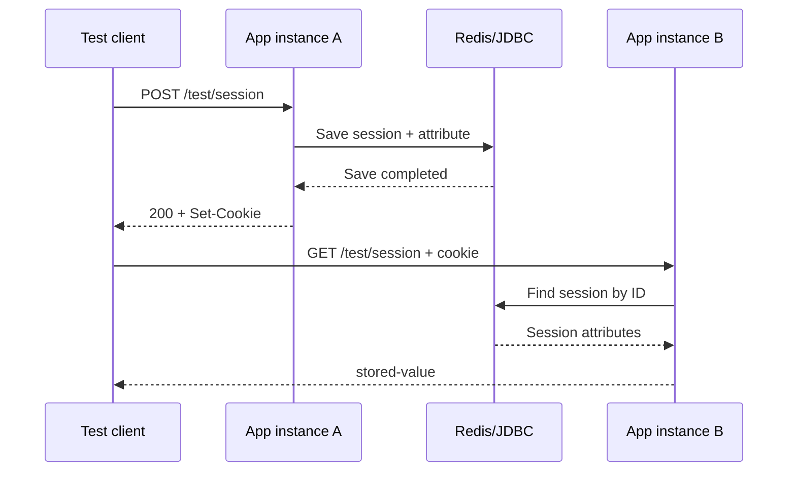

# MockHttpSession và lý do không đủ để chứng minh phiên được lưu ngoài JVM

`MockHttpSession` là đối tượng mô phỏng `HttpSession` do Spring Test cung cấp. Nó rất hữu ích khi kiểm thử controller, filter hoặc service có thao tác đọc/ghi thuộc tính session. Tuy nhiên, khi test tạo một `MockHttpSession` rồi truyền lại chính đối tượng đó cho nhiều request MockMvc, dữ liệu được giữ trong bộ nhớ của test. Bài kiểm thử chứng minh mã ứng dụng dùng API Servlet đúng, nhưng không chứng minh Spring Session đã ghi dữ liệu vào Redis/JDBC, không chứng minh một JVM khác đọc được session, và cũng không chứng minh session còn tồn tại sau khi ứng dụng khởi động lại.

Để kiểm tra persistence của Spring Session, phải đưa đúng `SessionRepositoryFilter` và repository thật vào đường request, để session được nhận diện bằng cookie/session ID và được đọc/ghi qua kho bên ngoài. Sau đó cần kiểm tra request tiếp theo, instance khác hoặc tiến trình mới có thể khôi phục cùng session. Mức độ bằng chứng phải phù hợp với tuyên bố cần chứng minh: MockMvc có thể kiểm tra wiring và repository integration; Redis/JDBC Testcontainers kiểm tra lưu trữ thật; hai process độc lập hoặc restart ứng dụng mới chứng minh session không phụ thuộc vào bộ nhớ của JVM cũ.

## 1. Các tầng kiểm thử session cần phân biệt

Không phải mọi test có `HttpSession` đều là test persistence. Có thể chia thành các tầng:

| Tầng | Công cụ thường dùng | Điều được chứng minh |
|---|---|---|
| Unit test | Mock `HttpSession` hoặc service | Logic đọc/ghi thuộc tính session |
| Servlet interaction test | `MockHttpSession` + MockMvc | Controller/filter tương tác đúng với API Servlet |
| Spring Session filter test | MockMvc + `SessionRepositoryFilter` + repository | Cookie, filter và repository phối hợp trong request giả lập |
| Repository integration test | Redis/JDBC thật hoặc Testcontainers | Repository lưu và khôi phục session từ kho bên ngoài |
| Application restart test | Store bên ngoài + khởi động lại context/process | Session tồn tại sau khi instance ứng dụng cũ dừng |
| Multi-instance/process test | Hai process hoặc container ứng dụng cùng store | Instance độc lập có thể đọc cùng session |

Một test ở tầng thấp vẫn có giá trị, nhưng không được dùng kết quả của nó để kết luận về tầng cao hơn. Ví dụ, test `MockHttpSession` pass không chứng minh Redis đã được cấu hình.

## 2. MockHttpSession là gì?

`MockHttpSession` là implementation mô phỏng của `HttpSession` trong Spring Test. Nó lưu các thuộc tính trong cấu trúc dữ liệu ở bộ nhớ test, cung cấp các thao tác như:
- `getAttribute` và `setAttribute`.
- `removeAttribute`.
- `invalidate`.
- `getId` và thời gian tạo/truy cập mô phỏng.
- Các hành vi cần thiết để controller hoặc filter tương tác với Servlet API.

Nó không phải Redis session, JDBC session hay session do container thật quản lý. Nó không tự serialize object, không gửi dữ liệu đến datastore, không có replication, TTL của Redis, cleanup task của JDBC hoặc failover của kho dữ liệu.

Mục đích của class này là tạo một đối tượng `HttpSession` có thể điều khiển được trong test mà không cần chạy Servlet container thật.

## 3. Vì sao test truyền lại cùng MockHttpSession có thể tạo kết quả sai lệch?

Ví dụ:

```java
MockHttpSession session = new MockHttpSession();

mockMvc.perform(post("/cart/items")
        .session(session)
        .param("sku", "SKU-10"))
    .andExpect(status().isOk());

mockMvc.perform(get("/cart")
        .session(session))
    .andExpect(status().isOk())
    .andExpect(jsonPath("$.items[0]").value("SKU-10"));
```

Test này chứng minh controller có thể lưu và đọc thuộc tính qua `HttpSession`. Request thứ hai nhận lại chính object `MockHttpSession` đã được request thứ nhất sử dụng. Dữ liệu còn trong object đó nên assertion có thể pass ngay cả khi:
- Spring Session Redis/JDBC chưa được bật.
- `SessionRepositoryFilter` chưa được đăng ký.
- Redis hoặc database không chạy.
- Serializer không thể ghi principal hoặc DTO.
- Cookie session không được phát hoặc không được đọc.
- Ứng dụng khác không thể tìm thấy session.

Đây là lý do quan trọng khiến test này không đủ để chứng minh phiên được lưu ngoài JVM. Test không tạo ranh giới lưu trữ độc lập; nó giữ nguyên object session trong cùng bộ nhớ test.

## 4. MockMvc và MockHttpSession phù hợp với loại kiểm tra nào?

Dùng `MockHttpSession` khi mục tiêu là kiểm tra hành vi Servlet:
- Controller thêm hoặc xóa session attribute.
- Service xử lý giỏ hàng hoặc trạng thái wizard trong session.
- Logout gọi invalidate theo đúng luồng.
- Filter đọc thuộc tính session để áp dụng quy tắc.
- Mã ứng dụng xử lý session không tồn tại hoặc attribute bị thiếu.

Ví dụ kiểm tra logout:

```java
MockHttpSession session = new MockHttpSession();
session.setAttribute("userId", "user-42");

mockMvc.perform(post("/logout").session(session))
        .andExpect(status().is3xxRedirection());

assertThat(session.isInvalid()).isTrue();
```

Đây là kiểm tra tương tác với session mô phỏng. Nó không chứng minh bản ghi Redis/JDBC đã bị xóa hoặc session ID cũ không thể được một node khác khôi phục. Đối với logout persistence, cần gửi request bằng cookie cũ qua Spring Session filter và xác nhận repository không còn trả session hợp lệ.

## 5. Phân biệt MockHttpSession với SessionRepository

Spring Session sử dụng `SessionRepository` để lưu và tìm session. Ví dụ:
- `RedisSessionRepository` hoặc `RedisIndexedSessionRepository` cho Redis.
- `JdbcIndexedSessionRepository` cho JDBC.
- `MapSessionRepository` cho một số test hoặc cấu hình bộ nhớ.

`SessionRepositoryFilter` bọc request/response Servlet để thay việc truy cập session container bằng repository Spring Session. Khi request mang cookie session ID, filter resolve session từ repository, cung cấp API `HttpSession` tương thích và lưu thay đổi theo cấu hình.

`MockHttpSession` không phải một `SessionRepository`. Nó không kiểm tra việc filter gọi `findById` hoặc `save` trên repository. Nếu mục tiêu là chứng minh persistence, test phải đi qua filter và repository thật.

## 6. Kiểm thử filter và repository bằng MockMvc

MockMvc vẫn có thể kiểm tra tích hợp Spring Session ở mức filter nếu test context đăng ký đúng `SessionRepositoryFilter` và repository. Cần bảo đảm:
- Spring Session auto-configuration hoặc cấu hình Servlet tường minh được nạp.
- Filter thực sự nằm trong MockMvc filter chain.
- Filter order đúng, đặc biệt trước các filter Spring Security cần `HttpSession`.
- Repository test là implementation cần kiểm tra.
- Request sau dùng cookie từ response trước, không truyền lại `MockHttpSession`.

Ví dụ minh họa:

```java
MvcResult first = mockMvc.perform(post("/test/session")
        .contentType(MediaType.APPLICATION_JSON)
        .content("{\"value\":\"stored\"}"))
    .andExpect(status().isOk())
    .andReturn();

Cookie sessionCookie = first.getResponse().getCookie("SESSION");
assertThat(sessionCookie).isNotNull();

mockMvc.perform(get("/test/session")
        .cookie(sessionCookie))
    .andExpect(status().isOk())
    .andExpect(content().string("stored"));
```

Tên cookie `SESSION` chỉ là mặc định thường gặp; nếu ứng dụng đổi `CookieSerializer` hoặc `HttpSessionIdResolver`, test phải lấy đúng cookie được cấu hình. Không tự dựng session ID hoặc giả định cookie value bằng session ID nguyên bản vì serializer có thể mã hóa hoặc biến đổi giá trị.

Test này có thể chứng minh request thứ hai resolve session thông qua cookie và filter trong test context. Nhưng nếu repository là in-memory map, hoặc cả hai request vẫn dùng chung một JVM/context, nó chưa chứng minh Redis/JDBC thật hay ranh giới process.

## 7. Tránh vô tình bypass Spring Session filter

Một số cách viết test làm cho `MockHttpSession` được gắn trực tiếp vào request:
- `.session(mockHttpSession)` trong MockMvc.
- `.sessionAttr(...)` để thiết lập attribute.
- `@WithMockUser` hoặc `SecurityMockMvcRequestPostProcessors.user` để tạo Authentication cho request.
- Tự gắn `SecurityContext` vào mock request/session.

Các cách này hữu ích để kiểm tra authorization hoặc controller, nhưng không tự chứng minh quá trình login tạo session trong repository. `@WithMockUser` đặc biệt hữu ích cho kiểm tra quyền theo request; nó không chạy toàn bộ credential authentication flow và không xác nhận SecurityContext đã được serialize vào Redis/JDBC.

Khi kiểm tra persistence, hãy khởi tạo trạng thái qua endpoint hoặc filter xác thực thực tế, nhận cookie từ response và gửi cookie đó ở request sau. Tránh truyền object session mock qua nhiều request.

## 8. Thiết kế endpoint kiểm thử session tối thiểu

Trong integration test, có thể tạo endpoint chỉ dành cho profile test để ghi và đọc một giá trị xác định:

```java
@RestController
@RequestMapping("/test/session")
class SessionProbeController {

    @PostMapping
    String write(HttpSession session) {
        session.setAttribute("probe", "stored-value");
        return "written";
    }

    @GetMapping
    String read(HttpSession session) {
        Object value = session.getAttribute("probe");
        return value == null ? "missing" : value.toString();
    }
}
```

Endpoint này cần được bật chỉ trong test profile hoặc module kiểm thử. Không đưa endpoint có thể đọc/ghi tùy ý session vào production.

Bài test phải gọi POST không truyền `MockHttpSession`, nhận `Set-Cookie` từ response, rồi gọi GET với cookie đó. Nếu GET trả lại `stored-value`, đã chứng minh đường request qua filter/repository giữ được thuộc tính giữa hai request. Để chứng minh external persistence, repository phải là Redis/JDBC thật và test cần thêm kiểm tra qua instance/process khác hoặc sau restart.

## 9. Integration test với Redis Testcontainers

Testcontainers có thể khởi chạy Redis thật trong môi trường test. Ứng dụng Spring Boot kết nối tới Redis container và dùng Spring Session Redis repository giống cấu hình production.

Ví dụ khung JUnit 5:

```java
@Testcontainers
@SpringBootTest(webEnvironment = SpringBootTest.WebEnvironment.RANDOM_PORT)
class RedisSessionPersistenceIT {

    @Container
    static final GenericContainer<?> redis =
            new GenericContainer<>(DockerImageName.parse("redis:7.4-alpine"))
                    .withExposedPorts(6379);

    @DynamicPropertySource
    static void redisProperties(DynamicPropertyRegistry registry) {
        registry.add("spring.data.redis.host", redis::getHost);
        registry.add("spring.data.redis.port",
                () -> redis.getMappedPort(6379));
    }

    // Test gọi endpoint thật qua HTTP và giữ cookie giữa các request.
}
```

Property name tùy phiên bản Spring Boot: các phiên bản cũ có thể dùng prefix Redis khác. Cần xác nhận dependency thực tế và để Spring Boot cấu hình đúng connection factory.

Dùng `RANDOM_PORT` để request đi qua embedded Servlet container và filter chain thật. Redis container nằm ngoài process ứng dụng, vì vậy session được lưu ở một dịch vụ độc lập. Tuy nhiên, một test duy nhất vẫn cần kiểm tra cookie round-trip và repository để chứng minh dữ liệu thực sự được ghi.

## 10. Giữ cookie qua các request HTTP thật

Một cách đơn giản là dùng `java.net.http.HttpClient` với `CookieManager` để client tự nhận `Set-Cookie` và gửi cookie ở request sau.

Ví dụ khung:

```java
CookieManager cookieManager = new CookieManager();
cookieManager.setCookiePolicy(CookiePolicy.ACCEPT_ALL);

HttpClient client = HttpClient.newBuilder()
        .cookieHandler(cookieManager)
        .build();

HttpRequest writeRequest = HttpRequest.newBuilder()
        .uri(URI.create(baseUrl + "/test/session"))
        .POST(HttpRequest.BodyPublishers.noBody())
        .build();

HttpResponse<String> writeResponse = client.send(
        writeRequest, HttpResponse.BodyHandlers.ofString());

assertEquals(200, writeResponse.statusCode());

HttpRequest readRequest = HttpRequest.newBuilder()
        .uri(URI.create(baseUrl + "/test/session"))
        .GET()
        .build();

HttpResponse<String> readResponse = client.send(
        readRequest, HttpResponse.BodyHandlers.ofString());

assertEquals("stored-value", readResponse.body());
```

`CookieManager` giữ cookie nhận được từ response đầu tiên và gửi cookie phù hợp ở request thứ hai. Điều này kiểm tra hành vi HTTP cookie thực tế hơn việc truyền `MockHttpSession` trực tiếp.

Trong test thật, `baseUrl` lấy từ `@LocalServerPort` hoặc một URI test server. Endpoint POST/GET ở ví dụ trên phải được bật trong test profile. Nếu response không phát cookie, hãy kiểm tra filter registration, resolver, cookie serializer và việc endpoint có tạo session hay không.

## 11. Kiểm tra trực tiếp repository

Ngoài HTTP round-trip, có thể kiểm tra `SessionRepository` được Spring cấu hình để xác nhận session tồn tại trong store.

Ví dụ khái quát:

```java
Session session = sessionRepository.findById(sessionId);

assertThat(session).isNotNull();
assertThat(session.getAttribute("probe"))
        .isEqualTo("stored-value");
```

Cách lấy `sessionId` phải tôn trọng `HttpSessionIdResolver` hoặc cookie serializer. Không giả định cookie value luôn chính là repository ID. Có thể lấy session ID từ một endpoint test chỉ dành cho test, hoặc giải mã cookie bằng cùng resolver/serializer đã cấu hình.

Đọc lại cùng repository bean trong cùng context chứng minh repository có dữ liệu, nhưng nếu repository là in-memory implementation thì vẫn không chứng minh external storage. Hãy xác minh bean implementation là Redis/JDBC repository cần kiểm tra và kiểm tra dữ liệu ở Redis/database khi cần.

Không dùng API nội bộ hoặc tự tạo key theo cấu trúc Redis implementation nếu test có thể xác minh qua public repository API. Cấu trúc key là chi tiết triển khai có thể thay đổi theo phiên bản.

## 12. Chứng minh session tồn tại sau khi application context khởi động lại

Để chứng minh session không chỉ nằm trong heap của context cũ:
1. Khởi chạy ứng dụng với Redis/JDBC bên ngoài.
2. Gửi request tạo session và lưu cookie cùng session ID vào test harness.
3. Xác nhận repository tìm được session.
4. Dừng application context hoặc process.
5. Khởi động instance mới với cùng repository namespace/schema và serializer.
6. Gửi request mới với cookie cũ.
7. Xác nhận ứng dụng mới khôi phục được thuộc tính session.

Điều kiện quan trọng là store bên ngoài phải tiếp tục tồn tại trong lúc ứng dụng dừng. Nếu test đồng thời xóa Redis container hoặc tạo database/schema mới, nó không kiểm tra persistence qua restart.

Khởi động lại Spring context trong cùng JVM chứng minh session không phụ thuộc vào bean/context cũ, nhưng chưa phải bằng chứng hai JVM độc lập. Muốn tuyên bố “ngoài JVM”, nên dùng process/container ứng dụng mới hoặc hai tiến trình Java độc lập cùng kết nối một Redis/JDBC store.

## 13. Kiểm thử hai application instance dùng chung repository

Một bài test multi-instance có thể chạy hai Spring Boot application context hoặc hai container riêng:
- Instance A và B có port, bean và Servlet container riêng.
- Cả hai kết nối cùng Redis/JDBC test store.
- Cả hai dùng cùng cookie name, namespace/schema và serializer.
- POST tạo session qua A.
- GET bằng cookie nhận từ A qua B.
- B phải đọc được thuộc tính đã ghi.

Sơ đồ:



Test này chứng minh hai instance độc lập về application context có thể dùng chung repository. Nếu hai instance vẫn nằm trong cùng JVM, hãy mô tả kết quả chính xác là multi-context/shared-store. Để xác nhận ranh giới JVM, chạy chúng trong process hoặc container riêng.

## 14. Redis persistence test cần kiểm tra những gì?

Với Redis, ngoài đọc/ghi attribute, nên kiểm tra:
- Session được ghi dưới namespace mong đợi.
- Serializer ghi được các kiểu session attribute đang dùng.
- Session ID được resolve qua cookie đúng cấu hình.
- Request sau đọc được dữ liệu mới từ repository.
- Logout/invalidate khiến session không còn được khôi phục.
- TTL hoặc `maxInactiveInterval` có giá trị phù hợp.
- Session hết hạn được xử lý theo semantics repository.
- Hai instance có thể đọc cùng session.
- Redis restart/failover được kiểm tra theo durability mong muốn nếu đó là yêu cầu vận hành.

Không chỉ dùng `MapSessionRepository` trong test rồi gọi đó là Redis integration. Hãy xác minh Spring context thực sự dùng Redis repository và kết nối đến Redis container.

Nếu dùng Redis Cluster/Sentinel trong production, Redis đơn lẻ trong Testcontainers chỉ chứng minh serializer và repository integration cơ bản. Cần thêm môi trường test topology gần production để kiểm tra failover, replication lag và event delivery.

## 15. JDBC persistence test cần kiểm tra những gì?

Với Spring Session JDBC:
- Dùng database test thật, ví dụ PostgreSQL hoặc MySQL Testcontainers.
- Chạy schema Spring Session đúng phiên bản.
- Xác nhận `JdbcIndexedSessionRepository` hoặc repository JDBC dự kiến được cấu hình.
- Ghi session qua HTTP request và kiểm tra request sau đọc được.
- Kiểm tra session attribute serialization/conversion.
- Kiểm tra cập nhật, invalidate và cleanup.
- Kiểm tra transaction manager và DataSource đúng.
- Nếu dùng custom table name/schema, xác nhận query trỏ đúng bảng.

Không thay JDBC repository bằng H2 in-memory rồi kết luận đã kiểm tra external database persistence nếu production dùng PostgreSQL/MySQL với kiểu cột, SQL và transaction semantics khác nhau. H2 vẫn hữu ích cho test nhanh, nhưng cần integration test trên DBMS thật trước khi khẳng định tương thích production.

## 16. Kiểm thử Spring Security SecurityContext persistence

Một session thường chứa thuộc tính `SPRING_SECURITY_CONTEXT`. Để chứng minh đăng nhập được duy trì qua repository:
1. Gửi credential qua form login hoặc authentication flow thật.
2. Nhận session cookie từ response.
3. Gửi request đến endpoint bảo vệ bằng cookie đó.
4. Xác nhận endpoint nhìn thấy principal và authorities mong đợi.
5. Kiểm tra repository có SecurityContext được lưu.
6. Logout và gửi lại cookie cũ.
7. Xác nhận request tiếp theo không còn được xác thực.

`@WithMockUser` không đủ cho test này vì nó có thể đặt Authentication vào test security context mà không chạy login flow và session persistence thực tế.

Với test nhanh về authorization, `@WithMockUser` vẫn phù hợp. Hãy tách tên test và phạm vi assertion để người đọc không nhầm authorization unit test với login/session integration test.

## 17. Kiểm thử serialization và kiểu thuộc tính session

Một session có thể chứa DTO, collection, principal hoặc SecurityContext. Repository thật cần serialize và deserialize các kiểu đó.

Test nên bao gồm:
- Kiểu chuẩn như String, số và Boolean.
- DTO tùy chỉnh.
- Collection lồng nhau trong giới hạn thiết kế.
- Principal và Authentication thực tế.
- Payload do phiên bản ứng dụng trước ghi.
- Kiểu không được allowlist hoặc payload không hợp lệ.
- Lỗi serialization khi ghi và lỗi deserialization khi đọc.

Nếu test chỉ lưu chuỗi đơn giản, nó chưa kiểm tra được các vấn đề tương thích của principal hoặc SecurityContext. Ngược lại, không nên đưa entity JPA, socket, request object hoặc object graph lớn vào session chỉ để tăng coverage.

Khi serializer thay đổi, chạy test với dữ liệu session fixture được tạo từ phiên bản cũ. Điều này giúp phát hiện lỗi rolling deployment trước khi người dùng đang đăng nhập bị buộc đăng nhập lại hoặc request phát sinh lỗi.

## 18. Kiểm thử TTL và expiration

`MockHttpSession` không thực thi TTL của Redis hoặc cleanup semantics của JDBC. Để kiểm thử expiration:
- Cấu hình timeout ngắn trong profile integration test.
- Tạo session qua HTTP request.
- Chờ hoặc điều khiển thời gian theo cách repository hỗ trợ.
- Gửi request với cookie cũ.
- Xác nhận session không còn được khôi phục.
- Kiểm tra session destruction event hoặc cleanup nếu ứng dụng dựa vào chúng.

Tránh dùng `Thread.sleep` dài tùy tiện trong test vì làm CI chậm và dễ flaky. Có thể dùng clock abstraction cho logic do ứng dụng sở hữu; với TTL của Redis/database, cần test integration có thời gian chờ ngắn, poll có deadline hoặc công cụ test phù hợp. Không thay TTL thật bằng một mock clock rồi tuyên bố đã kiểm tra Redis expiration.

## 19. Kiểm thử logout và thu hồi session

Đối với logout, cần phân biệt:
- Cookie bị xóa ở browser.
- Session bị invalidate trong Servlet API.
- Bản ghi session bị xóa/đánh dấu hết hạn trong repository.
- SecurityContext được clear.
- WebSocket hoặc session phụ thuộc được đóng theo event nếu ứng dụng có tích hợp.

Test mạnh hơn:
1. Login và nhận cookie.
2. Gửi request bảo vệ, xác nhận thành công.
3. Gửi logout bằng cookie đó và CSRF token phù hợp.
4. Gửi lại cookie cũ đến endpoint bảo vệ.
5. Xác nhận request bị chuyển hướng hoặc từ chối như một người dùng chưa xác thực.
6. Kiểm tra repository không còn session hợp lệ.

Không chỉ assert response logout có `Set-Cookie` xóa cookie. Nếu server-side session vẫn tồn tại, một client giữ cookie cũ có thể tiếp tục dùng nó.

## 20. Kiểm thử đồng thời và nhiều request cùng session

Hai request đồng thời có thể cùng đọc rồi ghi một session. `MockHttpSession` dùng chung trong test có thể không phản ánh đúng behavior của repository thật, transaction hoặc serialization.

Integration test nên:
- Gửi hai request song song với cùng cookie.
- Cập nhật các attribute khác nhau và cùng attribute.
- Kiểm tra có lost update hay không theo SaveMode/FlushMode.
- Xác nhận repository không bị ghi dữ liệu hỏng.
- Thử logout đồng thời với request được bảo vệ.
- Thử session ID rotation trong khi request khác đang chạy nếu hệ thống có yêu cầu.

Không giả định Spring Session biến một session thành một transaction đồng bộ giữa mọi request. Nếu ứng dụng cần cập nhật nguyên tử cho dữ liệu nghiệp vụ, hãy dùng transaction/locking ở domain store thay vì dựa vào session attribute.

## 21. Bảng chọn công cụ theo mục tiêu kiểm thử

| Mục tiêu | Cách kiểm thử phù hợp | Không đủ nếu chỉ dùng |
|---|---|---|
| Controller lưu attribute | MockMvc + `MockHttpSession` | Không thể kết luận về Redis/JDBC |
| Filter chain và cookie resolver | MockMvc + SessionRepositoryFilter + cookie round-trip | Truyền cùng mock session object |
| Redis repository serialization | Testcontainers Redis + repository thật | MapSessionRepository |
| JDBC schema và conversion | Testcontainers DBMS + JdbcIndexedSessionRepository | Chỉ H2 nếu production DB khác |
| Session qua restart | Store bên ngoài + restart context/process | Hai request trong cùng MockMvc test |
| Session giữa hai instance | Hai context/container + shared store | Hai request đến cùng một context |
| Session qua ranh giới JVM | Hai process/container độc lập | Hai bean repository trong cùng JVM |
| SecurityContext persistence | Login flow thật + cookie + request bảo vệ | `@WithMockUser` đơn lẻ |
| TTL/expiration | Repository/store thật và timeout test | MockHttpSession |
| Logout server-side | Cookie cũ sau invalidate + repository check | Chỉ kiểm tra cookie response |

## 22. Lỗi thường gặp khi test và cách chẩn đoán

| Triệu chứng | Nguyên nhân có thể | Cách kiểm tra |
|---|---|---|
| Test pass dù Redis tắt | Đang dùng `MockHttpSession` hoặc in-memory repository | Kiểm tra repository bean và test profile |
| Request thứ hai vẫn thấy attribute nhưng không có cookie | Cùng mock session object được truyền lại | Viết lại test theo cookie round-trip |
| MockMvc không tạo session cookie | Session filter không được đăng ký, endpoint không tạo session hoặc resolver khác | Kiểm tra filter chain, response header và cookie serializer |
| Redis có session nhưng app không đọc được | Namespace, cookie, serializer hoặc session ID resolver không khớp | So sánh cấu hình instance |
| Login test pass nhưng request sau anonymous | SecurityContext không được save hoặc repository/filter không hoạt động | Kiểm tra login flow và `SecurityContextRepository` |
| Test H2 pass nhưng PostgreSQL lỗi | Schema, SQL hoặc kiểu cột khác nhau | Dùng Testcontainers DBMS production |
| Session còn sau logout | Chỉ xóa cookie, chưa invalidate repository | Gửi lại cookie cũ và kiểm tra store |
| Test expiration chập chờn | Sleep cố định, TTL/event cleanup có độ trễ | Poll có deadline và tách logic timeout với cleanup |

## 23. Quy trình xây dựng test suite đáng tin cậy

Một test suite cân bằng có thể gồm:

1. Unit test cho service thao tác session attribute.
2. MockMvc test với `MockHttpSession` cho controller/filter semantics.
3. MockMvc + Spring Session filter + cookie round-trip để kiểm tra wiring.
4. Redis Testcontainers integration test.
5. JDBC Testcontainers integration test nếu ứng dụng hỗ trợ JDBC.
6. Security login/logout integration test.
7. Serialization compatibility test với fixture session cũ.
8. TTL/expiration test.
9. Two-instance/shared-store test.
10. Restart hoặc process-boundary test cho yêu cầu persistence ngoài JVM.
11. Concurrency test cho cập nhật session và logout đồng thời.

Không cần chạy toàn bộ topology test trong mọi vòng unit test. Đặt test nhanh ở mỗi commit và test Redis/JDBC, multi-instance, restart vào integration pipeline phù hợp. Nhưng trước khi phát hành, phải có bằng chứng từ repository thật cho những tính năng mà production phụ thuộc.

## 24. Checklist để tuyên bố session được lưu ngoài JVM

Trước khi kết luận Spring Session persistence hoạt động:

- Test context dùng đúng Redis/JDBC repository, không phải `MapSessionRepository`.
- `SessionRepositoryFilter` được đăng ký trong Servlet filter chain.
- Request tạo session đi qua filter và repository.
- Response phát cookie session theo resolver đang cấu hình.
- Request tiếp theo gửi lại cookie, không truyền `MockHttpSession`.
- Repository tìm được session và attribute đã lưu.
- Serializer đọc lại được các kiểu dữ liệu cần thiết.
- Logout/invalidate khiến cookie cũ không khôi phục được session.
- TTL/expiration được kiểm tra với store thật.
- Với yêu cầu nhiều instance, một context/instance khác đọc được cùng session.
- Với yêu cầu qua ranh giới JVM, process mới đọc được session sau khi process cũ dừng.
- Test report mô tả đúng mức bằng chứng đã thực hiện.

Một test MockMvc với cookie round-trip và Redis Testcontainers là bằng chứng tốt cho repository integration. Một test với hai application context là bằng chứng chia sẻ giữa context. Một test với hai process hoặc container ứng dụng độc lập mới chứng minh trực tiếp khả năng khôi phục session ngoài JVM.

## 25. Kết luận

`MockHttpSession` là công cụ đúng cho unit test và Servlet interaction test. Nó cho phép tạo một `HttpSession` mô phỏng, kiểm soát được và không cần container thật. Nhưng khi test truyền lại cùng object mock qua nhiều request, dữ liệu vẫn được giữ trong bộ nhớ test; test không chứng minh session được serialize, ghi vào Redis/JDBC, chia sẻ giữa instance hoặc tồn tại sau khi JVM dừng.

Để kiểm chứng Spring Session, hãy đưa `SessionRepositoryFilter` và repository thật vào đường request, tạo session qua HTTP, lấy cookie từ response rồi gửi cookie ở request sau. Dùng Testcontainers cho Redis/JDBC, kiểm tra repository, logout và TTL; dùng instance hoặc process độc lập khi cần chứng minh chia sẻ ngoài JVM. Hãy ghi rõ test đang chứng minh controller behavior, repository integration, application restart hay process boundary để tránh kết luận vượt quá bằng chứng.

