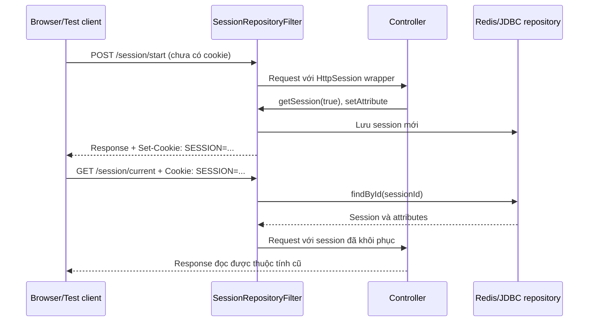

# Tạo phiên qua yêu cầu HTTP và gửi lại cookie ở yêu cầu tiếp theo

Trong ứng dụng Spring chạy trên Servlet stack, một session thường bắt đầu khi request gọi `HttpServletRequest.getSession()` hoặc khi một thành phần như Spring Security cần lưu trạng thái. Với Spring Session, `SessionRepositoryFilter` thay thế cách Servlet container giữ session trong memory bằng một repository như Redis hoặc JDBC.

Khi request đầu tiên tạo session, ứng dụng ghi thuộc tính vào `HttpSession`. Cuối request, Spring Session lưu thay đổi vào repository và gửi cookie session ID về trình duyệt qua header `Set-Cookie`. Ở request tiếp theo, trình duyệt gửi lại giá trị cookie trong header `Cookie`; Spring Session dùng ID đó để nạp đúng session từ repository. Kiểm thử phải xác minh toàn bộ chu trình HTTP này, không chỉ xác minh controller gọi được `getSession()`.

## 1. Vòng đời session qua hai request HTTP

### 1.1. Request đầu tiên tạo session

Một request có thể tạo session bằng:

```java
HttpSession session = request.getSession();
```

Hành vi tương đương với `request.getSession(true)`: nếu request chưa có session hợp lệ, Servlet API tạo một session mới. Ứng dụng có thể ghi thuộc tính:

```java
session.setAttribute("cartReference", "cart-42");
```

Spring Session bọc `HttpServletRequest`/`HttpSession` thông qua `SessionRepositoryFilter`. Ứng dụng vẫn dùng Servlet API quen thuộc, trong khi repository thực hiện lưu trữ session. Tùy `FlushMode` và cấu hình repository, thay đổi được lưu trong quá trình xử lý hoặc khi request kết thúc/response được commit.

### 1.2. Server gửi cookie bằng `Set-Cookie`

Khi session mới được tạo, Spring Session thường phát header tương tự:

```http
HTTP/1.1 200 OK
Set-Cookie: SESSION=<opaque-session-id>; Path=/; HttpOnly; Secure; SameSite=Lax
Content-Type: application/json
```

Tên cookie mặc định phổ biến của Spring Session là `SESSION`; ứng dụng có thể đổi tên bằng `CookieSerializer`. Giá trị là định danh opaque do server quản lý. Client không nên phân tích, tự tạo hoặc sửa giá trị này.

Cookie có thể có thêm `Domain`, `Max-Age` hoặc thuộc tính khác tùy cấu hình. `Secure` yêu cầu browser chỉ gửi cookie qua HTTPS; `HttpOnly` ngăn JavaScript đọc cookie; `SameSite` kiểm soát một số ngữ cảnh gửi cookie cross-site.

### 1.3. Request tiếp theo gửi lại cookie

Trình duyệt không gửi lại header `Set-Cookie`. Nó gửi cookie trong header `Cookie`:

```http
GET /session/current HTTP/1.1
Host: app.example.test
Cookie: SESSION=<opaque-session-id>
Accept: application/json
```

Spring Session dùng `HttpSessionIdResolver` để lấy session ID từ request. Cấu hình cookie mặc định dùng `CookieHttpSessionIdResolver`; resolver tìm cookie và chuyển ID cho `SessionRepositoryFilter`. Repository tìm session, khôi phục các thuộc tính và cung cấp `HttpSession` cho controller cùng các filter tiếp theo.

### 1.4. Sơ đồ chu trình



Điểm cần kiểm thử là thuộc tính ghi ở request đầu tiên phải đọc được ở request sau khi client gửi lại cookie. Chỉ kiểm tra status `200 OK` của hai request là chưa đủ.

## 2. `getSession()`, `getSession(true)` và `getSession(false)`

| Lệnh | Hành vi | Tình huống thường dùng |
|---|---|---|
| `getSession()` | Lấy session hiện tại hoặc tạo mới | Luồng thực sự cần bắt đầu trạng thái phiên |
| `getSession(true)` | Giống `getSession()` | Muốn thể hiện rõ ý định cho phép tạo |
| `getSession(false)` | Chỉ lấy session hiện có; không có thì trả `null` | Đọc trạng thái tùy chọn hoặc kiểm tra request đã có session chưa |

Ví dụ endpoint chỉ đọc session hiện có:

```java
@GetMapping("/session/current")
public SessionView current(HttpServletRequest request) {
    HttpSession session = request.getSession(false);
    if (session == null) {
        throw new ResponseStatusException(HttpStatus.UNAUTHORIZED);
    }

    String value = (String) session.getAttribute("probeValue");
    return new SessionView(value);
}
```

Endpoint này không tạo session mới khi cookie bị thiếu hoặc session đã hết hạn. Nếu dùng `getSession()` ở đây, request chưa có cookie có thể vô tình tạo session rỗng và che khuất lỗi mất cookie.

## 3. Ví dụ controller tạo và đọc session

Controller dưới đây tạo session bằng POST, lưu một giá trị kiểm thử và đọc lại bằng GET. Trong ứng dụng thực tế, các endpoint cần được bảo vệ bằng Spring Security và chính sách CSRF phù hợp.

```java
import jakarta.servlet.http.HttpServletRequest;
import jakarta.servlet.http.HttpSession;
import org.springframework.http.HttpStatus;
import org.springframework.web.bind.annotation.GetMapping;
import org.springframework.web.bind.annotation.PostMapping;
import org.springframework.web.bind.annotation.RequestMapping;
import org.springframework.web.bind.annotation.RestController;
import org.springframework.web.server.ResponseStatusException;

@RestController
@RequestMapping("/session")
public class SessionProbeController {

    @PostMapping("/start")
    public SessionView start(HttpServletRequest request) {
        HttpSession session = request.getSession(true);
        session.setAttribute("probeValue", "created-by-first-request");
        session.setAttribute("visitCount", 1);
        return new SessionView("created-by-first-request", 1);
    }

    @GetMapping("/current")
    public SessionView current(HttpServletRequest request) {
        HttpSession session = request.getSession(false);
        if (session == null) {
            throw new ResponseStatusException(HttpStatus.UNAUTHORIZED);
        }

        String value = (String) session.getAttribute("probeValue");
        Integer count = (Integer) session.getAttribute("visitCount");
        return new SessionView(value, count == null ? 0 : count);
    }

    public record SessionView(String value, int visitCount) {
    }
}
```

Không trả session ID cho client chỉ để kiểm thử. Có thể xác minh sự liên tục của session thông qua thuộc tính nghiệp vụ được lưu và khôi phục. Nếu cần chẩn đoán nội bộ, dùng correlation ID hoặc thông tin đã được che/mã hóa phù hợp, không ghi raw session ID vào log.

## 4. Cấu hình cookie Spring Session

### 4.1. Dùng `DefaultCookieSerializer`

Có thể cấu hình tên và thuộc tính cookie bằng `CookieSerializer`:

```java
import org.springframework.context.annotation.Bean;
import org.springframework.context.annotation.Configuration;
import org.springframework.session.web.http.CookieSerializer;
import org.springframework.session.web.http.DefaultCookieSerializer;

@Configuration
public class SessionCookieConfiguration {

    @Bean
    CookieSerializer cookieSerializer() {
        DefaultCookieSerializer serializer = new DefaultCookieSerializer();
        serializer.setCookieName("SESSION");
        serializer.setCookiePath("/");
        serializer.setUseHttpOnlyCookie(true);
        serializer.setUseSecureCookie(true);
        serializer.setSameSite("Lax");
        return serializer;
    }
}
```

`Secure=true` phù hợp khi ứng dụng public luôn chạy qua HTTPS. Trong môi trường local HTTP, browser có thể không gửi cookie Secure; có thể cấu hình riêng cho profile test/dev nhưng không để cấu hình yếu lọt vào production. Nếu luồng OIDC cần cookie cross-site, kiểm tra liệu `SameSite=None; Secure` có cần thiết không và thử nghiệm trên browser thật.

### 4.2. Cookie name phải thống nhất với test

Nếu đổi tên cookie thành `APP_SESSION`, test phải tìm `APP_SESSION`, không tiếp tục tìm `SESSION`. Không hard-code tên cookie rải rác trong nhiều test; có thể đặt một hằng số test hoặc đọc cấu hình dùng chung.

### 4.3. Cookie session và session timeout là hai điều khác nhau

Cookie phiên của browser có thể không có `Max-Age`, nhưng session trong Redis/JDBC vẫn có `maxInactiveInterval`. Ngược lại, cookie có thể còn ở browser sau khi server đã xóa session. Vì vậy, request gửi cookie cũ có thể không khôi phục được session.

Test cần phân biệt:

- Cookie không có trong request.
- Cookie có nhưng session ID không tồn tại trong repository.
- Session tồn tại nhưng đã hết inactivity timeout.
- Session tồn tại và còn hợp lệ.

## 5. Kiểm thử chu trình cookie bằng MockMvc

### 5.1. Vì sao phải kiểm thử qua filter chain?

`MockMvc` gửi request qua Spring MVC và các servlet filter đã đăng ký trong test context. Khi Spring Session được cấu hình đúng, `SessionRepositoryFilter` tham gia xử lý request, đọc cookie và ghi response cookie.

Một test chỉ gọi trực tiếp controller hoặc gắn `MockHttpSession` bằng `.session(...)` có thể kiểm tra logic controller nhưng không chứng minh cookie serializer, resolver và repository hoạt động. Để kiểm tra hợp đồng HTTP, hãy lấy cookie từ response đầu tiên rồi gửi chính cookie đó ở request kế tiếp.

### 5.2. Test lấy cookie từ response và gửi lại

Ví dụ với Spring Boot test, MockMvc và Spring Session Redis đã được cấu hình trong application context:

```java
import static org.hamcrest.Matchers.is;
import static org.springframework.security.test.web.servlet.request.SecurityMockMvcRequestPostProcessors.csrf;
import static org.springframework.test.web.servlet.request.MockMvcRequestBuilders.get;
import static org.springframework.test.web.servlet.request.MockMvcRequestBuilders.post;
import static org.springframework.test.web.servlet.result.MockMvcResultMatchers.jsonPath;
import static org.springframework.test.web.servlet.result.MockMvcResultMatchers.status;

import jakarta.servlet.http.Cookie;
import org.junit.jupiter.api.Test;
import org.springframework.beans.factory.annotation.Autowired;
import org.springframework.boot.test.autoconfigure.web.servlet.AutoConfigureMockMvc;
import org.springframework.boot.test.context.SpringBootTest;
import org.springframework.http.HttpHeaders;
import org.springframework.test.web.servlet.MvcResult;
import org.springframework.test.web.servlet.MockMvc;

import static org.junit.jupiter.api.Assertions.assertNotNull;
import static org.junit.jupiter.api.Assertions.assertTrue;

@SpringBootTest
@AutoConfigureMockMvc
class SessionCookieFlowTest {

    @Autowired
    MockMvc mockMvc;

    @Test
    void createsSessionAndRestoresItFromCookieOnNextRequest() throws Exception {
        MvcResult first = this.mockMvc.perform(post("/session/start").with(csrf()))
            .andExpect(status().isOk())
            .andExpect(jsonPath("$.visitCount", is(1)))
            .andReturn();

        String setCookie = first.getResponse().getHeader(HttpHeaders.SET_COOKIE);
        assertNotNull(setCookie, "The first response should issue a session cookie");
        assertTrue(setCookie.contains("HttpOnly"));

        Cookie sessionCookie = first.getResponse().getCookie("SESSION");
        assertNotNull(sessionCookie, "The response should contain the configured session cookie");

        this.mockMvc.perform(get("/session/current").cookie(sessionCookie))
            .andExpect(status().isOk())
            .andExpect(jsonPath("$.value", is("created-by-first-request")))
            .andExpect(jsonPath("$.visitCount", is(1)));
    }
}
```

Test dùng `spring-security-test` để thêm CSRF token cho POST nếu CSRF đang bật. Nếu ứng dụng dùng tên cookie khác, thay `SESSION` bằng tên đã cấu hình. `getCookie` lấy cookie từ mock response; giá trị được gửi lại nguyên vẹn mà không decode hoặc tự dựng.

### 5.3. Kiểm tra header và thuộc tính cookie

Ngoài việc kiểm tra cookie tồn tại, có thể xác minh:

- `Path` đúng với ứng dụng.
- `HttpOnly` được bật.
- `Secure` có mặt trong môi trường HTTPS/test cấu hình Secure.
- `SameSite` phù hợp với luồng điều hướng.
- `Domain` không rộng hơn phạm vi cần thiết.

`MockHttpServletResponse` có thể cung cấp cookie qua `getCookie` và header `Set-Cookie`. Cách biểu diễn header có thể khác giữa Servlet container và mock implementation; nếu cần xác minh browser thực sự tuân thủ Secure/SameSite, phải có browser integration test.

### 5.4. Test request không có cookie

```java
@Test
void requestWithoutCookieDoesNotRestorePreviousSession() throws Exception {
    this.mockMvc.perform(get("/session/current"))
        .andExpect(status().isUnauthorized());
}
```

Endpoint `current` dùng `getSession(false)`, do đó không tạo session mới để thay thế session cũ. Nếu Security filter chain hoặc request cache tạo session trước controller, kiểm tra cấu hình filter và phân biệt session do Security tạo với session do controller tạo.

## 6. Kiểm thử với repository thực và Redis/JDBC

### 6.1. Vì sao nên có integration test?

Một test dùng repository in-memory có thể kiểm tra logic cookie/filter, nhưng không chứng minh Redis serialization, TTL, JDBC schema, index hoặc kết nối kho hoạt động. Nên có ít nhất một integration test với repository thật trong môi trường cô lập.

Với Redis, Testcontainers có thể khởi chạy Redis riêng cho test:

```java
import org.junit.jupiter.api.Test;
import org.springframework.test.context.DynamicPropertyRegistry;
import org.springframework.test.context.DynamicPropertySource;
import org.testcontainers.containers.GenericContainer;
import org.testcontainers.junit.jupiter.Container;
import org.testcontainers.junit.jupiter.Testcontainers;
import org.testcontainers.utility.DockerImageName;

@Testcontainers
@SpringBootTest
@AutoConfigureMockMvc
class RedisSessionCookieIntegrationTest {

    @Container
    static final GenericContainer<?> redis =
        new GenericContainer<>(DockerImageName.parse("redis:7.4-alpine"))
            .withExposedPorts(6379);

    @DynamicPropertySource
    static void redisProperties(DynamicPropertyRegistry registry) {
        registry.add("spring.data.redis.host", redis::getHost);
        registry.add("spring.data.redis.port", () -> redis.getMappedPort(6379));
        registry.add("spring.session.redis.namespace", () -> "test:servlet-session");
    }

    // Inject MockMvc và thực hiện cùng chu trình create-cookie-read.
}
```

Ví dụ giả định dự án đã có dependency Spring Session Redis, Redis starter, Spring Boot test và Testcontainers. Tên property cần khớp phiên bản Spring Boot đang dùng. Nếu dự án cấu hình bằng `@EnableRedisHttpSession`, bảo đảm annotation và properties không tạo hai cấu hình repository cạnh tranh.

### 6.2. Test với JDBC

Với `JdbcIndexedSessionRepository`, chạy test trên database container hoặc database test cô lập đã áp dụng schema Spring Session. Test tương tự: tạo session, lấy cookie, gửi lại cookie và xác minh thuộc tính được khôi phục. Bổ sung kiểm tra cleanup/timeout nếu bài test cần xác minh vòng đời JDBC.

Không dùng database production để chạy test tạo session ngẫu nhiên. Dùng schema riêng, dữ liệu seed có thể xóa và cấu hình cleanup sau test.

### 6.3. Kiểm tra repository trực tiếp khi cần chẩn đoán

Có thể inject `SessionRepository` trong test để xác minh session được lưu, nhưng không để thao tác repository thay thế kiểm tra HTTP cookie. Hai lớp kiểm tra bổ sung cho nhau:

- HTTP test chứng minh cookie được phát và gửi lại.
- Repository test chứng minh session ID được lưu/nạp đúng trong kho.

Không đưa session ID vào assertion message hoặc log CI nếu log có thể được chia sẻ rộng.

## 7. Kiểm thử chuyển session qua nhiều instance

### 7.1. Hai instance cùng dùng một repository

Để kiểm tra khả năng chuyển request sang node khác, chạy hai instance A và B cùng trỏ tới Redis/JDBC namespace hoặc schema dùng chung:

1. Gửi request tạo session tới A.
2. Lấy cookie `SESSION` từ response A.
3. Gửi request tiếp theo tới B và đính kèm đúng cookie đó.
4. Xác minh B đọc được thuộc tính đã ghi ở A.
5. Cập nhật session ở B rồi gửi request kế tiếp tới A để xác minh thay đổi được chia sẻ theo semantics repository.

Không dùng hai repository in-memory độc lập. Test đó chỉ chứng minh hai ứng dụng không chia sẻ session.

### 7.2. Cookie giống nhau nhưng repository khác nhau

Nếu A và B dùng Redis database, namespace hoặc JDBC schema khác nhau, cookie có thể có cùng tên và giá trị nhưng B không tìm thấy session. Request sẽ được xem là không có session hợp lệ. Đây là cấu hình sai nếu mục tiêu là failover/chia sẻ session.

Nếu hai ứng dụng không nên chia sẻ session, repository riêng là chủ ý và cookie nên được phân vùng phù hợp. Test cần thể hiện rõ kiến trúc mong muốn.

### 7.3. Load balancer và affinity cookie

Nếu có sticky session, phân biệt cookie route do load balancer phát với cookie `SESSION` của Spring Session. Test failover nên:

- Tạo session ở node A.
- Giữ cookie session và route cookie.
- Đánh dấu A unhealthy hoặc dừng A.
- Gửi request tiếp theo với cookie session cũ.
- Xác minh load balancer chuyển tới B và B khôi phục được session.

Cookie affinity không được coi là bằng chứng xác thực và không thay thế shared repository.

## 8. Session ID rotation, logout và cookie cũ

### 8.1. Session ID có thể thay đổi sau đăng nhập

Spring Security bảo vệ chống session fixation bằng cách thay đổi session ID sau khi xác thực, tùy chiến lược session authentication. Response đăng nhập có thể phát `Set-Cookie` với ID mới. Client phải dùng cookie mới cho request tiếp theo.

Trong test login, không giữ cookie trước đăng nhập rồi giả định nó vẫn là cookie hiện tại. Hãy lấy cookie mới nhất từ response login và gửi lại.

### 8.2. Logout và xóa cookie

Khi logout, Spring Security thường invalidate `HttpSession`; Spring Session xóa dữ liệu khỏi repository và resolver gửi cookie hết hạn. Test nên kiểm tra cả hai kết quả:

- Session ID cũ không còn được repository nạp.
- Response logout có cookie hết hạn phù hợp.

Nếu chỉ kiểm tra redirect tới trang logout thành công, có thể bỏ sót session chưa bị xóa.

### 8.3. Cookie cũ không khôi phục session đã xóa

Sau khi session bị xóa hoặc hết hạn, browser vẫn có thể gửi cookie cũ. Spring Session tìm ID nhưng repository không trả session hợp lệ. `getSession(false)` trả `null`; nếu endpoint gọi `getSession(true)`, nó có thể tạo session mới với ID khác. Vì vậy, test cần phân biệt session cũ không còn tồn tại với session mới vô tình được tạo.

## 9. Kiểm thử timeout và cookie policy

### 9.1. Inactivity timeout

`maxInactiveInterval` xác định thời gian không hoạt động tối đa. Có thể cấu hình timeout ngắn trong profile test để xác minh session hết hạn mà không phải chờ lâu. Tuy nhiên, test dựa trên `Thread.sleep` thường chậm và dễ flaky; ưu tiên clock có thể điều khiển nếu repository/test harness hỗ trợ, hoặc kiểm tra repository expiry với khoảng thời gian đủ dư.

### 9.2. Cookie hết hạn và server-side expiration

Cookie `Max-Age` và session TTL là hai cơ chế riêng. Browser có thể xóa cookie trước khi server hết hạn; server cũng có thể xóa session trước khi cookie hết hạn. Test server-side nên xác minh repository từ chối session ID hết hạn, còn browser test xác minh cookie policy.

### 9.3. Secure và SameSite

MockMvc gửi cookie trực tiếp theo test builder; nó không mô phỏng đầy đủ chính sách browser về HTTPS, third-party cookie, SameSite hoặc domain. Dùng Selenium/Playwright hoặc browser automation trong integration environment khi cần kiểm tra:

- Cookie Secure chỉ được gửi qua HTTPS.
- HttpOnly không truy cập được từ JavaScript.
- SameSite phù hợp với form POST và OIDC redirect/callback.
- Domain/Path không làm cookie bị gửi tới host hoặc ứng dụng ngoài phạm vi.

## 10. Các lỗi thường gặp trong test

| Hiện tượng | Nguyên nhân có thể | Cách kiểm tra |
|---|---|---|
| Request đầu thành công nhưng không có cookie | Session chưa được tạo, response chưa commit hoặc filter chưa đăng ký | Xác minh `getSession(true)`, `SessionRepositoryFilter` và `Set-Cookie` |
| Request sau luôn tạo session mới | Cookie không được gửi, sai tên/path/domain hoặc resolver không đọc được | Kiểm tra `Cookie` request header và `CookieSerializer` |
| Test dùng `.session(MockHttpSession)` pass nhưng browser fail | Test bỏ qua cookie serializer/resolver | Lấy cookie từ response đầu và gửi lại qua `.cookie(...)` |
| Cookie có nhưng thuộc tính session bị null | Session không được lưu, repository khác hoặc serializer lỗi | Kiểm tra repository, flush mode, log serialization và namespace |
| Node B không đọc session do A tạo | Hai node dùng kho/namespace/schema khác nhau | So sánh cấu hình Redis/JDBC và cookie resolver |
| Cookie bị browser bỏ qua | Secure, SameSite, Domain hoặc Path không phù hợp | Kiểm tra DevTools và HTTPS/proxy |
| Login xong cookie cũ không dùng được | Session ID đã được rotate | Lấy cookie từ response login mới nhất |
| Logout redirect đúng nhưng session vẫn còn | Chưa invalidate hoặc logout handler không chạy | Kiểm tra repository và cookie hết hạn |
| Test không có cookie nhưng vẫn có session | Security request cache/CSRF hoặc controller tự tạo session | Kiểm tra filter chain và các lệnh `getSession()` |
| Test Redis pass nhưng JDBC fail | Schema, index hoặc repository configuration chưa đúng | Chạy migration/schema và kiểm tra JDBC repository |
| Test flaky khi kiểm tra timeout | Dựa vào sleep sát ngưỡng TTL hoặc cleanup bất đồng bộ | Tăng biên thời gian, kiểm tra logic expiry riêng với cleanup vật lý |

## 11. Checklist cho một bài test HTTP session

Trước khi coi test là đầy đủ, xác minh:

1. Test context đăng ký đúng `SessionRepositoryFilter` và chỉ có một cơ chế session repository.
2. Request đầu tiên thực sự gọi `getSession(true)` hoặc một thành phần có chủ đích tạo session.
3. Response đầu có `Set-Cookie` với tên cookie đã cấu hình.
4. Cookie được lấy từ response, không tự tạo session ID giả.
5. Request tiếp theo gửi cookie trong header `Cookie`.
6. Controller dùng `getSession(false)` khi cần xác minh session đã được khôi phục.
7. Thuộc tính đã ghi ở request đầu được đọc đúng ở request sau.
8. Test kiểm tra cookie attributes theo môi trường phù hợp.
9. Integration test dùng Redis/JDBC thật xác minh repository persistence.
10. Multi-node test gửi cookie từ node A sang node B cùng shared repository.
11. Test logout/timeout xác minh ID cũ không còn khôi phục được.
12. Test không ghi raw cookie hoặc session ID vào log.

## 12. Quy trình thực hành từ đầu đến cuối

Một quy trình kiểm thử ngắn gọn có thể thực hiện như sau:

1. Cấu hình Spring Session Redis hoặc JDBC và bảo đảm filter được đăng ký trước các filter cần dùng `HttpSession`.
2. Tạo endpoint test POST dùng `getSession(true)` và ghi một thuộc tính nhỏ.
3. Gửi request đầu bằng MockMvc, kiểm tra status và header `Set-Cookie`.
4. Lấy cookie theo đúng tên đã cấu hình từ response.
5. Gửi GET tiếp theo với `.cookie(sessionCookie)`.
6. Kiểm tra endpoint đọc được thuộc tính cũ qua `getSession(false)`.
7. Gửi request tới node khác cùng repository và kiểm tra cùng kết quả.
8. Kiểm thử thiếu cookie, cookie cũ, logout, session timeout và ID rotation.
9. Chạy browser test để xác minh Secure, HttpOnly, SameSite, Domain và Path.
10. Chạy integration test với Redis/JDBC riêng và kiểm tra cleanup sau test.

Khi request đầu tạo session, Spring Session lưu session vào repository và phát cookie qua `Set-Cookie`. Client gửi lại giá trị cookie trong header `Cookie` ở request kế tiếp; `SessionRepositoryFilter` dùng resolver và repository để khôi phục cùng session. Kiểm thử bằng cách lấy cookie thật từ response rồi gửi lại qua MockMvc chứng minh được cả giao kèo HTTP lẫn khả năng lưu/nạp session, đặc biệt khi cùng cookie được chuyển sang instance khác dùng chung Redis hoặc JDBC.

## Tài liệu tham khảo

- [Spring Session — HttpSession Integration](https://docs.spring.io/spring-session/reference/http-session.html)
- [Spring Session — Servlet API and SessionRepositoryFilter](https://docs.spring.io/spring-session/reference/api/java/org/springframework/session/web/http/SessionRepositoryFilter.html)
- [Spring Session — CookieHttpSessionIdResolver](https://docs.spring.io/spring-session/reference/api/java/org/springframework/session/web/http/CookieHttpSessionIdResolver.html)
- [Spring Session — DefaultCookieSerializer](https://docs.spring.io/spring-session/reference/api/java/org/springframework/session/web/http/DefaultCookieSerializer.html)
- [Spring Session — Redis Configuration](https://docs.spring.io/spring-session/reference/configuration/redis.html)
- [Spring Session — JDBC Configuration](https://docs.spring.io/spring-session/reference/configuration/jdbc.html)
- [Spring Framework — MockMvc](https://docs.spring.io/spring-framework/reference/testing/mockmvc.html)
- [Spring Security — Testing CSRF](https://docs.spring.io/spring-security/reference/servlet/test/mockmvc/csrf.html)
