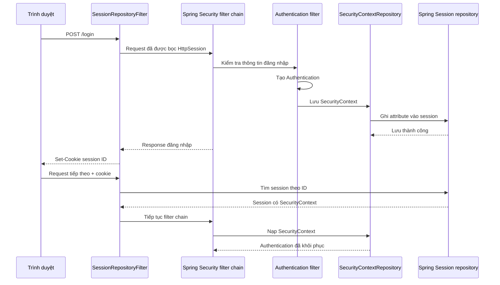
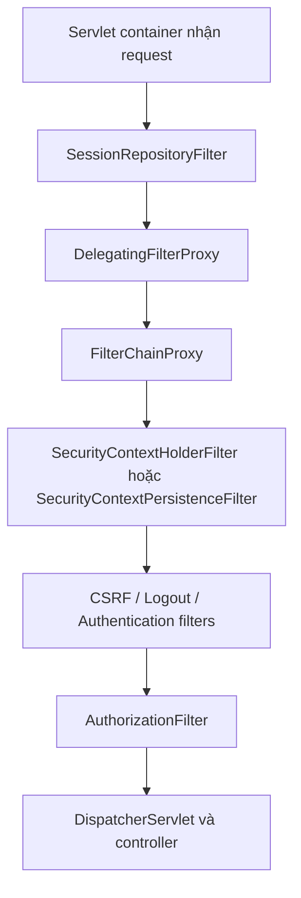

# Đăng nhập, SecurityContext và thứ tự filter thực tế

Trong ứng dụng Spring dùng Servlet, đăng nhập thường tạo hoặc cập nhật `SecurityContext` rồi lưu context đó vào HTTP session để request tiếp theo khôi phục trạng thái xác thực. Khi Spring Session thay session mặc định của Servlet bằng Redis, JDBC hoặc repository khác, việc kiểm thử cần xác nhận cả ba phần: quá trình đăng nhập thực tế, `SecurityContext` được lưu/đọc qua repository, và filter chạy đúng thứ tự để Spring Security sử dụng session của Spring Session.

Một test chỉ gắn `@WithMockUser` có thể kiểm tra authorization, nhưng không chứng minh form login đã tạo session, context được lưu xuống Redis/JDBC hay request kế tiếp khôi phục được context qua cookie. Muốn kiểm tra tích hợp thực tế, hãy gửi request đăng nhập, lấy cookie session trong response, rồi dùng chính cookie đó ở request mới.

## 1. SecurityContext được tạo và lưu như thế nào?

Spring Security lưu thông tin người dùng đã xác thực trong `SecurityContext`. Context thường chứa một `Authentication`, bao gồm principal, authorities và trạng thái authenticated. `SecurityContextHolder` cung cấp context cho code xử lý request hiện tại.

Trong ứng dụng Servlet stateful, `SecurityContextRepository` chịu trách nhiệm nạp và lưu `SecurityContext`. Cấu hình mặc định phổ biến là `HttpSessionSecurityContextRepository`, sử dụng `HttpSession` làm nơi lưu context giữa các request.

Khi Spring Session được bật, `SessionRepositoryFilter` bọc request/response để các thao tác `HttpSession` được chuyển tới `SessionRepository`. Vì vậy, `HttpSessionSecurityContextRepository` vẫn làm việc với API Servlet quen thuộc, còn session attributes được lưu vào Redis/JDBC thông qua Spring Session. Attribute thường dùng để chứa context là `SPRING_SECURITY_CONTEXT`.

Luồng khái quát:



Điểm quan trọng là cookie chỉ mang session ID. `SecurityContext` nằm trong session repository. Nếu cookie được gửi nhưng node không tìm thấy session, hoặc deserialize context thất bại, request tiếp theo có thể trở thành anonymous.

## 2. Vai trò của thứ tự filter

`SessionRepositoryFilter` phải chạy trước mọi filter cần truy cập `HttpSession`, đặc biệt là Spring Security filter chain. Filter này bọc request/response bằng wrapper của Spring Session để `request.getSession()` và các thao tác session được chuyển tới repository đã cấu hình.

Thứ tự khái quát:



Trong Spring Session Servlet, `SessionRepositoryFilter` được đăng ký với thứ tự rất sớm (mặc định `Ordered.HIGHEST_PRECEDENCE + 50` trong các phiên bản hỗ trợ). `springSecurityFilterChain` chạy sau đó. Bên trong `FilterChainProxy`, Spring Security quản lý thứ tự các security filters riêng.

Nếu security filter chạy trước `SessionRepositoryFilter`, một thành phần có thể tạo hoặc đọc container `HttpSession` trước khi Spring Session bọc request. Khi đó, `SecurityContext` có thể được lưu trong session cục bộ của Servlet container thay vì repository dùng chung. Triệu chứng có thể là đăng nhập hoạt động trên một node nhưng mất xác thực khi request chuyển sang node khác.

Không đăng ký `SessionRepositoryFilter` lần thứ hai nếu Spring Boot/Spring Session đã tự đăng ký. Một filter trùng lặp hoặc thứ tự thủ công không đúng có thể khiến request bị bọc nhiều lần và làm hành vi session khó dự đoán.

## 3. Filter bên trong Spring Security

Thứ tự bên trong Spring Security phụ thuộc phiên bản và cấu hình. Trong các phiên bản mới, `SecurityContextHolderFilter` thường được dùng để nạp `SecurityContext` vào `SecurityContextHolder`. Các phiên bản cũ hoặc cấu hình tương thích có thể dùng `SecurityContextPersistenceFilter`.

Một chuỗi phổ biến có thể gồm:

1. `WebAsyncManagerIntegrationFilter` tích hợp context với xử lý async của Servlet.
2. `SecurityContextHolderFilter` nạp context từ `SecurityContextRepository` (hoặc `SecurityContextPersistenceFilter` ở cấu hình cũ).
3. Các filter ghi header bảo mật và xử lý CORS/CSRF theo cấu hình.
4. `LogoutFilter` xử lý logout.
5. Authentication filters như `UsernamePasswordAuthenticationFilter` xử lý form login.
6. Các filter khác như remember-me, anonymous authentication và session management tùy cấu hình.
7. `ExceptionTranslationFilter` chuyển lỗi authentication/authorization thành response phù hợp.
8. `AuthorizationFilter` kiểm tra quyền trước khi request tới controller.

Đây là thứ tự minh họa, không phải danh sách cố định cho mọi ứng dụng. Spring Security chỉ chạy các filter phù hợp với request matcher và cấu hình thực tế. Hãy xem startup/debug logs hoặc cấu hình filter chain của phiên bản đang dùng khi cần xác nhận thứ tự chính xác.

## 4. Khác biệt SecurityContextPersistenceFilter và SecurityContextHolderFilter

Sự khác biệt này đặc biệt quan trọng khi viết code xác thực tùy chỉnh.

| Filter | Hành vi lưu context khái quát |
|---|---|
| `SecurityContextPersistenceFilter` | Theo mô hình cũ, nạp context đầu request và quản lý việc lưu context trở lại repository ở cuối request |
| `SecurityContextHolderFilter` | Nạp context theo mô hình mới; không tự động lưu mọi thay đổi trong `SecurityContextHolder` chỉ vì code đã đặt context |

Với mô hình mới, authentication mechanism chịu trách nhiệm lưu context qua `SecurityContextRepository` khi xác thực thành công. Các filter chuẩn như form login đã tích hợp logic này. Nhưng nếu ứng dụng tự viết filter đăng nhập, chỉ gọi `SecurityContextHolder.getContext().setAuthentication(authentication)` có thể không đủ để giữ trạng thái ở request tiếp theo.

Ví dụ về lưu tường minh trong một authentication filter tùy chỉnh:

```java
SecurityContext context = SecurityContextHolder.createEmptyContext();
context.setAuthentication(authentication);
SecurityContextHolder.setContext(context);

securityContextRepository.saveContext(context, request, response);
```

Đoạn code chỉ minh họa bước lưu sau khi `authentication` đã được xác minh. Filter tùy chỉnh còn phải xử lý lỗi, session fixation, failure handler, CSRF và thứ tự filter phù hợp. Ưu tiên dùng authentication mechanism chuẩn của Spring Security nếu có thể.

Không tự gọi `saveContext` nhiều lần ở các lớp không sở hữu vòng đời authentication. Hãy xác định rõ component nào chịu trách nhiệm ghi context để tránh ghi lặp hoặc ghi context chưa xác thực.

## 5. SecurityContextRepository và chính sách tạo session

`HttpSessionSecurityContextRepository` dùng session Servlet để lưu context. Spring Session thay backend của `HttpSession`, do đó context có thể được chia sẻ giữa các node nếu mọi node dùng cùng repository, serializer và cấu hình.

Một số chính sách session ảnh hưởng tới kết quả:

- `SessionCreationPolicy.IF_REQUIRED`: Spring Security có thể tạo session khi cần, phù hợp nhiều ứng dụng form login stateful.
- `SessionCreationPolicy.ALWAYS`: yêu cầu luôn tạo session.
- `SessionCreationPolicy.NEVER`: không chủ động tạo session nhưng có thể dùng session đã tồn tại.
- `SessionCreationPolicy.STATELESS`: không dùng HTTP session để lưu SecurityContext cho cơ chế xác thực đó.

Nếu ứng dụng đặt `STATELESS`, không kỳ vọng đăng nhập form tạo trạng thái SecurityContext lâu dài trong Spring Session repository. Với API bearer token stateless, điều đó có thể là chủ đích. Với ứng dụng web form login cần duy trì đăng nhập qua session, hãy chọn chính sách stateful phù hợp.

Trong Spring Security hiện đại, `SecurityContextRepository` có thể được cấu hình tường minh. Nếu thay repository mặc định bằng `RequestAttributeSecurityContextRepository` hoặc repository stateless khác, context có thể chỉ tồn tại trong request hiện tại. Kiểm tra bean/configuration thực tế thay vì giả định luôn dùng HttpSession.

## 6. Cấu hình ứng dụng Servlet dùng Spring Session

Ví dụ dưới đây dùng Redis làm shared store. Ứng dụng có thể dùng JDBC thay thế; phần quan trọng với filter/security là repository được Spring Session đăng ký trước Spring Security.

```java
import org.springframework.context.annotation.Configuration;
import org.springframework.session.data.redis.config.annotation.web.http.EnableRedisHttpSession;

@Configuration
@EnableRedisHttpSession(maxInactiveIntervalInSeconds = 1800)
class SpringSessionConfiguration {
}
```

Security chain stateful với form login:

```java
import org.springframework.context.annotation.Bean;
import org.springframework.context.annotation.Configuration;
import org.springframework.security.config.annotation.web.builders.HttpSecurity;
import org.springframework.security.web.SecurityFilterChain;

@Configuration
class SecurityConfiguration {

    @Bean
    SecurityFilterChain securityFilterChain(HttpSecurity http) throws Exception {
        http
            .authorizeHttpRequests(auth -> auth
                .requestMatchers("/login", "/error").permitAll()
                .anyRequest().authenticated())
            .formLogin(form -> form.permitAll())
            .logout(logout -> logout.permitAll());

        return http.build();
    }
}
```

Đây là ví dụ cấu hình Servlet. Với Spring Boot auto-configuration, không thêm `@EnableRedisHttpSession` nếu ứng dụng đã bật Spring Session bằng cơ chế khác và việc thêm annotation sẽ tạo cấu hình trùng. Nếu dùng JDBC, thay cấu hình Redis bằng repository JDBC tương ứng. Trong production, các node cần dùng chung backend và cùng serializer/schema.

## 7. Kiểm thử phân biệt mock authentication và login thật

Spring Security Test cung cấp một số cách đưa Authentication vào test. Mỗi cách xác minh một phạm vi khác nhau:

| Cách kiểm thử | Xác minh được | Không tự chứng minh |
|---|---|---|
| `@WithMockUser` | Controller/authorization xử lý principal và authorities trong test context | Form login, password validation, session cookie hoặc persistence qua repository |
| `.with(user("alice"))` | Request được chạy với Authentication giả lập | Authentication filter đã xác thực credentials thật |
| `.with(authentication(...))` | Hành vi với Authentication object cụ thể | SecurityContext được lưu và khôi phục qua request khác |
| POST `/login` rồi gửi lại cookie session | Luồng authentication và session persistence qua filter/repository đang được test | Không thay thế kiểm thử browser/proxy nếu cookie policy ngoài trình duyệt cũng quan trọng |

Vì chủ đề này tập trung vào đăng nhập và SecurityContext thực tế, cần có ít nhất một integration test gửi credentials tới login endpoint, sau đó gửi cookie session trong request mới.

## 8. Integration test với MockMvc và cookie Spring Session

Ví dụ dưới đây giả định:

- Ứng dụng chạy Servlet với Spring Session.
- Spring Security dùng form login và `HttpSessionSecurityContextRepository` theo cấu hình stateful.
- Cookie serializer dùng tên mặc định `SESSION`; nếu ứng dụng đổi tên, test phải dùng tên thực tế.
- Test context cung cấp một user hợp lệ tên `alice` và password test đã được encode theo cấu hình.
- `/whoami` là endpoint được bảo vệ và trả về tên principal.

```java
import static org.springframework.security.test.web.servlet.request.SecurityMockMvcRequestPostProcessors.csrf;
import static org.springframework.test.web.servlet.request.MockMvcRequestBuilders.get;
import static org.springframework.test.web.servlet.request.MockMvcRequestBuilders.post;
import static org.springframework.test.web.servlet.result.MockMvcResultMatchers.content;
import static org.springframework.test.web.servlet.result.MockMvcResultMatchers.redirectedUrlPattern;
import static org.springframework.test.web.servlet.result.MockMvcResultMatchers.status;

import jakarta.servlet.http.Cookie;
import org.junit.jupiter.api.Test;
import org.springframework.beans.factory.annotation.Autowired;
import org.springframework.boot.test.autoconfigure.web.servlet.AutoConfigureMockMvc;
import org.springframework.boot.test.context.SpringBootTest;
import org.springframework.test.web.servlet.MockMvc;
import org.springframework.test.web.servlet.MvcResult;

import static org.assertj.core.api.Assertions.assertThat;

@SpringBootTest
@AutoConfigureMockMvc
class LoginSessionIntegrationTests {

    @Autowired
    MockMvc mockMvc;

    @Test
    void loginPersistsSecurityContextForNextRequest() throws Exception {
        MvcResult login = mockMvc.perform(post("/login")
                        .with(csrf())
                        .param("username", "alice")
                        .param("password", "test-password"))
                .andExpect(status().is3xxRedirection())
                .andReturn();

        Cookie sessionCookie = login.getResponse().getCookie("SESSION");
        assertThat(sessionCookie).isNotNull();

        mockMvc.perform(get("/whoami").cookie(sessionCookie))
                .andExpect(status().isOk())
                .andExpect(content().string("alice"));
    }
}
```

`@SpringBootTest` cùng `@AutoConfigureMockMvc` cho phép kiểm thử filter chain được đăng ký trong ứng dụng. Trong test context thực tế, cần có user fixture hợp lệ, password encoder và endpoint `/whoami`. Nếu ứng dụng dùng cookie name khác, hãy lấy đúng cookie name đã cấu hình. Login có thể xoay session ID theo session fixation protection; vì vậy hãy dùng cookie được trả về từ response đăng nhập thành công.

Nếu tự dựng MockMvc bằng `MockMvcBuilders.webAppContextSetup`, phải áp dụng Spring Security integration bằng `.apply(springSecurity())` và bảo đảm `SessionRepositoryFilter` cũng nằm trong chuỗi filter theo đúng thứ tự. Một MockMvc chỉ thêm `springSecurity()` mà bỏ qua filter Spring Session sẽ không chứng minh session được lưu vào Redis/JDBC.

## 9. Vì sao không nên dùng MockHttpSession để chứng minh persistence?

`MockHttpSession` hữu ích để kiểm tra controller hoặc filter với một session giả trong cùng test. Nhưng nếu test tạo `MockHttpSession` rồi gọi `.session(mockSession)` cho request sau, nó có thể bỏ qua cookie resolver và lookup repository thực tế.

Để xác minh Spring Session:

- Gửi cookie session ID trong request mới thay vì chuyền cùng object `MockHttpSession`.
- Bảo đảm `SessionRepositoryFilter` đã chạy trong MockMvc.
- Dùng repository test thật hoặc Testcontainers Redis/JDBC nếu cần xác minh backend.
- Với nhiều instance, ghi session qua node A và đọc qua node B.
- Không đọc hoặc assert trực tiếp key Redis nội bộ nếu có thể xác minh qua HTTP/API; cấu trúc key là chi tiết implementation.

Một test dùng in-memory `MapSessionRepository` chỉ chứng minh filter và repository map tích hợp trong một process. Nó không chứng minh dữ liệu bền vững sau restart hoặc chia sẻ giữa nhiều process.

## 10. Kiểm thử SecurityContext được lưu trong session

Sau login thành công, có thể kiểm tra session attributes trong test nếu cần chẩn đoán, nhưng không nên phụ thuộc quá mức vào tên attribute nội bộ. Bằng chứng hành vi tốt hơn là request thứ hai có cùng cookie và controller nhận đúng principal/authorities.

Một endpoint test-only có thể trả thông tin principal:

```java
import org.springframework.security.core.Authentication;
import org.springframework.web.bind.annotation.GetMapping;
import org.springframework.web.bind.annotation.RestController;

@RestController
class WhoAmIController {

    @GetMapping("/whoami")
    String whoAmI(Authentication authentication) {
        return authentication.getName();
    }
}
```

Trong production, không nhất thiết tạo endpoint này; có thể kiểm tra một endpoint nghiệp vụ chỉ người dùng đã đăng nhập mới truy cập được. Test nên xác nhận cả:

- Principal đúng người dùng đã đăng nhập.
- Authorities đúng theo user fixture.
- Request không gửi cookie bị từ chối hoặc chuyển tới login theo cấu hình.
- Request có cookie nhưng session đã bị invalidate không còn authenticated.
- Logout làm session bị vô hiệu hóa và cookie được xóa đúng scope.

## 11. Kiểm thử session fixation và đổi session ID

Spring Security có session fixation protection. Sau khi xác thực, framework có thể thay đổi session ID hoặc migrate session attributes theo strategy đang cấu hình. Spring Session cần nhận được thao tác thay đổi ID qua wrapper/repository để ID cũ không còn được dùng như phiên đã xác thực.

Test nên so sánh trạng thái trước và sau login:

1. Gửi request anonymous làm phát sinh session nếu ứng dụng có tạo session trước login.
2. Lấy cookie trước login nếu có.
3. Đăng nhập thành công.
4. Lấy cookie session mới từ response login.
5. Xác nhận request với cookie mới được xác thực.
6. Xác nhận cookie/ID cũ không còn được dùng để tiếp tục phiên đã xác thực theo strategy.

Không giả định cookie trước login luôn tồn tại; session có thể chỉ được tạo khi login. Test phải phù hợp với `SessionCreationPolicy`, CSRF và cách ứng dụng tạo session.

## 12. Kiểm thử thứ tự filter thực tế

Khi nghi ngờ session bị tạo trong Servlet container thay vì Spring Session, cần xác minh thứ tự filter trong ứng dụng đang chạy, không chỉ dựa vào cấu hình mong muốn.

Các điểm kiểm tra:

- `SessionRepositoryFilter` được đăng ký và chạy trước `springSecurityFilterChain`.
- `SessionRepositoryFilter` không bị đăng ký trùng bởi cả auto-configuration và `FilterRegistrationBean` thủ công.
- Security filter chain dùng `HttpSessionSecurityContextRepository` nếu ứng dụng cần stateful session.
- Filter tùy chỉnh đọc `HttpSession` phải chạy sau `SessionRepositoryFilter`.
- Authentication filter tùy chỉnh nằm đúng vị trí so với `SecurityContextHolderFilter`, logout và authorization filters.
- Không có filter hoặc servlet component tạo session sớm trước khi Spring Session bọc request.

Có thể bật debug logging cho Spring Security trong môi trường test để xem các filter được đặt trong chain và filter nào xử lý request. Không bật log nhạy cảm ở production; log filter không nên ghi cookie hoặc session ID.

Nếu tự đăng ký filter bằng `FilterRegistrationBean`, đặt order rõ ràng và xác nhận so với order mặc định của Spring Session. Không chọn một số order tùy ý mà không xem `SessionRepositoryFilter.DEFAULT_ORDER` và thứ tự security proxy của phiên bản dự án.

## 13. Kiểm thử logout và request sau logout

Logout mặc định của Spring Security thường xóa SecurityContext, invalidate session theo cấu hình và xóa cookie session. Với Spring Session, việc invalidate phải đi qua `HttpSession` wrapper để repository xóa session dùng chung.

Ví dụ test logout bằng cookie đã đăng nhập:

```java
MvcResult login = mockMvc.perform(post("/login")
                .with(csrf())
                .param("username", "alice")
                .param("password", "test-password"))
        .andExpect(status().is3xxRedirection())
        .andReturn();

Cookie sessionCookie = login.getResponse().getCookie("SESSION");

mockMvc.perform(post("/logout")
                .with(csrf())
                .cookie(sessionCookie))
        .andExpect(status().is3xxRedirection());

mockMvc.perform(get("/whoami").cookie(sessionCookie))
        .andExpect(status().is3xxRedirection());
```

Đoạn test minh họa luồng logout mặc định form login. Ứng dụng có thể cấu hình logout URL, success handler hoặc response status khác. Nếu endpoint trả `204`, hãy assert status đó. Điều cần xác minh là cookie cũ không còn khôi phục một `SecurityContext` hợp lệ.

## 14. Test với Redis/JDBC và nhiều instance

Để chứng minh dữ liệu session được lưu vào kho dùng chung, cần integration test có backend thật hoặc container tương ứng.

Một kịch bản nhiều node:

1. Khởi động Redis hoặc database test.
2. Khởi động node A và node B với cùng session repository, namespace/schema và serializer.
3. Gửi POST `/login` tới node A.
4. Lấy cookie session từ response A.
5. Gửi GET endpoint được bảo vệ tới node B với cookie đó.
6. Xác nhận node B nhận đúng principal và authorities.
7. Gửi logout tới node A hoặc B.
8. Gửi lại request được bảo vệ tới node còn lại bằng cookie cũ và xác nhận bị từ chối.
9. Khởi động lại node A hoặc B rồi lặp lại request để xác minh session vẫn được backend giữ nếu backend durability hỗ trợ.

Kịch bản này kiểm tra đồng thời filter order, cookie resolver, repository dùng chung, serializer và SecurityContext persistence. Nếu chỉ dùng một node và in-memory repository, test không bao phủ các failure mode nhiều instance.

## 15. Lỗi thường gặp và cách chẩn đoán

| Hiện tượng | Nguyên nhân có thể | Cách kiểm tra |
|---|---|---|
| Login thành công nhưng request tiếp theo anonymous | Context chưa được save, cookie không được gửi, repository không tìm thấy session hoặc serializer lỗi | Kiểm tra cookie, SecurityContextRepository và repository read-after-write |
| Session có nhưng SecurityContext mất | Dùng repository stateless/request-only hoặc filter không lưu context | Kiểm tra `SessionCreationPolicy`, `SecurityContextRepository` và save semantics |
| Hoạt động ở node A nhưng mất ở B | Session lưu trong container/local map hoặc filter order sai | Kiểm tra shared store và `SessionRepositoryFilter` chạy trước Security |
| `JSESSIONID` xuất hiện thay vì cookie Spring Session | Spring Session filter chưa chạy, cấu hình chưa bật hoặc container session được tạo trước | Kiểm tra filter registration và cookie serializer |
| Test `@WithMockUser` pass nhưng login thật fail | Test chỉ inject Authentication giả lập | Thêm integration test POST login và gửi lại cookie |
| Login custom chỉ hoạt động trong request đầu | Đã đặt `SecurityContextHolder` nhưng không save context theo mô hình mới | Gọi `SecurityContextRepository.saveContext` từ authentication mechanism phù hợp |
| Session ID không đổi sau login như mong đợi | Session fixation strategy hoặc filter chain tùy chỉnh sai | Kiểm tra session management và repository wrapper |
| Logout node A nhưng node B vẫn authenticated | Repository/store không chia sẻ hoặc invalidation/event propagation có vấn đề | Kiểm tra cùng backend, cache và session lookup trên B |
| Filter chạy hai lần | Filter được đăng ký qua nhiều cơ chế | Kiểm tra FilterRegistrationBean và auto-configuration |
| MockMvc test không thấy cookie `SESSION` | Test thiếu Spring Session filter hoặc cookie name đã tùy chỉnh | Xác nhận filter chain, resolver và cấu hình serializer |

Khi ghi log, không in session ID, cookie value, password, raw `SecurityContext` hoặc principal chứa dữ liệu nhạy cảm. Ghi nhận correlation ID, filter/repository type, node và loại lỗi là đủ cho phần lớn điều tra.

## 16. Checklist cho bài kiểm thử tích hợp

Trước khi kết luận login và Spring Session hoạt động đúng, xác nhận:

- [ ] Test context bật đúng `SessionRepositoryFilter`.
- [ ] Filter Spring Session chạy trước `springSecurityFilterChain`.
- [ ] Security dùng repository lưu context vào HttpSession nếu yêu cầu stateful login.
- [ ] `SessionCreationPolicy` phù hợp với luồng xác thực.
- [ ] Test gửi credentials thật tới login endpoint, có CSRF nếu được bật.
- [ ] Test lấy cookie session từ response login, không tái sử dụng mock session object để thay thế repository lookup.
- [ ] Request thứ hai gửi cookie và khôi phục đúng principal/authorities.
- [ ] Session fixation protection được kiểm tra theo strategy.
- [ ] Logout invalidate session và request sau logout bị từ chối.
- [ ] Test backend Redis/JDBC và đọc chéo node nếu production chạy nhiều instance.
- [ ] Test không log session ID, cookie hoặc SecurityContext.

## 17. Nguyên tắc cần nhớ

- `SecurityContextRepository` nạp và lưu `SecurityContext`; với stateful Servlet login, context thường được lưu trong `HttpSession`.
- `SessionRepositoryFilter` phải chạy trước Spring Security để các thao tác `HttpSession` đi qua Spring Session repository.
- `SessionRepositoryFilter` không thay thế security filters; nó cung cấp session wrapper cho các filter phía sau.
- Spring Security 6 thường dùng `SecurityContextHolderFilter`; custom authentication phải lưu context tường minh qua `SecurityContextRepository` khi cần.
- `@WithMockUser` và `.with(user())` kiểm tra authorization với Authentication giả lập, không chứng minh login/session persistence.
- Kiểm thử login thật bằng POST credentials, lấy cookie session và gửi lại trong request mới.
- `MockHttpSession` không tự chứng minh cookie resolver hoặc shared repository hoạt động.
- Kiểm thử filter order, session fixation, logout, Redis/JDBC read-after-write và nhiều instance.
- Đồng bộ filter order, session policy, repository, serializer và cookie configuration giữa các node.
- Không log session ID, cookie, password hoặc raw SecurityContext.
