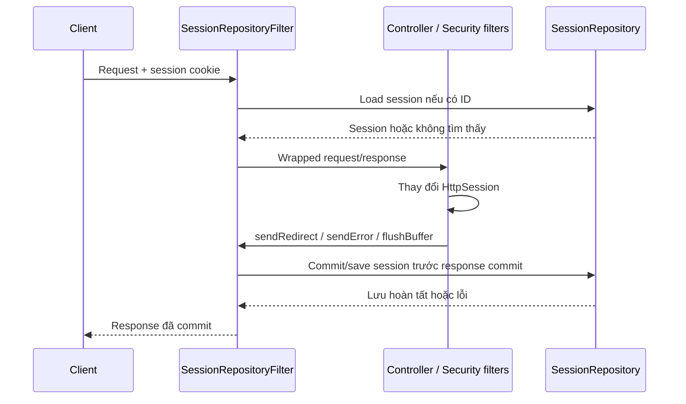

# Phản hồi redirect, lỗi, commit sớm và yêu cầu bất đồng bộ

Trong ứng dụng Servlet dùng Spring Session, session thường được lưu khi response sắp được commit hoặc khi vòng đời xử lý request kết thúc theo cơ chế của filter/repository. Điều này trở nên đáng chú ý khi controller gửi redirect, gọi `sendError`, flush response sớm hoặc khởi chạy xử lý bất đồng bộ. Những thao tác này ảnh hưởng đến thời điểm header/cookie được gửi, thời điểm session được lưu và khả năng thay đổi response sau đó.

Kiểm thử chỉ gọi controller method trực tiếp thường không phát hiện được lỗi vòng đời này. Cần kiểm thử request qua filter chain, quan sát `Set-Cookie`, trạng thái session trong repository và hành vi khi response đã commit. Với Servlet async, cần kiểm tra cả request ban đầu, async dispatch, completion, timeout và lỗi; đồng thời không giả định `HttpSession` an toàn khi nhiều thread cùng sửa.

## 1. Response commit là gì?

Servlet response có status, headers và body buffer. Trước khi response được commit, ứng dụng còn có thể thay đổi status, headers và cookie. Khi response commit, status/header được gửi đi và body bắt đầu được chuyển đến client; sau thời điểm đó, ứng dụng không thể thay đổi header hoặc thay response thành redirect khác.

Các thao tác thường dẫn đến commit:

- Gọi `flushBuffer()`.
- Buffer đầy và container tự flush.
- Ghi response rồi hoàn tất request theo cơ chế container.
- Một số thao tác như `sendRedirect()` hoặc `sendError()` điều khiển response và có thể commit/hoàn tất response theo Servlet container.
- Async request gọi `AsyncContext.complete()` hoặc hoàn tất async lifecycle.

Có thể kiểm tra trạng thái bằng:

```java
if (response.isCommitted()) {
    // Không thể sửa status/header/cookie của response đã gửi.
}
```

Không nên dùng `isCommitted()` để thay thế thiết kế luồng điều khiển. Nếu response đã commit, cách xử lý phù hợp thường là ghi log/metric và kết thúc; không cố gửi thêm redirect hoặc JSON lỗi khác.

## 2. Spring Session lưu session quanh thời điểm response commit

`SessionRepositoryFilter` bọc request/response để thay thế `HttpSession` của container bằng session được quản lý bởi Spring Session repository. Trong Servlet stack, response wrapper của Spring Session có thể lưu session trước khi response được commit. Cơ chế này giúp cookie session ID và dữ liệu session được đồng bộ trước khi response rời ứng dụng.

Luồng khái quát:



Đây là mô hình khái quát. Thời điểm save cụ thể phụ thuộc `FlushMode`, repository implementation, response wrapper và phiên bản Spring Session. Không giả định mọi thao tác setter luôn ghi ngay xuống Redis/JDBC.

Với `FlushMode.ON_SAVE`, thay đổi thường được gom và lưu khi session được save trong vòng đời request/commit. Với `FlushMode.IMMEDIATE`, repository có thể đẩy thay đổi sớm hơn khi session thay đổi. Cả hai cần được kiểm thử với đúng repository thực tế.

## 3. Redirect và session mới

Một luồng form login thường tạo hoặc cập nhật session rồi redirect người dùng đến trang ban đầu. Session có thể chứa `SecurityContext`, saved request, CSRF token hoặc trạng thái nghiệp vụ. Khi gửi redirect, Spring Session cần lưu session và phát cookie session ID phù hợp để request kế tiếp có thể tìm lại dữ liệu.

Ví dụ controller:

```java
@PostMapping("/preferences")
String updatePreference(HttpSession session) {
    session.setAttribute("locale", "vi-VN");
    return "redirect:/profile";
}
```

Với Spring MVC, chuỗi `redirect:` được xử lý bởi view resolver và kết quả là response redirect. Khi dùng Servlet API trực tiếp, có thể gọi `response.sendRedirect(...)`. Trong cả hai trường hợp, cần kiểm tra response status, `Location` và cookie session.

### Những điều cần xác nhận

- Redirect có status phù hợp với phương thức và semantics của luồng (ví dụ 302/303 theo framework/container) hay không.
- `Location` trỏ đúng URL, không tạo open redirect.
- Session đã thay đổi được lưu trước khi response commit.
- `Set-Cookie` được phát khi cần tạo hoặc thay session ID.
- Request tiếp theo gửi cookie và đọc lại được attribute vừa lưu.
- Nếu redirect sau logout, cookie cũ đã được hết hạn và session đã bị invalidate.

Không chỉ kiểm tra status 3xx. Một response redirect đúng status nhưng session chưa lưu hoặc cookie sai scope vẫn khiến người dùng mất trạng thái ở request kế tiếp.

## 4. Kiểm thử redirect với MockMvc

Ví dụ kiểm tra endpoint thay đổi session rồi redirect:

```java
mockMvc.perform(post("/preferences")
        .with(csrf()))
    .andExpect(status().is3xxRedirection())
    .andExpect(header().string("Location", "/profile"));
```

Để xác nhận session được giữ qua request tiếp theo, cần dùng cùng client/session cookie hoặc `MockHttpSession` phù hợp với test setup:

```java
MvcResult updateResult = mockMvc.perform(post("/preferences")
        .with(csrf()))
    .andExpect(status().is3xxRedirection())
    .andReturn();

MockHttpSession session = (MockHttpSession)
        updateResult.getRequest().getSession(false);

mockMvc.perform(get("/profile").session(session))
    .andExpect(status().isOk());
```

Ví dụ trên dùng `MockHttpSession` để minh họa test ở mức MockMvc. Khi kiểm tra Spring Session repository thật, cần bảo đảm test thực sự đi qua `SessionRepositoryFilter` và dùng cookie ID do filter phát hành; `MockHttpSession` thuần có thể bỏ qua repository, serializer và cookie resolver.

### Kiểm tra cookie qua redirect

Nếu test sử dụng session mới, kiểm tra header `Set-Cookie` theo cookie name đã cấu hình. Không hardcode `JSESSIONID` nếu ứng dụng dùng `APPSESSION` hoặc tên khác. Cookie có thể không được phát lại trong mọi request nếu session ID đã tồn tại và không đổi; assertion nên dựa trên tình huống cụ thể.

## 5. `sendError` và error dispatch

`HttpServletResponse.sendError(status)` yêu cầu container xử lý response như một lỗi HTTP. Container có thể thực hiện ERROR dispatch đến error page hoặc error handler được cấu hình. Hành vi cụ thể phụ thuộc Servlet container và cấu hình ứng dụng.

Ví dụ:

```java
@GetMapping("/reports/private")
void privateReport(HttpServletResponse response) throws IOException {
    response.sendError(HttpServletResponse.SC_FORBIDDEN);
}
```

Khác với việc chỉ đặt status và ghi body, `sendError` có semantics của container error handling. Nếu ứng dụng cần JSON lỗi ổn định cho REST API, thường nên dùng `@ExceptionHandler`, `ResponseEntity` hoặc `AuthenticationEntryPoint`/`AccessDeniedHandler` phù hợp thay vì gọi `sendError` rồi mong container tự tạo JSON.

### Session trong error handler

Error page hoặc ERROR dispatch có thể cần đọc thông tin session để hiển thị thông báo hoặc correlation data. Cần tránh tạo session mới không cần thiết chỉ để render lỗi. Nếu chỉ muốn đọc session hiện có, dùng API không tạo mới khi phù hợp (`request.getSession(false)`).

Không đặt dữ liệu nhạy cảm như stack trace, access token hoặc toàn bộ SecurityContext vào session để error page đọc. Error response nên chứa thông tin tối thiểu và không tiết lộ nội bộ.

## 6. Kiểm thử lỗi HTTP và exception

MockMvc có thể kiểm tra status/body được tạo bởi Spring MVC exception handling:

```java
mockMvc.perform(get("/reports/private"))
    .andExpect(status().isForbidden());
```

Nếu test cần xác nhận `sendError` kích hoạt error page thực tế, MockMvc có giới hạn vì nó không chạy đầy đủ error-page dispatch của một Servlet container thật. Dùng `@SpringBootTest(webEnvironment = RANDOM_PORT)` hoặc test với container tương đương production để xác nhận:

- Status cuối cùng mà client nhận.
- ERROR dispatch có chạy hay không.
- Error controller/page có được gọi đúng không.
- Cookie/session có được lưu trước khi lỗi hoàn tất không.
- Response không bị commit trước khi error handler cần thay status/header.

Phân biệt lỗi do controller chủ động trả 4xx/5xx với exception chưa được xử lý. Hai trường hợp có thể đi qua các handler khác nhau.

## 7. `flushBuffer()` và commit sớm

`flushBuffer()` đẩy nội dung buffer ra client và commit response. Sau khi gọi, ứng dụng không thể đổi status hoặc thêm cookie mới. Ví dụ nguy hiểm:

```java
response.getWriter().write("processing");
response.flushBuffer();

session.setAttribute("jobId", jobId); // Quá muộn để sửa header/cookie
```

Nếu thay đổi session làm phát sinh session ID mới hoặc cookie cần cập nhật, response đã commit có thể khiến cookie không được gửi. Tùy Spring Session và `FlushMode`, session data có thể được lưu theo cơ chế riêng, nhưng không thể dựa vào đó để phát header sau commit.

Thứ tự an toàn hơn là hoàn tất các thay đổi session cần thiết trước khi commit response:

```java
session.setAttribute("jobId", jobId);
response.getWriter().write("processing");
response.flushBuffer();
```

Ngay cả khi session được lưu trước commit, không nên thực hiện nhiều thao tác ghi session sau khi response đã bắt đầu gửi. Hãy xác định rõ điểm cuối mà ứng dụng được phép thay đổi session và cookie.

## 8. Response wrapper và các đường commit

Spring Session phải xử lý nhiều cách response được commit, không chỉ `sendRedirect`. Các đường thường cần kiểm thử:

- `sendRedirect(location)`.
- `sendError(status)` và `sendError(status, message)`.
- `flushBuffer()`.
- Ghi vượt giới hạn buffer khiến container tự flush.
- Hoàn tất async response.

Nếu ứng dụng tự bọc `HttpServletResponse`, filter wrapper phải giữ đúng semantics của wrapper trước đó. Một wrapper tùy chỉnh có thể vô tình bỏ qua `flushBuffer`, không chuyển tiếp `sendRedirect`, hoặc commit response trước khi Spring Session wrapper kịp lưu session.

Thứ tự filter quan trọng. Spring Session filter cần bọc request/response trước các thành phần sử dụng `HttpSession`, thường đặt trước Spring Security filter chain. Không đăng ký trùng filter theo nhiều cách khiến request có nhiều wrapper không nhất quán. Khi tùy chỉnh filter registration, kiểm tra thứ tự và dispatcher types.

## 9. Phân biệt session save với response commit

Response commit là sự kiện của HTTP; session save là thao tác ghi trạng thái vào repository. Chúng có liên hệ qua response wrapper nhưng không phải một khái niệm.

| Sự kiện | Ý nghĩa |
|---|---|
| Gọi `session.setAttribute` | Thay đổi object session trong request |
| Repository `save(session)` | Yêu cầu ghi session xuống store |
| `FlushMode.IMMEDIATE` | Có thể ghi thay đổi sớm theo repository semantics |
| `response.flushBuffer()` | Commit response HTTP; header không còn sửa được |
| `sendRedirect` | Thiết lập redirect và đưa response đến trạng thái hoàn tất/commit theo container |
| Async completion | Kết thúc xử lý bất đồng bộ và hoàn tất response nếu chưa được commit trước đó |

Không dùng `response.isCommitted()` làm bằng chứng session đã được lưu thành công. Ngược lại, việc repository save thành công không có nghĩa cookie đã được gửi nếu response header đã commit trước khi cookie được thêm.

## 10. Servlet async request là gì?

Servlet async cho phép request bắt đầu xử lý bất đồng bộ để thread container ban đầu có thể được giải phóng trong khi công việc tiếp tục. Spring MVC có thể dùng `Callable`, `DeferredResult`, `WebAsyncTask` hoặc Servlet `AsyncContext`.

Ví dụ controller trả `Callable`:

```java
@GetMapping("/async/profile")
Callable<String> asyncProfile(HttpSession session) {
    String locale = (String) session.getAttribute("locale");
    return () -> "locale=" + locale;
}
```

Ở ví dụ này, session attribute được đọc trên request thread trước khi tạo `Callable`; tác vụ nền chỉ dùng giá trị đã chụp. Đây thường là cách an toàn hơn việc giữ `HttpSession` rồi sửa từ thread nền sau khi request thread đã rời filter chain.

### Servlet `AsyncContext`

API Servlet cho phép bắt đầu async:

```java
AsyncContext asyncContext = request.startAsync();
asyncContext.start(() -> {
    try {
        // Thực hiện công việc nền
        asyncContext.getResponse().getWriter().write("done");
    }
    catch (IOException ex) {
        // Ghi nhận lỗi; không ghi response lần nữa nếu đã commit
    }
    finally {
        asyncContext.complete();
    }
});
```

Đây là ví dụ rút gọn để minh họa lifecycle; trong ứng dụng thực tế cần xử lý timeout, lỗi, đóng writer và quyền truy cập response theo đúng Servlet API. Không giữ response để ghi sau khi async context đã complete.

## 11. Async dispatch và filter lifecycle

Servlet async có thể gồm nhiều giai đoạn:

1. Request ban đầu với dispatcher type `REQUEST`.
2. Controller/filter gọi `startAsync()` và trả quyền điều khiển cho container.
3. Tác vụ nền hoàn tất hoặc yêu cầu `AsyncContext.dispatch()` để xử lý tiếp trong container thread.
4. Async dispatch có dispatcher type `ASYNC`.
5. Response được hoàn tất qua `complete()` hoặc kết thúc dispatch.

Filter có thể được đăng ký cho các dispatcher type khác nhau (`REQUEST`, `ASYNC`, `ERROR`, `FORWARD`, `INCLUDE`). Một filter bỏ qua async dispatch có thể không chạy lại ở giai đoạn ASYNC; một filter chạy lại có thể cần tránh xử lý cùng logic hai lần. `OncePerRequestFilter` có quy tắc riêng cho async/error dispatch và subclass có thể thay đổi hành vi.

Với Spring Session, cần xác nhận `SessionRepositoryFilter` được đăng ký đúng và giữ được wrapper/session trong async lifecycle của container đang dùng. Không tự thêm một instance filter thứ hai để “chạy lại” session filter trên ASYNC nếu chưa hiểu cấu hình auto-registration.

## 12. Truy cập `HttpSession` từ thread bất đồng bộ

`HttpSession` không phải một object thread-safe cho mọi chuỗi thao tác nghiệp vụ. Nhiều request hoặc async task có thể cùng đọc/sửa session. Các thao tác set/remove attribute riêng lẻ không tự tạo transaction cho một chuỗi cập nhật nhiều attribute.

Ví dụ rủi ro:

```java
asyncContext.start(() -> {
    Cart cart = (Cart) session.getAttribute("cart");
    cart.add(item);
    session.setAttribute("cart", cart);
});
```

Trong lúc task này chạy, request khác có thể đọc cùng cart, thay đổi nó hoặc logout session. Một snapshot cũ có thể ghi đè thay đổi mới hoặc ghi lại session đã bị xóa.

Khuyến nghị:

- Đọc các giá trị cần thiết trên request thread và truyền DTO/ID bất biến sang task nền.
- Không truyền `HttpServletRequest` hoặc `HttpServletResponse` sang worker thread tùy ý.
- Nếu phải cập nhật session, định nghĩa rõ đồng bộ hóa hoặc optimistic locking ở tầng dữ liệu.
- Tránh giữ object mutable lớn trong session và sửa nó từ nhiều thread.
- Kiểm tra session còn hợp lệ trước khi áp dụng kết quả tác vụ.
- Không coi `synchronized(session)` là khóa phân tán; nó chỉ có hiệu lực trong JVM và không bảo vệ node khác.

## 13. Async completion, timeout và error

Một async request có thể hoàn tất thành công, timeout hoặc lỗi. Mỗi nhánh cần kết thúc lifecycle đúng cách và không ghi response sau khi response đã commit/complete.

Với Servlet API, `AsyncListener` cung cấp callback:

```java
asyncContext.addListener(new AsyncListener() {
    @Override
    public void onComplete(AsyncEvent event) {
        // Theo dõi hoàn tất; không giả định có thể sửa response.
    }

    @Override
    public void onTimeout(AsyncEvent event) {
        // Ghi nhận timeout; kiểm tra response chưa commit trước khi ghi lỗi.
    }

    @Override
    public void onError(AsyncEvent event) {
        // Ghi nhận lỗi và giải phóng tài nguyên.
    }

    @Override
    public void onStartAsync(AsyncEvent event) {
        // Đăng ký lại listener nếu ứng dụng bắt đầu chu kỳ async mới.
    }
});
```

Ví dụ bỏ qua phần import và xử lý chi tiết. `onTimeout`/`onError` cần phối hợp với framework/controller để tạo response hợp lệ; không gọi `sendError` nếu response đã commit. Listener nên giải phóng tài nguyên, ghi metric và tránh thực hiện logic session hai lần.

Nếu async task cần cập nhật session trước khi kết thúc, hãy làm trước `complete()` và bảo đảm repository có cơ hội lưu thay đổi. Nếu session đã bị invalidate trong lúc task chạy, không tự tạo lại session bằng cách gọi `getSession(true)` trừ khi đó là hành vi được thiết kế.

## 14. Kiểm thử async với MockMvc

Spring MVC async test thường có hai bước: xác nhận request bắt đầu async, sau đó dispatch kết quả để kiểm tra response cuối.

Ví dụ:

```java
MvcResult result = mockMvc.perform(get("/async/profile"))
    .andExpect(request().asyncStarted())
    .andReturn();

mockMvc.perform(asyncDispatch(result))
    .andExpect(status().isOk())
    .andExpect(content().string("locale=vi-VN"));
```

Trong test thực tế, cần cung cấp session hoặc cookie theo cấu hình test. Nếu controller trả `DeferredResult`, có thể hoàn tất deferred result trong test rồi gọi `asyncDispatch`. Nếu dùng `Callable`, chờ async result theo timeout hợp lý và tránh sleep cố định.

### Kiểm tra session sau async completion

Không chỉ kiểm tra body. Nếu async task cập nhật session, gửi request thứ hai bằng cùng session cookie sau khi async response hoàn tất và xác nhận repository chứa thay đổi. Với Spring Session thật, cần test qua filter và store thật hoặc Testcontainers để kiểm tra serialization, flush và cookie.

MockMvc async dispatch mô phỏng phần lớn Spring MVC async flow nhưng không thay thế hoàn toàn embedded Servlet container. Các vấn đề về dispatcher mapping, error page, response buffer và socket commit cần kiểm tra bằng integration test chạy trên container.

## 15. Kiểm thử response commit sớm

Để kiểm tra `flushBuffer()`:

1. Tạo session mới hoặc tải session hiện có.
2. Thay đổi attribute cần lưu.
3. Gọi `flushBuffer()` hoặc ghi đủ dữ liệu làm buffer tự flush.
4. Kiểm tra response đã committed.
5. Xác nhận session được lưu theo `FlushMode` và response cookie đã được gửi trước commit nếu cần.
6. Thử thay đổi session/cookie sau commit và xác nhận ứng dụng không dựa vào việc có thể sửa header.
7. Gửi request tiếp theo và đọc lại session từ repository.

Không dùng mock response đơn giản để kết luận container tự flush đúng ở kích thước buffer production. Cần một test với embedded container và response body đủ lớn để vượt buffer nếu đó là tình huống thực tế.

## 16. Kiểm thử redirect và error với Spring Session filter

Một bộ integration test nên bao gồm:

- Redirect sau khi tạo session mới và kiểm tra `Set-Cookie`.
- Redirect sau khi cập nhật attribute của session hiện có.
- Redirect sau login và xác nhận `SecurityContext` có ở request kế tiếp.
- Logout rồi redirect, xác nhận session bị xóa và cookie hết hạn.
- `sendError` với ERROR dispatch và error page có/không truy cập session.
- Exception được xử lý bởi `@ControllerAdvice` và response JSON.
- Response commit trước khi code cố thêm cookie.
- Response wrapper tùy chỉnh không làm mất thao tác save session.

Test phải phân biệt cookie được phát do session mới với cookie được phát do session ID rotation. Không yêu cầu `Set-Cookie` trong mọi request vì một session ID ổn định có thể không cần gửi lại.

## 17. Các lỗi thường gặp

| Hiện tượng | Nguyên nhân có thể | Cách kiểm tra |
|---|---|---|
| Redirect thành công nhưng request sau mất attribute | Session chưa được save hoặc cookie không được gửi | Kiểm tra filter, repository, `Set-Cookie` và request kế tiếp |
| `Set-Cookie` thiếu sau `flushBuffer()` | Response đã commit trước khi cookie được thêm | Sắp xếp thay đổi session trước commit; kiểm tra wrapper |
| Gọi `sendError` nhưng error page không chạy trong MockMvc | MockMvc không mô phỏng đầy đủ container ERROR dispatch | Dùng embedded container integration test |
| Async response trả body nhưng session update bị mất | Session bị save trước khi async task thay đổi hoặc task không hoàn tất đúng lifecycle | Kiểm tra thời điểm save/complete và async dispatch |
| Async timeout tạo response lỗi hai lần | Callback và framework cùng cố ghi response | Chỉ một thành phần sở hữu response; kiểm tra `isCommitted()` |
| Session attribute bị mất ngẫu nhiên khi async | Nhiều thread ghi cùng session hoặc snapshot cũ | Dùng DTO bất biến, đồng bộ hóa/versioning phù hợp |
| Logout rồi async task tạo lại session | Task cũ gọi `getSession(true)` hoặc save snapshot cũ | Kiểm tra session validity, cancellation và fencing/revocation |
| Filter chạy hai lần trong async/error dispatch | Mapping dispatcher type hoặc wrapper lifecycle sai | Kiểm tra filter registration và `OncePerRequestFilter` behavior |
| Cookie có ở response nhưng repository không có session | Save lỗi, transaction rollback hoặc flush mode khác kỳ vọng | Kiểm tra repository exception và store thực tế |

## 18. Checklist triển khai và kiểm thử

- Đăng ký `SessionRepositoryFilter` đúng thứ tự trước các filter sử dụng `HttpSession`.
- Kiểm tra redirect, `sendError`, `flushBuffer` và response buffer tự commit.
- Xác nhận session được save trước response commit khi cần phát cookie hoặc duy trì trạng thái.
- Phân biệt HTTP response commit với repository save.
- Kiểm tra `FlushMode` và repository implementation của phiên bản đang dùng.
- Không sửa header/cookie sau khi response đã committed.
- Kiểm thử error dispatch bằng embedded Servlet container khi cần semantics container thật.
- Với async, kiểm tra REQUEST/ASYNC/ERROR dispatcher mapping và filter lifecycle.
- Đọc session cần thiết trước khi chuyển sang worker thread; tránh chia sẻ mutable `HttpSession` giữa thread.
- Xử lý async completion, timeout, error và cancellation đúng một lần.
- Kiểm tra session không bị ghi lại sau logout bởi async task cũ.
- Kiểm thử request tiếp theo qua cùng cookie và repository thật.
- Quan sát lỗi save, pool timeout, response commit và async timeout bằng metric/correlation ID; không log session ID.

Redirect, error response, commit sớm và async request đều làm thay đổi thời điểm response được hoàn tất và session được lưu. Spring Session tích hợp qua filter/response wrapper để lưu session quanh thời điểm commit, nhưng code ứng dụng vẫn phải thay đổi session trước khi response không còn sửa được, xử lý đúng error/async lifecycle và tránh nhiều thread ghi snapshot cũ. Kiểm thử qua filter chain, repository thật và Servlet container giúp phát hiện lỗi cookie, session save và async dispatch mà unit test controller không thể hiện.
