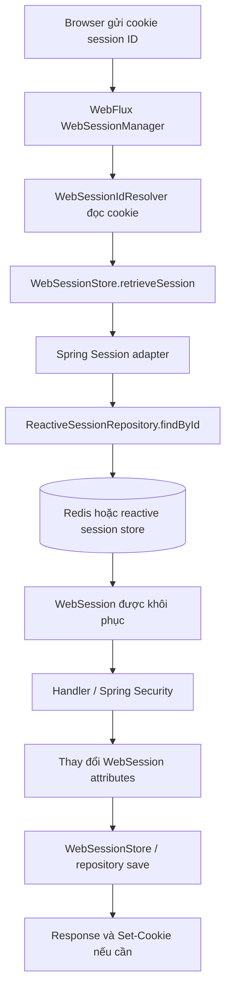

# Kiểm thử WebSessionStore cùng ReactiveSessionRepository được cấu hình thật

Trong ứng dụng WebFlux, Spring Session tích hợp với WebFlux qua WebSession và WebSessionStore. Repository phản ứng ReactiveSessionRepository lưu trạng thái session ở kho dữ liệu, còn WebSessionStore là abstraction mà WebFlux dùng để tạo, tải và xóa WebSession. Kiểm thử chỉ mock controller hoặc mock repository không chứng minh rằng cookie, WebSession manager, adapter và kho dữ liệu thật đang phối hợp đúng.

Mục tiêu của bài là xây dựng kiểm thử theo nhiều lớp, từ contract của ReactiveSessionRepository, adapter WebSessionStore, tới request HTTP thực qua WebTestClient. Bài cũng chỉ ra cách kiểm tra session được tạo ở request đầu, khôi phục ở request sau, cập nhật thuộc tính, hết hạn, bị xóa, và hoạt động đúng khi repository phát sinh lỗi.

## 1. Luồng session trong WebFlux

WebFlux không dùng HttpSession của Servlet. Nó làm việc với WebSession thông qua WebSessionManager và WebSessionStore. Spring Session cung cấp adapter để nối ReactiveSessionRepository với abstraction WebSessionStore.



Các thành phần có trách nhiệm khác nhau:

| Thành phần | Trách nhiệm |
| --- | --- |
| **ReactiveSessionRepository<S>** | Tạo, lưu, tìm và xóa session theo kiểu reactive |
| **WebSessionStore** | Cung cấp thao tác lưu trữ WebSession cho WebFlux |
| **SpringSessionWebSessionStore** | Adapter Spring Session nối ReactiveSessionRepository với WebSessionStore |
| **WebSessionManager** | Quản lý vòng đời WebSession trong một ServerWebExchange |
| **WebSessionIdResolver** | Đọc, phát hành và hết hạn session ID ở HTTP exchange |
| **WebTestClient** | Gửi request và kiểm tra response/cookie như một HTTP client |

Tên class và cách auto-configuration có thể thay đổi theo phiên bản Spring Framework, Spring Session và Spring Boot. Khi viết test, hãy lấy bean thực tế từ application context của dự án; không giả định một class cấu hình của phiên bản khác đang được sử dụng.

## 2. Phân biệt unit test, repository contract test và integration test

Một bộ test tốt không dùng một loại test để chứng minh mọi thứ.

| Loại test | Thành phần thật | Điều được xác minh |
| --- | --- | --- |
| Unit test handler/service | Handler thật, repository có thể mock | Logic nghiệp vụ, mapping và xử lý lỗi |
| Contract test repository | ReactiveSessionRepository thật | createSession, save, findById, deleteById, TTL và thuộc tính |
| Adapter test | WebSessionStore adapter thật cùng repository thật | Chuyển đổi session và WebSession, lưu/khôi phục thuộc tính |
| WebFlux integration test | WebFlux context, manager, resolver, store và repository thật | Cookie, request lifecycle và persistence qua nhiều request |
| Multi-instance test | Hai application context/process cùng kho dùng chung | Session được tạo ở node A và đọc/xóa được ở node B |
| Fault test | Repository thật và lỗi được tạo có kiểm soát | Timeout, connection failure, serialization failure và recovery |

Không thể kết luận WebSessionStore hoạt động đúng chỉ từ một unit test có mock ReactiveSessionRepository. Mock hữu ích để ép lỗi hoặc xác minh handler gọi đúng phương thức; nó không kiểm tra serialization, TTL, connection, transaction hay cookie resolver.

## 3. Khởi động application context thật

Đối với kiểm thử tích hợp, dùng full application context để giữ nguyên cấu hình WebFlux và Spring Session đang chạy trong ứng dụng:

```java
@SpringBootTest(webEnvironment = SpringBootTest.WebEnvironment.RANDOM_PORT)
@AutoConfigureWebTestClient
class WebSessionIntegrationTests {

    @Autowired
    WebTestClient client;
}
```

Ví dụ này dành cho ứng dụng reactive được Spring Boot cấu hình. Nếu dự án không dùng Spring Boot, có thể khởi tạo reactive web application context phù hợp hoặc dùng WebTestClient.bindToApplicationContext(...) với context thật.

@WebFluxTest là test slice. Nó thường chỉ nạp một phần cấu hình và có thể không khởi tạo repository, WebSession manager hoặc storage integration như production. Dùng slice test cho controller/handler; dùng @SpringBootTest hoặc context integration tương đương để chứng minh session store thực sự được cấu hình.

Không thay repository thật bằng mock trong bài test có mục tiêu xác minh WebSessionStore cùng ReactiveSessionRepository được cấu hình thật. Nếu cần cô lập test, tạo một Redis hoặc reactive repository riêng cho test, không thay bằng một mock trả kết quả cố định.

## 4. Cấu hình kho dữ liệu dành riêng cho test

Với Redis, có thể dùng Testcontainers để mỗi test suite có một Redis thật, tránh phụ thuộc Redis trên máy lập trình viên:

```java
@Testcontainers
@SpringBootTest(webEnvironment = SpringBootTest.WebEnvironment.RANDOM_PORT)
@AutoConfigureWebTestClient
class RedisWebSessionIntegrationTests {

    @Container
    static final GenericContainer<?> redis =
            new GenericContainer<>("redis:7-alpine")
                    .withExposedPorts(6379);

    @DynamicPropertySource
    static void redisProperties(DynamicPropertyRegistry properties) {
        properties.add("spring.data.redis.host", redis::getHost);
        properties.add(
                "spring.data.redis.port",
                () -> redis.getMappedPort(6379));
        properties.add(
                "spring.session.redis.namespace",
                () -> "test:webflux:sessions");
    }

    @Autowired
    WebTestClient client;
}
```

Đây là mẫu cho dòng Spring Boot dùng các property spring.data.redis.*. Tên property và cách bật reactive Spring Session phụ thuộc phiên bản và cấu hình của ứng dụng. Điều quan trọng là application context test phải khởi tạo đúng reactive repository/adapter mà ứng dụng sẽ dùng, trỏ tới Redis container thay vì mock.

Nếu dùng một ReactiveSessionRepository tùy chỉnh, khởi tạo implementation thật với storage test riêng. Nếu dự án có repository JDBC chỉ triển khai API Servlet đồng bộ, không thể đưa nó vào WebFlux rồi coi như ReactiveSessionRepository; cần một implementation reactive đúng contract hoặc một kiến trúc adapter được thiết kế rõ ràng.

Không dùng chung namespace giữa test và môi trường đang chạy. Có thể dùng namespace ngẫu nhiên theo test run để tránh test song song đọc hoặc xóa session của nhau.

## 5. Xác nhận ReactiveSessionRepository thật đã được nạp

Trong integration test, có thể inject abstraction để xác nhận bean tồn tại:

```java
@Autowired
ReactiveSessionRepository<? extends Session> sessionRepository;
```

Nếu ứng dụng có nhiều repository hoặc nhiều profile, kiểm tra bean được inject chính là implementation mong muốn. Có thể kiểm tra class runtime hoặc qualifier theo cấu hình ứng dụng. Không chỉ kiểm tra bean tồn tại rồi mặc định rằng nó kết nối đúng Redis/database.

Các điều kiện nên xác minh:

- Application context khởi động với cấu hình session thực tế.
- Reactive repository là implementation thật, không phải mock hoặc in-memory fallback ngoài ý muốn.
- Endpoint storage của test là endpoint test.
- Namespace/key prefix hoặc schema test được tách riêng.
- WebSessionManager và resolver sử dụng store/repository đó.
- Không có một cấu hình test khác ghi đè repository bean trong im lặng.

Nếu application context có WebSessionManager, có thể inject nó để kiểm tra cấu hình manager. WebSessionStore thường được giữ bên trong manager và không nhất thiết là bean riêng để inject trực tiếp. Trong trường hợp đó, test HTTP end-to-end qua manager là cách xác minh wiring đáng tin cậy hơn việc tự tạo một adapter mới rồi chỉ test adapter đó.

## 6. Contract test cho ReactiveSessionRepository

Trước khi kiểm thử HTTP, xác minh repository thật thực hiện đúng contract cơ bản. ReactiveSessionRepository cung cấp các thao tác reactive để tạo, lưu, tìm và xóa session.

```java
@Autowired
ReactiveSessionRepository<? extends Session> repository;

@Test
void shouldCreateSaveAndFindSession() {
    Mono<String> savedId = repository.createSession()
            .flatMap(session -> {
                session.setAttribute("probe", "persisted");
                return repository.save(session)
                        .thenReturn(session.getId());
            });

    StepVerifier.create(savedId.flatMap(repository::findById))
            .assertNext(session ->
                    assertThat(session.getAttribute("probe"))
                            .isEqualTo("persisted"))
            .verifyComplete();
}
```

Đoạn test minh họa generic repository; tùy kiểu wildcard và phiên bản API, có thể cần khai báo một kiểu Session cụ thể hoặc helper method để compiler suy luận đúng. Không gọi block() trong luồng reactive của test chỉ để lấy ID.

Các điểm được xác minh:

- createSession() phát ra một session mới.
- save() hoàn tất mà không lỗi.
- findById() đọc lại được session sau khi lưu.
- Attribute được serialize và deserialize đúng.
- Repository không trả một object chỉ tồn tại trong memory của caller.

### 6.1. Kiểm tra delete

```java
Mono<String> saveOneSession() {
    return repository.createSession()
            .flatMap(session -> {
                session.setAttribute("probe", "to-delete");
                return repository.save(session)
                        .thenReturn(session.getId());
            });
}

@Test
void shouldDeleteSession() {
    StepVerifier.create(
            saveOneSession().flatMap(id ->
                    repository.deleteById(id)
                            .then(repository.findById(id))))
            .expectNextCount(0)
            .verifyComplete();
}
```

Vì findById không phát giá trị khi session đã bị xóa, verifyComplete xác nhận chuỗi hoàn tất rỗng. Nếu repository phát lỗi, StepVerifier sẽ thất bại thay vì biến lỗi thành session miss.

## 7. Kiểm thử WebSessionStore adapter

Spring Session có adapter SpringSessionWebSessionStore để dùng ReactiveSessionRepository phía dưới như một WebSessionStore. Test adapter cần dùng repository thật để kiểm tra chuyển đổi hai chiều giữa WebSession và Session.

Ví dụ khởi tạo adapter trong một test tập trung:

```java
WebSessionStore store =
        new SpringSessionWebSessionStore<>(repository);

Mono<String> createAndSaveWebSession() {
    return store.createWebSession()
            .flatMap(webSession -> {
                webSession.getAttributes().put("probe", "web-session");
                return webSession.save()
                        .thenReturn(webSession.getId());
            });
}
```

Sau khi có ID, gọi retrieveSession(id) và xác nhận attribute đã lưu vẫn tồn tại. Gọi removeSession(id) rồi xác nhận retrieve không còn phát session.

Lưu ý: test tạo adapter trực tiếp chứng minh adapter với repository thật, nhưng không tự chứng minh application context đang sử dụng đúng adapter đó. Vì vậy cần thêm kiểm thử HTTP qua WebSessionManager được cấu hình trong ứng dụng.

## 8. WebSessionStore test qua WebTestClient

Kiểm thử end-to-end nên tạo một endpoint test-only nhỏ để đọc, tăng và trả về một attribute trong WebSession. Endpoint này cho phép kiểm tra session qua request mà không phụ thuộc logic nghiệp vụ khác.

```java
@RestController
class WebSessionProbeController {

    @GetMapping("/test/session/counter")
    Mono<Map<String, Integer>> increment(ServerWebExchange exchange) {
        return exchange.getSession().map(session -> {
            Integer current = session.getAttribute("counter");
            int next = current == null ? 1 : current + 1;
            session.getAttributes().put("counter", next);
            return Map.of("counter", next);
        });
    }
}
```

Đặt controller trong test source hoặc chỉ bật dưới test profile; không đưa endpoint kiểm thử này vào production. WebFlux sẽ quản lý vòng đời WebSession của exchange và lưu thay đổi theo cấu hình manager/store.

Test request đầu:

```java
EntityExchangeResult<Map<String, Integer>> first =
        client.get()
                .uri("/test/session/counter")
                .exchange()
                .expectStatus().isOk()
                .expectBody(new ParameterizedTypeReference<
                        Map<String, Integer>>() {})
                .returnResult();
```

Sau response đầu, lấy cookie session ID từ first.getResponseCookies() theo cookie name thực tế của resolver. Gửi cookie đó ở request thứ hai:

```java
String sessionId = first.getResponseCookies()
        .getFirst("TESTSESSION")
        .getValue();

client.get()
        .uri("/test/session/counter")
        .cookie("TESTSESSION", sessionId)
        .exchange()
        .expectStatus().isOk()
        .expectBody()
        .jsonPath("$.counter").isEqualTo(2);
```

Trong ví dụ, TESTSESSION là cookie name đã cấu hình cho test. Không mặc định cookie name này là tên mặc định của mọi phiên bản. WebTestClient không nên được giả định là tự duy trì cookie jar như browser; chủ động chuyển cookie giữa các request làm test rõ ràng và có thể kiểm tra chính xác.

Kết quả mong đợi: request đầu tạo session và counter bằng 1; request thứ hai mang cùng session ID, repository khôi phục attribute và counter tăng lên 2. Đây là bằng chứng thực tế cho cookie resolver, WebSession manager, store adapter và repository cùng hoạt động.

## 9. Kiểm tra cookie và session ID resolver

Cookie là một phần của contract giữa browser và server. Cần xác minh:

- Response tạo session có Set-Cookie.
- Cookie name đúng cấu hình.
- Cookie value không rỗng.
- Thuộc tính HttpOnly, Secure, SameSite, Path và Domain phù hợp.
- Request tiếp theo có cookie hợp lệ khôi phục đúng session.
- Khi invalidate, response hết hạn cookie theo resolver.

Không log giá trị session ID trong test output hoặc CI log. Có thể kiểm tra cookie tồn tại, độ dài hoặc so sánh bằng nhau trong bộ nhớ mà không in giá trị.

Khi cần kiểm tra thuộc tính đầy đủ, đọc ResponseCookie từ kết quả response và assert từng field. API matcher cụ thể có thể khác theo phiên bản Spring Test.

Không chỉ kiểm tra Set-Cookie ở request đầu. Một số cấu hình chỉ phát cookie khi session mới được lưu hoặc ID thay đổi; request tiếp theo có thể không phát cookie mới. Điều cần chứng minh là cookie đã phát vẫn được resolver đọc và trỏ tới session đúng.

## 10. Kiểm tra cập nhật, invalidate và delete

Ngoài việc đọc lại attribute, hãy kiểm tra vòng đời:

1. Request đầu tạo session.
2. Request sau đọc được cùng attribute.
3. Một endpoint test-only thay đổi attribute.
4. Request tiếp theo đọc được giá trị mới.
5. Endpoint invalidate gọi WebSession.invalidate().
6. Response hết hạn cookie nếu resolver có hành vi đó.
7. Request tiếp theo với cookie cũ không khôi phục session cũ.

Ví dụ endpoint invalidate:

```java
@PostMapping("/test/session/invalidate")
Mono<Void> invalidate(ServerWebExchange exchange) {
    return exchange.getSession()
            .flatMap(WebSession::invalidate);
}
```

Endpoint này chỉ dùng trong test. Nếu ứng dụng bật Spring Security và CSRF, test phải gửi CSRF token theo cấu hình hoặc dùng một test route có chính sách rõ ràng. Không tắt toàn bộ security filter trong test được dùng để xác nhận logout/security integration.

Sau invalidate, xác minh cả hai lớp:

- HTTP behavior: cookie được hết hạn hoặc request cũ không còn được chấp nhận.
- Repository behavior: findById(id) không còn trả session, hoặc trạng thái đã bị đánh dấu hết hạn theo contract.

Không chỉ xóa cookie ở test client rồi kết luận server-side delete thành công.

## 11. Kiểm thử expiration và TTL

Test TTL cần phân biệt thời điểm session không còn hợp lệ với thời điểm storage dọn vật lý.

Các assertion:

- Session còn đọc được trước deadline.
- Session không còn được trả về sau deadline.
- TTL được gia hạn khi request hợp lệ cập nhật last access theo policy.
- Session hết hạn không được khôi phục chỉ vì cleanup vật lý chưa chạy.
- Cleanup/event xảy ra theo guarantee của repository.

Với test unit, có thể inject Clock hoặc dùng time abstraction của repository để điều khiển thời gian. StepVerifier.withVirtualTime chỉ điều khiển scheduler của Reactor; nó không tự tua thời gian của Redis server, JDBC database hoặc TTL native của storage.

Với Redis thật, kiểm tra expiration bằng thời gian thực có giới hạn và polling có timeout. Dùng TTL đủ dài để tránh test flake ở CI; sau đó xác minh session đã hết hạn bằng repository hoặc request path. Với JDBC, điều khiển EXPIRY_TIME qua repository/test fixture hoặc clock injection và chạy cleanup thực.

Không dùng Thread.sleep dài để chờ TTL. Nếu phải chờ storage expiration, dùng polling/backoff với deadline rõ ràng và failure message hữu ích.

## 12. Kiểm tra sự kiện vòng đời

Một số repository hoặc adapter có thể phát event session created, deleted hoặc expired. Không phải mọi ReactiveSessionRepository tùy chỉnh đều tự động có cùng mức hỗ trợ event.

Test cần căn cứ vào guarantee của implementation:

- Nếu repository cam kết phát SessionCreatedEvent, xác nhận event xuất hiện đúng thời điểm đã công bố.
- Nếu delete được hỗ trợ event, xác nhận delete thành công phát event và delete lỗi không bị báo như thành công.
- Nếu expiration event dựa vào Redis notification hoặc cleanup task, kiểm tra cấu hình và độ trễ thực tế.
- Nếu event chỉ là Spring application event, xác nhận listener trong cùng ApplicationContext nhận được.
- Nếu ứng dụng cam kết event phân tán, kiểm thử broker/outbox và node consumer riêng.

ApplicationEventPublisher trong một JVM không tự gửi event tới application context khác. Test một listener trong context hiện tại không chứng minh node khác nhận được event.

Với event bất đồng bộ, dùng latch hoặc StepVerifier/Awaitility theo cơ chế thực tế để chờ có giới hạn. Event consumer nên idempotent vì retry hoặc broker có thể phát lại message.

## 13. Kiểm thử SecurityContext trong WebSession

Trong WebFlux, Spring Security lưu context theo cơ chế reactive và có thể tích hợp với WebSession. Nếu mục tiêu là xác minh authentication được khôi phục qua request:

- Dùng security configuration thật của ứng dụng.
- Gửi login request hoặc tạo Authentication qua test flow được hỗ trợ.
- Lấy cookie session từ response.
- Gửi request bảo vệ qua cùng cookie.
- Xác nhận principal và authorities đúng.
- Xóa session rồi xác nhận request sau không còn được xác thực.

@WithMockUser hoặc mockUser() hữu ích cho test authorization của handler, nhưng không chứng minh SecurityContext đã được serialize vào repository và khôi phục qua cookie ở request kế tiếp.

Không lưu principal hoặc token thật vào test log. Dùng tài khoản fixture và dữ liệu giả lập.

## 14. Test reactive đúng cách

Các API repository và store trả về Mono/Flux. Test nên kiểm tra tín hiệu reactive thay vì chặn luồng tùy tiện:

- Dùng StepVerifier để kiểm tra giá trị, completion và error.
- Không gọi block() trong production code hoặc trong chain mà test đang kiểm tra.
- Không tạo subscription phụ bên trong assertNext.
- Kiểm tra cancellation nếu thao tác có thể bị hủy giữa chừng.
- Kiểm tra lỗi được truyền xuống subscriber, không bị nuốt thành empty.
- Dùng timeout để test không treo vô hạn.

Ví dụ xác minh repository phát lỗi:

```java
StepVerifier.create(repository.findById("known-id"))
        .expectError()
        .verify(Duration.ofSeconds(3));
```

Chỉ dùng test này khi fixture thật được cấu hình để tạo lỗi xác định, ví dụ dừng Redis test container hoặc dùng fault proxy. Không làm hỏng storage dùng chung ngoài test để tạo lỗi.

Khi kiểm thử cancellation, cần xác định semantics của thao tác. Client hủy request không nhất thiết rollback một lệnh Redis đã được gửi hoặc một transaction database đã commit. Không suy luận rằng cancellation đồng nghĩa session chưa được ghi.

## 15. Multi-instance test

Một WebFlux app có thể chạy trên nhiều instance nhưng cùng dùng một reactive repository. Test nhiều instance giúp phát hiện cấu hình local store hoặc namespace sai.

Kịch bản:

1. Khởi động application context A và B với cùng Redis namespace.
2. Request qua A tạo WebSession và nhận cookie.
3. Request qua B gửi cookie đó.
4. B đọc được cùng attribute/session state.
5. B cập nhật attribute.
6. Request sau qua A thấy thay đổi.
7. B invalidate session.
8. Request qua A với cookie cũ không khôi phục được session.

Đảm bảo A và B là hai context/process riêng, không phải hai client trỏ cùng một bean singleton trong cùng context. Nếu dùng embedded server, mỗi instance cần port hoặc application context riêng.

Nếu ứng dụng dùng sticky session trong production, vẫn cần test cross-node vì failover, deployment hoặc node restart có thể đưa request sang instance khác. Sticky routing không thay thế shared repository.

## 16. Test isolation và dữ liệu tồn dư

Session test dễ ảnh hưởng lẫn nhau nếu dùng chung Redis namespace, cookie name hoặc principal.

Nguyên tắc:

- Namespace riêng theo test suite hoặc test run.
- Session ID mới cho mỗi test.
- Không hard-code session ID.
- Xóa session được tạo trong teardown khi cần.
- Dùng database/schema test riêng cho JDBC.
- Không xóa toàn bộ Redis database nếu nó được chia sẻ với test khác.
- Tránh chạy song song hai test cùng thao tác một session ID.
- Đặt timeout ngắn phù hợp cho fixture nhưng đủ rộng để CI không flaky.

Với test parallel, namespace có thể gắn run ID ngẫu nhiên. Nếu storage không hỗ trợ namespace riêng, dùng container riêng hoặc schema riêng thay vì quét/xóa key của test khác.

## 17. Kiểm thử lỗi repository và phục hồi

Không chỉ test đường đi thành công. Cần xác minh lỗi hạ tầng không bị biến thành session miss hoặc anonymous một cách âm thầm.

| Tình huống | Kết quả cần xác minh |
| --- | --- |
| Redis/JDBC không kết nối khi đọc | Reactive chain phát lỗi; route cần xác thực không được cấp quyền |
| Timeout khi save | Request không báo persistence thành công khi write chưa được xác nhận |
| Delete lỗi | Không tuyên bố logout/revoke hoàn tất |
| Serialization lỗi | Lỗi được phân loại; không khôi phục SecurityContext sai |
| Storage phục hồi | Request mới có thể đọc/lưu theo trạng thái thực tế |
| Request bị cancel | Không giả định storage đã rollback |
| Một node mất kết nối | Node khác vẫn xử lý theo cùng repository và policy |

Với reactive code, tránh onErrorResume(error -> Mono.empty()) trên toàn bộ repository chain. Cách đó có thể biến outage thành session không tồn tại. Chỉ fallback cho lỗi được xác định rõ và phù hợp nghiệp vụ.

Nếu dùng circuit breaker, test open/half-open/closed state và bảo đảm route bảo vệ fail-closed khi session store không thể xác minh trạng thái.

## 18. Phân biệt WebSessionStore và ReactiveSessionRepository trong test

Hai abstraction liên quan nhưng không thể thay thế nhau:

| Kiểm tra | ReactiveSessionRepository | WebSessionStore |
| --- | --- | --- |
| Tạo session | createSession() | createWebSession() |
| Đọc session | findById(id) | retrieveSession(id) |
| Lưu thay đổi | save(session) | WebSession.save() qua store |
| Xóa | deleteById(id) | removeSession(id) |
| Dữ liệu | Session của Spring Session | WebSession của WebFlux |
| Mục tiêu | Persistence contract | WebFlux session lifecycle adapter |

Repository test xác minh storage semantics. Store test xác minh adapter chuyển đổi đúng. HTTP integration test xác minh resolver, manager, cookie và lifecycle được nối đúng trong application context.

Một test suite hoàn chỉnh nên có cả ba mức. Nếu chỉ test repository, cookie có thể sai; nếu chỉ test HTTP với in-memory store, Redis/JDBC serialization và TTL có thể chưa được kiểm tra.

## 19. Lỗi thường gặp khi kiểm thử

- **Dùng @WebFluxTest rồi kết luận repository thật đã chạy:** test slice có thể không nạp session infrastructure.
- **Mock ReactiveSessionRepository trong integration test:** không kiểm tra storage thật.
- **Chỉ test createSession() và save():** chưa chứng minh cookie và WebSession manager dùng repository đó.
- **Không gửi lại cookie ở request thứ hai:** mỗi request có thể tạo session mới.
- **Giả định WebTestClient tự giữ cookie:** cần kiểm tra API client và truyền cookie tường minh nếu không có cookie jar.
- **Chỉ xóa cookie trong test:** chưa chứng minh session đã bị xóa ở repository.
- **Dùng virtual time để tua Redis TTL:** virtual scheduler không điều khiển đồng hồ storage bên ngoài.
- **Dùng block() trong reactive chain:** có thể gây deadlock hoặc che giấu lỗi subscription.
- **Bắt lỗi thành Mono.empty():** biến repository outage thành session miss.
- **Dùng chung namespace:** test song song có thể đọc/xóa session của nhau.
- **Chỉ chạy một instance:** chưa chứng minh session chia sẻ qua node.
- **Tắt security filters trong mọi test:** không kiểm tra được SecurityContext được lưu và khôi phục.

## 20. Ma trận kiểm thử đề xuất

| Nhóm | Ca kiểm thử tối thiểu | Bằng chứng |
| --- | --- | --- |
| Repository | create/save/find/delete | Session tồn tại và bị xóa đúng |
| Attributes | ghi rồi đọc attribute | Serialize/deserialize đúng |
| WebSessionStore | create/retrieve/remove | Adapter ánh xạ đúng |
| Cookie | Set-Cookie và request kế tiếp | Resolver khôi phục cùng session |
| Lifecycle | update, invalidate, expire | Session state chuyển đúng |
| Security | login rồi gọi route bảo vệ | SecurityContext được khôi phục |
| TTL | trước/sau deadline, refresh | Expiration đúng semantics |
| Events | created/deleted/expired | Chỉ event được cam kết mới phát |
| Failure | read/write/delete error | Lỗi không bị biến thành anonymous giả |
| Isolation | namespace riêng, test song song | Không rò dữ liệu giữa test |
| Multi-instance | A tạo, B đọc, A xóa | Shared repository hoạt động xuyên node |

Không cần mọi unit test dựng Redis container. Chọn tầng test phù hợp: unit test nhanh cho logic, contract test cho repository, integration test với storage thật cho TTL/serialization và một số end-to-end test cho cookie/security/multi-instance.

## 21. Checklist trước khi merge

- [ ] Test dùng full WebFlux application context khi cần xác minh wiring thật.
- [ ] ReactiveSessionRepository được inject là implementation thật, không phải mock.
- [ ] WebSessionStore adapter được kiểm tra với repository thật.
- [ ] WebSessionManager và WebSessionIdResolver của application context được sử dụng trong HTTP test.
- [ ] Storage test dùng Redis/JDBC/reactive store riêng và namespace cô lập.
- [ ] Có test create, save, retrieve, update, invalidate và delete.
- [ ] Cookie name và cookie scope được kiểm tra.
- [ ] Cookie từ request đầu được gửi lại rõ ràng ở request sau.
- [ ] Có kiểm thử TTL, refresh và expiration boundary.
- [ ] Có test cho lỗi read/write/delete và recovery.
- [ ] Reactive test dùng StepVerifier và timeout; không block tùy tiện.
- [ ] Có test SecurityContext nếu ứng dụng dùng session cho authentication.
- [ ] Có test hai application context/node khi triển khai phân tán.
- [ ] Event test chỉ assert những guarantee repository thực sự công bố.
- [ ] Không log session ID, cookie value, token hoặc SecurityContext.

## 22. Tự kiểm tra kiến thức

Bạn đã nắm được bài học nếu có thể trả lời:

- ReactiveSessionRepository khác WebSessionStore ở vai trò nào?
- Vì sao test repository trực tiếp chưa chứng minh cookie resolver hoạt động?
- Khi nào nên dùng @SpringBootTest thay cho @WebFluxTest?
- Làm sao kiểm tra một session được tạo ở request đầu và khôi phục ở request thứ hai?
- Vì sao phải dùng Redis/JDBC/reactive store thật cho TTL và serialization integration test?
- StepVerifier giúp kiểm tra tín hiệu reactive như thế nào?
- Vì sao withVirtualTime không tua được TTL của Redis?
- Làm sao phân biệt session không tồn tại với lỗi kết nối repository?
- Vì sao cần test hai application context khi ứng dụng chạy nhiều instance?
- Làm thế nào bảo đảm test không dùng chung session hoặc xóa dữ liệu của test khác?

Kiểm thử WebFlux session cần xác minh toàn bộ đường đi từ cookie tới WebSessionManager, WebSessionStore adapter và ReactiveSessionRepository thật. Hãy kết hợp contract test, adapter test và HTTP integration test; dùng StepVerifier cho reactive signals, WebTestClient cho cookie round-trip, và storage riêng cho TTL, serialization, delete cùng failure scenarios. Chỉ khi request qua application context thật có thể tạo, khôi phục, cập nhật và xóa cùng một session thì mới có bằng chứng rằng cấu hình WebFlux và Spring Session đang phối hợp đúng.
