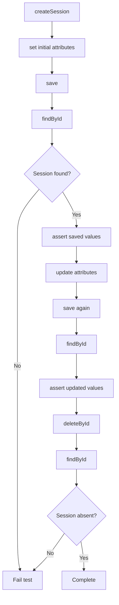

# StepVerifier cho tạo, đọc, lưu, xóa phiên

Trong Spring WebFlux, session được biểu diễn qua `WebSession` và có thể được lưu bằng Spring Session thông qua một `ReactiveSessionRepository` như Redis reactive. Các thao tác tạo, tìm, lưu và xóa đều trả về Reactor `Mono`. Vì vậy, kiểm thử cần xác minh cả giá trị phát ra, thời điểm publisher thực thi, trạng thái sau khi lưu và hành vi khi kho dữ liệu gặp lỗi.

`StepVerifier` thuộc `reactor-test`, cho phép subscribe có kiểm soát vào `Publisher`, yêu cầu tín hiệu theo thứ tự và xác nhận publisher hoàn tất hoặc phát lỗi. Với Spring Session reactive, StepVerifier đặc biệt hữu ích để kiểm tra hợp đồng CRUD của repository. Nó không tự chứng minh HTTP handshake, cookie hay filter WebFlux hoạt động; các phần đó cần được kiểm thử bổ sung bằng `WebTestClient` và repository thật.

## 1. Phân biệt WebSession và HttpSession

Spring Session hỗ trợ hai mô hình ứng dụng khác nhau:

| Mô hình | API session | Repository |
|---|---|---|
| Servlet/MVC | `HttpSession` | `SessionRepository` |
| WebFlux/reactive | `WebSession` | `ReactiveSessionRepository` |

Trong WebFlux, request được xử lý theo mô hình reactive. Session API mà handler thường sử dụng là `WebSession`. Không nên đưa `HttpSession` hoặc `MockHttpSession` vào test để kết luận về reactive session repository.

Spring Session có thể lưu session reactive trong Redis. Khi dùng cấu hình Redis WebFlux, `@EnableRedisWebSession` kích hoạt tích hợp reactive tương ứng. Ứng dụng cũng có thể dùng repository reactive khác nếu implementation đáp ứng contract.

## 2. ReactiveSessionRepository cung cấp các thao tác nào?

`ReactiveSessionRepository<S extends Session>` cung cấp các thao tác chính:

| Phương thức | Kiểu trả về | Ý nghĩa |
|---|---|---|
| `createSession()` | `Mono<S>` | Tạo đối tượng session mới |
| `save(session)` | `Mono<Void>` | Lưu session và các thay đổi |
| `findById(id)` | `Mono<S>` | Tìm session theo ID; có thể hoàn tất rỗng |
| `deleteById(id)` | `Mono<Void>` | Xóa session theo ID |

`Mono<S>` phát tối đa một session. `Mono<Void>` biểu diễn thao tác chỉ cần biết hoàn tất hay lỗi, không phát giá trị dữ liệu.

Một điểm quan trọng: `createSession()` tạo session mới trong bộ nhớ của repository implementation; ứng dụng thường cần gọi `save(session)` để lưu nó. Không kết luận session đã tồn tại trong Redis/JDBC chỉ vì `createSession()` phát ra một đối tượng.

## 3. Thêm reactor-test vào dự án

Với Gradle và Spring Boot dependency management:

```kotlin
dependencies {
    testImplementation("io.projectreactor:reactor-test")
}
```

Với Maven:

```xml
<dependency>
    <groupId>io.projectreactor</groupId>
    <artifactId>reactor-test</artifactId>
    <scope>test</scope>
</dependency>
```

Nên để Spring Boot dependency management hoặc BOM quản lý phiên bản Reactor để tránh lệch version giữa `reactor-core` và `reactor-test`. Test thường dùng cùng JUnit Jupiter và AssertJ/JUnit assertions.

Import chính:

```java
import org.junit.jupiter.api.Test;
import reactor.test.StepVerifier;
```

## 4. Cách StepVerifier quan sát publisher

Một test StepVerifier thường có ba phần:
1. Tạo publisher cần kiểm tra.
2. Khai báo tín hiệu mong đợi theo thứ tự.
3. Gọi `verify()` hoặc phương thức tương đương để bắt đầu subscribe và chờ kết quả.

Ví dụ publisher đơn giản:

```java
Mono<String> result = Mono.just("session-ready");

StepVerifier.create(result)
        .expectNext("session-ready")
        .verifyComplete();
```

`StepVerifier.create` chưa tự thực thi publisher cho đến khi verifier bắt đầu verify. `expectNext` kiểm tra giá trị, `verifyComplete` yêu cầu publisher hoàn tất bình thường và không phát thêm tín hiệu ngoài dự kiến.

Không gọi `block()` hoặc `subscribe()` trước StepVerifier để “lấy kết quả” rồi mới assert. Làm như vậy có thể chạy publisher hai lần hoặc làm thay đổi thứ tự thực thi, khiến test không còn kiểm tra đúng luồng reactive.

## 5. Kiểm thử tạo session

Bài test đầu tiên xác nhận `createSession()` phát một session có ID và trạng thái ban đầu phù hợp:

```java
@Test
void createsNewSession() {
    StepVerifier.create(repository.createSession())
            .assertNext(session -> {
                assertThat(session.getId()).isNotBlank();
                assertThat(session.getCreationTime()).isNotNull();
                assertThat(session.getMaxInactiveInterval())
                        .isNotNull();
            })
            .verifyComplete();
}
```

`assertNext` nhận session và chạy các assertion đồng bộ trên giá trị đó. Nếu assertion ném lỗi, test thất bại.

Test này chỉ kiểm tra việc tạo đối tượng session. Nếu muốn chứng minh repository đã lưu session, phải gọi `save` và sau đó `findById`.

## 6. Kiểm thử findById khi session không tồn tại

Khi không tìm thấy session, contract thường biểu diễn kết quả bằng `Mono.empty()`, tức là hoàn tất mà không phát `Session`.

```java
@Test
void returnsEmptyWhenSessionDoesNotExist() {
    String unknownId = "missing-" + UUID.randomUUID();

    StepVerifier.create(repository.findById(unknownId))
            .verifyComplete();
}
```

`verifyComplete()` cũng xác nhận không có giá trị nào được phát trước khi hoàn tất. Nếu repository phát một session bất ngờ, test sẽ thất bại.

Dùng ID duy nhất để test không phụ thuộc dữ liệu còn sót từ lần chạy trước. Không dùng một ID cố định trong Redis dùng chung nếu test có thể chạy song song hoặc nhiều lần.

## 7. Kiểm thử lưu session và đọc lại

Để xác minh save, hãy tạo session, thêm thuộc tính, lưu rồi đọc lại bằng ID. Các bước phải được nối trong cùng reactive chain để bảo đảm thứ tự.

```java
private <S extends Session> Mono<Void> saveAndRead(
        ReactiveSessionRepository<S> repository) {

    return repository.createSession()
            .flatMap(session -> {
                String id = session.getId();
                session.setAttribute("probe", "saved-value");

                return repository.save(session)
                        .then(repository.findById(id))
                        .switchIfEmpty(Mono.error(
                                new AssertionError("Session was not found")))
                        .doOnNext(restored ->
                                assertThat(restored.getAttribute("probe"))
                                        .isEqualTo("saved-value"))
                        .then();
            });
}

@Test
void savesAndReadsSession() {
    StepVerifier.create(saveAndRead(repository))
            .verifyComplete();
}
```

`then` chỉ subscribe đến publisher tiếp theo sau khi thao tác trước hoàn tất. Vì vậy `findById` chỉ chạy sau khi `save` hoàn tất.

`switchIfEmpty` biến trường hợp không tìm thấy session thành lỗi test rõ ràng. Nếu bỏ qua bước này, chain có thể hoàn tất rỗng và test pass dù session chưa được lưu.

## 8. Kiểm thử cập nhật session đã lưu

Lưu session lần đầu rồi thay đổi một thuộc tính và lưu lại. Sau đó đọc lại để xác minh phiên bản mới:

```java
private <S extends Session> Mono<Void> updateAndVerify(
        ReactiveSessionRepository<S> repository) {

    return repository.createSession()
            .flatMap(session -> {
                String id = session.getId();
                session.setAttribute("state", "created");

                return repository.save(session)
                        .then(repository.findById(id))
                        .switchIfEmpty(Mono.error(
                                new AssertionError("Initial save missing")))
                        .flatMap(restored -> {
                            restored.setAttribute("state", "updated");
                            restored.setAttribute("revision", 2);

                            return repository.save(restored)
                                    .then(repository.findById(id))
                                    .switchIfEmpty(Mono.error(
                                            new AssertionError("Update missing")))
                                    .doOnNext(updated -> {
                                        assertThat(updated.getAttribute("state"))
                                                .isEqualTo("updated");
                                        assertThat(updated.getAttribute("revision"))
                                                .isEqualTo(2);
                                    })
                                    .then();
                        });
            });
}

@Test
void savesUpdatedSessionAttributes() {
    StepVerifier.create(updateAndVerify(repository))
            .verifyComplete();
}
```

Đọc lại sau lần save thứ hai giúp test kiểm tra dữ liệu được ghi vào repository, thay vì chỉ kiểm tra object mutable còn trong heap. Với Redis/JDBC thật, đây là một phần của integration test.

## 9. Kiểm thử xóa session

Xóa session cần xác nhận hai điều:
- `deleteById` hoàn tất không lỗi.
- `findById` sau đó không phát session.

Ví dụ:

```java
private <S extends Session> Mono<Void> deleteAndVerify(
        ReactiveSessionRepository<S> repository) {

    return repository.createSession()
            .flatMap(session -> {
                String id = session.getId();
                session.setAttribute("probe", "to-delete");

                return repository.save(session)
                        .then(repository.deleteById(id))
                        .then(repository.findById(id))
                        .flatMap(remaining -> Mono.error(
                                new AssertionError(
                                        "Deleted session is still present")))
                        .then();
            }).then();
}

@Test
void deletesSession() {
    StepVerifier.create(deleteAndVerify(repository))
            .verifyComplete();
}
```

Nếu `findById` trả `Mono.empty()`, chain hoàn tất và test pass. Nếu session còn tồn tại, `flatMap` tạo lỗi và test thất bại.

Không chỉ kiểm tra `deleteById` hoàn tất. Một publisher hoàn tất không chứng minh dữ liệu đã biến mất nếu test không đọc lại.

## 10. Ghép toàn bộ CRUD thành một vòng đời

Một contract test có thể ghép create, save, find, update, save lần nữa, find lại và delete trong cùng một publisher. Điều này giúp bảo đảm thứ tự và tránh dùng `block()` giữa các bước.

Luồng logic:



Ví dụ tổng hợp:

```java
private <S extends Session> Mono<Void> crudLifecycle(
        ReactiveSessionRepository<S> repository) {

    return Mono.defer(() -> repository.createSession())
            .flatMap(session -> {
                String id = session.getId();
                session.setAttribute("status", "new");

                return repository.save(session)
                        .then(repository.findById(id))
                        .switchIfEmpty(Mono.error(
                                new AssertionError("Create/save not visible")))
                        .flatMap(saved -> {
                            assertThat(saved.getAttribute("status"))
                                    .isEqualTo("new");

                            saved.setAttribute("status", "updated");

                            return repository.save(saved)
                                    .then(repository.findById(id))
                                    .switchIfEmpty(Mono.error(
                                            new AssertionError("Update not visible")))
                                    .flatMap(updated -> {
                                        assertThat(updated.getAttribute("status"))
                                                .isEqualTo("updated");

                                        return repository.deleteById(id)
                                                .then(repository.findById(id))
                                                .flatMap(remaining -> Mono.error(
                                                        new AssertionError(
                                                                "Session still exists")))
                                                .then();
                                    });
                        });
            });
}

@Test
void supportsCompleteCrudLifecycle() {
    StepVerifier.create(crudLifecycle(repository))
            .verifyComplete();
}
```

`Mono.defer` tạo session mới khi có subscription. Điều này hữu ích nếu publisher có thể được subscribe lại trong test hoặc trong helper dùng chung.

## 11. Vì sao phải nối publisher thay vì gọi subscribe thủ công?

Reactive publisher thường lazy: tạo `Mono` chưa có nghĩa thao tác đã chạy. Subscription kích hoạt luồng xử lý.

Mẫu không nên dùng trong test:

```java
repository.createSession()
        .subscribe(session -> session.setAttribute("key", "value"));

StepVerifier.create(repository.findById(id))
        .verifyComplete();
```

Đoạn này có nhiều vấn đề:
- `subscribe` chạy một luồng tách rời.
- Test không chờ thao tác tạo/lưu hoàn tất.
- Biến `id` có thể chưa được gán.
- Lỗi trong luồng subscribe có thể không được gắn với assertion của test.
- Thứ tự thực thi không được bảo đảm.

Hãy nối bằng `flatMap`, `then`, `map` hoặc `concatMap` theo semantics cần thiết, rồi chỉ subscribe một lần thông qua StepVerifier.

## 12. Phân biệt complete rỗng và phát giá trị null

Reactive Streams không cho phép `onNext(null)`. Một publisher không có kết quả biểu diễn bằng `Mono.empty()`, không phải `Mono.just(null)`.

Các assertion thường dùng:
- `expectNext(value)`: yêu cầu đúng giá trị kế tiếp.
- `assertNext(consumer)`: chạy assertion trên giá trị.
- `expectNextMatches(predicate)`: kiểm tra điều kiện trên giá trị.
- `expectComplete()`: yêu cầu hoàn tất bình thường.
- `expectError(...)`: yêu cầu phát lỗi.
- `verifyComplete()`: xác nhận hoàn tất và không còn tín hiệu ngoài dự kiến.

Đối với `findById`, test session không tồn tại nên dùng `verifyComplete` mà không có `expectNext`. Đối với session phải tồn tại sau save, hãy dùng `assertNext` hoặc `expectNextMatches` trước `verifyComplete`.

## 13. Kiểm tra lỗi từ repository

Nếu datastore lỗi, publisher có thể phát `onError`. StepVerifier cho phép xác nhận lỗi được truyền ra đúng cách:

```java
@Test
void propagatesRepositoryFailure() {
    Mono<Session> failing = Mono.error(
            new IllegalStateException("session store unavailable"));

    StepVerifier.create(failing)
            .expectErrorMatches(error ->
                    error instanceof IllegalStateException
                    && error.getMessage().contains("unavailable"))
            .verify(Duration.ofSeconds(3));
}
```

Ví dụ trên kiểm tra hành vi Reactor khi publisher lỗi. Để kiểm tra repository thật, cần làm test integration có thể kiểm soát datastore outage hoặc mock repository ở service boundary và xác nhận service xử lý lỗi đúng.

Không phụ thuộc quá chặt vào message exception nội bộ của Redis/JDBC nếu nó có thể thay đổi theo driver. Thường nên kiểm tra loại lỗi ở abstraction của ứng dụng hoặc kiểm tra rằng lỗi được chuyển thành response phù hợp.

## 14. Kiểm tra thứ tự và số lượng tín hiệu

`StepVerifier` có thể kiểm tra publisher phát đúng số lượng tín hiệu:

```java
StepVerifier.create(repository.createSession())
        .expectNextCount(1)
        .verifyComplete();
```

Cách này phù hợp khi chỉ quan tâm có một session được phát. Nếu cần kiểm tra ID, timestamp hoặc thuộc tính, dùng `assertNext`.

Với `Flux` có nhiều session, có thể dùng:
- `expectNextCount(n)` để kiểm tra số phần tử.
- `expectNextSequence(values)` để kiểm tra chuỗi.
- `recordWith` và `consumeRecordedWith` để thu thập và assert tập giá trị.
- `thenRequest(n)` để kiểm soát demand.

Các CRUD method của `ReactiveSessionRepository` chủ yếu trả `Mono`, nhưng truy vấn nhiều session hoặc stream event có thể trả `Flux` và cần kiểm tra backpressure riêng.

## 15. Kiểm thử lazy execution và demand

StepVerifier cho phép bắt đầu với demand bằng 0:

```java
StepVerifier.create(repository.createSession(), 0)
        .thenRequest(1)
        .assertNext(session ->
                assertThat(session.getId()).isNotBlank())
        .verifyComplete();
```

Điều này kiểm tra publisher chỉ phát giá trị sau khi subscriber yêu cầu. Với `Mono`, thao tác thường chỉ phát tối đa một giá trị, nhưng test demand vẫn có thể xác nhận contract reactive.

Không nên suy diễn rằng repository chỉ thực hiện I/O sau demand nếu implementation có hành vi chuẩn bị tài nguyên trước subscription. Điều cần kiểm tra là publisher tuân thủ Reactive Streams và không phát `onNext` vượt quá demand.

## 16. Cancellation và timeout của test

Một publisher có thể bị cancel khi client ngắt request hoặc timeout. StepVerifier hỗ trợ:

```java
StepVerifier.create(repository.findById(sessionId))
        .thenCancel()
        .verify(Duration.ofSeconds(3));
```

Cancellation kiểm tra subscription bị hủy; nó không có nghĩa thao tác đã rollback hoặc session đã bị xóa. Với lệnh ghi, nếu client cancel khi lệnh đã được gửi tới Redis/database, kết quả commit có thể phụ thuộc thời điểm và implementation.

Đối với thao tác CRUD, nên đặt timeout để test không treo vô hạn:
```java
StepVerifier.create(repository.save(session))
        .expectComplete()
        .verify(Duration.ofSeconds(5));
```

Nếu test timeout, hãy kiểm tra connection pool, Redis/database availability, scheduler và publisher chain. Đừng tăng timeout quá lớn để che lỗi treo.

## 17. Kiểm thử WebSession ở tầng WebFlux

`ReactiveSessionRepository` kiểm tra persistence abstraction. Nếu muốn kiểm tra cách WebFlux tạo `WebSession` và gắn nó với HTTP cookie, cần test ở tầng WebFlux bằng `WebTestClient`.

Một endpoint chỉ dành cho test có thể ghi và đọc attribute:

```java
@RestController
class SessionProbeController {

    @PostMapping("/probe/session")
    Mono<String> write(WebSession session) {
        session.getAttributes().put("probe", "reactive-value");
        return Mono.just("written");
    }

    @GetMapping("/probe/session")
    Mono<String> read(WebSession session) {
        return Mono.justOrEmpty(
                (String) session.getAttributes().get("probe"));
    }
}
```

Test client cần giữ cookie được phát sau POST và gửi lại trong GET. `WebTestClient` xác nhận HTTP/WebFlux session integration; StepVerifier có thể dùng riêng cho publisher repository hoặc response body stream. Không dùng endpoint probe production có khả năng ghi tùy ý session.

## 18. Cấu hình Redis reactive cho integration test

Với Spring Session reactive Redis, ứng dụng thường bật `@EnableRedisWebSession` và cung cấp `ReactiveRedisConnectionFactory`. Testcontainers có thể khởi chạy Redis thật để test repository.

Ví dụ khung cấu hình test:

```java
@Testcontainers
@SpringBootTest
class ReactiveRedisSessionRepositoryIT {

    @Container
    static final GenericContainer<?> redis =
            new GenericContainer<>(DockerImageName.parse("redis:7.4-alpine"))
                    .withExposedPorts(6379);

    @DynamicPropertySource
    static void redisProperties(DynamicPropertyRegistry registry) {
        registry.add("spring.data.redis.host", redis::getHost);
        registry.add("spring.data.redis.port",
                () -> redis.getMappedPort(6379));
    }

    @Autowired
    ReactiveSessionRepository<? extends Session> repository;
}
```

Tên property có thể khác theo phiên bản Spring Boot. Hãy dùng đúng cấu hình reactive Redis của phiên bản dự án và xác minh bean được inject là repository reactive mong đợi, không phải map/in-memory repository.

Khi viết helper generic nhận `ReactiveSessionRepository<S>`, có thể truyền repository có kiểu session cụ thể mà không phải ép kiểu không an toàn. Không dùng `block()` để lấy kết quả repository trong test reactive.

## 19. Kiểm thử TTL và thời gian hết hạn

Session có `maxInactiveInterval` và `lastAccessedTime`. Khi dùng Redis, repository có thể dựa vào TTL và cơ chế expiration notification/cleanup. StepVerifier không tự làm đồng hồ Redis chạy nhanh hơn.

`StepVerifier.withVirtualTime` chỉ điều khiển scheduler ảo mà publisher sử dụng. Nó không tua thời gian của Redis server hoặc database. Vì vậy, không thể dùng virtual time đơn thuần để chứng minh key Redis đã hết TTL.

Đối với TTL thật:
1. Dùng Redis/JDBC repository thật.
2. Cấu hình timeout ngắn trong test profile.
3. Tạo và lưu session.
4. Poll repository với deadline hữu hạn hoặc chờ khoảng thời gian có kiểm soát.
5. Xác nhận `findById` hoàn tất rỗng sau khi session hết hạn.
6. Kiểm tra event/cleanup riêng nếu ứng dụng phụ thuộc vào chúng.

Virtual time phù hợp cho logic timeout do ứng dụng tự triển khai trên Reactor scheduler, không thay thế kiểm thử expiration của datastore.

## 20. Kiểm tra xóa và tính idempotent

Sau khi `deleteById(id)` hoàn tất, lần đọc tiếp theo phải không tìm thấy session. Một test có thể gọi xóa lần nữa nếu contract repository và ứng dụng mong đợi thao tác delete lặp lại an toàn.

Không mặc định mọi thao tác xóa có semantics giống nhau giữa mọi datastore. Kiểm tra contract public của repository implementation đang dùng. Nếu delete session không tồn tại được xem là no-op, test có thể xác nhận lần xóa thứ hai hoàn tất; nếu ứng dụng cần behavior khác, hãy kiểm tra ở service layer.

Đừng nhầm idempotency của delete với việc xử lý đồng thời: một request có thể đọc session trước khi request khác xóa. Nếu yêu cầu không cho phép thao tác sau logout, cần kiểm tra session/revocation trong luồng xử lý và kiểm thử race riêng.

## 21. Dọn dữ liệu test và tránh test phụ thuộc nhau

Test session store dùng chung cần tạo ID và namespace riêng. Một số nguyên tắc:
- Dùng UUID hoặc identifier riêng cho test.
- Xóa session đã tạo trong `doFinally` hoặc `usingWhen` khi phù hợp.
- Không gọi `FLUSHDB` trên Redis dùng chung.
- Không dùng một session ID cố định giữa test song song.
- Không phụ thuộc thứ tự test.
- Đảm bảo cleanup vẫn chạy khi assertion thất bại.
- Nếu test bị cancel, có cơ chế cleanup độc lập hoặc TTL ngắn cho fixture.

Ví dụ cleanup theo reactive flow:

```java
Mono<Void> testFlow =
        repository.createSession()
                .flatMap(session -> {
                    String id = session.getId();
                    session.setAttribute("probe", "value");

                    return repository.save(session)
                            .then(repository.findById(id))
                            .then(repository.deleteById(id));
                });

StepVerifier.create(testFlow)
        .verifyComplete();
```

Trong test phức tạp, cần giữ ID để cleanup trong `doFinally` hoặc dùng `usingWhen` nhằm bảo đảm resource cleanup phù hợp với complete, error và cancel. Tránh đặt cleanup fire-and-forget bằng `subscribe()`.

## 22. Các lỗi thường gặp khi dùng StepVerifier

| Triệu chứng | Nguyên nhân có thể | Cách kiểm tra |
|---|---|---|
| Test pass nhưng session không nằm trong store | Chỉ gọi `createSession`, chưa `save` | Save rồi đọc lại bằng ID |
| Test treo | Publisher không hoàn tất hoặc datastore không phản hồi | Dùng `verify(Duration)` và kiểm tra connection |
| Test đọc được object nhưng không có dữ liệu sau restart | Dùng repository in-memory hoặc chỉ kiểm tra object vừa tạo | Dùng Redis/JDBC thật và instance mới |
| Test luôn thấy session cũ | Dùng ID cố định hoặc cleanup thiếu | Dùng UUID và xóa fixture |
| `findById` phát rỗng dù vừa save | Save chưa được nối trước read, sai namespace hoặc store chưa sẵn sàng | Nối bằng `then` và kiểm tra repository |
| Test TTL dùng virtual time nhưng Redis key vẫn còn | Virtual scheduler không điều khiển đồng hồ Redis | Kiểm tra TTL bằng datastore thật |
| Lỗi không xuất hiện trong test | Có `subscribe()` tách rời khỏi StepVerifier | Nối publisher vào chain được verify |
| Delete pass nhưng session vẫn còn | Chỉ assert delete completion | Đọc lại và yêu cầu publisher hoàn tất rỗng |

## 23. Ma trận chọn công cụ kiểm thử

| Mục tiêu | Công cụ phù hợp |
|---|---|
| Tạo/lưu/tìm/xóa publisher repository | StepVerifier |
| Xác nhận thuộc tính sau save | StepVerifier + `findById` |
| Kiểm tra empty/error/complete | StepVerifier |
| Kiểm tra demand/cancel | StepVerifier với request/cancel |
| Kiểm tra WebFlux `WebSession` và cookie | WebTestClient |
| Kiểm tra Redis reactive persistence | StepVerifier + Redis Testcontainers |
| Kiểm tra session qua hai instance | Hai context/instance + cùng Redis |
| Kiểm tra session qua restart | Store ngoài JVM + khởi động instance mới |
| Kiểm tra TTL Redis | Redis thật + poll/deadline |
| Kiểm tra authorization | WebTestClient + Spring Security test support |

StepVerifier không thay WebTestClient. Một bên kiểm tra tín hiệu reactive ở abstraction, bên kia kiểm tra request/response WebFlux. Kết hợp hai công cụ giúp xác định lỗi nằm ở repository, filter/session adapter hay HTTP cookie.

## 24. Quy trình viết contract test cho repository

Một quy trình thực tế:
1. Inject đúng `ReactiveSessionRepository` implementation.
2. Tạo publisher CRUD trong một chain, không gọi `block`.
3. Dùng `StepVerifier` để xác nhận create phát session.
4. Set attribute và gọi save.
5. Đọc lại bằng ID và assert giá trị.
6. Cập nhật session, save lại và đọc lần nữa.
7. Xóa session và xác nhận findById hoàn tất rỗng.
8. Kiểm tra error và timeout.
9. Dùng Redis Testcontainers hoặc repository thực tế tương ứng.
10. Dùng WebTestClient để kiểm tra WebSession/cookie ở tầng HTTP.
11. Dùng instance/process mới nếu yêu cầu chứng minh persistence qua ranh giới JVM.
12. Cleanup fixture mà không xóa dữ liệu của test khác.

Nên có contract test dùng chung cho nhiều repository implementation. Cùng một bộ assertion có thể chạy với Redis reactive và repository khác để phát hiện implementation nào không đáp ứng hành vi mong đợi.

## 25. Checklist trước khi kết luận CRUD reactive hoạt động

- Test dùng `reactor-test` đúng phiên bản Reactor.
- Publisher được subscribe bởi StepVerifier.
- Không gọi `block()` hoặc `subscribe()` tách rời trong test.
- `createSession` được phân biệt với `save`.
- Sau save, đọc lại bằng `findById`.
- Giá trị attribute được assert trên session đã đọc lại.
- Update được save và đọc lại.
- Delete được xác nhận bằng lần findById tiếp theo.
- Empty và error được kiểm tra riêng.
- Có timeout cho verify để tránh test treo.
- TTL dùng store thật, không chỉ virtual time.
- Test dùng ID duy nhất và cleanup an toàn.
- Repository là implementation reactive cần kiểm tra, không phải map giả.
- WebSession/cookie được kiểm tra riêng bằng WebTestClient.
- Nếu cần chứng minh ngoài JVM, dùng instance hoặc process độc lập.

StepVerifier cung cấp cách kiểm tra có thứ tự và có kiểm soát cho các publisher CRUD của Spring Session reactive. Một bài test đáng tin cậy phải tạo session, lưu, đọc lại từ repository, cập nhật, lưu lần nữa, xóa và xác nhận không còn dữ liệu. Hãy dùng `StepVerifier` cho contract của `ReactiveSessionRepository`, `WebTestClient` cho WebFlux `WebSession` và cookie, cùng Redis/JDBC test store thật để kiểm tra persistence. Virtual time không tua TTL của datastore; và `createSession` phát ra object không đồng nghĩa session đã được lưu.

