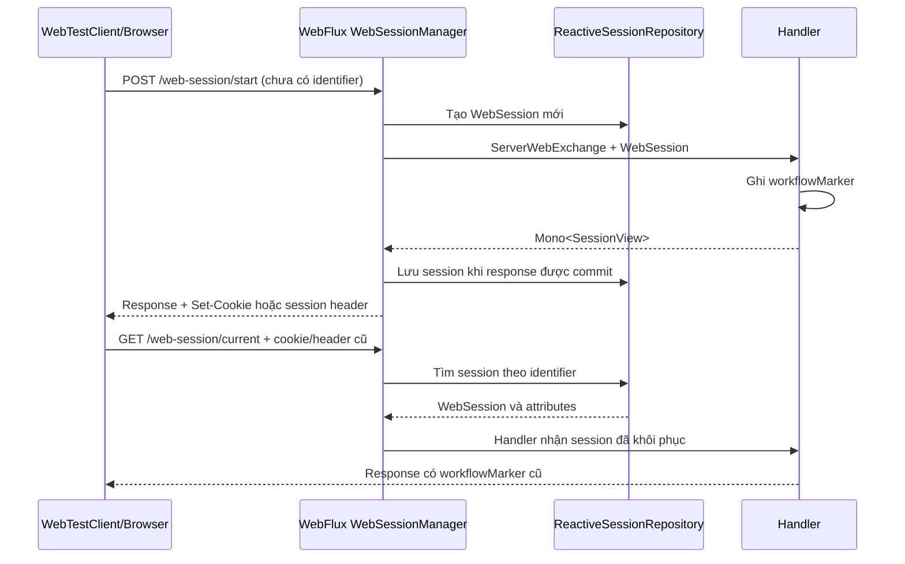

# Gửi lại cookie hoặc header từ phản hồi trước

Trong ứng dụng Spring WebFlux dùng Spring Session, một request có thể tạo `WebSession`, ghi thuộc tính rồi trả session identifier về client. Với resolver dùng cookie, identifier thường được gửi qua `Set-Cookie`; với resolver dùng header, identifier được gửi qua một response header do ứng dụng cấu hình. Client phải lấy đúng giá trị từ phản hồi trước và gửi lại trong request tiếp theo để server khôi phục cùng session từ repository.

Đây là một chu trình HTTP quan trọng cần kiểm thử ở tầng WebFlux. Chỉ gọi hai controller method trong cùng một test hoặc tự tạo một session ID không chứng minh cookie/header resolver và repository hoạt động. Bài này dùng `WebTestClient` để thực hiện hai request riêng biệt, lấy credential từ response đầu tiên, gửi lại trong request thứ hai và xác minh thuộc tính được khôi phục. Phạm vi là Spring Session reactive trên WebFlux, với kho chia sẻ như Redis; API reactive sử dụng `Mono`, `Flux` và `WebSession`.

## 1. Vòng đời WebSession qua hai request

### 1.1. Request đầu tiên lấy và thay đổi WebSession

Trong WebFlux, controller thường nhận `ServerWebExchange` và gọi `exchange.getSession()`. Phương thức này trả `Mono<WebSession>` vì việc lấy session có thể cần truy cập repository bất đồng bộ.

```java
return exchange.getSession().map(session -> {
    session.getAttributes().put("workflowMarker", "created-on-first-request");
    return new SessionView("created-on-first-request");
});
```

Khi thuộc tính được thêm, session được khởi động và Spring Session có thể lưu session ở cuối vòng đời response. `WebSessionManager` phối hợp với `WebSessionIdResolver` và `ReactiveSessionRepository` để nạp, lưu và phát session identifier. Client không cần biết session được lưu trong Redis hay một repository reactive khác.

### 1.2. Phản hồi đầu tiên trả session identifier

Với cookie resolver, response có thể chứa:

```http
HTTP/1.1 200 OK
Set-Cookie: SESSION=<opaque-session-id>; Path=/; HttpOnly; Secure; SameSite=Lax
Content-Type: application/json
```

Tên cookie mặc định phổ biến là `SESSION`, nhưng có thể được cấu hình. Giá trị là một identifier opaque do server phát hành. Không decode, sửa hoặc tự sinh giá trị này trong client.

Với header resolver, response có thể chứa một header như `X-Session-Id`. Tên header và cách phát hành phụ thuộc resolver được cấu hình. Session ID là bearer credential trong cả hai trường hợp; không ghi giá trị thô vào log.

### 1.3. Request tiếp theo gửi lại đúng giá trị

Với cookie, browser hoặc test client gửi:

```http
GET /web-session/current HTTP/1.1
Host: app.example.test
Cookie: SESSION=<opaque-session-id>
Accept: application/json
```

Với header resolver, client gửi header đã nhận:

```http
GET /web-session/current HTTP/1.1
Host: app.example.test
X-Session-Id: <opaque-session-id>
Accept: application/json
```

Resolver lấy identifier từ request, `WebSessionManager` yêu cầu repository tìm session và WebFlux cung cấp `WebSession` đã khôi phục cho handler. Nếu session không còn tồn tại hoặc đã hết hạn, server không thể khôi phục trạng thái cũ.

### 1.4. Sơ đồ chu trình



Test phải chứng minh response đầu phát identifier, request thứ hai gửi lại identifier đó và thuộc tính cũ xuất hiện trong response thứ hai.

## 2. WebSession khác HttpSession

| Đặc điểm | Servlet `HttpSession` | Reactive `WebSession` |
|---|---|---|
| API | `HttpServletRequest.getSession()` | `ServerWebExchange.getSession()` |
| Kiểu trả về | Đối tượng đồng bộ | `Mono<WebSession>` |
| Repository | `SessionRepository` | `ReactiveSessionRepository` |
| Filter/lifecycle | `SessionRepositoryFilter` | WebFlux `WebSessionManager` và `WebSessionIdResolver` |
| Kiểm thử HTTP | MockMvc | WebTestClient |
| Lưu thay đổi | Theo flush/save mode của Servlet repository | Reactive save gắn với vòng đời WebSession/response commit |

Không dùng `HttpSession` hoặc `SessionRepositoryFilter` làm mô hình cho ứng dụng WebFlux thuần reactive. Các API và lifecycle khác nhau dù mục tiêu chia sẻ session qua Redis/JDBC tương tự nhau.

### 2.1. `WebSession` được truy cập bất đồng bộ

`ServerWebExchange.getSession()` trả `Mono<WebSession>`. Controller phải nối các thao tác trong pipeline reactive:

```java
public Mono<SessionView> current(ServerWebExchange exchange) {
    return exchange.getSession()
        .map(session -> new SessionView(
            (String) session.getAttributes().get("workflowMarker")));
}
```

Không gọi `block()` hoặc tự `subscribe()` trong controller/service để lấy session. Làm vậy có thể chặn event loop, tách việc thực thi khỏi lifecycle của request và khiến lỗi khó được chuyển tới response. Hãy trả `Mono`/`Flux` để framework điều phối subscription.

### 2.2. Session thường được tạo lười

Lấy `WebSession` không nhất thiết đồng nghĩa server đã phát cookie ngay. Session thường chỉ bắt đầu khi có thay đổi hoặc được yêu cầu lưu. Một request không thay đổi thuộc tính có thể không tạo identifier mới. Vì vậy, test tạo session cần thực hiện một thay đổi rõ ràng rồi chờ response hoàn tất trước khi đọc cookie/header.

## 3. Cấu hình Spring Session reactive với Redis

### 3.1. Bật Redis WebSession repository

Một ứng dụng WebFlux có thể bật Spring Session Redis bằng cấu hình server-side:

```java
import org.springframework.context.annotation.Configuration;
import org.springframework.session.data.redis.config.annotation.web.server.EnableRedisWebSession;

@Configuration
@EnableRedisWebSession(maxInactiveIntervalInSeconds = 1800)
public class ReactiveSessionConfiguration {
}
```

Ứng dụng cần dependency Spring Session Data Redis và một `ReactiveRedisConnectionFactory` phù hợp. Trong ứng dụng Spring Boot, connection factory thường được cấu hình từ Redis starter và properties. Tất cả instance cần dùng cùng Redis deployment và cùng namespace nếu phải khôi phục cùng session.

Không cấu hình đồng thời nhiều repository reactive cạnh tranh nhau. Chọn một nguồn session chính và kiểm tra cấu hình auto-configuration/annotation theo phiên bản Spring Session đang dùng.

### 3.2. Session identifier qua cookie

Spring Session WebFlux sử dụng `WebSessionIdResolver`. Cookie là lựa chọn thường gặp cho browser. Có thể tùy chỉnh resolver:

```java
import org.springframework.context.annotation.Bean;
import org.springframework.context.annotation.Configuration;
import org.springframework.session.web.server.CookieWebSessionIdResolver;
import org.springframework.web.server.session.WebSessionIdResolver;

@Configuration
public class WebSessionCookieConfiguration {

    @Bean
    WebSessionIdResolver webSessionIdResolver() {
        CookieWebSessionIdResolver resolver = new CookieWebSessionIdResolver();
        resolver.setCookieName("SESSION");
        return resolver;
    }
}
```

Tên package/API cần khớp phiên bản Spring Session và Spring Framework của dự án. Nếu chỉ dùng cookie mặc định, không cần khai báo resolver riêng. Khi có bean tùy chỉnh, xác minh cấu hình `@EnableRedisWebSession` sử dụng đúng resolver đó.

### 3.3. Bảo vệ cookie

Cookie session dùng trong production cần được bảo vệ bằng HTTPS và các thuộc tính phù hợp:

- `Secure`: browser chỉ gửi cookie qua HTTPS.
- `HttpOnly`: JavaScript không đọc được cookie.
- `SameSite`: giảm việc gửi cookie trong một số request cross-site.
- `Path` và `Domain`: giới hạn host/path nhận cookie.

Các tùy chọn cookie có thể được cấu hình qua cookie resolver hoặc cookie initializer theo API của phiên bản. Nếu ứng dụng dùng OIDC redirect/callback cross-site, kiểm thử `SameSite` trên browser thực tế. WebTestClient gửi cookie theo lệnh test và không mô phỏng đầy đủ chính sách browser.

## 4. Ví dụ WebFlux controller

Controller dưới đây có một endpoint tạo session và endpoint khác đọc thuộc tính đã lưu. Endpoint đọc không tự ghi đè thuộc tính cũ.

```java
import org.springframework.http.HttpStatus;
import org.springframework.web.bind.annotation.GetMapping;
import org.springframework.web.bind.annotation.PostMapping;
import org.springframework.web.bind.annotation.RequestMapping;
import org.springframework.web.bind.annotation.RestController;
import org.springframework.web.server.ResponseStatusException;
import org.springframework.web.server.ServerWebExchange;
import reactor.core.publisher.Mono;

@RestController
@RequestMapping("/web-session")
public class WebSessionProbeController {

    @PostMapping("/start")
    public Mono<SessionView> start(ServerWebExchange exchange) {
        return exchange.getSession().map(session -> {
            session.getAttributes().put(
                "workflowMarker", "created-on-first-request");
            session.getAttributes().put("visitCount", 1);
            return new SessionView("created-on-first-request", 1);
        });
    }

    @GetMapping("/current")
    public Mono<SessionView> current(ServerWebExchange exchange) {
        return exchange.getSession().flatMap(session -> {
            String marker = (String) session.getAttributes().get("workflowMarker");
            Integer count = (Integer) session.getAttributes().get("visitCount");
            if (marker == null) {
                return Mono.error(new ResponseStatusException(
                    HttpStatus.UNAUTHORIZED, "No existing session state"));
            }
            return Mono.just(new SessionView(marker, count == null ? 0 : count));
        });
    }

    public record SessionView(String marker, int visitCount) {
    }
}
```

`exchange.getSession()` tạo hoặc lấy session theo lifecycle WebFlux. Ở endpoint `/current`, session mới nếu có sẽ không chứa `workflowMarker`, do đó handler từ chối. Với API thực tế, kết hợp Spring Security để xác thực principal và phân quyền; một marker trong session chỉ là dữ liệu trạng thái, không tự chứng minh danh tính.

## 5. Kiểm thử cookie round-trip bằng WebTestClient

### 5.1. Không giả định test client tự giữ cookie

WebTestClient được dùng để tạo request và kiểm tra response. Để kiểm tra đúng yêu cầu “lấy cookie từ response trước rồi gửi lại”, hãy chủ động đọc cookie từ `EntityExchangeResult` và gắn nó vào request tiếp theo. Cách này làm rõ test đang truyền đúng giá trị nào.

### 5.2. Ví dụ kiểm thử đầy đủ

```java
import static org.junit.jupiter.api.Assertions.assertNotNull;
import static org.junit.jupiter.api.Assertions.assertEquals;

import org.junit.jupiter.api.Test;
import org.springframework.beans.factory.annotation.Autowired;
import org.springframework.boot.test.autoconfigure.web.reactive.AutoConfigureWebTestClient;
import org.springframework.boot.test.context.SpringBootTest;
import org.springframework.http.ResponseCookie;
import org.springframework.test.web.reactive.server.EntityExchangeResult;
import org.springframework.test.web.reactive.server.WebTestClient;

@SpringBootTest(webEnvironment = SpringBootTest.WebEnvironment.RANDOM_PORT)
@AutoConfigureWebTestClient
class WebSessionCookieFlowTest {

    @Autowired
    WebTestClient webTestClient;

    @Test
    void sendsCookieFromFirstResponseOnTheNextRequest() {
        EntityExchangeResult<SessionView> first = this.webTestClient
            .post()
            .uri("/web-session/start")
            .exchange()
            .expectStatus().isOk()
            .expectBody(SessionView.class)
            .returnResult();

        ResponseCookie sessionCookie =
            first.getResponseCookies().getFirst("SESSION");
        assertNotNull(sessionCookie, "First response should issue SESSION cookie");
        assertEquals("created-on-first-request", first.getResponseBody().marker());

        this.webTestClient
            .get()
            .uri("/web-session/current")
            .cookie("SESSION", sessionCookie.getValue())
            .exchange()
            .expectStatus().isOk()
            .expectBody(SessionView.class)
            .value(body -> {
                assertEquals("created-on-first-request", body.marker());
                assertEquals(1, body.visitCount());
            });
    }
}
```

Ví dụ giả định endpoint probe được phép gọi trong test context và resolver dùng cookie tên `SESSION`. Nếu Spring Security bảo vệ POST bằng CSRF, thêm token test phù hợp, chẳng hạn `mutateWith(csrf())` từ Spring Security WebFlux test support. Không tắt CSRF trong production chỉ để test dễ hơn.

### 5.3. Vì sao phải chờ response hoàn tất?

Spring Session lưu WebSession gắn với vòng đời reactive response. `exchange()` và bước consume response body trong WebTestClient subscribe pipeline và chờ response hoàn tất. Sau khi lấy `EntityExchangeResult`, response cookie đã có thể được kiểm tra.

Không lấy cookie trước khi response commit hoặc tự `subscribe()` trong controller để ép ghi session. Cách làm đó phá vỡ lifecycle reactive và khiến test không còn mô phỏng request thật.

### 5.4. Kiểm tra thuộc tính cookie

Ngoài việc cookie tồn tại, có thể kiểm tra:

```java
assertEquals("/", sessionCookie.getPath());
assertEquals(true, sessionCookie.isHttpOnly());
```

Kiểm tra `Secure`, `SameSite`, `Domain` theo cấu hình test tương ứng. `ResponseCookie` có thể cung cấp thuộc tính để assertion; nếu cần chứng minh browser thực sự tuân thủ chúng, dùng browser automation qua HTTPS.

## 6. Gửi lại header từ phản hồi trước

### 6.1. Khi nào dùng header resolver?

Header-based session identifier có thể phù hợp với native client hoặc API client cần tự quản lý credential. Nó không phải lựa chọn mặc định cho browser session vì JavaScript và client code có thể truy cập header/identifier, trong khi cookie `HttpOnly` hạn chế khả năng đọc bằng script.

Nếu dùng header, cần bảo vệ TLS, không log header, giới hạn CORS, chống replay và xem xét CSRF theo cách credential được truyền. Session ID trong header vẫn là bearer credential; đổi vị trí từ cookie sang header không làm nó ít nhạy cảm hơn.

### 6.2. Cấu hình `HeaderWebSessionIdResolver`

Có thể dùng resolver header thay cho cookie resolver:

```java
import org.springframework.context.annotation.Bean;
import org.springframework.context.annotation.Configuration;
import org.springframework.session.web.server.HeaderWebSessionIdResolver;
import org.springframework.web.server.session.WebSessionIdResolver;

@Configuration
public class WebSessionHeaderConfiguration {

    @Bean
    WebSessionIdResolver webSessionIdResolver() {
        return new HeaderWebSessionIdResolver("X-Session-Id");
    }
}
```

Chỉ cấu hình một resolver phù hợp cho một ứng dụng/endpoint domain; không giả định cookie resolver và header resolver tự động đồng thời hoạt động. Xác minh constructor và package với phiên bản Spring Session đang dùng.

### 6.3. Kiểm thử gửi lại header

```java
@Test
void sendsSessionHeaderFromFirstResponseOnTheNextRequest() {
    EntityExchangeResult<SessionView> first = this.webTestClient
        .post()
        .uri("/web-session/start")
        .exchange()
        .expectStatus().isOk()
        .expectBody(SessionView.class)
        .returnResult();

    String sessionId = first.getResponseHeaders().getFirst("X-Session-Id");
    assertNotNull(sessionId, "First response should return X-Session-Id");

    this.webTestClient
        .get()
        .uri("/web-session/current")
        .header("X-Session-Id", sessionId)
        .exchange()
        .expectStatus().isOk()
        .expectBody(SessionView.class)
        .value(body -> assertEquals("created-on-first-request", body.marker()));
}
```

Test phải chạy với `HeaderWebSessionIdResolver` đã được cấu hình trong application context. Không dùng kết quả test cookie để kết luận header resolver hoạt động; hai cách truyền identifier cần test riêng.

### 6.4. Không trộn header session ID với bearer access token

`X-Session-Id` ở ví dụ là identifier để tìm `WebSession`, không phải OAuth2 access token. Không đặt tên hoặc xử lý khiến client nhầm nó với `Authorization: Bearer ...`. Nếu API dùng bearer token stateless, thường không cần Spring Session để lưu Authentication.

## 7. Kiểm thử khi không gửi lại cookie/header

### 7.1. Không có identifier

Gửi request `/web-session/current` mà không có cookie/header. Handler nhận một session mới hoặc chưa được khởi động tùy lifecycle, nhưng không có `workflowMarker`; response phải từ chối yêu cầu cần trạng thái cũ.

```java
@Test
void requestWithoutSessionIdentifierCannotReadPreviousState() {
    this.webTestClient
        .get()
        .uri("/web-session/current")
        .exchange()
        .expectStatus().isUnauthorized();
}
```

### 7.2. Identifier sai hoặc session đã bị xóa

Nếu gửi một identifier không tồn tại, repository không trả session tương ứng. Server không được suy ra danh tính từ giá trị đó. Endpoint cần yêu cầu xác thực lại hoặc trả trạng thái chưa được xác thực.

Không dùng session ID đoán được trong test. Có thể xóa session đã tạo bằng repository sau bước đầu, rồi gửi lại cookie cũ để xác minh server không khôi phục trạng thái.

### 7.3. Session hết inactivity timeout

Session có thể còn cookie trong browser nhưng đã hết `maxInactiveInterval` ở server. Request gửi cookie cũ không khôi phục session hợp lệ. Cookie lifetime và server-side inactivity timeout là hai cơ chế khác nhau.

Không dùng `Thread.sleep` sát ngưỡng TTL nếu có thể tránh; test timeout nên có biên thời gian đủ rộng hoặc dùng clock/test seam mà repository hỗ trợ. Redis có thể dọn key vật lý bất đồng bộ so với thời điểm session hết hạn logic.

## 8. Integration test với Redis reactive

### 8.1. Vì sao cần Redis thật?

Test WebTestClient bind vào controller hoặc dùng repository giả có thể xác minh pipeline HTTP, nhưng không chứng minh serialization, Redis TTL, namespace và connection factory hoạt động. Nên có integration test trong môi trường cô lập với Redis riêng.

Ví dụ Testcontainers:

```java
import org.junit.jupiter.api.Test;
import org.springframework.boot.test.context.SpringBootTest;
import org.springframework.boot.test.autoconfigure.web.reactive.AutoConfigureWebTestClient;
import org.springframework.test.context.DynamicPropertyRegistry;
import org.springframework.test.context.DynamicPropertySource;
import org.testcontainers.containers.GenericContainer;
import org.testcontainers.junit.jupiter.Container;
import org.testcontainers.junit.jupiter.Testcontainers;
import org.testcontainers.utility.DockerImageName;

@Testcontainers
@SpringBootTest(webEnvironment = SpringBootTest.WebEnvironment.RANDOM_PORT)
@AutoConfigureWebTestClient
class RedisWebSessionIntegrationTest {

    @Container
    static final GenericContainer<?> redis =
        new GenericContainer<>(DockerImageName.parse("redis:7.4-alpine"))
            .withExposedPorts(6379);

    @DynamicPropertySource
    static void redisProperties(DynamicPropertyRegistry registry) {
        registry.add("spring.data.redis.host", redis::getHost);
        registry.add("spring.data.redis.port", () -> redis.getMappedPort(6379));
        registry.add("spring.session.redis.namespace", () -> "test:webflux-session");
    }

    // Inject WebTestClient và chạy cookie/header round-trip trong test.
}
```

Ví dụ giả định dự án có dependency Spring Session Redis reactive, Spring Boot WebFlux test và Testcontainers. Tên property thay đổi theo phiên bản Spring Boot; kiểm tra cấu hình của BOM dự án. Nếu dùng `@EnableRedisWebSession`, xác minh annotation và property namespace không tạo cấu hình repository trùng lặp.

### 8.2. Kiểm tra repository reactive trực tiếp

Có thể inject `ReactiveSessionRepository` để kiểm tra session đã lưu hoặc xóa:

```java
StepVerifier.create(sessionRepository.findById(sessionId))
    .assertNext(session -> assertEquals(
        "created-on-first-request",
        session.getAttribute("workflowMarker")))
    .verifyComplete();
```

Đoạn này minh họa kiểm tra repository trong test; `sessionId` phải được lấy từ response hoặc một test fixture có kiểm soát. `StepVerifier` subscribe vào publisher trong test và kiểm tra kết quả. Trong code ứng dụng, không tự `subscribe()` để ép repository ghi dữ liệu.

### 8.3. Phân biệt HTTP test và repository test

- HTTP test xác minh response phát identifier và request tiếp theo gửi lại đúng identifier.
- Repository test xác minh dữ liệu session được lưu/nạp theo API reactive.
- Integration test kết hợp cả hai với Redis thật để xác minh cấu hình và serialization.

Không để repository test thay thế cookie/header round-trip. Một repository có thể hoạt động nhưng resolver/cookie name cấu hình sai vẫn khiến browser không khôi phục được session.

## 9. Kiểm thử chuyển request giữa nhiều instance

### 9.1. Hai node dùng chung Redis

Để xác minh failover, chạy hai ứng dụng WebFlux A và B cùng dùng Redis và namespace:

1. Gửi POST `/web-session/start` tới A.
2. Lấy cookie hoặc header identifier từ response A.
3. Gửi GET `/web-session/current` tới B với đúng identifier.
4. Xác minh B đọc được `workflowMarker` do A ghi.
5. Cập nhật session ở B, sau đó gửi request tới A để xác minh thay đổi đã được lưu và chia sẻ.

Không dùng hai Redis namespace riêng nếu mục tiêu test là chia sẻ session. Cũng không dùng repository in-memory riêng cho từng node.

### 9.2. Kiểm thử node tạo session dừng trước request tiếp theo

Sau khi response đầu tiên hoàn tất, dừng node A rồi gửi request với cookie/header cũ tới B. Nếu Redis còn hoạt động và session đã được lưu, B phải khôi phục được session. Nếu dừng A trước khi response commit, test có thể quan sát mất thay đổi chưa lưu; đó là lý do cần đợi response hoàn tất trong bước đầu.

### 9.3. Kiểm thử namespace không khớp

Chạy A và B với namespace khác nhau trong test âm. Dù client gửi đúng cookie/header identifier, B không tìm thấy session của A. Kết quả phải là trạng thái chưa có session, không được tự tạo Authentication hoặc tin một giá trị từ client.

### 9.4. Header/cookie không thay thế xác thực

Session identifier chỉ giúp tìm session. Ứng dụng vẫn phải kiểm tra SecurityContext/Authentication hợp lệ và authorization cho tài nguyên. Không coi việc client gửi một header tên `X-Session-Id` là bằng chứng người dùng đã đăng nhập.

## 10. Session rotation, logout và cookie/header cũ

### 10.1. Identifier có thể thay đổi

Trong một số luồng bảo mật, session ID được xoay sau khi xác thực hoặc thay đổi trạng thái. Khi response phát identifier mới, client phải dùng giá trị mới nhất. Test không nên giữ cookie/header cũ qua một thao tác rotation rồi kỳ vọng nó tiếp tục trỏ tới session hiện tại.

### 10.2. Invalidate session

Trong WebFlux, `WebSession.invalidate()` trả `Mono<Void>`. Hãy nối publisher vào luồng xử lý:

```java
public Mono<Void> logout(ServerWebExchange exchange) {
    return exchange.getSession()
        .flatMap(WebSession::invalidate);
}
```

Sau khi invalidate và response hoàn tất, resolver có thể phát cookie hết hạn hoặc header xóa identifier tùy loại resolver. Repository không còn trả session hợp lệ theo ID cũ.

### 10.3. Kiểm thử identifier cũ sau logout

1. Tạo session và lấy cookie/header.
2. Gọi endpoint logout với identifier đó.
3. Consume response logout.
4. Gửi lại identifier cũ tới endpoint cần session.
5. Xác minh thuộc tính cũ không còn và ứng dụng yêu cầu xác thực lại.

Chỉ kiểm tra response logout thành công là chưa đủ; cần kiểm tra repository hoặc request sau logout.

## 11. Những lỗi thường gặp khi gửi lại cookie/header

| Hiện tượng | Nguyên nhân có thể | Cách kiểm tra |
|---|---|---|
| Response đầu không có `Set-Cookie` | Session chưa được khởi động, không có thay đổi hoặc resolver khác đang dùng | Ghi thuộc tính session và kiểm tra resolver/context |
| Cookie có nhưng request sau tạo session mới | Test không gửi cookie, sai tên cookie hoặc cookie bị loại theo path/domain | Lấy `getResponseCookies().getFirst(...)` rồi gửi `.cookie(...)` |
| Header response có nhưng request sau không khôi phục | Header name không khớp hoặc resolver không được cấu hình ở server | Kiểm tra `WebSessionIdResolver` và header request |
| Session attribute bị null | Response trước chưa lưu xong, repository/namespace khác hoặc serialization lỗi | Consume response, kiểm tra Redis và repository |
| Test bind-to-controller pass nhưng server fail | Test không đi qua WebSessionManager/repository thật | Chạy `@SpringBootTest` hoặc bind vào application context có đầy đủ filter/handler |
| `block()` làm test/ứng dụng treo | Chặn event loop hoặc sai reactive composition | Trả `Mono` và để WebTestClient/StepVerifier subscribe |
| `subscribe()` trong controller làm response thiếu dữ liệu | Tác vụ chạy ngoài lifecycle request | Nối thao tác bằng `map`, `flatMap`, `then` |
| Cookie bị browser bỏ qua | Secure, SameSite, Domain, Path hoặc HTTPS proxy sai | Kiểm tra browser DevTools và cấu hình cookie |
| Header session ID bị lộ | Log header, CORS rộng hoặc client lưu credential không an toàn | Che log, TLS, giới hạn CORS và cân nhắc cookie HttpOnly |
| Node B không thấy session A tạo | Redis namespace/cluster/database khác nhau | So sánh cấu hình repository trên các node |
| Cookie cũ không dùng sau login | Session identifier đã rotate | Lấy identifier mới từ response login |
| Session cũ vẫn xuất hiện trong kho sau timeout | Cleanup vật lý có thể trễ hơn expiry logic | Kiểm tra repository semantics và TTL, không chỉ nhìn key thô |

## 12. Checklist kiểm thử WebFlux session

Trước khi coi test round-trip hoàn chỉnh, xác minh:

1. Ứng dụng dùng `WebSession` và reactive repository phù hợp, không nhầm Servlet `HttpSession` API.
2. `WebSessionManager` và `WebSessionIdResolver` được cấu hình đúng.
3. Request đầu thực sự thay đổi session để kích hoạt lưu.
4. Test chờ response đầu hoàn tất trước khi đọc cookie/header.
5. Identifier được lấy từ `getResponseCookies()` hoặc `getResponseHeaders()`, không tự tạo.
6. Request thứ hai gửi lại đúng cookie hoặc header đã lấy.
7. Handler đọc được thuộc tính đã ghi ở request đầu.
8. Test thiếu identifier và identifier đã hết hạn/xóa.
9. Test cookie/header riêng biệt nếu ứng dụng hỗ trợ cả hai cấu hình ở môi trường khác nhau.
10. Integration test dùng Redis thật xác minh repository reactive.
11. Multi-node test gửi identifier từ node A sang node B cùng repository.
12. Test logout/rotation xác minh identifier cũ không khôi phục session.
13. Code ứng dụng không gọi `block()` hoặc tự `subscribe()`.
14. Log và assertion output không làm lộ raw session ID.

## 13. Quy trình thực hành

1. Bật `@EnableRedisWebSession` hoặc cấu hình reactive repository phù hợp.
2. Xác định resolver: cookie cho browser hoặc header cho client có chủ đích.
3. Tạo endpoint POST gọi `exchange.getSession()` và ghi một thuộc tính nhỏ.
4. Tạo endpoint GET đọc thuộc tính bằng `WebSession`.
5. Viết WebTestClient test gửi request đầu và consume response.
6. Lấy `ResponseCookie` từ `getResponseCookies()` hoặc identifier từ response header.
7. Gửi request thứ hai bằng `.cookie(name, value)` hoặc `.header(name, value)`.
8. Xác minh thuộc tính được khôi phục.
9. Lặp lại với Redis Testcontainers và repository reactive thật.
10. Gửi cùng identifier tới instance khác để xác minh chia sẻ session.
11. Kiểm thử identifier thiếu, sai, hết hạn, logout và rotation.
12. Kiểm tra cookie policy trên browser thật và rà soát log để bảo vệ identifier.

Trong WebFlux, `WebSession` được truy cập bất đồng bộ qua `Mono`. Request đầu tiên thay đổi session và response commit sẽ lưu dữ liệu rồi phát cookie hoặc header identifier. Client phải lấy đúng giá trị từ response đó và gửi lại ở request tiếp theo. WebTestClient giúp kiểm tra chính xác chu trình này; kết hợp Redis integration test và request chuyển giữa nhiều instance sẽ xác nhận cả resolver, reactive repository và khả năng chia sẻ trạng thái của Spring Session.

## Tài liệu tham khảo

- [Spring Session — WebSession Integration](https://docs.spring.io/spring-session/reference/web-session.html)
- [Spring Session — Reactive Redis Configuration](https://docs.spring.io/spring-session/reference/configuration/reactive-redis.html)
- [Spring Session API — WebSessionIdResolver](https://docs.spring.io/spring-session/reference/api/java/org/springframework/session/web/server/WebSessionIdResolver.html)
- [Spring Session API — CookieWebSessionIdResolver](https://docs.spring.io/spring-session/reference/api/java/org/springframework/session/web/server/CookieWebSessionIdResolver.html)
- [Spring Session API — HeaderWebSessionIdResolver](https://docs.spring.io/spring-session/reference/api/java/org/springframework/session/web/server/HeaderWebSessionIdResolver.html)
- [Spring Framework — WebTestClient](https://docs.spring.io/spring-framework/reference/testing/webtestclient.html)
- [Spring Framework — WebSession](https://docs.spring.io/spring-framework/reference/web/webflux-websession.html)
- [Project Reactor — Testing with StepVerifier](https://projectreactor.io/docs/core/release/reference/testing.html)
