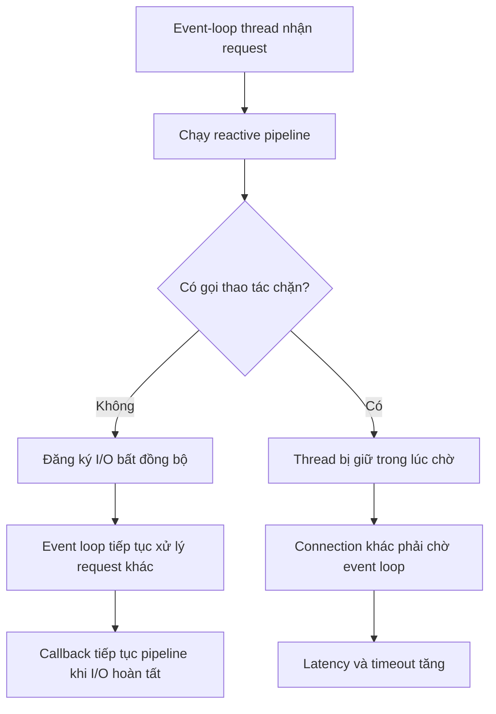

# Đảm bảo không dùng thao tác chặn trong luồng xử lý sự kiện

Spring WebFlux xử lý request bằng reactive pipeline. Với Netty, nhiều request được phục vụ trên một nhóm nhỏ event-loop threads. Nếu một đoạn code gọi thao tác chặn như JDBC đồng bộ, `Thread.sleep()`, `Future.get()` hoặc `Mono.block()` ngay trên event loop, thread đó không thể tiếp tục xử lý các request khác trong thời gian chờ. Hậu quả có thể là latency tăng trên diện rộng, timeout dây chuyền và cạn khả năng xử lý dù CPU chưa bận.

Spring Session trong WebFlux dùng `WebSession` và `ReactiveSessionRepository`. Các thao tác đọc/ghi session cần được nối vào reactive pipeline để I/O diễn ra bất đồng bộ. Việc lưu một attribute vào map của `WebSession` là thao tác bộ nhớ đồng bộ; việc repository tải hoặc lưu session mới là phần có thể cần I/O. Không gọi API đồng bộ của một repository Servlet/JDBC từ event loop rồi giả định rằng bọc kết quả trong `Mono` sẽ biến nó thành non-blocking.

## 1. Event loop và vì sao thao tác chặn gây ảnh hưởng lớn

WebFlux thường chạy trên một runtime non-blocking như Reactor Netty. Event loop nhận sự kiện socket, điều phối request, chạy các operator trong pipeline và tiếp tục xử lý nhiều connection. Một event-loop thread không được thiết kế để ngồi chờ database, file system hoặc một lock lâu dài.

Giả sử một event-loop thread đang xử lý request A và gọi JDBC query mất 500 ms. Trong 500 ms đó, thread không thể xử lý các sự kiện socket khác được phân công cho nó. Nếu nhiều request cùng thực hiện thao tác chặn, số event-loop threads khả dụng giảm nhanh và các request khác phải xếp hàng.



Đặc biệt, một thao tác chặn có thể ảnh hưởng nhiều request không liên quan vì chúng dùng chung event loop. Đây là lý do một ứng dụng có thể chỉ có một endpoint chậm nhưng toàn bộ API WebFlux đều tăng latency.

## 2. Những thao tác cần tránh trong reactive pipeline

Các ví dụ dưới đây thường gây chặn nếu được gọi trực tiếp trên event-loop thread:

- `Mono.block()`, `blockFirst()` hoặc `blockLast()`.
- `Future.get()`, `CompletableFuture.join()` hoặc chờ `CountDownLatch.await()`.
- `Thread.sleep()`.
- JDBC đồng bộ, JPA/Hibernate blocking hoặc Spring Data repository imperative.
- HTTP client đồng bộ như `RestTemplate` hoặc thư viện network blocking.
- Đọc/ghi file đồng bộ với file lớn hoặc storage chậm.
- Chờ monitor/lock như `synchronized` contention, `ReentrantLock.lock()` hoặc semaphore không có timeout.
- Gọi tiến trình ngoài và chờ kết quả đồng bộ.
- Logging hoặc audit sink đồng bộ có thể chờ I/O mạng/file.

Không phải mọi method có vẻ đồng bộ đều nguy hiểm như nhau. Thao tác trên object đã có trong bộ nhớ, ví dụ đọc `session.getAttribute()` hoặc thêm một giá trị nhỏ vào `session.getAttributes()`, thường là thao tác đồng bộ rất ngắn. Điều cần tránh là chờ tài nguyên bên ngoài hoặc giữ event-loop thread trong một khoảng thời gian không kiểm soát.

## 3. WebSession và ReactiveSessionRepository

Trong WebFlux, `WebSession` là API phiên cho request reactive. `WebSessionManager` lấy hoặc tạo session; `WebSessionStore` là abstraction lưu trữ; Spring Session cung cấp `SpringSessionWebSessionStore` để nối `ReactiveSessionRepository` với WebFlux.

Các thao tác repository có dạng reactive:

| Thao tác | Kiểu kết quả điển hình | Ý nghĩa |
|---|---|---|
| `createSession()` | `Mono<S>` | Tạo session mới |
| `findById(id)` | `Mono<S>` | Tìm session; publisher có thể hoàn tất rỗng nếu không có |
| `save(session)` | `Mono<Void>` | Lưu session và attributes |
| `deleteById(id)` | `Mono<Void>` | Xóa session |
| `exchange.getSession()` | `Mono<WebSession>` | Lấy session của exchange hiện tại |
| `session.save()` | `Mono<Void>` | Yêu cầu lưu session theo API WebSession |

Các signature cụ thể có thể khác theo phiên bản, nhưng nguyên tắc là repository reactive trả về `Mono`/`Flux` thay vì chờ I/O rồi trả kết quả đồng bộ.

Trong Spring Session, Redis reactive là một lựa chọn phổ biến cho WebFlux. Repository reactive dùng client Redis hỗ trợ non-blocking I/O. Cấu hình WebFlux phải dùng tích hợp reactive, ví dụ `@EnableRedisWebSession` theo phiên bản, không phải `@EnableRedisHttpSession` dành cho Servlet.

`JdbcIndexedSessionRepository` là repository đồng bộ cho Servlet session; nó không triển khai `ReactiveSessionRepository`. Không inject repository JDBC đó vào WebFlux rồi gọi từ controller hoặc `WebFilter`. Nếu cần database quan hệ trong WebFlux, dùng một giải pháp reactive được hỗ trợ hoặc repository tùy chỉnh dựa trên R2DBC.

## 4. Giữ mọi thao tác session trong reactive chain

Một controller nên nối các thao tác session với publisher thay vì tự subscribe hoặc chặn để lấy kết quả.

Ví dụ đọc attribute và tải dữ liệu giỏ hàng bằng service reactive:

```java
import org.springframework.web.bind.annotation.GetMapping;
import org.springframework.web.bind.annotation.RestController;
import org.springframework.web.server.ServerWebExchange;
import reactor.core.publisher.Mono;

@RestController
class CartController {

    private final ReactiveCartService cartService;

    CartController(ReactiveCartService cartService) {
        this.cartService = cartService;
    }

    @GetMapping("/cart")
    Mono<CartView> cart(ServerWebExchange exchange) {
        return exchange.getSession()
                .flatMap(session ->
                        Mono.justOrEmpty(session.<String>getAttribute("cartId")))
                .flatMap(cartService::findById);
    }
}
```

`exchange.getSession()` trả về `Mono<WebSession>`. `flatMap` nối kết quả với thao tác reactive tiếp theo. `Mono.justOrEmpty` chuyển attribute có thể null thành publisher rỗng. `cartService.findById` phải là API reactive nếu nó truy cập kho dữ liệu bên ngoài.

Nếu muốn trả về response khi không có `cartId`, có thể dùng `switchIfEmpty`:

```java
return exchange.getSession()
        .flatMap(session ->
                Mono.justOrEmpty(session.<String>getAttribute("cartId")))
        .flatMap(cartService::findById)
        .switchIfEmpty(Mono.error(new CartNotFoundException()));
```

Không gọi `.block()` để lấy `cartId` rồi tiếp tục xử lý. Việc nối pipeline giúp Reactor quản lý subscription, cancellation, lỗi và backpressure theo đúng mô hình reactive.

## 5. Cập nhật session mà không chặn

Map attributes của `WebSession` được thao tác đồng bộ trong bộ nhớ. Khi cần lưu thay đổi, hãy nối `session.save()` vào publisher và trả publisher đó cho WebFlux.

```java
@PostMapping("/cart")
Mono<CartView> updateCart(ServerWebExchange exchange,
                         @RequestBody CartRequest request) {
    return exchange.getSession()
            .flatMap(session -> {
                session.getAttributes().put("cartId", request.cartId());
                return session.save()
                        .then(cartService.findById(request.cartId()));
            });
}
```

Ví dụ này giả định `cartService.findById` trả `Mono<CartView>`. `session.save()` cũng trả `Mono<Void>`, nên `then(...)` chỉ chạy thao tác tiếp theo sau khi publisher lưu session hoàn tất. Nếu save thất bại, lỗi được truyền trong pipeline và controller không tiếp tục như thể dữ liệu đã được lưu.

Trong nhiều ứng dụng, WebFlux/Spring Session tự quản lý việc lưu WebSession theo vòng đời request. Gọi `save()` tường minh chỉ khi cần bảo đảm thứ tự lưu trước một thao tác phụ thuộc hoặc khi API/phiên bản yêu cầu. Không gọi `save().block()`.

## 6. Không tự subscribe bên trong controller hoặc WebFilter

Một lỗi phổ biến là tạo một publisher rồi gọi `subscribe()` bên trong request handler:

```java
// Không nên
exchange.getSession().subscribe(session -> {
    session.getAttributes().put("lastAction", "VIEW_CART");
});

return Mono.just(ResponseEntity.ok().build());
```

Đoạn code này tách thao tác session ra khỏi pipeline trả về cho WebFlux. Response có thể hoàn tất trước khi session được cập nhật; lỗi của subscription riêng không được phản ánh đúng vào response; cancellation và request context cũng không còn được điều phối cùng nhau.

Hãy trả publisher:

```java
return exchange.getSession()
        .doOnNext(session ->
                session.getAttributes().put("lastAction", "VIEW_CART"))
        .flatMap(WebSession::save)
        .thenReturn(ResponseEntity.ok().build());
```

`doOnNext` phù hợp cho side effect đồng bộ, ngắn và không chặn. Nếu side effect cần gọi API reactive, dùng `flatMap` hoặc `then` để nối publisher đó vào luồng chính. Không dùng `subscribe()` để “chạy cho xong” một thao tác cần thiết trước khi response trả về.

## 7. Phân biệt map, flatMap, doOnNext và then

Chọn operator đúng giúp code vừa rõ ràng vừa giữ được tính non-blocking.

| Operator | Dùng khi | Tránh dùng để |
|---|---|---|
| `map` | Biến đổi đồng bộ một giá trị đã có trong bộ nhớ | Gọi JDBC hoặc chờ API blocking |
| `flatMap` | Nối một thao tác trả `Mono`/`Flux` khác | Tạo publisher rồi bỏ quên không return |
| `doOnNext` | Side effect đồng bộ, ngắn như metric hoặc cập nhật object local | Chạy I/O bất đồng bộ hoặc công việc cần chờ hoàn tất |
| `then` | Chờ publisher trước hoàn tất rồi chuyển sang publisher tiếp theo | Chặn thread để lấy kết quả |
| `switchIfEmpty` | Xử lý publisher không phát giá trị | Thay thế kiểm tra lỗi serialization/backend |
| `onErrorResume` | Chuyển lỗi thành fallback có chủ đích | Che mọi lỗi rồi trả dữ liệu giả |

Ví dụ sai:

```java
return exchange.getSession()
        .map(session -> blockingJdbcRepository.load(session.getId()));
```

`map` không biến JDBC thành reactive. Hàm `load` vẫn chạy trên thread đang thực thi operator, có thể là event loop.

Ví dụ đúng nếu service đã reactive:

```java
return exchange.getSession()
        .flatMap(session -> reactiveRepository.load(session.getId()));
```

## 8. Tránh các API chặn trong mã xử lý request

Các mẫu sau cần loại bỏ khỏi controller, `WebFilter`, reactive security filter và callback được chạy trên event loop:

```java
// Chặn cho tới khi Mono phát giá trị.
Cart cart = cartService.findById(cartId).block();

// Chặn cho tới khi Future hoàn tất.
User user = userFuture.get();

// Dừng thread hiện tại.
Thread.sleep(1000);

// JDBC đồng bộ.
Order order = jdbcTemplate.queryForObject(sql, mapper, id);
```

Thay bằng API reactive tương ứng:

```java
return cartService.findById(cartId)
        .flatMap(cart -> userService.findById(cart.ownerId())
                .map(user -> new CartView(cart, user)));
```

Nếu API chỉ có `CompletionStage`/`CompletableFuture` và thực sự thực hiện I/O bất đồng bộ, có thể chuyển nó thành `Mono`:

```java
return Mono.defer(() -> Mono.fromFuture(userClient.fetchAsync(userId)));
```

`Mono.fromFuture` nối completion của future vào pipeline. `defer` giúp tạo future khi có subscription, tránh gọi client quá sớm khi publisher được xây dựng. Không gọi `future.get()` hoặc `join()` để chờ future.

## 9. Khi bắt buộc dùng thư viện blocking cũ

Một số hệ thống chưa thể thay ngay JDBC, SDK cũ hoặc thư viện file blocking. Khi đó, cô lập thao tác blocking khỏi event loop bằng `Schedulers.boundedElastic()`.

```java
import reactor.core.publisher.Mono;
import reactor.core.scheduler.Schedulers;

Mono<Order> loadOrder(String orderId) {
    return Mono.fromCallable(() -> legacyJdbcRepository.findById(orderId))
            .subscribeOn(Schedulers.boundedElastic());
}
```

`Mono.fromCallable` trì hoãn lời gọi tới lúc subscription. `subscribeOn(boundedElastic())` chuyển việc thực thi source và thao tác blocking sang scheduler dành cho công việc có thể chặn.

Không viết như sau:

```java
// Sai: lời gọi blocking xảy ra ngay khi tạo Mono.
return Mono.just(legacyJdbcRepository.findById(orderId))
        .subscribeOn(Schedulers.boundedElastic());
```

Trong ví dụ sai, `findById` đã chạy trước khi Reactor có thể chuyển subscription sang scheduler khác. `Mono.just` chỉ bọc kết quả đã được tính.

### 9.1. Giới hạn khi dùng boundedElastic

`boundedElastic` là vùng cách ly cho thao tác blocking, không biến JDBC hoặc SDK cũ thành non-blocking. Nó có giới hạn thread và queue; nếu workload blocking tăng quá mức, task có thể xếp hàng hoặc bị từ chối.

Khi dùng:

- Đặt timeout ở tầng client/database để một task không giữ thread vô hạn.
- Giới hạn concurrency và kích thước connection pool tương ứng.
- Theo dõi queue, thread count, task latency và lỗi rejected execution.
- Không tạo scheduler mới cho từng request.
- Không chuyển toàn bộ pipeline sang `boundedElastic` nếu phần lớn thao tác đã reactive.
- Lập kế hoạch thay API blocking bằng R2DBC/reactive client hoặc service bất đồng bộ thực sự.

Không dùng `Schedulers.parallel()` cho JDBC blocking. Scheduler `parallel` dành cho tác vụ CPU-bound ngắn; chặn các worker của nó cũng làm giảm năng lực xử lý các tác vụ khác.

## 10. Không dùng JDBC SessionRepository trong WebFlux

Spring Session có hai nhóm API cần phân biệt:

| API | Môi trường | Tính chất |
|---|---|---|
| `SessionRepository<S>` | Servlet | Imperative, ví dụ `JdbcIndexedSessionRepository` |
| `ReactiveSessionRepository<S>` | WebFlux | Reactive, thao tác trả `Mono` |
| `MapSessionRepository` | Thường dùng cho Servlet/in-memory test | API imperative và dữ liệu trong process |
| Reactive Redis session repository | WebFlux | Reactive I/O tới Redis |

`JdbcIndexedSessionRepository` thực hiện JDBC đồng bộ. Nó không phải repository reactive và không thể được đưa trực tiếp vào `SpringSessionWebSessionStore`. Nếu ứng dụng WebFlux cần lưu session vào relational database, hãy dùng repository reactive được hỗ trợ hoặc tự triển khai dựa trên R2DBC với semantics expiration, concurrency và cleanup rõ ràng.

Không làm như sau:

```java
return Mono.fromCallable(() -> jdbcSessionRepository.findById(id));
```

Đoạn này vẫn là adapter cho một thao tác blocking; nếu dùng trong WebFlux, phải offload sang boundedElastic và hiểu rõ giới hạn. Nó không làm cho `JdbcIndexedSessionRepository` trở thành `ReactiveSessionRepository`, cũng không bảo đảm tích hợp WebSession/Spring Session đúng hợp đồng.

## 11. Không chặn trong WebFilter và Spring Security reactive

WebFilter có thể cần đọc session để xác định trạng thái hoặc gắn thông tin vào exchange. Hãy trả publisher từ filter chain:

```java
import org.springframework.web.server.ServerWebExchange;
import org.springframework.web.server.WebFilter;
import org.springframework.web.server.WebFilterChain;
import reactor.core.publisher.Mono;

class SessionAuditWebFilter implements WebFilter {

    @Override
    public Mono<Void> filter(ServerWebExchange exchange, WebFilterChain chain) {
        if (!exchange.getRequest().getPath().value().startsWith("/account/")) {
            return chain.filter(exchange);
        }

        return exchange.getSession()
                .doOnNext(session -> {
                    // Chỉ đọc metadata/attribute local; không gọi dịch vụ blocking.
                    exchange.getAttributes().put("sessionPresent", !session.isExpired());
                })
                .then(chain.filter(exchange));
    }
}
```

Ví dụ chỉ minh họa cách nối publisher; filter audit không nên gọi `getSession()` cho mọi request nếu việc đó làm phát sinh session không cần thiết. Với yêu cầu bảo mật, dùng reactive `SecurityContextRepository` và các thành phần Spring Security WebFlux phù hợp, không dùng Servlet `HttpSessionSecurityContextRepository` trong reactive stack.

Trong reactive security filter, không gọi `block()` để lấy principal hoặc session. Dùng `ReactiveSecurityContextHolder`, `Mono` và `flatMap` theo hợp đồng reactive. Context được truyền qua Reactor Context; không giả định `ThreadLocal` của một thread luôn có mặt ở callback chạy trên thread khác.

## 12. Xử lý lỗi và timeout mà không chặn

Reactive pipeline nên thể hiện lỗi bằng signal `onError`, không bắt exception rồi chờ hoặc ngủ để retry. Với session repository:

- Timeout kết nối Redis/database phải được cấu hình ở client và có giới hạn.
- Retry chỉ áp dụng cho lỗi tạm thời và thao tác có thể retry an toàn.
- Không retry vô hạn một lệnh ghi session vì có thể giữ request và tạo tải dây chuyền.
- `onErrorResume` chỉ dùng fallback đã xác định, ví dụ trả `503` khi session store unavailable.
- Không biến lỗi deserialize thành session rỗng mà không ghi nhận; điều đó có thể gây mất trạng thái xác thực khó điều tra.
- Cancellation của request nên được truyền tới publisher I/O nếu client hỗ trợ.

Ví dụ fallback có kiểm soát:

```java
return exchange.getSession()
        .flatMap(session -> session.save())
        .thenReturn(ResponseEntity.noContent().build())
        .onErrorResume(SessionStoreUnavailableException.class,
                ex -> Mono.just(ResponseEntity.status(503).build()));
```

Trong ứng dụng thật, exception có thể được wrap bởi driver hoặc repository. Hãy ánh xạ lỗi ở tầng service/repository với loại lỗi rõ ràng và không nuốt mọi `Throwable`. Response type trong ví dụ cần thống nhất generic type của controller.

## 13. Event listener và tác vụ nền

Một listener có thể được gọi khi repository phát sự kiện session hoặc khi ứng dụng xử lý event nghiệp vụ. Nếu listener chạy trên event loop hoặc trong reactive callback, không gọi API blocking trực tiếp.

Nếu listener cần thực hiện I/O reactive, nối publisher vào cơ chế xử lý có lifecycle rõ ràng. Tránh tạo subscription detached mà không theo dõi lỗi, retry hoặc shutdown. Nếu listener là Spring `@EventListener` đồng bộ, việc trả về `Mono` không tự động bảo đảm publisher được subscribe; cần dùng cơ chế reactive event handling hoặc adapter/scheduler có chủ đích.

Với event transport, cân nhắc:

- Listener nhận message có thể xử lý lặp; handler cần idempotent.
- Retry cần backoff và giới hạn.
- Nếu event phải được xử lý bền vững, dùng broker có delivery/ack semantics phù hợp thay vì in-memory event.
- Không chặn thread nhận message bằng thao tác database đồng bộ.
- Không dùng `Thread.sleep()` để trì hoãn retry; dùng retry/backoff operator hoặc scheduler.

## 14. Kiểm thử phát hiện thao tác blocking

Kiểm thử chức năng đơn thuần có thể pass dù code vẫn chặn event loop. Cần thêm công cụ phát hiện và test chạy qua runtime reactive thực tế.

### 14.1. BlockHound

BlockHound instrument một số API blocking và báo lỗi khi chúng được gọi trên thread được đánh dấu non-blocking. Có thể cài trong test suite:

```java
import org.junit.jupiter.api.BeforeAll;
import reactor.blockhound.BlockHound;

class ReactiveBlockingTests {

    @BeforeAll
    static void installBlockHound() {
        BlockHound.install();
    }
}
```

Sau đó chạy các test service/controller trên scheduler hoặc WebFlux runtime mà ứng dụng sử dụng. Nếu pipeline vô tình gọi `Thread.sleep`, `block()` hoặc một API blocking được BlockHound nhận diện trên non-blocking thread, test có thể thất bại.

BlockHound có thể cần cấu hình tương thích với JDK, agent hoặc thư viện runtime. Một số thư viện có đoạn blocking nội bộ được phép theo integration chính thức. Chỉ thêm allowlist cho trường hợp đã hiểu rõ; không cho phép toàn bộ package ứng dụng để làm test pass.

### 14.2. StepVerifier

`StepVerifier` xác minh publisher phát đúng giá trị, hoàn tất hoặc phát lỗi theo mong đợi:

```java
import org.junit.jupiter.api.Test;
import reactor.test.StepVerifier;

class SessionServiceTests {

    @Test
    void readsSessionStateReactively() {
        StepVerifier.create(sessionService.loadCart("session-123"))
                .expectNextMatches(cart -> cart.id().equals("CART-42"))
                .verifyComplete();
    }
}
```

Test này giả định `loadCart` trả publisher và repository test double cũng trả reactive type. Kết hợp BlockHound để phát hiện thao tác blocking trong pipeline, vì `StepVerifier` một mình không chứng minh không có blocking.

### 14.3. WebTestClient và integration test

`WebTestClient` kiểm tra request/response qua WebFlux stack. Với Spring Session reactive, integration test nên:

1. Khởi động Redis test instance hoặc reactive repository thật.
2. Gửi request tạo session và lưu một attribute.
3. Lấy cookie session từ response.
4. Gửi request tiếp theo với cookie và xác nhận attribute được khôi phục.
5. Gửi request qua một instance khác nếu production chạy nhiều node.
6. Tạm làm backend chậm hoặc unavailable và xác nhận timeout/error được trả đúng, không làm event loop bị giữ.
7. Bật BlockHound trong test profile và chạy các endpoint session thường dùng.

Không chỉ dùng `MapSessionRepository` imperative để test WebFlux reactive flow. Chọn repository triển khai `ReactiveSessionRepository` và đúng backend sẽ dùng trong production.

## 15. Quan sát event loop và scheduler

Để phát hiện blocking trong production/staging, theo dõi:

| Chỉ số | Dấu hiệu cần quan sát |
|---|---|
| Event-loop thread utilization/latency | Event loop bận bất thường hoặc xử lý callback chậm |
| Request latency theo percentile | P95/P99 tăng dù backend không quá tải |
| BoundedElastic queue/active threads | Blocking workload vượt năng lực cách ly |
| Redis/R2DBC latency | I/O reactive chậm hoặc pool/connection có vấn đề |
| Timeout/cancel count | Request hết hạn hoặc client rời trước khi I/O hoàn tất |
| Thread dump | Event-loop thread nằm trong JDBC, `sleep`, monitor wait hoặc `Future.get` |
| BlockHound reports | Blocking call xuất hiện trên non-blocking thread trong test |

Thread name có thể giúp nhận diện event loop, nhưng không nên chỉ dựa vào chuỗi tên thread làm kiểm soát correctness. Hãy kết hợp BlockHound, tracing, metrics và thread dump. Không ghi session ID hoặc cookie vào metric label.

## 16. Anti-pattern thường gặp và cách sửa

| Anti-pattern | Vì sao có vấn đề | Cách sửa |
|---|---|---|
| `exchange.getSession().block()` | Chặn event loop chờ session | Trả `Mono` và nối bằng `flatMap` |
| Gọi JDBC trong `map` | JDBC chạy trên thread hiện tại | Dùng reactive driver/repository hoặc cô lập bằng `fromCallable` + `boundedElastic` |
| `Mono.just(blockingCall())` | Blocking call chạy trước khi publisher được subscribe | Dùng `Mono.fromCallable` và `subscribeOn` |
| `future.get()`/`join()` | Chờ thread hiện tại | Dùng `Mono.fromFuture` cho API async thực sự |
| `Thread.sleep()` để retry | Giữ thread và trì hoãn event loop | Dùng retry/backoff reactive có giới hạn |
| Gọi `subscribe()` trong controller | Tách công việc khỏi request lifecycle | Trả publisher từ controller |
| Dùng `Schedulers.parallel()` cho JDBC | Chặn worker CPU-bound | Dùng boundedElastic tạm thời hoặc thay bằng reactive I/O |
| Dùng `JdbcIndexedSessionRepository` trực tiếp trong WebFlux | Repository imperative không đáp ứng reactive contract | Dùng `ReactiveSessionRepository` phù hợp |
| Chuyển mọi code sang boundedElastic | Tăng thread/queue và che giấu blocking | Chỉ offload đúng đoạn legacy blocking |
| Bắt mọi lỗi rồi trả session rỗng | Che mất backend/serialization failure | Ánh xạ lỗi có chủ đích, log an toàn và trả status phù hợp |

## 17. Quy trình rà soát một luồng session WebFlux

Khi kiểm tra một endpoint có dùng session, đi theo trình tự:

1. Xác định endpoint có thật sự cần tạo/đọc WebSession hay không; tránh tạo session trong filter chỉ để log.
2. Kiểm tra repository được inject có triển khai `ReactiveSessionRepository` không.
3. Theo dõi mọi lời gọi trong controller, service, WebFilter và security filter; tìm `block`, `get`, `join`, `sleep`, JDBC/JPA và client đồng bộ.
4. Đảm bảo publisher từ `exchange.getSession()`, repository và service được nối bằng `flatMap`/`then` và được return.
5. Nếu có API blocking chưa thể thay, bọc đúng lời gọi bằng `Mono.fromCallable(...).subscribeOn(Schedulers.boundedElastic())` và đặt timeout/giới hạn concurrency.
6. Không gọi `subscribe()` thủ công cho công việc cần hoàn tất trước response.
7. Chạy BlockHound cùng StepVerifier/WebTestClient trên các kịch bản login, đọc session, cập nhật, logout và backend lỗi.
8. Theo dõi event-loop latency, scheduler queue, repository latency và timeout trong staging.
9. Kiểm thử nhiều instance nếu session store dùng chung.
10. Loại bỏ adapter blocking khi đã có reactive client/repository tương ứng.

## 18. Nguyên tắc cần nhớ

- WebFlux event loop phải luôn sẵn sàng xử lý sự kiện; không dùng nó để chờ database, file, lock hoặc future.
- `WebSession` và `ReactiveSessionRepository` cung cấp API reactive; nối thao tác bằng `flatMap`, `then` và return publisher.
- Đọc/ghi attribute trong map local có thể đồng bộ; I/O của repository phải non-blocking.
- Không gọi `block`, `blockFirst`, `blockLast`, `Future.get`, `join` hoặc `Thread.sleep` trong reactive request flow.
- Không gọi `subscribe()` detached trong controller/WebFilter cho công việc thuộc request lifecycle.
- Dùng reactive Redis/R2DBC client phù hợp; `JdbcIndexedSessionRepository` là imperative Servlet repository, không phải reactive repository.
- Khi chưa thể bỏ API blocking, dùng `Mono.fromCallable` với `subscribeOn(Schedulers.boundedElastic())`, timeout và giới hạn concurrency.
- Không dùng `Mono.just(blockingCall())` hoặc `Schedulers.parallel()` cho blocking I/O.
- Dùng BlockHound, StepVerifier, WebTestClient, metrics và thread dump để phát hiện blocking.
- Lỗi backend phải được truyền và xử lý có chủ đích; không che bằng session rỗng hoặc fallback local âm thầm.
