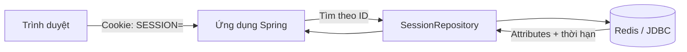

# Session và các thao tác quản lý định danh, thuộc tính, thời gian sống

Spring Session cung cấp cách quản lý phiên cho ứng dụng Spring khi dữ liệu phiên cần được chia sẻ giữa nhiều instance. Để sử dụng đúng, cần hiểu ba nhóm thao tác cơ bản: định danh một session, lưu và truy xuất các thuộc tính của session, và kiểm soát thời gian sống của phiên. Những thao tác này xuất hiện ở API Servlet mà mã web thường dùng, đồng thời được Spring Session ánh xạ xuống các repository như Redis hoặc JDBC.

Trong module này, Spring Session được dùng để quản lý session ứng dụng Spring độc lập với một máy chủ bằng kho dữ liệu chia sẻ như Redis hoặc JDBC. Bài học tập trung vào cách làm việc với session và repository, để ứng dụng có thể đọc cùng một phiên từ nhiều instance mà vẫn quản lý được bảo mật, dữ liệu và thời hạn của phiên.

## 1. Session gồm định danh và dữ liệu

HTTP không tự duy trì trạng thái giữa hai request. Trình duyệt thường gửi một cookie chứa session ID để máy chủ tìm lại dữ liệu phiên. Session ID là khóa tra cứu, còn các thuộc tính như mã người dùng hoặc mã giỏ hàng được lưu ở phía máy chủ.

Một session có thể hình dung như bản ghi sau:

| Thành phần | Ví dụ | Ý nghĩa |
|---|---|---|
| ID | Một chuỗi ngẫu nhiên khó đoán | Nhận diện phiên trong các request |
| Creation time | Thời điểm đăng nhập hoặc tạo phiên | Mốc bắt đầu vòng đời |
| Last accessed time | Thời điểm phiên được truy cập gần nhất | Cơ sở tính thời hạn không hoạt động |
| Max inactive interval | 20 phút | Khoảng không hoạt động tối đa |
| Attributes | userId, cartId, locale | Dữ liệu ngữ cảnh của người dùng |

ID không phải mã người dùng và cũng không nên chứa thông tin nghiệp vụ. Nó là thông tin định danh phiên có tính nhạy cảm: người sở hữu một ID còn hiệu lực có thể được máy chủ xem là đang sử dụng phiên tương ứng. Vì vậy, session ID phải khó đoán, được truyền qua kênh an toàn và không bị ghi vào log công khai.



Spring Session tách dữ liệu phiên khỏi bộ nhớ của một instance. Khi request tiếp theo đến instance khác, instance đó dùng cùng repository để tìm session theo ID và tiếp tục xử lý.

## 2. Hai lớp API thường gặp: HttpSession và Session

Trong ứng dụng Servlet, mã controller và service thường thao tác với jakarta.servlet.http.HttpSession (hoặc javax.servlet.http.HttpSession ở các thế hệ Spring cũ). Đây là API Servlet tiêu chuẩn. Spring Session đăng ký filter để thay thế cách triển khai session mặc định của container, vì vậy mã ứng dụng vẫn có thể dùng HttpSession.

Ở tầng lưu trữ, Spring Session định nghĩa abstraction org.springframework.session.Session. Interface này mô tả dữ liệu phiên độc lập với Servlet container. SessionRepository làm việc với abstraction đó để tạo, tìm, lưu và xóa session.

| API | Vai trò | Nơi thường dùng |
|---|---|---|
| HttpSession | API phiên tiêu chuẩn của Servlet | Controller, filter, tích hợp Servlet |
| Session | Mô hình session của Spring Session | Repository và lớp hạ tầng |
| SessionRepository<S> | Hợp đồng tạo, tìm, lưu, xóa session | Cấu hình và mã quản lý session |
| HttpSessionIdResolver | Đọc và phát hành session ID trong request/response | Tích hợp cookie hoặc header |

Không nên nhầm HttpSession với Session. Chúng biểu diễn cùng một khái niệm ở hai tầng khác nhau. Ứng dụng Servlet thường không cần ép mọi controller phụ thuộc trực tiếp vào SessionRepository; hãy dùng HttpSession cho ngữ cảnh request và dành repository cho các tác vụ hạ tầng cần thao tác với bản ghi session.

## 3. Tạo hoặc lấy session trong Servlet

HttpServletRequest cung cấp hai cách lấy session:

- request.getSession() trả về session hiện tại; nếu chưa có, container hoặc Spring Session tạo session mới.
- request.getSession(false) chỉ trả về session hiện có; nếu request chưa gắn với một session hợp lệ, phương thức trả về null.

Ví dụ, endpoint chỉ đọc thông tin giỏ hàng nên tránh tạo session mới khi người dùng chưa có phiên:

```java
@GetMapping("/cart/summary")
public CartSummary summary(HttpServletRequest request) {
    HttpSession session = request.getSession(false);
    if (session == null) {
        return CartSummary.empty();
    }

    String cartId = (String) session.getAttribute("cartId");
    if (cartId == null) {
        return CartSummary.empty();
    }

    return cartService.getSummary(cartId);
}
```

Khi thực sự cần bắt đầu một phiên, dùng getSession():

```java
@PostMapping("/cart")
public void startCart(HttpServletRequest request) {
    HttpSession session = request.getSession();
    session.setAttribute("cartId", cartService.createCartId());
}
```

Một lời gọi getSession() không cần thiết có thể tạo nhiều session rỗng, phát hành cookie và ghi dữ liệu vào repository. Với endpoint công khai, tài nguyên tĩnh hoặc API không cần trạng thái, hãy cân nhắc getSession(false) hoặc không truy cập session.

## 4. Đọc, thêm, cập nhật và xóa thuộc tính

HttpSession hoạt động như một vùng lưu trữ key-value gắn với phiên:

| Thao tác | API | Kết quả |
|---|---|---|
| Đọc thuộc tính | getAttribute(name) | Giá trị hoặc null nếu không có |
| Đặt mới/cập nhật | setAttribute(name, value) | Gắn giá trị với tên thuộc tính |
| Xóa thuộc tính | removeAttribute(name) | Bỏ một giá trị khỏi session |
| Liệt kê tên | getAttributeNames() | Enumeration các tên hiện có |
| Hủy toàn bộ phiên | invalidate() | Vô hiệu hóa session hiện tại |

Ví dụ:

```java
HttpSession session = request.getSession();

session.setAttribute("userId", "user-42");
session.setAttribute("cartId", "cart-815");

String userId = (String) session.getAttribute("userId");

session.removeAttribute("cartId");
```

Tên thuộc tính nên ổn định, có ý nghĩa và tránh xung đột giữa các phần của ứng dụng. Có thể dùng hằng số để giảm lỗi đánh máy:

```java
public final class SessionAttributes {
    public static final String USER_ID = "userId";
    public static final String CART_ID = "cartId";

    private SessionAttributes() {
    }
}
```

Trong Servlet API, gọi setAttribute(name, null) có tác dụng tương đương xóa thuộc tính; dùng removeAttribute thường làm ý định rõ ràng hơn. getAttribute trả về Object, vì vậy cần kiểm tra kiểu dữ liệu khi đọc, đặc biệt nếu dữ liệu session được tạo bởi nhiều phiên bản ứng dụng.

Không nên xem session như một cache tùy ý. Chỉ lưu dữ liệu nhỏ cần thiết để khôi phục ngữ cảnh request. Với dữ liệu nghiệp vụ lớn hoặc cần truy vấn, hãy lưu ở repository nghiệp vụ và chỉ giữ khóa tham chiếu trong session.

## 5. Chọn kiểu dữ liệu cho thuộc tính

Khi dùng Redis hoặc JDBC, thuộc tính session phải được chuyển thành dạng dữ liệu có thể lưu và đọc lại. Khả năng tuần tự hóa của từng repository phụ thuộc cấu hình serializer. Một object có thể chạy trong bộ nhớ của một JVM nhưng không thể được ghi hoặc giải tuần tự hóa đúng ở instance khác.

Nên ưu tiên:

- Chuỗi, số, boolean, enum và các kiểu giá trị đơn giản.
- DTO nhỏ, có cấu trúc ổn định và được quản lý phiên bản.
- ID tham chiếu đến dữ liệu nghiệp vụ nằm trong database hoặc dịch vụ chuyên trách.

Tránh lưu:

- Entity JPA còn gắn với persistence context hoặc chứa quan hệ lazy.
- HttpServletRequest, HttpServletResponse, stream, socket, connection hay đối tượng phụ thuộc tài nguyên của một tiến trình.
- Đối tượng lớn, blob, dữ liệu có thể tải lại dễ dàng hoặc bản sao của toàn bộ giỏ hàng.
- Thông tin bí mật không cần thiết cho request tiếp theo.

Ví dụ một DTO đơn giản:

```java
public record UserContext(String userId, String displayName, String locale)
        implements java.io.Serializable {
}

session.setAttribute("userContext",
        new UserContext("user-42", "An", "vi"));
```

Đoạn record yêu cầu phiên bản Java hỗ trợ record; với Java cũ có thể dùng class thông thường. Việc triển khai Serializable có thể cần thiết với serializer Java mặc định, nhưng không phải yêu cầu chung cho mọi serializer. Hãy kiểm tra serializer thực tế của repository và giữ cấu trúc dữ liệu tương thích giữa các instance đang chạy.

Một lưu ý khác là thay đổi object đã lưu tại chỗ. Ví dụ, lấy một List từ session rồi thêm phần tử có thể không được repository nhận diện như một thay đổi thuộc tính trong mọi chế độ lưu. Cách an toàn, dễ dự đoán hơn là tạo giá trị mới rồi gọi setAttribute lại:

```java
List<String> oldItems =
        (List<String>) session.getAttribute("recentItems");
List<String> newItems = new ArrayList<>(
        oldItems == null ? List.of() : oldItems);
newItems.add("item-17");
session.setAttribute("recentItems", newItems);
```

Đoạn ví dụ cần import các kiểu List và ArrayList. Trong hệ thống thực tế, nên giới hạn kích thước danh sách và tránh biến session thành kho lưu lịch sử không giới hạn.

## 6. Session ID và cách trình duyệt gửi định danh

Spring Session dùng HttpSessionIdResolver để tách cách truyền session ID khỏi repository. Resolver đọc ID từ request và quyết định cách phát hành hoặc xóa định danh trong response.

Các lựa chọn thường gặp:

| Resolver | Cách truyền | Trường hợp sử dụng |
|---|---|---|
| CookieHttpSessionIdResolver | Cookie | Ứng dụng web dùng trình duyệt |
| HeaderHttpSessionIdResolver | HTTP header | Một số API client tự quản lý header |
| Resolver tùy chỉnh | Theo quy ước của hệ thống | Tích hợp đặc thù đã được đánh giá bảo mật |

Cookie là lựa chọn phổ biến cho ứng dụng web. Có thể tùy chỉnh serializer để đặt tên cookie và thuộc tính bảo mật:

```java
@Bean
public CookieSerializer cookieSerializer() {
    DefaultCookieSerializer serializer = new DefaultCookieSerializer();
    serializer.setCookieName("SESSION");
    serializer.setUseHttpOnlyCookie(true);
    serializer.setUseSecureCookie(true);
    serializer.setSameSite("Lax");
    return serializer;
}
```

HttpOnly ngăn JavaScript đọc cookie trực tiếp; Secure yêu cầu HTTPS; SameSite kiểm soát việc gửi cookie trong các ngữ cảnh cross-site. Cấu hình SameSite=None thường cần Secure và phải đi cùng thiết kế CSRF phù hợp. Thuộc tính Domain và Path cần khớp với phạm vi ứng dụng. Trong môi trường phát triển HTTP, cookie Secure có thể không được gửi như mong muốn; hãy cấu hình theo môi trường thay vì bỏ bảo vệ ở production.

Không truyền session ID trong URL. URL có thể xuất hiện trong lịch sử trình duyệt, log máy chủ, header referrer và hệ thống phân tích. Với header resolver, phải bảo vệ token qua HTTPS, tránh log header nhạy cảm và thiết kế CORS/CSRF theo mô hình client.

## 7. Thay đổi session ID và chống session fixation

Session ID cần được thay đổi ở ranh giới xác thực để ngăn kẻ tấn công chuẩn bị trước một ID rồi dụ người dùng đăng nhập bằng chính phiên đó. Trong Servlet 3.1 trở lên, HttpServletRequest.changeSessionId() thay đổi ID của session hiện tại mà vẫn giữ dữ liệu phiên:

```java
@PostMapping("/login/success")
public void afterLogin(HttpServletRequest request) {
    // Chỉ minh họa thao tác Servlet; trong ứng dụng Spring Security,
    // hãy dùng cơ chế session-fixation protection của framework.
    request.changeSessionId();
}
```

Trong ứng dụng Spring Security, cơ chế bảo vệ session fixation thường đã được cấu hình trong luồng xác thực. Hãy kiểm tra cấu hình hiện tại trước khi tự gọi thêm thao tác đổi ID, tránh xử lý trùng lặp hoặc làm sai luồng đăng nhập.

Đổi ID và hủy session là hai thao tác khác nhau. Đổi ID giữ session hiện tại với định danh mới; invalidate() vô hiệu hóa phiên hiện tại và làm các thuộc tính không còn dùng được. Khi đăng xuất, thường cần hủy phiên và xóa cookie ở phía client. Khi đăng nhập, cần bảo đảm ID trước xác thực không tiếp tục được dùng như ID của phiên đã xác thực.

## 8. Thời điểm tạo, truy cập và hết hạn

HttpSession cung cấp các mốc thời gian và cấu hình timeout:

| API Servlet | Ý nghĩa |
|---|---|
| getCreationTime() | Thời điểm session được tạo, tính bằng milliseconds từ epoch |
| getLastAccessedTime() | Thời điểm truy cập gần nhất được ghi nhận |
| getMaxInactiveInterval() | Khoảng không hoạt động tối đa, tính bằng giây |
| setMaxInactiveInterval(seconds) | Đặt timeout cho session hiện tại |
| isNew() | Cho biết client đã tham gia session hay chưa theo trạng thái Servlet |

Timeout của session là thời gian không hoạt động, không phải thời gian tồn tại tuyệt đối. Khi request tiếp tục sử dụng session, thời điểm truy cập gần nhất được cập nhật theo vòng đời xử lý. Một session có timeout 20 phút có thể tồn tại nhiều ngày nếu liên tục được sử dụng.

Đặt timeout mặc định cho session hoặc thay đổi theo nhu cầu nghiệp vụ:

```java
HttpSession session = request.getSession();

// 20 phút, vì Servlet API dùng đơn vị giây.
session.setMaxInactiveInterval(20 * 60);
```

Giá trị bằng 0 hoặc âm trong Servlet API biểu thị session không tự hết hạn do không hoạt động. Cần cân nhắc kỹ trước khi dùng vì dữ liệu có thể tồn tại lâu hơn dự kiến và tiêu tốn tài nguyên. Chính sách mặc định thường được cấu hình ở cấp ứng dụng; setMaxInactiveInterval đặt chính sách cho session cụ thể.

Nếu nghiệp vụ cần giới hạn tuyệt đối, chẳng hạn bắt buộc đăng nhập lại sau 12 giờ kể cả khi người dùng đang hoạt động, chỉ dùng inactivity timeout là chưa đủ. Có thể lưu mốc thời gian xác thực hoặc tạo phiên trong thuộc tính riêng, rồi kiểm tra thời gian trôi qua ở lớp bảo mật.

## 9. Thời hạn trong Spring Session abstraction

Interface org.springframework.session.Session biểu diễn thông tin session độc lập với Servlet. Trong các phiên bản Spring Session hiện đại, các mốc thời gian được biểu diễn bằng Instant, còn thời gian không hoạt động tối đa được biểu diễn bằng Duration. Những thao tác khái niệm gồm:

- Lấy ID và thời điểm tạo session.
- Lấy/cập nhật thời điểm truy cập gần nhất.
- Đọc hoặc thay đổi max inactive interval.
- Kiểm tra session đã hết hạn hay chưa.
- Đọc, ghi, liệt kê và xóa thuộc tính.

API Servlet biểu diễn timeout bằng số giây, trong khi abstraction Spring Session có thể dùng Duration. Khi chuyển giữa hai tầng, Spring Session thực hiện ánh xạ phù hợp. Nếu viết mã trực tiếp với Session, hãy đối chiếu API của đúng phiên bản dependency đang sử dụng vì kiểu dữ liệu thời gian thay đổi giữa các thế hệ Spring Session.

Về mặt logic, session hết hạn khi thời gian hiện tại vượt quá mốc truy cập gần nhất cộng với max inactive interval. Khi repository nhận diện session đã hết hạn, findById không nên trả về một phiên còn hợp lệ. Việc xóa vật lý dữ liệu cũ có thể diễn ra theo cơ chế riêng của từng store.

## 10. SessionRepository và các thao tác cơ bản

SessionRepository<S extends Session> là hợp đồng trung tâm để thao tác với session đã được trừu tượng hóa. Các thao tác chính:

| Phương thức | Mục đích |
|---|---|
| createSession() | Tạo một session mới với ID và timeout ban đầu |
| save(session) | Lưu session hoặc các thay đổi của session |
| findById(id) | Tìm session theo định danh; có thể trả về null nếu không tồn tại hoặc đã hết hạn |
| deleteById(id) | Xóa session theo định danh |

Ví dụ sau minh họa cách dùng repository trong một tác vụ hạ tầng. Việc khởi tạo repository được lược bỏ vì phụ thuộc store và cấu hình ứng dụng:

```java
// S là một implementation của org.springframework.session.Session.
S session = repository.createSession();
session.setAttribute("userId", "user-42");
repository.save(session);

String sessionId = session.getId();
S loaded = repository.findById(sessionId);

if (loaded != null) {
    Object userId = loaded.getAttribute("userId");
}

repository.deleteById(sessionId);
```

Đây là ví dụ khái niệm về hợp đồng generic; S là kiểu cụ thể của repository và biến repository được cung cấp bởi cấu hình ứng dụng. Trong ứng dụng Servlet thông thường, SessionRepositoryFilter gọi repository trong quá trình xử lý request, nên controller không cần tự tạo và lưu Session cho mỗi request.

save không nên bị hiểu là giao dịch nghiệp vụ bao trùm toàn bộ request. Nó lưu trạng thái session theo chính sách của repository và filter. Việc lưu session không tự bảo đảm tính nguyên tử cho những cập nhật đồng thời trên nhiều thuộc tính hoặc trên dữ liệu nghiệp vụ khác.

## 11. Các loại repository và cách chọn

Spring Session cung cấp nhiều implementation. Các repository khác nhau về nơi lưu, khả năng truy vấn và cách quản lý hết hạn:

| Repository | Nơi lưu | Cách sử dụng điển hình |
|---|---|---|
| MapSessionRepository | Map trong bộ nhớ tiến trình | Kiểm thử, demo hoặc ứng dụng đơn giản |
| RedisIndexedSessionRepository | Redis | Ứng dụng nhiều instance, cần truy cập nhanh và chia sẻ session |
| JdbcIndexedSessionRepository | Cơ sở dữ liệu quan hệ | Hệ thống đã có database và muốn lưu session trong hạ tầng đó |

MapSessionRepository không phải kho dùng chung giữa các JVM. Nếu mỗi instance tạo một map riêng, session vẫn bị phân tán như session cục bộ. Không dùng repository trong bộ nhớ làm giải pháp production cho cụm nhiều instance nếu không có cơ chế chia sẻ bên ngoài.

Redis thường phù hợp với tải đọc/ghi session cao và có thể tận dụng TTL của key. JDBC tận dụng hạ tầng quan hệ hiện có nhưng cần chú ý tải truy vấn, index và việc dọn bản ghi hết hạn. Lựa chọn nên dựa trên lưu lượng, kích thước session, yêu cầu độ trễ, khả năng vận hành và yêu cầu sẵn sàng của hệ thống.

## 12. Tra cứu session theo người dùng

SessionRepository cơ bản tra cứu theo session ID. Một số ứng dụng cần tìm tất cả session của một người dùng, ví dụ để hiển thị thiết bị đang đăng nhập hoặc thu hồi các phiên khác. Spring Session có abstraction FindByIndexNameSessionRepository mở rộng khả năng tra cứu bằng index.

Một index được định nghĩa sẵn là PRINCIPAL_NAME_INDEX_NAME. Khi repository và tích hợp bảo mật được cấu hình để lập chỉ mục principal, có thể tìm session theo tên người dùng:

```java
Map<String, ? extends Session> sessions =
    repository.findByIndexNameAndIndexValue(
        FindByIndexNameSessionRepository.PRINCIPAL_NAME_INDEX_NAME,
        "user-42"
    );
```

Ví dụ trên giả định repository là một FindByIndexNameSessionRepository đã được cấu hình và index principal được ghi nhận. Không phải mọi SessionRepository đều hỗ trợ truy vấn này. Khả năng lập chỉ mục và đồng bộ principal phụ thuộc implementation cùng tích hợp Spring Security.

Để đăng xuất người dùng khỏi một thiết bị cụ thể, ứng dụng có thể xác định session cần thu hồi rồi xóa session tương ứng qua repository hoặc cơ chế quản lý session của Spring Security. Cần xác minh quyền của người gọi và tránh để endpoint tra cứu session trở thành cách đọc thông tin đăng nhập của người khác.

## 13. TTL ở Redis và thời gian hết hạn trong JDBC

Thời hạn logic của session được xác định bởi last accessed time và max inactive interval. Mỗi repository triển khai việc lưu và dọn dữ liệu theo cách riêng.

**Với Redis:** dữ liệu session có thể được gắn TTL để Redis tự hết hạn key. Spring Session còn có thể dùng key hoặc metadata hỗ trợ xử lý sự kiện hết hạn và tra cứu. TTL thực tế có thể được thiết lập để việc dọn dẹp và phát sự kiện hoạt động đúng, nên không nên giả định mọi key liên quan đều có cùng giá trị TTL. Cần cấu hình Redis notifications theo hướng dẫn của phiên bản Spring Session đang dùng nếu ứng dụng phụ thuộc sự kiện hết hạn.

**Với JDBC:** repository lưu thời điểm hết hạn trong bản ghi session. Khi truy vấn, session quá hạn được xem là không hợp lệ; bản ghi vật lý có thể được dọn bởi tác vụ cleanup. Vì vậy, thời điểm ứng dụng ngừng chấp nhận session và thời điểm hàng dữ liệu biến mất khỏi bảng có thể khác nhau.

Hai khái niệm cần phân biệt:

- **Hết hạn về mặt logic:** session không còn được chấp nhận khi ứng dụng tra cứu.
- **Xóa vật lý:** dữ liệu cũ được loại khỏi Redis hoặc database để giải phóng tài nguyên.

Nếu thấy bản ghi hết hạn vẫn còn trong bảng hoặc key phụ trợ vẫn tồn tại, hãy kiểm tra cơ chế cleanup và sự kiện của repository trước khi kết luận rằng người dùng vẫn có thể sử dụng phiên đó.

## 14. Cập nhật session đồng thời và tính nhất quán

Nhiều request của cùng một trình duyệt có thể chạy đồng thời. Ví dụ, người dùng mở hai tab và cả hai cùng cập nhật thuộc tính cart. Hai request có thể đọc cùng một trạng thái ban đầu, tạo hai phiên bản cập nhật khác nhau rồi lưu gần như cùng lúc. Kết quả có thể là cập nhật sau ghi đè cập nhật trước.

Spring Session cung cấp kho dùng chung để các instance đọc cùng session; điều đó không biến thao tác trên thuộc tính thành một giao dịch có khóa phân tán. Repository cũng không thay thế transaction của database nghiệp vụ.

Với dữ liệu cần nhất quán như số dư, số lượng hàng tồn, mã giảm giá đã dùng hoặc đơn hàng, hãy lưu và cập nhật trong service/repository nghiệp vụ với transaction, optimistic locking hoặc thao tác nguyên tử thích hợp. Session chỉ nên giữ ID hoặc dữ liệu giao diện cần thiết.

Khi phải cập nhật thuộc tính session đồng thời, cần xác định rõ quy tắc hợp nhất hoặc ghi đè và kiểm thử bằng repository thật. Kiểm thử hai request trên cùng một mock session không đủ để chứng minh hành vi của Redis/JDBC trong nhiều instance.

## 15. Đăng xuất và thu hồi session

Đăng xuất cần xử lý cả dữ liệu phía máy chủ lẫn dấu vết định danh phía trình duyệt. Trong Servlet, có thể lấy session hiện tại mà không tạo phiên mới rồi vô hiệu hóa:

```java
HttpSession session = request.getSession(false);
if (session != null) {
    session.invalidate();
}
```

Với Spring Session, việc invalidate được filter chuyển thành thao tác xóa session trong repository. Resolver có thể phát hành cookie hết hạn để trình duyệt ngừng gửi ID cũ. Nếu chỉ xóa cookie mà không xóa session ở server, một bản sao ID bị lộ vẫn có thể được dùng đến khi phiên hết hạn.

Trong ứng dụng Spring Security, nên dùng logout flow chuẩn và cấu hình xóa cookie session tương ứng. Nếu cung cấp chức năng đăng xuất mọi thiết bị, cần tìm session theo principal index khi có hỗ trợ, xác thực quyền sở hữu rồi xóa các session đã chọn. Cần xử lý trường hợp repository tạm thời không truy cập được; không được báo đăng xuất hoàn tất nếu thao tác thu hồi phía máy chủ đã thất bại.

## 16. Kiểm thử API và repository

Kiểm thử nên xác nhận cả hành vi API lẫn khả năng lưu trữ qua repository:

1. **Tạo session:** request đầu tiên cần session tạo được một ID và response phát hành cookie.
2. **Đọc thuộc tính:** request tiếp theo mang cookie đọc lại được giá trị đã lưu.
3. **Cập nhật và xóa thuộc tính:** giá trị mới được nhìn thấy ở request sau; thuộc tính đã xóa không còn xuất hiện.
4. **Không tạo session ngoài ý muốn:** request dùng getSession(false) không làm phát sinh session mới.
5. **Timeout:** session không hoạt động vượt timeout không còn được trả về như phiên hợp lệ.
6. **Đổi ID:** sau xác thực, ID mới được sử dụng và ID cũ không còn đại diện cho phiên đã xác thực.
7. **Đăng xuất:** session bị invalidate và request tiếp theo với cookie cũ không thể khôi phục phiên.
8. **Nhiều instance:** tạo session ở instance A rồi đọc cùng cookie ở instance B và xác nhận dữ liệu giống nhau.
9. **Đồng thời:** chạy hai request cập nhật cùng thuộc tính, sau đó xác minh kết quả theo chính sách xung đột đã chọn.

MockHttpSession hữu ích cho unit test controller và kiểm tra logic Servlet. Để xác nhận Redis hoặc JDBC hoạt động, cần integration test với repository tương ứng. Nên kiểm tra cả cookie, TTL, serializer, principal index và hành vi khi store mất kết nối.

## 17. Checklist khi thiết kế session

- Dùng getSession(false) khi chỉ cần đọc phiên có sẵn.
- Dùng tên thuộc tính nhất quán và lưu DTO nhỏ, ổn định.
- Không đưa dữ liệu nhạy cảm không cần thiết hoặc object gắn với tài nguyên tiến trình vào session.
- Đặt inactivity timeout phù hợp; dùng kiểm tra riêng nếu có giới hạn tuổi phiên tuyệt đối.
- Bảo vệ cookie bằng HTTPS, HttpOnly, Secure và SameSite phù hợp.
- Đổi session ID tại ranh giới xác thực và invalidate session khi logout.
- Tách namespace theo ứng dụng/môi trường và bảo đảm mọi instance dùng cùng repository.
- Theo dõi lỗi kết nối, số session, dung lượng và hoạt động cleanup.
- Kiểm thử timeout, thu hồi, serialization, request đồng thời và chuyển instance.

Quản lý session tốt đòi hỏi đồng thời kiểm soát ID, thuộc tính và thời gian sống. Spring Session giữ API Servlet quen thuộc cho ứng dụng web, cung cấp abstraction Session và SessionRepository ở tầng lưu trữ, rồi ánh xạ dữ liệu đó xuống Redis hoặc JDBC. Khi dữ liệu session được thiết kế nhỏ gọn, có timeout rõ ràng và được kiểm thử qua nhiều instance, ứng dụng có thể duy trì ngữ cảnh người dùng mà không phụ thuộc vào bộ nhớ của một máy chủ cụ thể.
