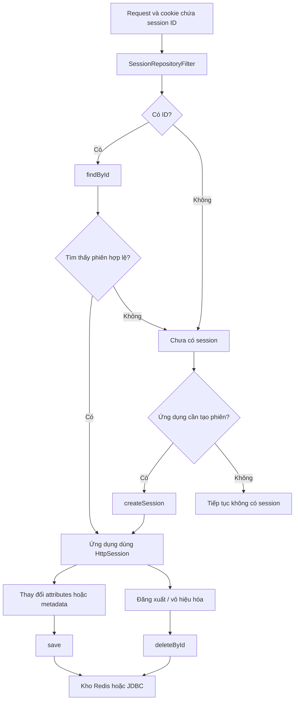
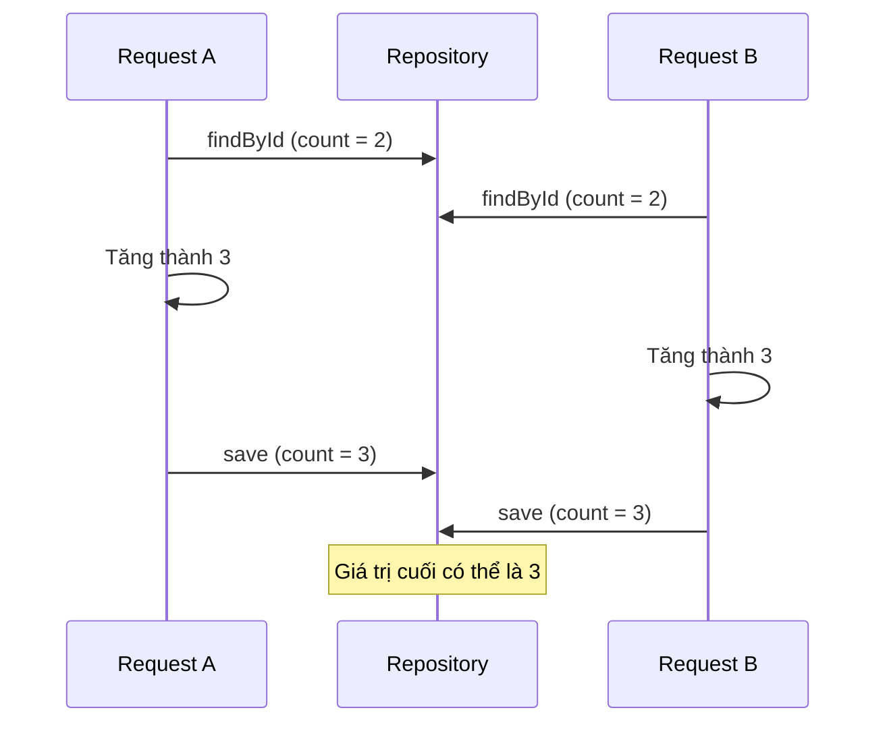

# SessionRepository và hợp đồng tạo, đọc, lưu, xóa phiên

Spring Session giúp ứng dụng Spring quản lý session độc lập với bộ nhớ của một máy chủ. Khi triển khai nhiều instance, các instance có thể cùng truy cập dữ liệu phiên trong một kho dùng chung như Redis hoặc JDBC. Thành phần quyết định cách ứng dụng tạo, tìm, lưu và xóa dữ liệu phiên là **repository**.

Trong Spring Session, `SessionRepository` là hợp đồng lưu trữ đồng bộ cho các đối tượng `Session`. Hợp đồng này giữ cho mã sử dụng session không phụ thuộc vào chi tiết của Redis, JDBC hay một implementation khác. Để dùng đúng abstraction, cần hiểu trách nhiệm của từng thao tác, vòng đời một phiên qua repository và những giới hạn mà hợp đồng không cam kết.

## 1. SessionRepository nằm ở đâu trong kiến trúc?

Một session là dữ liệu của một phiên làm việc, thường gồm ID, thời điểm tạo, thời điểm truy cập gần nhất, thời gian không hoạt động tối đa và các attributes do ứng dụng đặt. Repository quản lý việc lưu và khôi phục dữ liệu đó. Kho lưu trữ là nơi implementation của repository ghi dữ liệu thực tế.

Với ứng dụng Servlet, `SessionRepositoryFilter` kết nối API `HttpSession` với `SessionRepository`. Controller tiếp tục dùng `request.getSession()` hoặc nhận `HttpSession` như thông thường; filter chuyển các thao tác đó sang session do Spring Session quản lý. Filter cũng phối hợp với `HttpSessionIdResolver` để lấy và gửi session ID, thường thông qua cookie.

Vì vậy, cookie và repository có hai vai trò khác nhau:

- Cookie thường mang session ID để trình duyệt gửi lại ở request tiếp theo.
- Repository tìm dữ liệu phiên tương ứng với ID đó và lưu thay đổi của phiên.
- `SessionRepositoryFilter` kết nối API Servlet với repository trong ứng dụng Servlet.

Repository không cần biết trình duyệt gửi cookie như thế nào. Tương tự, cookie không chứa toàn bộ dữ liệu session; nó thường chỉ chứa ID. Tách các trách nhiệm này giúp ứng dụng có thể thay đổi cơ chế lưu trữ mà không phải viết lại logic nghiệp vụ trong controller.

## 2. Hợp đồng SessionRepository

Spring Session định nghĩa interface đồng bộ với kiểu tổng quát `S` là một kiểu triển khai `Session`:

```java
public interface SessionRepository<S extends Session> {
    S createSession();

    void save(S session);

    S findById(String id);

    void deleteById(String id);
}
```

`S extends Session` cho phép repository làm việc với nhiều kiểu session cụ thể, miễn là kiểu đó tuân theo hợp đồng `Session`. Ứng dụng thường nhận repository đã được Spring cấu hình và sử dụng qua thành phần tích hợp; không cần tự viết một implementation nếu Redis hoặc JDBC đã đáp ứng yêu cầu.

Bốn phương thức tương ứng với bốn thao tác trong vòng đời phiên:

| Phương thức | Đầu vào | Kết quả | Ý nghĩa |
|---|---|---|---|
| `createSession()` | Không có | Một đối tượng `S` mới | Tạo phiên mới và cấp ID cho phiên |
| `findById(String id)` | Session ID | `S` hoặc `null` | Tìm phiên theo ID; không có phiên phù hợp thì trả về `null` |
| `save(S session)` | Đối tượng session | `void` | Lưu trạng thái hiện tại của phiên, bao gồm dữ liệu và metadata |
| `deleteById(String id)` | Session ID | `void` | Xóa phiên được nhận diện bằng ID |

Các phương thức này là hợp đồng thao tác, không phải bốn tên gọi cho câu lệnh SQL hay lệnh Redis cụ thể. Implementation quyết định cách tạo ID, tuần tự hóa attributes, ghi dữ liệu, thiết lập thời hạn và dọn dữ liệu hết hạn.

## 3. Tạo phiên với createSession()

`createSession()` tạo một đối tượng session mới có thể được repository lưu trữ. Đối tượng mới có ID và metadata khởi tạo, nhưng ứng dụng cần gọi `save()` để yêu cầu repository lưu trạng thái đã chuẩn bị. Có thể đặt attributes và thời gian không hoạt động tối đa trước khi lưu.

Ví dụ dưới đây minh họa luồng gọi API. Hàm dùng kiểu tổng quát để chấp nhận implementation `SessionRepository` với bất kỳ kiểu `Session` cụ thể nào:

```java
static <S extends Session> String createCartSession(
        SessionRepository<S> repository, String cartId) {

    S session = repository.createSession();
    session.setAttribute("cartId", cartId);
    session.setMaxInactiveInterval(Duration.ofMinutes(30));

    repository.save(session);
    return session.getId();
}
```

Ví dụ cần có import `java.time.Duration` và các kiểu Spring Session tương ứng. Mã thực tế thường để filter hoặc lớp tích hợp gọi repository thay vì gọi trực tiếp trong controller. Đoạn mã cho thấy quan hệ giữa các thao tác: tạo đối tượng, chuẩn bị dữ liệu, lưu phiên, sau đó dùng ID để tham chiếu phiên.

Không nên tạo session mới ở mọi request một cách vô điều kiện. Trong ứng dụng Servlet, khi request có session ID hợp lệ, filter tìm lại session hiện tại. Chỉ khi request cần tạo phiên mới, chẳng hạn lần đầu người dùng thêm hàng vào giỏ, ứng dụng mới cần một session mới. Tạo phiên dư thừa có thể làm tăng dữ liệu lưu trữ và tạo nhiều cookie hoặc phiên không cần thiết.

## 4. Đọc phiên với findById()

`findById(id)` tìm session theo ID. Nếu phiên không tồn tại, đã bị xóa hoặc không còn hợp lệ do hết hạn, phương thức trả về `null`. Vì vậy, mã gọi phải xử lý trường hợp không tìm thấy trước khi đọc attributes.

```java
static <S extends Session> String findCartId(
        SessionRepository<S> repository, String sessionId) {

    S session = repository.findById(sessionId);
    if (session == null) {
        return null; // Không có phiên hợp lệ cho ID này.
    }

    return session.getAttribute("cartId");
}
```

ID do client gửi lên phải được xem là dữ liệu không đáng tin cậy. Không được coi việc có một chuỗi ID là bằng chứng người dùng đã xác thực. Ứng dụng cần để Spring Session phân giải ID và tải session, sau đó áp dụng quy trình xác thực và phân quyền riêng.

`findById()` cũng không phải thao tác khóa phiên. Nhiều request có thể cùng tìm và nhận dữ liệu của một session. Nếu chúng cập nhật cùng một attribute, kết quả cuối cùng phụ thuộc cách implementation lưu thay đổi và thứ tự các lần ghi. Hợp đồng cơ bản không hứa rằng một lần đọc sẽ khóa session cho đến khi request kết thúc.

## 5. Lưu phiên với save()

`save(session)` yêu cầu repository lưu trạng thái hiện tại của đối tượng session. Trạng thái này có thể bao gồm attributes, thời điểm truy cập gần nhất và thời gian không hoạt động tối đa. Vì phương thức trả về `void`, caller không nhận một đối tượng kết quả để xác nhận từng attribute đã được ghi theo cách nào.

Ví dụ cập nhật một phiên đã đọc:

```java
static <S extends Session> void updateCartCount(
        SessionRepository<S> repository, String sessionId, int count) {

    S session = repository.findById(sessionId);
    if (session == null) {
        throw new IllegalStateException("Session không còn hợp lệ");
    }

    session.setAttribute("cartItemCount", count);
    repository.save(session);
}
```

Với ứng dụng Servlet, controller thông thường chỉ thao tác trên `HttpSession`. `SessionRepositoryFilter` theo dõi session và phối hợp việc lưu theo cấu hình flush của Spring Session, thường trong quá trình hoàn tất response. Không nên gọi repository trực tiếp ở mọi controller chỉ để lưu từng attribute nếu filter đã quản lý vòng đời đó.

Thời điểm lưu có ảnh hưởng đến hành vi quan sát được. Cấu hình lưu khi hoàn tất request có thể gom nhiều thay đổi vào một lần ghi. Cấu hình flush ngay có thể đẩy thay đổi sớm hơn, nhưng tăng số lần truy cập kho dữ liệu. Chi tiết này phụ thuộc cấu hình và implementation; `SessionRepository` chỉ định nghĩa thao tác `save`, không quy định toàn bộ chính sách flush.

### Attributes và tuần tự hóa

Attributes thường là các cặp tên–giá trị do ứng dụng đặt, ví dụ `cartId`, một mã tham chiếu hoặc một phần trạng thái xác thực. Khi dùng repository chia sẻ, dữ liệu phải có khả năng được implementation chuyển thành định dạng lưu trữ và khôi phục ở instance khác.

Với Redis hoặc JDBC, cần kiểm tra serializer được cấu hình và yêu cầu đối với kiểu attribute. Nếu một instance lưu đối tượng theo một định dạng mà instance khác không đọc được, lỗi có thể xuất hiện sau khi request chuyển sang instance đó hoặc sau khi ứng dụng được triển khai phiên bản mới. Nên ưu tiên lưu dữ liệu nhỏ, có cấu trúc ổn định; tránh đưa các đối tượng lớn, phụ thuộc nhiều vào class nội bộ hoặc thay đổi thường xuyên vào session.

## 6. Xóa phiên với deleteById()

`deleteById(id)` yêu cầu repository xóa phiên theo ID. Thao tác này thường được sử dụng khi người dùng đăng xuất hoặc khi ứng dụng chủ động thu hồi một phiên. Với ứng dụng Servlet, `HttpSession.invalidate()` là API quen thuộc; Spring Session chuyển yêu cầu vô hiệu hóa đó thành thao tác xóa qua repository.

```java
static <S extends Session> void removeSession(
        SessionRepository<S> repository, String sessionId) {

    repository.deleteById(sessionId);
}
```

Phương thức không trả về cờ cho biết có bao nhiêu bản ghi bị xóa. Luồng ứng dụng không nên dựa vào một giá trị trả về để quyết định đăng xuất có thành công hay không. Cần phối hợp việc xóa dữ liệu ở phía máy chủ với việc xóa hoặc làm mất hiệu lực cookie phía client theo `HttpSessionIdResolver` đang dùng. Xóa cookie mà không thu hồi session ở repository có thể để lại dữ liệu phiên còn hiệu lực; xóa dữ liệu mà client vẫn gửi cookie thì request tiếp theo sẽ không khôi phục được phiên cũ.

Khi cần đăng xuất khỏi mọi thiết bị, xóa một session ID là chưa đủ nếu người dùng có nhiều session khác nhau. Ứng dụng cần một chiến lược nhận diện và thu hồi các phiên liên quan, chẳng hạn dùng repository có hỗ trợ truy vấn theo principal/index hoặc duy trì dữ liệu liên kết phù hợp. Hợp đồng `SessionRepository` cơ bản chỉ cung cấp thao tác theo ID.

## 7. Vòng đời phiên đi qua repository

Trong một ứng dụng Servlet sử dụng Spring Session, luồng điển hình diễn ra như sau:

1. Trình duyệt gửi request và cookie mang session ID nếu đã có.
2. `SessionRepositoryFilter` dùng `HttpSessionIdResolver` để lấy ID từ request.
3. Nếu có ID, filter gọi `findById()` để khôi phục session. Nếu không có session hợp lệ, request chưa có phiên hiện tại.
4. Khi ứng dụng yêu cầu tạo session, filter gọi `createSession()` và cung cấp API `HttpSession` tương ứng.
5. Ứng dụng đọc hoặc cập nhật attributes. Spring Session theo dõi thay đổi và lưu theo chính sách flush đã cấu hình.
6. Repository thực hiện `save()` để ghi dữ liệu. Filter gửi session ID cho client theo resolver.
7. Khi người dùng đăng xuất hoặc phiên bị vô hiệu hóa, Spring Session gọi `deleteById()` để thu hồi dữ liệu phiên.



Khi triển khai nhiều instance, instance A và instance B cần dùng repository được cấu hình trỏ đến cùng kho dữ liệu hoặc cùng không gian dữ liệu tương thích. Sau khi A lưu phiên, B có thể khôi phục phiên bằng ID đó. Sticky session ở load balancer có thể giảm việc chuyển request giữa các instance, nhưng không thay thế repository chia sẻ nếu mục tiêu là duy trì trạng thái khi instance bị thay thế hoặc khởi động lại.

## 8. Repository, Redis và JDBC

`SessionRepository` là abstraction; Redis và JDBC là các lựa chọn triển khai lưu trữ. Spring Session cung cấp implementation tương ứng để ứng dụng không phải tự ánh xạ từng attribute thành câu lệnh Redis hoặc SQL.

| Khía cạnh | Repository dùng Redis | Repository dùng JDBC |
|---|---|---|
| Nơi lưu dữ liệu | Redis | Cơ sở dữ liệu quan hệ |
| Truy cập | Qua kết nối Redis | Qua `DataSource` và schema session |
| Thời hạn phiên | Có thể tận dụng TTL và cơ chế hết hạn của Redis | Được quản lý bằng metadata thời hạn và cơ chế dọn dữ liệu của implementation |
| Vận hành cần chú ý | Bộ nhớ, persistence, eviction, kết nối và serializer | Schema, index, transaction, kết nối và tác vụ dọn dữ liệu |
| Phù hợp khi | Hệ thống cần truy cập nhanh và đã vận hành Redis | Hệ thống muốn dùng hạ tầng cơ sở dữ liệu quan hệ hiện có |

Ví dụ bật repository Redis cho Servlet:

```java
@Configuration
@EnableRedisHttpSession
class SessionConfiguration {
    // Cần có RedisConnectionFactory được cấu hình trong ứng dụng.
}
```

Với JDBC, dùng cấu hình Spring Session JDBC tương ứng, cung cấp `DataSource` và schema được hỗ trợ bởi phiên bản Spring Session đang sử dụng. Trong cả hai trường hợp, ứng dụng tiếp tục làm việc với `HttpSession`; Spring Session cung cấp implementation repository và filter phù hợp.

Chọn Redis hay JDBC không chỉ dựa trên tốc độ. Cần xem xét độ bền dữ liệu, năng lực vận hành, chính sách backup, khả năng phục hồi, giới hạn bộ nhớ hoặc dung lượng bảng, và cách tổ chức môi trường. Các instance phải có cấu hình tương thích về namespace, serializer, cookie và thời hạn phiên. Nếu hai instance dùng namespace hoặc định dạng dữ liệu khác nhau, chúng có thể không tìm thấy hoặc không giải mã được session của nhau dù kết nối đến cùng một máy chủ dữ liệu.

## 9. Thời hạn phiên và dọn dữ liệu hết hạn

Session có thời gian không hoạt động tối đa. Khi khoảng thời gian đó trôi qua mà không có truy cập hợp lệ, phiên phải được xem là hết hạn. Giá trị thời hạn được biểu diễn trên đối tượng `Session` và implementation repository chuyển nó thành cơ chế lưu trữ phù hợp.

Không nên đồng nhất thời hạn session với thời hạn cookie. Cookie quyết định trình duyệt còn giữ và gửi ID trong bao lâu; TTL của session quyết định phía máy chủ còn chấp nhận dữ liệu phiên trong bao lâu. Hai chính sách cần nhất quán với yêu cầu bảo mật và trải nghiệm người dùng. Nếu cookie còn tồn tại sau khi session hết hạn, request tiếp theo có thể gửi một ID mà repository không còn tìm thấy.

Việc một session hết hạn về mặt logic và việc dữ liệu cũ được xóa vật lý có thể xảy ra ở những thời điểm khác nhau. Redis có cơ chế hết hạn key; với JDBC, implementation có thể cần tác vụ dọn dữ liệu. Vì vậy, không nên dựa vào việc bản ghi hết hạn biến mất ngay lập tức để thực hiện logic nghiệp vụ. `findById()` cần được sử dụng để xác định phiên có còn hợp lệ hay không.

Spring Session và các implementation có thể phát các sự kiện vòng đời như tạo, xóa hoặc hết hạn session để ứng dụng tích hợp thêm xử lý. Cơ chế phát sự kiện, độ trễ và khả năng nhận sự kiện phụ thuộc loại repository cùng cấu hình. Không nên dùng sự kiện hết hạn như cơ chế duy nhất để bảo đảm một nghiệp vụ quan trọng chạy đúng một lần; nghiệp vụ cần bảo đảm riêng về tính lặp an toàn và khả năng phục hồi.

## 10. Đồng thời và giới hạn của hợp đồng

`SessionRepository` cung cấp các thao tác riêng lẻ, nhưng hợp đồng cơ bản không biến chuỗi đọc–sửa–ghi thành một giao dịch nguyên tử. Ví dụ, hai request đồng thời cùng đọc `cartItemCount = 2`. Request A tăng lên 3 và request B tăng lên 3. Nếu cả hai cùng lưu toàn bộ trạng thái, kết quả cuối có thể là 3 thay vì 4. Đây là tình huống lost update.



Nếu nghiệp vụ không chấp nhận mất cập nhật, hãy cân nhắc thao tác nguyên tử ở kho dữ liệu, khóa hoặc kiểm soát phiên bản phù hợp với implementation, hay chuyển dữ liệu có tính cạnh tranh cao sang mô hình lưu trữ nghiệp vụ có giao dịch rõ ràng. Không nên giả định rằng việc dùng Redis hoặc JDBC tự động giải quyết mọi race condition.

Các lỗi vận hành cũng cần được xử lý theo đúng lớp:

- **Kho dữ liệu không truy cập được:** thao tác `findById`, `save` hoặc `deleteById` có thể thất bại. Cần cấu hình timeout, pool kết nối, quan sát lỗi và chính sách retry có giới hạn; retry thao tác ghi cần xét tính lặp an toàn.
- **Session không tìm thấy:** có thể do ID sai, cookie cũ, session hết hạn, dữ liệu đã bị xóa hoặc instance dùng namespace khác. Không coi đây mặc nhiên là lỗi hệ thống.
- **Không giải mã được attribute:** kiểm tra serializer, class đã thay đổi và tính tương thích giữa các phiên bản ứng dụng đang chạy đồng thời.
- **Dữ liệu phiên quá lớn:** giảm số lượng và kích thước attributes, tránh lưu các object graph lớn làm tăng độ trễ và chi phí bộ nhớ.
- **Cập nhật đồng thời:** kiểm tra cách implementation lưu thay đổi và thiết kế cơ chế bảo vệ dữ liệu nếu nghiệp vụ cần tính nhất quán cao.

## 11. Repository đồng bộ và repository reactive

`SessionRepository` có API đồng bộ, phù hợp với tích hợp Servlet. Khi dùng Spring WebFlux, Spring Session cung cấp hợp đồng riêng là `ReactiveSessionRepository`, với các thao tác trả về kiểu reactive:

```java
public interface ReactiveSessionRepository<S extends Session> {
    Mono<S> createSession();

    Mono<Void> save(S session);

    Mono<S> findById(String id);

    Mono<Void> deleteById(String id);
}
```

Các thao tác có ý nghĩa tương ứng: tạo, lưu, tìm và xóa session. Tuy nhiên, kiểu trả về khác nhau vì việc truy cập repository phải nằm trong chuỗi reactive. Không gọi API đồng bộ rồi `block()` trong luồng request WebFlux chỉ để dùng lại `SessionRepository`; cách đó có thể chặn thread và làm suy giảm khả năng xử lý đồng thời.

Trong WebFlux, `WebSessionStore` tích hợp `WebSession` với repository reactive. Với Servlet, `SessionRepositoryFilter` tích hợp `HttpSession` với repository đồng bộ. Hai mô hình có adapter và API khác nhau, dù cùng hướng đến mục tiêu lưu trữ session dùng chung.

## 12. Kiểm thử hợp đồng và hành vi thực tế

Khi kiểm thử một repository hoặc cấu hình Spring Session, nên kiểm tra cả bốn thao tác và vòng đời qua nhiều request:

1. Gọi `createSession()`, đặt một attribute và lưu bằng `save()`.
2. Gọi `findById()` với ID vừa tạo, xác nhận session tồn tại và attribute có giá trị mong đợi.
3. Cập nhật attribute, gọi `save()` lần nữa và đọc lại để xác nhận thay đổi được lưu.
4. Gọi `deleteById()`, sau đó xác nhận `findById()` không còn trả về session hợp lệ.
5. Kiểm tra thời hạn không hoạt động: sau khi session hết hạn, ứng dụng không tiếp tục sử dụng dữ liệu cũ như một phiên còn hiệu lực.
6. Trong môi trường nhiều instance, tạo hoặc cập nhật phiên qua instance A rồi đọc qua instance B bằng cùng session ID.
7. Gửi hai request cập nhật đồng thời để xác định hành vi của implementation và xác minh cơ chế bảo vệ nếu nghiệp vụ yêu cầu.

Một bài kiểm thử chỉ dùng mock repository có thể xác nhận controller gọi đúng phương thức, nhưng không chứng minh Redis hoặc JDBC đã lưu và khôi phục dữ liệu đúng. Nên có kiểm thử tích hợp với kho dữ liệu thực tế được dùng trong môi trường triển khai, đặc biệt cho TTL, serialization, xóa phiên và chia sẻ dữ liệu giữa các instance.

## 13. Cách chọn đúng thao tác

Khi đọc hoặc thiết kế mã Spring Session, hãy xác định trạng thái hiện tại của phiên trước khi chọn phương thức:

- Chưa có phiên và cần bắt đầu một phiên làm việc: gọi `createSession()`, thiết lập attributes cần thiết rồi `save()`.
- Đã có session ID và cần khôi phục dữ liệu: gọi `findById()` và xử lý trường hợp trả về `null`.
- Dữ liệu hoặc metadata của session đã thay đổi: gọi `save()` theo chính sách lưu của integration đang dùng.
- Phiên cần bị thu hồi: gọi `deleteById()`; với Servlet, thường thực hiện thông qua `HttpSession.invalidate()`.

`SessionRepository` cung cấp ranh giới ổn định giữa mô hình `Session` và kho dữ liệu. Hiểu rõ hợp đồng tạo, tìm, lưu và xóa giúp ứng dụng dùng Redis hoặc JDBC mà vẫn giữ logic nghiệp vụ độc lập với hạ tầng. Khi vận hành nhiều instance, chất lượng của giải pháp còn phụ thuộc vào cấu hình ID và cookie, TTL, serializer, xử lý đồng thời, quan sát lỗi và kiểm thử tích hợp với chính repository được triển khai.
