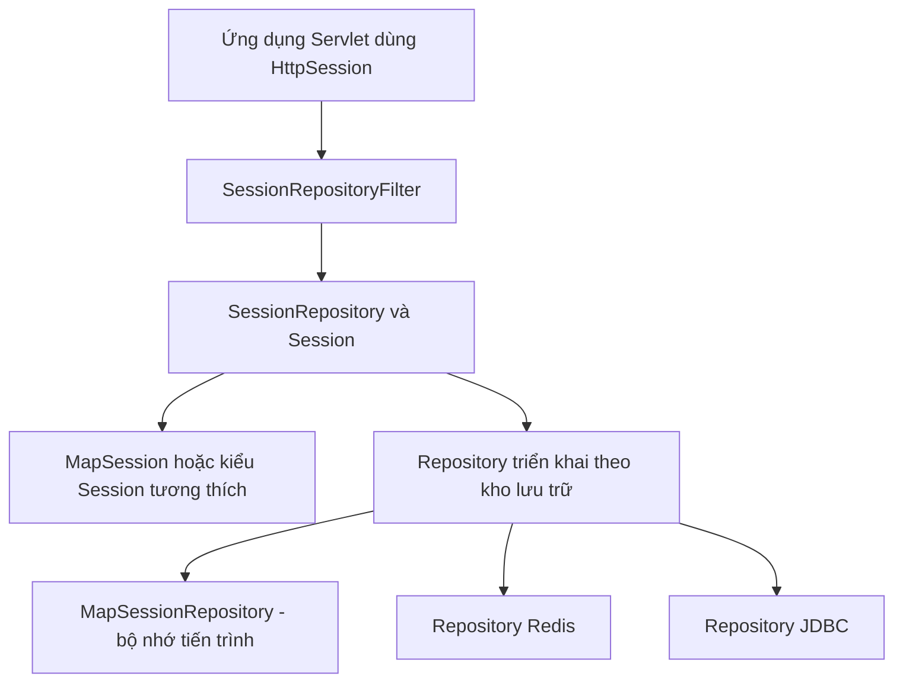
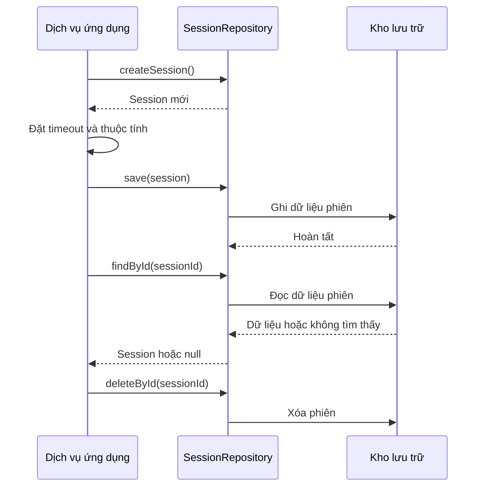
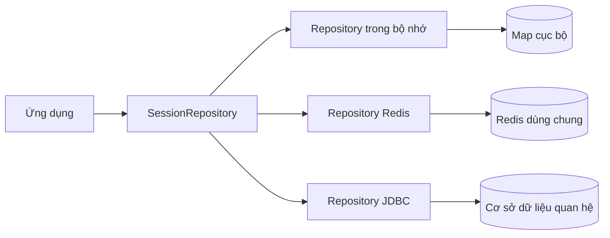

# MapSession và mô hình phiên không phụ thuộc kho lưu trữ

Spring Session tách dữ liệu của một phiên khỏi nơi lưu dữ liệu đó. Nhờ sự tách biệt này, ứng dụng có thể làm việc với một mô hình session thống nhất trong khi repository quyết định phiên được giữ trong bộ nhớ, Redis, JDBC hay một kho lưu trữ khác. `MapSession` là một triển khai cụ thể của mô hình phiên; `SessionRepository` là hợp đồng thao tác với phiên; còn `MapSessionRepository` là repository đơn giản lưu các phiên trong một `Map` ở bộ nhớ của tiến trình.

Ba khái niệm này có liên quan nhưng không đồng nghĩa. Hiểu rõ ranh giới giữa chúng giúp viết mã ít phụ thuộc hạ tầng, kiểm thử vòng đời phiên dễ hơn và lựa chọn repository phù hợp khi ứng dụng Spring cần chạy trên nhiều instance. Điều này nằm trong phạm vi Spring Session: quản lý HTTP session độc lập với một máy chủ, có thể kết nối với kho dữ liệu chia sẻ như Redis hoặc JDBC.

## 1. Vì sao cần mô hình phiên độc lập kho lưu trữ?

Một ứng dụng web thường cần giữ một lượng trạng thái nhỏ giữa nhiều HTTP request, ví dụ mã giỏ hàng, mã quy trình đang thực hiện hoặc thông tin tham chiếu tới người dùng đã đăng nhập. Servlet API cung cấp `HttpSession` để mã ứng dụng có thể tạo, đọc, cập nhật và hủy trạng thái đó.

Nếu ứng dụng chỉ dựa vào session mặc định của Servlet container, dữ liệu thường nằm trong bộ nhớ của instance đang xử lý yêu cầu. Khi có nhiều instance, request kế tiếp có thể đến một máy chủ khác và máy chủ đó không có dữ liệu phiên. Có thể cấu hình sticky session ở bộ cân bằng tải, nhưng điều này vẫn gắn vòng đời phiên với instance và làm việc chuyển máy chủ hoặc khôi phục sau sự cố khó khăn hơn.

Spring Session đưa ra một lớp trừu tượng cho phiên. Thay vì buộc ứng dụng quản lý một cấu trúc dữ liệu cụ thể của Redis hoặc một hàng trong bảng JDBC, framework định nghĩa:

- Một hợp đồng mô tả những thao tác và thuộc tính cơ bản của phiên.
- Một đối tượng phiên cụ thể có thể chứa ID, thời điểm tạo, thời điểm truy cập gần nhất, thời hạn không hoạt động và các thuộc tính ứng dụng.
- Một repository tạo, lưu, tìm và xóa phiên ở một nơi lưu trữ cụ thể.
- Một filter Servlet kết nối `HttpSession` với repository để phần lớn mã web tiếp tục dùng API Servlet quen thuộc.

Kiến trúc khái quát:



Mã ứng dụng thao tác với session qua API phù hợp với tầng của nó. Repository chịu trách nhiệm chuyển các thao tác đó thành việc lưu trữ và truy xuất cụ thể. Nhờ vậy, logic nghiệp vụ không cần biết dữ liệu đang nằm trong một `ConcurrentHashMap`, Redis hay bảng quan hệ.

## 2. Hợp đồng `Session` và lớp `MapSession`

### 2.1. `Session` mô tả điều gì?

Trong Spring Session, `org.springframework.session.Session` là hợp đồng chung cho một phiên. Hợp đồng này tập trung vào danh tính phiên, các mốc thời gian, thời hạn không hoạt động và tập thuộc tính được gắn với phiên.

| Nhóm | API tiêu biểu | Ý nghĩa |
|---|---|---|
| Danh tính | `getId()`, `changeSessionId()` | Đọc ID hiện tại hoặc thay đổi ID của phiên. |
| Thuộc tính | `getAttribute(name)`, `setAttribute(name, value)`, `removeAttribute(name)`, `getAttributeNames()` | Đọc, thêm, cập nhật, xóa và liệt kê dữ liệu gắn với phiên. |
| Thời điểm | `getCreationTime()`, `getLastAccessedTime()`, `setLastAccessedTime(time)` | Theo dõi thời điểm phiên được tạo và lần truy cập gần nhất. |
| Thời hạn | `getMaxInactiveInterval()`, `setMaxInactiveInterval(duration)`, `isExpired()` | Đọc, đặt khoảng không hoạt động tối đa và kiểm tra phiên đã hết hạn hay chưa. |

Hợp đồng này không yêu cầu dữ liệu phải được lưu trong một loại cơ sở dữ liệu cụ thể. Nó cũng không định nghĩa cách Redis tạo khóa, cách JDBC ánh xạ cột, hoặc cách repository đồng bộ dữ liệu giữa các máy chủ. Những trách nhiệm đó thuộc về triển khai repository.

### 2.2. `MapSession` là một mô hình phiên cụ thể

`org.springframework.session.MapSession` là một lớp triển khai `Session`. Nó biểu diễn một phiên bằng đối tượng Java có các trường dữ liệu cần thiết và một tập thuộc tính. Tên lớp nhấn mạnh việc thuộc tính phiên được tổ chức theo dạng ánh xạ tên và giá trị.

Có thể hiểu dữ liệu của một `MapSession` qua ví dụ:

```text
MapSession
  id                 = "session-opaque-id"
  creationTime       = thời điểm phiên được tạo
  lastAccessedTime   = thời điểm truy cập gần nhất
  maxInactiveInterval= 30 phút
  attributes
    cartId           = "cart-204"
    locale            = "vi-VN"
    workflowStep      = "CONFIRM_ADDRESS"
```

ID là định danh của phiên, thường được gửi cho trình duyệt thông qua cookie do cơ chế tích hợp HTTP session quản lý. Thuộc tính là dữ liệu ứng dụng gắn với phiên. Thời điểm tạo và truy cập gần nhất hỗ trợ quản lý vòng đời; `maxInactiveInterval` xác định khoảng không hoạt động được phép.

`MapSession` không phải một kho lưu trữ. Tạo một đối tượng `MapSession` chỉ tạo ra biểu diễn trong bộ nhớ của một phiên. Muốn phiên được lưu qua một repository, mã gọi phải sử dụng thao tác `save` hoặc để thành phần tích hợp như `SessionRepositoryFilter` quản lý việc lưu theo vòng đời request.

### 2.3. ID, thuộc tính và thời hạn

ID phiên nên được xem như một mã định danh bí mật ở mức vận hành. Người khác có được ID có thể tìm cách chiếm quyền sử dụng phiên. Vì thế, không đưa ID vào URL, log công khai hoặc thông báo lỗi; cookie cần có thuộc tính bảo vệ phù hợp như `HttpOnly`, `Secure` khi chạy HTTPS và `SameSite` theo luồng trình duyệt.

Sau khi xác thực người dùng, ứng dụng cần bảo vệ khỏi session fixation. Spring Security có thể thay đổi ID phiên theo chính sách session fixation; ở tầng mô hình, `changeSessionId()` thể hiện thao tác đổi ID mà vẫn giữ danh tính logic và dữ liệu phiên. Không nên tự lấy một ID từ đầu vào người dùng rồi dùng nó làm ID phiên.

Thuộc tính phiên là cặp tên và giá trị. Tên thuộc tính nên ổn định, có quy ước và tránh trùng với tên do thư viện khác sử dụng. Giá trị nên nhỏ, có vòng đời ngắn và thực sự cần thiết giữa các request. Khi chuyển sang repository cần tuần tự hóa dữ liệu, các kiểu đối tượng được lưu phải tương thích với serializer hoặc cơ chế ánh xạ của repository. Một đối tượng có thể dùng được trong `MapSessionRepository` ở bộ nhớ chưa chắc đã lưu được trong Redis hoặc JDBC.

Thời hạn không hoạt động được biểu diễn bằng `Duration` trong API `Session`. Nếu thời hạn là 30 phút, phiên được coi là hết hạn sau khoảng thời gian đó tính từ lần truy cập gần nhất theo cách repository cập nhật mốc truy cập. Filter HTTP thường tham gia cập nhật thời điểm này trong quá trình xử lý request. Cần phân biệt thời hạn không hoạt động của phiên với thời hạn cookie và TTL thực tế ở kho lưu trữ: cookie còn ở trình duyệt không làm một phiên đã hết hạn trở nên hợp lệ.

Ví dụ thao tác trên một đối tượng `MapSession`:

```java
import java.time.Duration;
import org.springframework.session.MapSession;

MapSession session = new MapSession();
session.setMaxInactiveInterval(Duration.ofMinutes(30));
session.setAttribute("cartId", "cart-204");
session.setAttribute("locale", "vi-VN");

String sessionId = session.getId();
String cartId = session.getAttribute("cartId");

session.removeAttribute("locale");
String newSessionId = session.changeSessionId();
```

Đoạn mã trên chỉ minh họa thao tác với mô hình phiên. Nó chưa lưu phiên vào repository và chưa gửi cookie tới trình duyệt. Những việc đó thuộc tầng lưu trữ và tích hợp HTTP.

## 3. `SessionRepository`: ranh giới giữa mô hình và lưu trữ

### 3.1. Các thao tác cốt lõi

`org.springframework.session.SessionRepository<S extends Session>` là hợp đồng repository. Tham số kiểu `S` cho biết loại đối tượng phiên mà repository quản lý. Với `MapSessionRepository`, kiểu đó là `MapSession`.

Các thao tác chính gồm:

| Phương thức | Trách nhiệm |
|---|---|
| `createSession()` | Tạo một đối tượng phiên mới với trạng thái ban đầu hợp lệ. |
| `save(session)` | Lưu phiên hoặc cập nhật trạng thái của phiên trong repository. |
| `findById(id)` | Tìm phiên theo ID; có thể không tìm thấy hoặc phiên đã hết hạn. |
| `deleteById(id)` | Xóa phiên có ID tương ứng, thường được gọi khi phiên bị vô hiệu hóa. |

Đây là ranh giới quan trọng của thiết kế. Mã sử dụng `SessionRepository` có thể tạo và lưu phiên mà không cần gọi trực tiếp API của Redis hay JDBC. Một triển khai repository có trách nhiệm bảo đảm các thao tác trên phù hợp với cách lưu trữ của nó.

### 3.2. Vì sao kiểu generic hữu ích?

Tham số `S` giúp repository làm việc với kiểu phiên cụ thể mà không làm mất hợp đồng chung. Ví dụ:

```java
SessionRepository<MapSession> repository;
```

Mã sử dụng có thể gọi `createSession()` và nhận `MapSession`, đồng thời vẫn dựa trên hợp đồng `SessionRepository`. Một repository khác có thể cung cấp kiểu triển khai riêng miễn là kiểu đó thực hiện `Session`.

Khi viết dịch vụ nghiệp vụ, nên giới hạn phụ thuộc vào các phương thức mà dịch vụ thật sự cần. Nếu dịch vụ chỉ cần tạo, tìm và xóa phiên, không nên để logic đó phụ thuộc vào cấu trúc nội bộ của Redis hoặc schema JDBC. Khi cần tính năng riêng như tìm phiên theo principal, cần kiểm tra xem repository có triển khai interface mở rộng tương ứng hay không; không nên giả định `SessionRepository` cơ bản hỗ trợ truy vấn mọi kiểu.

### 3.3. Vòng đời tạo, lưu, đọc và xóa

Một vòng đời điển hình khi thao tác trực tiếp với repository có thể mô tả như sau:



Khi đọc phiên, mã gọi cần xử lý trường hợp không tìm thấy hoặc phiên đã hết hạn. Khi xóa, repository cần làm cho phiên không còn được sử dụng theo ngữ nghĩa của triển khai. Với hệ thống phân tán, việc xóa cần có hiệu lực trên các instance dùng chung repository.

## 4. `MapSessionRepository`: repository tham chiếu trong bộ nhớ

### 4.1. Cách hoạt động

`org.springframework.session.MapSessionRepository` là một triển khai `SessionRepository<MapSession>` đơn giản. Nó nhận một `Map` để giữ các phiên, thường dùng `ConcurrentHashMap` trong ví dụ cấu hình. Các thao tác tạo, lưu, tìm và xóa được thực hiện trên cấu trúc dữ liệu trong bộ nhớ của tiến trình.

Ví dụ cấu hình Spring Session cho ứng dụng Servlet:

```java
import java.util.concurrent.ConcurrentHashMap;

import org.springframework.context.annotation.Bean;
import org.springframework.context.annotation.Configuration;
import org.springframework.session.MapSession;
import org.springframework.session.SessionRepository;
import org.springframework.session.config.annotation.web.http.EnableSpringHttpSession;
import org.springframework.session.MapSessionRepository;

@Configuration
@EnableSpringHttpSession
public class HttpSessionConfiguration {

    @Bean
    public SessionRepository<MapSession> sessionRepository() {
        return new MapSessionRepository(new ConcurrentHashMap<>());
    }
}
```

`@EnableSpringHttpSession` kích hoạt tích hợp HTTP session dựa trên repository được cung cấp. `SessionRepositoryFilter` sẽ làm cầu nối giữa `HttpSession` trong ứng dụng Servlet và `SessionRepository`. Khi chọn `MapSessionRepository`, dữ liệu phiên nằm trong map của tiến trình đang chạy.

Ở môi trường Spring Boot, cần tránh khai báo đồng thời nhiều cấu hình repository cạnh tranh nhau. Nếu ứng dụng đã bật cấu hình tự động cho Redis hoặc JDBC, hãy kiểm tra cấu hình đang hoạt động trước khi thêm bean `MapSessionRepository`. Đoạn mã trên là một cấu hình độc lập minh họa cho repository trong bộ nhớ.

### 4.2. Dùng repository trực tiếp

Một số ứng dụng hoặc bài kiểm thử có thể cần thao tác với repository mà không thông qua `HttpSession`. Ví dụ dịch vụ nhỏ sau tạo một phiên cho giỏ hàng:

```java
import java.time.Duration;
import org.springframework.session.MapSession;
import org.springframework.session.SessionRepository;
import org.springframework.stereotype.Service;

@Service
public class CartSessionService {

    private final SessionRepository<MapSession> sessions;

    public CartSessionService(SessionRepository<MapSession> sessions) {
        this.sessions = sessions;
    }

    public String createSession(String cartId) {
        MapSession session = sessions.createSession();
        session.setMaxInactiveInterval(Duration.ofMinutes(30));
        session.setAttribute("cartId", cartId);
        sessions.save(session);
        return session.getId();
    }

    public String findCartId(String sessionId) {
        MapSession session = sessions.findById(sessionId);
        return session == null ? null : session.getAttribute("cartId");
    }

    public void invalidate(String sessionId) {
        sessions.deleteById(sessionId);
    }
}
```

Ví dụ này cho thấy logic dịch vụ chỉ phụ thuộc vào `SessionRepository<MapSession>`. Nó không biết map nội bộ được tổ chức ra sao. Trong ứng dụng web thông thường, nên ưu tiên dùng `HttpSession` qua Servlet API khi nghiệp vụ gắn với request của người dùng; thao tác repository trực tiếp phù hợp hơn cho tích hợp chuyên biệt, tác vụ nền hoặc kiểm thử cần điều khiển rõ vòng đời phiên.

### 4.3. Giới hạn quan trọng của repository trong bộ nhớ

`MapSessionRepository` hữu ích cho phát triển cục bộ, minh họa API và kiểm thử. Tuy nhiên, một map trong tiến trình có các giới hạn rõ ràng:

- **Không chia sẻ giữa các instance:** instance A và instance B có hai map riêng. Một request tới B không tự tìm thấy phiên đã tạo ở A.
- **Không bền vững qua khởi động lại:** khi tiến trình dừng, map trong bộ nhớ mất đi. Người dùng có thể bị yêu cầu đăng nhập lại hoặc mất trạng thái phiên.
- **Không có sao chép hay đồng bộ cụm:** repository không tự truyền thay đổi tới máy chủ khác.
- **Giới hạn bởi bộ nhớ của tiến trình:** số lượng phiên và kích thước thuộc tính ảnh hưởng trực tiếp đến dung lượng heap.
- **Không thay thế cơ chế quản lý phân tán:** `ConcurrentHashMap` hỗ trợ thao tác map đồng thời trong một tiến trình, nhưng không cung cấp giao dịch, khóa phân tán hay tính nhất quán xuyên nhiều máy chủ.

Do đó, không nên dùng `MapSessionRepository` làm kho phiên cho một cụm production có nhiều instance nếu người dùng cần duy trì phiên khi request được chuyển giữa các máy chủ hoặc khi một máy chủ khởi động lại.

## 5. Cùng mô hình `Session`, thay đổi repository

Điểm mạnh của thiết kế repository là phần lớn ý nghĩa của phiên vẫn giữ nguyên trong khi cách lưu thay đổi. Với ứng dụng cần nhiều instance, repository có thể chuyển sang Redis hoặc JDBC. Spring Session cung cấp các triển khai tương ứng; Spring Boot cũng có thể tự cấu hình khi dependency và thuộc tính cần thiết được khai báo.

| Khía cạnh | MapSessionRepository | Repository Redis | Repository JDBC |
|---|---|---|---|
| Nơi lưu | Map trong bộ nhớ tiến trình | Redis dùng chung | Cơ sở dữ liệu quan hệ |
| Chia sẻ nhiều instance | Không tự chia sẻ | Có, nếu các instance dùng cùng Redis và cấu hình tương thích | Có, nếu các instance dùng cùng cơ sở dữ liệu và schema |
| Khả năng tồn tại sau restart | Không | Phụ thuộc cấu hình persistence và độ sẵn sàng Redis | Phụ thuộc độ bền của cơ sở dữ liệu và transaction/backup |
| Độ trễ truy cập | Truy cập bộ nhớ cục bộ | Truy cập qua mạng tới Redis | Truy cập qua mạng và thực thi truy vấn SQL |
| Vận hành | Đơn giản, không cần dịch vụ ngoài | Cần quản lý kết nối, bảo mật, memory, replication và availability | Cần schema, chỉ mục, connection pool, backup và dọn dữ liệu hết hạn |
| Phù hợp | Local development, ví dụ, kiểm thử | Ứng dụng cần kho session dùng chung có độ trễ thấp | Hệ thống đã vận hành cơ sở dữ liệu quan hệ và muốn lưu session ở đó |

Sơ đồ khi thay repository:



Ở tầng ứng dụng, mã nghiệp vụ có thể tiếp tục làm việc với cùng các thao tác tạo, đọc, cập nhật và xóa phiên. Phần cần thay đổi nằm ở cấu hình repository và các yêu cầu vận hành đi kèm. Không nên hiểu điều này là mọi repository có hiệu năng, tính nhất quán hoặc tính năng phụ giống hệt nhau; hợp đồng chung chỉ chuẩn hóa những thao tác cơ bản.

### 5.1. Những khác biệt cần kiểm tra khi chuyển kho

Trước khi thay `MapSessionRepository` bằng Redis hoặc JDBC, cần kiểm tra các điểm sau:

1. **Kiểu dữ liệu thuộc tính:** serializer hoặc cơ chế lưu của repository có hỗ trợ mọi kiểu dữ liệu đang đặt trong session không? Ưu tiên kiểu đơn giản, nhỏ và ổn định.
2. **Tính tương thích khi triển khai nhiều phiên bản:** các instance mới và cũ có đọc được dữ liệu phiên mà phiên bản kia ghi không? Thay đổi tên thuộc tính hoặc kiểu đối tượng có thể làm hỏng phiên đang tồn tại.
3. **TTL và dọn dữ liệu:** repository thực thi hết hạn như thế nào, có cần tác vụ dọn bản ghi hoặc cấu hình thông báo hết hạn hay không?
4. **Lỗi kho lưu trữ:** ứng dụng phản ứng thế nào khi Redis hoặc cơ sở dữ liệu tạm thời không truy cập được? Không được âm thầm coi phiên không đọc được là một người dùng đã xác thực.
5. **Tính đồng thời:** hai request cùng cập nhật một phiên có thể ghi đè dữ liệu của nhau hay không? Cần xác định ngữ nghĩa cập nhật của repository và thiết kế dữ liệu để tránh lost update khi phù hợp.
6. **Namespace và bảo mật:** các ứng dụng dùng chung kho có phân vùng khóa hoặc bảng riêng không? Kết nối có được xác thực, mã hóa và giới hạn quyền truy cập không?

## 6. Tích hợp với `HttpSession` trong Servlet

Phần lớn ứng dụng Spring MVC không cần tự gọi `SessionRepository` ở mỗi controller. `SessionRepositoryFilter` cung cấp một đối tượng request/response wrapper để các thao tác `HttpSession` được ủy quyền tới Spring Session.

Ví dụ controller dùng API Servlet:

```java
import jakarta.servlet.http.HttpSession;
import org.springframework.web.bind.annotation.PostMapping;
import org.springframework.web.bind.annotation.GetMapping;
import org.springframework.web.bind.annotation.RestController;

@RestController
public class CartController {

    @PostMapping("/cart/session")
    public String createCartSession(HttpSession session) {
        session.setAttribute("cartId", "cart-204");
        session.setMaxInactiveInterval(30 * 60);
        return session.getId();
    }

    @GetMapping("/cart/session")
    public Object getCartSession(HttpSession session) {
        return session.getAttribute("cartId");
    }
}
```

Controller chỉ dùng `HttpSession`. Filter của Spring Session xử lý việc ánh xạ thao tác Servlet sang session do repository quản lý. Khi thay repository, controller thường không cần thay đổi. Nếu dự án dùng Servlet API cũ, import có thể là `javax.servlet.http.HttpSession`; với các phiên bản Spring Framework mới dùng Jakarta EE, import là `jakarta.servlet.http.HttpSession` như ví dụ. Cần dùng namespace phù hợp với phiên bản nền tảng của dự án.

Thứ tự filter cũng quan trọng. `SessionRepositoryFilter` phải chạy ở vị trí phù hợp để các filter bảo mật và thành phần khác nhìn thấy `HttpSession` do Spring Session cung cấp. Khi tích hợp thủ công, hãy kiểm tra cách đăng ký filter và thứ tự với Spring Security; khi dùng cấu hình tự động, tránh đăng ký filter lần thứ hai theo cách thủ công.

## 7. Kiểm thử mô hình phiên và repository

Tách mô hình khỏi repository giúp kiểm thử theo nhiều lớp.

### 7.1. Kiểm thử `MapSession` độc lập

Có thể kiểm tra việc đặt thuộc tính, xóa thuộc tính, đổi ID và thời hạn mà không cần khởi động Redis hoặc cơ sở dữ liệu:

```java
import static org.junit.jupiter.api.Assertions.*;

import java.time.Duration;
import org.junit.jupiter.api.Test;
import org.springframework.session.MapSession;

class MapSessionTest {

    @Test
    void storesAttributesAndChangesSessionId() {
        MapSession session = new MapSession();
        String originalId = session.getId();

        session.setAttribute("userId", "user-17");
        session.setMaxInactiveInterval(Duration.ofMinutes(15));

        assertEquals("user-17", session.getAttribute("userId"));
        assertEquals(Duration.ofMinutes(15), session.getMaxInactiveInterval());

        String changedId = session.changeSessionId();
        assertNotEquals(originalId, changedId);
        assertEquals("user-17", session.getAttribute("userId"));
    }
}
```

Kiểm thử này xác minh hành vi của đối tượng phiên, không chứng minh dữ liệu đã được lưu bền vững hay chia sẻ giữa các instance.

### 7.2. Kiểm thử repository

Với `MapSessionRepository`, kiểm thử có thể tạo phiên, lưu, tìm lại và xóa:

```java
import static org.junit.jupiter.api.Assertions.*;

import java.util.concurrent.ConcurrentHashMap;
import org.junit.jupiter.api.Test;
import org.springframework.session.MapSession;
import org.springframework.session.MapSessionRepository;

class MapSessionRepositoryTest {

    @Test
    void savesFindsAndDeletesSession() {
        MapSessionRepository repository =
            new MapSessionRepository(new ConcurrentHashMap<>());

        MapSession session = repository.createSession();
        session.setAttribute("orderId", "order-900");
        repository.save(session);

        MapSession loaded = repository.findById(session.getId());
        assertNotNull(loaded);
        assertEquals("order-900", loaded.getAttribute("orderId"));

        repository.deleteById(session.getId());
        assertNull(repository.findById(session.getId()));
    }
}
```

Kiểm thử repository xác minh hợp đồng thao tác trong phạm vi triển khai đang dùng. Khi chuyển sang Redis hoặc JDBC, cần thêm kiểm thử tích hợp với kho thật hoặc môi trường kiểm thử tương ứng để xác minh serialization, TTL, lỗi kết nối và khả năng chia sẻ giữa nhiều instance.

### 7.3. Kiểm thử tích hợp HTTP

Khi Spring Session được gắn vào Servlet stack, cần kiểm tra cả đường đi của cookie và filter:

- Request đầu tiên tạo session và nhận cookie session ID theo cấu hình.
- Request tiếp theo gửi lại cookie và đọc được thuộc tính đã lưu.
- Xóa hoặc vô hiệu hóa session khiến cookie cũ không còn khôi phục được trạng thái đã đăng nhập.
- Hết thời hạn không hoạt động khiến session bị xem là hết hạn.
- Nếu dùng repository dùng chung, tạo phiên ở instance A và đọc ở instance B phải cho kết quả như mong đợi.
- Nếu kho lưu trữ tạm ngừng, ứng dụng trả lỗi phù hợp và không cấp quyền dựa trên dữ liệu xác thực không thể kiểm tra.

## 8. Các lỗi thiết kế thường gặp

**Nhầm `MapSession` với `MapSessionRepository`.** `MapSession` là đối tượng biểu diễn một phiên; `MapSessionRepository` là thành phần lưu và tìm nhiều phiên. Tạo đối tượng không có nghĩa đã lưu nó.

**Cho rằng `SessionRepository` làm mọi repository có cùng tính chất.** Hợp đồng chuẩn hóa các thao tác cốt lõi. Khả năng chịu lỗi, độ bền dữ liệu, chỉ mục tìm kiếm, TTL và đồng bộ giữa các máy chủ vẫn phụ thuộc triển khai.

**Dùng map cục bộ trong cụm nhiều instance.** Hai instance có bộ nhớ riêng. Nếu cần chia sẻ session, hãy dùng repository dựa trên kho dữ liệu chung như Redis hoặc JDBC.

**Lưu cả đối tượng nghiệp vụ lớn vào session.** Điều này làm tăng chi phí truyền dữ liệu và lưu trữ, đồng thời khiến thay đổi class có thể phá khả năng đọc session cũ. Nên lưu ID hoặc dữ liệu tối thiểu rồi truy vấn nghiệp vụ từ tầng phù hợp.

**Coi session ID là dữ liệu bình thường.** ID phải được bảo vệ như một credential. Tránh ghi log, đưa vào URL hoặc chia sẻ qua kênh không an toàn.

**Không kiểm tra cập nhật đồng thời.** Hai request có thể cùng đọc một phiên, thay đổi các thuộc tính và lưu ở thời điểm gần nhau. Cần hiểu ngữ nghĩa repository và tránh để nhiều request ghi đè dữ liệu quan trọng mà không có quy tắc phối hợp.

**Không kiểm thử sau khi đổi repository.** Việc mã biên dịch với một interface chung không đảm bảo serializer, TTL, cookie, sự kiện hết hạn và xử lý lỗi giống nhau. Cần có kiểm thử tích hợp cho các đặc tính quan trọng của kho mới.

## 9. Cách lựa chọn và áp dụng

Khi thiết kế phần quản lý phiên cho ứng dụng Spring, có thể đi theo trình tự sau:

1. Xác định dữ liệu nào thực sự cần tồn tại giữa các HTTP request và thời gian cần giữ dữ liệu.
2. Dùng hợp đồng `Session` để hiểu những thuộc tính tối thiểu của một phiên: ID, thuộc tính, thời điểm truy cập và thời hạn.
3. Dùng `MapSession` khi cần một triển khai cụ thể đơn giản để học API, kiểm thử hoặc chạy cục bộ.
4. Dùng `SessionRepository` làm ranh giới thao tác để mã không phụ thuộc trực tiếp vào cấu trúc lưu trữ.
5. Chọn `MapSessionRepository` cho bộ nhớ cục bộ; chọn repository Redis/JDBC khi cần lưu trữ dùng chung hoặc độ bền phù hợp với yêu cầu hệ thống.
6. Kiểm tra cookie, thời hạn, serialization, cập nhật đồng thời, xử lý lỗi và hành vi khi đăng xuất.
7. Kiểm thử qua nhiều instance trước khi đưa cấu hình repository phân tán vào vận hành.

`MapSession` giúp nhìn rõ dữ liệu của một phiên; `SessionRepository` định nghĩa cách ứng dụng thao tác với phiên; `MapSessionRepository` minh họa một cách lưu trữ đơn giản. Khi tách đúng ba vai trò này, ứng dụng có thể chuyển từ mô hình trong bộ nhớ sang Redis hoặc JDBC với ít thay đổi ở logic nghiệp vụ, đồng thời vẫn đánh giá được những khác biệt quan trọng về độ bền, đồng bộ, thời hạn và vận hành của từng kho lưu trữ.
