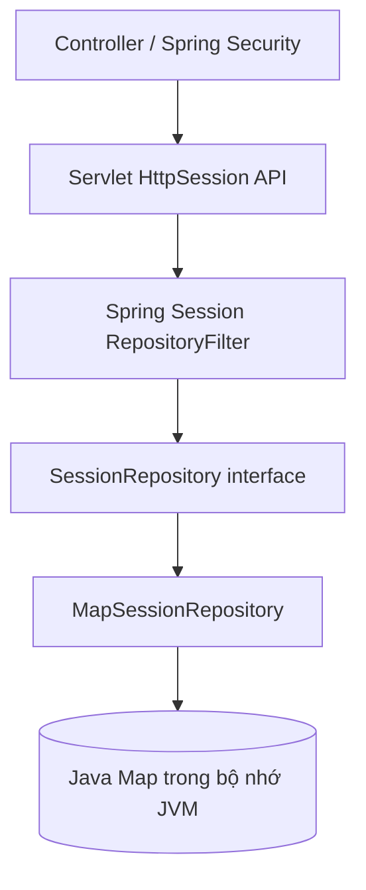
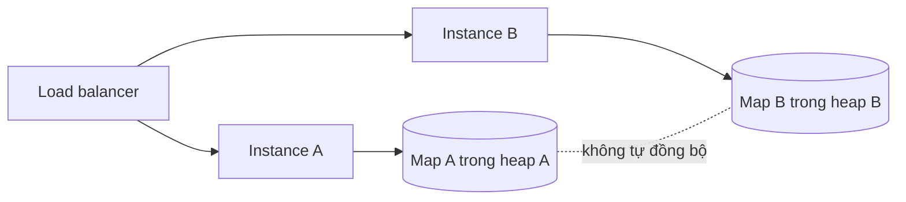

# MapSessionRepository và giới hạn của repository trong bộ nhớ

Spring Session cung cấp nhiều cách lưu trạng thái phiên để ứng dụng Servlet có thể tiếp tục dùng `HttpSession` trong khi thay đổi nơi lưu dữ liệu. `MapSessionRepository` là một implementation đơn giản: nó giữ các `MapSession` trong một Java `Map` nằm trong bộ nhớ của tiến trình ứng dụng. Cách này thuận tiện cho kiểm thử, ví dụ nhỏ và prototype, nhưng có giới hạn rõ ràng về độ bền dữ liệu, chia sẻ giữa nhiều instance, dung lượng và xử lý đồng thời.

Bài học này giải thích vị trí của `MapSessionRepository` trong kiến trúc Spring Session, cách cấu hình và thao tác với repository, cách hiểu thời hạn phiên, cùng các giới hạn cần cân nhắc trước khi dùng. Mục tiêu là biết khi nào repository trong bộ nhớ phù hợp và nhận ra thời điểm cần chuyển sang Redis hoặc JDBC.

## 1. `SessionRepository` và `MapSessionRepository` làm nhiệm vụ gì?

Trong Servlet API, controller và filter thường thao tác với `HttpSession`. Spring Session đặt một lớp trung gian giữa API đó và nơi lưu dữ liệu. Lớp trung gian này cho phép ứng dụng thay đổi repository mà không phải viết lại mọi controller đang gọi `request.getSession()` hoặc `session.setAttribute(...)`.

`SessionRepository<S extends Session>` là abstraction chính. Các thao tác cơ bản gồm:

| Thao tác | Ý nghĩa |
| --- | --- |
| `createSession()` | Tạo một đối tượng session mới, chưa nhất thiết đã được lưu vào repository |
| `save(session)` | Lưu trạng thái session vào nơi lưu trữ của repository |
| `findById(id)` | Tìm session theo định danh; kết quả có thể không tồn tại hoặc đã hết hạn |
| `deleteById(id)` | Xóa session theo định danh |

`MapSession` là implementation của `Session`, chứa session ID, thời điểm truy cập gần nhất, thời hạn không hoạt động và các thuộc tính của phiên. `MapSessionRepository` triển khai `SessionRepository<MapSession>` bằng cách giữ các đối tượng `MapSession` trong một `Map<String, MapSession>`.



Khi Spring Session được tích hợp vào Servlet, `SessionRepositoryFilter` bọc request và response để các thành phần ứng dụng tiếp tục dùng API session quen thuộc. Filter phối hợp với repository để tải phiên theo ID, tạo phiên khi cần và lưu thay đổi theo chính sách cấu hình. Repository chịu trách nhiệm lưu trữ; filter chịu trách nhiệm tích hợp với vòng đời HTTP request.

Điểm quan trọng là `MapSessionRepository` thay đổi nơi lưu session, nhưng không tự biến một Java `Map` thành kho dữ liệu phân tán. Map vẫn thuộc về bộ nhớ của một tiến trình Java.

## 2. Cấu hình `MapSessionRepository` trong ứng dụng Servlet

Với cấu hình Java thuần của Spring Session, có thể bật tích hợp Servlet bằng `@EnableSpringHttpSession` và cung cấp một bean repository. Ví dụ dưới đây dùng `ConcurrentHashMap` làm backing map và đặt idle timeout mặc định là 30 phút:

```java
import java.time.Duration;
import java.util.concurrent.ConcurrentHashMap;

import org.springframework.context.annotation.Bean;
import org.springframework.context.annotation.Configuration;
import org.springframework.session.MapSession;
import org.springframework.session.MapSessionRepository;
import org.springframework.session.config.annotation.web.http.EnableSpringHttpSession;

@Configuration
@EnableSpringHttpSession
public class SessionConfiguration {

    @Bean
    MapSessionRepository sessionRepository() {
        MapSessionRepository repository =
                new MapSessionRepository(new ConcurrentHashMap<>());
        repository.setDefaultMaxInactiveInterval(Duration.ofMinutes(30));
        return repository;
    }
}
```

Ví dụ dùng API theo Spring Session 3.x, trong đó thời lượng được biểu diễn bằng `java.time.Duration`. Với phiên bản cũ hơn, chữ ký một số phương thức thời hạn có thể dùng số giây; hãy đối chiếu API của phiên bản Spring Session đang quản lý trong dependency BOM của dự án.

`ConcurrentHashMap` là lựa chọn hợp lý cho backing map khi nhiều request trong cùng JVM có thể cùng truy cập map. Nó bảo vệ các thao tác cấu trúc trên map như đọc, thêm và xóa entry. Điều đó không biến các thao tác nghiệp vụ trên thuộc tính session thành giao dịch nguyên tử; vấn đề này được phân tích ở phần concurrency.

Nếu ứng dụng dùng Spring Boot, cách cấu hình bean và auto-configuration phụ thuộc phiên bản Boot và các starter đang có. Khi chủ động bật `@EnableSpringHttpSession`, cần bảo đảm chỉ có một cấu hình chịu trách nhiệm đăng ký `SessionRepositoryFilter` và một repository phù hợp. Tránh đồng thời khai báo nhiều cấu hình session khiến ứng dụng có bean hoặc filter trùng lặp.

## 3. Thao tác với repository qua API

`MapSessionRepository` có thể được dùng trực tiếp trong unit test hoặc thành phần cần kiểm tra repository mà không khởi động toàn bộ web server. Ví dụ sau minh họa vòng đời tạo, lưu, tìm và xóa một phiên:

```java
import java.time.Duration;
import java.util.concurrent.ConcurrentHashMap;

import org.springframework.session.MapSession;
import org.springframework.session.MapSessionRepository;

public class SessionRepositoryExample {

    public static void main(String[] args) {
        MapSessionRepository repository =
                new MapSessionRepository(new ConcurrentHashMap<>());

        MapSession session = repository.createSession();
        session.setMaxInactiveInterval(Duration.ofMinutes(15));
        session.setAttribute("userId", "user-204");
        session.setAttribute("workflow", "checkout");

        repository.save(session);

        MapSession loaded = repository.findById(session.getId());
        if (loaded != null) {
            String userId = loaded.getAttribute("userId");
            System.out.println("Session belongs to: " + userId);
        }

        repository.deleteById(session.getId());
    }
}
```

Luồng trên có bốn điểm cần phân biệt:

1. `createSession()` tạo session mới và cấp định danh. Việc tạo đối tượng chưa đồng nghĩa dữ liệu đã được lưu.
2. Ứng dụng đặt thời hạn và thuộc tính trên đối tượng session.
3. `save(session)` ghi trạng thái vào backing map. Trong luồng HTTP, Spring Session filter phối hợp việc lưu này khi request hoàn tất.
4. `findById` đọc lại theo ID; `deleteById` xóa phiên khi ứng dụng cần hủy phiên.

Trong code ứng dụng web, thông thường controller tiếp tục thao tác với `HttpSession`; không nên tự gọi `MapSessionRepository` trong từng controller. Việc truy cập repository trực tiếp hữu ích cho test, adapter chuyên biệt hoặc minh họa contract. Nếu controller phụ thuộc trực tiếp vào `MapSessionRepository`, việc thay sang Redis hoặc JDBC sẽ lan ra nhiều nơi và làm mất lợi ích của abstraction.

## 4. Thời hạn không hoạt động và việc dọn session

Mỗi session có `maxInactiveInterval`, tức khoảng thời gian tối đa phiên được phép không hoạt động. Khi request sử dụng session, thời điểm truy cập gần nhất được cập nhật theo vòng đời session. Nếu đã quá khoảng thời gian này, session được xem là hết hạn và không nên được trả về như một phiên hợp lệ.

Có thể đặt thời hạn mặc định ở repository:

```java
repository.setDefaultMaxInactiveInterval(Duration.ofMinutes(20));
```

Hoặc đặt thời hạn riêng cho một session trước khi lưu:

```java
MapSession shortLived = repository.createSession();
shortLived.setMaxInactiveInterval(Duration.ofMinutes(5));
shortLived.setAttribute("purpose", "one-time-flow");
repository.save(shortLived);
```

Idle timeout khác với thời gian tồn tại tuyệt đối kể từ lúc đăng nhập. Một phiên có hoạt động liên tục có thể tiếp tục được làm mới theo idle timeout. Nếu chính sách yêu cầu người dùng phải xác thực lại sau một khoảng thời gian cố định, ứng dụng cần theo dõi thời điểm xác thực và kiểm tra giới hạn tuyệt đối riêng.

Với repository trong bộ nhớ, hết hạn logic và giải phóng bộ nhớ vật lý là hai việc khác nhau. Repository có thể phát hiện phiên hết hạn khi tra cứu và không trả phiên đó về ứng dụng, nhưng không nên giả định có một dịch vụ TTL độc lập sẽ quét và giải phóng mọi entry đúng ngay thời điểm hết hạn. Các entry không còn được truy cập có thể tiếp tục chiếm bộ nhớ cho đến khi bị dọn theo cơ chế của implementation hoặc bị xóa. Vì vậy cần theo dõi số entry và dung lượng heap trong môi trường chạy dài ngày.

Redis có TTL ở kho dữ liệu và cơ chế thông báo hết hạn có thể cấu hình; JDBC có cơ chế truy vấn và dọn các bản ghi hết hạn. `MapSessionRepository` không cung cấp các đặc tính vận hành tương đương của một kho dữ liệu chuyên dụng. Không dùng thời điểm dọn entry trong map làm tín hiệu chính xác cho một nghiệp vụ cần chạy đúng một lần.

## 5. Các giới hạn quan trọng của repository trong bộ nhớ

### 5.1. Không bền vững qua restart

Dữ liệu của `MapSessionRepository` tồn tại trong heap của JVM. Khi tiến trình dừng, container bị thay thế hoặc ứng dụng khởi động lại, backing map mới bắt đầu rỗng. Người dùng có thể phải đăng nhập lại và những trạng thái tạm đang nằm trong session bị mất.

Điều này có thể chấp nhận được trong unit test hoặc môi trường demo. Với hệ thống production, cần đánh giá tác động người dùng và chọn kho lưu trữ có độ bền phù hợp. Không nên dùng session làm nơi duy nhất lưu dữ liệu nghiệp vụ quan trọng, kể cả khi đã chuyển sang Redis/JDBC.

### 5.2. Không tự chia sẻ giữa nhiều JVM hoặc nhiều máy

Mỗi instance Spring Boot thường chạy trong một JVM riêng và có heap riêng. Nếu instance A và B mỗi bên tạo một `MapSessionRepository` với `ConcurrentHashMap` riêng, cùng một session ID được gửi đến B cũng không giúp B tìm thấy dữ liệu mà A đã lưu.



`ConcurrentHashMap` chỉ đồng bộ truy cập trên chính đối tượng map đó trong cùng tiến trình. Nó không truyền dữ liệu qua mạng, không sao chép session sang máy khác và không cung cấp replication. Sticky session có thể làm request thường quay lại cùng instance, nhưng khi instance restart hoặc bị loại khỏi cụm, session trong map của instance đó vẫn mất.

Vì vậy, `MapSessionRepository` không đáp ứng yêu cầu quản lý session chia sẻ giữa nhiều instance độc lập. Với kiến trúc nhiều nút, dùng một repository được tất cả instance truy cập, chẳng hạn Spring Session Redis hoặc JDBC.

### 5.3. Dung lượng phụ thuộc heap ứng dụng

Mỗi session và các thuộc tính của nó chiếm bộ nhớ heap. Khi số người dùng đồng thời tăng, session tồn tại lâu hoặc thuộc tính lưu quá lớn, bộ nhớ dành cho map tăng theo. Hậu quả có thể là garbage collection thường xuyên, tăng độ trễ, `OutOfMemoryError` hoặc làm ứng dụng mất ổn định.

Không nên lưu file, ảnh, object đồ thị lớn, entity ORM có quan hệ sâu hoặc dữ liệu có thể truy vấn lại vào session. Nên lưu ID hoặc một lượng nhỏ trạng thái cần thiết cho luồng tương tác. Theo dõi số session, kích thước trung bình, heap usage, tốc độ tạo session và số phiên hết hạn.

### 5.4. Không có transaction phân tán hay cập nhật nghiệp vụ nguyên tử

`ConcurrentHashMap` bảo vệ cấu trúc map khỏi hỏng khi nhiều thread thêm hoặc xóa entry cùng lúc. Nó không bảo đảm một chuỗi thao tác đọc-sửa-ghi trên thuộc tính session là nguyên tử. Ví dụ hai request cùng đọc `cartCount = 2`, mỗi request tăng lên một rồi lưu; cả hai có thể cùng ghi giá trị 3, làm mất một lần tăng.

Nếu một thuộc tính session chỉ phục vụ giao diện, có thể chấp nhận trạng thái cập nhật gần nhất. Nếu dữ liệu cần chính xác, như số dư, tồn kho, trạng thái đơn hàng hoặc lượt sử dụng giới hạn, hãy xử lý trong tầng nghiệp vụ với transaction, optimistic locking hoặc thao tác nguyên tử thích hợp. Không dựa vào session để bảo đảm tính đúng đắn của giao dịch.

### 5.5. Vòng đời sự kiện và quan sát có giới hạn

Repository trong bộ nhớ không có hệ thống notification phân tán như Redis keyspace notification. Việc phát hiện session hết hạn, phát sự kiện và dọn dữ liệu phụ thuộc vào cách Spring Session tích hợp repository và phiên bản đang dùng. Cần kiểm thử hành vi sự kiện trong cấu hình thực tế; không giả định listener sẽ luôn nhận được một callback chính xác vào đúng thời điểm TTL kết thúc.

Nếu ứng dụng cần audit đăng nhập/đăng xuất, hãy ghi nhận sự kiện tại luồng xác thực và logout có kiểm soát. Nếu cần dọn tài nguyên quan trọng, thiết kế handler idempotent, có thể chạy lại và có cơ chế đối soát. Không dùng việc một entry biến mất khỏi map làm bằng chứng duy nhất rằng một tác vụ nghiệp vụ đã hoàn tất.

## 6. Khi nào nên dùng `MapSessionRepository`?

| Tình huống | Mức độ phù hợp | Lý do |
| --- | --- | --- |
| Unit test cho thành phần dùng `SessionRepository` | Phù hợp | Không cần khởi động Redis/database; test nhanh và dễ cô lập |
| Demo API `HttpSession` hoặc prototype chạy một tiến trình | Phù hợp có giới hạn | Cấu hình đơn giản, dễ quan sát dữ liệu trong lúc chạy |
| Integration test cần mô phỏng repository đơn giản | Có thể phù hợp | Kiểm tra luồng session cơ bản; vẫn cần test riêng với kho thật khi phụ thuộc vào tính năng của kho |
| Ứng dụng production cần giữ session qua restart | Không phù hợp | Dữ liệu chỉ nằm trong heap và mất khi tiến trình dừng |
| Nhiều instance sau load balancer cần dùng chung session | Không phù hợp | Map riêng của mỗi JVM không đồng bộ với nhau |
| Lưu lượng lớn hoặc session có kích thước lớn | Không phù hợp | Heap ứng dụng trở thành giới hạn dung lượng và độ ổn định |

Một nguyên tắc thực tế là dùng `MapSessionRepository` để kiểm thử contract hoặc minh họa API. Khi ứng dụng cần session bền vững hoặc chia sẻ giữa nhiều nút, chuyển sang repository chuyên dụng.

## 7. Chuyển từ Map sang Redis hoặc JDBC

Lợi ích của `SessionRepository` abstraction là phần lớn mã sử dụng `HttpSession` không cần biết dữ liệu được lưu trong map, Redis hay database. Khi chuyển repository, tập trung thay cấu hình và dependency của lớp lưu trữ.

Ví dụ định hướng:

| Thành phần | Môi trường test/prototype | Môi trường nhiều instance |
| --- | --- | --- |
| Repository | `MapSessionRepository` | `RedisIndexedSessionRepository` hoặc repository JDBC phù hợp |
| Nơi lưu | Java Map trong một JVM | Redis hoặc database được chia sẻ |
| Cấu hình | Backing map và idle timeout | Kết nối, namespace/schema, TTL, bảo mật và chính sách vận hành |
| Kiểm thử | Test API và vòng đời cơ bản | Test qua ít nhất hai instance, logout, timeout, failover và request đồng thời |

Không có quá trình tự động chuyển các session đang nằm trong map sang Redis/JDBC khi thay bean repository. Khi triển khai repository mới, session cũ trong heap không tự xuất hiện trong kho mới. Cần lên kế hoạch chấp nhận người dùng đăng nhập lại hoặc xây dựng cơ chế chuyển đổi riêng nếu sản phẩm bắt buộc giữ phiên.

Trước khi chuyển đổi, kiểm kê thuộc tính đang lưu trong session, kích thước, thời hạn, cách logout và những thành phần đang phụ thuộc trực tiếp vào implementation cụ thể. Giữ controller dùng Servlet API và tránh ép kiểu sang `MapSession` ở tầng nghiệp vụ. Việc phụ thuộc vào `MapSessionRepository` trực tiếp sẽ khiến thay đổi backend khó hơn.

## 8. Kiểm thử hành vi và giới hạn

Nên chia kiểm thử thành hai nhóm. Nhóm thứ nhất kiểm tra contract repository: tạo session, đặt thuộc tính, lưu, tìm lại, xóa và xử lý session hết hạn. Nhóm thứ hai kiểm tra hành vi hệ thống: restart ứng dụng, request chuyển giữa hai instance, cập nhật đồng thời và mức tiêu thụ bộ nhớ.

Một số kịch bản nên có:

1. Tạo session, lưu thuộc tính, đọc lại bằng ID và xác nhận giá trị.
2. Xóa session rồi xác nhận `findById` không còn trả về phiên đó.
3. Đặt idle timeout ngắn, cho session hết hạn và xác minh repository không coi phiên hết hạn là hợp lệ.
4. Khởi động hai instance với hai backing map độc lập; tạo session ở A rồi gửi cùng ID đến B để xác nhận B không có dữ liệu đó. Đây là test thể hiện rõ giới hạn của Map repository.
5. Khởi động lại instance và xác nhận map trong tiến trình mới không còn session cũ.
6. Gửi nhiều request cùng cập nhật một thuộc tính để phát hiện giả định sai về tính nguyên tử.
7. Chạy test tương đương với Redis/JDBC khi hệ thống thực tế cần chia sẻ session, để xác minh hai instance có thể đọc cùng một phiên.

Không nên dùng riêng `MapSessionRepository` để kiểm chứng các đặc tính riêng của Redis hoặc JDBC như TTL vật lý, keyspace notification, schema, transaction, failover hoặc serialization. Các đặc tính đó phải được kiểm tra với đúng loại repository và hạ tầng dự kiến triển khai.

## 9. Những lỗi thiết kế thường gặp

- **Dùng `ConcurrentHashMap` rồi cho rằng đã hỗ trợ cluster:** map an toàn hơn khi truy cập nhiều thread trong một JVM, nhưng không chia sẻ dữ liệu giữa các JVM.
- **Lưu toàn bộ object nghiệp vụ vào session:** làm tăng heap, tạo phụ thuộc vào cấu trúc object và khiến dữ liệu dễ mất khi session hết hạn hoặc ứng dụng restart.
- **Dùng session làm nguồn dữ liệu chính:** session là trạng thái tương tác ngắn hạn, không thay thế database giao dịch.
- **Cho rằng timeout đồng nghĩa entry được xóa đúng thời điểm:** hết hạn logic và thu hồi bộ nhớ có thể diễn ra ở thời điểm khác nhau; cần theo dõi cleanup.
- **Gọi trực tiếp repository từ nhiều controller:** làm mã ứng dụng phụ thuộc implementation và khó chuyển backend; nên dùng `HttpSession` hoặc abstraction phù hợp ở tầng cần thiết.
- **Chỉ test một instance:** không thể phát hiện lỗi định tuyến hoặc mất phiên khi request chuyển sang node khác. Cần test hai instance với repository thật khi triển khai nhiều nút.

## 10. Tự kiểm tra kiến thức

Sau bài học, bạn có thể tự trả lời:

- `SessionRepository` cung cấp những thao tác cốt lõi nào và `MapSessionRepository` triển khai chúng ra sao?
- Vì sao `ConcurrentHashMap` hỗ trợ truy cập đồng thời trong một JVM nhưng không giải quyết việc chia sẻ session giữa hai instance?
- Điều gì xảy ra với session khi tiến trình ứng dụng restart?
- Idle timeout khác với việc entry được giải phóng khỏi heap như thế nào?
- Vì sao thao tác đọc-sửa-ghi thuộc tính session không tự trở thành một giao dịch nguyên tử?
- Khi nào Map repository phù hợp cho test, và dấu hiệu nào cho thấy hệ thống cần Redis hoặc JDBC?
- Vì sao đổi repository không tự di chuyển session đang nằm trong map sang kho mới?

`MapSessionRepository` giúp hiểu rõ contract của Spring Session bằng một implementation nhỏ, dễ cấu hình và thuận tiện cho kiểm thử. Giới hạn của nó cũng cho thấy vai trò của repository dùng chung: khi cần chịu restart, scale ngang và vận hành nhiều instance, ứng dụng phải lưu session ở một hệ thống có thể được các instance cùng truy cập và được quản trị như một phụ thuộc hạ tầng thực sự.
